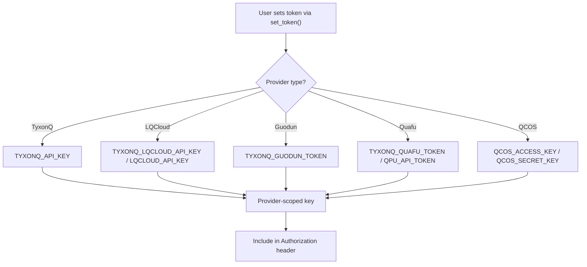
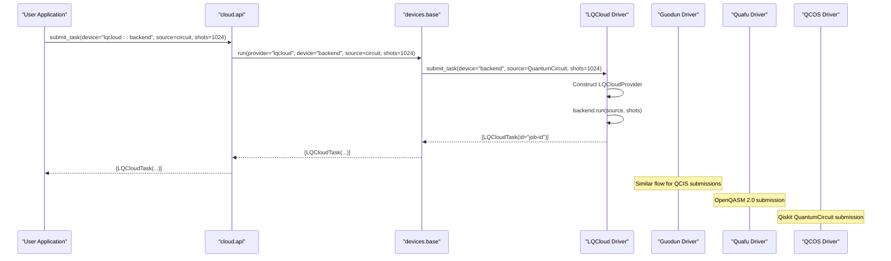
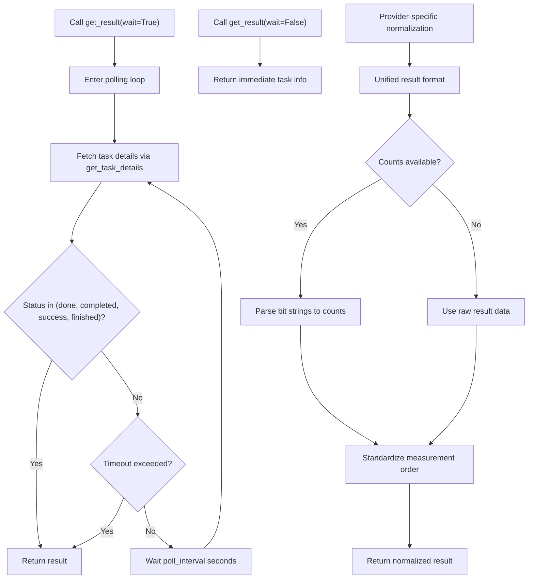
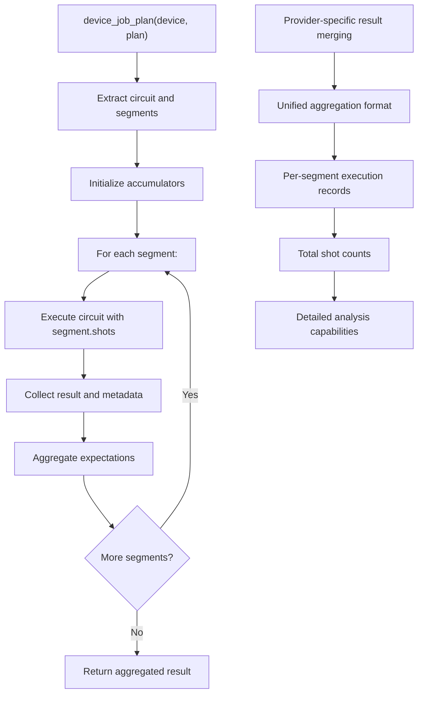
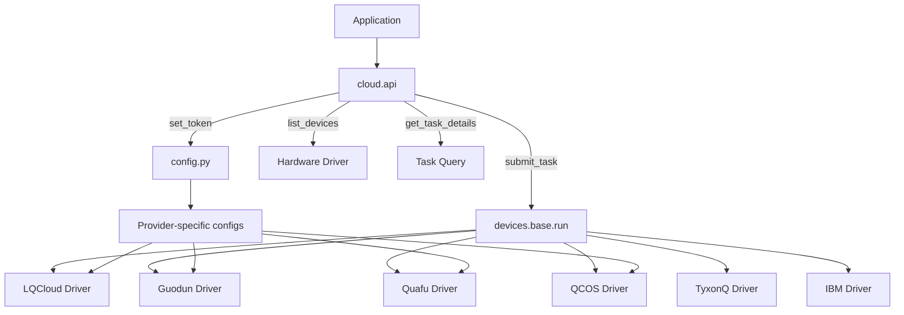
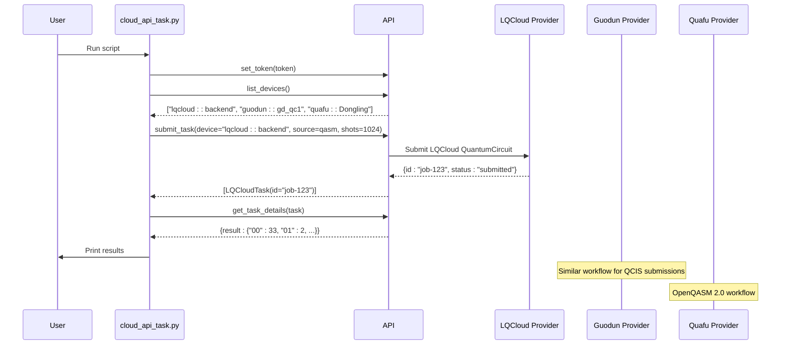

# Hardware Drivers

<cite>
**Referenced Files in This Document**   
- [driver.py](file://src/tyxonq/devices/hardware/tyxonq/driver.py)
- [driver.py](file://src/tyxonq/devices/hardware/ibm/driver.py)
- [driver.py](file://src/tyxonq/devices/hardware/lqcloud/driver.py)
- [driver.py](file://src/tyxonq/devices/hardware/guodun/driver.py)
- [driver.py](file://src/tyxonq/devices/hardware/quafu/driver.py)
- [driver.py](file://src/tyxonq/devices/hardware/qcos/driver.py)
- [config.py](file://src/tyxonq/devices/hardware/config.py)
- [session.py](file://src/tyxonq/devices/session.py)
- [api.py](file://src/tyxonq/cloud/api.py)
- [api.py](file://src/tyxonq/compiler/api.py)
- [compiler.py](file://src/tyxonq/compiler/platforms/lqcloud/compiler.py)
- [compiler.py](file://src/tyxonq/compiler/platforms/guodun/compiler.py)
- [cloud_api_task.py](file://examples/cloud_api_task.py)
- [cloud_api_devices.py](file://examples/cloud_api_devices.py)
</cite>

## Update Summary
**Changes Made**   
- Added comprehensive documentation for LQCloud, Guodun QCIS, and Quafu hardware providers with complete driver implementations
- Updated authentication and configuration sections to include new provider-specific token management
- Expanded device management section to cover all supported hardware platforms
- Added new compiler integration sections for platform-specific compilation pipelines
- Enhanced usage examples to demonstrate multi-provider cloud execution workflows
- Updated conclusion to reflect expanded hardware support ecosystem

## Table of Contents
1. [Introduction](#introduction)
2. [Authentication and Configuration](#authentication-and-configuration)
3. [Device Management](#device-management)
4. [Job Submission and Execution](#job-submission-and-execution)
5. [Result Retrieval and Task Monitoring](#result-retrieval-and-task-monitoring)
6. [Hardware Session Management](#hardware-session-management)
7. [Compiler Integration and Hardware-Aware Optimization](#compiler-integration-and-hardware-aware-optimization)
8. [Cloud API Integration](#cloud-api-integration)
9. [Usage Examples](#usage-examples)
10. [Conclusion](#conclusion)

## Introduction
This document provides comprehensive API documentation for the hardware drivers in TyxonQ, focusing on the expanded ecosystem of quantum hardware providers including TyxonQ processor, IBM Quantum, LQCloud, Guodun QCIS, Quafu, and QCOS platforms. It details the mechanisms for authentication, device selection, job submission, and result retrieval across multiple cloud providers. The document also explains the hardware session management system, configuration of execution parameters, and the mapping between abstract circuit operations and native hardware gates. Integration with the compiler pipeline for hardware-aware optimization and with the cloud API module for remote job handling is addressed, supported by examples demonstrating multi-provider cloud-based quantum computing workflows.

## Authentication and Configuration
The authentication and configuration system in TyxonQ has been significantly expanded to support multiple quantum hardware providers through the `config.py` module. Each provider now implements specialized token resolution chains with provider-specific environment variables and precedence rules.

**Updated** The system now supports provider-scoped tokens with the following hierarchy: explicit parameter → `tq.set_token(provider='...')` → provider-specific environment variable → fallback to default behavior.



**Diagram sources**
- [config.py:1-68](file://src/tyxonq/devices/hardware/config.py#L1-L68)
- [driver.py:33-42](file://src/tyxonq/devices/hardware/lqcloud/driver.py#L33-L42)
- [driver.py:56-67](file://src/tyxonq/devices/hardware/guodun/driver.py#L56-L67)
- [driver.py:28-45](file://src/tyxonq/devices/hardware/quafu/driver.py#L28-L45)

**Section sources**
- [config.py:1-68](file://src/tyxonq/devices/hardware/config.py#L1-L68)
- [api.py:1-124](file://src/tyxonq/cloud/api.py#L1-L124)
- [driver.py:16-42](file://src/tyxonq/devices/hardware/lqcloud/driver.py#L16-L42)
- [driver.py:24-67](file://src/tyxonq/devices/hardware/guodun/driver.py#L24-L67)
- [driver.py:18-45](file://src/tyxonq/devices/hardware/quafu/driver.py#L18-L45)

## Device Management
Device discovery and property inspection have been enhanced to support multiple quantum hardware providers through standardized interfaces. Each provider implements its own device enumeration strategy while maintaining a consistent API surface.

**Updated** The system now supports dynamic device discovery across LQCloud (via SDK backends), Guodun QCIS (via platform queries), Quafu (via chip status monitoring), and QCOS (via static catalog).

```mermaid
graph TB
Client[Application] --> API[cloud.api.list_devices]
API --> Driver[Hardware Driver]
Driver --> |TyxonQ| TyxonQDriver[tyxonq/driver.py]
Driver --> |IBM| IBMDriver[ibm/driver.py]
Driver --> |LQCloud| LQCloudDriver[lqcloud/driver.py]
Driver --> |Guodun| GuodunDriver[guodun/driver.py]
Driver --> |Quafu| QuafuDriver[quafu/driver.py]
Driver --> |QCOS| QCOSDriver[qcos/driver.py]
TyxonQDriver --> HTTP[POST /api/v1/devices/list]
LQCloudDriver --> SDK[LQCloud Provider.get_backends()]
GuodunDriver --> Platform[Platform.query_quantum_computer_list()]
QuafuDriver --> Status[Manager.status(0)]
HTTP --> Server[TyxonQ Cloud API]
Server --> Response[{"devices": [...]}]
SDK --> Backends[Backend list]
Platform --> Devices[Device codes]
Status --> Chips[Chip availability]
Response --> Parser[Extract device IDs]
Backends --> Format[Format as lqcloud::name]
Devices --> Format
Chips --> Format
Format --> Return[Return device list]
```

**Diagram sources**
- [driver.py:1-193](file://src/tyxonq/devices/hardware/tyxonq/driver.py#L1-L193)
- [driver.py:190-213](file://src/tyxonq/devices/hardware/lqcloud/driver.py#L190-L213)
- [driver.py:493-510](file://src/tyxonq/devices/hardware/guodun/driver.py#L493-L510)
- [driver.py:242-266](file://src/tyxonq/devices/hardware/quafu/driver.py#L242-L266)
- [driver.py:258-268](file://src/tyxonq/devices/hardware/qcos/driver.py#L258-L268)

**Section sources**
- [driver.py:1-193](file://src/tyxonq/devices/hardware/tyxonq/driver.py#L1-L193)
- [driver.py:190-213](file://src/tyxonq/devices/hardware/lqcloud/driver.py#L190-L213)
- [driver.py:493-510](file://src/tyxonq/devices/hardware/guodun/driver.py#L493-L510)
- [driver.py:242-266](file://src/tyxonq/devices/hardware/quafu/driver.py#L242-L266)
- [driver.py:258-268](file://src/tyxonq/devices/hardware/qcos/driver.py#L258-L268)
- [cloud_api_devices.py:1-29](file://examples/cloud_api_devices.py#L1-L29)

## Job Submission and Execution
Job submission in TyxonQ has been significantly expanded to support multiple quantum hardware platforms through the unified `submit_task` interface. Each provider implements platform-specific submission strategies while maintaining consistent task handling.

**Updated** The system now supports direct source submission (OPENQASM, QCIS, QuantumCircuit objects) and batch processing across LQCloud, Guodun QCIS, Quafu, and QCOS platforms with provider-specific optimizations.



**Diagram sources**
- [driver.py:1-193](file://src/tyxonq/devices/hardware/tyxonq/driver.py#L1-L193)
- [driver.py:56-92](file://src/tyxonq/devices/hardware/lqcloud/driver.py#L56-L92)
- [driver.py:310-357](file://src/tyxonq/devices/hardware/guodun/driver.py#L310-L357)
- [driver.py:103-180](file://src/tyxonq/devices/hardware/quafu/driver.py#L103-L180)
- [driver.py:80-158](file://src/tyxonq/devices/hardware/qcos/driver.py#L80-L158)

**Section sources**
- [driver.py:1-193](file://src/tyxonq/devices/hardware/tyxonq/driver.py#L1-L193)
- [driver.py:56-92](file://src/tyxonq/devices/hardware/lqcloud/driver.py#L56-L92)
- [driver.py:310-357](file://src/tyxonq/devices/hardware/guodun/driver.py#L310-L357)
- [driver.py:103-180](file://src/tyxonq/devices/hardware/quafu/driver.py#L103-L180)
- [driver.py:80-158](file://src/tyxonq/devices/hardware/qcos/driver.py#L80-L158)
- [api.py:1-124](file://src/tyxonq/cloud/api.py#L1-L124)
- [cloud_api_task.py:1-65](file://examples/cloud_api_task.py#L1-L65)

## Result Retrieval and Task Monitoring
Results are retrieved using provider-specific implementations that normalize responses to a unified format. Each driver handles platform-specific status codes, error conditions, and result structures while maintaining consistency across the TyxonQ ecosystem.

**Updated** The system now supports comprehensive result parsing for LQCloud (SDK Result objects), Guodun QCIS (bit string counts), Quafu (count dictionaries), and QCOS (WuYue platform results) with robust error handling and status mapping.



**Diagram sources**
- [driver.py:1-193](file://src/tyxonq/devices/hardware/tyxonq/driver.py#L1-L193)
- [driver.py:119-180](file://src/tyxonq/devices/hardware/lqcloud/driver.py#L119-L180)
- [driver.py:403-471](file://src/tyxonq/devices/hardware/guodun/driver.py#L403-L471)
- [driver.py:203-236](file://src/tyxonq/devices/hardware/quafu/driver.py#L203-L236)
- [driver.py:161-238](file://src/tyxonq/devices/hardware/qcos/driver.py#L161-L238)

**Section sources**
- [driver.py:1-193](file://src/tyxonq/devices/hardware/tyxonq/driver.py#L1-L193)
- [driver.py:119-180](file://src/tyxonq/devices/hardware/lqcloud/driver.py#L119-L180)
- [driver.py:403-471](file://src/tyxonq/devices/hardware/guodun/driver.py#L403-L471)
- [driver.py:203-236](file://src/tyxonq/devices/hardware/quafu/driver.py#L203-L236)
- [driver.py:161-238](file://src/tyxonq/devices/hardware/qcos/driver.py#L161-L238)
- [cloud_api_task.py:1-65](file://examples/cloud_api_task.py#L1-L65)

## Hardware Session Management
Hardware session management is facilitated through the `device_job_plan` function in `session.py`, which enables segmented execution of quantum circuits with aggregated results across multiple providers. This supports advanced execution patterns such as adaptive measurements and dynamic circuit scheduling.

**Updated** The session system now works seamlessly with all supported providers, collecting and combining results from LQCloud, Guodun QCIS, Quafu, and QCOS platforms with provider-specific metadata handling.



**Diagram sources**
- [session.py:1-51](file://src/tyxonq/devices/session.py#L1-L51)

**Section sources**
- [session.py:1-51](file://src/tyxonq/devices/session.py#L1-L51)

## Compiler Integration and Hardware-Aware Optimization
The compiler integration layer has been significantly expanded to support platform-specific compilation pipelines for LQCloud and Guodun QCIS, while maintaining compatibility with existing TyxonQ and IBM Quantum workflows.

**Updated** The system now includes dedicated compilers for LQCloud (producing SDK QuantumCircuit objects) and Guodun QCIS (producing gate-level QCIS text), both leveraging the common gate_compiler core for device-independent optimizations.

```mermaid
graph TD
A[Circuit] --> B[compile()]
B --> C{Target platform?}
C --> |TyxonQ| D[NativeCompiler → QASM2]
C --> |LQCloud| E[LQCloudCompiler → SDK Object]
C --> |Guodun| F[GuodunCompiler → Gate QCIS]
C --> |Quafu| G[OpenQASM 2.0 Export]
C --> |QCOS| H[Qiskit QuantumCircuit]
D --> I[Optimized for hardware constraints]
E --> J[Core compile + IR translation]
F --> K[Core compile + gate lowering]
G --> L[Provider-optimized circuit]
H --> M[Provider-optimized circuit]
I --> N[submit_task with source]
J --> N
K --> N
L --> N
M --> N
```

**Diagram sources**
- [api.py:1-66](file://src/tyxonq/compiler/api.py#L1-L66)
- [compiler.py:50-112](file://src/tyxonq/compiler/platforms/lqcloud/compiler.py#L50-L112)
- [compiler.py:88-176](file://src/tyxonq/compiler/platforms/guodun/compiler.py#L88-L176)
- [driver.py:1-193](file://src/tyxonq/devices/hardware/tyxonq/driver.py#L1-L193)

**Section sources**
- [api.py:1-66](file://src/tyxonq/compiler/api.py#L1-L66)
- [compiler.py:50-112](file://src/tyxonq/compiler/platforms/lqcloud/compiler.py#L50-L112)
- [compiler.py:88-176](file://src/tyxonq/compiler/platforms/guodun/compiler.py#L88-L176)
- [driver.py:1-193](file://src/tyxonq/devices/hardware/tyxonq/driver.py#L1-L193)

## Cloud API Integration
The cloud API module (`cloud/api.py`) provides a unified facade that coordinates access to multiple quantum hardware providers through a consistent interface. It delegates operations to hardware-specific drivers based on provider identifiers, enabling a pluggable architecture that supports current and future providers.

**Updated** The API now seamlessly integrates with LQCloud, Guodun QCIS, Quafu, and QCOS providers, providing consistent error handling, authentication, and result processing across all platforms.



**Diagram sources**
- [api.py:1-124](file://src/tyxonq/cloud/api.py#L1-L124)
- [config.py:1-68](file://src/tyxonq/devices/hardware/config.py#L1-L68)

**Section sources**
- [api.py:1-124](file://src/tyxonq/cloud/api.py#L1-L124)

## Usage Examples
Two primary usage patterns are demonstrated in the example files, now extended to support multiple quantum hardware providers:

**Updated** The examples now demonstrate cross-platform execution workflows including LQCloud SDK integration, Guodun QCIS submissions, Quafu OpenQASM workflows, and QCOS Qiskit circuit execution.

1. **Legacy-style submission**: Direct submission of provider-specific source code formats using `submit_task`, followed by polling for results.
2. **Chain-style execution**: Building a circuit using the high-level API, compiling it for the target platform, and executing with automatic result handling.

The `cloud_api_devices.py` example shows device enumeration across multiple providers, while `cloud_api_task.py` demonstrates both submission patterns with comprehensive error handling and result inspection.



**Diagram sources**
- [cloud_api_task.py:1-65](file://examples/cloud_api_task.py#L1-L65)
- [cloud_api_devices.py:1-29](file://examples/cloud_api_devices.py#L1-L29)

**Section sources**
- [cloud_api_task.py:1-65](file://examples/cloud_api_task.py#L1-L65)
- [cloud_api_devices.py:1-29](file://examples/cloud_api_devices.py#L1-L29)

## Conclusion
The TyxonQ hardware driver system has evolved into a comprehensive quantum computing platform supporting multiple hardware providers including TyxonQ cloud processors, IBM Quantum, LQCloud, Guodun QCIS, Quafu, and QCOS platforms. The architecture maintains a clean separation of concerns through layered design: authentication and configuration, device management, job execution, result retrieval, session management, and compiler integration. The cloud API facade enables consistent access patterns across diverse providers, while the session system supports advanced execution workflows. The expanded compiler integration provides hardware-aware optimization tailored to each platform's specific requirements. Examples demonstrate practical usage patterns for multi-provider quantum computing workflows, making TyxonQ a versatile framework for heterogeneous quantum hardware access.