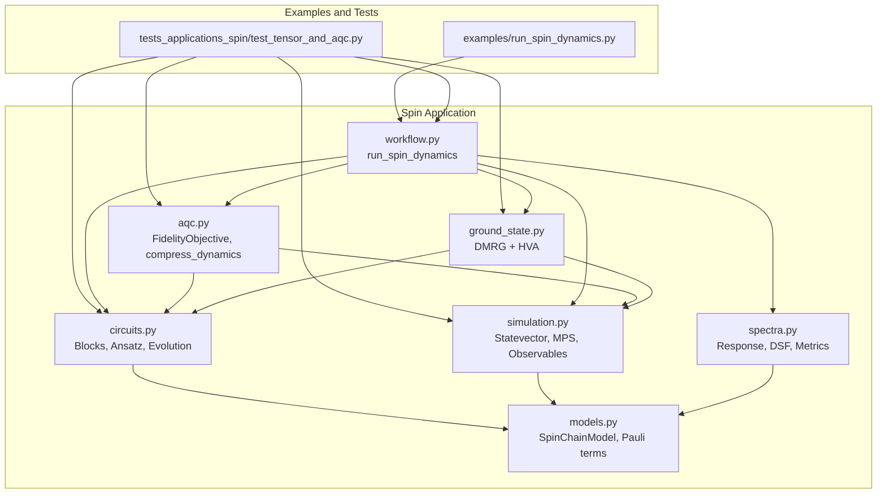
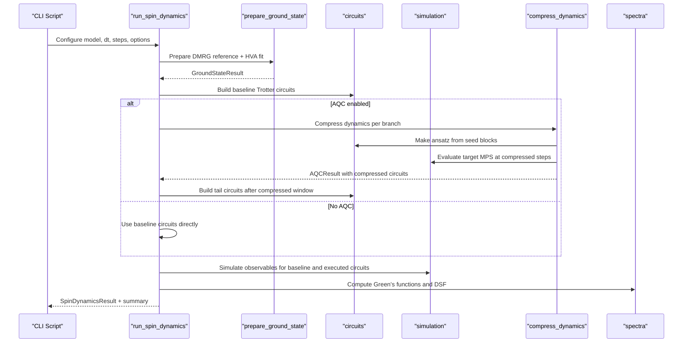
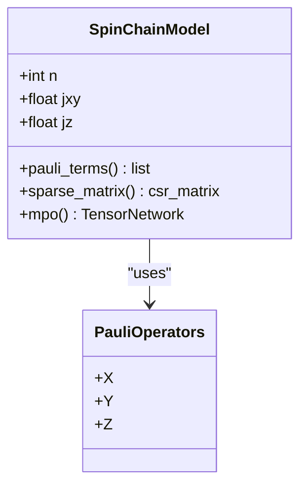
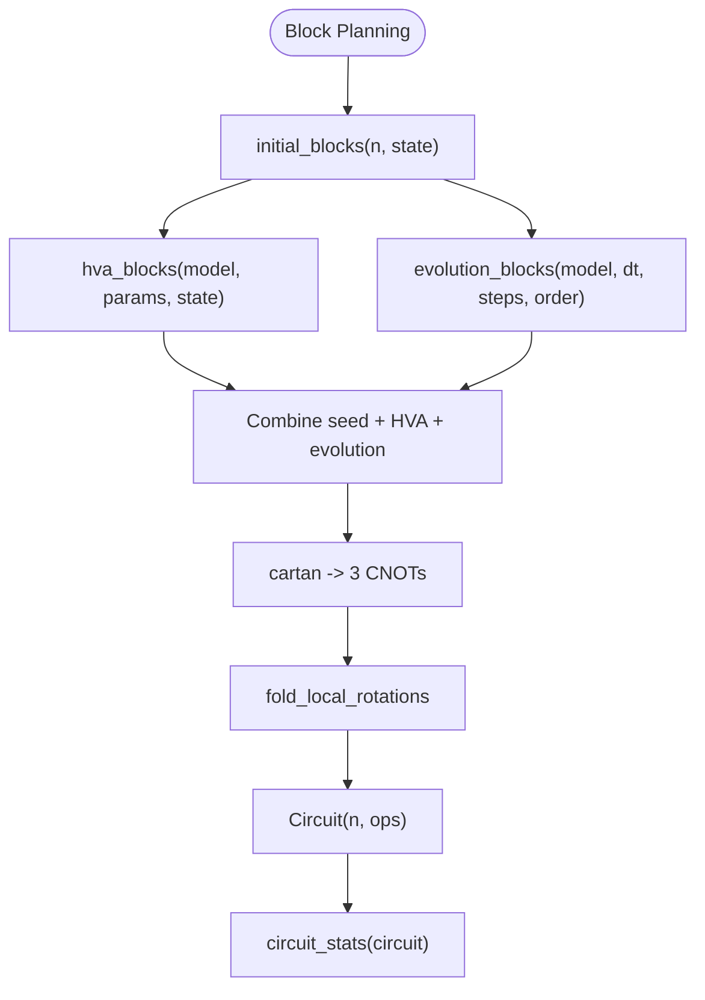
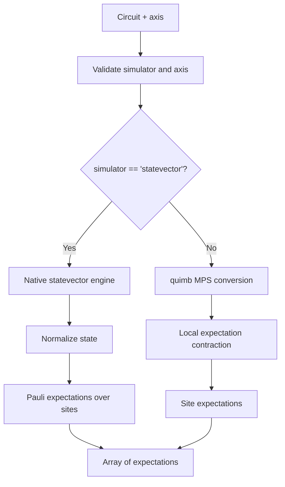
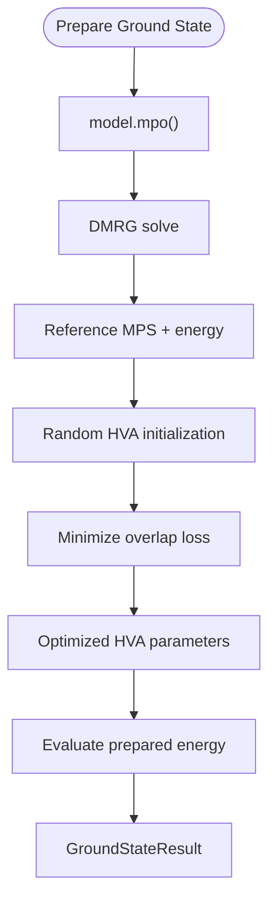
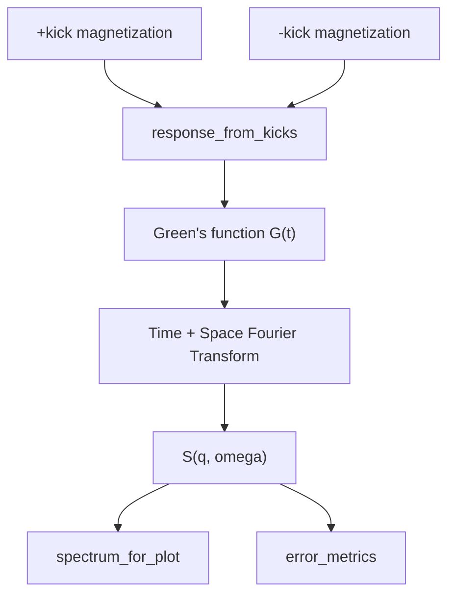
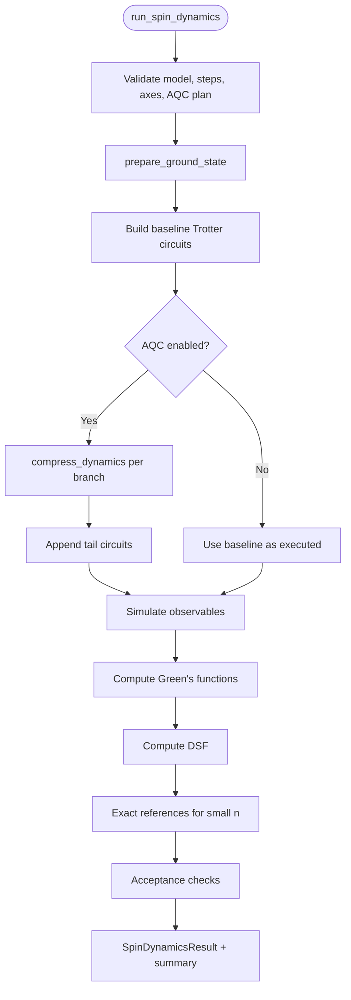
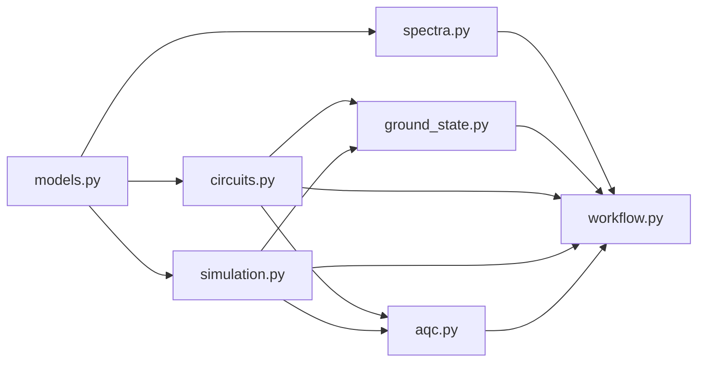

# Spin Simulation and Adiabatic Quantum Computation

<cite>
**Referenced Files in This Document**   
- [spin/__init__.py](file://src/tyxonq/applications/spin/__init__.py)
- [models.py](file://src/tyxonq/applications/spin/models.py)
- [circuits.py](file://src/tyxonq/applications/spin/circuits.py)
- [simulation.py](file://src/tyxonq/applications/spin/simulation.py)
- [ground_state.py](file://src/tyxonq/applications/spin/ground_state.py)
- [aqc.py](file://src/tyxonq/applications/spin/aqc.py)
- [spectra.py](file://src/tyxonq/applications/spin/spectra.py)
- [workflow.py](file://src/tyxonq/applications/spin/workflow.py)
- [run_spin_dynamics.py](file://examples/run_spin_dynamics.py)
- [test_tensor_and_aqc.py](file://tests_applications_spin/test_tensor_and_aqc.py)
</cite>

## Table of Contents
1. [Introduction](#introduction)
2. [Project Structure](#project-structure)
3. [Core Components](#core-components)
4. [Architecture Overview](#architecture-overview)
5. [Detailed Component Analysis](#detailed-component-analysis)
6. [Dependency Analysis](#dependency-analysis)
7. [Performance Considerations](#performance-considerations)
8. [Troubleshooting Guide](#troubleshooting-guide)
9. [Conclusion](#conclusion)

## Introduction
This document explains the spin simulation and adiabatic quantum computation (AQC) layer in TyxonQ. It focuses on how open-boundary XXZ spin chains are modeled, how ground states are prepared, how time evolution is constructed through Trotter blocks, how AQC compresses dynamics into shorter circuits, and how response functions and dynamical structure factors are computed. The implementation combines classical tensor-network tools, native statevector simulation, parameterized circuit templates, and gradient-based optimization to produce compact, high-fidelity evolution circuits for small-to-medium spin systems.

The documentation is organized for both technical readers who want to extend or debug the code and non-technical readers who need a conceptual understanding of the workflow.

## Project Structure
The spin application lives under `src/tyxonq/applications/spin`. Its public API is exposed by the package initializer, while each module has a focused responsibility:

- `models.py`: Physical model definition, Pauli operators, sparse Hamiltonian, and MPO construction.
- `circuits.py`: Gate-level building blocks, HVA ansatz, Trotter evolution blocks, parameterized ansatz template, and circuit statistics.
- `simulation.py`: Native statevector execution, quimb MPS conversion, local expectation evaluation, and observable simulation.
- `ground_state.py`: DMRG reference ground state and HVA variational preparation.
- `aqc.py`: Fidelity objective, SciPy optimizer integration, and compressed-dynamics builder.
- `spectra.py`: Linear-response construction, discrete Fourier transform, plotting helpers, and error metrics.
- `workflow.py`: End-to-end pipeline that separates ground-state, Trotter, and AQC errors and produces arrays, summaries, and acceptance checks.
- `examples/run_spin_dynamics.py`: Command-line entry point that configures and runs the full workflow with progress reporting and result saving.
- `tests_applications_spin/test_tensor_and_aqc.py`: Integration tests covering DMRG, simulators, gradients, segments, warm starts, tails, and complete workflows.



**Diagram sources**
- [spin/__init__.py:1-12](file://src/tyxonq/applications/spin/__init__.py#L1-L12)
- [models.py:1-71](file://src/tyxonq/applications/spin/models.py#L1-L71)
- [circuits.py:1-213](file://src/tyxonq/applications/spin/circuits.py#L1-L213)
- [simulation.py:1-70](file://src/tyxonq/applications/spin/simulation.py#L1-L70)
- [ground_state.py:1-96](file://src/tyxonq/applications/spin/ground_state.py#L1-L96)
- [aqc.py:1-160](file://src/tyxonq/applications/spin/aqc.py#L1-L160)
- [spectra.py:1-62](file://src/tyxonq/applications/spin/spectra.py#L1-L62)
- [workflow.py:1-176](file://src/tyxonq/applications/spin/workflow.py#L1-L176)
- [run_spin_dynamics.py:1-173](file://examples/run_spin_dynamics.py#L1-L173)
- [test_tensor_and_aqc.py:1-138](file://tests_applications_spin/test_tensor_and_aqc.py#L1-L138)

**Section sources**
- [spin/__init__.py:1-12](file://src/tyxonq/applications/spin/__init__.py#L1-L12)
- [run_spin_dynamics.py:1-173](file://examples/run_spin_dynamics.py#L1-L173)

## Core Components
The spin subsystem provides a layered stack:

| Layer | Responsibility | Key Types / Functions |
|---|---|---|
| Physics model | Defines the XXZ chain, Pauli operators, sparse Hamiltonian, and MPO | `SpinChainModel`, `site_operator`, `pauli_terms`, `sparse_matrix`, `mpo` |
| Circuit construction | Builds initial states, HVA layers, Trotter evolution blocks, and parameterized ansatz | `initial_blocks`, `hva_blocks`, `evolution_blocks`, `make_spin_ansatz`, `build_evolution`, `circuit_stats` |
| Simulation | Converts circuits to statevectors or MPS, computes local observables | `statevector`, `mps_state`, `simulate_observables`, `pauli_expectations` |
| Ground state | Computes DMRG reference and fits HVA parameters classically | `dmrg_ground_state`, `prepare_ground_state`, `GroundStateOptions`, `GroundStateResult` |
| AQC compression | Optimizes a parameterized ansatz to match target dynamics at selected times | `AQCOptions`, `AQCResult`, `FidelityObjective`, `compress_dynamics` |
| Spectral analysis | Constructs linear response and dynamical structure factor | `response_from_kicks`, `compute_dsf`, `spectrum_for_plot`, `error_metrics` |
| Workflow | Orchestrates ground-state preparation, Trotter baseline, AQC compression, response, spectra, and acceptance checks | `run_spin_dynamics`, `exact_response`, `SpinDynamicsResult` |

**Section sources**
- [models.py:1-71](file://src/tyxonq/applications/spin/models.py#L1-L71)
- [circuits.py:1-213](file://src/tyxonq/applications/spin/circuits.py#L1-L213)
- [simulation.py:1-70](file://src/tyxonq/applications/spin/simulation.py#L1-L70)
- [ground_state.py:1-96](file://src/tyxonq/applications/spin/ground_state.py#L1-L96)
- [aqc.py:1-160](file://src/tyxonq/applications/spin/aqc.py#L1-L160)
- [spectra.py:1-62](file://src/tyxonq/applications/spin/spectra.py#L1-L62)
- [workflow.py:1-176](file://src/tyxonq/applications/spin/workflow.py#L1-L176)

## Architecture Overview
At a high level, the system prepares a physical spin-chain model, obtains a high-quality reference ground state, constructs Trotter evolution blocks, optionally compresses those blocks using AQC, evaluates observables, and computes response functions and spectra. The example script wraps this workflow with command-line configuration, progress callbacks, and result visualization.



**Diagram sources**
- [workflow.py:44-176](file://src/tyxonq/applications/spin/workflow.py#L44-L176)
- [ground_state.py:68-96](file://src/tyxonq/applications/spin/ground_state.py#L68-L96)
- [circuits.py:51-123](file://src/tyxonq/applications/spin/circuits.py#L51-L123)
- [aqc.py:95-160](file://src/tyxonq/applications/spin/aqc.py#L95-L160)
- [simulation.py:26-69](file://src/tyxonq/applications/spin/simulation.py#L26-L69)
- [spectra.py:6-36](file://src/tyxonq/applications/spin/spectra.py#L6-L36)

## Detailed Component Analysis

### Physics Model: Open-Boundary XXZ Chain
The model defines an even-length, open-boundary XXZ chain with coupling constants `jxy` and `jz`. It exposes:

- Pauli matrices for X, Y, Z.
- Site-wise Pauli operator construction.
- Explicit Pauli-term list avoiding string ordering ambiguity.
- Sparse Hamiltonian matrix for exact diagonalization on small systems.
- Quimb MPO representation optimized for DMRG.

Validation ensures `n` is an even integer greater than or equal to two and couplings are finite.



**Diagram sources**
- [models.py:9-70](file://src/tyxonq/applications/spin/models.py#L9-L70)

**Section sources**
- [models.py:1-71](file://src/tyxonq/applications/spin/models.py#L1-L71)

### Circuit Construction: Blocks, Ansatz, and Statistics
Circuit construction is block-oriented rather than gate-by-gate during planning:

- `initial_blocks` prepares singlet pairs or Néel product states from `|0...0>`.
- `hva_blocks` builds a Hamiltonian Variational Ansatz using shared parameters per layer and parity.
- `evolution_blocks` generates Trotter layers for first-order or second-order Suzuki–Trotter decomposition.
- `blocks_to_circuit` expands Cartan interactions into three CNOTs and folds local rotations.
- `make_spin_ansatz` creates a parameterized template where Cartan angles and local ZXZ rotations become trainable variables; fixed Clifford prefixes are preserved.
- `build_evolution` returns a pure evolution circuit without measurements.
- `circuit_stats` counts two-qubit gates and depths across qubits.



**Diagram sources**
- [circuits.py:21-86](file://src/tyxonq/applications/spin/circuits.py#L21-L86)
- [circuits.py:89-142](file://src/tyxonq/applications/spin/circuits.py#L89-L142)
- [circuits.py:145-213](file://src/tyxonq/applications/spin/circuits.py#L145-L213)

**Section sources**
- [circuits.py:1-213](file://src/tyxonq/applications/spin/circuits.py#L1-L213)

### Simulation: Statevector and MPS Paths
Simulation supports two backends:

- **Statevector path**: Uses TyxonQ’s native statevector engine to evaluate bound unitary circuits and normalize the resulting vector.
- **MPS path**: Converts circuits to quimb MPS with configurable bond dimension and cutoff, normalizes the state, and computes local Pauli expectations efficiently.

Both paths validate supported gates and axes, and return site-resolved expectation values.



**Diagram sources**
- [simulation.py:8-69](file://src/tyxonq/applications/spin/simulation.py#L8-L69)

**Section sources**
- [simulation.py:1-70](file://src/tyxonq/applications/spin/simulation.py#L1-L70)

### Ground-State Preparation: DMRG Reference and HVA Fit
Ground-state preparation separates the reference state from the variational approximation:

- `dmrg_ground_state` builds the MPO, initializes random MPS seeds, runs DMRG, and returns a normalized MPS along with energy and convergence status.
- `prepare_ground_state` fits HVA parameters by minimizing MPS overlap loss against the DMRG reference using COBYQA.
- The result includes both the prepared circuit and its energy evaluated via explicit tensor-network contraction.



**Diagram sources**
- [ground_state.py:53-96](file://src/tyxonq/applications/spin/ground_state.py#L53-L96)

**Section sources**
- [ground_state.py:1-96](file://src/tyxonq/applications/spin/ground_state.py#L1-L96)

### AQC Compression: Fidelity Objective and Segment Optimization
AQC compresses dynamics by optimizing a parameterized ansatz to reproduce target states at selected time points:

- `AQCOptions` validates segment plans, fidelity targets, iteration limits, bond dimensions, and truncation cutoffs.
- `FidelityObjective` builds a quimb circuit from the ansatz, contracts it with the conjugate of the target MPS, computes fidelity, and uses PyTorch autograd to obtain real-valued gradients for SciPy’s L-BFGS-B optimizer.
- `compress_dynamics` iterates over segments, warms up parameters from previous steps, records detailed diagnostics, and appends tail circuits beyond the compressed window.

```mermaid
sequenceDiagram
participant Seg as "Segment Loop"
participant Ans as "make_spin_ansatz"
participant Tgt as "Target MPS"
participant Obj as "FidelityObjective"
participant Opt as "SciPy minimize"
participant Rec as "Records"
Seg->>Ans : Build ansatz from seed blocks
Seg->>Tgt : Construct target MPS at step k
Seg->>Obj : value_and_grad(parameters)
Obj->>Obj : Build quimb circuit + contract with target
Obj-->>Seg : Loss + gradient
Seg->>Opt : L-BFGS-B with callback
Opt-->>Seg : Best parameters
Seg->>Rec : Record fidelity, stats, history
Seg-->>Seg : Warm start next step
```

**Diagram sources**
- [aqc.py:13-35](file://src/tyxonq/applications/spin/aqc.py#L13-L35)
- [aqc.py:48-93](file://src/tyxonq/applications/spin/aqc.py#L48-L93)
- [aqc.py:95-160](file://src/tyxonq/applications/spin/aqc.py#L95-L160)

**Section sources**
- [aqc.py:1-160](file://src/tyxonq/applications/spin/aqc.py#L1-L160)

### Spectral Analysis: Response and Dynamical Structure Factor
Spectral analysis converts time-domain responses into momentum-frequency spectra:

- `response_from_kicks` computes retarded spin response from positive and negative kicks.
- `compute_dsf` performs a discrete Fourier transform over time and space, returning raw spectra without mirror averaging or clipping.
- `spectrum_for_plot` provides safe transformations for visualization.
- `error_metrics` reports absolute and relative errors while handling zero-reference signals.



**Diagram sources**
- [spectra.py:6-36](file://src/tyxonq/applications/spin/spectra.py#L6-L36)
- [spectra.py:39-62](file://src/tyxonq/applications/spin/spectra.py#L39-L62)

**Section sources**
- [spectra.py:1-62](file://src/tyxonq/applications/spin/spectra.py#L1-L62)

### End-to-End Workflow: Separating Errors and Acceptance Checks
The workflow orchestrates all components and explicitly separates three error sources:

1. Ground-state preparation error.
2. Trotter discretization error.
3. AQC compression error.

It also computes exact references for small systems, compares baseline and executed circuits, and produces acceptance checks such as DMRG energy accuracy, ground-state fidelity, compressed fidelity, independent statevector fidelity, and reduced gate counts.



**Diagram sources**
- [workflow.py:29-176](file://src/tyxonq/applications/spin/workflow.py#L29-L176)

**Section sources**
- [workflow.py:1-176](file://src/tyxonq/applications/spin/workflow.py#L1-L176)

## Dependency Analysis
The spin application exhibits clear layering and controlled dependencies:

- `models.py` has no internal spin dependencies and provides primitives used by other modules.
- `circuits.py` depends on `models.py` and the core IR `Circuit`.
- `simulation.py` depends on `models.py` and optional external libraries (`quimb.tensor`, TyxonQ statevector engine).
- `ground_state.py` depends on `circuits.py` and `simulation.py`.
- `aqc.py` depends on `circuits.py` and `simulation.py`.
- `spectra.py` is self-contained except for NumPy.
- `workflow.py` composes all modules and adds exact-reference computation.



**Diagram sources**
- [models.py:1-71](file://src/tyxonq/applications/spin/models.py#L1-L71)
- [circuits.py:1-213](file://src/tyxonq/applications/spin/circuits.py#L1-L213)
- [simulation.py:1-70](file://src/tyxonq/applications/spin/simulation.py#L1-L70)
- [ground_state.py:1-96](file://src/tyxonq/applications/spin/ground_state.py#L1-L96)
- [aqc.py:1-160](file://src/tyxonq/applications/spin/aqc.py#L1-L160)
- [spectra.py:1-62](file://src/tyxonq/applications/spin/spectra.py#L1-L62)
- [workflow.py:1-176](file://src/tyxonq/applications/spin/workflow.py#L1-L176)

**Section sources**
- [spin/__init__.py:1-12](file://src/tyxonq/applications/spin/__init__.py#L1-L12)
- [workflow.py:1-176](file://src/tyxonq/applications/spin/workflow.py#L1-L176)

## Performance Considerations
- **Bond dimension and cutoff**: Both MPS conversion and DMRG depend on `max_bond` and `cutoff`. Larger bonds improve accuracy but increase memory and contraction cost.
- **Trotter order**: Second-order Trotter reduces discretization error compared to first-order at the same time step.
- **AQC segments**: Shorter compressed windows reduce optimization complexity; longer segments require more iterations and larger ansatz capacity.
- **Gradient backend**: AQC uses PyTorch tensors and autograd; CPU double precision is enforced for stability.
- **Contraction strategy**: Fixed greedy contraction paths are reused for reproducibility in small systems.
- **Exact references**: Exact diagonalization scales exponentially; the workflow restricts exact references to small systems.

[No sources needed since this section provides general guidance]

## Troubleshooting Guide
Common issues and their likely causes:

| Symptom | Likely Cause | Resolution |
|---|---|---|
| Invalid model size | `n` is not an even integer ≥ 2 | Ensure `n` satisfies validation rules. |
| Unsupported operation in spin simulator | Circuit contains gates outside the allowed set | Use only `h`, `x`, `s`, `sdg`, `cx`, `rx`, `ry`, `rz`. |
| AQC plan exceeds requested steps | Segment time points or seed steps exceed total steps | Reduce segment lengths or increase `steps`. |
| Fidelity target not met | Insufficient iterations, too aggressive fidelity target, or insufficient ansatz capacity | Increase `maxiter`, relax `fidelity_target`, or adjust `segments` and `max_bond`. |
| DMRG does not converge | Tight tolerance, insufficient sweeps, or ill-conditioned MPO | Relax `dmrg_tol`, increase `dmrg_max_sweeps`, or check couplings. |
| Spectrum contains negatives or artifacts | Finite-time window effects | Use `spectrum_for_plot` with mirror or clipping options for visualization only. |
| Exact reference fails for large systems | Exponential scaling of exact diagonalization | Keep `n ≤ 10` when exact references are enabled. |

**Section sources**
- [models.py:35-39](file://src/tyxonq/applications/spin/models.py#L35-L39)
- [simulation.py:33-41](file://src/tyxonq/applications/spin/simulation.py#L33-L41)
- [aqc.py:23-35](file://src/tyxonq/applications/spin/aqc.py#L23-L35)
- [aqc.py:95-100](file://src/tyxonq/applications/spin/aqc.py#L95-L100)
- [ground_state.py:25-33](file://src/tyxonq/applications/spin/ground_state.py#L25-L33)
- [workflow.py:57-73](file://src/tyxonq/applications/spin/workflow.py#L57-L73)

## Conclusion
TyxonQ’s spin application provides a cohesive framework for simulating open-boundary XXZ spin chains, preparing high-quality ground states, constructing Trotter evolutions, compressing dynamics through AQC, and analyzing response functions and spectra. The design separates physics modeling, circuit templating, simulation backends, optimization, and spectral analysis, enabling clear debugging and extensibility. The example script and integration tests demonstrate how to configure, run, and validate the workflow, including progress reporting, result serialization, and acceptance checks.

[No sources needed since this section summarizes without analyzing specific files]