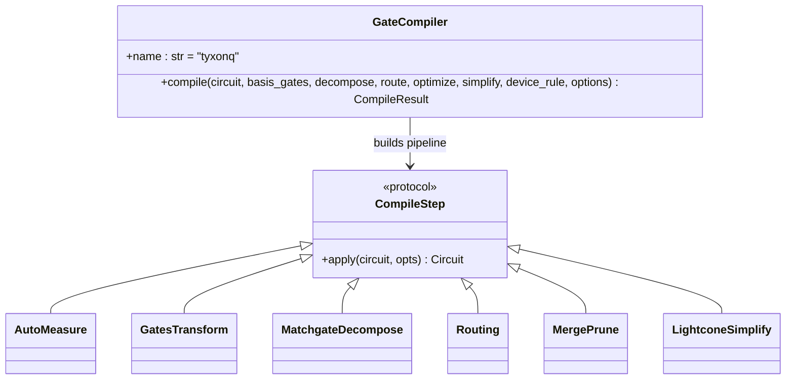
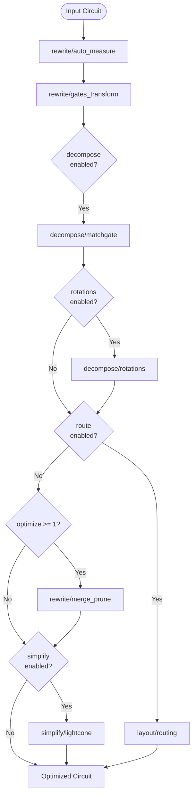
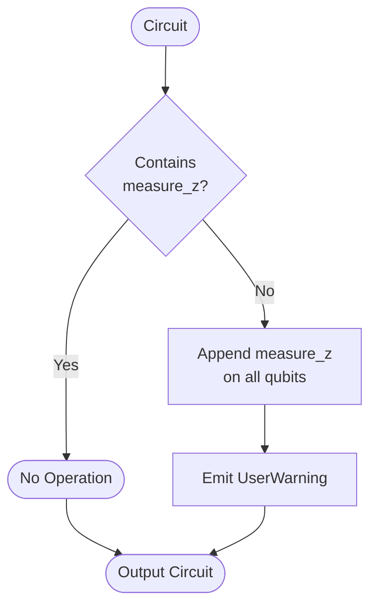
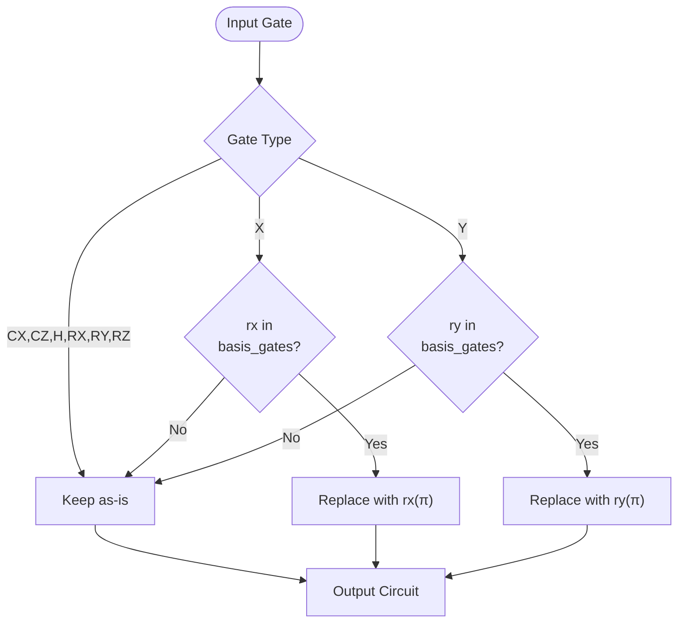
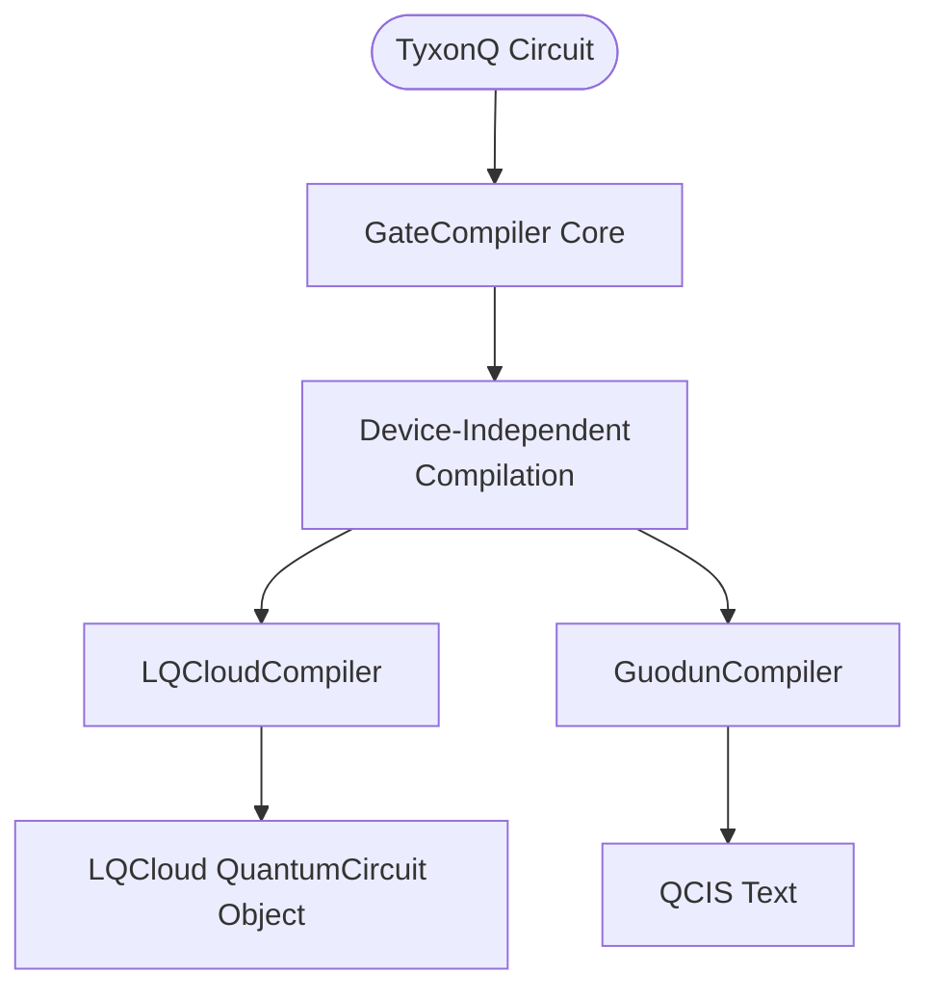
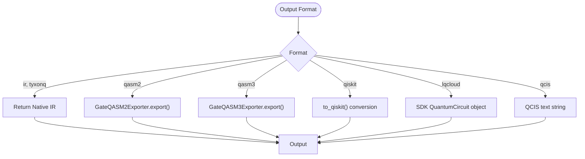

# Gate Compiler Architecture

<cite>
**Referenced Files in This Document**   
- [compiler.py](file://src/tyxonq/compiler/gate_compiler/compiler.py)
- [steps.py](file://src/tyxonq/compiler/gate_compiler/steps.py)
- [api.py](file://src/tyxonq/compiler/api.py)
- [auto_measure.py](file://src/tyxonq/compiler/gate_compiler/stages/rewrite/auto_measure.py)
- [gates_transform.py](file://src/tyxonq/compiler/gate_compiler/stages/rewrite/gates_transform.py)
- [lqcloud_compiler.py](file://src/tyxonq/compiler/platforms/lqcloud/compiler.py)
- [guodun_compiler.py](file://src/tyxonq/compiler/platforms/guodun/compiler.py)
</cite>

## Update Summary
**Changes Made**   
- Replaced outdated NativeCompiler documentation with new GateCompiler architecture
- Updated all references from compile_engine/native to gate_compiler structure
- Added platform-specific compiler information for LQCloud and Guodun
- Updated compilation pipeline description to reflect type-based parameter system
- Removed deprecated compile_plan parameter references

## Table of Contents
1. [Introduction](#introduction)
2. [Gate Compiler Core Architecture](#gate-compiler-core-architecture)
3. [Default Compilation Pipeline](#default-compilation-pipeline)
4. [Normalization Passes](#normalization-passes)
5. [Type-Based Optimization Configuration](#type-based-optimization-configuration)
6. [Platform-Specific Compilers](#platform-specific-compilers)
7. [Output Format Handling](#output-format-handling)
8. [Practical Usage Examples](#practical-usage-examples)
9. [Troubleshooting Common Issues](#troubleshooting-common-issues)

## Introduction
The GateCompiler is TyxonQ's unified compilation engine that provides a lightweight, dependency-free compilation path optimized for the internal execution ecosystem. It operates directly on TyxonQ's intermediate representation (IR) and enables efficient circuit transformation and optimization without requiring external quantum software frameworks. The compiler uses a type-based parameter system instead of string DSLs, supporting customizable optimization workflows through modular compilation passes. Platform-specific compilers for LQCloud and Guodun delegate to this core while translating results into their respective dialects.

**Section sources**   
- [compiler.py:14-23](file://src/tyxonq/compiler/gate_compiler/compiler.py#L14-L23)
- [api.py:39-98](file://src/tyxonq/compiler/api.py#L39-L98)

## Gate Compiler Core Architecture
The GateCompiler serves as the central compilation hub, collecting state-of-the-art device-independent passes including decomposition, routing, optimization, and simplification. Unlike the previous NativeCompiler which had its own implementation, the GateCompiler provides a unified interface that platform-specific compilers delegate to. The architecture separates device-agnostic compilation from hardware-dialect translation, ensuring compilation logic lives in exactly one place rather than being reimplemented per vendor.



**Diagram sources**   
- [compiler.py:14-109](file://src/tyxonq/compiler/gate_compiler/compiler.py#L14-L109)
- [steps.py:27-91](file://src/tyxonq/compiler/gate_compiler/steps.py#L27-L91)

**Section sources**   
- [compiler.py:14-23](file://src/tyxonq/compiler/gate_compiler/compiler.py#L14-L23)
- [steps.py:1-8](file://src/tyxonq/compiler/gate_compiler/steps.py#L1-L8)

## Default Compilation Pipeline
The GateCompiler constructs its default compilation pipeline by automatically prepending essential normalization passes to any user-specified optimization sequence. The pipeline begins with two mandatory passes: 'rewrite/auto_measure' and 'rewrite/gates_transform'. These are followed by optional decomposition, routing, optimization, and simplification passes based on the provided type-based parameters. The pipeline execution is managed by the `build_compile_steps` function, which resolves typed parameters into executable `CompileStep` instances and composes them into an ordered sequence.



**Diagram sources**   
- [steps.py:56-91](file://src/tyxonq/compiler/gate_compiler/steps.py#L56-L91)

**Section sources**   
- [steps.py:27-91](file://src/tyxonq/compiler/gate_compiler/steps.py#L27-L91)
- [compiler.py:64-73](file://src/tyxonq/compiler/gate_compiler/compiler.py#L64-L73)

## Normalization Passes
The GateCompiler automatically inserts two critical normalization passes at the beginning of every compilation pipeline to ensure circuit consistency and gate compatibility.

### Auto-Measurement Pass
The `AutoMeasure` pass ensures that all circuits contain explicit measurement operations. When no `measure_z` operations are present in the input circuit, this pass automatically appends Z-basis measurements on all qubits. This behavior prevents execution failures due to missing measurements while maintaining circuit semantics. A non-fatal warning is emitted to inform users of this automatic insertion, promoting transparency in the compilation process.



**Diagram sources**   
- [auto_measure.py:10-34](file://src/tyxonq/compiler/gate_compiler/stages/rewrite/auto_measure.py#L10-L34)

### Gate Transformation Pass
The `GatesTransform` pass rewrites quantum gates according to the specified basis gate set. By default, it targets the native basis gates ["h", "rx", "rz", "cx", "cz"]. The pass performs gate substitutions such as converting X gates to RX(π) when RX is available, and Y gates to RY(π) when RY is supported. Gates that are already in the basis set are preserved, while unsupported gates remain unchanged to maintain circuit integrity. This transformation ensures compatibility with the target execution environment's native gate set.



**Diagram sources**   
- [gates_transform.py:9-49](file://src/tyxonq/compiler/gate_compiler/stages/rewrite/gates_transform.py#L9-L49)

**Section sources**   
- [auto_measure.py:10-34](file://src/tyxonq/compiler/gate_compiler/stages/rewrite/auto_measure.py#L10-L34)
- [gates_transform.py:9-49](file://src/tyxonq/compiler/gate_compiler/stages/rewrite/gates_transform.py#L9-L49)

## Type-Based Optimization Configuration
The GateCompiler uses a type-based parameter system that replaces the old string DSL approach. Key parameters include:

- **basis_gates**: Target native gate set for gate transformation
- **decompose**: Boolean or `DecomposeSpec` controlling decomposition steps (matchgate, rotations, two_qubit_unitary)
- **route**: Boolean or `RoutingSpec` controlling routing steps with coupling map and layout specifications
- **optimize**: Integer optimization level (0-3) enabling adjacent gate merging and identity pruning
- **simplify**: Boolean enabling lightcone simplification for cutting operators that don't affect measurements

This approach provides better type safety and IDE support compared to the previous string-based configuration system.

**Section sources**   
- [api.py:39-98](file://src/tyxonq/compiler/api.py#L39-L98)
- [steps.py:27-55](file://src/tyxonq/compiler/gate_compiler/steps.py#L27-L55)

## Platform-Specific Compilers
TyxonQ now features platform-specific compilers that delegate to the GateCompiler core while translating results into their respective dialects.

### LQCloud Compiler
The `LQCloudCompiler` compiles TyxonQ circuits to LQCloud's official QuantumCircuit objects. It delegates to the GateCompiler for device-independent decomposition and routing, then performs 1:1 translation to LQCloud SDK objects without network requests. Physical qubits are treated as runtime backend parameters (initial_layout) rather than compilation-time parameters.

### Guodun Compiler  
The `GuodunCompiler` compiles TyxonQ circuits to QCIS format for the Guodun platform. It enforces specific basis gates (X, H, RZ, CZ, M) and validates output instructions against allowed sets. Physical qubits are compilation-time parameters baked into the QCIS text. The compiler includes version checking for cqlib dependency and performs offline syntax validation.



**Diagram sources**   
- [lqcloud_compiler.py:50-109](file://src/tyxonq/compiler/platforms/lqcloud/compiler.py#L50-L109)
- [guodun_compiler.py:88-173](file://src/tyxonq/compiler/platforms/guodun/compiler.py#L88-L173)

**Section sources**   
- [lqcloud_compiler.py:50-113](file://src/tyxonq/compiler/platforms/lqcloud/compiler.py#L50-L113)
- [guodun_compiler.py:88-177](file://src/tyxonq/compiler/platforms/guodun/compiler.py#L88-L177)

## Output Format Handling
The GateCompiler handles multiple output formats through conditional delegation logic:

- **IR/TyxonQ**: Returns optimized circuit in TyxonQ's native intermediate representation
- **QASM2/QASM3**: Uses dedicated exporters (`GateQASM2Exporter`, `GateQASM3Exporter`) for pure QASM output without external dependencies
- **Qiskit**: Converts to Qiskit's `QuantumCircuit` format using the `to_qiskit` adapter when Qiskit is available
- **Platform-specific**: LQCloud returns SDK objects, Guodun returns QCIS text strings

For QASM2 output, the compiler automatically sets a compatible basis gate set (cx, h, rz, rx, cz) to ensure qelib1 compatibility before exporting.



**Diagram sources**   
- [compiler.py:84-109](file://src/tyxonq/compiler/gate_compiler/compiler.py#L84-L109)

**Section sources**   
- [compiler.py:84-109](file://src/tyxonq/compiler/gate_compiler/compiler.py#L84-L109)

## Practical Usage Examples
The GateCompiler can be invoked with various optimization levels and basis gate configurations through the unified API:

```python
from tyxonq.compiler import compile
from tyxonq.core.ir import Circuit

# Basic compilation with default settings
circuit = Circuit(2)
circuit.h(0).cx(0, 1)
result = compile(circuit)

# With custom basis gates
result = compile(circuit, basis_gates=["cx", "h", "rz"])

# Aggressive optimization with decomposition and routing
result = compile(circuit, 
                 decompose=True, 
                 route=True, 
                 optimize=2,
                 simplify=True)

# Platform-specific compilation
lqcloud_result = compile(circuit, platform="lqcloud")
guodun_result = compile(circuit, platform="guodun")

# Qiskit interoperability
qiskit_result = compile(circuit, platform="qiskit", output="qiskit")
```

**Section sources**   
- [api.py:83-98](file://src/tyxonq/compiler/api.py#L83-L98)

## Troubleshooting Common Issues
Common issues when using the GateCompiler include:

### Unexpected IR Output
Unexpected IR output may occur when the input circuit lacks explicit measurements, triggering the automatic insertion of Z-measurements by the `AutoMeasure` pass. Users should verify their circuit contains the expected measurement operations or explicitly disable auto-measurement if needed.

### Missing Dependencies
- **Qiskit**: Required for Qiskit output format; gracefully falls back to IR when unavailable
- **cqlib**: Required for Guodun compilation; version must match 1.3.11 exactly
- **LQCloud SDK**: Required for LQCloud compilation; imported only when needed

### Incorrect Parameter Types
The type-based parameter system provides better error detection than the previous string DSL. Ensure proper types for:
- `decompose`: Use boolean or `DecomposeSpec` instance
- `route`: Use boolean or `RoutingSpec` instance  
- `basis_gates`: Use list of strings

### Platform-Specific Issues
- **LQCloud**: Physical qubits are runtime parameters, not compilation-time
- **Guodun**: Physical qubits are compilation-time parameters baked into QCIS text
- **Basis gates**: Guodun enforces strict basis gate validation

**Section sources**   
- [auto_measure.py:10-34](file://src/tyxonq/compiler/gate_compiler/stages/rewrite/auto_measure.py#L10-L34)
- [guodun_compiler.py:27-43](file://src/tyxonq/compiler/platforms/guodun/compiler.py#L27-L43)
- [compiler.py:51-55](file://src/tyxonq/compiler/gate_compiler/compiler.py#L51-L55)