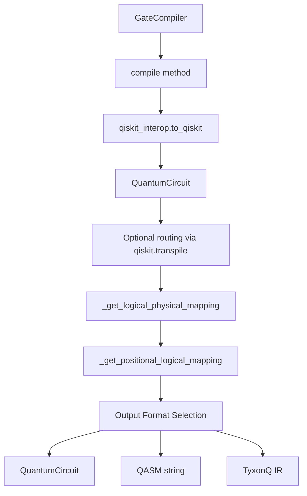
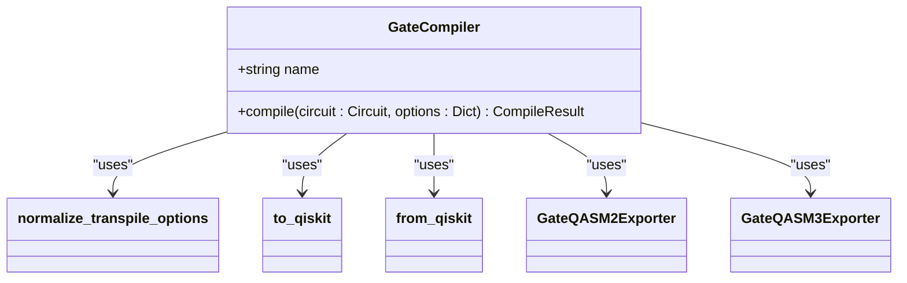
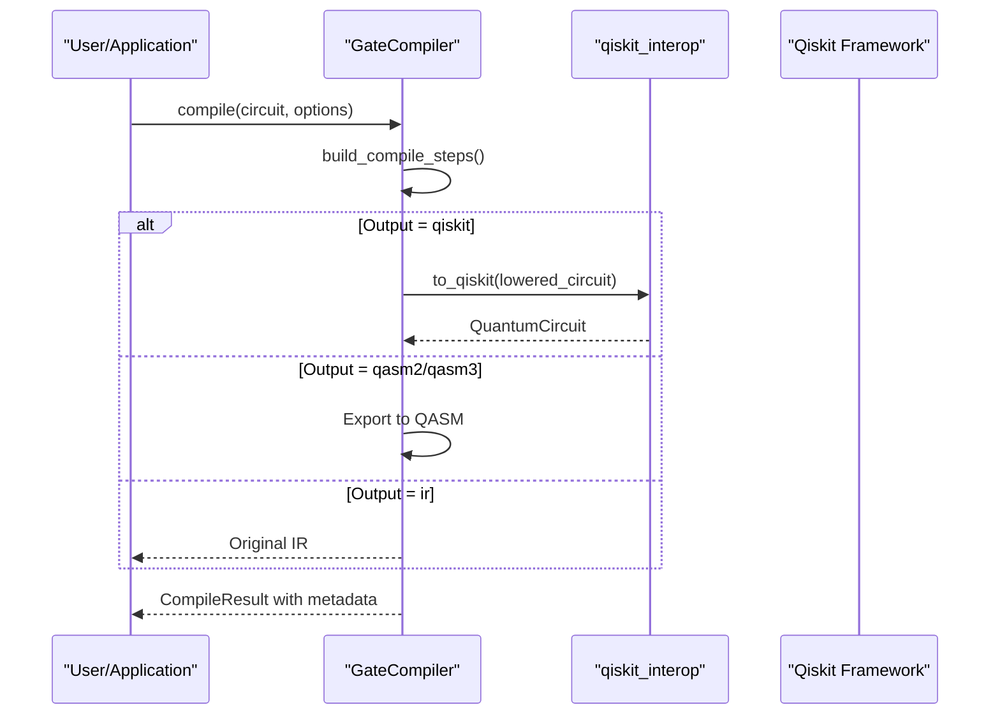
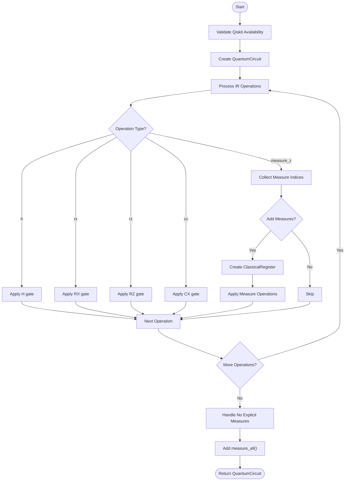
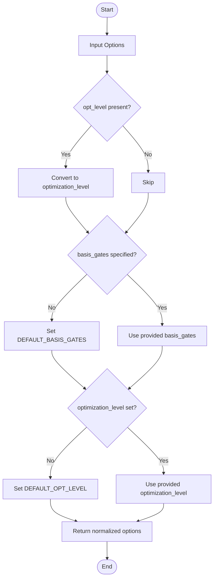
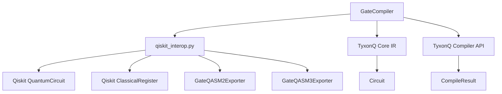

# Qiskit Compiler

<cite>
**Referenced Files in This Document**   
- [qiskit_interop.py](file://src/tyxonq/compiler/gate_compiler/interop/qiskit_interop.py)
- [compiler.py](file://src/tyxonq/compiler/gate_compiler/compiler.py)
- [routing.py](file://src/tyxonq/compiler/gate_compiler/stages/layout/routing.py)
</cite>

## Update Summary
**Changes Made**   
- Updated to reflect the migration of Qiskit compiler integration from `compile_engine/qiskit/` to `gate_compiler/interop/qiskit_interop.py`
- Replaced references to old QiskitCompiler class with new GateCompiler-based architecture
- Updated documentation to reflect enhanced functionality in the new location
- Revised component analysis to match the new modular structure
- Updated troubleshooting guidance for the new implementation

## Table of Contents
1. [Introduction](#introduction)
2. [Core Components](#core-components)
3. [Architecture Overview](#architecture-overview)
4. [Detailed Component Analysis](#detailed-component-analysis)
5. [Dependency Analysis](#dependency-analysis)
6. [Performance Considerations](#performance-considerations)
7. [Troubleshooting Guide](#troubleshooting-guide)
8. [Conclusion](#conclusion)

## Introduction

The Qiskit interoperability system in TyxonQ has been restructured to provide seamless integration with IBM Quantum hardware and Qiskit's rich transpilation framework. The functionality previously located in `compile_engine/qiskit/` has been moved to `gate_compiler/interop/qiskit_interop.py` with enhanced capabilities and improved modularity. This new architecture serves as a bridge between TyxonQ's IR and Qiskit's QuantumCircuit representation, enabling users to leverage Qiskit's comprehensive optimization passes, device-aware compilation, and hardware-specific constraints while maintaining compatibility with TyxonQ's internal circuit representation.

The updated implementation provides bidirectional conversion utilities, enhanced transpilation management, and sophisticated qubit mapping extraction capabilities. It supports multiple output formats including native Qiskit circuits, OpenQASM 2.0, and TyxonQ's IR, making it a versatile tool for quantum circuit development and execution across different platforms.

## Core Components

The Qiskit interoperability system now consists of a modular architecture centered around the `qiskit_interop.py` module, which provides essential conversion utilities and supporting functions. The system integrates with the GateCompiler framework to perform circuit optimization and device-specific compilation, while maintaining backward compatibility with existing APIs through alias functions.

**Updated** The Qiskit compiler integration has been moved from `compile_engine/qiskit/` to `gate_compiler/interop/qiskit_interop.py`, providing enhanced functionality and better integration with TyxonQ's gate compiler infrastructure.

**Section sources**
- [qiskit_interop.py:1-342](file://src/tyxonq/compiler/gate_compiler/interop/qiskit_interop.py#L1-L342)
- [compiler.py:1-110](file://src/tyxonq/compiler/gate_compiler/compiler.py#L1-L110)

## Architecture Overview

The new architecture follows a modular design that separates the Qiskit interoperability logic from the core compilation orchestration. The `GateCompiler` class coordinates the overall compilation process, while the `qiskit_interop.py` module handles the specific translation between representations. This separation allows for maintainable code and clear responsibility boundaries.

**Diagram sources**
- [compiler.py:27-110](file://src/tyxonq/compiler/gate_compiler/compiler.py#L27-L110)
- [qiskit_interop.py:165-342](file://src/tyxonq/compiler/gate_compiler/interop/qiskit_interop.py#L165-L342)

## Detailed Component Analysis

### GateCompiler Integration

The `GateCompiler` class now serves as the primary entry point for Qiskit-based compilation within the TyxonQ framework. It implements a unified compilation interface that supports multiple output formats and integrates seamlessly with the gate compiler pipeline.

#### Class Structure

**Diagram sources**
- [compiler.py:14-110](file://src/tyxonq/compiler/gate_compiler/compiler.py#L14-L110)

**Section sources**
- [compiler.py:14-110](file://src/tyxonq/compiler/gate_compiler/compiler.py#L14-L110)

### Compilation Process Flow

The compilation process follows a streamlined workflow that transforms TyxonQ's IR into executable quantum circuits, with optional transpilation and format conversion steps.

#### Compilation Sequence

**Diagram sources**
- [compiler.py:27-110](file://src/tyxonq/compiler/gate_compiler/compiler.py#L27-L110)
- [qiskit_interop.py:165-342](file://src/tyxonq/compiler/gate_compiler/interop/qiskit_interop.py#L165-L342)

### Conversion Utilities Analysis

The `qiskit_interop.py` module provides essential utilities for bidirectional conversion between TyxonQ's IR and Qiskit's QuantumCircuit representation. These functions form the foundation of the interoperability between the two frameworks.

#### IR to Qiskit Conversion Logic

**Diagram sources**
- [qiskit_interop.py:165-242](file://src/tyxonq/compiler/gate_compiler/interop/qiskit_interop.py#L165-L242)

### Transpilation Options Normalization

The `normalize_transpile_options` function ensures consistent parameter handling between TyxonQ's interface and Qiskit's transpile function, providing backward compatibility and sensible defaults.

#### Options Normalization Process

**Diagram sources**
- [qiskit_interop.py:56-69](file://src/tyxonq/compiler/gate_compiler/interop/qiskit_interop.py#L56-L69)

## Dependency Analysis

The Qiskit interoperability system has a well-defined dependency structure that isolates Qiskit-specific functionality while maintaining integration with the broader TyxonQ framework. The system depends on Qiskit only when required for specific operations, allowing the rest of the system to function without this external dependency.

**Diagram sources**
- [compiler.py:1-110](file://src/tyxonq/compiler/gate_compiler/compiler.py#L1-L110)
- [qiskit_interop.py:1-342](file://src/tyxonq/compiler/gate_compiler/interop/qiskit_interop.py#L1-L342)

## Performance Considerations

The updated Qiskit interoperability system is designed with performance in mind, minimizing unnecessary operations and leveraging efficient conversion pipelines. The system uses optional imports for Qiskit components, reducing startup overhead when Qiskit is not available. The conversion utilities are implemented with direct operation mapping, avoiding intermediate representations that could introduce latency. The GateCompiler integration ensures optimal compilation steps are applied based on the target output format.

## Troubleshooting Guide

### Common Issues and Solutions

| Issue | Cause | Solution |
|------|------|----------|
| "qiskit is not available" error | Qiskit package not installed | Install Qiskit using `pip install qiskit` |
| Transpilation failures | Invalid transpilation options | Validate options against Qiskit's transpile function documentation |
| Incorrect qubit mappings | Measurement operations not properly handled | Ensure measurement operations are correctly specified in the IR circuit |
| Empty output circuits | No operations in input circuit | Verify the input circuit contains valid quantum operations |
| Unsupported operation errors | Gate not supported by Qiskit adapter | Check OP_MAPPING in qiskit_interop.py for supported gates |

### Migration from Old Location

**Updated** Users migrating from the old `compile_engine/qiskit/` location should update their imports and usage patterns:

- Replace `from tyxonq.compiler.compile_engine.qiskit import QiskitCompiler` with `from tyxonq.compiler.gate_compiler.interop.qiskit_interop import to_qiskit, from_qiskit`
- Update compilation calls to use the GateCompiler instead of direct QiskitCompiler instantiation
- Utilize the enhanced functionality available in the new location

### Dependency Management

The Qiskit interoperability system uses optional imports for Qiskit components, which means the compiler can be imported and instantiated even when Qiskit is not available. However, attempting to perform compilation operations that require Qiskit will raise a RuntimeError with a descriptive message indicating the missing dependency.

**Section sources**
- [qiskit_interop.py:20-25](file://src/tyxonq/compiler/gate_compiler/interop/qiskit_interop.py#L20-L25)
- [compiler.py:100-107](file://src/tyxonq/compiler/gate_compiler/compiler.py#L100-L107)

## Conclusion

The updated Qiskit interoperability system provides a robust bridge between TyxonQ's Intermediate Representation and IBM Quantum's Qiskit framework, enabling seamless integration with IBM Quantum hardware and access to Qiskit's advanced transpilation capabilities. Through its restructured implementation in `gate_compiler/interop/qiskit_interop.py`, the system offers flexible output formats, comprehensive transpilation options, and detailed qubit mapping metadata. The separation of conversion logic from compilation orchestration ensures maintainability and extensibility, while the careful dependency management allows for graceful degradation when Qiskit is not available. This enhanced implementation positions TyxonQ as a versatile platform for quantum algorithm development that can leverage the strengths of both frameworks while providing a cleaner, more modular architecture.