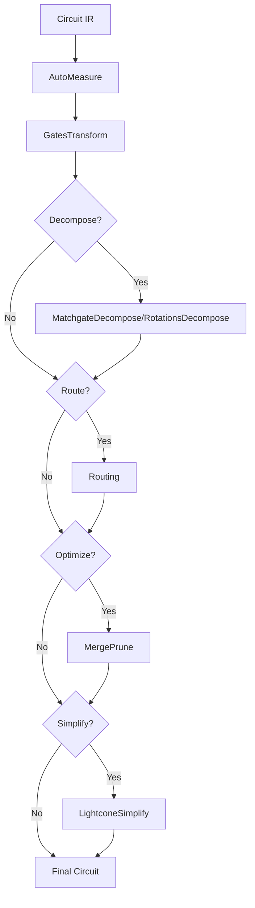
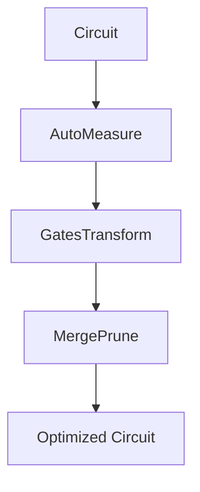
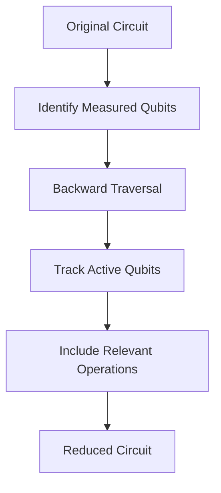

# Compilation Stages

<cite>
**Referenced Files in This Document**   
- [compiler.py](file://src/tyxonq/compiler/gate_compiler/compiler.py)
- [steps.py](file://src/tyxonq/compiler/gate_compiler/steps.py)
- [rotations.py](file://src/tyxonq/compiler/gate_compiler/stages/decompose/rotations.py)
- [matchgate.py](file://src/tyxonq/compiler/gate_compiler/stages/decompose/matchgate.py)
- [auto_measure.py](file://src/tyxonq/compiler/gate_compiler/stages/rewrite/auto_measure.py)
- [gates_transform.py](file://src/tyxonq/compiler/gate_compiler/stages/rewrite/gates_transform.py)
- [merge_prune.py](file://src/tyxonq/compiler/gate_compiler/stages/rewrite/merge_prune.py)
- [lightcone.py](file://src/tyxonq/compiler/gate_compiler/stages/simplify/lightcone.py)
</cite>

## Update Summary
**Changes Made**   
- Updated all stage references from old `compiler/stages/` to new `gate_compiler/stages/` structure
- Replaced compilation pipeline architecture with new type-based step system
- Removed gradient processing stage as it's no longer part of the core compilation pipeline
- Updated decomposition stage to include matchgate decomposition alongside rotation decomposition
- Added layout/routing stage documentation for qubit mapping and routing
- Updated all file paths and imports to reflect new module structure
- Simplified scheduling stage as shot allocation is now handled by device-specific compilers

## Table of Contents
1. [Introduction](#introduction)
2. [Compilation Pipeline Architecture](#compilation-pipeline-architecture)
3. [Decomposition Stage](#decomposition-stage)
4. [Rewriting Stage](#rewriting-stage)
5. [Layout and Routing Stage](#layout-and-routing-stage)
6. [Simplification Stage](#simplification-stage)
7. [Integration with Device Constraints and Numerics](#integration-with-device-constraints-and-numerics)
8. [Common Issues and Best Practices](#common-issues-and-best-practices)
9. [Conclusion](#conclusion)

## Introduction

The TyxonQ compiler implements a modular, composable pipeline for quantum circuit compilation through its new gate compiler architecture. This document details the four core stages of the compilation process: decomposition, rewriting, layout/routing, and simplification. Each stage operates as a transformation pass on the Intermediate Representation (IR), progressively optimizing the circuit for execution on target hardware or simulation backends. The pipeline uses a type-based step system that allows users to configure compilation capabilities through structured parameters while ensuring compatibility with device constraints and numerical backends.

**Section sources**
- [compiler.py:14-23](file://src/tyxonq/compiler/gate_compiler/compiler.py#L14-L23)
- [steps.py:1-8](file://src/tyxonq/compiler/gate_compiler/steps.py#L1-L8)

## Compilation Pipeline Architecture

The compilation pipeline is orchestrated by the `GateCompiler` class, which uses a type-based step system managed by `build_compile_steps`. Unlike the previous string-based DSL approach, the new system uses structured configuration objects (`DecomposeSpec`, `RoutingSpec`) to control compilation capabilities. The pipeline follows a fixed order: normalization → decomposition → routing → optimization → simplification.

The `apply_steps` function sequentially applies each compiled step to transform the circuit IR. Each step implements a common interface with an `apply` method that takes the circuit and optional parameters, enabling flexible composition while maintaining mathematical correctness.



**Diagram sources**
- [steps.py:38-43](file://src/tyxonq/compiler/gate_compiler/steps.py#L38-L43)
- [compiler.py:64-73](file://src/tyxonq/compiler/gate_compiler/compiler.py#L64-L73)

**Section sources**
- [compiler.py:14-23](file://src/tyxonq/compiler/gate_compiler/compiler.py#L14-L23)
- [steps.py:27-91](file://src/tyxonq/compiler/gate_compiler/steps.py#L27-L91)

## Decomposition Stage

The decomposition stage consists of two complementary passes that break down complex gates into native gate sets:

### Matchgate Decomposition
The `MatchgateDecompose` pass handles 2-qubit number-conserving matchgates (fSim family) by decomposing them into native gates {rz, rx, h, cx}. This is particularly important for quantum chemistry applications using LUCJ/SQD algorithms where two-mode fock matrices need to be implemented on hardware.

The decomposition follows the mathematical identity:
- fSim(θ, φ) = exp(-i·θ/2·(XX+YY)) · diag(1, 1, 1, e^{-iφ})
- Decomposed via ZXZ Euler angles and partial-iSWAP implementation
- Zero-angle blocks are pruned to reduce gate count

### Rotation Decomposition  
The `RotationsDecompose` pass converts parametric rotation gates to the standard basis {H, RZ, CX}:
- RX(θ) → H · RZ(θ) · H
- RY(θ) → S† · H · RZ(θ) · H · S
- RZZ(θ) → CX · RZ(θ) · CX
- RXX(θ) → H⊗H · CX · RZ(θ) · CX · H⊗H
- RYY(θ) → (S†H)⊗(S†H) · CX · RZ(θ) · CX · (HS)⊗(HS)

Both decomposition passes use `rebuild_circuit` to preserve metadata like `_unitary_cache`, ensuring subsequent compilation steps can access matrix information when needed.

```mermaid
flowchart LR
RX[RX(θ)] --> H1[H]
H1 --> RZ[RZ(θ)]
RZ --> H2[H]
RY[RY(θ)] --> Sd[S†]
Sd --> H3[H]
H3 --> RZ2[RZ(θ)]
RZ2 --> H4[H]
H4 --> S[S]
```

**Diagram sources**
- [rotations.py:13-25](file://src/tyxonq/compiler/gate_compiler/stages/decompose/rotations.py#L13-L25)

**Section sources**
- [matchgate.py:152-197](file://src/tyxonq/compiler/gate_compiler/stages/decompose/matchgate.py#L152-L197)
- [rotations.py:13-73](file://src/tyxonq/compiler/gate_compiler/stages/decompose/rotations.py#L13-L73)

## Rewriting Stage

The rewriting stage performs circuit normalization and optimization through three key passes:

### Auto Measurement
The `AutoMeasure` pass automatically adds Z measurements to all qubits when no explicit measurements exist in the circuit. This ensures consistent measurement behavior across different compilation targets and provides warnings when implicit measurements are added.

### Gate Transformation
The `GatesTransform` pass rewrites gates according to a specified basis set (default: ["h", "rx", "rz", "cx", "cz"]). It converts X and Y gates to their parametric equivalents (RX(π) and RY(π)) when the basis allows, ensuring compatibility with device-specific gate sets while preserving other gates for later decomposition.

### Circuit Pruning
The `MergePrune` pass applies local optimizations by merging adjacent single-qubit gates and removing identity operations. It uses a rule-based system combining gates (e.g., RZ(θ₁) followed by RZ(θ₂) becomes RZ(θ₁+θ₂)) and eliminates redundant operations, reducing circuit depth and improving performance.



**Diagram sources**
- [auto_measure.py:13-25](file://src/tyxonq/compiler/gate_compiler/stages/rewrite/auto_measure.py#L13-L25)
- [gates_transform.py:12-27](file://src/tyxonq/compiler/gate_compiler/stages/rewrite/gates_transform.py#L12-L27)
- [merge_prune.py:27-33](file://src/tyxonq/compiler/gate_compiler/stages/rewrite/merge_prune.py#L27-L33)

**Section sources**
- [auto_measure.py:13-50](file://src/tyxonq/compiler/gate_compiler/stages/rewrite/auto_measure.py#L13-L50)
- [gates_transform.py:12-50](file://src/tyxonq/compiler/gate_compiler/stages/rewrite/gates_transform.py#L12-L50)
- [merge_prune.py:27-86](file://src/tyxonq/compiler/gate_compiler/stages/rewrite/merge_prune.py#L27-L86)

## Layout and Routing Stage

The layout and routing stage handles qubit mapping and connectivity constraints through the `Routing` pass. This stage delegates to Qiskit's transpiler to map logical qubits to physical qubits and insert SWAP gates as needed to satisfy device connectivity requirements.

The routing stage is controlled by the `RoutingSpec` parameter and is only included when explicitly enabled. It respects device topology information provided through the `device_rule` parameter, ensuring that the final circuit can be executed on the target hardware without violating connectivity constraints.

This stage is particularly important for real hardware execution where qubit connectivity is limited compared to idealized simulation environments.

**Section sources**
- [steps.py:74-79](file://src/tyxonq/compiler/gate_compiler/steps.py#L74-L79)

## Simplification Stage

The simplification stage employs lightcone-based circuit reduction through the `LightconeSimplify` pass. This pass performs backward slicing from measurement operations to identify and retain only the operations that influence the final measurement outcomes.

The algorithm works as follows:
1. Collect all measured qubits from explicit `measure_z` operations or assume all qubits are measured if `assume_measure_all` is enabled
2. Traverse the circuit operations in reverse order, maintaining an "active" set of qubits
3. For each operation, if it acts on any active qubit, include it in the reduced circuit and update the active set
4. For entangling gates (CX, CZ, etc.), propagate dependencies to both qubits

This approach significantly reduces circuit depth by eliminating operations that do not contribute to the final observable, improving simulation efficiency and reducing noise in hardware execution.



**Diagram sources**
- [lightcone.py:12-18](file://src/tyxonq/compiler/gate_compiler/stages/simplify/lightcone.py#L12-L18)

**Section sources**
- [lightcone.py:12-97](file://src/tyxonq/compiler/gate_compiler/stages/simplify/lightcone.py#L12-L97)

## Integration with Device Constraints and Numerics

The compilation pipeline integrates with device constraints through the `device_rule` parameter passed to each step. This allows stages to adapt their behavior based on hardware capabilities, such as maximum shots per job, supported gate sets, and connectivity constraints.

For numerical backends, the pipeline preserves mathematical equivalence while optimizing for target backend performance characteristics. The `GateCompiler` class provides a unified interface that handles output format selection (IR, QASM2, QASM3, or Qiskit circuits) and ensures compatibility with various numerics implementations.

The type-based configuration system enables precise control over compilation capabilities, allowing users to enable or disable specific optimization passes based on their target platform requirements.

**Section sources**
- [compiler.py:27-38](file://src/tyxonq/compiler/gate_compiler/compiler.py#L27-L38)
- [steps.py:27-55](file://src/tyxonq/compiler/gate_compiler/steps.py#L27-L55)

## Common Issues and Best Practices

### Common Issues
1. **Non-convergent Simplifications**: Lightcone simplification may not reduce circuit depth when all operations are in the lightcone of measurements. This is expected behavior for circuits where every gate affects the output.
2. **Matchgate Decomposition Failures**: Non-number-conserving matchgates cannot be decomposed using the fSim-based algorithm and will either be preserved or raise errors depending on strict mode settings.
3. **Routing Dependencies**: Routing requires Qiskit to be installed and may fail if device topology information is incomplete or incorrect.

### Best Practices
1. **Step Configuration**: Use the type-based configuration system (`DecomposeSpec`, `RoutingSpec`) instead of boolean flags for fine-grained control over compilation capabilities.
2. **Device-Aware Compilation**: Provide accurate `device_rule` information including coupling maps and gate sets to enable constraint-aware optimization.
3. **Output Selection**: Choose appropriate output formats (IR, QASM2, QASM3, or Qiskit) based on your target execution environment.
4. **Testing Strategy**: Validate compilation results with small circuits before scaling to larger problems, especially when using custom device rules.

**Section sources**
- [steps.py:27-91](file://src/tyxonq/compiler/gate_compiler/steps.py#L27-L91)
- [matchgate.py:46-93](file://src/tyxonq/compiler/gate_compiler/stages/decompose/matchgate.py#L46-L93)

## Conclusion

The TyxonQ gate compiler provides a comprehensive, modular framework for quantum circuit optimization through its new type-based step system. By separating concerns into distinct stages—decomposition, rewriting, layout/routing, and simplification—the system enables flexible, targeted optimizations while maintaining mathematical correctness. The integration of device constraints and numerical backend requirements ensures that compiled circuits are both efficient and executable on real hardware. Understanding the invocation relationships and domain models of each stage allows users to chain them effectively for their specific quantum computing tasks through the structured configuration system.