# Compiler Pipeline

<cite>
**Referenced Files in This Document**   
- [api.py](file://src/tyxonq/compiler/api.py)
- [gate_compiler/__init__.py](file://src/tyxonq/compiler/gate_compiler/__init__.py)
- [gate_compiler/compiler.py](file://src/tyxonq/compiler/gate_compiler/compiler.py)
- [gate_compiler/steps.py](file://src/tyxonq/compiler/gate_compiler/steps.py)
- [gate_compiler/stages/decompose/matchgate.py](file://src/tyxonq/compiler/gate_compiler/stages/decompose/matchgate.py)
- [gate_compiler/stages/decompose/rotations.py](file://src/tyxonq/compiler/gate_compiler/stages/decompose/rotations.py)
- [gate_compiler/stages/rewrite/auto_measure.py](file://src/tyxonq/compiler/gate_compiler/stages/rewrite/auto_measure.py)
- [gate_compiler/stages/rewrite/gates_transform.py](file://src/tyxonq/compiler/gate_compiler/stages/rewrite/gates_transform.py)
- [gate_compiler/stages/rewrite/merge_prune.py](file://src/tyxonq/compiler/gate_compiler/stages/rewrite/merge_prune.py)
- [gate_compiler/stages/simplify/lightcone.py](file://src/tyxonq/compiler/gate_compiler/stages/simplify/lightcone.py)
- [platforms/tyxonq/__init__.py](file://src/tyxonq/compiler/platforms/tyxonq/__init__.py)
</cite>

## Update Summary
**Changes Made**   
- Updated compiler architecture from monolithic compile_engine to modular gate_compiler structure
- Replaced old compilation stages with new staged pipeline in gate_compiler/stages/
- Updated all references to reflect the new GateCompiler class and CompileStep protocol
- Modified optimization passes to use new stage-based implementation
- Updated backend system documentation to reflect platform adapter pattern
- Revised API interface to document type-safe parameter specification

## Table of Contents
1. [Introduction](#introduction)
2. [Compiler Architecture Overview](#compiler-architecture-overview)
3. [Compilation Stages](#compilation-stages)
   - [Decomposition](#decomposition)
   - [Rewriting](#rewriting)
   - [Simplification](#simplification)
4. [Optimization Passes](#optimization-passes)
   - [Measurement Rewriting](#measurement-rewriting)
   - [Lightcone Simplification](#lightcone-simplification)
5. [Backend System](#backend-system)
   - [Platform Adapters](#platform-adapters)
   - [Dialect Translation](#dialect-translation)
6. [API Interface](#api-interface)
   - [Type-Safe Compilation](#type-safe-compilation)
   - [Optimization Configuration](#optimization-configuration)
7. [Practical Examples](#practical-examples)
   - [VQE Circuit Compilation](#vqe-circuit-compilation)
   - [QAOA Circuit Compilation](#qaoa-circuit-compilation)
8. [Integration Points](#integration-points)
   - [Device Constraints](#device-constraints)
9. [Troubleshooting](#troubleshooting)
   - [Failed Passes](#failed-passes)
   - [Suboptimal Reductions](#suboptimal-reductions)
10. [Performance Tuning](#performance-tuning)
    - [Large-Scale Circuit Optimization](#large-scale-circuit-optimization)

## Introduction

The TyxonQ compiler pipeline provides a modular framework for quantum circuit compilation with support for multiple optimization stages, pluggable backends, and advanced scheduling capabilities. The system has been refactored from a monolithic compile_engine architecture to a modular gate_compiler structure with distinct compilation stages that can be configured through a flexible API.

**Updated** The compiler now uses a type-safe parameter system with DecomposeSpec and RoutingSpec for precise control over compilation behavior, replacing the previous string-based DSL approach.

**Section sources**
- [api.py:39-98](file://src/tyxonq/compiler/api.py#L39-L98)
- [gate_compiler/__init__.py:1-21](file://src/tyxonq/compiler/gate_compiler/__init__.py#L1-L21)

## Compiler Architecture Overview

The TyxonQ compiler follows a modular architecture centered around the GateCompiler class, which orchestrates a sequence of CompileStep instances. Each step implements a specific transformation and can be conditionally included based on type-safe parameters.

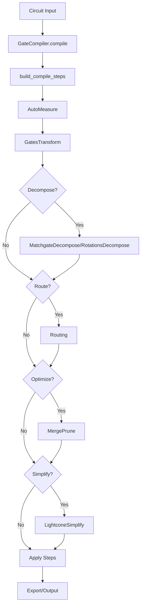

**Diagram sources**
- [gate_compiler/compiler.py:27-110](file://src/tyxonq/compiler/gate_compiler/compiler.py#L27-L110)
- [gate_compiler/steps.py:27-91](file://src/tyxonq/compiler/gate_compiler/steps.py#L27-L91)

**Section sources**
- [gate_compiler/compiler.py:14-110](file://src/tyxonq/compiler/gate_compiler/compiler.py#L14-L110)
- [gate_compiler/steps.py:1-109](file://src/tyxonq/compiler/gate_compiler/steps.py#L1-L109)

## Compilation Stages

The compiler pipeline consists of five distinct stages that transform quantum circuits through various optimization and preparation steps. Each stage is implemented as a CompileStep with an apply method.

### Decomposition

The decomposition stage breaks down complex quantum operations into fundamental gate sets supported by target hardware. Two key decomposition passes are available:

#### Matchgate Decomposition
The `MatchgateDecompose` pass handles 2-qubit number-conserving matchgates (fSim family) by decomposing them into native gates {rz, rx, h, cx}. This is particularly important for quantum chemistry applications using LUCJ/SQD algorithms.

```mermaid
flowchart TD
A[fSim(θ,φ)] --> B[Number Conservation Check]
B --> C{Is matchgate?}
C --> |Yes| D[ZXZ Euler Angle Decomposition]
D --> E[Rz(a)·Rx(b)·Rz(c)]
E --> F[Partial-iSWAP = RYY(b/2)·RXX(b/2)]
F --> G[Native Gates: rz, rx, h, cx]
C --> |No| H[Keep Original or Raise Error]
```

**Diagram sources**
- [gate_compiler/stages/decompose/matchgate.py:65-149](file://src/tyxonq/compiler/gate_compiler/stages/decompose/matchgate.py#L65-L149)

#### Rotation Decomposition
The `RotationsDecompose` pass transforms parametric rotations into standard gate identities:
- RX(θ) → H · RZ(θ) · H
- RY(θ) → S† · H · RZ(θ) · H · S  
- RZZ(θ) → CX · RZ(θ) · CX
- RXX(θ) → H⊗H · CX · RZ(θ) · CX · H⊗H
- RYY(θ) → (S†H)⊗(S†H) · CX · RZ(θ) · CX · (HS)⊗(HS)

**Section sources**
- [gate_compiler/stages/decompose/matchgate.py:152-198](file://src/tyxonq/compiler/gate_compiler/stages/decompose/matchgate.py#L152-L198)
- [gate_compiler/stages/decompose/rotations.py:13-76](file://src/tyxonq/compiler/gate_compiler/stages/decompose/rotations.py#L13-L76)

### Rewriting

The rewriting stage transforms circuit components according to specified rules and constraints. This includes automatic measurement insertion, gate basis transformations, and circuit normalization.

#### Auto Measure
The `AutoMeasure` pass automatically adds Z measurements to all qubits when no explicit measurements are present, ensuring proper execution semantics.

#### Gates Transform
The `GatesTransform` pass rewrites gates according to preferred basis gates, handling simple transformations like x→rx(π) and y→ry(π) while preserving more complex gates for later decomposition.

#### Merge Prune
The `MergePrune` pass merges adjacent gates using identity rules and prunes identity operations, improving circuit efficiency.

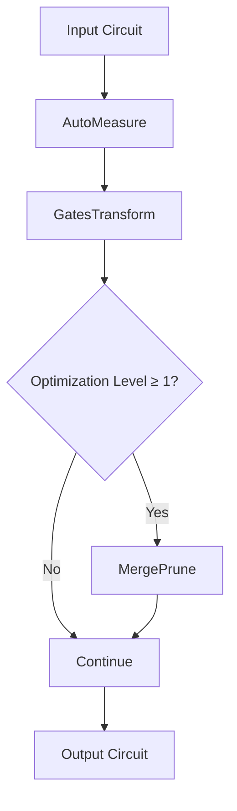

**Diagram sources**
- [gate_compiler/stages/rewrite/auto_measure.py:13-53](file://src/tyxonq/compiler/gate_compiler/stages/rewrite/auto_measure.py#L13-L53)
- [gate_compiler/stages/rewrite/gates_transform.py:12-53](file://src/tyxonq/compiler/gate_compiler/stages/rewrite/gates_transform.py#L12-L53)
- [gate_compiler/stages/rewrite/merge_prune.py:27-88](file://src/tyxonq/compiler/gate_compiler/stages/rewrite/merge_prune.py#L27-L88)

**Section sources**
- [gate_compiler/stages/rewrite/auto_measure.py:13-53](file://src/tyxonq/compiler/gate_compiler/stages/rewrite/auto_measure.py#L13-L53)
- [gate_compiler/stages/rewrite/gates_transform.py:12-53](file://src/tyxonq/compiler/gate_compiler/stages/rewrite/gates_transform.py#L12-L53)
- [gate_compiler/stages/rewrite/merge_prune.py:27-88](file://src/tyxonq/compiler/gate_compiler/stages/rewrite/merge_prune.py#L27-L88)

### Simplification

The simplification stage reduces circuit complexity through optimization techniques. The lightcone simplification pass implements backward slicing to remove operations that do not affect measured qubits.

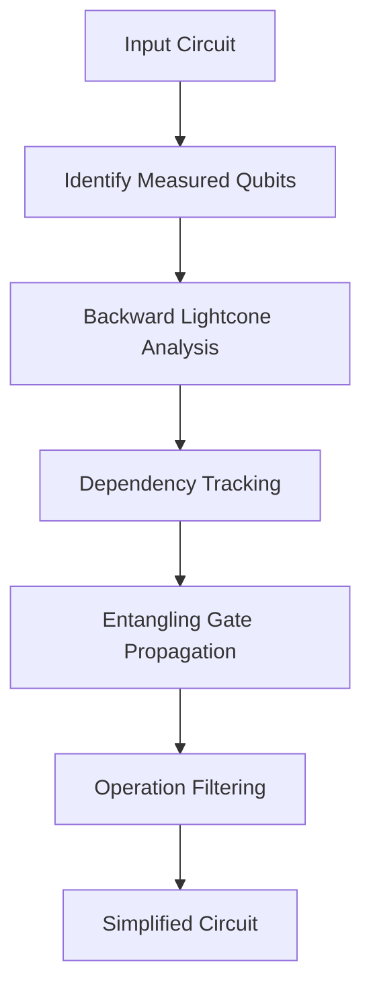

**Diagram sources**
- [gate_compiler/stages/simplify/lightcone.py:12-100](file://src/tyxonq/compiler/gate_compiler/stages/simplify/lightcone.py#L12-L100)

**Section sources**
- [gate_compiler/stages/simplify/lightcone.py:12-100](file://src/tyxonq/compiler/gate_compiler/stages/simplify/lightcone.py#L12-L100)

## Optimization Passes

### Measurement Rewriting

The measurement rewriting functionality is now integrated into the AutoMeasure pass, which ensures all qubits have appropriate measurements for proper execution. This replaces the previous separate measurement rewrite stage.

**Updated** Measurement handling is now part of the core rewriting pipeline rather than a separate stage, providing better integration with other compilation passes.

**Section sources**
- [gate_compiler/stages/rewrite/auto_measure.py:13-53](file://src/tyxonq/compiler/gate_compiler/stages/rewrite/auto_measure.py#L13-L53)

### Lightcone Simplification

The lightcone simplification pass implements circuit reduction by analyzing the causal cone of measured qubits. Operations outside the lightcone are removed as they do not affect measurement outcomes.

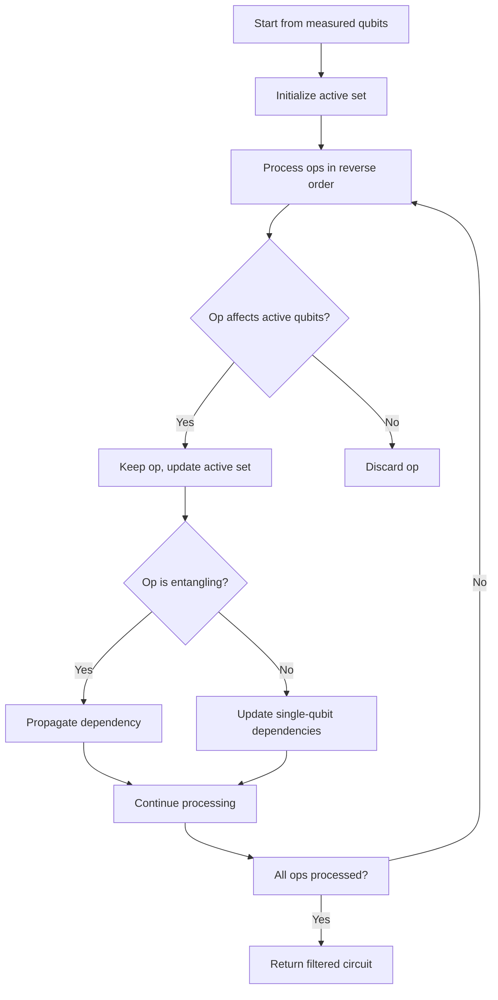

**Diagram sources**
- [gate_compiler/stages/simplify/lightcone.py:12-100](file://src/tyxonq/compiler/gate_compiler/stages/simplify/lightcone.py#L12-L100)

**Section sources**
- [gate_compiler/stages/simplify/lightcone.py:12-100](file://src/tyxonq/compiler/gate_compiler/stages/simplify/lightcone.py#L12-L100)

## Backend System

### Platform Adapters

The backend system now uses a platform adapter pattern where each hardware platform provides a thin adapter that delegates to the core GateCompiler. This eliminates code duplication across platforms while maintaining platform-specific optimizations.

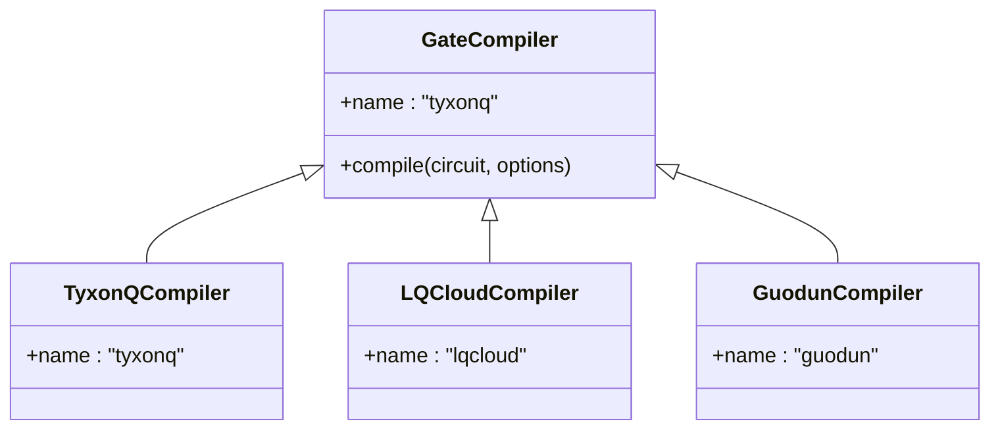

**Diagram sources**
- [gate_compiler/compiler.py:14-26](file://src/tyxonq/compiler/gate_compiler/compiler.py#L14-L26)
- [platforms/tyxonq/__init__.py:12-18](file://src/tyxonq/compiler/platforms/tyxonq/__init__.py#L12-L18)

**Updated** The previous monolithic compile_engine structure has been replaced with this modular platform adapter pattern, making it easier to add new platforms and maintain existing ones.

**Section sources**
- [platforms/tyxonq/__init__.py:1-19](file://src/tyxonq/compiler/platforms/tyxonq/__init__.py#L1-L19)

### Dialect Translation

The dialect translation system provides bidirectional conversion between TyxonQ IR and external formats like QASM and Qiskit circuits. The GateCompiler handles output format selection internally.

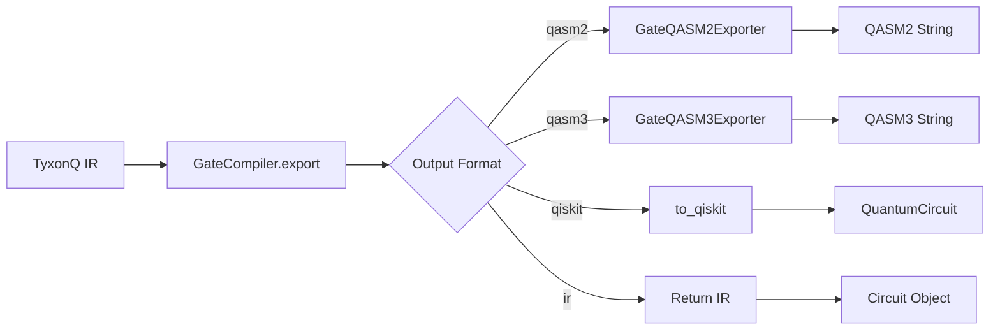

**Diagram sources**
- [gate_compiler/compiler.py:84-109](file://src/tyxonq/compiler/gate_compiler/compiler.py#L84-L109)

**Section sources**
- [gate_compiler/compiler.py:84-109](file://src/tyxonq/compiler/gate_compiler/compiler.py#L84-L109)

## API Interface

### Type-Safe Compilation

The unified compile API now uses type-safe parameters instead of string-based DSLs. Key parameters include:

- `basis_gates`: Target native gate set
- `decompose`: Boolean or DecomposeSpec for fine-grained control
- `route`: Boolean or RoutingSpec for routing configuration  
- `optimize`: Integer optimization level (0-3)
- `simplify`: Boolean flag for lightcone simplification

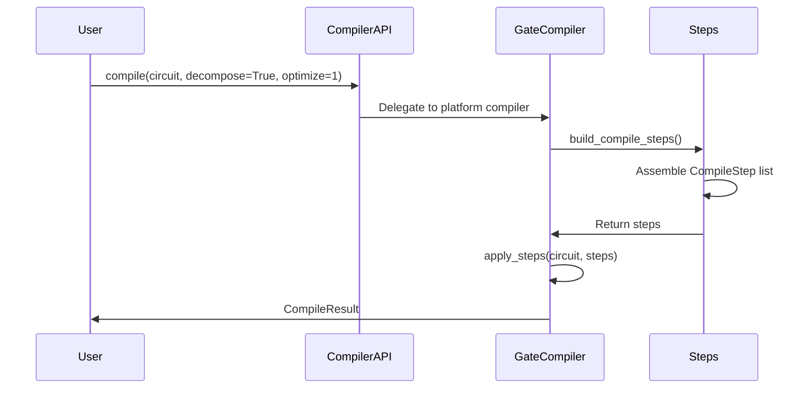

**Diagram sources**
- [api.py:39-98](file://src/tyxonq/compiler/api.py#L39-L98)
- [gate_compiler/compiler.py:27-73](file://src/tyxonq/compiler/gate_compiler/compiler.py#L27-L73)
- [gate_compiler/steps.py:27-91](file://src/tyxonq/compiler/gate_compiler/steps.py#L27-L91)

**Section sources**
- [api.py:39-98](file://src/tyxonq/compiler/api.py#L39-L98)

### Optimization Configuration

The API supports configuration of optimization levels and custom compilation plans through type-safe specifications. The optimization_level parameter controls which passes are enabled:

- Level 0: Basic compilation only
- Level 1+: Enable merge/prune optimizations
- Level 2+: Additional optimizations
- Level 3: Maximum optimization

**Section sources**
- [gate_compiler/compiler.py:57-59](file://src/tyxonq/compiler/gate_compiler/compiler.py#L57-L59)
- [gate_compiler/steps.py:81-84](file://src/tyxonq/compiler/gate_compiler/steps.py#L81-L84)

## Practical Examples

### VQE Circuit Compilation

The compilation of VQE circuits involves specific optimization considerations for variational quantum algorithms, particularly for matchgate decomposition used in quantum chemistry applications.

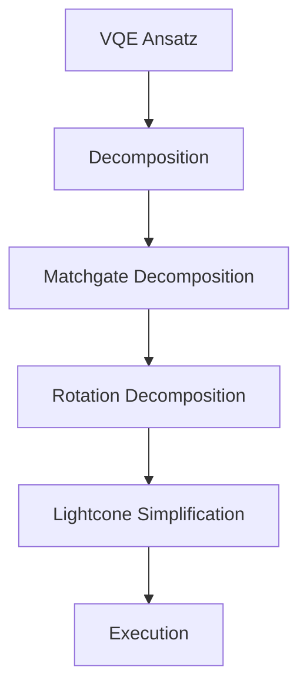

**Section sources**
- [gate_compiler/stages/decompose/matchgate.py:152-198](file://src/tyxonq/compiler/gate_compiler/stages/decompose/matchgate.py#L152-L198)
- [gate_compiler/stages/decompose/rotations.py:13-76](file://src/tyxonq/compiler/gate_compiler/stages/decompose/rotations.py#L13-L76)
- [gate_compiler/stages/simplify/lightcone.py:12-100](file://src/tyxonq/compiler/gate_compiler/stages/simplify/lightcone.py#L12-L100)

### QAOA Circuit Compilation

QAOA circuits benefit from specific optimization passes that handle the alternating structure of mixer and cost Hamiltonians, with particular attention to rotation decomposition and gate merging.

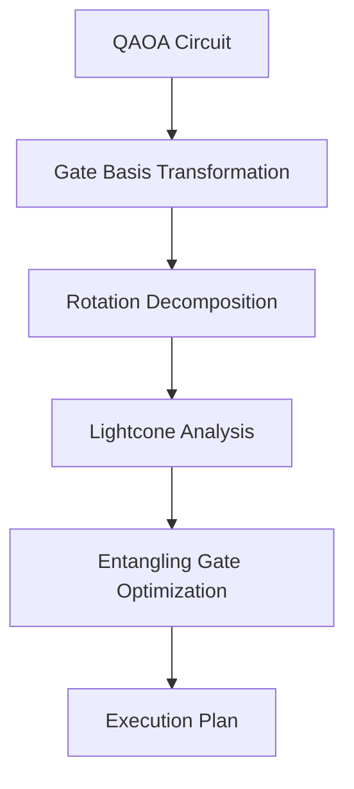

**Section sources**
- [gate_compiler/stages/rewrite/gates_transform.py:12-53](file://src/tyxonq/compiler/gate_compiler/stages/rewrite/gates_transform.py#L12-L53)
- [gate_compiler/stages/decompose/rotations.py:13-76](file://src/tyxonq/compiler/gate_compiler/stages/decompose/rotations.py#L13-L76)
- [gate_compiler/stages/simplify/lightcone.py:12-100](file://src/tyxonq/compiler/gate_compiler/stages/simplify/lightcone.py#L12-L100)

## Integration Points

### Device Constraints

The compiler integrates with device rules through the DeviceRule parameter, which provides hardware limitations and capabilities to the compilation process. Device constraints flow through all platform branches and affect routing and optimization decisions.

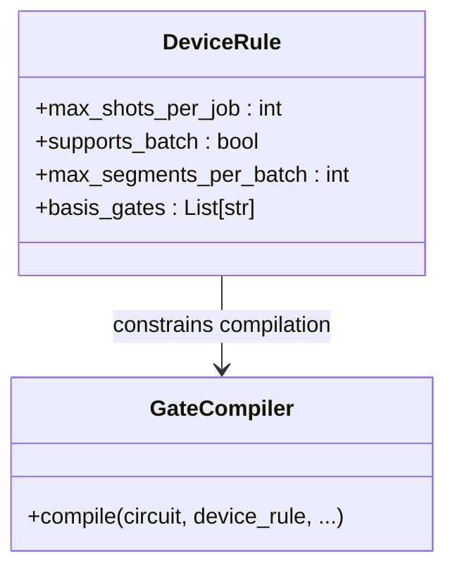

**Diagram sources**
- [gate_compiler/compiler.py:27-38](file://src/tyxonq/compiler/gate_compiler/compiler.py#L27-L38)

**Section sources**
- [gate_compiler/compiler.py:27-38](file://src/tyxonq/compiler/gate_compiler/compiler.py#L27-L38)

## Troubleshooting

### Failed Passes

When compilation passes fail, the system provides diagnostic information through metadata and error handling. Each CompileStep can raise specific exceptions with detailed error messages.

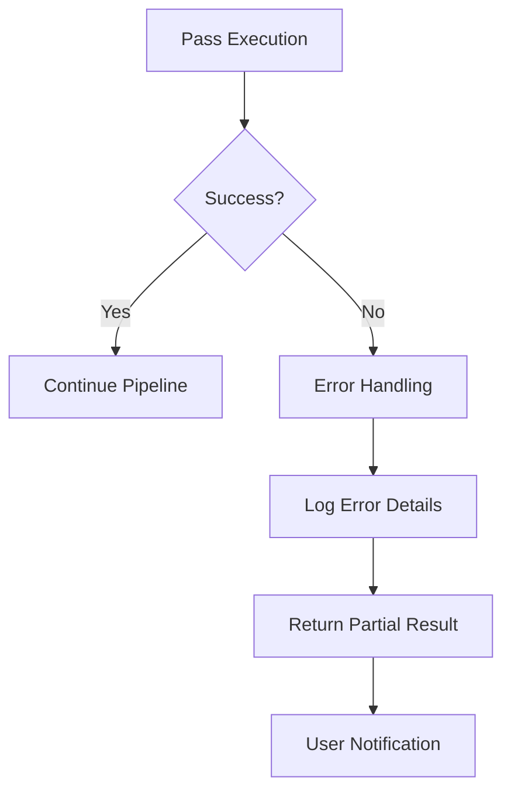

**Section sources**
- [gate_compiler/steps.py:94-105](file://src/tyxonq/compiler/gate_compiler/steps.py#L94-L105)

### Suboptimal Reductions

Cases where circuit simplification does not achieve expected reductions can be diagnosed through lightcone analysis. The simplify parameter enables lightcone simplification, and optimization_level controls additional merging passes.

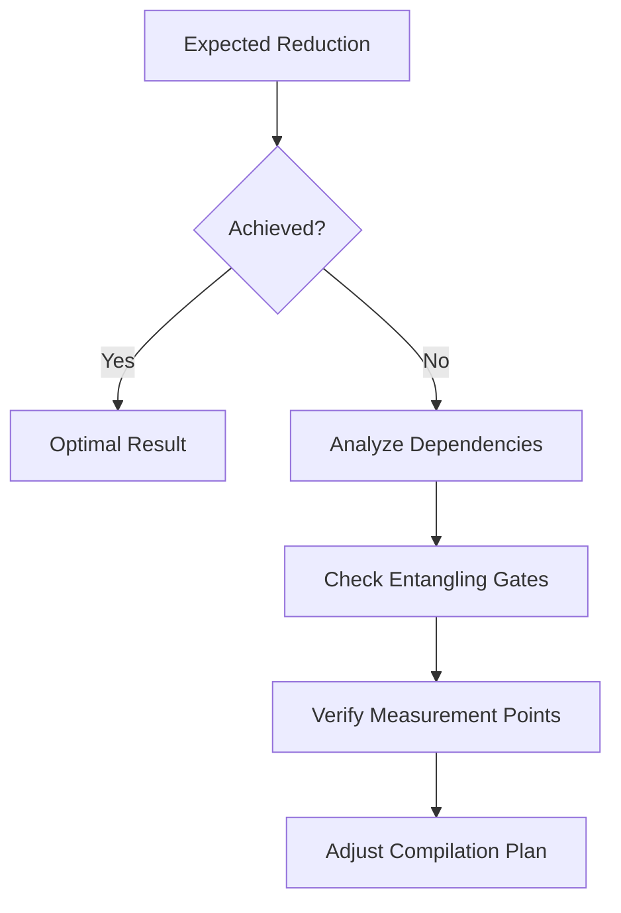

**Section sources**
- [gate_compiler/stages/simplify/lightcone.py:12-100](file://src/tyxonq/compiler/gate_compiler/stages/simplify/lightcone.py#L12-L100)

## Performance Tuning

### Large-Scale Circuit Optimization

For large-scale circuits, specific optimization strategies can improve compilation efficiency and execution performance. The modular stage-based architecture allows selective enablement of optimization passes.

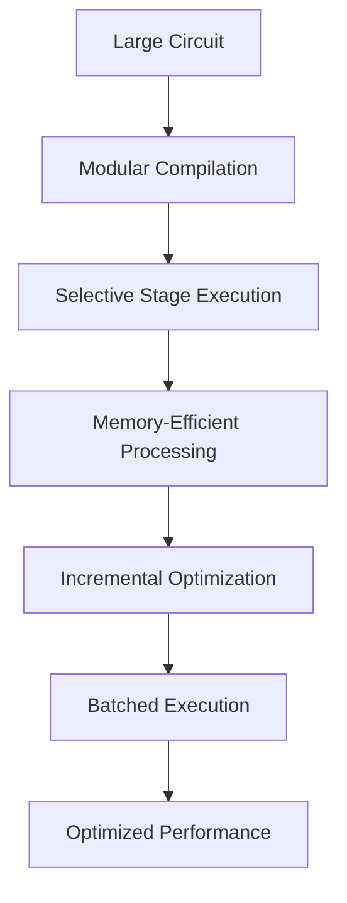

**Key Optimization Strategies:**
- Use `optimize=1` for basic gate merging and pruning
- Enable `simplify=True` for lightcone reduction
- Configure `decompose` spec for targeted decomposition
- Use appropriate `basis_gates` to minimize decomposition overhead

**Section sources**
- [gate_compiler/steps.py:27-91](file://src/tyxonq/compiler/gate_compiler/steps.py#L27-L91)
- [gate_compiler/compiler.py:57-59](file://src/tyxonq/compiler/gate_compiler/compiler.py#L57-L59)