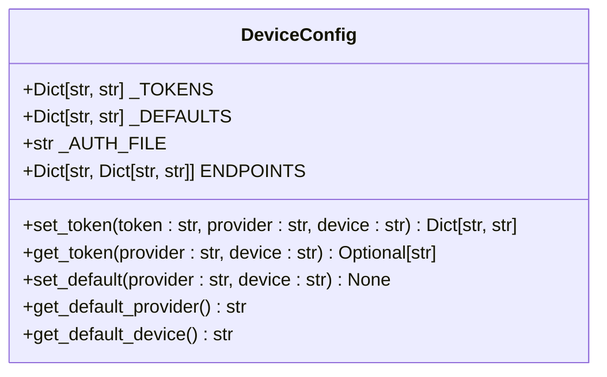
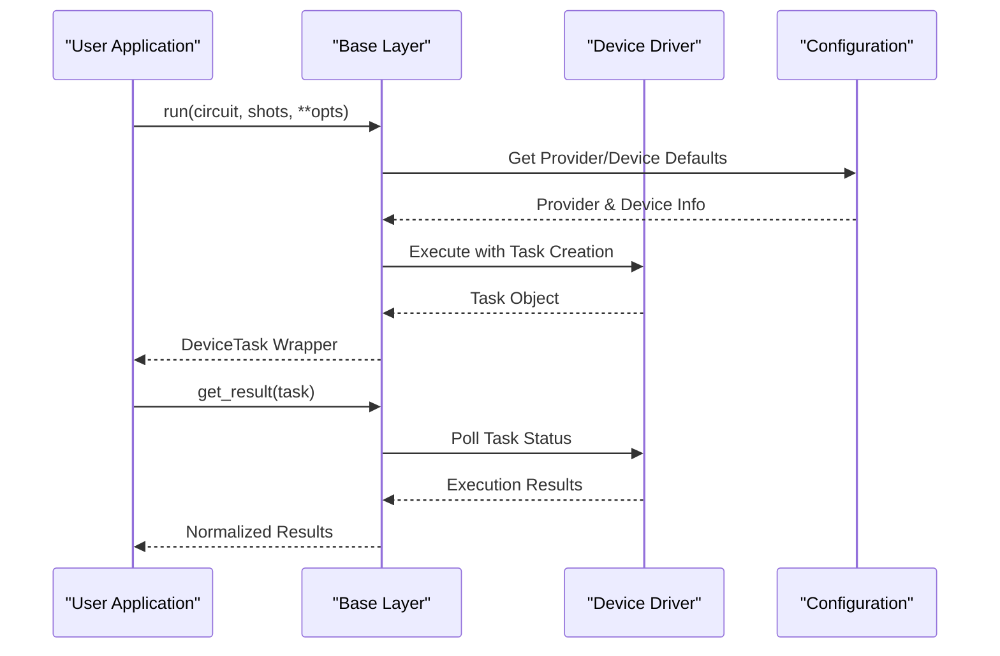
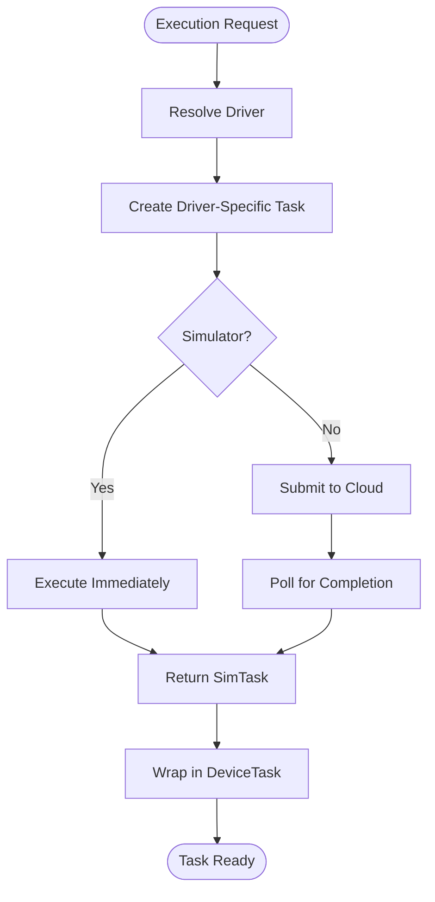
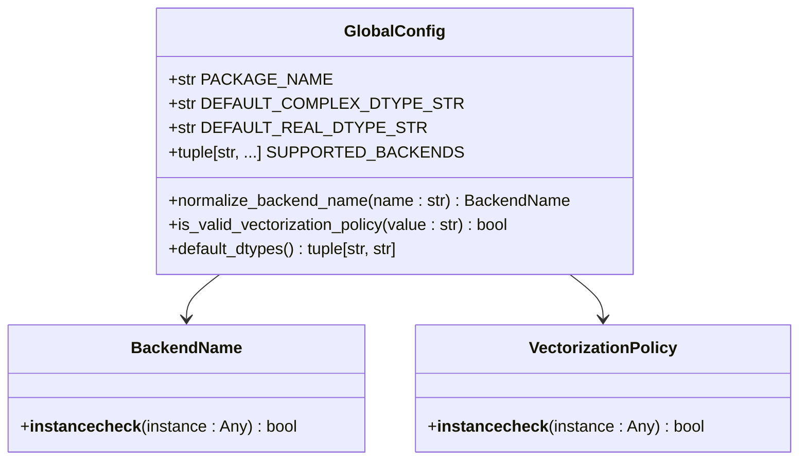

# Device Configuration and Session Management

<cite>
**Referenced Files in This Document**   
- [devices/index.rst](file://docs/source/user_guide/devices/index.rst)
- [config.py](file://src/tyxonq/devices/hardware/config.py)
- [base.py](file://src/tyxonq/devices/base.py)
- [driver.py](file://src/tyxonq/devices/simulators/driver.py)
- [driver.py](file://src/tyxonq/devices/hardware/tyxonq/driver.py)
- [config.py](file://src/tyxonq/config.py)
</cite>

## Update Summary
**Changes Made**   
- Updated session management section to reflect removal of dedicated session classes
- Revised device execution model to show integrated session handling in drivers
- Updated configuration system documentation to reflect current implementation
- Removed references to non-existent session.py files
- Added new sections explaining the simplified driver-based execution model

## Table of Contents
1. [Introduction](#introduction)
2. [Device Configuration System](#device-configuration-system)
3. [Simplified Execution Model](#simplified-execution-model)
4. [Driver-Based Session Management](#driver-based-session-management)
5. [Configuration Options and Execution Parameters](#configuration-options-and-execution-parameters)
6. [Common Issues and Troubleshooting](#common-issues-and-troubleshooting)
7. [Performance Considerations](#performance-considerations)
8. [Conclusion](#conclusion)

## Introduction
This document provides a comprehensive overview of the device configuration and execution model in the TyxonQ quantum computing framework. The system has been simplified with the removal of dedicated session management classes, integrating session handling directly into device drivers. It details the configuration mechanisms that define execution parameters, backend selection, and resource allocation policies. The unified execution interface now handles device binding, task management, and state persistence through streamlined driver implementations. Key aspects such as initialization, context propagation, cleanup procedures, and automatic resource deallocation are managed within individual device drivers.

## Device Configuration System

The device configuration system in TyxonQ provides a centralized mechanism for managing hardware and simulation device settings, authentication tokens, and default execution parameters. The configuration is primarily handled through the `src/tyxonq/devices/hardware/config.py` module, which implements a flexible system for token management, endpoint configuration, and default device selection.

The configuration system maintains provider-specific settings and supports both device-scoped and provider-scoped configurations. It reads environment variables for base URL and API version, allowing for flexible deployment across different environments. The system also supports storing authentication tokens in memory with fallback to environment variables, providing multiple layers of configuration options.

**Diagram sources**
- [config.py:7-78](file://src/tyxonq/devices/hardware/config.py#L7-L78)

**Section sources**
- [config.py:7-78](file://src/tyxonq/devices/hardware/config.py#L7-L78)

## Simplified Execution Model

The execution model in TyxonQ has been significantly simplified by removing dedicated session management classes and integrating session handling directly into device drivers. Instead of maintaining separate session objects, the framework now uses a unified task-based approach where each execution creates lightweight task objects that encapsulate execution context and results.

The core execution flow is managed through the `run()` function in `src/tyxonq/devices/base.py`, which serves as the central entry point for all circuit executions. This function handles device resolution, parameter normalization, and result aggregation while delegating actual execution to specific device drivers.

**Diagram sources**
- [base.py:294-445](file://src/tyxonq/devices/base.py#L294-L445)
- [driver.py:80-142](file://src/tyxonq/devices/hardware/tyxonq/driver.py#L80-L142)

**Section sources**
- [base.py:294-445](file://src/tyxonq/devices/base.py#L294-L445)

## Driver-Based Session Management

Session management is now integrated directly into device drivers, eliminating the need for separate session classes. Each driver implements its own task lifecycle management, handling initialization, execution, and cleanup within the driver's scope.

### Simulator Drivers
Simulator drivers create lightweight `SimTask` objects that immediately contain execution results. These tasks are synchronous and don't require polling or waiting mechanisms.

### Hardware Drivers
Hardware drivers create `TyxonQTask` objects that represent asynchronous cloud submissions. These tasks include built-in polling mechanisms for status checking and result retrieval.

**Diagram sources**
- [driver.py:6-18](file://src/tyxonq/devices/simulators/driver.py#L6-L18)
- [driver.py:12-43](file://src/tyxonq/devices/hardware/tyxonq/driver.py#L12-L43)

**Section sources**
- [driver.py:6-18](file://src/tyxonq/devices/simulators/driver.py#L6-L18)
- [driver.py:12-43](file://src/tyxonq/devices/hardware/tyxonq/driver.py#L12-L43)

## Configuration Options and Execution Parameters

The configuration system in TyxonQ provides a comprehensive set of options for controlling execution parameters, backend selection, and resource allocation policies. These options are accessible through both programmatic interfaces and environment variables, allowing for flexible configuration across different deployment scenarios.

Key configuration options include:
- **Execution mode**: Controls whether circuits are executed synchronously (simulators) or asynchronously (hardware)
- **Shot count defaults**: Specifies the default number of shots for circuit execution
- **Error mitigation settings**: Configures error mitigation strategies for noisy quantum devices
- **Backend selection**: Determines the computational backend (CPU, GPU, or specialized hardware)
- **Resource allocation policies**: Defines how computational resources are allocated and managed

The global configuration in `src/tyxonq/config.py` defines canonical backend names and provides normalization functions for backend aliases, ensuring consistent backend selection across the framework.

**Diagram sources**
- [config.py:17-97](file://src/tyxonq/config.py#L17-L97)

**Section sources**
- [config.py:17-97](file://src/tyxonq/config.py#L17-L97)

## Common Issues and Troubleshooting

The simplified device configuration and execution model may encounter several common issues that require troubleshooting. Understanding these issues and their resolution strategies is essential for maintaining reliable quantum circuit execution.

**Task Timeout Issues**: Long-running hardware tasks may encounter timeout issues during polling. The unified task handling system includes built-in timeout detection with configurable wait periods and polling intervals. Users can adjust timeout parameters when retrieving task results.

**Device Availability**: Quantum hardware devices may be unavailable due to maintenance or high demand. The system provides device status information through driver-specific methods, allowing users to check device availability before initiating executions.

**Configuration Conflicts**: Conflicting configuration settings between environment variables, configuration files, and programmatic settings can lead to unexpected behavior. The configuration system implements a clear precedence hierarchy, with programmatic settings taking precedence over environment variables.

**Resource Management**: The simplified model automatically handles resource cleanup through task object destruction. However, long-running applications should still explicitly manage task references to prevent memory accumulation.

**Section sources**
- [base.py:497-558](file://src/tyxonq/devices/base.py#L497-L558)
- [config.py:24-50](file://src/tyxonq/devices/hardware/config.py#L24-L50)

## Performance Considerations

Effective performance management in the simplified device configuration and execution model requires careful consideration of several factors, particularly for long-running applications and multi-device workflows.

### Task-Based Resource Management
The task-based approach eliminates the overhead of maintaining persistent session objects. Each execution creates lightweight task objects that are garbage collected after use, reducing memory footprint and improving overall system responsiveness.

### Concurrent Execution Patterns
The unified task interface supports concurrent execution patterns through Python's standard concurrency primitives. Multiple tasks can be submitted simultaneously, with the underlying drivers handling appropriate queuing and resource allocation.

### Driver-Specific Optimizations
Each device driver implements optimizations specific to its execution environment:
- **Simulators**: Immediate execution with minimal overhead
- **Hardware drivers**: Batched submissions and efficient polling mechanisms
- **Cloud providers**: Connection pooling and request optimization

### Memory Management
The simplified model reduces memory pressure by avoiding persistent state management. Task objects contain only necessary execution context and results, enabling efficient garbage collection.

**Section sources**
- [base.py:112-144](file://src/tyxonq/devices/base.py#L112-L144)
- [driver.py:86-142](file://src/tyxonq/devices/simulators/driver.py#L86-L142)

## Conclusion

The simplified device configuration and execution model in TyxonQ provides a robust and efficient framework for managing quantum circuit execution across diverse hardware and simulation backends. By removing dedicated session management classes and integrating session handling directly into device drivers, the system achieves better performance, reduced complexity, and improved maintainability.

Key improvements include:
- **Simplified Architecture**: Elimination of complex session management layers
- **Unified Interface**: Consistent task-based execution model across all device types
- **Improved Performance**: Reduced overhead through lightweight task objects
- **Better Resource Management**: Automatic cleanup through Python's garbage collection

The system's design emphasizes reliability, performance, and ease of use, making it suitable for both research and production quantum computing applications. Users benefit from a more straightforward API while maintaining access to advanced features like concurrent execution and comprehensive error handling.

By understanding the simplified execution model, configuration options, and performance characteristics described in this document, users can effectively leverage the TyxonQ framework for their quantum computing workflows, ensuring optimal execution and resource utilization.