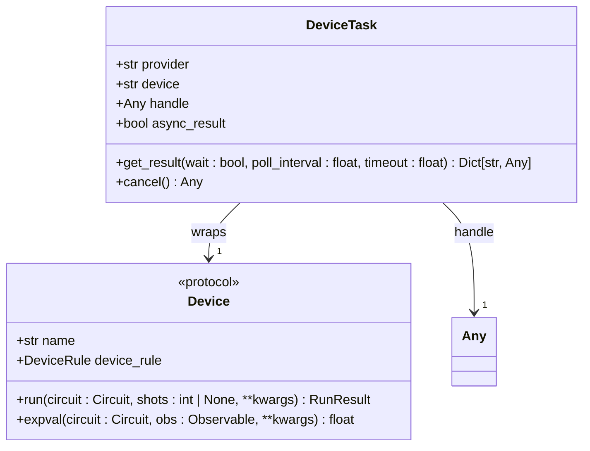
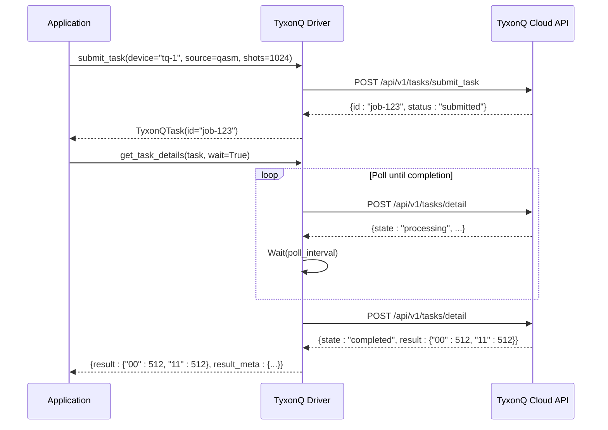
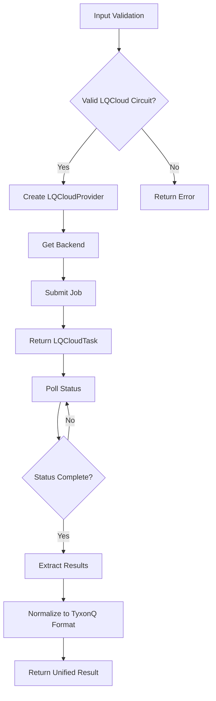
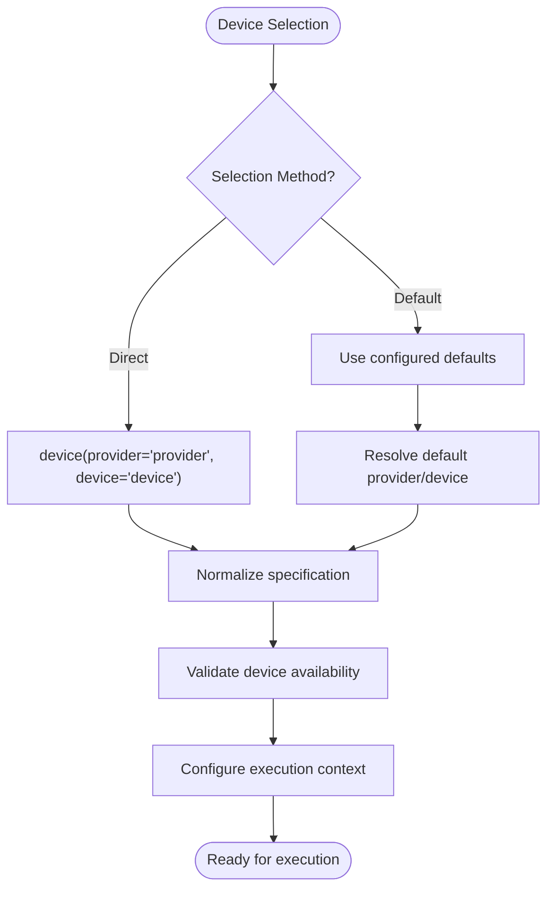
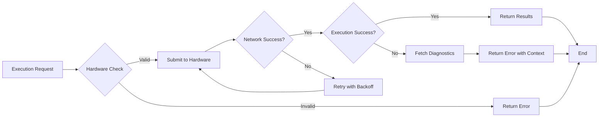

# Hardware Integration

<cite>
**Referenced Files in This Document**
- [src/tyxonq/devices/base.py](file://src/tyxonq/devices/base.py)
- [src/tyxonq/devices/hardware/config.py](file://src/tyxonq/devices/hardware/config.py)
- [src/tyxonq/devices/hardware/topology.py](file://src/tyxonq/devices/hardware/topology.py)
- [src/tyxonq/cloud/api.py](file://src/tyxonq/cloud/api.py)
- [src/tyxonq/devices/hardware/tyxonq/driver.py](file://src/tyxonq/devices/hardware/tyxonq/driver.py)
- [src/tyxonq/devices/hardware/ibm/driver.py](file://src/tyxonq/devices/hardware/ibm/driver.py)
- [src/tyxonq/devices/hardware/lqcloud/driver.py](file://src/tyxonq/devices/hardware/lqcloud/driver.py)
- [src/tyxonq/devices/hardware/guodun/driver.py](file://src/tyxonq/devices/hardware/guodun/driver.py)
- [src/tyxonq/devices/hardware/quafu/driver.py](file://src/tyxonq/devices/hardware/quafu/driver.py)
- [examples/run_circuit_on_lqcloud.py](file://examples/run_circuit_on_lqcloud.py)
- [examples/run_circuit_on_guodun.py](file://examples/run_circuit_on_guodun.py)
- [examples/run_circuit_on_quafu.py](file://examples/run_circuit_on_quafu.py)
</cite>

## Update Summary
**Changes Made**
- Added comprehensive documentation for three new hardware providers: LQCloud, Guodun QCIS, and Quafu
- Updated unified driver interface section to include all supported providers
- Added detailed sections for each new provider with their specific capabilities and authentication mechanisms
- Enhanced device selection and configuration examples with new provider syntax
- Updated hardware constraints section with provider-specific limitations
- Added compilation best practices for each provider's unique requirements

## Table of Contents
1. [Introduction](#introduction)
2. [Unified Driver Interface](#unified-driver-interface)
3. [TyxonQ Hardware Driver](#tyxonq-hardware-driver)
4. [IBM Quantum Driver](#ibm-quantum-driver)
5. [LQCloud Provider](#lqcloud-provider)
6. [Guodun QCIS Provider](#guodun-qcis-provider)
7. [Quafu Provider](#quafu-provider)
8. [Device Selection and Configuration](#device-selection-and-configuration)
9. [Hardware Constraints and Execution Considerations](#hardware-constraints-and-execution-considerations)
10. [Circuit Compilation Best Practices](#circuit-compilation-best-practices)
11. [Conclusion](#conclusion)

## Introduction
This document details the hardware integration framework within the TyxonQ quantum computing platform, focusing on the abstraction layer that enables seamless execution across different quantum hardware providers. The system provides a unified interface for interacting with both proprietary quantum processors via the TyxonQ cloud API and multiple external quantum computing platforms including IBM Quantum, LQCloud, Guodun QCIS, and Quafu devices. The architecture is designed to abstract provider-specific implementation details while maintaining low-latency control, proper error handling, and consistent execution patterns across different backends.

The platform now supports a comprehensive ecosystem of quantum hardware providers, each with specialized capabilities and optimization strategies. From superconducting quantum processors to cloud-based quantum services, the unified driver interface ensures consistent user experience regardless of the underlying hardware technology.

**Section sources**
- [src/tyxonq/devices/base.py:1-578](file://src/tyxonq/devices/base.py#L1-L578)
- [src/tyxonq/cloud/api.py:1-160](file://src/tyxonq/cloud/api.py#L1-L160)

## Unified Driver Interface
The hardware integration system is built around a unified driver interface defined in `devices/base.py`, which provides a consistent API for interacting with different quantum hardware providers. This interface abstracts provider-specific details and normalizes the execution workflow across different backends.

The core of the unified interface is the `DeviceTask` class, which wraps hardware-specific task objects with a standardized interface. This wrapper provides consistent methods for result retrieval and task cancellation regardless of the underlying provider. The `get_result()` method implements a polling mechanism with configurable timeout and poll interval parameters, ensuring reliable result retrieval across different hardware backends with varying execution times.

The driver resolution system uses the `resolve_driver()` function to dynamically select the appropriate hardware driver based on the provider specification. This function routes requests to the correct implementation:
- `"simulator"` or `"local"` providers use the local simulator driver
- `"tyxonq"` provider uses the TyxonQ cloud hardware driver
- `"ibm"` provider uses the IBM Quantum driver
- `"lqcloud"` provider uses the LQCloud SDK integration
- `"guodun"` provider uses the Guodun QCIS platform
- `"quafu"` provider uses the BAQIS Quafu cloud service

The unified interface also includes standardized error handling that normalizes provider-specific error formats into a consistent structure for downstream processing. This ensures that error conditions are handled predictably regardless of the execution backend.

**Diagram sources**
- [src/tyxonq/devices/base.py:13-58](file://src/tyxonq/devices/base.py#L13-L58)

**Section sources**
- [src/tyxonq/devices/base.py:146-258](file://src/tyxonq/devices/base.py#L146-L258)

## TyxonQ Hardware Driver
The TyxonQ hardware driver provides access to proprietary quantum processors through a cloud-based API with low-latency control and integrated calibration data. Implemented in `src/tyxonq/devices/hardware/tyxonq/driver.py`, this driver enables direct execution of quantum circuits on TyxonQ's quantum hardware infrastructure.

The driver implements three core functions that form the execution workflow:
1. `list_devices()` - Retrieves available quantum processors from the TyxonQ cloud service
2. `submit_task()` - Submits quantum circuits for execution on specified hardware
3. `get_task_details()` - Retrieves execution results and status information

The `submit_task()` function accepts quantum programs in OPENQASM format by default and handles batch submissions for multiple circuits. It includes robust error handling that attempts to retrieve device properties for diagnostic purposes when execution fails, providing valuable context for troubleshooting. The function returns a `TyxonQTask` object that encapsulates the job identifier, target device, and execution status.

The `get_task_details()` function normalizes the response from the TyxonQ cloud API into a unified structure expected by downstream components. It extracts measurement counts, shot information, and device metadata from the raw API response, ensuring consistency with the platform's data processing pipeline. The driver also integrates authentication through bearer tokens managed by the central configuration system.

**Diagram sources**
- [src/tyxonq/devices/hardware/tyxonq/driver.py:82-124](file://src/tyxonq/devices/hardware/tyxonq/driver.py#L82-L124)
- [src/tyxonq/devices/hardware/tyxonq/driver.py:128-182](file://src/tyxonq/devices/hardware/tyxonq/driver.py#L128-L182)

**Section sources**
- [src/tyxonq/devices/hardware/tyxonq/driver.py:12-182](file://src/tyxonq/devices/hardware/tyxonq/driver.py#L12-L182)

## IBM Quantum Driver
The IBM Quantum driver provides a framework for interfacing with IBM's quantum computing resources through the Qiskit Runtime service. Currently implemented as a skeleton in `src/tyxonq/devices/hardware/ibm/driver.py`, this driver establishes the interface contract that will be fulfilled with full Qiskit integration.

The driver defines the same core functions as other hardware drivers to maintain interface consistency:
- `list_devices()` - Currently returns an empty list, with future implementation planned to query available IBM quantum systems
- `submit_task()` - Raises NotImplementedError, indicating that integration with Qiskit providers is pending
- `get_task_details()` - Raises NotImplementedError, with future implementation to retrieve job results from IBM Cloud

The skeleton implementation follows the same pattern as the TyxonQ driver, ensuring that once the Qiskit integration is completed, the interface will be fully compatible with the unified execution framework. This design allows for seamless switching between hardware providers without requiring changes to application code.

The driver is designed to eventually support IBM's RESTful endpoints for circuit submission, job management, and result retrieval, following the same execution pattern as the TyxonQ driver but adapted to IBM's specific API requirements and authentication mechanisms.

**Section sources**
- [src/tyxonq/devices/hardware/ibm/driver.py:16-36](file://src/tyxonq/devices/hardware/ibm/driver.py#L16-L36)

## LQCloud Provider
The LQCloud provider offers access to LogicalQubit's quantum computing platform through their official SDK integration. Implemented in `src/tyxonq/devices/hardware/lqcloud/driver.py`, this driver provides a minimal gate-line adaptation for LQCloud's quantum processors.

### Key Features
- **SDK Integration**: Uses the official LQCloud SDK (version 0.4.2) for native quantum circuit execution
- **Authentication**: Supports flexible token management through environment variables (`TYXONQ_LQCLOUD_API_KEY`, `LQCLOUD_API_KEY`) or explicit parameter passing
- **Device Discovery**: Dynamic listing of available quantum processors through the provider's backend system
- **Error Handling**: Comprehensive error handling with fallback mechanisms for network and authentication failures

### Implementation Details
The LQCloud driver implements the standard driver interface with the following core functions:
- `run()`: Submits quantum circuits using LQCloud's `QuantumCircuit` objects
- `get_task_details()`: Retrieves execution results and normalizes them to TyxonQ's unified format
- `list_devices()`: Discovers available quantum processors through the LQCloud provider
- `remove_task()`: Cancels queued jobs through the official SDK

The driver requires pre-compiled LQCloud quantum circuits and validates input types to ensure compatibility with the underlying SDK. It supports single-circuit submissions with configurable shot counts and physical qubit mapping options.

**Diagram sources**
- [src/tyxonq/devices/hardware/lqcloud/driver.py:56-92](file://src/tyxonq/devices/hardware/lqcloud/driver.py#L56-L92)
- [src/tyxonq/devices/hardware/lqcloud/driver.py:119-180](file://src/tyxonq/devices/hardware/lqcloud/driver.py#L119-L180)

**Section sources**
- [src/tyxonq/devices/hardware/lqcloud/driver.py:1-223](file://src/tyxonq/devices/hardware/lqcloud/driver.py#L1-L223)

## Guodun QCIS Provider
The Guodun QCIS provider provides access to GuoDun's quantum computing platform through their cqlib integration. Implemented in `src/tyxonq/devices/hardware/guodun/driver.py`, this driver offers comprehensive support for both gate-level and pulse-level quantum operations on Guodun's quantum processors.

### Advanced Capabilities
- **Pulse-Level Control**: Full support for pulse-QCIS programming with real-time calibration validation
- **Topology Validation**: Real-time verification of qubit connectivity and coupler availability
- **Batch Processing**: Support for submitting multiple circuits in a single request
- **Waveform Management**: Dedicated functions for creating and managing waveform tasks

### Authentication and Security
The Guodun driver implements strict authentication with version-locked dependencies (cqlib 1.3.11) to ensure compatibility and security. Token resolution follows a specific precedence chain: explicit parameters → configured tokens → environment variables.

### Core Functions
- `run()`: Submits gate-level QCIS circuits with topology validation
- `open_pulse_context()`: Establishes secure connection for pulse-level operations
- `create_waveform()`: Creates waveform tasks for pulse programming
- `get_waveform()`: Retrieves waveform data and URLs
- `list_devices()`: Discovers available quantum computers through the platform

The driver includes sophisticated error handling for transient network issues during calibration periods and provides detailed diagnostics for topology violations and instruction validation failures.

**Section sources**
- [src/tyxonq/devices/hardware/guodun/driver.py:1-525](file://src/tyxonq/devices/hardware/guodun/driver.py#L1-L525)

## Quafu Provider
The Quafu provider enables access to the BAQIS Quafu Superconducting Quantum Cloud through a vendored REST client. Implemented in `src/tyxonq/devices/hardware/quafu/driver.py`, this driver provides a streamlined interface for executing OpenQASM 2.0 circuits on Quafu's quantum processors.

### Platform Integration
- **REST API Client**: Uses a custom-built client for communicating with Quafu's cloud services
- **OpenQASM 2.0 Support**: Requires pre-compiled OpenQASM 2.0 circuits with proper headers
- **Token Rotation**: Handles Quafu's 30-day token rotation policy automatically
- **Device Discovery**: Lists online chips and their current queue depths

### Execution Workflow
The Quafu driver follows a straightforward execution pattern:
1. Validate OpenQASM 2.0 source format
2. Submit circuits to Quafu's `/task/run` endpoint
3. Poll for task completion using the returned task ID
4. Normalize results to TyxonQ's unified format

### Configuration Options
The driver supports various compilation and execution options including:
- Compiler selection (None, 'quarkcircuit', 'qsteed', 'qiskit')
- Readout error correction
- Dynamical decoupling protocols (XY4, CPMG)
- Target qubit specification
- Server-side compilation control

**Section sources**
- [src/tyxonq/devices/hardware/quafu/driver.py:1-276](file://src/tyxonq/devices/hardware/quafu/driver.py#L1-L276)

## Device Selection and Configuration
Device selection in the TyxonQ platform is accomplished through a consistent syntax that specifies both the provider and target device. The system supports multiple methods for device specification across all supported providers:

### Direct Device Selection
Using the `.device()` method with provider-specific syntax:
- `.device(provider='tyxonq', device='homebrew_s2')` - TyxonQ quantum processor
- `.device(provider='ibm', device='ibmq_qasm_simulator')` - IBM Quantum resource
- `.device(provider='lqcloud', device='AGate-100')` - LQCloud quantum processor
- `.device(provider='guodun', device='gd_qc1')` - Guodun QCIS platform
- `.device(provider='quafu', device='Dongling')` - BAQIS Quafu chip

### Configuration-Based Selection
The system maintains default provider and device settings that can be configured globally:
- Global defaults set via `set_default(provider='...', device='...')`
- Per-session overrides for specific executions
- Environment variable fallbacks for deployment scenarios

### Authentication Mechanisms
Each provider has specific authentication requirements:
- **TyxonQ**: `TYXONQ_API_KEY` environment variable or `set_token()` function
- **LQCloud**: `TYXONQ_LQCLOUD_API_KEY` or `LQCLOUD_API_KEY` environment variables
- **Guodun**: `TYXONQ_GUODUN_TOKEN` environment variable
- **Quafu**: `TYXONQ_QUAFU_TOKEN` or `QPU_API_TOKEN` environment variables

**Diagram sources**
- [src/tyxonq/devices/base.py:112-143](file://src/tyxonq/devices/base.py#L112-L143)
- [src/tyxonq/devices/hardware/config.py:24-66](file://src/tyxonq/devices/hardware/config.py#L24-L66)

**Section sources**
- [src/tyxonq/devices/base.py:112-143](file://src/tyxonq/devices/base.py#L112-L143)
- [src/tyxonq/devices/hardware/config.py:1-78](file://src/tyxonq/devices/hardware/config.py#L1-L78)

## Hardware Constraints and Execution Considerations
Quantum hardware execution involves several constraints and considerations that must be addressed for successful circuit execution across different providers. The platform provides mechanisms to handle these constraints through both pre-execution validation and runtime error handling.

### Provider-Specific Constraints
Different quantum processors have specific limitations that affect circuit execution:

**LQCloud Constraints:**
- Requires LQCloud SDK version 0.4.2
- Single circuit submission per request
- Physical qubit mapping must be explicitly specified
- Limited to gate-level operations

**Guodun QCIS Constraints:**
- Requires cqlib version 1.3.11 for compatibility
- Pulse-QCIS only supported on gd_qc1 device
- Topology validation enforced at submission time
- Batch submissions require consistent shot counts

**Quafu Constraints:**
- Requires OpenQASM 2.0 format with proper headers
- Shot counts must be multiples of 1024
- Token rotation every 30 days
- Limited compiler options

### Error Handling Strategies
The system implements comprehensive error handling for both network and execution failures:
- Network failures trigger automatic retries with exponential backoff
- Execution failures return detailed diagnostic information including device status
- Authentication failures are handled through token refresh mechanisms
- Timeout conditions are managed with configurable polling intervals

### Authentication Mechanisms
Authentication is implemented through provider-specific tokens that are included in API requests. The system supports multiple token management approaches:
- In-memory token storage for session-based authentication
- Environment variable fallback for deployment scenarios
- Provider-specific and device-specific token scoping
- Automatic token validation and refresh

**Diagram sources**
- [src/tyxonq/devices/hardware/tyxonq/driver.py:82-124](file://src/tyxonq/devices/hardware/tyxonq/driver.py#L82-L124)
- [src/tyxonq/devices/hardware/tyxonq/driver.py:55-61](file://src/tyxonq/devices/hardware/tyxonq/driver.py#L55-L61)

**Section sources**
- [src/tyxonq/devices/hardware/tyxonq/driver.py:55-182](file://src/tyxonq/devices/hardware/tyxonq/driver.py#L55-L182)

## Circuit Compilation Best Practices
Effective circuit compilation is essential for successful execution on quantum hardware across different providers. The platform's architecture separates compilation from execution, requiring users to compile circuits to provider-specific formats before submission.

### Provider-Specific Compilation Requirements

**LQCloud Compilation:**
- Convert to LQCloud's native `QuantumCircuit` format
- Use `to_lqcloud()` compiler engine for IR conversion
- Specify physical qubit mappings explicitly
- Validate gate compatibility with target device

**Guodun QCIS Compilation:**
- Generate QCIS format with explicit measurement instructions
- Use `compile_engine='guodun'` for optimal gate decomposition
- Validate topology constraints before submission
- Support for both gate-level and pulse-level programming

**Quafu Compilation:**
- Compile to OpenQASM 2.0 format with proper headers
- Use `compile_engine='qiskit'` for reliable QASM generation
- Ensure shot counts are multiples of 1024
- Validate qubit connectivity against device topology

### Targeted Compilation Strategies
When compiling circuits for specific hardware architectures, consider the following best practices:

1. **Map to native gate sets**: Convert high-level gates to the target hardware's native operations
2. **Optimize for connectivity**: Rearrange qubit mappings to minimize SWAP operations
3. **Respect coherence limits**: Ensure circuit depth is within the hardware's coherence time
4. **Account for calibration data**: Incorporate current device calibration parameters
5. **Validate topology constraints**: Verify qubit connectivity before submission

### Execution Patterns
For optimal performance and reliability across all providers:
- Use batched submissions for multiple related circuits to reduce API overhead
- Implement appropriate polling intervals based on expected execution times
- Handle asynchronous execution patterns properly with proper timeout settings
- Monitor queue times and select devices with acceptable wait periods
- Leverage provider-specific optimizations where available

The platform's design encourages users to compile circuits using appropriate tools before submission, ensuring that the hardware drivers can focus on reliable execution and result retrieval rather than complex compilation tasks.

**Section sources**
- [src/tyxonq/devices/base.py:294-445](file://src/tyxonq/devices/base.py#L294-L445)
- [src/tyxonq/devices/hardware/tyxonq/driver.py:82-124](file://src/tyxonq/devices/hardware/tyxonq/driver.py#L82-L124)

## Conclusion
The TyxonQ platform provides a robust framework for hardware integration that abstracts provider-specific details while maintaining direct access to diverse quantum processors. The unified driver interface enables consistent execution patterns across different hardware backends, with comprehensive support for TyxonQ's proprietary quantum processors, IBM Quantum devices, LQCloud, Guodun QCIS, and Quafu platforms.

The expanded provider ecosystem demonstrates the platform's commitment to interoperability and flexibility, allowing users to leverage the strengths of different quantum computing technologies while maintaining a consistent development experience. Each provider brings unique capabilities—from pulse-level control on Guodun to cloud accessibility on Quafu—while adhering to common interfaces and execution patterns.

By separating circuit compilation from execution and implementing comprehensive error handling, authentication, and device discovery, the architecture promotes best practices in quantum circuit design while ensuring efficient and reliable hardware interaction. The platform's modular design facilitates easy addition of new providers and continued evolution of the quantum computing landscape.

The unified approach to hardware integration positions TyxonQ as a versatile platform capable of adapting to the rapidly evolving quantum computing ecosystem, providing researchers and developers with reliable access to cutting-edge quantum hardware resources.