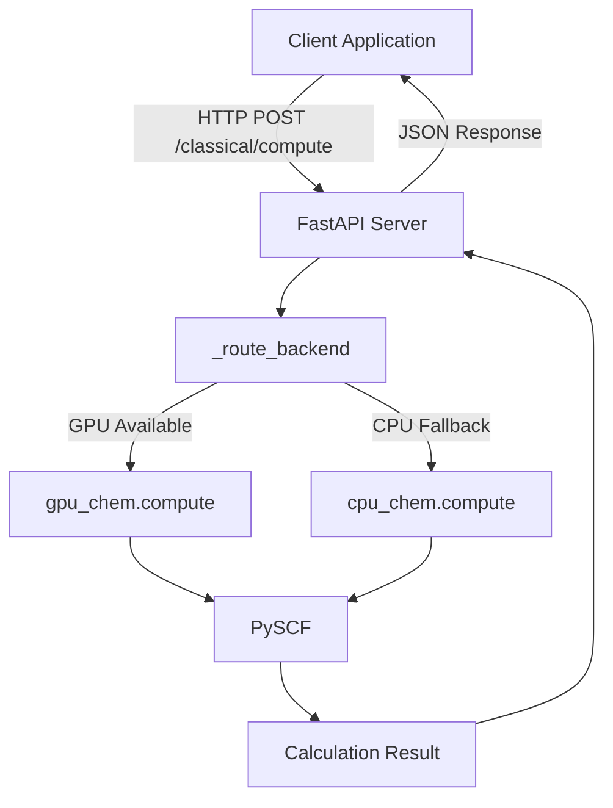
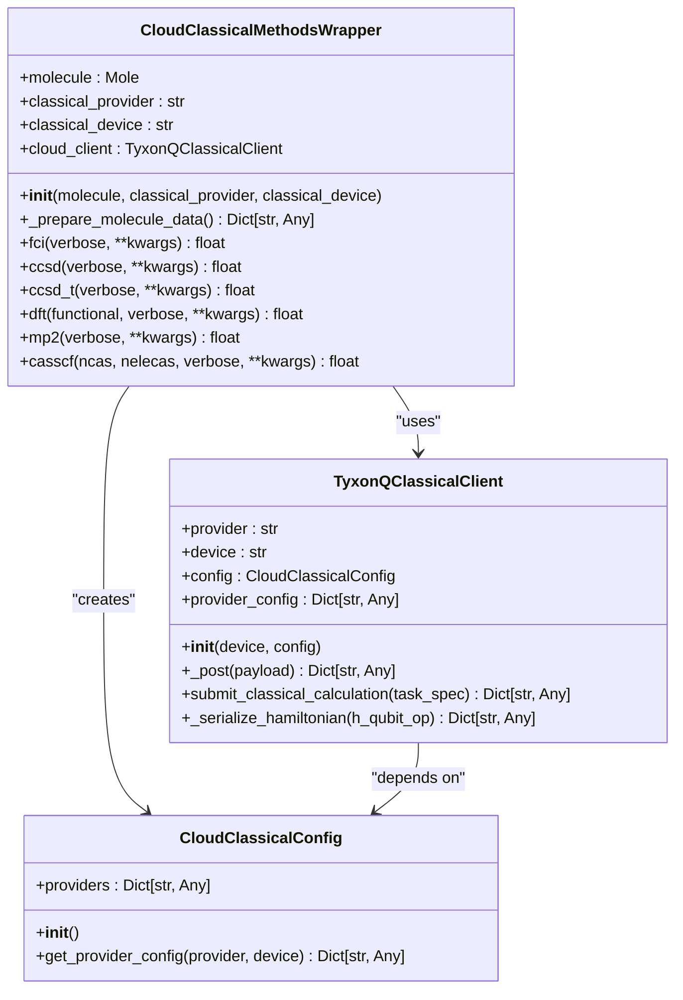
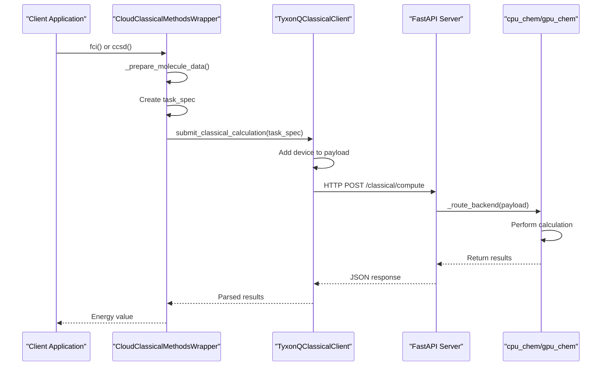
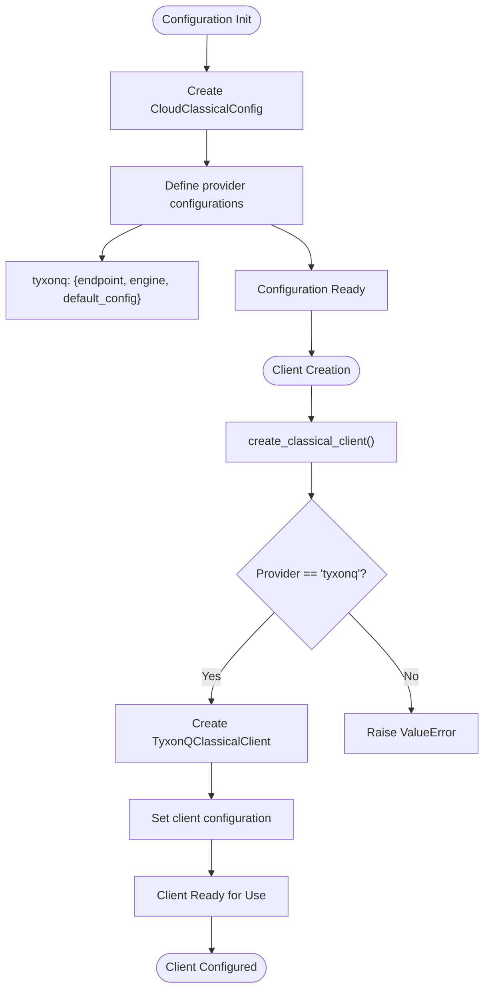
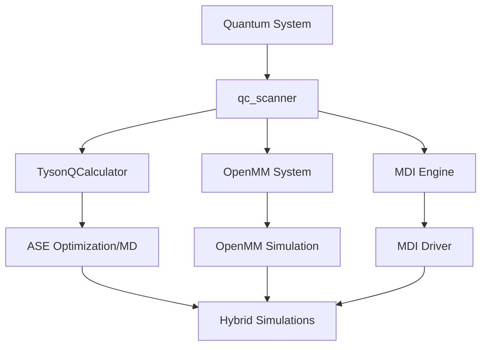
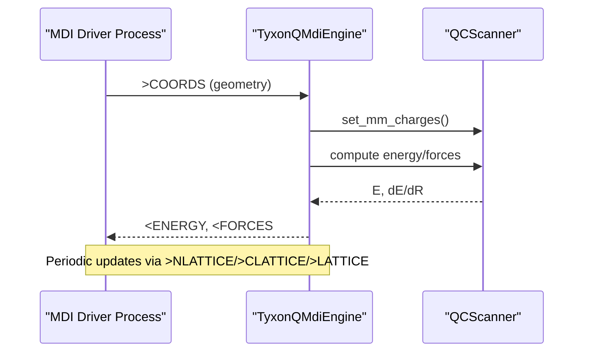
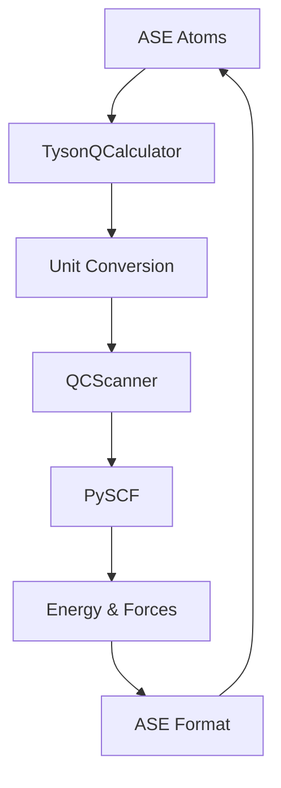
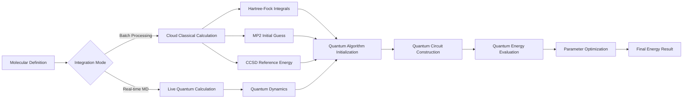

# Classical Chemistry Integration

<cite>
**Referenced Files in This Document**
- [app.py](file://src/tyxonq/applications/chem/classical_chem_cloud/server/app.py)
- [classical_methods.py](file://src/tyxonq/applications/chem/classical_chem_cloud/classical_methods.py)
- [clients.py](file://src/tyxonq/applications/chem/classical_chem_cloud/clients.py)
- [config.py](file://src/tyxonq/applications/chem/classical_chem_cloud/config.py)
- [cpu_chem.py](file://src/tyxonq/applications/chem/classical_chem_cloud/server/cpu_chem.py)
- [gpu_chem.py](file://src/tyxonq/applications/chem/classical_chem_cloud/server/gpu_chem.py)
- [cloud_uccsd_hea_demo.py](file://examples/cloud_uccsd_hea_demo.py)
- [scanner.py](file://src/tyxonq/applications/chem/interfaces/scanner.py)
- [ase_calculator.py](file://src/tyxonq/applications/chem/interfaces/ase_calculator.py)
- [openmm_potential.py](file://src/tyxonq/applications/chem/interfaces/openmm_potential.py)
- [mdi_engine.py](file://src/tyxonq/applications/chem/interfaces/mdi_engine.py)
- [ipi_driver.py](file://src/tyxonq/applications/chem/interfaces/ipi_driver.py)
- [md_ase_optimize_and_md.py](file://examples/qmmm/md_ase_optimize_and_md.py)
- [md_openmm_pure_qm.py](file://examples/qmmm/md_openmm_pure_qm.py)
- [md_mdi_qmmm_embedded.py](file://examples/qmmm/md_mdi_qmmm_embedded.py)
</cite>

## Update Summary
**Changes Made**
- Added comprehensive documentation for molecular dynamics integration interfaces including MDI engine support, OpenMM potential integration, and ASE calculator compatibility
- Updated hybrid workflow section to include classical-quantum hybrid simulations through multiple integration pathways
- Added new sections covering MDI engine architecture, OpenMM direct integration, and ASE calculator interface
- Enhanced setup instructions with molecular dynamics dependencies and deployment options
- Updated security considerations to cover distributed MD simulation environments

## Table of Contents
1. [Introduction](#introduction)
2. [Cloud-Based Classical Computation Architecture](#cloud-based-classical-computation-architecture)
3. [Classical Methods Implementation](#classical-methods-implementation)
4. [Client-Server Communication](#client-server-communication)
5. [Configuration Management](#configuration-management)
6. [Molecular Dynamics Integration Interfaces](#molecular-dynamics-integration-interfaces)
7. [MDI Engine Support](#mdi-engine-support)
8. [OpenMM Potential Integration](#openmm-potential-integration)
9. [ASE Calculator Compatibility](#ase-calculator-compatibility)
10. [Hybrid Quantum-Classical Workflow](#hybrid-quantum-classical-workflow)
11. [Security and Error Handling](#security-and-error-handling)
12. [Setup and Deployment](#setup-and-deployment)
13. [Conclusion](#conclusion)

## Introduction
This document provides comprehensive documentation for the classical chemistry integration within TyxonQ, focusing on both cloud-based computation architecture and molecular dynamics integration capabilities. The system leverages a FastAPI server for remote quantum chemistry calculations while providing extensive interfaces for classical-quantum hybrid simulations through MDI engine support, OpenMM potential integration, and ASE calculator compatibility. This dual approach enables efficient hybrid workflows by combining cloud-accelerated classical methods with real-time molecular dynamics simulations.

**Section sources**
- [classical_methods.py:1-20](file://src/tyxonq/applications/chem/classical_chem_cloud/classical_methods.py#L1-L20)
- [app.py:1-10](file://src/tyxonq/applications/chem/classical_chem_cloud/server/app.py#L1-L10)
- [scanner.py:1-40](file://src/tyxonq/applications/chem/interfaces/scanner.py#L1-L40)

## Cloud-Based Classical Computation Architecture
The cloud-based classical computation architecture in TyxonQ is built around a FastAPI server that handles remote PySCF calculations. The server, implemented in `app.py`, exposes a RESTful endpoint at `/classical/compute` that accepts JSON payloads containing molecular data and method specifications. The architecture supports both CPU and GPU computation through a routing mechanism that automatically selects the appropriate backend based on availability and client preferences.

The server architecture consists of two main computational backends: `cpu_chem.py` and `gpu_chem.py`. The CPU backend utilizes standard PySCF implementations with optimized threading and memory management, while the GPU backend leverages gpu4pyscf for accelerated computation. The routing function `_route_backend` in `app.py` determines the appropriate backend based on the `classical_device` parameter in the request payload, with automatic fallback to CPU if GPU computation fails.



**Diagram sources**
- [app.py:15-30](file://src/tyxonq/applications/chem/classical_chem_cloud/server/app.py#L15-L30)
- [cpu_chem.py:1-20](file://src/tyxonq/applications/chem/classical_chem_cloud/server/cpu_chem.py#L1-L20)
- [gpu_chem.py:1-20](file://src/tyxonq/applications/chem/classical_chem_cloud/server/gpu_chem.py#L1-L20)

**Section sources**
- [app.py:1-42](file://src/tyxonq/applications/chem/classical_chem_cloud/server/app.py#L1-L42)
- [cpu_chem.py:1-190](file://src/tyxonq/applications/chem/classical_chem_cloud/server/cpu_chem.py#L1-L190)
- [gpu_chem.py:1-170](file://src/tyxonq/applications/chem/classical_chem_cloud/server/gpu_chem.py#L1-L170)

## Classical Methods Implementation
The `classical_methods.py` module provides cloud-accelerated implementations of traditional quantum chemistry methods including Hartree-Fock, MP2, CCSD, and FCI. These methods are encapsulated within the `CloudClassicalMethodsWrapper` class, which serves as a unified interface for accessing cloud-based classical computations. The wrapper prepares molecular data for transmission and submits calculation tasks to the remote server through the classical client.

Each method implementation follows a consistent pattern: preparing a task specification with molecular data, method options, and device preferences, then submitting this specification to the cloud client. The supported methods include:
- **Hartree-Fock (HF)**: Self-consistent field calculations for molecular orbitals
- **Møller-Plesset perturbation theory (MP2)**: Second-order perturbation theory for electron correlation
- **Coupled Cluster Singles and Doubles (CCSD)**: High-accuracy method for electron correlation
- **Full Configuration Interaction (FCI)**: Exact solution within the specified basis set
- **Density Functional Theory (DFT)**: Implementation with configurable functionals
- **Complete Active Space SCF (CASSCF)**: Multi-configurational method for active spaces

The `cloud_classical_methods` factory function simplifies the creation of the wrapper, accepting a PySCF molecule object and provider configuration to return an instance with all cloud-accelerated methods available.



**Diagram sources**
- [classical_methods.py:16-168](file://src/tyxonq/applications/chem/classical_chem_cloud/classical_methods.py#L16-L168)
- [clients.py:21-72](file://src/tyxonq/applications/chem/classical_chem_cloud/clients.py#L21-L72)
- [config.py:7-41](file://src/tyxonq/applications/chem/classical_chem_cloud/config.py#L7-L41)

**Section sources**
- [classical_methods.py:1-168](file://src/tyxonq/applications/chem/classical_chem_cloud/classical_methods.py#L1-L168)

## Client-Server Communication
Client-server communication in the TyxonQ classical chemistry system follows a RESTful API pattern using HTTP POST requests. The `clients.py` module implements the `TyxonQClassicalClient` class, which handles all communication with the remote classical computation server. The client prepares JSON payloads containing calculation specifications and sends them to the server endpoint, then processes the JSON responses containing calculation results.

The communication workflow consists of several key steps:
1. Client initialization with device preferences and configuration
2. Preparation of task specification with molecular data and method parameters
3. HTTP POST request to the server's `/classical/compute` endpoint
4. Response handling with error checking and result extraction
5. Return of structured results to the calling application

The client implements robust error handling for network-related issues, including timeouts and connection failures. The `_post` method in `TyxonQClassicalClient` manages the HTTP request lifecycle, including setting appropriate headers, handling timeouts from the configuration, and parsing JSON responses. The `submit_classical_calculation` method serves as the primary interface, adding the client's device preference to the task specification before submission.



**Diagram sources**
- [clients.py:21-72](file://src/tyxonq/applications/chem/classical_chem_cloud/clients.py#L21-L72)
- [app.py:32-42](file://src/tyxonq/applications/chem/classical_chem_cloud/server/app.py#L32-L42)
- [classical_methods.py:48-60](file://src/tyxonq/applications/chem/classical_chem_cloud/classical_methods.py#L48-L60)

**Section sources**
- [clients.py:1-72](file://src/tyxonq/applications/chem/classical_chem_cloud/clients.py#L1-L72)

## Configuration Management
Configuration management in the TyxonQ classical chemistry system is handled through the `config.py` module, which defines the `CloudClassicalConfig` class and the `create_classical_client` factory function. The configuration system supports provider selection between local and cloud-based computation, with the current implementation focused on the "tyxonq" cloud provider.

The `CloudClassicalConfig` class maintains a dictionary of provider configurations, with each provider specifying an endpoint URL, engine type, and default configuration parameters such as timeout values. The current configuration points to a local development server at `http://127.0.0.1:8009`, but this can be changed to a production cloud endpoint. The `get_provider_config` method validates the requested provider and returns its configuration, raising an error for unknown providers.

The `create_classical_client` factory function simplifies client creation by handling the instantiation of the appropriate client class based on the provider. Currently, only the "tyxonq" provider is supported, and attempts to use other providers will raise a `ValueError`. This factory pattern allows for future expansion to support additional classical computation providers while maintaining a consistent interface.



**Diagram sources**
- [config.py:7-41](file://src/tyxonq/applications/chem/classical_chem_cloud/config.py#L7-L41)

**Section sources**
- [config.py:1-42](file://src/tyxonq/applications/chem/classical_chem_cloud/config.py#L1-L42)

## Molecular Dynamics Integration Interfaces
**Updated** Added comprehensive molecular dynamics integration capabilities that enable classical-quantum hybrid simulations through multiple integration pathways.

The TyxonQ framework now provides extensive molecular dynamics integration interfaces that bridge quantum chemistry calculations with classical simulation engines. These interfaces support three primary integration patterns:

### Core Scanner Interface
The `qc_scanner` function serves as the central entry point for molecular dynamics, providing a PySCF-compatible scanner interface that supports various quantum chemistry methods including SQD, UCCSD, ROUCCSD, and HEA. The scanner handles geometry optimization, energy calculations, and gradient computations with support for electrostatic embedding and periodic boundary conditions.

### Integration Pathways
1. **ASE Calculator Interface**: Standard ASE calculator implementation enabling seamless integration with ASE ecosystem tools
2. **OpenMM Direct Integration**: Direct OpenMM System creation with PythonForce callbacks for real-time quantum calculations
3. **MDI Engine Protocol**: Message Passing Interface protocol support for multi-process quantum-classical simulations



**Diagram sources**
- [scanner.py:93-188](file://src/tyxonq/applications/chem/interfaces/scanner.py#L93-L188)
- [ase_calculator.py:53-136](file://src/tyxonq/applications/chem/interfaces/ase_calculator.py#L53-L136)
- [openmm_potential.py:73-99](file://src/tyxonq/applications/chem/interfaces/openmm_potential.py#L73-L99)
- [mdi_engine.py:52-102](file://src/tyxonq/applications/chem/interfaces/mdi_engine.py#L52-L102)

**Section sources**
- [scanner.py:1-424](file://src/tyxonq/applications/chem/interfaces/scanner.py#L1-L424)

## MDI Engine Support
**New Section** Added MDI (Message Passing Interface) engine support for high-performance quantum-classical molecular dynamics simulations.

The MDI engine implementation provides a specialized communication protocol for coupling TyxonQ with MDI-capable molecular dynamics engines like LAMMPS and OpenMM-MDI. This enables efficient electrostatic embedding where classical point charges from the MM region are dynamically incorporated into the QM Hamiltonian during simulation.

### Key Features
- **TCP-based Communication**: Uses MDI protocol over TCP sockets for inter-process communication
- **Electrostatic Embedding**: Supports dynamic updates of MM point charges during simulation
- **Force Decomposition**: Returns combined QM gradients and MM reaction forces
- **Periodic Boundary Conditions**: Full support for Ewald summation in periodic systems

### Usage Pattern
The MDI engine operates as a separate process that listens for commands from a driver process. The driver sends geometry updates and receives energy/force calculations, while managing the exchange of MM environment information through specialized MDI commands (`>NLATTICE`, `>CLATTICE`, `>LATTICE`).



**Diagram sources**
- [mdi_engine.py:105-179](file://src/tyxonq/applications/chem/interfaces/mdi_engine.py#L105-L179)
- [scanner.py:331-381](file://src/tyxonq/applications/chem/interfaces/scanner.py#L331-L381)

**Section sources**
- [mdi_engine.py:1-231](file://src/tyxonq/applications/chem/interfaces/mdi_engine.py#L1-L231)

## OpenMM Potential Integration
**New Section** Added direct OpenMM integration through a thin wrapper around openmmml's MLPotential functionality.

The OpenMM potential integration provides seamless access to TyxonQ's quantum chemistry capabilities within the OpenMM molecular dynamics framework. This enables running full quantum mechanical simulations or QM/MM hybrid simulations directly in OpenMM without external drivers.

### Integration Modes
1. **Pure QM Systems**: Entire system treated quantum mechanically using TyxonQ potential surface
2. **Mechanical Embedding**: QM region embedded in classical force field with classical QM-MM interactions
3. **Electrostatic Embedding**: MM point charges incorporated into QM Hamiltonian for polarizable environments

### System Construction
The integration uses OpenMM's `MLPotential('ase')` to create custom potential functions that call TyxonQ's quantum chemistry methods. For QM/MM simulations, the system undergoes surgical modification to prevent double-counting of interactions between QM and MM regions.

```mermaid
graph LR
Topology[OpenMM Topology] --> MLPotential[MLPotential('ase')]
MLPotential --> TyxonQCalc[TysonQCalculator]
TyxonQCalc --> QCScanner[QCScanner]
QCScanner --> PySCF[PySCF Calculations]
PySCF --> Forces[Energy & Forces]
Forces --> Context[OpenMM Context]
Context --> Integrator[Integrator]
```

**Diagram sources**
- [openmm_potential.py:73-99](file://src/tyxonq/applications/chem/interfaces/openmm_potential.py#L73-L99)
- [openmm_potential.py:145-239](file://src/tyxonq/applications/chem/interfaces/openmm_potential.py#L145-L239)

**Section sources**
- [openmm_potential.py:1-257](file://src/tyxonq/applications/chem/interfaces/openmm_potential.py#L1-L257)

## ASE Calculator Compatibility
**New Section** Added full ASE calculator compatibility for integration with the Atomic Simulation Environment ecosystem.

The ASE calculator implementation provides a standard interface that allows TyxonQ to be used as a drop-in replacement for any ASE calculator. This enables seamless integration with ASE's optimization algorithms, molecular dynamics integrators, and analysis tools.

### Key Capabilities
- **Standard ASE Interface**: Implements `energy`, `free_energy`, and `forces` properties
- **Automatic Unit Conversion**: Handles conversion between Bohr/Hartree and eV/Å units
- **QM/MM Region Partitioning**: Supports dividing systems into QM and MM regions
- **Electrostatic Embedding**: Dynamic updates of MM point charges during simulation

### Integration Examples
The calculator supports both pure quantum calculations and QM/MM simulations. In QM/MM mode, the QM region is calculated quantum mechanically while MM regions provide classical point charges that are updated at each simulation step.



**Diagram sources**
- [ase_calculator.py:53-136](file://src/tyxonq/applications/chem/interfaces/ase_calculator.py#L53-L136)
- [ase_calculator.py:139-208](file://src/tyxonq/applications/chem/interfaces/ase_calculator.py#L139-L208)

**Section sources**
- [ase_calculator.py:1-208](file://src/tyxonq/applications/chem/interfaces/ase_calculator.py#L1-L208)

## Hybrid Quantum-Classical Workflow
**Updated** Enhanced hybrid workflow documentation to include molecular dynamics integration capabilities alongside cloud-based classical computation.

The hybrid quantum-classical workflow in TyxonQ now supports multiple integration pathways that combine quantum algorithms with classical molecular dynamics simulations. This enhanced workflow enables sophisticated simulations where computationally intensive quantum calculations are performed on remote servers while classical dynamics run locally or in distributed environments.

### Enhanced Workflow Components
1. **Cloud-Based Classical Methods**: Remote Hartree-Fock, MP2, CCSD, and FCI calculations
2. **Real-Time Quantum Dynamics**: Live quantum calculations during molecular dynamics
3. **Multi-Scale Simulations**: Coupling different levels of theory across spatial/temporal scales
4. **Adaptive Sampling**: Quantum calculations triggered by classical sampling criteria

### Integration Patterns
The workflow supports both batch processing (cloud classical methods) and streaming computation (real-time MD integration). Users can choose the appropriate approach based on their specific requirements for accuracy, performance, and resource utilization.



**Diagram sources**
- [cloud_uccsd_hea_demo.py:1-57](file://examples/cloud_uccsd_hea_demo.py#L1-L57)
- [scanner.py:93-188](file://src/tyxonq/applications/chem/interfaces/scanner.py#L93-L188)

**Section sources**
- [cloud_uccsd_hea_demo.py:1-57](file://examples/cloud_uccsd_hea_demo.py#L1-L57)

## Security and Error Handling
**Updated** Enhanced security and error handling to cover distributed molecular dynamics environments and multi-process communication.

The TyxonQ classical chemistry system implements comprehensive security and error handling mechanisms that extend beyond basic cloud computing to cover distributed molecular dynamics simulations. The system includes robust protection against network failures, process crashes, and invalid input data across all integration pathways.

### Enhanced Security Measures
- **Process Isolation**: MDI engine runs in separate processes with proper cleanup
- **Network Security**: Secure communication protocols for distributed simulations
- **Resource Management**: Automatic cleanup of temporary files and network connections
- **Input Validation**: Comprehensive validation of molecular structures and simulation parameters

### Error Recovery Strategies
1. **Graceful Degradation**: Fallback from GPU to CPU computation when resources unavailable
2. **Checkpoint Recovery**: Ability to resume simulations after failures
3. **Communication Retry**: Automatic reconnection for network-based simulations
4. **Memory Management**: Efficient handling of large molecular systems

**Section sources**
- [app.py:15-30](file://src/tyxonq/applications/chem/classical_chem_cloud/server/app.py#L15-L30)
- [clients.py:35-45](file://src/tyxonq/applications/chem/classical_chem_cloud/clients.py#L35-L45)
- [mdi_engine.py:44-49](file://src/tyxonq/applications/chem/interfaces/mdi_engine.py#L44-L49)

## Setup and Deployment
**Updated** Enhanced setup instructions to include molecular dynamics dependencies and multi-environment deployment options.

Setting up and deploying the classical chemistry server in TyxonQ now requires additional dependencies for molecular dynamics integration. The system supports both standalone cloud computation and integrated molecular dynamics workflows.

### Complete Installation Requirements
```bash
# Core classical chemistry dependencies
pip install fastapi uvicorn pydantic
pip install pyscf
pip install gpu4pyscf-cuda12x 
pip install cutensor-cu12

# Molecular dynamics integration dependencies
pip install 'tyxonq[md]'  # Includes ASE, OpenMM, OpenMM-ML
pip install 'pymdi>=1.4'   # For MDI engine support
```

### Multi-Environment Deployment
1. **Development Environment**: Local server with GPU acceleration for testing
2. **Production Cloud**: Containerized deployment with auto-scaling
3. **High-Performance Computing**: Distributed MDI engine clusters
4. **Hybrid Workflows**: Combined cloud and local computation strategies

### Advanced Configuration Options
```python
# Configure quantum algorithms with cloud classical provider
u_ccsd = UCCSD(mol, classical_provider="tyxonq", classical_device="auto")
hea = HEA(molecule=mol, classical_provider="tyxonq", classical_device="auto")

# Set up molecular dynamics integration
from tyxonq.applications.chem.interfaces import qc_scanner
scan = qc_scanner("O 0 0 0; H 0 -0.757 0.587; H 0 0.757 0.587",
                  basis="sto-3g", active_space=(4, 4), method="uccsd")
```

**Section sources**
- [app.py:40-42](file://src/tyxonq/applications/chem/classical_chem_cloud/server/app.py#L40-L42)
- [config.py:11-20](file://src/tyxonq/applications/chem/classical_chem_cloud/config.py#L11-L20)

## Conclusion
**Updated** Enhanced conclusion reflecting the expanded capabilities of classical chemistry integration with molecular dynamics support.

The classical chemistry integration in TyxonQ has evolved into a comprehensive platform that combines cloud-based quantum chemistry calculations with advanced molecular dynamics integration capabilities. The system now provides multiple pathways for classical-quantum hybrid simulations, from simple ASE calculator usage to complex multi-process MDI engine deployments.

Key enhancements include:
- **Multi-Platform Integration**: Support for ASE, OpenMM, and MDI protocols
- **Flexible Deployment**: From single-node development to distributed HPC clusters
- **Advanced Embedding**: Electrostatic and mechanical embedding for realistic simulations
- **Robust Error Handling**: Comprehensive recovery mechanisms for distributed environments

This expanded integration significantly enhances the capabilities of quantum chemistry simulations by providing seamless bridges between quantum algorithms and classical molecular dynamics engines. Researchers can now perform sophisticated multi-scale simulations that leverage the strengths of both quantum and classical computational approaches, enabling more accurate and efficient molecular modeling across diverse scientific domains.

The architecture's modular design ensures that users can select the appropriate integration pathway based on their specific requirements, whether they need simple structure optimization, complex QM/MM simulations, or large-scale distributed molecular dynamics studies.