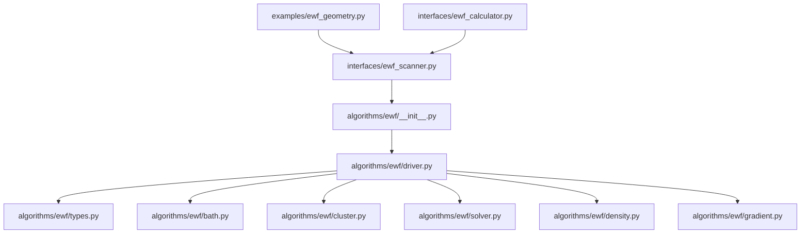
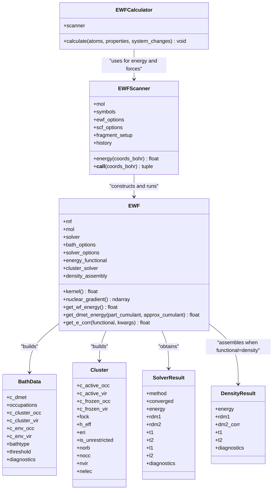
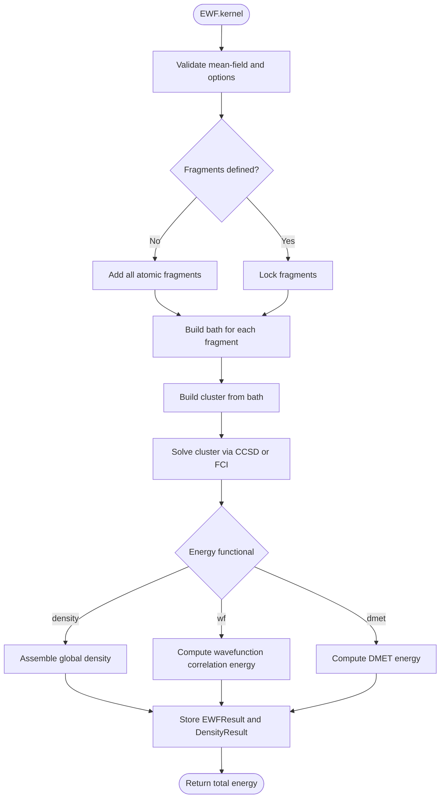
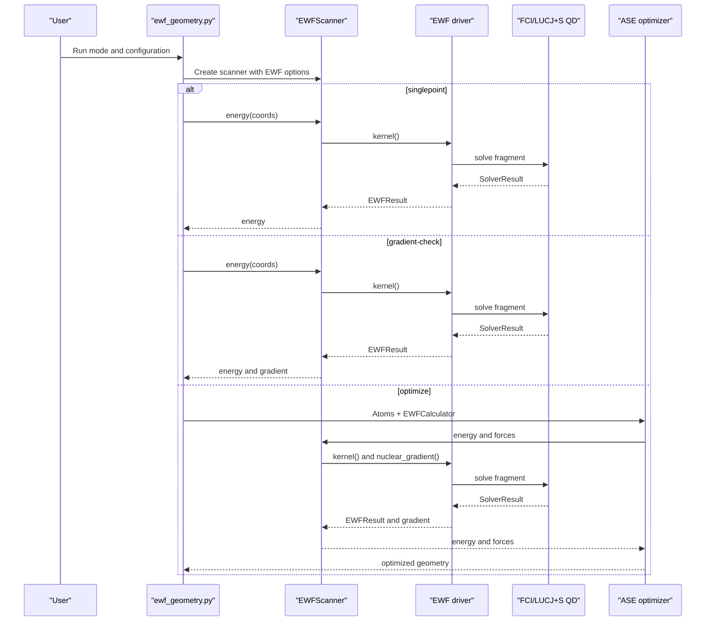
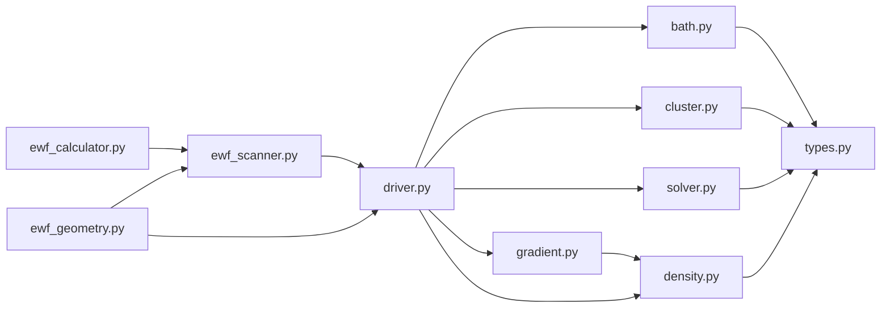

# EWF (Embedded Wavefunction Theory) Algorithm

<cite>
**Referenced Files in This Document**
- [ewf_geometry.py](file://examples/ewf_geometry.py)
- [ewf_scanner.py](file://src/tyxonq/applications/chem/interfaces/ewf_scanner.py)
- [ewf_calculator.py](file://src/tyxonq/applications/chem/interfaces/ewf_calculator.py)
- [__init__.py](file://src/tyxonq/applications/chem/algorithms/ewf/__init__.py)
- [driver.py](file://src/tyxonq/applications/chem/algorithms/ewf/driver.py)
- [types.py](file://src/tyxonq/applications/chem/algorithms/ewf/types.py)
- [solver.py](file://src/tyxonq/applications/chem/algorithms/ewf/solver.py)
- [density.py](file://src/tyxonq/applications/chem/algorithms/ewf/density.py)
- [gradient.py](file://src/tyxonq/applications/chem/algorithms/ewf/gradient.py)
- [bath.py](file://src/tyxonq/applications/chem/algorithms/ewf/bath.py)
- [cluster.py](file://src/tyxonq/applications/chem/algorithms/ewf/cluster.py)
</cite>

## Table of Contents
1. [Introduction](#introduction)
2. [Project Structure](#project-structure)
3. [Core Components](#core-components)
4. [Architecture Overview](#architecture-overview)
5. [Detailed Component Analysis](#detailed-component-analysis)
6. [Dependency Analysis](#dependency-analysis)
7. [Performance Considerations](#performance-considerations)
8. [Troubleshooting Guide](#troubleshooting-guide)
9. [Conclusion](#conclusion)

## Introduction
This document explains the Embedded Wavefunction Theory implementation in TyxonQ. It focuses on how molecular mean-field references are partitioned into fragments, how bath orbitals and cluster Hamiltonians are constructed, how fragment solvers produce reduced density matrices, and how global densities, energies, and frozen-bath nuclear gradients are assembled. The documentation also covers the geometry scanner and ASE integration used by the EWF example workflow.

EWF is not a single monolithic algorithm here; it is a coordinated pipeline:
- Fragmentation defines atomic or user-defined fragments.
- Bath construction builds DMET and MP2-BNO environment information.
- Cluster assembly produces active/frozen orbital spaces and effective Hamiltonians.
- Solver execution returns local amplitudes and reduced density matrices.
- Density assembly projects local data onto a global molecular basis.
- Energy and gradient evaluation use either wavefunction projection, DMET-style energy partitioning, or linear-density energy with frozen-bath gradients.

The example script demonstrates closed-shell EWF with optional LUCJ state-vector sampling and SQD recovery for larger fragments, while the core EWF driver supports CCSD and FCI cluster solvers.

## Project Structure
The EWF code lives under `src/tyxonq/applications/chem/algorithms/ewf`, with interfaces under `src/tyxonq/applications/chem/interfaces` and an end-to-end example under `examples`.

**Diagram sources**
- [ewf_geometry.py:49-55](file://examples/ewf_geometry.py#L49-L55)
- [ewf_scanner.py:16-17](file://src/tyxonq/applications/chem/interfaces/ewf_scanner.py#L16-L17)
- [ewf_calculator.py:3-5](file://src/tyxonq/applications/chem/interfaces/ewf_calculator.py#L3-L5)
- [__init__.py:1-27](file://src/tyxonq/applications/chem/algorithms/ewf/__init__.py#L1-L27)
- [driver.py:14-24](file://src/tyxonq/applications/chem/algorithms/ewf/driver.py#L14-L24)

**Section sources**
- [ewf_geometry.py:1-34](file://examples/ewf_geometry.py#L1-L34)
- [ewf_scanner.py:1-25](file://src/tyxonq/applications/chem/interfaces/ewf_scanner.py#L1-L25)
- [ewf_calculator.py:1-10](file://src/tyxonq/applications/chem/interfaces/ewf_calculator.py#L1-L10)
- [__init__.py:1-27](file://src/tyxonq/applications/chem/algorithms/ewf/__init__.py#L1-L27)

## Core Components
- EWF driver: validates mean-field input, manages fragments, constructs baths and clusters, runs solvers, assembles energy, and provides frozen-bath gradients.
- Data types: immutable dataclasses describing bath data, cluster orbitals and integrals, solver results, fragment results, and total EWF results.
- Bath module: builds DMET bath and MP2-BNO bath orbitals, including UHF spin-resolved variants and projector-weight schemes.
- Cluster module: combines fragment and bath orbitals into active/frozen spaces and computes effective one-electron Hamiltonians and two-electron integrals.
- Solver module: wraps PySCF CCSD and FCI solvers, handles RHF and UHF clusters, pads amplitudes, and returns consistent `SolverResult` objects.
- Density module: projects fragment reduced density matrices to global effective amplitudes, optionally solves fixed-T Lambda equations, and computes linear-density energy.
- Gradient module: computes frozen-bath nuclear gradients using CPHF response and AO integral blocks.
- Interfaces: `EWFScanner` maps Bohr coordinates to energy and gradients; `EWFCalculator` integrates with ASE for geometry optimization.
- Example: `ewf_geometry.py` shows single-point, finite-difference checks, and approximate geometry optimization with optional LUCJ/SQD fragment solving.

**Section sources**
- [driver.py:151-206](file://src/tyxonq/applications/chem/algorithms/ewf/driver.py#L151-L206)
- [types.py:22-209](file://src/tyxonq/applications/chem/algorithms/ewf/types.py#L22-L209)
- [bath.py:27-48](file://src/tyxonq/applications/chem/algorithms/ewf/bath.py#L27-L48)
- [cluster.py:12-79](file://src/tyxonq/applications/chem/algorithms/ewf/cluster.py#L12-L79)
- [solver.py:14-34](file://src/tyxonq/applications/chem/algorithms/ewf/solver.py#L14-L34)
- [density.py:21-31](file://src/tyxonq/applications/chem/algorithms/ewf/density.py#L21-L31)
- [gradient.py:20-25](file://src/tyxonq/applications/chem/algorithms/ewf/gradient.py#L20-L25)
- [ewf_scanner.py:19-43](file://src/tyxonq/applications/chem/interfaces/ewf_scanner.py#L19-L43)
- [ewf_calculator.py:8-17](file://src/tyxonq/applications/chem/interfaces/ewf_calculator.py#L8-L17)
- [ewf_geometry.py:58-175](file://examples/ewf_geometry.py#L58-L175)

## Architecture Overview
The EWF pipeline can be viewed as a layered architecture where each layer has a clear contract and validation boundary.

**Diagram sources**
- [driver.py:151-484](file://src/tyxonq/applications/chem/algorithms/ewf/driver.py#L151-L484)
- [ewf_scanner.py:19-111](file://src/tyxonq/applications/chem/interfaces/ewf_scanner.py#L19-L111)
- [ewf_calculator.py:8-33](file://src/tyxonq/applications/chem/interfaces/ewf_calculator.py#L8-L33)
- [types.py:22-209](file://src/tyxonq/applications/chem/algorithms/ewf/types.py#L22-L209)
- [density.py:21-31](file://src/tyxonq/applications/chem/algorithms/ewf/density.py#L21-L31)

## Detailed Component Analysis

### EWF Driver
The driver is the central orchestrator. It validates the mean-field reference, accepts bath and solver options, manages IAO fragmentation, builds baths and clusters, executes fragment solvers, and computes either wavefunction-projected energy, DMET-style energy, or density-based energy. It also exposes frozen-bath nuclear gradients when the density functional is used.

Key responsibilities:
- Mean-field validation enforces real RHF/UHF references, correct occupations, non-periodic molecules, and convergence.
- Bath option validation restricts supported keys and ranges.
- Kernel builds default atomic fragments if none exist, locks fragments, warns about incomplete owner coverage, and records per-fragment diagnostics.
- Density assembly requires converged fragment solvers and stores `DensityResult` for gradient evaluation.
- Nuclear gradient requires `energy_functional='density'`, converged SCF and fragment solvers, and complete fragmentation.

**Diagram sources**
- [driver.py:256-412](file://src/tyxonq/applications/chem/algorithms/ewf/driver.py#L256-L412)

**Section sources**
- [driver.py:67-107](file://src/tyxonq/applications/chem/algorithms/ewf/driver.py#L67-L107)
- [driver.py:110-148](file://src/tyxonq/applications/chem/algorithms/ewf/driver.py#L110-L148)
- [driver.py:256-412](file://src/tyxonq/applications/chem/algorithms/ewf/driver.py#L256-L412)
- [driver.py:430-449](file://src/tyxonq/applications/chem/algorithms/ewf/driver.py#L430-L449)

### Data Types
Types define the immutable contracts between components:
- `BathData`: DMET and MP2-BNO orbitals, occupations, thresholds, and diagnostics.
- `Cluster`: active/frozen occupied/virtual orbitals, Fock matrix, effective Hamiltonian, and integrals; includes unrestricted helpers and dummy virtual padding.
- `SolverResult`: method name, convergence flag, energy, reduced density matrices, amplitudes, and diagnostics.
- `FragmentResult`: links fragment metadata, bath, cluster, solver result, and per-fragment energies.
- `EWFResult`: total mean-field, correlation, and total energy; convergence flags; fragmentation diagnostics; and per-fragment results.

These types ensure that downstream modules do not assume mutable state and can validate shapes, spin structure, and numerical properties.

**Section sources**
- [types.py:22-49](file://src/tyxonq/applications/chem/algorithms/ewf/types.py#L22-L49)
- [types.py:51-152](file://src/tyxonq/applications/chem/algorithms/ewf/types.py#L51-L152)
- [types.py:154-209](file://src/tyxonq/applications/chem/algorithms/ewf/types.py#L154-L209)

### Bath Construction
Bath construction separates environment information from the fragment:
- DMET bath partitions environment orbitals based on occupation thresholds and canonicalizes cluster orbitals.
- MP2-BNO bath uses MP2 amplitudes projected onto fragment+DMET subspaces, then selects bath orbitals by threshold.
- Both restricted and unrestricted paths are supported; UHF uses per-spin wrappers around restricted logic.
- Projector weights control how strongly DMET environment orbitals contribute to the bath selection.

Validation ensures real orbitals, overlap consistency, proper occupation ranges, and orthogonality.

**Section sources**
- [bath.py:103-215](file://src/tyxonq/applications/chem/algorithms/ewf/bath.py#L103-L215)
- [bath.py:280-307](file://src/tyxonq/applications/chem/algorithms/ewf/bath.py#L280-L307)
- [bath.py:656-769](file://src/tyxonq/applications/chem/algorithms/ewf/bath.py#L656-L769)
- [bath.py:772-800](file://src/tyxonq/applications/chem/algorithms/ewf/bath.py#L772-L800)

### Cluster Assembly
Cluster assembly merges fragment and bath orbitals into a mathematically consistent active space:
- Active occupied and virtual orbitals are stacked from DMET cluster and MP2-BNO contributions.
- Canonicalization may be applied before constructing the full active+frozen space.
- Orthogonality checks verify both active and total spaces.
- Effective one-electron Hamiltonian removes double-counted Coulomb-exchange contributions from active occupied orbitals.
- Two-electron integrals are computed either through direct AO transformation or density-fitted auxiliary basis.

For UHF, spin channels may have different physical dimensions; dummy virtual orbitals pad them to a common size.

**Section sources**
- [cluster.py:12-79](file://src/tyxonq/applications/chem/algorithms/ewf/cluster.py#L12-L79)
- [cluster.py:121-205](file://src/tyxonq/applications/chem/algorithms/ewf/cluster.py#L121-L205)

### Cluster Solvers
The solver module bridges EWF clusters to PySCF post-Hartree-Fock methods:
- `solve_ccsd` supports RCCSD and UCCSD, applies validated options, optionally solves Lambda equations, and returns consistent RDMs and amplitudes.
- `solve_fci` supports direct spin-restricted and unrestricted FCI, supports spin-fixing for restricted cases, and returns CI coefficients and RDMs.
- Helper functions wrap cluster Hamiltonians as PySCF mean-field objects so existing solvers can operate without modification.
- Amplitude padding aligns unrestricted spin channels to a common orbital count.

**Section sources**
- [solver.py:14-54](file://src/tyxonq/applications/chem/algorithms/ewf/solver.py#L14-L54)
- [solver.py:115-185](file://src/tyxonq/applications/chem/algorithms/ewf/solver.py#L115-L185)
- [solver.py:211-319](file://src/tyxonq/applications/chem/algorithms/ewf/solver.py#L211-L319)
- [solver.py:322-400](file://src/tyxonq/applications/chem/algorithms/ewf/solver.py#L322-L400)

### Global Density Assembly
Density assembly converts fragment-level reduced density matrices into a global molecular representation:
- Validates RHF reference, orbital ordering, orthogonality, and canonical form.
- Extracts exact cumulant parts from fragment 2-RDMs and projects them into global effective T1/T2 amplitudes.
- Optionally solves fixed-T Lambda equations; this does not optimize amplitudes variationally.
- Builds linear-density energy using effective 2-RDM and PySCF RDM utilities.
- Stores diagnostics including assembly time, Lambda convergence, electron number, memory usage, and approximation labels.

Important distinction: effective T and fixed-T Lambda are not equivalent to a globally optimized CCSD solution, and the resulting energy is not a variational EWF wavefunction energy.

**Section sources**
- [density.py:21-31](file://src/tyxonq/applications/chem/algorithms/ewf/density.py#L21-L31)
- [density.py:44-70](file://src/tyxonq/applications/chem/algorithms/ewf/density.py#L44-L70)
- [density.py:85-195](file://src/tyxonq/applications/chem/algorithms/ewf/density.py#L85-L195)

### Frozen-Bath Nuclear Gradient
Gradient computation implements a frozen-bath approximation:
- Requires converged global Lambda when using `rdm_t_lambda`.
- Uses CPHF response for occupied-virtual orbital mixing.
- Computes AO integral blocks efficiently and accumulates nuclear gradients atom by atom.
- Adds translation residual diagnostics and peak memory reporting.

The gradient is not a strict derivative of a fully rebuilt EWF energy because bath orbitals and projectors are held fixed.

**Section sources**
- [gradient.py:1-4](file://src/tyxonq/applications/chem/algorithms/ewf/gradient.py#L1-L4)
- [gradient.py:20-25](file://src/tyxonq/applications/chem/algorithms/ewf/gradient.py#L20-L25)
- [gradient.py:27-155](file://src/tyxonq/applications/chem/algorithms/ewf/gradient.py#L27-L155)

### Geometry Scanner and ASE Integration
`EWFScanner` provides a stable interface for geometry-dependent calculations:
- Accepts Bohr coordinates and caches results for identical geometries.
- Runs RHF, constructs EWF, optionally applies custom fragment setup, and validates convergence and finiteness.
- Records history including energy, timing, memory, fragment spaces, and whether the selected space changed.
- Returns energy only or energy plus gradient depending on the call path.

`EWFCalculator` adapts the scanner for ASE:
- Converts Bohr positions to Angstroms and Hartree to eV.
- Rejects periodic systems and mismatched atom identities.
- Exposes energy and forces to ASE optimizers.

**Section sources**
- [ewf_scanner.py:19-111](file://src/tyxonq/applications/chem/interfaces/ewf_scanner.py#L19-L111)
- [ewf_calculator.py:8-33](file://src/tyxonq/applications/chem/interfaces/ewf_calculator.py#L8-L33)

### Example Workflow: Closed-Shell EWF with LUCJ and SQD
The example demonstrates:
- Single-point energy calculation.
- Finite-difference gradient checks across multiple step sizes.
- Approximate geometry optimization using ASE and Sella.
- Optional forced SQD path for all fragments, bypassing FCI for small clusters.
- Local statevector sampling of LUCJ circuits followed by SQD recovery.
- Diagnostics tracking CCSD initialization, LUCJ parameter optimization, sampling, SQD iterations, selected space signatures, and backend usage.

**Diagram sources**
- [ewf_geometry.py:58-175](file://examples/ewf_geometry.py#L58-L175)
- [ewf_geometry.py:178-246](file://examples/ewf_geometry.py#L178-L246)
- [ewf_scanner.py:44-111](file://src/tyxonq/applications/chem/interfaces/ewf_scanner.py#L44-L111)
- [driver.py:256-449](file://src/tyxonq/applications/chem/algorithms/ewf/driver.py#L256-L449)

**Section sources**
- [ewf_geometry.py:1-34](file://examples/ewf_geometry.py#L1-L34)
- [ewf_geometry.py:58-175](file://examples/ewf_geometry.py#L58-L175)
- [ewf_geometry.py:178-246](file://examples/ewf_geometry.py#L178-L246)

## Dependency Analysis
The EWF subsystem has clear internal dependencies and external integrations:

**Diagram sources**
- [__init__.py:1-27](file://src/tyxonq/applications/chem/algorithms/ewf/__init__.py#L1-L27)
- [driver.py:14-24](file://src/tyxonq/applications/chem/algorithms/ewf/driver.py#L14-L24)
- [density.py:14-18](file://src/tyxonq/applications/chem/algorithms/ewf/density.py#L14-L18)
- [gradient.py:10-17](file://src/tyxonq/applications/chem/algorithms/ewf/gradient.py#L10-L17)
- [ewf_scanner.py:13-17](file://src/tyxonq/applications/chem/interfaces/ewf_scanner.py#L13-L17)
- [ewf_calculator.py:3-5](file://src/tyxonq/applications/chem/interfaces/ewf_calculator.py#L3-L5)
- [ewf_geometry.py:49-55](file://examples/ewf_geometry.py#L49-L55)

**Section sources**
- [__init__.py:1-27](file://src/tyxonq/applications/chem/algorithms/ewf/__init__.py#L1-L27)
- [driver.py:14-24](file://src/tyxonq/applications/chem/algorithms/ewf/driver.py#L14-L24)
- [density.py:14-18](file://src/tyxonq/applications/chem/algorithms/ewf/density.py#L14-L18)
- [gradient.py:10-17](file://src/tyxonq/applications/chem/algorithms/ewf/gradient.py#L10-L17)
- [ewf_scanner.py:13-17](file://src/tyxonq/applications/chem/interfaces/ewf_scanner.py#L13-L17)
- [ewf_calculator.py:3-5](file://src/tyxonq/applications/chem/interfaces/ewf_calculator.py#L3-L5)
- [ewf_geometry.py:49-55](file://examples/ewf_geometry.py#L49-L55)

## Performance Considerations
- Memory scaling: Global density and Lambda storage scale with the fourth power of the number of molecular orbitals; local statevector sampling scales exponentially with qubit count.
- Fragment size limits: The example enforces a maximum qubit count for local statevector sampling and raises an error when exceeded.
- Batched sampling: SQD supports batched shots and carryover thresholds to stabilize recovery without storing full trajectories.
- Density-fitted integrals: Cluster integrals reuse the same auxiliary basis as the bath to avoid mixed DF/exact inconsistencies.
- Gradient cost: Frozen-bath gradients require CPHF response and AO integral block processing; memory-aware blocking is used to avoid excessive temporary storage.
- Convergence diagnostics: Both fragment solvers and global Lambda provide convergence flags and diagnostics that should be inspected before trusting energies or gradients.

[No sources needed since this section provides general guidance]

## Troubleshooting Guide
Common issues and their likely causes:

- Mean-field not converged:
  - EWF requires a converged RHF or UHF reference; ROHF is converted to UHF with a warning.
  - Complex orbitals or periodic cells are unsupported in the minimal EWF path.

- Invalid bath options:
  - Unsupported bath keys, negative thresholds, invalid DMET thresholds, or incorrect projector orders/modes raise explicit errors.

- Fragmentation incomplete:
  - Incomplete owner coverage triggers a runtime warning; gradients additionally require complete coverage.

- Fragment solver did not converge:
  - Density assembly and gradients require converged fragment solvers.

- Non-finite energy or gradient:
  - EWF checks total energy, global density, Lambda amplitudes, and nuclear gradients for finiteness.

- Density assembly failures:
  - Requires closed-shell RHF, canonical orbitals, no extended features like DF solvent/X2C/MM, and valid fragment RDM shapes and traces.

- CPHF response failure:
  - Gradient computation may fail if the response residual does not converge within the allowed refinement steps.

- Geometry scanner cache invalidation:
  - Different coordinates rebuild embedding; identical coordinates reuse cached results. Space changes are recorded in history.

**Section sources**
- [driver.py:67-107](file://src/tyxonq/applications/chem/algorithms/ewf/driver.py#L67-L107)
- [driver.py:110-148](file://src/tyxonq/applications/chem/algorithms/ewf/driver.py#L110-L148)
- [driver.py:270-281](file://src/tyxonq/applications/chem/algorithms/ewf/driver.py#L270-L281)
- [driver.py:346-396](file://src/tyxonq/applications/chem/algorithms/ewf/driver.py#L346-L396)
- [driver.py:430-449](file://src/tyxonq/applications/chem/algorithms/ewf/driver.py#L430-L449)
- [density.py:44-70](file://src/tyxonq/applications/chem/algorithms/ewf/density.py#L44-L70)
- [density.py:148-195](file://src/tyxonq/applications/chem/algorithms/ewf/density.py#L148-L195)
- [gradient.py:27-155](file://src/tyxonq/applications/chem/algorithms/ewf/gradient.py#L27-L155)
- [ewf_scanner.py:44-111](file://src/tyxonq/applications/chem/interfaces/ewf_scanner.py#L44-L111)

## Conclusion
TyxonQ’s EWF implementation provides a modular, well-validated pipeline for embedded wavefunction calculations. It separates concerns across fragmentation, bath construction, cluster assembly, fragment solving, global density assembly, and gradient evaluation. The driver enforces strong contracts through type definitions and extensive validation, while the scanner and ASE calculator make the algorithm accessible for geometry scans and optimizations.

Users should choose the appropriate energy functional, inspect convergence diagnostics, respect fragment size and qubit limits, and treat frozen-bath gradients as approximations rather than exact derivatives of a fully rebuilt EWF energy. For large fragments, the example workflow demonstrates how to combine LUCJ state-vector sampling with SQD recovery, while the core driver remains compatible with standard CCSD and FCI solvers.

[No sources needed since this section summarizes without analyzing specific files]