# SKQD (Spin-Adapted Quantum Chemistry Dynamics)

<cite>
**Referenced Files in This Document**   
- [workflow.py](file://examples/SKQD/workflow.py)
- [models.py](file://examples/SKQD/models.py)
- [__init__.py](file://src/tyxonq/applications/chem/algorithms/skqd/__init__.py)
- [driver.py](file://src/tyxonq/applications/chem/algorithms/skqd/driver.py)
- [ensemble.py](file://src/tyxonq/applications/chem/algorithms/skqd/ensemble.py)
- [circuit_builder.py](file://src/tyxonq/applications/chem/algorithms/skqd/circuit_builder.py)
- [basis.py](file://src/tyxonq/applications/chem/algorithms/skqd/basis.py)
- [qdrift.py](file://src/tyxonq/applications/chem/algorithms/skqd/qdrift.py)
- [gaussian.py](file://src/tyxonq/applications/chem/algorithms/skqd/gaussian.py)
- [layout.py](file://src/tyxonq/applications/chem/algorithms/skqd/layout.py)
</cite>

## Table of Contents
1. [Introduction](#introduction)
2. [Project Structure](#project-structure)
3. [Core Components](#core-components)
4. [Architecture Overview](#architecture-overview)
5. [Detailed Component Analysis](#detailed-component-analysis)
6. [Dependency Analysis](#dependency-analysis)
7. [Performance Considerations](#performance-considerations)
8. [Troubleshooting Guide](#troubleshooting-guide)
9. [Conclusion](#conclusion)

## Introduction
SKQD is the spin-adapted quantum chemistry dynamics implementation in TyxonQ. It provides two native evolution strategies for electronic Hamiltonians:

- **Trotter-Krylov**: builds a Krylov subspace using second-order Trotter steps and density-density interactions, optionally accelerated by a fixed-depth Gaussian compilation of single-particle evolution.
- **SqDRIFT**: groups fermionic terms into commuting Pauli families, samples them stochastically, and synthesizes JW-evolution circuits with optional mode-layout optimization.

The workflow separates problem preparation, circuit ensemble construction, sampling, and classical postprocessing. Sampling results are merged back into the existing SQD selected-CI solver, while energy offsets such as nuclear repulsion are applied only at the outermost level. The example directory demonstrates Anderson impurity models, four-impurity lattices, and molecule-based active spaces, including a two-round natural-orbital rotation workflow.

## Project Structure
SKQD lives under `src/tyxonq/applications/chem/algorithms/skqd`. Its public API is re-exported through a package-level `__init__.py`, which also documents that the module implements native SKQD and SqDRIFT circuit generation, sample reconstruction, and classical diagonalization.

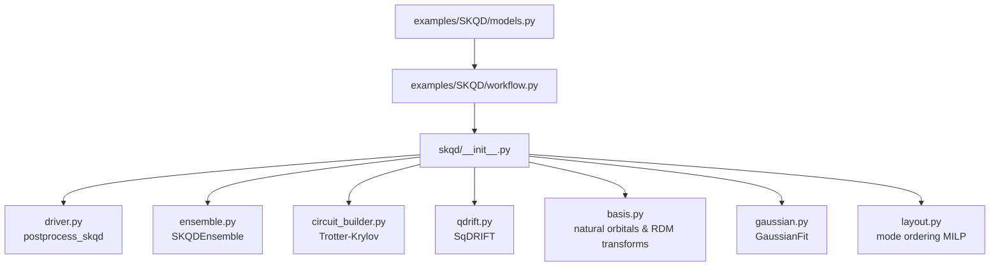

**Diagram sources**
- [workflow.py:31-37](file://examples/SKQD/workflow.py#L31-L37)
- [__init__.py:1-19](file://src/tyxonq/applications/chem/algorithms/skqd/__init__.py#L1-L19)
- [driver.py:30-60](file://src/tyxonq/applications/chem/algorithms/skqd/driver.py#L30-L60)
- [ensemble.py:41-99](file://src/tyxonq/applications/chem/algorithms/skqd/ensemble.py#L41-L99)
- [circuit_builder.py:75-139](file://src/tyxonq/applications/chem/algorithms/skqd/circuit_builder.py#L75-L139)
- [qdrift.py:86-174](file://src/tyxonq/applications/chem/algorithms/skqd/qdrift.py#L86-L174)
- [basis.py:8-43](file://src/tyxonq/applications/chem/algorithms/skqd/basis.py#L8-L43)
- [gaussian.py:56-102](file://src/tyxonq/applications/chem/algorithms/skqd/gaussian.py#L56-L102)
- [layout.py:19-79](file://src/tyxonq/applications/chem/algorithms/skqd/layout.py#L19-L79)
- [models.py:30-100](file://examples/SKQD/models.py#L30-L100)

**Section sources**
- [__init__.py:1-19](file://src/tyxonq/applications/chem/algorithms/skqd/__init__.py#L1-L19)
- [workflow.py:1-19](file://examples/SKQD/workflow.py#L1-L19)

## Core Components
SKQD is organized around six responsibilities:

| Component | Responsibility | Key Inputs | Key Outputs |
|---|---|---|---|
| Problem preparation | Build integrals, reference state, and metadata | JSON configuration | `h1e`, `eri`, `norb`, `nelec`, `energy_offset`, orbital rotations |
| Circuit ensembles | Generate unmeasured SKQD circuits | Integrals, schedule, initial state | `SKQDEnsemble` with `CircuitRecord` metadata |
| Sampling contract | Map device or simulator counts to logical bitstrings | Counts per circuit ID | Merged SQD-compatible counts |
| Classical postprocessing | Run SQD on merged samples | Counts, ensemble, integrals | `SKQDResult` with SCI state and statistics |
| Basis transformation | Local natural orbitals and integral/RDM basis changes | 1-RDM, blocks, rotation matrices | New integrals or original-basis observables |
| Optimization helpers | Gaussian compilation and mode layout | Single-particle unitary, excitation supports | `GaussianFit`, `LayoutResult` |

**Section sources**
- [driver.py:12-60](file://src/tyxonq/applications/chem/algorithms/skqd/driver.py#L12-L60)
- [ensemble.py:24-150](file://src/tyxonq/applications/chem/algorithms/skqd/ensemble.py#L24-L150)
- [circuit_builder.py:16-139](file://src/tyxonq/applications/chem/algorithms/skqd/circuit_builder.py#L16-L139)
- [qdrift.py:19-174](file://src/tyxonq/applications/chem/algorithms/skqd/qdrift.py#L19-L174)
- [basis.py:8-79](file://src/tyxonq/applications/chem/algorithms/skqd/basis.py#L8-L79)
- [gaussian.py:56-102](file://src/tyxonq/applications/chem/algorithms/skqd/gaussian.py#L56-L102)
- [layout.py:12-79](file://src/tyxonq/applications/chem/algorithms/skqd/layout.py#L12-L79)

## Architecture Overview
The end-to-end SKQD workflow follows a staged pipeline: prepare → sample → postprocess, with an optional rotate step for a second round of local natural orbitals.

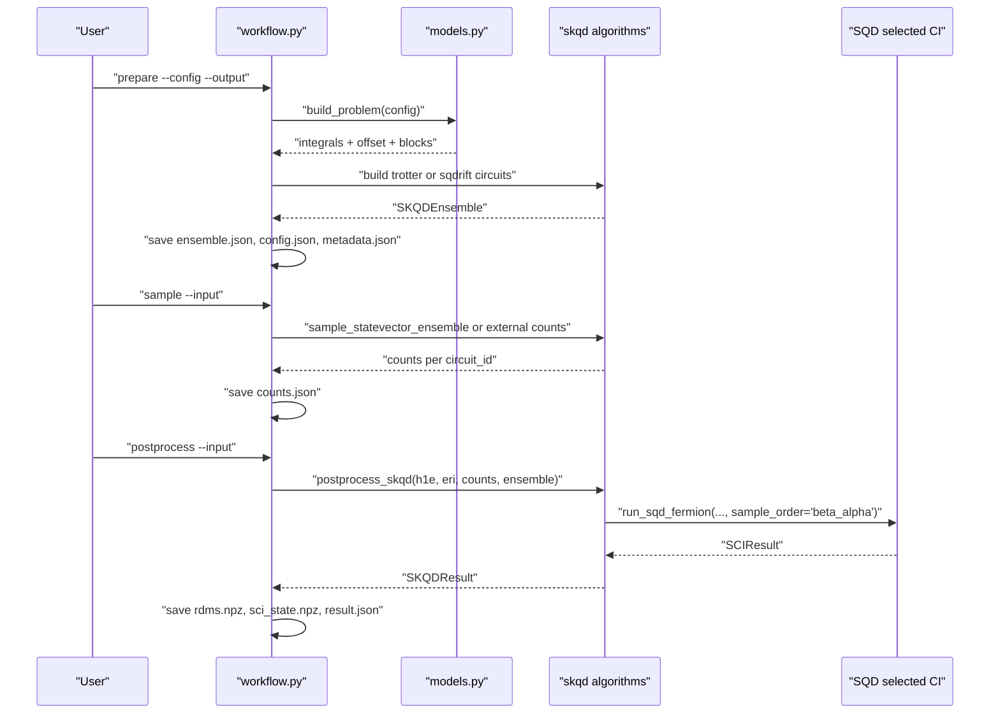

**Diagram sources**
- [workflow.py:130-210](file://examples/SKQD/workflow.py#L130-L210)
- [driver.py:30-60](file://src/tyxonq/applications/chem/algorithms/skqd/driver.py#L30-L60)
- [ensemble.py:102-150](file://src/tyxonq/applications/chem/algorithms/skqd/ensemble.py#L102-L150)
- [models.py:30-100](file://examples/SKQD/models.py#L30-L100)

## Detailed Component Analysis

### SKQD Result and Postprocessing Driver
`SKQDResult` wraps the underlying SQD selected-CI result and separates electronic energy from constant energy offsets. `postprocess_skqd` validates integrals, merges per-circuit counts according to the ensemble’s mapping, runs SQD with spin-pool ordering, and records statistics such as unique bitstrings, valid shot counts, and final CI dimension.

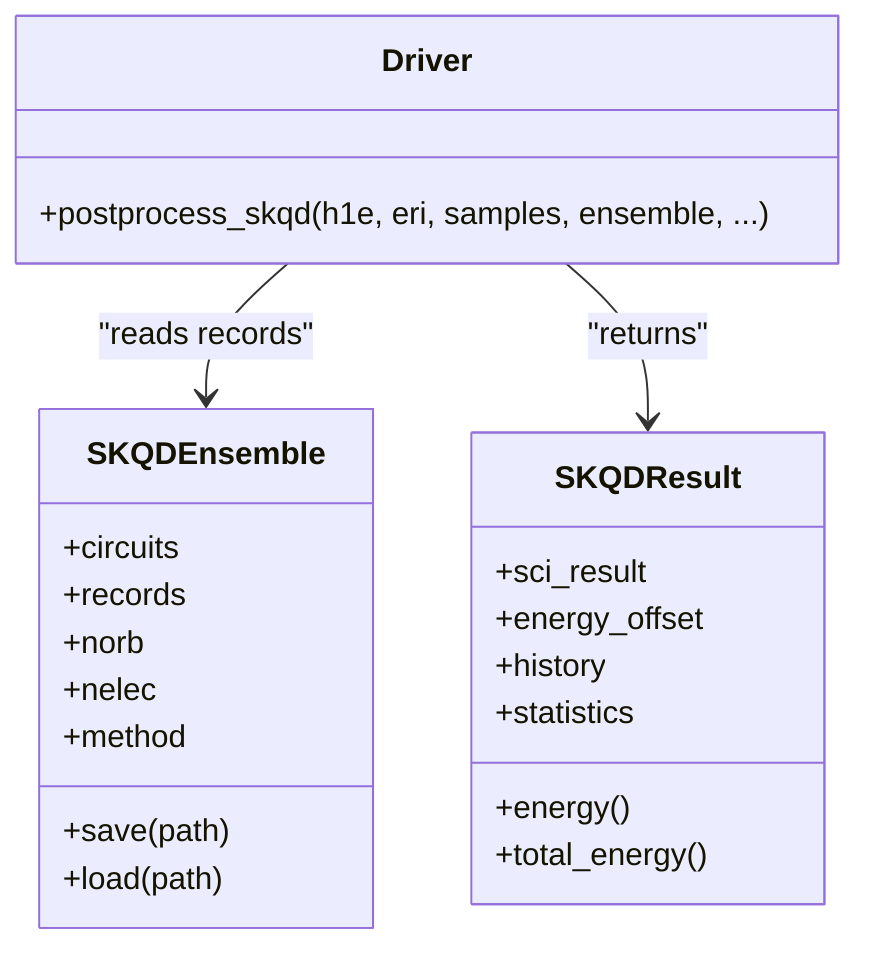

**Diagram sources**
- [driver.py:12-60](file://src/tyxonq/applications/chem/algorithms/skqd/driver.py#L12-L60)
- [ensemble.py:41-99](file://src/tyxonq/applications/chem/algorithms/skqd/ensemble.py#L41-L99)

**Section sources**
- [driver.py:12-60](file://src/tyxonq/applications/chem/algorithms/skqd/driver.py#L12-L60)

### Ensemble and Sample Contract
`SKQDEnsemble` stores unmeasured circuits together with `CircuitRecord` metadata describing time, randomization, sampled group IDs, mode permutation, measurement map, and basis identity. The ensemble schema is JSON-based and explicitly preserves complex unitary caches so circuits can be reconstructed without third-party libraries.

`merge_skqd_samples` enforces that all circuit IDs match the ensemble, that all samples belong to the same orbital basis, and that measurement maps form a complete permutation. It converts device or simulator bitstrings into the internal `[beta reversed | alpha reversed]` order expected by SQD.

`sample_statevector_ensemble` is a controlled local sampler for small systems; it requires the identity measurement map and outputs bitstrings consistent with the merged-sample contract.

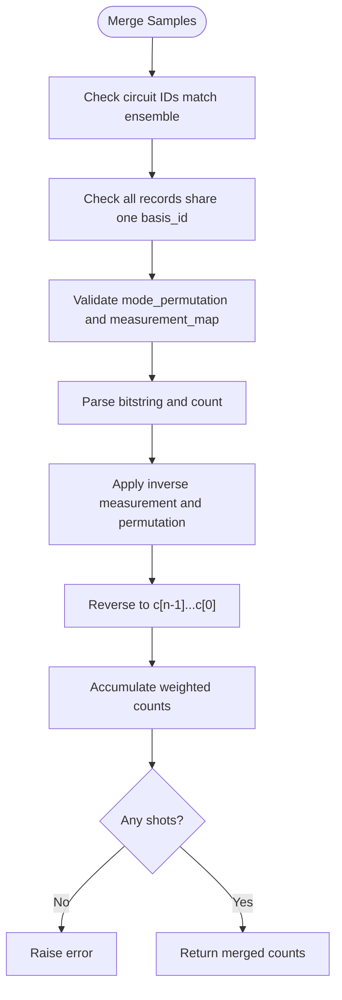

**Diagram sources**
- [ensemble.py:102-150](file://src/tyxonq/applications/chem/algorithms/skqd/ensemble.py#L102-L150)

**Section sources**
- [ensemble.py:24-150](file://src/tyxonq/applications/chem/algorithms/skqd/ensemble.py#L24-L150)

### Trotter-Krylov Circuit Builder
The Trotter-Krylov builder constructs a Krylov subspace by repeating second-order Trotter steps. It requires the interaction Hamiltonian to be density-density in the supplied `interaction_rotation`; otherwise it directs users to SqDRIFT. Each Krylov index `k` produces a circuit starting from a Slater reference, interleaving half-interaction evolutions with single-particle evolution. A Gaussian fit can replace exact single-particle evolution when provided.

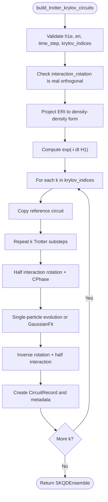

**Diagram sources**
- [circuit_builder.py:75-139](file://src/tyxonq/applications/chem/algorithms/skqd/circuit_builder.py#L75-L139)

**Section sources**
- [circuit_builder.py:16-139](file://src/tyxonq/applications/chem/algorithms/skqd/circuit_builder.py#L16-L139)

### SqDRIFT Fermionic Grouping and Circuits
SqDRIFT groups the electronic Hamiltonian by active excitation modes and spectator occupations. Each group is normalized by its spectral norm, converted to Pauli operators via Jordan-Wigner, and checked for commutativity within the group. Circuits are built by sampling groups according to their weights, optionally optimizing mode order, applying FSWAP-like permutations for determinant references, and appending Pauli evolutions.

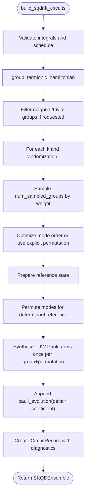

**Diagram sources**
- [qdrift.py:35-70](file://src/tyxonq/applications/chem/algorithms/skqd/qdrift.py#L35-L70)
- [qdrift.py:86-174](file://src/tyxonq/applications/chem/algorithms/skqd/qdrift.py#L86-L174)

**Section sources**
- [qdrift.py:19-174](file://src/tyxonq/applications/chem/algorithms/skqd/qdrift.py#L19-L174)

### Gaussian Compilation for Single-Particle Evolution
`fit_gaussian_evolution` fits a fixed-depth alternating nearest-neighbor Givens network to a target single-particle unitary using L-BFGS-B with an analytic gradient. The resulting `GaussianFit` can append directly to a circuit without further decomposition, preserving the intended depth.

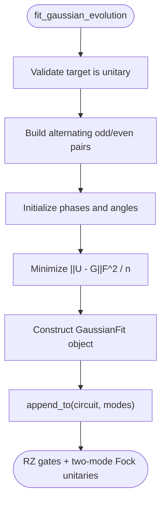

**Diagram sources**
- [gaussian.py:20-53](file://src/tyxonq/applications/chem/algorithms/skqd/gaussian.py#L20-L53)
- [gaussian.py:56-102](file://src/tyxonq/applications/chem/algorithms/skqd/gaussian.py#L56-L102)

**Section sources**
- [gaussian.py:56-102](file://src/tyxonq/applications/chem/algorithms/skqd/gaussian.py#L56-L102)

### Basis Transformations and Observables
Local natural orbitals are constructed by block-diagonalizing the 1-RDM. Integral rotation applies a real orthogonal transformation to both one-body and two-body tensors. Correlation functions compute number-number correlations, connected densities, spin-Z correlations, and spin-dot correlations. RDMs can be rotated back to the original orbital basis for comparison with reference data.

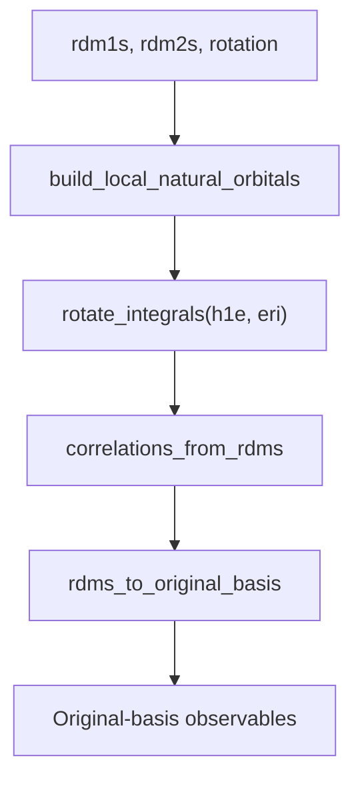

**Diagram sources**
- [basis.py:8-43](file://src/tyxonq/applications/chem/algorithms/skqd/basis.py#L8-L43)
- [basis.py:46-79](file://src/tyxonq/applications/chem/algorithms/skqd/basis.py#L46-L79)

**Section sources**
- [basis.py:8-79](file://src/tyxonq/applications/chem/algorithms/skqd/basis.py#L8-L79)

### Mode Layout Optimization
Mode layout optimization uses mixed-integer linear programming to minimize the maximum JW excitation span across sampled excitations, with a secondary average-span objective. It operates only on excitation modes, not spectator modes, and returns either an optimal permutation, a feasible permutation under time limits, or the identity.

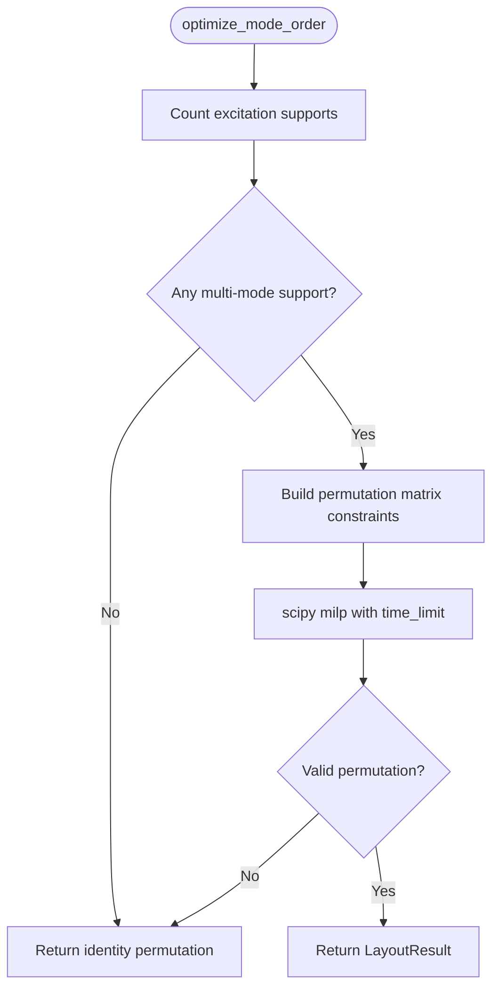

**Diagram sources**
- [layout.py:19-79](file://src/tyxonq/applications/chem/algorithms/skqd/layout.py#L19-L79)

**Section sources**
- [layout.py:12-79](file://src/tyxonq/applications/chem/algorithms/skqd/layout.py#L12-L79)

### Example Workflow and Model Builders
The example workflow exposes CLI commands for estimation, preparation, sampling, postprocessing, and two-round natural-orbital rotation. It reads JSON configurations, builds model-specific problems, saves intermediate artifacts, and computes correlation metrics. Model builders cover single-impurity Anderson models, four-impurity lattices, PySCF molecules, and FCIDUMP inputs.

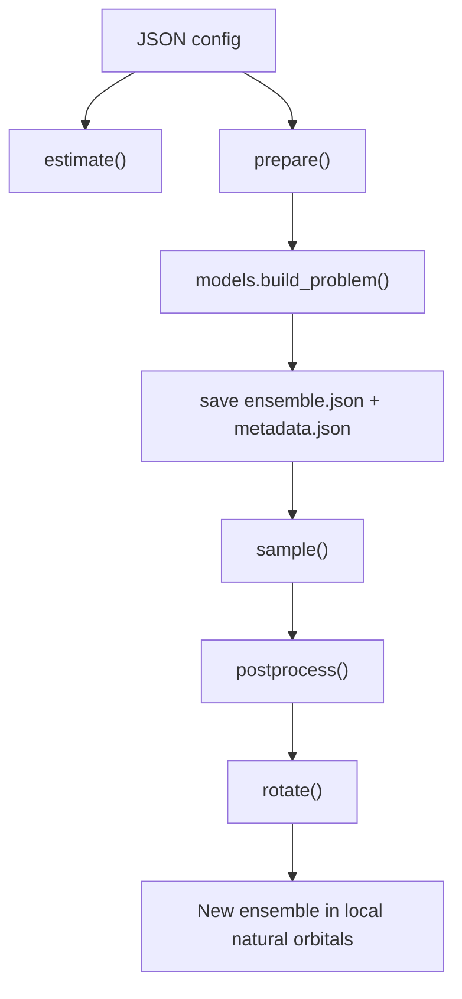

**Diagram sources**
- [workflow.py:70-229](file://examples/SKQD/workflow.py#L70-L229)
- [models.py:30-100](file://examples/SKQD/models.py#L30-L100)

**Section sources**
- [workflow.py:70-229](file://examples/SKQD/workflow.py#L70-L229)
- [models.py:1-100](file://examples/SKQD/models.py#L1-L100)

## Dependency Analysis
SKQD depends on several lower layers:

- **TyxonQ core IR**: circuits are represented as `Circuit` objects with JSON serialization and unitary caches.
- **Chemistry libraries**: fermionic circuits provide orbital rotations, CPhase gates, and Pauli evolution; fermionic operators validate integrals and construct electronic fermion operators.
- **SQD selected-CI solver**: SKQD does not reimplement classical diagonalization; it feeds merged samples into SQD.
- **External scientific libraries**: OpenFermion is used for JW conversion and sparse operator norms in SqDRIFT; SciPy is used for exponential maps, optimization, and MILP layout.

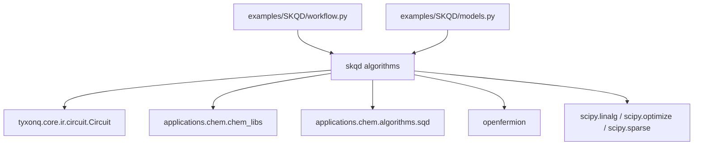

**Diagram sources**
- [circuit_builder.py:10-13](file://src/tyxonq/applications/chem/algorithms/skqd/circuit_builder.py#L10-L13)
- [qdrift.py:10-16](file://src/tyxonq/applications/chem/algorithms/skqd/qdrift.py#L10-L16)
- [driver.py:7-9](file://src/tyxonq/applications/chem/algorithms/skqd/driver.py#L7-L9)
- [gaussian.py:6-9](file://src/tyxonq/applications/chem/algorithms/skqd/gaussian.py#L6-L9)
- [layout.py:7-9](file://src/tyxonq/applications/chem/algorithms/skqd/layout.py#L7-L9)

**Section sources**
- [__init__.py:1-19](file://src/tyxonq/applications/chem/algorithms/skqd/__init__.py#L1-L19)
- [circuit_builder.py:10-13](file://src/tyxonq/applications/chem/algorithms/skqd/circuit_builder.py#L10-L13)
- [qdrift.py:10-16](file://src/tyxonq/applications/chem/algorithms/skqd/qdrift.py#L10-L16)
- [driver.py:7-9](file://src/tyxonq/applications/chem/algorithms/skqd/driver.py#L7-L9)

## Performance Considerations
- **Trotter-Krylov cost** scales with the number of Krylov indices, Trotter substeps, and the number of density-density two-body terms. Using `gaussian_fit` replaces exact single-particle exponentials with a fixed-depth compiled network, reducing gate depth at the cost of approximation error tracked in `GaussianFit`.
- **SqDRIFT cost** is dominated by Hamiltonian grouping, JW conversion, and stochastic group sampling. `num_sampled_groups` and `num_randomizations` control the number of independent circuits; `filter_diagonal` and `filter_trivial` can reduce ineffective sampling but require careful validation.
- **Mode layout optimization** adds MILP overhead but can reduce JW chain length for non-local excitations. It is disabled by default unless `optimize_layout=True` or an explicit `mode_permutation` is provided.
- **Statevector sampling** is limited to small systems (`max_qubits=20`) because it materializes full probability distributions. For larger systems, external device or simulator counts should be supplied through the merged-sample contract.
- **Two-round natural-orbital workflows** improve locality by rotating integrals based on the previous round’s RDM, but they require fresh sampling in the new basis; old bitstrings cannot be reused.

[No sources needed since this section provides general guidance]

## Troubleshooting Guide
Common validation errors and their meanings:

| Symptom | Likely Cause | Resolution |
|---|---|---|
| `interaction_rotation must be a real orthogonal matrix` | Rotation matrix is complex, wrong shape, or not orthogonal | Provide a real orthogonal matrix whose columns represent new orbitals in the old basis |
| `H2 is not density-density in the supplied interaction basis; use SqDRIFT` | Two-body term is not density-density after rotation | Use SqDRIFT instead of Trotter-Krylov, or change the interaction basis |
| `gaussian_fit target does not match the requested Trotter substep` | Gaussian fit was generated for a different time step or substep count | Regenerate `GaussianFit` with the same `time_step` and `trotter_substeps` |
| `samples in different orbital bases cannot be merged` | Counts come from multiple `basis_id` values | Keep one orbital basis per run; rotate and resample for a new basis |
| `measurement_map must measure each logical mode exactly once` | Measurement register width or mapping is inconsistent | Ensure every logical mode is measured exactly once |
| `local statevector sampling requires the identity measurement_map` | Custom measurement map used with `sample_statevector_ensemble` | Use identity mapping or supply external counts |
| `exact validation is limited to 100000 determinants` | Full CI space too large for explicit validation | Disable `--exact` or reduce active space size |
| `baseline SCI dimension exceeds max_determinants` | Strict extension seeds exceed allowed CI size | Reduce `strict_rank` or increase `max_determinants` carefully |

**Section sources**
- [circuit_builder.py:86-106](file://src/tyxonq/applications/chem/algorithms/skqd/circuit_builder.py#L86-L106)
- [ensemble.py:102-150](file://src/tyxonq/applications/chem/algorithms/skqd/ensemble.py#L102-L150)
- [workflow.py:182-209](file://examples/SKQD/workflow.py#L182-L209)

## Conclusion
SKQD provides a clean separation between quantum circuit construction and classical selected-CI postprocessing. Trotter-Krylov offers a compact, density-density-friendly path with optional Gaussian compilation, while SqDRIFT generalizes to arbitrary fermionic terms through grouped Pauli evolution. The ensemble and sample contracts ensure that device, simulator, and statevector results can be merged consistently. The example workflow demonstrates practical chemistry setups and a two-round natural-orbital refinement strategy, making SKQD suitable for both tutorial use and research-oriented quantum chemistry dynamics.

[No sources needed since this section summarizes without analyzing specific files]