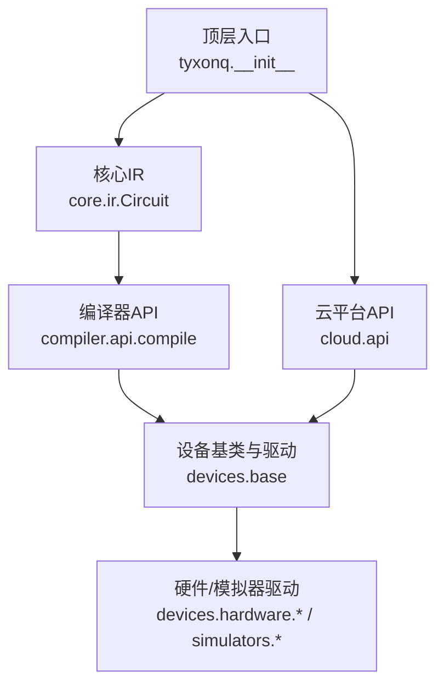
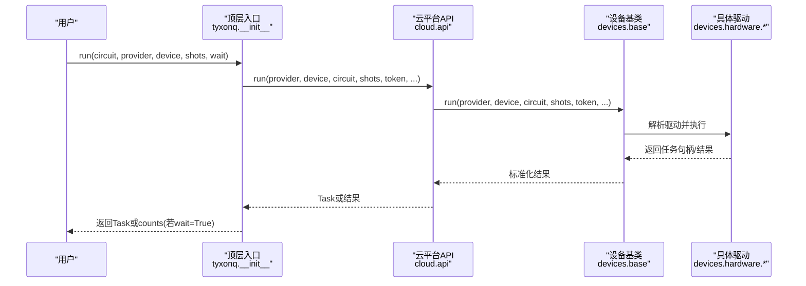
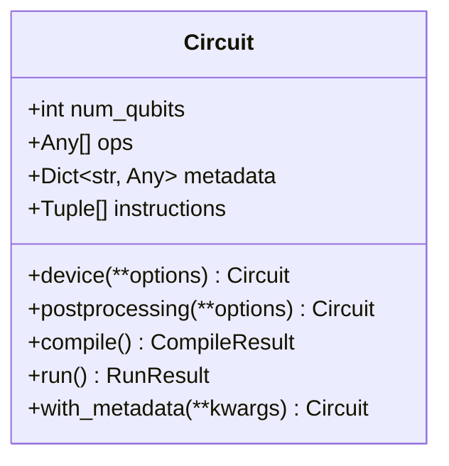
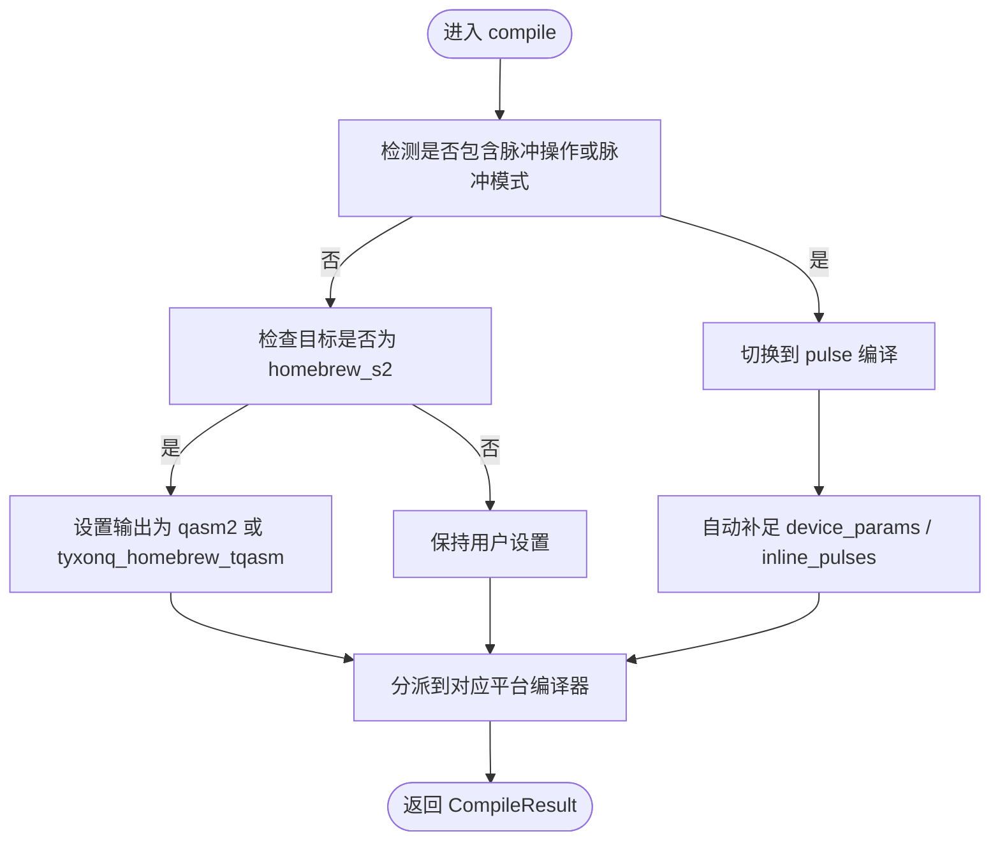
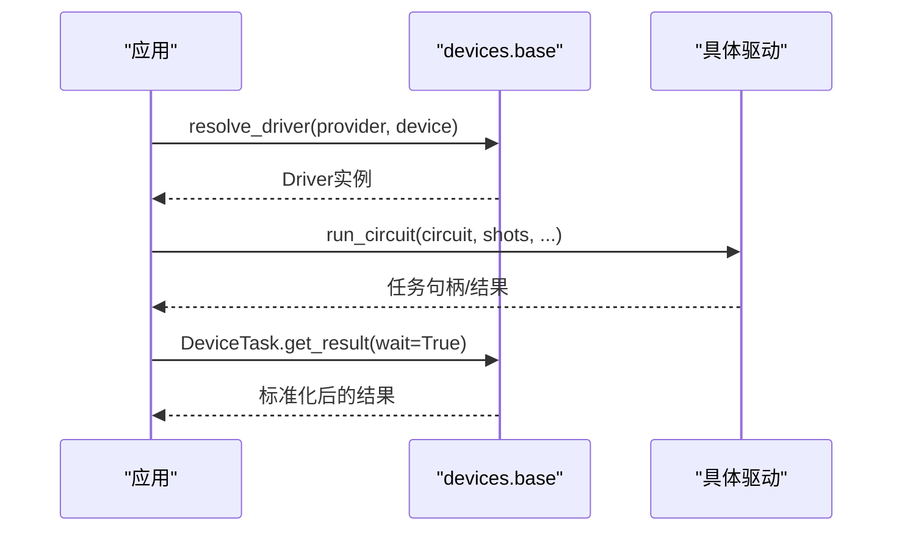
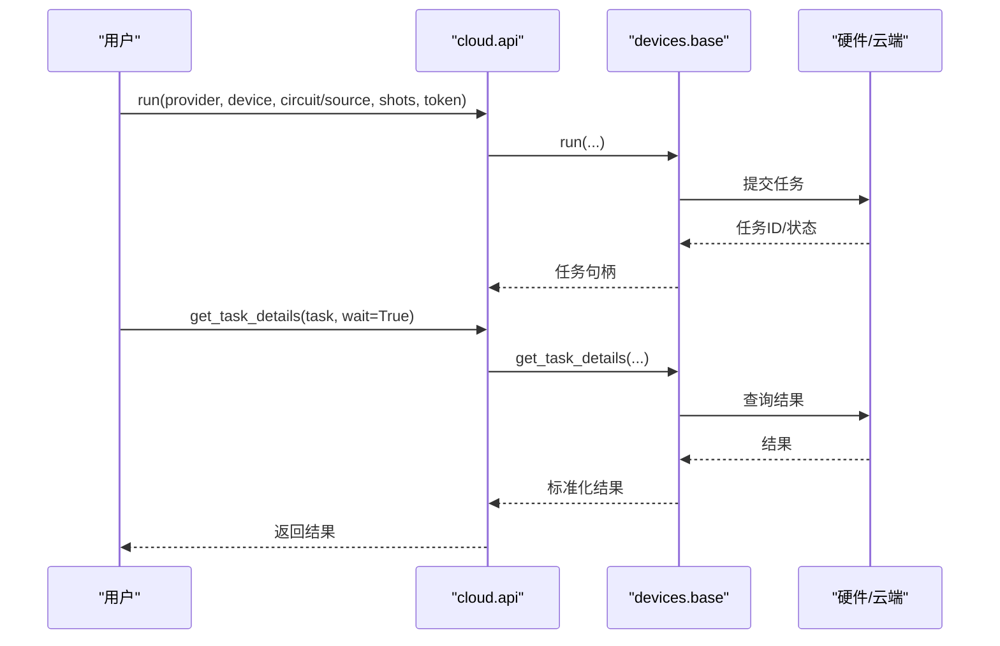
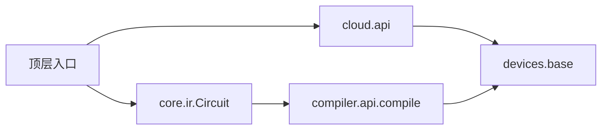

# API参考文档

<cite>
**本文引用的文件**
- [src/tyxonq/__init__.py](file://src/tyxonq/__init__.py)
- [src/tyxonq/core/__init__.py](file://src/tyxonq/core/__init__.py)
- [src/tyxonq/core/ir/circuit.py](file://src/tyxonq/core/ir/circuit.py)
- [src/tyxonq/cloud/api.py](file://src/tyxonq/cloud/api.py)
- [src/tyxonq/compiler/api.py](file://src/tyxonq/compiler/api.py)
- [src/tyxonq/devices/base.py](file://src/tyxonq/devices/base.py)
- [src/tyxonq/config.py](file://src/tyxonq/config.py)
- [src/tyxonq/core/errors.py](file://src/tyxonq/core/errors.py)
- [examples/basic_chain_api.py](file://examples/basic_chain_api.py)
- [docs/tyxonq_cloud_api.md](file://docs/tyxonq_cloud_api.md)
</cite>

## 目录
1. [简介](#简介)
2. [项目结构](#项目结构)
3. [核心组件](#核心组件)
4. [架构总览](#架构总览)
5. [详细组件分析](#详细组件分析)
6. [依赖关系分析](#依赖关系分析)
7. [性能与限制](#性能与限制)
8. [故障排查指南](#故障排查指南)
9. [结论](#结论)
10. [附录：配置与环境变量](#附录：配置与环境变量)

## 简介
本参考文档面向TyxonQ的公共API，覆盖核心IR、编译、设备执行与云平台接口。文档按模块组织，提供类、方法、函数的参数说明、返回值描述、异常处理、调用顺序与示例路径，并给出版本兼容性与迁移建议、性能特征与限制、错误代码与调试信息说明。

## 项目结构
TyxonQ采用分层模块化设计：
- 顶层入口：暴露便捷函数（云API、全局默认、数值后端）
- 核心IR：Circuit/Hamiltonian等与设备无关的中间表示
- 编译器：统一编译入口，支持门级与脉冲级编译，多平台输出
- 设备层：统一的Device协议、驱动选择与任务封装
- 云平台：统一的云端提交、查询、取消等接口
- 应用与库：量子化学、机器学习等上层能力

图表来源
- [src/tyxonq/__init__.py:25-128](file://src/tyxonq/__init__.py#L25-L128)
- [src/tyxonq/core/ir/circuit.py:48-139](file://src/tyxonq/core/ir/circuit.py#L48-L139)
- [src/tyxonq/compiler/api.py:39-98](file://src/tyxonq/compiler/api.py#L39-L98)
- [src/tyxonq/devices/base.py:97-143](file://src/tyxonq/devices/base.py#L97-L143)
- [src/tyxonq/cloud/api.py:22-158](file://src/tyxonq/cloud/api.py#L22-L158)

章节来源
- [src/tyxonq/__init__.py:25-128](file://src/tyxonq/__init__.py#L25-L128)
- [src/tyxonq/core/__init__.py:1-13](file://src/tyxonq/core/__init__.py#L1-L13)

## 核心组件
- 顶层便捷API
  - set_token(provider, device, token)：设置云端令牌（非持久化）
  - submit_task(...)：提交任务（委托至云API）
  - run(circuit|source, provider, device, shots, wait, ...)：提交并可选等待结果
  - device/postprocessing/compile：全局默认配置读写
  - set_backend/get_backend/set_dtype：数值后端切换与类型设置
  - enable_noise/is_noise_enabled/get_noise_config：模拟器噪声控制
- 核心IR
  - Circuit：量子线路IR，支持链式配置（device/postprocessing/compile/run）
- 编译器
  - compile(circuit, platform, output, basis_gates, decompose, route, optimize, simplify, device_rule, options)：统一编译入口
  - compile_pulse(pulse_program, output, device_params, calibrations, device, options)：脉冲程序编译
- 设备与任务
  - DeviceTask：统一任务包装，get_result/cancel
  - resolve_driver：根据provider/device解析具体驱动
  - device_descriptor：设备描述符构造
- 云平台
  - cloud.api.run/submit_task/get_task_details/result/cancel/list_devices/set_default/set_token

章节来源
- [src/tyxonq/__init__.py:25-128](file://src/tyxonq/__init__.py#L25-L128)
- [src/tyxonq/core/ir/circuit.py:48-139](file://src/tyxonq/core/ir/circuit.py#L48-L139)
- [src/tyxonq/compiler/api.py:39-98](file://src/tyxonq/compiler/api.py#L39-L98)
- [src/tyxonq/devices/base.py:12-58](file://src/tyxonq/devices/base.py#L12-L58)
- [src/tyxonq/cloud/api.py:22-158](file://src/tyxonq/cloud/api.py#L22-L158)

## 架构总览
TyxonQ通过“IR -> 编译 -> 设备执行”的统一流水线，屏蔽底层差异。顶层入口提供便捷函数，内部委托到cloud.api或devices.base；编译器根据目标平台与输入类型自动选择门级或脉冲级编译路径；设备层负责驱动选择与任务管理。

图表来源
- [src/tyxonq/__init__.py:67-118](file://src/tyxonq/__init__.py#L67-L118)
- [src/tyxonq/cloud/api.py:75-131](file://src/tyxonq/cloud/api.py#L75-L131)
- [src/tyxonq/devices/base.py:146-200](file://src/tyxonq/devices/base.py#L146-L200)

## 详细组件分析

### 顶层入口API（tyxonq包）
- set_token(token=None, provider="tyxonq", device="homebrew_s2") -> Dict
  - 作用：设置云端令牌（非持久化），用于后续云端任务提交
  - 参数：token为字符串；provider与device用于指定默认目标
  - 返回：配置字典
  - 异常：导入失败时回退为空导出
  - 示例路径：[examples/basic_chain_api.py:78-99](file://examples/basic_chain_api.py#L78-L99)
- submit_task(*, provider=None, device=None, token=None, **task_kws)
  - 作用：提交任务（委托至cloud.api.run）
  - 返回：Task或Task列表
- run(circuit|Sequence, *, provider=None, device=None, shots=1024, wait=True, mitigated=False, **task_kws)
  - 作用：提交电路或源码，可选等待结果
  - 行为：wait=True时返回counts或counts列表；否则返回Task或Task列表
  - 示例路径：[examples/basic_chain_api.py:22-41](file://examples/basic_chain_api.py#L22-L41)
- device(**options) / get_device_defaults()
  - 作用：设置/获取全局设备默认值（provider, device, shots等）
- postprocessing(**options) / get_postprocessing_defaults()
  - 作用：设置/获取全局后处理默认值
- compile(**options) / get_compile()
  - 作用：设置/获取全局编译默认值
- set_backend(name_or_instance) / get_backend(name=None) / set_dtype(dtype_str)
  - 作用：设置/获取数值后端与默认dtype；支持numpy/pytorch/cupynumeric
- enable_noise(enabled=True, config=None) / is_noise_enabled() / get_noise_config()
  - 作用：全局开关与配置模拟器噪声

章节来源
- [src/tyxonq/__init__.py:25-128](file://src/tyxonq/__init__.py#L25-L128)
- [src/tyxonq/__init__.py:145-183](file://src/tyxonq/__init__.py#L145-L183)
- [src/tyxonq/__init__.py:186-277](file://src/tyxonq/__init__.py#L186-L277)
- [src/tyxonq/__init__.py:335-356](file://src/tyxonq/__init__.py#L335-L356)
- [examples/basic_chain_api.py:22-124](file://examples/basic_chain_api.py#L22-L124)

### 核心IR：Circuit
- 构造与属性
  - num_qubits, ops, metadata, instructions
  - inputs：初始态（仅数值仿真）
  - 链式阶段默认：_compile_opts/_device_opts/_post_opts
- 链式配置与运行
  - device(**options)：设置执行设备选项（provider, device, shots, options）
  - postprocessing(method=None, **options)：设置后处理策略
  - compile()：触发编译（委托compiler.api.compile）
  - run()：执行链路（编译->设备->后处理）
- 元数据与绘制
  - with_metadata(**kwargs)：浅合并元数据
  - draw_output：绘图输出格式

图表来源
- [src/tyxonq/core/ir/circuit.py:48-139](file://src/tyxonq/core/ir/circuit.py#L48-L139)

章节来源
- [src/tyxonq/core/ir/circuit.py:48-139](file://src/tyxonq/core/ir/circuit.py#L48-L139)

### 编译器API
- compile(circuit, platform="tyxonq", output="ir", basis_gates=None, decompose=True, route=False, optimize=0, simplify=False, device_rule=None, options=None, compile_engine=None) -> CompileResult
  - 作用：统一编译入口，支持门级与脉冲级自动推断
  - 关键行为：
    - 检测脉冲操作或显式模式时自动启用pulse编译
    - homebrew_s2设备对门电路强制qasm2输出，对脉冲电路强制tyxonq_homebrew_tqasm
    - qiskit作为互操作别名，未指定output时默认输出qiskit对象
  - 返回：{"circuit", "compiled_source", "metadata"}
- compile_pulse(pulse_program, output="pulse_ir", device_params=None, calibrations=None, device=None, options=None) -> PulseCompileResult
  - 作用：脉冲程序编译，自动补足device_params与inline_pulses
  - 返回：{"pulse_program", "compiled_pulse_schedule", "metadata"}

图表来源
- [src/tyxonq/compiler/api.py:39-98](file://src/tyxonq/compiler/api.py#L39-L98)
- [src/tyxonq/compiler/api.py:100-186](file://src/tyxonq/compiler/api.py#L100-L186)
- [src/tyxonq/compiler/api.py:219-340](file://src/tyxonq/compiler/api.py#L219-L340)
- [src/tyxonq/compiler/api.py:343-463](file://src/tyxonq/compiler/api.py#L343-L463)

章节来源
- [src/tyxonq/compiler/api.py:39-98](file://src/tyxonq/compiler/api.py#L39-L98)
- [src/tyxonq/compiler/api.py:100-186](file://src/tyxonq/compiler/api.py#L100-L186)
- [src/tyxonq/compiler/api.py:219-340](file://src/tyxonq/compiler/api.py#L219-L340)
- [src/tyxonq/compiler/api.py:343-463](file://src/tyxonq/compiler/api.py#L343-L463)

### 设备与任务
- DeviceTask
  - get_result(wait=False, poll_interval=2.0, timeout=60.0) -> Dict
    - 标准化结果结构，提升result_meta中的metadata字段
  - cancel() -> Any：取消任务
- resolve_driver(provider, device) -> Driver
  - 作用：根据provider/device解析具体驱动（模拟器/各云平台）
  - 支持：simulator、tyxonq、ibm、qcos、quafu、lqcloud、guodun
- device_descriptor(name=None, provider=None, id=None, shots=None) -> Dict
  - 作用：生成设备描述符（provider, device, shots）

图表来源
- [src/tyxonq/devices/base.py:12-58](file://src/tyxonq/devices/base.py#L12-L58)
- [src/tyxonq/devices/base.py:146-200](file://src/tyxonq/devices/base.py#L146-L200)

章节来源
- [src/tyxonq/devices/base.py:12-58](file://src/tyxonq/devices/base.py#L12-L58)
- [src/tyxonq/devices/base.py:112-143](file://src/tyxonq/devices/base.py#L112-L143)
- [src/tyxonq/devices/base.py:146-200](file://src/tyxonq/devices/base.py#L146-L200)

### 云平台API
- set_token(token, provider=None, device=None) -> Dict
- set_default(provider=None, device=None) -> None
- device(name=None, provider=None, id=None, shots=None) -> Dict
- list_devices(provider=None, token=None, **kws) -> List[str]
- submit_task(*, provider=None, device=None, circuit=None, source=None, shots=1024, token=None, auto_compile=True, **opts)
  - 作用：提交任务（委托至devices.base.run）
- get_task_details(task, token=None, wait=False, poll_interval=2.0, timeout=60.0) -> Dict
- run(*, provider=None, device=None, circuit=None, source=None, shots=1024, token=None, **opts)
  - 作用：统一执行入口（支持circuit或source）
- result(task, token=None, prettify=False) -> Dict
- cancel(task, token=None) -> Any

图表来源
- [src/tyxonq/cloud/api.py:22-158](file://src/tyxonq/cloud/api.py#L22-L158)
- [src/tyxonq/devices/base.py:146-200](file://src/tyxonq/devices/base.py#L146-L200)

章节来源
- [src/tyxonq/cloud/api.py:22-158](file://src/tyxonq/cloud/api.py#L22-L158)

## 依赖关系分析
- 顶层入口依赖cloud.api与core IR，提供便捷函数
- compiler.api.compile依赖平台编译器（tyxonq/pulse/lqcloud/guodun）
- devices.base提供统一任务与驱动解析
- cloud.api委托devices.base进行实际执行

图表来源
- [src/tyxonq/__init__.py:25-128](file://src/tyxonq/__init__.py#L25-L128)
- [src/tyxonq/compiler/api.py:39-98](file://src/tyxonq/compiler/api.py#L39-L98)
- [src/tyxonq/cloud/api.py:75-131](file://src/tyxonq/cloud/api.py#L75-L131)
- [src/tyxonq/devices/base.py:146-200](file://src/tyxonq/devices/base.py#L146-L200)

章节来源
- [src/tyxonq/__init__.py:25-128](file://src/tyxonq/__init__.py#L25-L128)
- [src/tyxonq/compiler/api.py:39-98](file://src/tyxonq/compiler/api.py#L39-L98)
- [src/tyxonq/cloud/api.py:75-131](file://src/tyxonq/cloud/api.py#L75-L131)
- [src/tyxonq/devices/base.py:146-200](file://src/tyxonq/devices/base.py#L146-L200)

## 性能与限制
- 编译优化
  - optimize级别0-3，>=1启用相邻门合并/恒等剪枝
  - simplify启用光锥化简，裁剪不影响测量结果的算符
  - route可基于coupling_map进行路由（需device_rule）
- 平台特定
  - homebrew_s2对门电路强制qasm2输出，对脉冲电路强制tyxonq_homebrew_tqasm
  - 脉冲编译自动补足device_params与supported_waveforms
- 执行与采样
  - shots影响统计精度与耗时；批量提交可提升吞吐
  - 云端任务优先级prior（1-10）影响排队
- 数值后端
  - 支持numpy/pytorch/cupynumeric；cupynumeric不可用时回退numpy
  - dtype可设置为complex64/float32以平衡精度与速度

章节来源
- [src/tyxonq/compiler/api.py:39-98](file://src/tyxonq/compiler/api.py#L39-L98)
- [src/tyxonq/compiler/api.py:100-186](file://src/tyxonq/compiler/api.py#L100-L186)
- [src/tyxonq/__init__.py:186-277](file://src/tyxonq/__init__.py#L186-L277)
- [docs/tyxonq_cloud_api.md:91-199](file://docs/tyxonq_cloud_api.md#L91-L199)

## 故障排查指南
- 常见异常
  - CompilationError：编译失败或输出无效
  - DeviceExecutionError：设备执行失败（超时、连接问题等）
  - TyxonQError：基础异常类型
- 云端任务错误
  - 提交失败：检查设备状态与电路合法性
  - 执行失败：根据错误信息定位（如qubits/depth/timeout）
  - 超时：简化电路或增加timeout
- 调试建议
  - 使用get_task_details(task, wait=True, poll_interval, timeout)轮询任务状态
  - 查看result中的metadata与result_meta，提取raw与task信息
  - 在本地模拟器验证后再提交云端

章节来源
- [src/tyxonq/core/errors.py:1-17](file://src/tyxonq/core/errors.py#L1-L17)
- [docs/tyxonq_cloud_api.md:491-547](file://docs/tyxonq_cloud_api.md#L491-L547)

## 结论
TyxonQ提供从IR构建、编译到设备执行的完整API栈，并通过顶层便捷函数与云平台接口降低使用门槛。编译器智能推断与平台适配使得同一份代码可在模拟器与多种硬件上运行。结合全局默认与链式配置，开发者可快速迭代实验并平滑迁移至云端。

## 附录：配置与环境变量
- 全局默认
  - tq.device(provider, device, shots)：设置设备默认
  - tq.postprocessing(method, **options)：设置后处理默认
  - tq.compile(**options)：设置编译默认
- 数值后端
  - tq.set_backend("numpy"|"pytorch"|"cupynumeric")
  - tq.set_dtype("complex64"|"complex128")
- 云端认证
  - tq.set_token(token, provider="tyxonq", device="homebrew_s2")
- 云端API端点（HTTP）
  - 设备列表：POST /api/v1/devices/list
  - 任务提交：POST /api/v1/tasks/submit_task
  - 认证：Authorization: Bearer YOUR_TOKEN
  - 内容类型：application/json
  - 版本：v1

章节来源
- [src/tyxonq/__init__.py:145-183](file://src/tyxonq/__init__.py#L145-L183)
- [src/tyxonq/__init__.py:186-277](file://src/tyxonq/__init__.py#L186-L277)
- [src/tyxonq/__init__.py:25-128](file://src/tyxonq/__init__.py#L25-L128)
- [docs/tyxonq_cloud_api.md:1-200](file://docs/tyxonq_cloud_api.md#L1-L200)