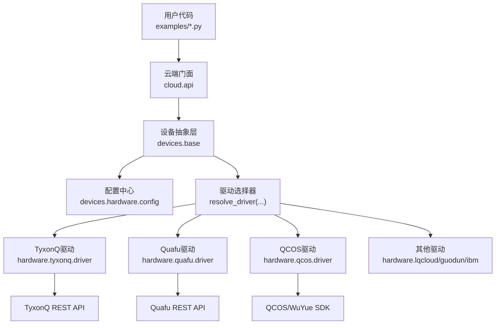
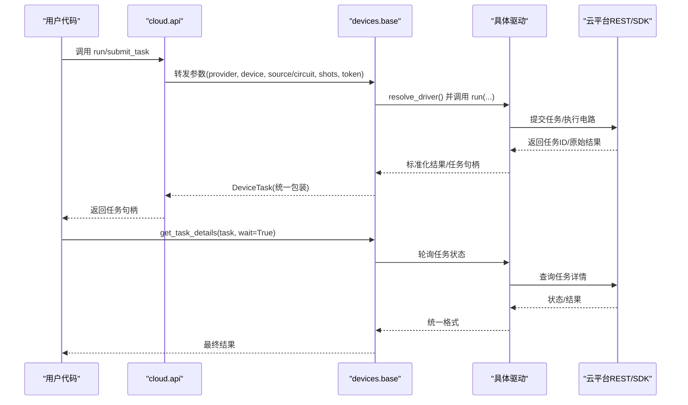
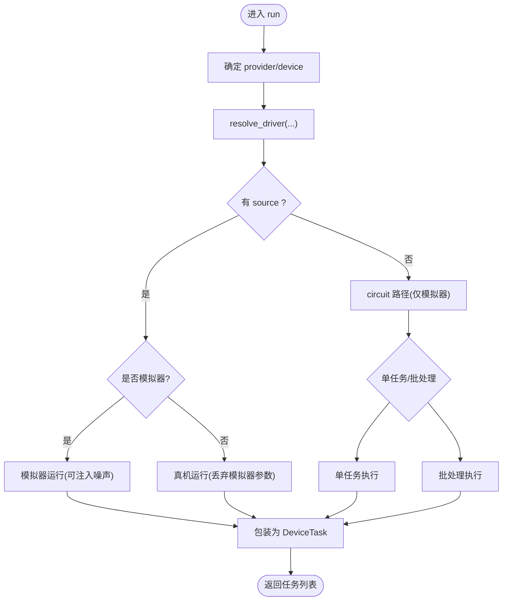
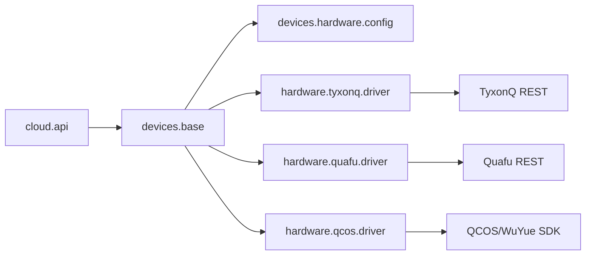

# 云平台API

<cite>
**本文引用的文件**
- [src/tyxonq/cloud/api.py](file://src/tyxonq/cloud/api.py)
- [src/tyxonq/devices/base.py](file://src/tyxonq/devices/base.py)
- [src/tyxonq/devices/hardware/config.py](file://src/tyxonq/devices/hardware/config.py)
- [docs/tyxonq_cloud_api.md](file://docs/tyxonq_cloud_api.md)
- [examples/cloud_api_task.py](file://examples/cloud_api_task.py)
- [examples/cloud_api_devices.py](file://examples/cloud_api_devices.py)
- [examples/run_circuit_on_quafu.py](file://examples/run_circuit_on_quafu.py)
- [examples/qcos_cloud_task.py](file://examples/qcos_cloud_task.py)
- [docs/qcos_provider.md](file://docs/qcos_provider.md)
- [docs/quafu_provider.md](file://docs/quafu_provider.md)
- [src/tyxonq/core/errors.py](file://src/tyxonq/core/errors.py)
</cite>

## 目录
1. [简介](#简介)
2. [项目结构](#项目结构)
3. [核心组件](#核心组件)
4. [架构总览](#架构总览)
5. [详细组件分析](#详细组件分析)
6. [依赖关系分析](#依赖关系分析)
7. [性能与限流](#性能与限流)
8. [故障排查指南](#故障排查指南)
9. [结论](#结论)
10. [附录：多平台集成示例](#附录多平台集成示例)

## 简介
本文件面向TyxonQ云平台的RESTful API与Python SDK集成，覆盖设备管理、任务提交、结果获取、异步监控、错误重试、安全与限流等主题。文档同时提供TyxonQ云、QCOS（移动云五岳）、Quafu等多平台接入示例与最佳实践，帮助开发者快速构建稳定高效的量子计算应用。

## 项目结构
TyxonQ将“云端统一入口”、“设备抽象层”、“硬件驱动”和“各平台Provider”分层组织：
- 云端统一入口：cloud.api 暴露 set_token、list_devices、submit_task、get_task_details、run、result、cancel 等函数，作为对外SDK门面。
- 设备抽象层：devices.base 提供统一的 DeviceTask、run、expval、get_task_details、remove_task 等能力，屏蔽不同后端差异。
- 配置与端点：devices.hardware.config 维护默认provider/device、Token存储、以及各Provider的端点信息。
- 平台Provider：quafu、qcos、tyxonq、lqcloud、guodun、ibm 等通过 devices.hardware.* 下的 driver 模块实现具体网络交互与协议适配。
- 文档与示例：docs 与 examples 提供REST接口说明与端到端使用样例。

图表来源
- [src/tyxonq/cloud/api.py:22-73](file://src/tyxonq/cloud/api.py#L22-L73)
- [src/tyxonq/devices/base.py:146-258](file://src/tyxonq/devices/base.py#L146-L258)
- [src/tyxonq/devices/hardware/config.py:11-19](file://src/tyxonq/devices/hardware/config.py#L11-L19)

章节来源
- [src/tyxonq/cloud/api.py:1-160](file://src/tyxonq/cloud/api.py#L1-L160)
- [src/tyxonq/devices/base.py:1-578](file://src/tyxonq/devices/base.py#L1-L578)
- [src/tyxonq/devices/hardware/config.py:1-78](file://src/tyxonq/devices/hardware/config.py#L1-L78)

## 核心组件
- 云端门面（cloud.api）
  - set_token/set_default：设置认证与默认provider/device。
  - list_devices：列出可用设备（聚合模拟器与硬件）。
  - submit_task/run：提交任务或执行电路/源码；返回统一的任务句柄。
  - get_task_details/result/cancel：查询任务详情、获取结果、取消任务。
- 设备抽象（devices.base）
  - DeviceTask：统一封装任务句柄，提供 get_result/cancel。
  - run：统一调度模拟器/真机路径，处理shots归一化、噪声注入、批处理、异常提示。
  - get_task_details：轮询等待、状态统一、超时告警。
  - resolve_driver：按provider动态加载对应驱动。
- 配置（devices.hardware.config）
  - Token存取（内存+环境变量回退）。
  - ENDPOINTS：TyxonQ/QCOS基础URL与版本。
  - 默认provider/device。

章节来源
- [src/tyxonq/cloud/api.py:22-158](file://src/tyxonq/cloud/api.py#L22-L158)
- [src/tyxonq/devices/base.py:14-578](file://src/tyxonq/devices/base.py#L14-L578)
- [src/tyxonq/devices/hardware/config.py:7-78](file://src/tyxonq/devices/hardware/config.py#L7-L78)

## 架构总览
TyxonQ采用“门面 + 抽象 + 驱动”的分层架构：
- 调用方通过 cloud.api 发起请求，内部委托到 devices.base.run。
- base.run 根据 provider/device 解析驱动并执行；对模拟器与真机分别处理参数与返回值。
- 各Provider驱动负责与具体云平台通信（HTTP/SDK），并将响应标准化为统一格式。
- 统一任务模型 DeviceTask 支持同步/异步获取结果，内置轮询与超时控制。

图表来源
- [src/tyxonq/cloud/api.py:42-73](file://src/tyxonq/cloud/api.py#L42-L73)
- [src/tyxonq/devices/base.py:294-445](file://src/tyxonq/devices/base.py#L294-L445)
- [src/tyxonq/devices/base.py:497-557](file://src/tyxonq/devices/base.py#L497-L557)

## 详细组件分析

### 云端门面（cloud.api）
- 职责：提供简洁的SDK函数，隐藏底层驱动细节。
- 关键函数：
  - set_token/set_default：设置认证与默认值。
  - list_devices：聚合模拟器与硬件设备列表。
  - submit_task/run：统一提交入口，内部委托 devices.base.run。
  - get_task_details/result/cancel：统一查询与取消。
- 设计要点：
  - 所有函数均为薄封装，便于扩展与测试。
  - 保留token透传能力，供特定驱动使用。

章节来源
- [src/tyxonq/cloud/api.py:22-158](file://src/tyxonq/cloud/api.py#L22-L158)

### 设备抽象层（devices.base）
- DeviceTask：统一任务句柄，封装 provider/device/handle/async_result，并提供 get_result/cancel。
- run：
  - 自动选择驱动；处理source/circuit分支；对模拟器注入噪声；对真机丢弃无关参数。
  - 支持单任务与批处理；shots归一化；异常提示。
- get_task_details：
  - 轮询等待；统一状态映射；超时警告；返回统一结构（result/result_meta/uni_status/error）。
- resolve_driver：
  - 根据provider动态导入对应驱动（simulator/tyxonq/ibm/qcos/quafu/lqcloud/guodun）。

图表来源
- [src/tyxonq/devices/base.py:294-445](file://src/tyxonq/devices/base.py#L294-L445)

章节来源
- [src/tyxonq/devices/base.py:14-578](file://src/tyxonq/devices/base.py#L14-L578)

### 配置与端点（devices.hardware.config）
- Token管理：支持设备级/provider级键，优先内存，其次环境变量回退。
- ENDPOINTS：TyxonQ/QCOS的基础URL与API版本。
- 默认值：默认provider为tyxonq，默认device为mps模拟器。

章节来源
- [src/tyxonq/devices/hardware/config.py:7-78](file://src/tyxonq/devices/hardware/config.py#L7-L78)

### TyxonQ云REST API规范
- 基础配置：
  - Base URL：https://api.tyxonq.com/qau-cloud/tyxonq/
  - API版本：v1
  - 认证：Authorization: Bearer YOUR_TOKEN
  - Content-Type：application/json
- 设备管理：
  - POST /api/v1/devices/list：列出设备（含拓扑、T1/T2、误差等）。
- 任务管理：
  - POST /api/v1/tasks/submit_task：提交任务（支持OpenQASM源、优化选项、优先级等）。
  - POST /api/v1/tasks/detail：查询任务详情（状态、时间戳、结果等）。
  - POST /api/v1/tasks/api_key/list：按设备/类型列出任务。
- 设备优化选项：
  - 通过 device_id?o=... 组合启用映射、分解、初始布局等优化。
- 语言支持：
  - OpenQASM 2.0；支持的门包括h/x/y/z/s/t/rz/cx/cz/measure等。

章节来源
- [docs/tyxonq_cloud_api.md:9-327](file://docs/tyxonq_cloud_api.md#L9-L327)

### 认证机制
- TyxonQ云：Bearer Token，可通过环境变量 TYXONQ_API_KEY 或 tq.set_token 设置。
- Quafu：支持显式token、TYXONQ_QUAFU_TOKEN、QPU_API_TOKEN等。
- QCOS：access_key/secret_key，支持环境变量 QCOS_ACCESS_KEY/QCOS_SECRET_KEY。

章节来源
- [src/tyxonq/devices/hardware/config.py:24-50](file://src/tyxonq/devices/hardware/config.py#L24-L50)
- [docs/quafu_provider.md:14-36](file://docs/quafu_provider.md#L14-L36)
- [docs/qcos_provider.md:22-58](file://docs/qcos_provider.md#L22-L58)

### 请求/响应格式
- 提交任务请求体包含 device、shots、source、lang、version、prior、remarks、group 等字段。
- 任务详情响应包含 id、queue、device、qubits、depth、state、ts、md5、runAt、durChip、result、task_type 等。
- 统一结果结构由 devices.base.get_task_details 规范化，确保下游处理一致性。

章节来源
- [docs/tyxonq_cloud_api.md:91-244](file://docs/tyxonq_cloud_api.md#L91-L244)
- [src/tyxonq/devices/base.py:497-557](file://src/tyxonq/devices/base.py#L497-L557)

### 异步任务处理与状态监控
- 提交后返回DeviceTask；可通过 get_result(wait=True, timeout=...) 轮询直至完成或失败。
- 统一状态映射：done/completed/success/finished 视为完成；failed/error/cancelled/canceled 视为失败。
- 超时策略：超过timeout仍非终止状态时发出RuntimeWarning并返回当前结果（可能为空/不完整）。

章节来源
- [src/tyxonq/devices/base.py:497-557](file://src/tyxonq/devices/base.py#L497-L557)

### 错误重试机制
- 通用建议：在调用层实现指数退避重试，捕获网络/认证/配额错误并重试。
- 平台差异：
  - Quafu：每日提交限额（如1000次/日），超限会被排队；需客户端做退避与队列管理。
  - QCOS：wuyue插件支持auto_retry；可通过timeout=0进行异步提交，再轮询。
- 统一工具：get_task_details 已内置轮询与超时；上层可结合业务逻辑实现重试。

章节来源
- [docs/quafu_provider.md:99-104](file://docs/quafu_provider.md#L99-L104)
- [docs/qcos_provider.md:117-136](file://docs/qcos_provider.md#L117-L136)
- [docs/source/cloud_services/task_submission.rst:447-571](file://docs/source/cloud_services/task_submission.rst#L447-L571)

### 安全考虑
- 令牌管理：避免硬编码；使用环境变量或密钥管理服务；定期轮换。
- 最小权限：仅授予必要API访问权限；限制IP白名单（若平台支持）。
- 传输安全：始终使用HTTPS；校验证书。
- 敏感日志：避免打印完整token或任务载荷。

章节来源
- [docs/tyxonq_cloud_api.md:16-22](file://docs/tyxonq_cloud_api.md#L16-L22)
- [docs/quafu_provider.md:14-36](file://docs/quafu_provider.md#L14-L36)
- [docs/qcos_provider.md:22-58](file://docs/qcos_provider.md#L22-L58)

### 性能优化建议
- 编译优化：合理设置 optimization_level、decompose、route、simplify；利用设备拓扑进行路由。
- 批处理：批量提交多个电路以减少往返开销。
- 缓存：复用已编译的QASM/TQASM；避免重复编译。
- 采样数：根据精度需求调整shots；对模拟器可使用analytic expval路径（shots=0）。
- 噪声模拟：仅在开发阶段开启；生产环境关闭以减少开销。

章节来源
- [src/tyxonq/devices/base.py:344-356](file://src/tyxonq/devices/base.py#L344-L356)
- [src/tyxonq/core/ir/circuit.py:815-845](file://src/tyxonq/core/ir/circuit.py#L815-L845)

## 依赖关系分析
- cloud.api 依赖 devices.base 与 devices.hardware.config。
- devices.base 通过 resolve_driver 动态加载各Provider驱动。
- 各Provider驱动依赖各自SDK或REST接口（TyxonQ云、Quafu、QCOS等）。
- 错误类型集中在 core.errors，便于统一捕获与处理。

图表来源
- [src/tyxonq/cloud/api.py:18-20](file://src/tyxonq/cloud/api.py#L18-L20)
- [src/tyxonq/devices/base.py:146-258](file://src/tyxonq/devices/base.py#L146-L258)
- [src/tyxonq/devices/hardware/config.py:11-19](file://src/tyxonq/devices/hardware/config.py#L11-L19)

章节来源
- [src/tyxonq/cloud/api.py:1-160](file://src/tyxonq/cloud/api.py#L1-L160)
- [src/tyxonq/devices/base.py:146-258](file://src/tyxonq/devices/base.py#L146-L258)
- [src/tyxonq/devices/hardware/config.py:11-19](file://src/tyxonq/devices/hardware/config.py#L11-L19)

## 性能与限流
- 限流策略：
  - Quafu：每日提交上限（如1000次/日），超限将被排队；建议在客户端实现队列与退避。
  - TyxonQ云：遵循服务端速率限制；必要时实现指数退避重试。
  - QCOS：通过wuyue插件的auto_retry与timeout控制；注意calculate_type等必需参数。
- 监控与告警：
  - 使用get_task_details轮询，记录耗时与状态分布；对长时间pending/running的任务触发告警。
- 资源优化：
  - 合理设置shots；对模拟器使用analytic路径；对真机减少不必要的重试。

章节来源
- [docs/quafu_provider.md:99-104](file://docs/quafu_provider.md#L99-L104)
- [docs/qcos_provider.md:104-116](file://docs/qcos_provider.md#L104-L116)
- [src/tyxonq/devices/base.py:497-557](file://src/tyxonq/devices/base.py#L497-L557)

## 故障排查指南
- 常见问题：
  - 认证失败：检查token是否正确、是否过期；确认环境变量或set_token调用。
  - 设备不可用：list_devices为空或报错；检查网络连接与平台状态。
  - 任务超时：get_task_details超时；检查队列长度与任务复杂度；适当增大timeout。
  - 编译错误：确认输出格式（如Quafu需要QASM2）；检查门集与拓扑。
- 调试技巧：
  - 打印result_meta/raw以查看上游响应；定位平台侧错误。
  - 使用dry run（如TyxonQ云的dry模式）验证编译结果。
  - 逐步缩小问题范围：先本地模拟器验证，再上云。
- 错误类型：
  - CompilationError：编译失败。
  - DeviceExecutionError：设备执行失败（超时、连接问题等）。

章节来源
- [src/tyxonq/core/errors.py:1-17](file://src/tyxonq/core/errors.py#L1-L17)
- [docs/tyxonq_cloud_api.md:189-199](file://docs/tyxonq_cloud_api.md#L189-L199)
- [docs/quafu_provider.md:48-76](file://docs/quafu_provider.md#L48-L76)

## 结论
TyxonQ云平台API通过统一门面与设备抽象层，屏蔽了多平台差异，提供了稳定的任务提交、结果获取与监控能力。结合合理的认证、限流、重试与性能优化策略，开发者可以高效地在TyxonQ云、QCOS、Quafu等平台间切换与集成。建议在生产环境中加强监控与告警，持续优化任务队列与资源利用率。

## 附录：多平台集成示例
- TyxonQ云
  - 使用tq.api.submit_task提交OpenQASM源，或使用链式API编译后提交。
  - 参考示例：[examples/cloud_api_task.py](file://examples/cloud_api_task.py)、[examples/cloud_api_devices.py](file://examples/cloud_api_devices.py)。
- Quafu
  - 需要先编译为QASM2；设置TYXONQ_QUAFU_TOKEN或QPU_API_TOKEN；注意shots需为1024倍数。
  - 参考示例：[examples/run_circuit_on_quafu.py](file://examples/run_circuit_on_quafu.py)、[docs/quafu_provider.md](file://docs/quafu_provider.md)。
- QCOS（移动云五岳）
  - 设置QCOS_ACCESS_KEY/QCOS_SECRET_KEY；使用calculate_type等必需参数；支持异步提交与轮询。
  - 参考示例：[examples/qcos_cloud_task.py](file://examples/qcos_cloud_task.py)、[docs/qcos_provider.md](file://docs/qcos_provider.md)。

章节来源
- [examples/cloud_api_task.py:1-65](file://examples/cloud_api_task.py#L1-L65)
- [examples/cloud_api_devices.py:1-29](file://examples/cloud_api_devices.py#L1-L29)
- [examples/run_circuit_on_quafu.py:1-56](file://examples/run_circuit_on_quafu.py#L1-L56)
- [examples/qcos_cloud_task.py:1-62](file://examples/qcos_cloud_task.py#L1-L62)
- [docs/quafu_provider.md:1-113](file://docs/quafu_provider.md#L1-L113)
- [docs/qcos_provider.md:1-169](file://docs/qcos_provider.md#L1-L169)