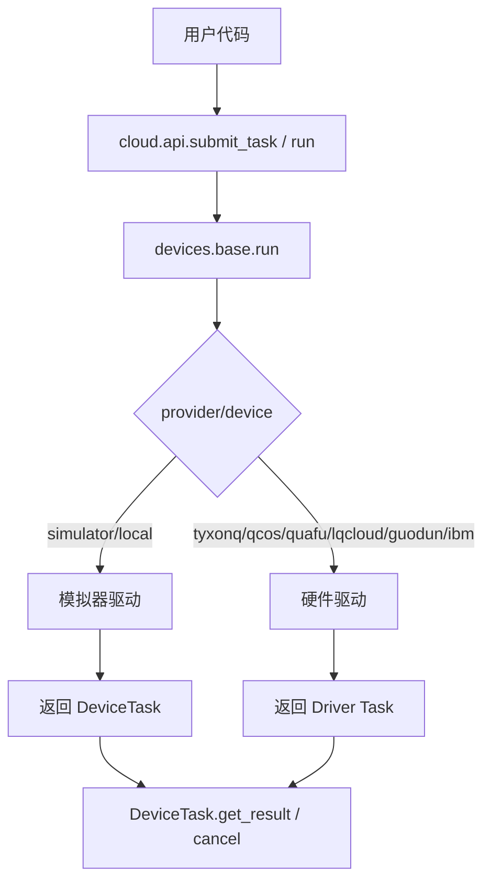
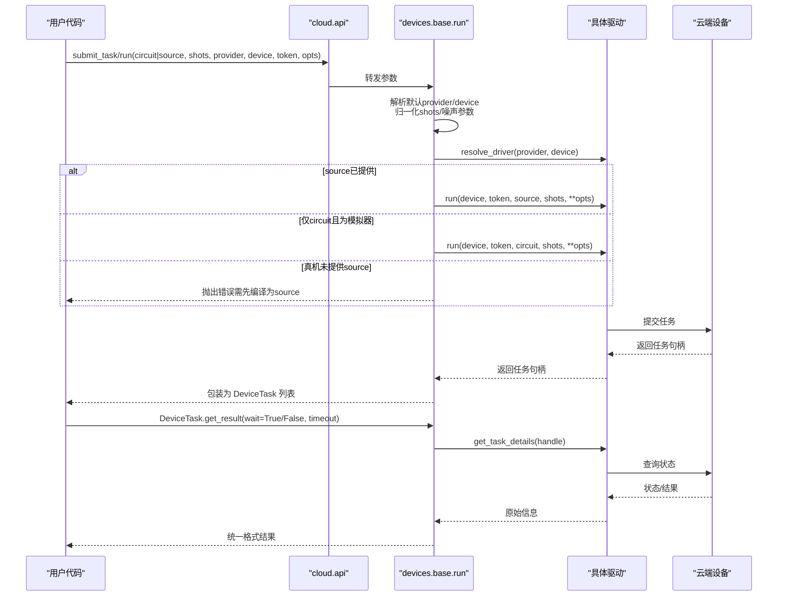
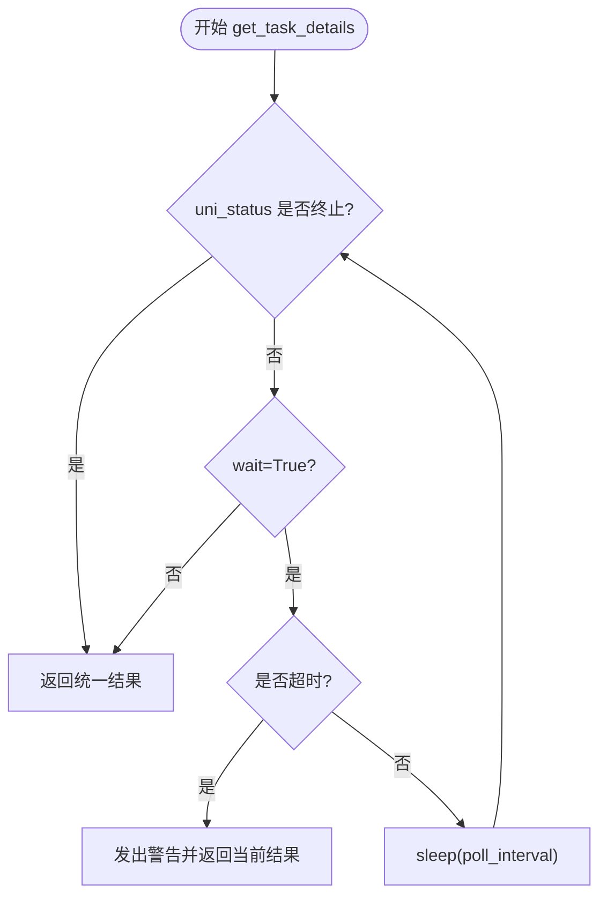
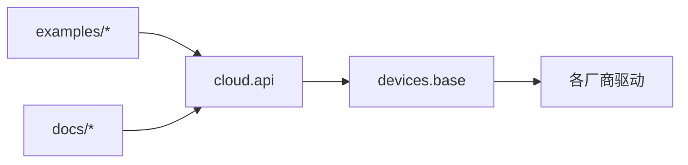

# 任务提交API

<cite>
**本文引用的文件**
- [src/tyxonq/cloud/api.py](file://src/tyxonq/cloud/api.py)
- [src/tyxonq/devices/base.py](file://src/tyxonq/devices/base.py)
- [examples/cloud_api_task.py](file://examples/cloud_api_task.py)
- [examples/cloud_api_task_qaoa.py](file://examples/cloud_api_task_qaoa.py)
- [examples/cloud_api_devices.py](file://examples/cloud_api_devices.py)
- [docs/source/cloud_services/task_submission.rst](file://docs/source/cloud_services/task_submission.rst)
- [docs/source/cloud_services/api_reference.rst](file://docs/source/cloud_services/api_reference.rst)
- [src/tyxonq/core/errors.py](file://src/tyxonq/core/errors.py)
</cite>

## 目录
1. [简介](#简介)
2. [项目结构](#项目结构)
3. [核心组件](#核心组件)
4. [架构总览](#架构总览)
5. [详细组件分析](#详细组件分析)
6. [依赖关系分析](#依赖关系分析)
7. [性能与资源管理](#性能与资源管理)
8. [故障排查指南](#故障排查指南)
9. [结论](#结论)
10. [附录](#附录)

## 简介
本文件面向TyxonQ云平台的“任务提交API”，聚焦于以下目标：
- 详细说明 submit_task() 与 run() 的用法，支持量子电路对象与预编译源代码（OpenQASM、TQASM）的提交。
- 解释任务参数配置：shots数量设置、自动编译选项、提供商与设备选择。
- 提供批量任务提交的实现示例，包括QAOA算法等复杂场景。
- 说明异步任务处理机制、任务状态跟踪、重试策略与超时处理。
- 包含任务优先级设置、资源分配与队列管理机制。
- 提供完整的错误处理和异常恢复方案。

## 项目结构
围绕任务提交的核心路径如下：
- 高层门面：cloud.api 暴露统一入口 submit_task()/run()，并委托到底层 devices.base.run。
- 设备抽象：devices.base 负责驱动选择、参数归一化、结果格式统一、异步轮询与取消。
- 示例与文档：examples 提供端到端使用样例；docs 提供任务提交与API参考文档。

图表来源
- [src/tyxonq/cloud/api.py:42-64](file://src/tyxonq/cloud/api.py#L42-L64)
- [src/tyxonq/devices/base.py:294-445](file://src/tyxonq/devices/base.py#L294-L445)

章节来源
- [src/tyxonq/cloud/api.py:1-160](file://src/tyxonq/cloud/api.py#L1-L160)
- [src/tyxonq/devices/base.py:1-578](file://src/tyxonq/devices/base.py#L1-L578)

## 核心组件
- cloud.api
  - submit_task(): 统一入口，接受 circuit/source/shots/provider/device/token/opts，委托至 devices.base.run。
  - run(): 与 submit_task() 等价，便于链式调用或习惯式调用。
  - get_task_details()/result()/cancel(): 查询任务详情、获取结果、取消任务。
- devices.base
  - run(): 选择驱动、注入噪声（仅模拟器）、归一化 shots、统一返回 DeviceTask 列表。
  - DeviceTask: 封装 provider/device/handle/async_result，并提供 get_result()/cancel()。
  - get_task_details(): 统一轮询、超时、状态标准化与结果格式归一。
  - remove_task(): 取消任务（若驱动支持）。

章节来源
- [src/tyxonq/cloud/api.py:22-158](file://src/tyxonq/cloud/api.py#L22-L158)
- [src/tyxonq/devices/base.py:12-578](file://src/tyxonq/devices/base.py#L12-L578)

## 架构总览
下图展示从用户调用到云端执行的完整流程，包括参数路由、驱动选择、异步轮询与结果归一化。

图表来源
- [src/tyxonq/cloud/api.py:42-131](file://src/tyxonq/cloud/api.py#L42-L131)
- [src/tyxonq/devices/base.py:294-445](file://src/tyxonq/devices/base.py#L294-L445)
- [src/tyxonq/devices/base.py:497-557](file://src/tyxonq/devices/base.py#L497-L557)

## 详细组件分析

### 组件A：cloud.api 的 submit_task 与 run
- 职责
  - 对外暴露统一的 submit_task()/run()，屏蔽底层差异。
  - 支持 circuit 或 source 两种输入；对 hardware 路径要求 caller 完成编译。
  - 透传 token、provider、device 及额外 opts。
- 关键行为
  - 直接委托 devices.base.run，不引入额外逻辑。
  - 通过 get_task_details/result/cancel 提供任务生命周期管理能力。
- 典型用法
  - 提交 OpenQASM/TQASM 源码：传入 source 字符串或列表。
  - 提交 Circuit：在 chain 模式下由 Circuit.compile().device(...).postprocessing().run(...) 完成编译与提交。

章节来源
- [src/tyxonq/cloud/api.py:42-131](file://src/tyxonq/cloud/api.py#L42-L131)
- [examples/cloud_api_task.py:30-59](file://examples/cloud_api_task.py#L30-L59)

### 组件B：devices.base.run 与 DeviceTask
- 职责
  - 选择驱动（resolve_driver），处理默认 provider/device 与 token。
  - 归一化 shots（真机不允许0），注入噪声（仅模拟器）。
  - 统一返回 DeviceTask 列表，封装 async_result 标志。
- 关键行为
  - source 直送路径：直接调用驱动 run(device, token, source, shots, **opts)。
  - circuit 路径：仅 simulator/local 支持；否则报错提示需在 circuit 层编译为 source。
  - 批量处理：支持 circuits 列表与 shots 列表对齐提交。
- DeviceTask
  - get_result(): 内部调用 get_task_details()，并对结果进行键补齐与元数据提升。
  - cancel(): 调用 remove_task() 取消任务（若驱动支持）。

```mermaid
flowchart TD
Start(["进入 devices.base.run"]) --> Resolve["解析 provider/device/token"]
Resolve --> SourceCheck{"是否提供 source?"}
SourceCheck --> |是| DirectRun["调用驱动 run(source, shots, **opts)"]
SourceCheck --> |否| CircuitPath{"是否为 simulator/local?"}
CircuitPath --> |是| SimRun["调用驱动 run(circuit, shots, **noise_opts)"]
CircuitPath --> |否| Err["抛出错误：需先编译为 source"]
DirectRun --> Wrap["包装为 DeviceTask 列表"]
SimRun --> Wrap
Wrap --> End(["返回"])
```

图表来源
- [src/tyxonq/devices/base.py:294-445](file://src/tyxonq/devices/base.py#L294-L445)

章节来源
- [src/tyxonq/devices/base.py:294-445](file://src/tyxonq/devices/base.py#L294-L445)
- [src/tyxonq/devices/base.py:12-58](file://src/tyxonq/devices/base.py#L12-L58)

### 组件C：任务状态跟踪、轮询与超时
- get_task_details()
  - 轮询策略：按 poll_interval 间隔查询，直到 uni_status 为 done/completed/success/finished 或 failed/error/cancelled。
  - 超时处理：当 wait=True 且超过 timeout，发出 RuntimeWarning 并返回当前结果（可能为空/不完整）。
  - 结果归一：确保 result/result_meta/metadata/expectations/probabilities 键存在，便于下游处理。
- 状态值
  - submitted/processing/running/completed/failed 等（不同驱动可能略有差异，统一为 uni_status）。

图表来源
- [src/tyxonq/devices/base.py:497-557](file://src/tyxonq/devices/base.py#L497-L557)

章节来源
- [src/tyxonq/devices/base.py:497-557](file://src/tyxonq/devices/base.py#L497-L557)

### 组件D：批量任务提交与QAOA示例
- 批量提交
  - 通过传入 circuits 列表与 shots 列表（或标量 shots 广播）实现批量提交。
  - 每个电路生成独立任务，返回 DeviceTask 列表，可分别轮询。
- QAOA 场景
  - 示例展示了构造 OPENQASM 源并提交到云端，随后查询任务详情。
  - 适合将优化器产出的参数化电路编译为 QASM 后批量提交。

章节来源
- [examples/cloud_api_task_qaoa.py:52-84](file://examples/cloud_api_task_qaoa.py#L52-L84)
- [docs/source/cloud_services/task_submission.rst:177-209](file://docs/source/cloud_services/task_submission.rst#L177-L209)

### 组件E：提供商与设备选择、自动编译
- 提供商与设备
  - provider 支持：simulator/local、tyxonq、qcos、quafu、lqcloud、guodun、ibm。
  - device 字符串可携带优化标记（如 homebrew_s2?o=7），或通过 enable_qos_* 参数控制。
- 自动编译
  - cloud.api 不执行编译；hardware 路径要求 caller 提供 source。
  - 推荐在 Circuit 层完成 compile() 后再提交，或使用链式 .device(...).postprocessing().run(...)。

章节来源
- [src/tyxonq/devices/base.py:146-258](file://src/tyxonq/devices/base.py#L146-L258)
- [docs/source/cloud_services/task_submission.rst:138-175](file://docs/source/cloud_services/task_submission.rst#L138-L175)
- [examples/cloud_api_task.py:52-59](file://examples/cloud_api_task.py#L52-L59)

## 依赖关系分析
- cloud.api 依赖 devices.base 的统一运行与任务管理。
- devices.base 通过 resolve_driver 动态加载各厂商驱动，屏蔽差异。
- 示例与文档提供了端到端的使用范式与最佳实践。

图表来源
- [src/tyxonq/cloud/api.py:42-131](file://src/tyxonq/cloud/api.py#L42-L131)
- [src/tyxonq/devices/base.py:146-258](file://src/tyxonq/devices/base.py#L146-L258)

章节来源
- [src/tyxonq/cloud/api.py:1-160](file://src/tyxonq/cloud/api.py#L1-L160)
- [src/tyxonq/devices/base.py:1-578](file://src/tyxonq/devices/base.py#L1-L578)

## 性能与资源管理
- 批量化
  - 使用 circuits 列表与 shots 列表进行批量提交，减少网络往返与调度开销。
- 自动编译与优化
  - 在 circuit 层完成编译，结合设备优化标记（如 o=7）降低深度与映射成本。
- 噪声与仿真
  - 仅对模拟器注入噪声；真机路径会丢弃无关参数，避免无效请求。
- 资源追踪
  - 通过 result_meta.raw.task 中的 qubits、depth、shots、runDur、durChip 等字段评估资源使用与耗时。

章节来源
- [src/tyxonq/devices/base.py:344-433](file://src/tyxonq/devices/base.py#L344-L433)
- [docs/source/cloud_services/task_submission.rst:350-443](file://docs/source/cloud_services/task_submission.rst#L350-L443)

## 故障排查指南
- 常见错误
  - 提交失败：检查设备状态与电路规模，必要时启用优化标记。
  - 执行失败：根据错误信息定位（如 qubits/depth/timeout）。
  - 超时：增大 timeout 或采用非阻塞轮询。
- 重试策略
  - 基于指数退避的重试循环，捕获异常并在失败时延迟重试。
- 回退机制
  - 真机不可用时回退到本地模拟器，保持接口一致性。
- 异常类型
  - 使用 core.errors 中定义的 TyxonQError、CompilationError、DeviceExecutionError 等分类处理。

章节来源
- [docs/source/cloud_services/task_submission.rst:447-619](file://docs/source/cloud_services/task_submission.rst#L447-L619)
- [src/tyxonq/core/errors.py:1-17](file://src/tyxonq/core/errors.py#L1-L17)

## 结论
TyxonQ 的任务提交API通过 cloud.api 与 devices.base 的协作，提供了简洁而强大的统一接口：
- 支持电路与源码两种提交方式，适配多种提供商与设备。
- 内置批量提交、异步轮询、超时与结果归一化能力。
- 结合文档与示例，可快速构建从简单Bell态到QAOA等复杂场景的端到端工作流。
- 完善的错误处理与回退策略，保障生产环境的稳定性与可维护性。

## 附录

### 常用参数速查
- provider/device：指定云平台与设备，支持默认配置与设备字符串优化标记。
- circuit/source：二选一；hardware 路径需提供 source。
- shots：测量次数，真机不允许0。
- token：认证令牌，优先使用显式传入，其次读取全局配置。
- auto_compile：cloud.api 不执行编译；请在 circuit 层完成编译。

章节来源
- [src/tyxonq/cloud/api.py:42-131](file://src/tyxonq/cloud/api.py#L42-L131)
- [src/tyxonq/devices/base.py:294-445](file://src/tyxonq/devices/base.py#L294-L445)

### 任务状态与时间戳
- 状态：submitted/processing/running/completed/failed。
- 时间戳：pending/scheduled/completed 等，用于分析排队与执行耗时。

章节来源
- [docs/source/cloud_services/task_submission.rst:311-417](file://docs/source/cloud_services/task_submission.rst#L311-L417)

### 设备列表与鉴权
- 使用 list_devices() 列出可用设备。
- 使用 set_token() 配置鉴权令牌，支持环境变量回退。

章节来源
- [examples/cloud_api_devices.py:16-21](file://examples/cloud_api_devices.py#L16-L21)
- [docs/source/cloud_services/api_reference.rst:18-66](file://docs/source/cloud_services/api_reference.rst#L18-L66)