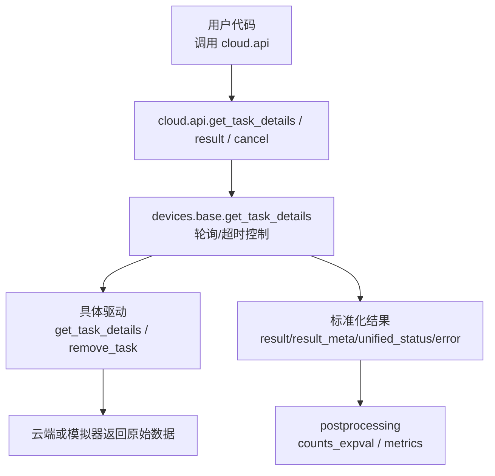
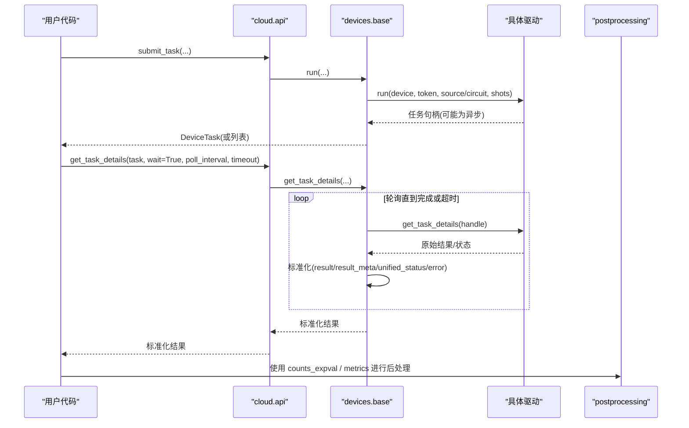
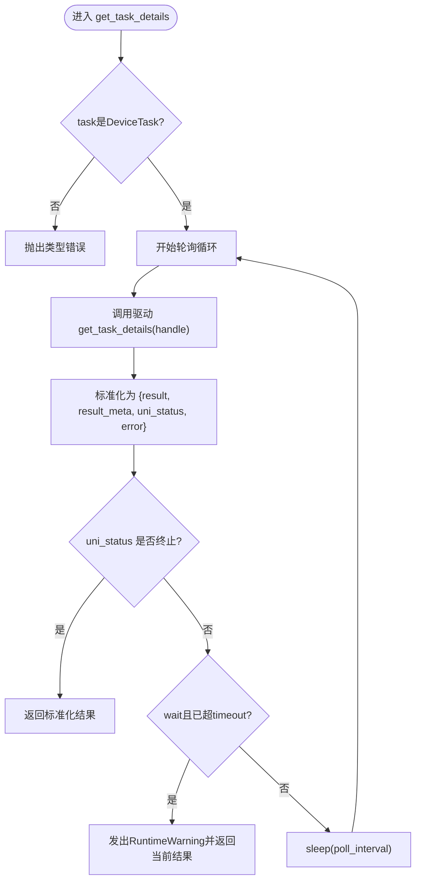
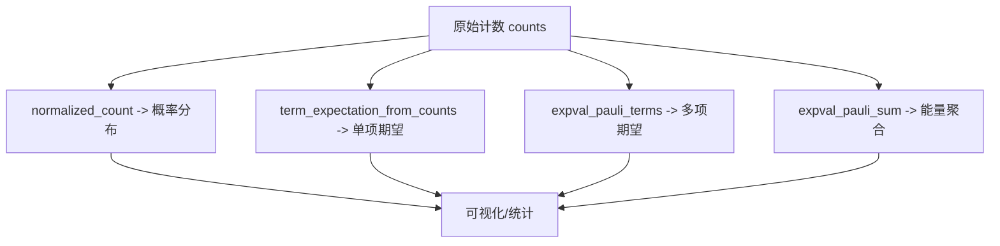
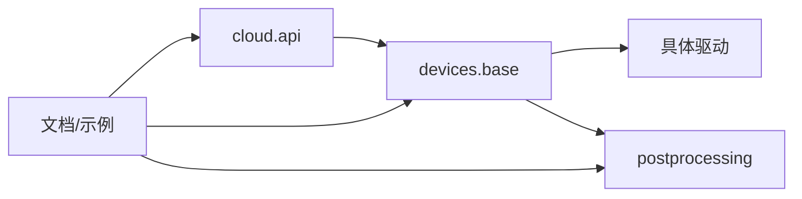

# 结果处理API

<cite>
**本文引用的文件**
- [src/tyxonq/cloud/api.py](file://src/tyxonq/cloud/api.py)
- [src/tyxonq/devices/base.py](file://src/tyxonq/devices/base.py)
- [src/tyxonq/core/ir/circuit.py](file://src/tyxonq/core/ir/circuit.py)
- [src/tyxonq/postprocessing/counts_expval.py](file://src/tyxonq/postprocessing/counts_expval.py)
- [src/tyxonq/postprocessing/metrics.py](file://src/tyxonq/postprocessing/metrics.py)
- [examples/cloud_api_task.py](file://examples/cloud_api_task.py)
- [docs/source/cloud_services/api_reference.rst](file://docs/source/cloud_services/api_reference.rst)
- [docs/tyxonq_cloud_api.md](file://docs/tyxonq_cloud_api.md)
</cite>

## 目录
1. [简介](#简介)
2. [项目结构](#项目结构)
3. [核心组件](#核心组件)
4. [架构总览](#架构总览)
5. [详细组件分析](#详细组件分析)
6. [依赖关系分析](#依赖关系分析)
7. [性能考虑](#性能考虑)
8. [故障排查指南](#故障排查指南)
9. [结论](#结论)
10. [附录](#附录)

## 简介
本文件面向TyxonQ云平台的结果处理API，围绕以下目标展开：
- 详细说明 get_task_details()、result() 和 cancel() 的用法，覆盖任务状态查询、结果获取与任务取消。
- 解释异步等待机制，包括 poll_interval 与 timeout 的配置与行为。
- 说明结果数据格式结构，包括计数统计、期望值计算、概率分布等。
- 提供结果后处理的完整示例思路，涵盖数据转换、统计分析、可视化展示。
- 解释错误处理策略，包括网络异常、超时处理与重试建议。
- 给出结果缓存、批量处理与性能优化建议。

## 项目结构
TyxonQ将云API封装在统一门面中，并通过设备层抽象屏蔽不同后端差异；结果获取与后处理由核心IR与后处理模块协同完成。

图表来源
- [src/tyxonq/cloud/api.py:67-145](file://src/tyxonq/cloud/api.py#L67-L145)
- [src/tyxonq/devices/base.py:497-574](file://src/tyxonq/devices/base.py#L497-L574)
- [src/tyxonq/postprocessing/counts_expval.py:7-112](file://src/tyxonq/postprocessing/counts_expval.py#L7-L112)
- [src/tyxonq/postprocessing/metrics.py:20-84](file://src/tyxonq/postprocessing/metrics.py#L20-L84)

章节来源
- [src/tyxonq/cloud/api.py:1-160](file://src/tyxonq/cloud/api.py#L1-L160)
- [src/tyxonq/devices/base.py:12-574](file://src/tyxonq/devices/base.py#L12-L574)

## 核心组件
- 云API门面（cloud.api）
  - get_task_details(task, wait=False, poll_interval=2.0, timeout=60.0)：委托到设备层统一接口，支持异步轮询与超时。
  - result(task, prettify=False)：通过Circuit模块级辅助函数获取任务结果（内部委托至 core.ir.circuit）。
  - cancel(task)：通过Circuit模块级辅助函数取消任务（内部委托至 core.ir.circuit）。
- 设备层统一接口（devices.base）
  - DeviceTask：统一的任务句柄包装，提供 get_result() 与 cancel()。
  - get_task_details(task, wait, poll_interval, timeout)：实现轮询、状态归一化、超时警告与错误透传。
  - remove_task(task)：移除/取消任务（若驱动支持）。
- 后处理模块（postprocessing）
  - counts_expval：从计数统计计算Pauli项期望值、Pauli求和能量等。
  - metrics：计数归一化为概率分布、KL散度、对角算符期望值等。

章节来源
- [src/tyxonq/cloud/api.py:67-145](file://src/tyxonq/cloud/api.py#L67-L145)
- [src/tyxonq/devices/base.py:12-574](file://src/tyxonq/devices/base.py#L12-L574)
- [src/tyxonq/postprocessing/counts_expval.py:7-112](file://src/tyxonq/postprocessing/counts_expval.py#L7-L112)
- [src/tyxonq/postprocessing/metrics.py:20-84](file://src/tyxonq/postprocessing/metrics.py#L20-L84)

## 架构总览
下图展示了从提交任务到获取结果的端到端流程，以及关键参数在系统中的流转。

图表来源
- [src/tyxonq/cloud/api.py:42-72](file://src/tyxonq/cloud/api.py#L42-L72)
- [src/tyxonq/devices/base.py:294-445](file://src/tyxonq/devices/base.py#L294-L445)
- [src/tyxonq/devices/base.py:497-557](file://src/tyxonq/devices/base.py#L497-L557)
- [src/tyxonq/postprocessing/counts_expval.py:7-112](file://src/tyxonq/postprocessing/counts_expval.py#L7-L112)
- [src/tyxonq/postprocessing/metrics.py:20-84](file://src/tyxonq/postprocessing/metrics.py#L20-L84)

## 详细组件分析

### get_task_details()：任务状态查询与结果获取
- 入口与委托
  - cloud.api.get_task_details 直接委托 devices.base.get_task_details，并透传 wait、poll_interval、timeout。
- 轮询与超时
  - 基于时间戳与 sleep(poll_interval) 循环查询，直到状态为完成/失败/取消或达到超时。
  - 超时触发 RuntimeWarning，提示“排队或执行耗时超过等待上限”，并返回当前结果（可能为空或不完整）。
- 结果标准化
  - 统一返回字段：result（计数字典）、result_meta（原始payload）、uni_status（统一状态字符串）、error（错误信息）。
  - DeviceTask.get_result 进一步将 provider-specific 元数据提升到 metadata，并补齐 expectations/probabilities 键。
- 典型用法
  - 非阻塞：wait=False，仅查询当前状态。
  - 阻塞等待：wait=True，结合 poll_interval 与 timeout 控制轮询频率与最长等待时间。

图表来源
- [src/tyxonq/devices/base.py:497-557](file://src/tyxonq/devices/base.py#L497-L557)
- [src/tyxonq/devices/base.py:20-54](file://src/tyxonq/devices/base.py#L20-L54)

章节来源
- [src/tyxonq/cloud/api.py:67-72](file://src/tyxonq/cloud/api.py#L67-L72)
- [src/tyxonq/devices/base.py:497-557](file://src/tyxonq/devices/base.py#L497-L557)

### result()：便捷获取最终结果
- 入口与委托
  - cloud.api.result 委托 core.ir.circuit 的 get_task_details（用于Circuit对象场景），支持 prettify 选项。
- 适用场景
  - 当使用链式构建Circuit并执行时，可通过 result() 快速拿到最终结果（等价于带等待语义的结果获取）。
- 注意
  - 该路径与 devices.base 的 get_task_details 在职责上略有差异：前者更偏向Circuit对象的结果获取，后者提供更通用的轮询与标准化能力。

章节来源
- [src/tyxonq/cloud/api.py:134-138](file://src/tyxonq/cloud/api.py#L134-L138)
- [src/tyxonq/core/ir/circuit.py:1-200](file://src/tyxonq/core/ir/circuit.py#L1-L200)

### cancel()：任务取消
- 入口与委托
  - cloud.api.cancel 委托 core.ir.circuit 的 cancel_task。
- 设备层取消
  - devices.base.remove_task 会尝试调用驱动的 remove_task；若驱动不支持则抛出 NotImplementedError。
- 使用建议
  - 对于长队列或长时间运行的任务，可在检测到不需要继续等待时主动取消以释放资源。

章节来源
- [src/tyxonq/cloud/api.py:141-145](file://src/tyxonq/cloud/api.py#L141-L145)
- [src/tyxonq/devices/base.py:563-574](file://src/tyxonq/devices/base.py#L563-L574)

### 异步等待机制：poll_interval 与 timeout
- 参数含义
  - poll_interval：每次轮询间隔（秒），默认2.0。
  - timeout：最大等待时间（秒），默认60.0。
- 行为说明
  - wait=True 时，循环查询直至完成/失败/取消或达到超时。
  - 超时不会抛异常，而是发出警告并返回当前结果（可能为空或不完整），便于上层区分“超时”与“执行错误”。
- 调优建议
  - 短任务：poll_interval可较小（如1.0），timeout适中（如30-60）。
  - 长任务或高负载时段：增大timeout，适当提高poll_interval以降低请求频率。

章节来源
- [src/tyxonq/devices/base.py:497-557](file://src/tyxonq/devices/base.py#L497-L557)
- [docs/source/cloud_services/api_reference.rst:368-417](file://docs/source/cloud_services/api_reference.rst#L368-L417)

### 结果数据格式结构
- 顶层字段
  - result：测量计数字典，键为比特串（如"00"、"11"），值为出现次数。
  - result_meta：执行元数据，包含shots、device、raw（云端原始响应）等。
- 云端原始任务信息（raw.task）
  - id、queue、device、qubits、depth、state、shots、result、ts（pending/scheduled/completed时间戳）、runDur、atChip、durChip、task_type等。
- 扩展字段（标准化后）
  - probabilities：可选，概率分布数组（某些驱动/模拟器返回）。
  - expectations：可选，期望值字典（某些驱动/模拟器返回）。
  - metadata：提升后的引擎元数据（如num_qubits等）。

章节来源
- [docs/source/cloud_services/api_reference.rst:429-499](file://docs/source/cloud_services/api_reference.rst#L429-L499)
- [src/tyxonq/devices/base.py:20-54](file://src/tyxonq/devices/base.py#L20-L54)

### 结果后处理：计数统计、期望值、概率分布
- 计数到概率分布
  - normalized_count：将计数字典归一化为概率分布。
- 期望值计算
  - term_expectation_from_counts：从计数统计计算Z乘积项的期望值。
  - expval_pauli_terms：对多个Pauli项计算期望值。
  - expval_pauli_sum：聚合Pauli求和的能量（支持计数或解析期望值两种路径）。
- 其他指标
  - expectation：对角算符期望值（支持指定z位或diagonal_op）。
  - kl_divergence：两个分布之间的KL散度。

图表来源
- [src/tyxonq/postprocessing/metrics.py:20-84](file://src/tyxonq/postprocessing/metrics.py#L20-L84)
- [src/tyxonq/postprocessing/counts_expval.py:7-112](file://src/tyxonq/postprocessing/counts_expval.py#L7-L112)

章节来源
- [src/tyxonq/postprocessing/metrics.py:20-84](file://src/tyxonq/postprocessing/metrics.py#L20-L84)
- [src/tyxonq/postprocessing/counts_expval.py:7-112](file://src/tyxonq/postprocessing/counts_expval.py#L7-L112)

### 完整后处理示例（思路）
- 数据转换
  - 从 result 提取 counts，使用 normalized_count 得到概率分布。
  - 若有 probabilities，可直接用于后续分析。
- 统计分析
  - 使用 expectation 计算对角算符期望值；或使用 expval_pauli_terms/expval_pauli_sum 计算特定物理量（如哈密顿量能量）。
  - 使用 kl_divergence 比较不同运行或不同参数的分布差异。
- 可视化展示
  - 将概率分布绘制为柱状图（按比特串排序），叠加理论分布对比。
  - 对期望值随参数变化曲线进行可视化，标注误差棒（可由多次运行估计）。

章节来源
- [examples/cloud_api_task.py:30-59](file://examples/cloud_api_task.py#L30-L59)
- [src/tyxonq/postprocessing/metrics.py:20-84](file://src/tyxonq/postprocessing/metrics.py#L20-L84)
- [src/tyxonq/postprocessing/counts_expval.py:7-112](file://src/tyxonq/postprocessing/counts_expval.py#L7-L112)

## 依赖关系分析
- cloud.api 作为门面，解耦上层调用与底层设备实现。
- devices.base 提供统一的轮询、超时、结果标准化与任务取消能力。
- postprocessing 模块独立于设备层，专注于从计数/期望值/概率中提取物理量与统计指标。
- 文档与示例提供了端到端的使用参考。

图表来源
- [src/tyxonq/cloud/api.py:1-160](file://src/tyxonq/cloud/api.py#L1-L160)
- [src/tyxonq/devices/base.py:12-574](file://src/tyxonq/devices/base.py#L12-L574)
- [src/tyxonq/postprocessing/counts_expval.py:7-112](file://src/tyxonq/postprocessing/counts_expval.py#L7-L112)
- [src/tyxonq/postprocessing/metrics.py:20-84](file://src/tyxonq/postprocessing/metrics.py#L20-L84)
- [docs/source/cloud_services/api_reference.rst:1-583](file://docs/source/cloud_services/api_reference.rst#L1-L583)
- [docs/tyxonq_cloud_api.md:1-361](file://docs/tyxonq_cloud_api.md#L1-L361)

章节来源
- [src/tyxonq/cloud/api.py:1-160](file://src/tyxonq/cloud/api.py#L1-L160)
- [src/tyxonq/devices/base.py:12-574](file://src/tyxonq/devices/base.py#L12-L574)

## 性能考虑
- 轮询频率与超时
  - 合理设置 poll_interval 与 timeout，避免频繁请求导致限流或浪费CPU。
  - 在高负载时段可适当增大间隔与超时。
- 批量化提交
  - 使用 batched 提交（如一次提交多个电路/源）可减少往返开销，但需确保驱动支持。
- 结果缓存
  - 对相同任务ID的结果进行本地缓存，避免重复查询。
  - 缓存键可包含 device、shots、source哈希等，确保一致性。
- 后处理优化
  - 优先使用向量化库（如NumPy）进行概率分布与期望值计算。
  - 对大规模计数统计，可使用分块处理减少内存占用。
- 噪声与模拟
  - 模拟器路径支持 noise/use_noise 注入，适合算法验证；真机路径会丢弃这些参数以避免无关开销。

章节来源
- [src/tyxonq/devices/base.py:274-445](file://src/tyxonq/devices/base.py#L274-L445)
- [docs/tyxonq_cloud_api.md:328-357](file://docs/tyxonq_cloud_api.md#L328-L357)

## 故障排查指南
- 常见错误
  - 类型错误：传入非DeviceTask对象给 get_task_details/remove_task。
  - 未实现：驱动不支持 remove_task。
  - 超时：等待时间不足或任务排队过长。
- 诊断步骤
  - 检查 uni_status 与 error 字段，确认任务实际状态。
  - 查看 result_meta.raw 中的云端原始响应，定位具体问题。
  - 调整 poll_interval 与 timeout，观察是否改善。
- 重试策略
  - 对网络异常或临时错误，可实现指数退避重试（如初始间隔1s，逐步增加至最大间隔）。
  - 对超时，可分段重试：先缩短等待，再逐步延长。
- 日志与监控
  - 记录每次轮询的时间戳、状态与耗时，便于分析瓶颈。
  - 对高频失败的任务，收集上下文（device、shots、source哈希）以便复现。

章节来源
- [src/tyxonq/devices/base.py:497-574](file://src/tyxonq/devices/base.py#L497-L574)
- [docs/tyxonq_cloud_api.md:328-357](file://docs/tyxonq_cloud_api.md#L328-L357)

## 结论
TyxonQ的结果处理API通过统一门面与设备层抽象，提供了稳定的任务状态查询、结果获取与取消能力。其异步等待机制通过 poll_interval 与 timeout 灵活控制，配合标准化的结果结构与丰富的后处理工具，能够满足从基础计数统计到复杂物理量计算的多样化需求。在生产环境中，建议结合缓存、批量化与合理的重试策略，以获得更好的性能与鲁棒性。

## 附录
- 端到端示例参考
  - 提交OPENQASM源并轮询任务详情：[examples/cloud_api_task.py:30-59](file://examples/cloud_api_task.py#L30-L59)
  - 云端API响应格式与字段说明：[docs/source/cloud_services/api_reference.rst:429-499](file://docs/source/cloud_services/api_reference.rst#L429-L499)
  - 云端API文档（认证、端点、最佳实践）：[docs/tyxonq_cloud_api.md:1-361](file://docs/tyxonq_cloud_api.md#L1-L361)