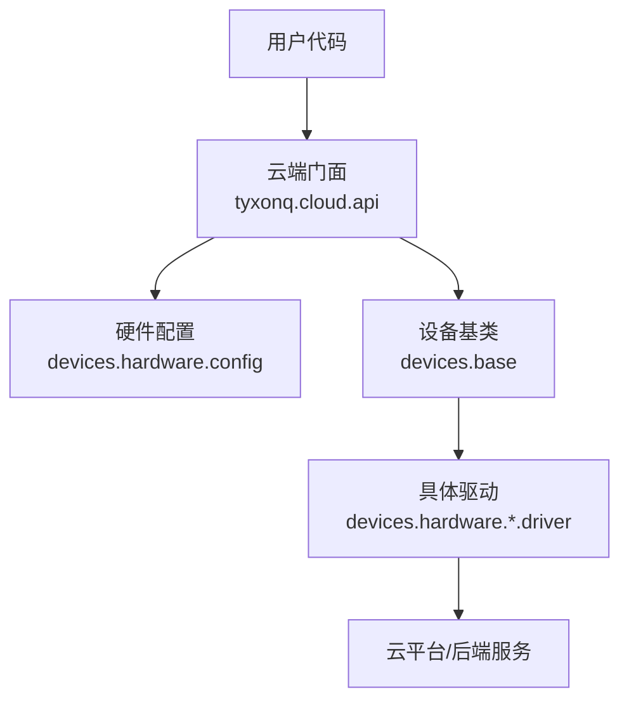
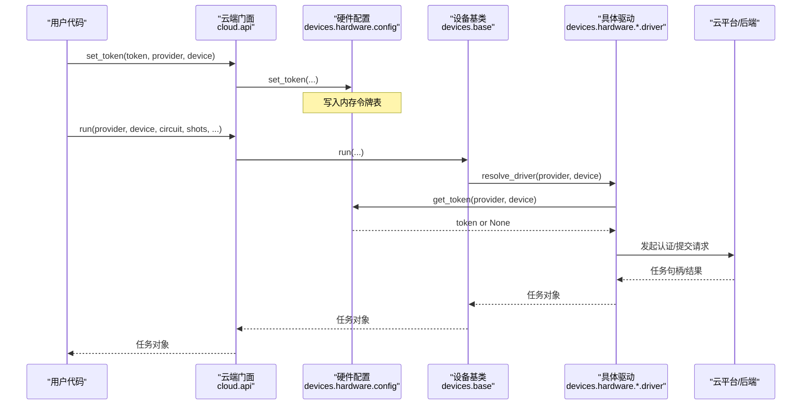
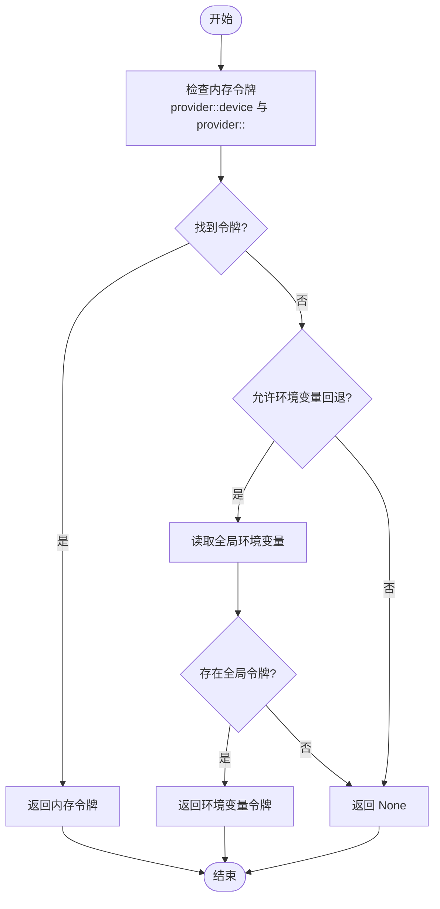
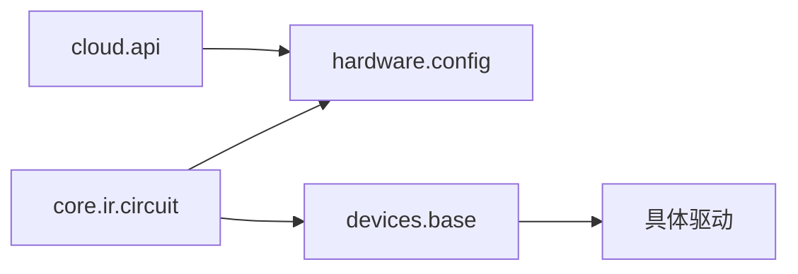

# 认证配置API

<cite>
**本文引用的文件**
- [src/tyxonq/cloud/api.py](file://src/tyxonq/cloud/api.py)
- [src/tyxonq/devices/hardware/config.py](file://src/tyxonq/devices/hardware/config.py)
- [src/tyxonq/core/ir/circuit.py](file://src/tyxonq/core/ir/circuit.py)
- [examples/cloud_api_devices.py](file://examples/cloud_api_devices.py)
- [examples/run_circuit_on_quafu.py](file://examples/run_circuit_on_quafu.py)
- [examples/qcos_cloud_task.py](file://examples/qcos_cloud_task.py)
- [tests_core_module/test_hwconfig_get_token.py](file://tests_core_module/test_hwconfig_get_token.py)
- [tests_core_module/test_lqcloud_driver.py](file://tests_core_module/test_lqcloud_driver.py)
- [tests_core_module/test_guodun_driver.py](file://tests_core_module/test_guodun_driver.py)
- [docs/qcos_provider.md](file://docs/qcos_provider.md)
- [QCOS_CHANGES.md](file://QCOS_CHANGES.md)
</cite>

## 目录
1. [简介](#简介)
2. [项目结构](#项目结构)
3. [核心组件](#核心组件)
4. [架构总览](#架构总览)
5. [详细组件分析](#详细组件分析)
6. [依赖关系分析](#依赖关系分析)
7. [性能与可用性考虑](#性能与可用性考虑)
8. [故障排查指南](#故障排查指南)
9. [结论](#结论)
10. [附录：多提供商配置示例与安全实践](#附录多提供商配置示例与安全实践)

## 简介
本文件面向TyxonQ云平台的“认证配置API”，聚焦于以下目标：
- 说明 set_token() 与 set_default() 的用法，涵盖API密钥管理、提供商配置与设备默认设置。
- 解释认证流程：令牌获取优先级、会话管理与权限控制（由驱动层实现）。
- 提供多提供商认证的完整配置示例：TyxonQ云、QCOS、Quafu等。
- 说明配置文件与环境变量策略，以及安全最佳实践。
- 覆盖认证失败处理、令牌刷新机制与错误诊断要点。

## 项目结构
认证相关能力集中在如下模块：
- 云端统一门面：tyxonq.cloud.api 暴露 set_token/set_default/list_devices/submit_task/run 等接口，并委托到底层硬件配置与设备基类。
- 硬件配置与令牌存储：tyxonq.devices.hardware.config 维护内存中的令牌表、默认提供商/设备、端点信息，并提供 get_token/set_default 等工具。
- 任务查询与取消：core.ir.circuit 提供 get_task_details/cancel_task，内部按设备解析提供商并调用对应驱动的查询/取消逻辑。
- 示例与文档：examples 与 docs 提供各提供商的使用示例与说明。

图表来源
- [src/tyxonq/cloud/api.py:22-64](file://src/tyxonq/cloud/api.py#L22-L64)
- [src/tyxonq/devices/hardware/config.py:24-65](file://src/tyxonq/devices/hardware/config.py#L24-L65)
- [src/tyxonq/core/ir/circuit.py:2048-2081](file://src/tyxonq/core/ir/circuit.py#L2048-L2081)

章节来源
- [src/tyxonq/cloud/api.py:1-160](file://src/tyxonq/cloud/api.py#L1-L160)
- [src/tyxonq/devices/hardware/config.py:1-78](file://src/tyxonq/devices/hardware/config.py#L1-L78)
- [src/tyxonq/core/ir/circuit.py:2048-2081](file://src/tyxonq/core/ir/circuit.py#L2048-L2081)

## 核心组件
- 云端门面 API
  - set_token(token, provider=None, device=None)：将令牌写入内存，支持按提供商或设备维度设置。
  - set_default(provider=None, device=None)：设置全局默认提供商与设备。
  - list_devices(provider=None)：列出可用设备（需要凭据时受提供商限制）。
  - submit_task()/run()：提交任务到指定提供商/设备，底层委托至设备基类。
- 硬件配置
  - _TOKENS：进程内令牌缓存，键形如 "provider::device" 或 "provider::"。
  - ENDPOINTS：提供商端点信息（如 TyxonQ 云、QCOS）。
  - get_token(provider, device, env_fallback=True)：按优先级返回令牌（内存 > 环境变量回退）。
  - set_default/get_default_provider/get_default_device：默认值管理。
- 任务详情与取消
  - get_task_details(task)：根据任务关联的设备字符串解析提供商，取对应驱动查询结果。
  - cancel_task(task)：若驱动支持 remove_task，则执行取消。

章节来源
- [src/tyxonq/cloud/api.py:22-158](file://src/tyxonq/cloud/api.py#L22-L158)
- [src/tyxonq/devices/hardware/config.py:7-75](file://src/tyxonq/devices/hardware/config.py#L7-L75)
- [src/tyxonq/core/ir/circuit.py:2048-2081](file://src/tyxonq/core/ir/circuit.py#L2048-L2081)

## 架构总览
认证与执行的关键路径如下：
- 设置令牌：通过 cloud.api.set_token 写入 devices.hardware.config._TOKENS。
- 设置默认：通过 cloud.api.set_default 更新默认提供商/设备。
- 运行任务：cloud.api.run/submit_task 委托 devices.base.run；驱动在运行时按设备解析提供商并获取令牌。
- 查询/取消：core.ir.circuit.get_task_details/cancel_task 解析设备字符串，取驱动并传入令牌。

图表来源
- [src/tyxonq/cloud/api.py:22-64](file://src/tyxonq/cloud/api.py#L22-L64)
- [src/tyxonq/devices/hardware/config.py:24-65](file://src/tyxonq/devices/hardware/config.py#L24-L65)
- [src/tyxonq/core/ir/circuit.py:2048-2081](file://src/tyxonq/core/ir/circuit.py#L2048-L2081)

## 详细组件分析

### 令牌与默认值管理（set_token / set_default）
- set_token
  - 作用：将令牌以 "provider::device" 和 "provider::" 两个键写入内存，便于设备级与提供商级复用。
  - 参数：token 必填；provider/device 可选，未提供时使用默认提供商。
  - 返回值：当前内存令牌表副本。
- set_default
  - 作用：设置全局默认提供商与设备，影响后续未显式指定的调用。
- get_token
  - 优先级：内存令牌（设备级优先，其次提供商级）→ 可选的环境变量回退（默认开启）→ None。
  - 开关：env_fallback=False 可禁用环境变量回退，供特定驱动自定义鉴权链。

图表来源
- [src/tyxonq/devices/hardware/config.py:24-65](file://src/tyxonq/devices/hardware/config.py#L24-L65)

章节来源
- [src/tyxonq/devices/hardware/config.py:24-65](file://src/tyxonq/devices/hardware/config.py#L24-L65)
- [tests_core_module/test_hwconfig_get_token.py:15-50](file://tests_core_module/test_hwconfig_get_token.py#L15-L50)

### 云端门面 API（cloud.api）
- set_token/set_default：直接委托至 hardware.config。
- list_devices：委托设备基类，按 provider/token 列出设备。
- submit_task/run：委托设备基类统一执行，支持电路或源码输入。
- get_task_details/result/cancel：委托 core.ir.circuit 或设备基类，完成结果获取与任务取消。

章节来源
- [src/tyxonq/cloud/api.py:22-158](file://src/tyxonq/cloud/api.py#L22-L158)

### 任务详情与取消（core.ir.circuit）
- get_task_details：从任务对象提取设备字符串，解析提供商，调用对应驱动的 get_task_details。
- cancel_task：若驱动提供 remove_task，则调用其取消接口。

章节来源
- [src/tyxonq/core/ir/circuit.py:2048-2081](file://src/tyxonq/core/ir/circuit.py#L2048-L2081)

### 提供商端点与默认值
- ENDPOINTS：包含 TyxonQ 云与 QCOS 的基础URL与版本信息。
- 默认提供商/设备：默认为 tyxonq 提供商与模拟器设备，可通过 set_default 覆盖。

章节来源
- [src/tyxonq/devices/hardware/config.py:11-19](file://src/tyxonq/devices/hardware/config.py#L11-L19)
- [src/tyxonq/devices/hardware/config.py:53-65](file://src/tyxonq/devices/hardware/config.py#L53-L65)

## 依赖关系分析
- cloud.api 依赖 devices.hardware.config 进行令牌与默认值管理。
- core.ir.circuit 在任务查询/取消时依赖 devices.hardware.config 获取令牌，并通过 devices.base.resolve_driver 选择具体驱动。
- 各驱动（如 guodun、lqcloud、quafu、qcos）各自实现凭据解析与网络交互，遵循统一的设备抽象。

图表来源
- [src/tyxonq/cloud/api.py:22-64](file://src/tyxonq/cloud/api.py#L22-L64)
- [src/tyxonq/core/ir/circuit.py:2048-2081](file://src/tyxonq/core/ir/circuit.py#L2048-L2081)

章节来源
- [src/tyxonq/cloud/api.py:1-160](file://src/tyxonq/cloud/api.py#L1-L160)
- [src/tyxonq/core/ir/circuit.py:2048-2081](file://src/tyxonq/core/ir/circuit.py#L2048-L2081)

## 性能与可用性考虑
- 令牌查找为 O(1) 字典访问，开销极低。
- 环境变量回退仅在未命中内存令牌时触发，避免不必要的系统调用。
- 列表设备可能因提供商鉴权而受限；无凭据时通常返回空列表并记录警告。
- 任务提交/查询涉及网络I/O，建议合理设置超时与轮询间隔。

[本节为通用指导，不直接分析具体文件]

## 故障排查指南
常见认证问题与定位方法：
- 未设置令牌
  - 现象：驱动抛出缺少凭据的错误（例如“X API key required”）。
  - 排查：确认是否调用 set_token 或设置了相应环境变量；查看 get_token 的返回值。
  - 参考：测试用例验证了不同优先级与缺失场景。
- 环境变量优先级冲突
  - 现象：全局 TYXONQ_API_KEY 被忽略，需使用提供商专用环境变量。
  - 排查：检查驱动是否要求专用环境变量（如 LQCloud、Guodun），并确保名称正确。
- 提供商不支持的环境回退
  - 现象：某些驱动关闭 env_fallback，需显式传入令牌。
  - 排查：确认驱动是否启用环境变量回退；必要时改用 set_token 或参数传递。
- 任务查询失败
  - 现象：get_task_details 报错或缺少设备信息。
  - 排查：确保任务对象携带设备信息；驱动是否实现 get_task_details。

章节来源
- [tests_core_module/test_hwconfig_get_token.py:15-50](file://tests_core_module/test_hwconfig_get_token.py#L15-L50)
- [tests_core_module/test_lqcloud_driver.py:103-126](file://tests_core_module/test_lqcloud_driver.py#L103-L126)
- [tests_core_module/test_guodun_driver.py:25-37](file://tests_core_module/test_guodun_driver.py#L25-L37)
- [src/tyxonq/core/ir/circuit.py:2048-2081](file://src/tyxonq/core/ir/circuit.py#L2048-L2081)

## 结论
TyxonQ 的认证配置API通过“云端门面 + 硬件配置 + 设备驱动”的分层设计，实现了灵活的令牌管理与提供商抽象。set_token/set_default 提供了简洁的认证入口，结合环境变量回退与驱动级自定义，满足多提供商、多设备的复杂场景。任务查询与取消通过核心IR层统一调度，保证一致的用户体验。生产环境应遵循安全最佳实践，妥善管理敏感信息与访问控制。

[本节为总结性内容，不直接分析具体文件]

## 附录：多提供商配置示例与安全实践

### 多提供商认证配置示例
- TyxonQ 云
  - 设置令牌：通过 cloud.api.set_token 设置提供商为 tyxonq。
  - 列出设备：使用 cloud.api.list_devices(provider="tyxonq")。
  - 参考示例：见 examples/cloud_api_devices.py。
- Quafu
  - 环境变量：设置 TYXONQ_QUAFU_TOKEN。
  - 示例：examples/run_circuit_on_quafu.py 展示了如何列出设备并提交电路。
  - 注意：部分驱动会关闭环境变量回退，需显式传入令牌。
- QCOS（中国移动 ecloud）
  - 环境变量：设置 QCOS_ACCESS_KEY 与 QCOS_SECRET_KEY。
  - 示例：examples/qcos_cloud_task.py 演示提交贝尔态电路。
  - 文档：docs/qcos_provider.md 与 QCOS_CHANGES.md 提供平台接入细节。

章节来源
- [examples/cloud_api_devices.py:16-21](file://examples/cloud_api_devices.py#L16-L21)
- [examples/run_circuit_on_quafu.py:22-49](file://examples/run_circuit_on_quafu.py#L22-L49)
- [examples/qcos_cloud_task.py:28-57](file://examples/qcos_cloud_task.py#L28-L57)
- [docs/qcos_provider.md:65-102](file://docs/qcos_provider.md#L65-L102)
- [QCOS_CHANGES.md:54-111](file://QCOS_CHANGES.md#L54-L111)

### 环境变量与配置文件管理
- 推荐做法
  - 使用进程内 set_token 注入令牌，避免落盘或明文输出。
  - 对不支持环境变量回退的驱动，显式传入 token 参数。
  - 使用专用环境变量（如 TYXONQ_QUAFU_TOKEN、QCOS_ACCESS_KEY/SECRET_KEY）隔离不同提供商。
- 注意事项
  - 全局 TYXONQ_API_KEY 可能被特定驱动忽略，需使用提供商专用变量。
  - 沙箱/CI环境中，环境变量不跨命令持久，需在单条命令中注入或通过脚本读取安全存储。

章节来源
- [tests_core_module/test_hwconfig_get_token.py:15-50](file://tests_core_module/test_hwconfig_get_token.py#L15-L50)
- [tests_core_module/test_lqcloud_driver.py:103-126](file://tests_core_module/test_lqcloud_driver.py#L103-L126)
- [tests_core_module/test_guodun_driver.py:25-37](file://tests_core_module/test_guodun_driver.py#L25-L37)

### 安全最佳实践
- 敏感信息保护
  - 不在日志/正文中打印令牌；不落盘到版本库。
  - 使用环境变量或安全存储（如密钥管理服务）注入令牌。
- 访问控制
  - 最小权限原则：仅授予必要的提供商/设备访问权限。
  - 定期轮换令牌，限制有效期。
- 审计日志
  - 记录认证尝试与失败原因（不含敏感数据），便于追踪与合规。
- 会话与刷新
  - 令牌过期时重新调用 set_token 更新内存令牌。
  - 对于长生命周期任务，建议在关键步骤前校验令牌有效性。

[本节为通用安全指导，不直接分析具体文件]