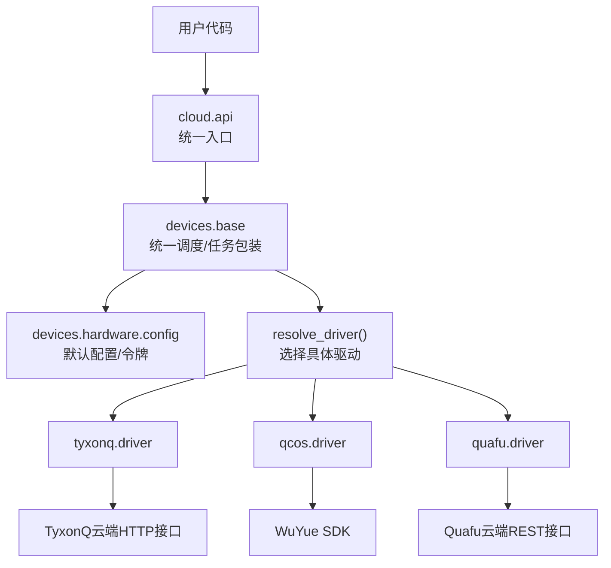
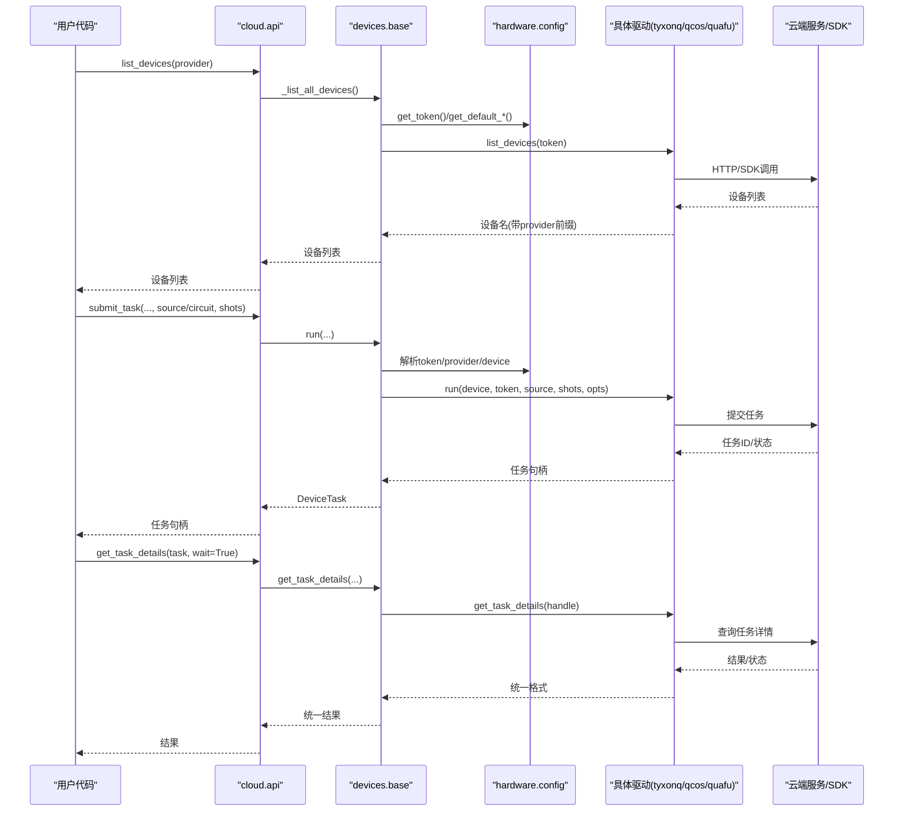
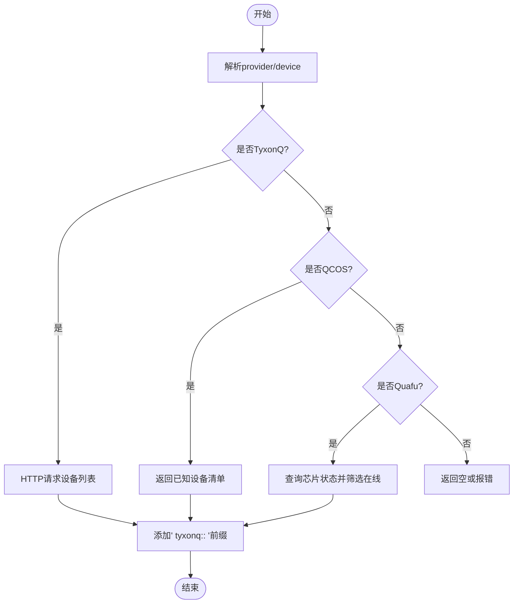
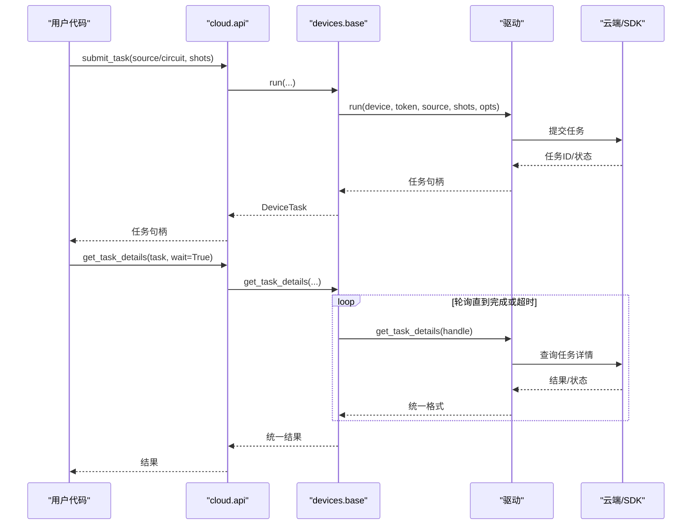
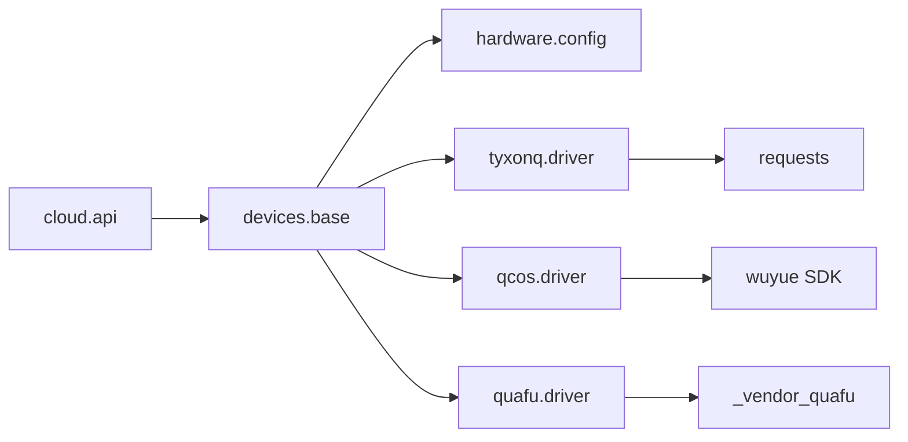

# 设备管理API

<cite>
**本文引用的文件**
- [src/tyxonq/cloud/api.py](file://src/tyxonq/cloud/api.py)
- [src/tyxonq/devices/base.py](file://src/tyxonq/devices/base.py)
- [src/tyxonq/devices/hardware/config.py](file://src/tyxonq/devices/hardware/config.py)
- [src/tyxonq/devices/hardware/tyxonq/driver.py](file://src/tyxonq/devices/hardware/tyxonq/driver.py)
- [src/tyxonq/devices/hardware/qcos/driver.py](file://src/tyxonq/devices/hardware/qcos/driver.py)
- [src/tyxonq/devices/hardware/quafu/driver.py](file://src/tyxonq/devices/hardware/quafu/driver.py)
- [examples/cloud_api_devices.py](file://examples/cloud_api_devices.py)
- [examples/cloud_api_task.py](file://examples/cloud_api_task.py)
- [examples/run_circuit_on_quafu.py](file://examples/run_circuit_on_quafu.py)
- [examples/qcos_cloud_task.py](file://examples/qcos_cloud_task.py)
- [docs/source/cloud_services/device_management.rst](file://docs/source/cloud_services/device_management.rst)
- [docs/tyxonq_cloud_api.md](file://docs/tyxonq_cloud_api.md)
</cite>

## 目录
1. [简介](#简介)
2. [项目结构](#项目结构)
3. [核心组件](#核心组件)
4. [架构总览](#架构总览)
5. [详细组件分析](#详细组件分析)
6. [依赖关系分析](#依赖关系分析)
7. [性能考虑](#性能考虑)
8. [故障排查指南](#故障排查指南)
9. [结论](#结论)
10. [附录](#附录)

## 简介
本文件面向TyxonQ云平台设备管理API，聚焦设备发现、设备描述查询、任务提交与结果获取、认证与令牌管理、多平台（TyxonQ云、QCOS、Quafu）设备操作示例，以及设备状态监控、连接池与错误处理策略。文档以代码级为依据，提供可追溯的引用与图示，帮助读者快速理解并安全使用设备管理功能。

## 项目结构
TyxonQ将设备管理抽象为“统一入口 + 驱动实现”的分层结构：
- 统一入口：cloud.api 暴露高层函数（list_devices、device、submit_task、get_task_details等），屏蔽底层差异。
- 设备基座：devices.base 提供统一的运行调度、任务包装DeviceTask、统一结果格式、轮询等待与移除任务能力。
- 配置中心：devices.hardware.config 集中管理默认provider/device、端点URL、令牌存取。
- 提供商驱动：各硬件提供商（tyxonq、qcos、quafu等）在 devices.hardware.<vendor>.driver 中实现具体网络交互、任务提交与状态查询。

图表来源
- [src/tyxonq/cloud/api.py:1-160](file://src/tyxonq/cloud/api.py#L1-L160)
- [src/tyxonq/devices/base.py:146-258](file://src/tyxonq/devices/base.py#L146-L258)
- [src/tyxonq/devices/hardware/config.py:11-19](file://src/tyxonq/devices/hardware/config.py#L11-L19)
- [src/tyxonq/devices/hardware/tyxonq/driver.py:45-62](file://src/tyxonq/devices/hardware/tyxonq/driver.py#L45-L62)
- [src/tyxonq/devices/hardware/qcos/driver.py:241-268](file://src/tyxonq/devices/hardware/qcos/driver.py#L241-L268)
- [src/tyxonq/devices/hardware/quafu/driver.py:242-266](file://src/tyxonq/devices/hardware/quafu/driver.py#L242-L266)

章节来源
- [src/tyxonq/cloud/api.py:1-160](file://src/tyxonq/cloud/api.py#L1-L160)
- [src/tyxonq/devices/base.py:146-258](file://src/tyxonq/devices/base.py#L146-L258)
- [src/tyxonq/devices/hardware/config.py:1-78](file://src/tyxonq/devices/hardware/config.py#L1-L78)

## 核心组件
- 统一入口（cloud.api）
  - list_devices(provider=None, token=None, **kws)：聚合模拟器与指定provider的设备列表。
  - device(name|provider.device, provider=None, id=None, shots=None)：解析设备描述，返回{provider, device, shots}。
  - submit_task(...) / run(...)：委托至devices.base.run进行统一执行。
  - get_task_details(task, wait=False, poll_interval=2.0, timeout=60.0)：统一获取任务详情。
- 设备基座（devices.base）
  - resolve_driver(provider, device)：按provider动态加载对应驱动。
  - run(...)：统一执行路径，支持source/circuit、批量shots、噪声注入（仅模拟器）、真机参数过滤。
  - DeviceTask：统一任务句柄，封装get_result/cancel，标准化result/result_meta/metadata。
  - get_task_details(...)：统一轮询与状态归一化，超时告警。
- 配置中心（devices.hardware.config）
  - set_token/get_token：内存令牌存储，支持provider/device两级键；可选环境变量回退。
  - set_default/get_default_provider/get_default_device：默认provider/device管理。
  - ENDPOINTS：各provider端点基础地址与版本。

章节来源
- [src/tyxonq/cloud/api.py:22-73](file://src/tyxonq/cloud/api.py#L22-L73)
- [src/tyxonq/devices/base.py:112-144](file://src/tyxonq/devices/base.py#L112-L144)
- [src/tyxonq/devices/base.py:294-445](file://src/tyxonq/devices/base.py#L294-L445)
- [src/tyxonq/devices/base.py:497-558](file://src/tyxonq/devices/base.py#L497-L558)
- [src/tyxonq/devices/hardware/config.py:24-66](file://src/tyxonq/devices/hardware/config.py#L24-L66)

## 架构总览
下图展示从调用到执行的端到端流程，包括认证、设备发现、任务提交与轮询。

图表来源
- [src/tyxonq/cloud/api.py:38-73](file://src/tyxonq/cloud/api.py#L38-L73)
- [src/tyxonq/devices/base.py:294-445](file://src/tyxonq/devices/base.py#L294-L445)
- [src/tyxonq/devices/base.py:497-558](file://src/tyxonq/devices/base.py#L497-L558)
- [src/tyxonq/devices/hardware/config.py:24-66](file://src/tyxonq/devices/hardware/config.py#L24-L66)
- [src/tyxonq/devices/hardware/tyxonq/driver.py:83-141](file://src/tyxonq/devices/hardware/tyxonq/driver.py#L83-L141)
- [src/tyxonq/devices/hardware/qcos/driver.py:80-158](file://src/tyxonq/devices/hardware/qcos/driver.py#L80-L158)
- [src/tyxonq/devices/hardware/quafu/driver.py:103-180](file://src/tyxonq/devices/hardware/quafu/driver.py#L103-L180)

## 详细组件分析

### 设备发现与设备描述
- 设备发现
  - TyxonQ云：通过HTTP POST到设备列表端点，返回设备id集合，统一加上“tyxonq::”前缀。
  - QCOS：当前SDK不再暴露设备枚举，采用静态已知设备清单，返回“qcos::...”前缀。
  - Quafu：通过状态接口筛选在线芯片，返回“quafu::...”前缀。
  - 聚合：base.list_all_devices会合并本地模拟器设备与指定provider的设备列表。
- 设备描述
  - device(name|provider.device, ...)：解析名称或provider.device形式，规范化为{provider, device, shots}，便于后续驱动选择。
  - 设备属性：可通过TyxonQ驱动的list_properties获取设备规格（如qubits、status、queue等）。

图表来源
- [src/tyxonq/devices/hardware/tyxonq/driver.py:56-62](file://src/tyxonq/devices/hardware/tyxonq/driver.py#L56-L62)
- [src/tyxonq/devices/hardware/qcos/driver.py:241-268](file://src/tyxonq/devices/hardware/qcos/driver.py#L241-L268)
- [src/tyxonq/devices/hardware/quafu/driver.py:242-266](file://src/tyxonq/devices/hardware/quafu/driver.py#L242-L266)
- [src/tyxonq/devices/base.py:475-493](file://src/tyxonq/devices/base.py#L475-L493)

章节来源
- [src/tyxonq/devices/hardware/tyxonq/driver.py:56-77](file://src/tyxonq/devices/hardware/tyxonq/driver.py#L56-L77)
- [src/tyxonq/devices/hardware/qcos/driver.py:241-268](file://src/tyxonq/devices/hardware/qcos/driver.py#L241-L268)
- [src/tyxonq/devices/hardware/quafu/driver.py:242-266](file://src/tyxonq/devices/hardware/quafu/driver.py#L242-L266)
- [src/tyxonq/devices/base.py:112-144](file://src/tyxonq/devices/base.py#L112-L144)
- [docs/source/cloud_services/device_management.rst:10-64](file://docs/source/cloud_services/device_management.rst#L10-L64)

### 任务提交与结果获取
- 统一入口
  - cloud.api.submit_task/run：委托至devices.base.run，统一处理source/circuit、shots、token、provider/device选择。
- 驱动差异
  - TyxonQ：提交OPENQASM 2.0源，返回异步任务句柄；get_task_details轮询云端任务详情。
  - QCOS：基于WuYue SDK提交量子线路，支持timeout/wait_async_result；内部维护Runner实例用于轮询。
  - Quafu：要求OpenQASM 2.0字符串，支持compiler/target_qubits等选项；状态映射到统一uni_status。
- 统一结果
  - base.get_task_details：统一返回{result, result_meta, uni_status, error}，支持wait/poll/timeout，并在超时时发出RuntimeWarning。

图表来源
- [src/tyxonq/cloud/api.py:42-73](file://src/tyxonq/cloud/api.py#L42-L73)
- [src/tyxonq/devices/base.py:294-445](file://src/tyxonq/devices/base.py#L294-L445)
- [src/tyxonq/devices/base.py:497-558](file://src/tyxonq/devices/base.py#L497-L558)
- [src/tyxonq/devices/hardware/tyxonq/driver.py:83-141](file://src/tyxonq/devices/hardware/tyxonq/driver.py#L83-L141)
- [src/tyxonq/devices/hardware/qcos/driver.py:80-158](file://src/tyxonq/devices/hardware/qcos/driver.py#L80-L158)
- [src/tyxonq/devices/hardware/quafu/driver.py:103-180](file://src/tyxonq/devices/hardware/quafu/driver.py#L103-L180)

章节来源
- [src/tyxonq/cloud/api.py:42-73](file://src/tyxonq/cloud/api.py#L42-L73)
- [src/tyxonq/devices/base.py:294-445](file://src/tyxonq/devices/base.py#L294-L445)
- [src/tyxonq/devices/base.py:497-558](file://src/tyxonq/devices/base.py#L497-L558)
- [src/tyxonq/devices/hardware/tyxonq/driver.py:83-214](file://src/tyxonq/devices/hardware/tyxonq/driver.py#L83-L214)
- [src/tyxonq/devices/hardware/qcos/driver.py:80-238](file://src/tyxonq/devices/hardware/qcos/driver.py#L80-L238)
- [src/tyxonq/devices/hardware/quafu/driver.py:103-236](file://src/tyxonq/devices/hardware/quafu/driver.py#L103-L236)

### 认证机制、令牌管理与会话处理
- 令牌优先级
  - 显式传入token > 通过tq.set_token(provider=...)设置 > 环境变量回退（不同provider有各自的环境变量）。
- 存储与查找
  - config.set_token支持provider与device两级键；config.get_token优先内存令牌，其次环境变量。
- 各provider细节
  - TyxonQ：Authorization: Bearer {token}，默认全局TYXONQ_API_KEY回退。
  - QCOS：access_key/secret_key来自opts或环境变量；不支持旧版sdk_code。
  - Quafu：四步解析（显式token > tq.set_token('quafu') > TYXONQ_QUAFU_TOKEN/QPU_API_TOKEN > 报错）。

章节来源
- [src/tyxonq/devices/hardware/config.py:24-50](file://src/tyxonq/devices/hardware/config.py#L24-L50)
- [src/tyxonq/devices/hardware/tyxonq/driver.py:51-53](file://src/tyxonq/devices/hardware/tyxonq/driver.py#L51-L53)
- [src/tyxonq/devices/hardware/qcos/driver.py:37-65](file://src/tyxonq/devices/hardware/qcos/driver.py#L37-L65)
- [src/tyxonq/devices/hardware/quafu/driver.py:18-45](file://src/tyxonq/devices/hardware/quafu/driver.py#L18-L45)

### 多平台设备管理完整示例
- TyxonQ云
  - 设备列表：examples/cloud_api_devices.py 读取token后调用tq.api.list_devices(provider="tyxonq")。
  - 任务提交与轮询：examples/cloud_api_task.py 演示legacy与chain两种风格。
- QCOS
  - 示例：examples/qcos_cloud_task.py 设置QCOS_ACCESS_KEY/QCOS_SECRET_KEY后提交任务，支持calculate_type等参数。
- Quafu
  - 示例：examples/run_circuit_on_quafu.py 设置TYXONQ_QUAFU_TOKEN，编译为QASM2后提交。

章节来源
- [examples/cloud_api_devices.py:16-21](file://examples/cloud_api_devices.py#L16-L21)
- [examples/cloud_api_task.py:30-59](file://examples/cloud_api_task.py#L30-L59)
- [examples/qcos_cloud_task.py:28-57](file://examples/qcos_cloud_task.py#L28-L57)
- [examples/run_circuit_on_quafu.py:22-51](file://examples/run_circuit_on_quafu.py#L22-L51)

### 设备状态监控、连接池与错误处理
- 设备状态监控
  - TyxonQ：通过list_properties获取设备状态、队列长度、qubits等；可在提交前检查online状态与队列长度。
  - Quafu：list_devices根据状态接口筛选在线芯片。
  - QCOS：当前无动态枚举，需参考控制台或静态清单。
- 连接池管理
  - TyxonQ驱动每次请求新建HTTP连接；Quafu驱动复用管理器实例；QCOS通过SDK Runner实例管理。
  - 建议：在高并发场景下复用管理器/Runner实例以减少握手开销。
- 错误处理策略
  - 提交失败：TyxonQ驱动在error字段存在时尝试拉取设备属性辅助诊断，并抛出运行时异常。
  - 轮询超时：base.get_task_details在wait模式下超过timeout会发出RuntimeWarning，返回可能不完整结果。
  - 参数校验：Quafu对shots必须为正且建议为1024倍数；TyxonQ对homebrew_s2/s3要求QASM2包含qreg/creg。

章节来源
- [docs/source/cloud_services/device_management.rst:212-271](file://docs/source/cloud_services/device_management.rst#L212-L271)
- [src/tyxonq/devices/hardware/tyxonq/driver.py:132-141](file://src/tyxonq/devices/hardware/tyxonq/driver.py#L132-L141)
- [src/tyxonq/devices/base.py:535-551](file://src/tyxonq/devices/base.py#L535-L551)
- [src/tyxonq/devices/hardware/quafu/driver.py:147-156](file://src/tyxonq/devices/hardware/quafu/driver.py#L147-L156)
- [src/tyxonq/devices/hardware/tyxonq/driver.py:95-107](file://src/tyxonq/devices/hardware/tyxonq/driver.py#L95-L107)

## 依赖关系分析
- 模块耦合
  - cloud.api 依赖 devices.base 与 hardware.config；不直接感知具体驱动。
  - devices.base 通过 resolve_driver 动态导入具体驱动，保持松耦合。
  - 各驱动独立实现HTTP/SDK交互，遵循统一run/get_task_details/list_devices接口。
- 外部依赖
  - TyxonQ：requests库访问HTTP端点。
  - QCOS：wuyue SDK（>=1.0）。
  - Quafu：_vendor_quafu.Task管理器。

图表来源
- [src/tyxonq/cloud/api.py:16-19](file://src/tyxonq/cloud/api.py#L16-L19)
- [src/tyxonq/devices/base.py:146-258](file://src/tyxonq/devices/base.py#L146-L258)
- [src/tyxonq/devices/hardware/tyxonq/driver.py:7-9](file://src/tyxonq/devices/hardware/tyxonq/driver.py#L7-L9)
- [src/tyxonq/devices/hardware/qcos/driver.py:106-107](file://src/tyxonq/devices/hardware/qcos/driver.py#L106-L107)
- [src/tyxonq/devices/hardware/quafu/driver.py:14-15](file://src/tyxonq/devices/hardware/quafu/driver.py#L14-L15)

章节来源
- [src/tyxonq/cloud/api.py:16-19](file://src/tyxonq/cloud/api.py#L16-L19)
- [src/tyxonq/devices/base.py:146-258](file://src/tyxonq/devices/base.py#L146-L258)
- [src/tyxonq/devices/hardware/tyxonq/driver.py:7-9](file://src/tyxonq/devices/hardware/tyxonq/driver.py#L7-L9)
- [src/tyxonq/devices/hardware/qcos/driver.py:106-107](file://src/tyxonq/devices/hardware/qcos/driver.py#L106-L107)
- [src/tyxonq/devices/hardware/quafu/driver.py:14-15](file://src/tyxonq/devices/hardware/quafu/driver.py#L14-L15)

## 性能考虑
- 批量化提交
  - base.run支持circuit序列与shots列表对齐，减少多次往返；驱动侧也支持批量payload构造（如TyxonQ）。
- 轮询优化
  - get_task_details支持poll_interval与timeout；合理设置避免频繁轮询导致带宽浪费。
- 噪声注入（仅模拟器）
  - 对simulator/local自动注入noise/use_noise；真机提交前会剔除这些键，避免无效参数传递。
- 编译器与优化
  - TyxonQ Homebrew支持o=位掩码优化组合；Quafu支持server-side compiler选择；按需启用以降低编译开销。

[本节为通用指导，无需特定文件引用]

## 故障排查指南
- 设备未找到
  - 确认已通过list_devices获取可用设备；权限不足可能导致设备不在列表中。
- 队列过长
  - 使用list_properties或状态接口检查队列长度；必要时等待低峰期或使用模拟器。
- 优化失败
  - 降低优化级别重试；例如TyxonQ从o=7降级到o=1或o=3。
- 认证错误
  - 检查token优先级与环境变量；Quafu需单独设置TYXONQ_QUAFU_TOKEN或QPU_API_TOKEN。
- 轮询超时
  - 增大timeout或降低poll_interval；关注uni_status是否为queued/running。

章节来源
- [docs/source/cloud_services/device_management.rst:354-407](file://docs/source/cloud_services/device_management.rst#L354-L407)
- [src/tyxonq/devices/base.py:535-551](file://src/tyxonq/devices/base.py#L535-L551)
- [src/tyxonq/devices/hardware/quafu/driver.py:18-45](file://src/tyxonq/devices/hardware/quafu/driver.py#L18-L45)

## 结论
TyxonQ通过统一入口与驱动分层，实现了跨平台的设备管理、任务提交与结果获取。开发者可使用list_devices与device进行设备发现与描述解析，借助submit_task/run与get_task_details完成端到端执行。结合认证与令牌管理、状态监控与错误处理策略，可在TyxonQ云、QCOS、Quafu等多平台上稳定高效地运行量子任务。

[本节为总结性内容，无需特定文件引用]

## 附录
- 常用端点与协议
  - TyxonQ云：Base URL与API版本见config.ENDPOINTS；认证使用Bearer Token。
  - 任务提交：支持source或circuit；shots可为标量或列表；lang/version等参数由驱动决定。
- 最佳实践
  - 提交前检查设备状态与队列长度。
  - 选择合适的优化级别与编译器。
  - 合理设置轮询间隔与超时，避免资源浪费。
  - 妥善保管token，定期轮换。

章节来源
- [docs/tyxonq_cloud_api.md:9-22](file://docs/tyxonq_cloud_api.md#L9-L22)
- [docs/tyxonq_cloud_api.md:91-199](file://docs/tyxonq_cloud_api.md#L91-L199)
- [docs/source/cloud_services/device_management.rst:97-210](file://docs/source/cloud_services/device_management.rst#L97-L210)