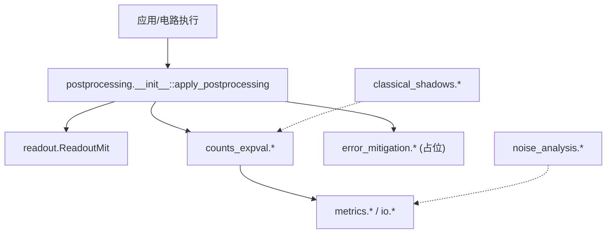
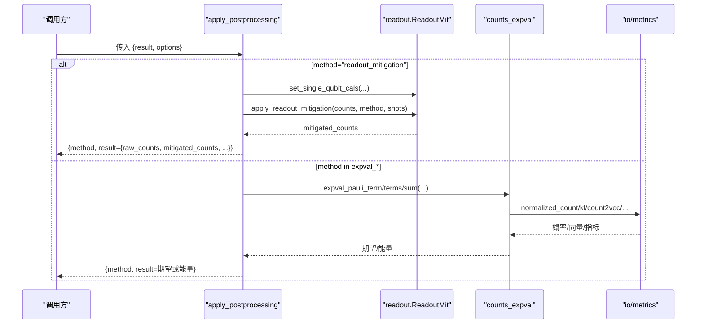
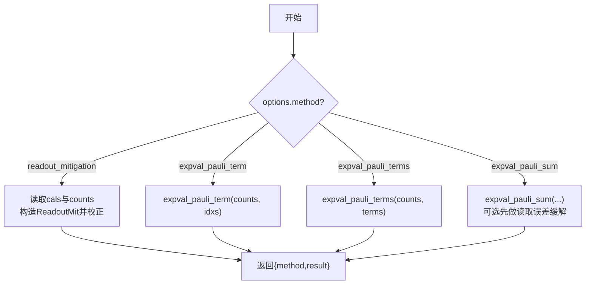
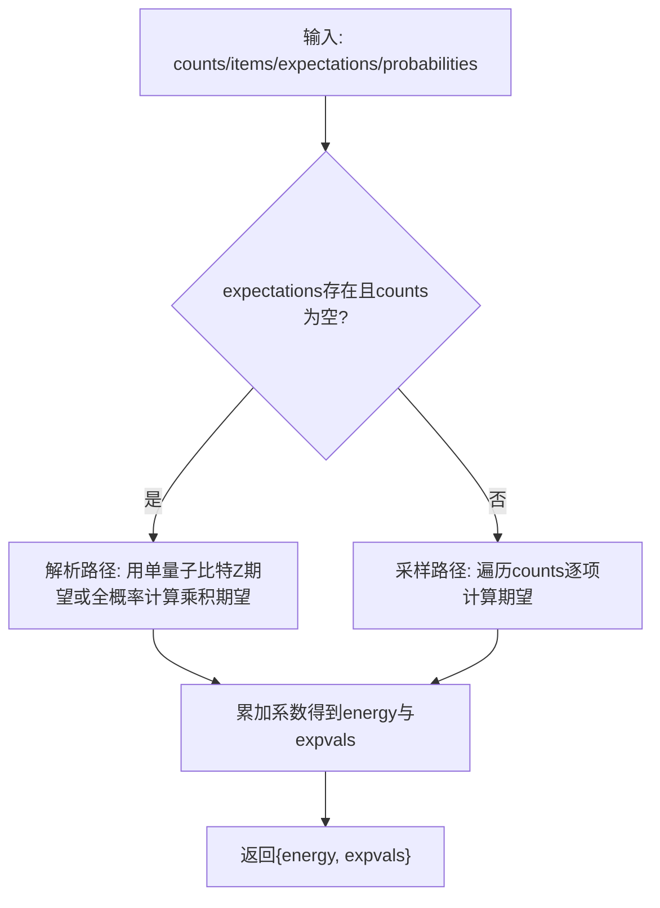
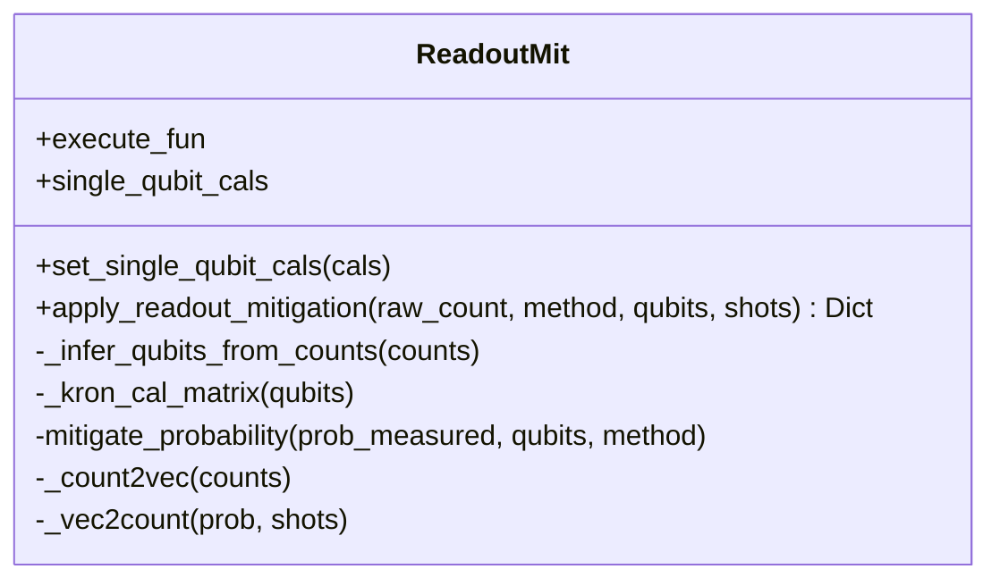
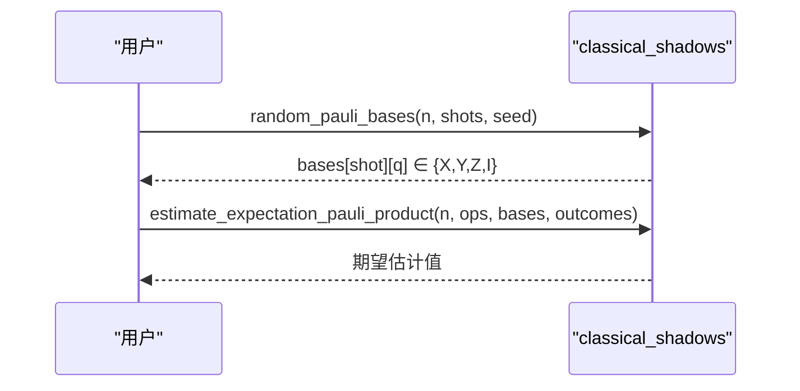
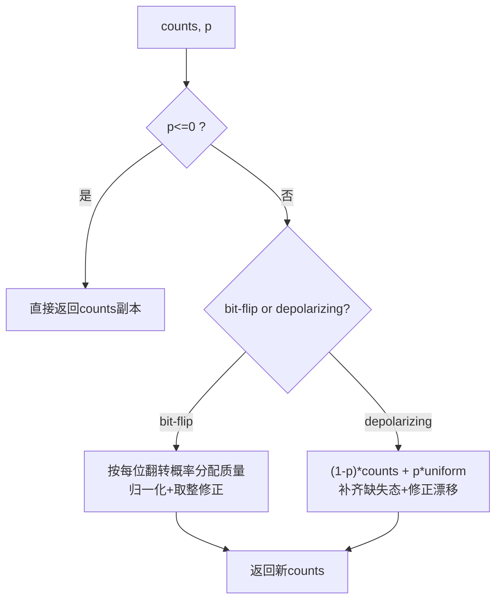
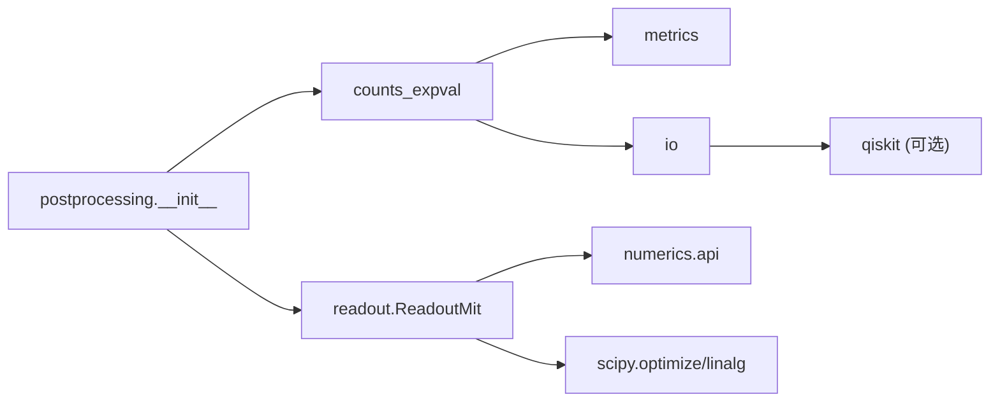

# 后处理API

<cite>
**本文引用的文件**
- [src/tyxonq/postprocessing/__init__.py](file://src/tyxonq/postprocessing/__init__.py)
- [src/tyxonq/postprocessing/counts_expval.py](file://src/tyxonq/postprocessing/counts_expval.py)
- [src/tyxonq/postprocessing/error_mitigation.py](file://src/tyxonq/postprocessing/error_mitigation.py)
- [src/tyxonq/postprocessing/classical_shadows.py](file://src/tyxonq/postprocessing/classical_shadows.py)
- [src/tyxonq/postprocessing/noise_analysis.py](file://src/tyxonq/postprocessing/noise_analysis.py)
- [src/tyxonq/postprocessing/readout.py](file://src/tyxonq/postprocessing/readout.py)
- [src/tyxonq/postprocessing/metrics.py](file://src/tyxonq/postprocessing/metrics.py)
- [src/tyxonq/postprocessing/io.py](file://src/tyxonq/postprocessing/io.py)
- [examples/readout_mitigation.py](file://examples/readout_mitigation.py)
- [tests_core_module/test_postprocessing_metrics.py](file://tests_core_module/test_postprocessing_metrics.py)
- [tests_core_module/test_postprocessing_qem.py](file://tests_core_module/test_postprocessing_qem.py)
</cite>

## 目录
1. [简介](#简介)
2. [项目结构](#项目结构)
3. [核心组件](#核心组件)
4. [架构总览](#架构总览)
5. [详细组件分析](#详细组件分析)
6. [依赖关系分析](#依赖关系分析)
7. [性能考虑](#性能考虑)
8. [故障排查指南](#故障排查指南)
9. [结论](#结论)
10. [附录](#附录)

## 简介
本文件面向TyxonQ后处理模块，系统化说明计数数据处理、期望值计算、误差缓解、噪声分析与经典阴影等功能的接口规范、参数配置与使用示例。文档覆盖读取误差缓解（Readout Mitigation）、经典阴影（Classical Shadows）、噪声建模（Bit-flip/Depolarizing）等高级能力，并提供流水线构建、批量处理与性能优化建议，以及结果可视化、数据导出与兼容性说明。

## 项目结构
后处理模块位于 src/tyxonq/postprocessing，提供统一入口与多种专用工具：
- 统一路由：apply_postprocessing 根据 method 分发到具体实现
- 计数与期望值：expval_pauli_term/terms/sum
- 误差缓解：readout.ReadoutMit；占位 ZNE/DD/RC
- 经典阴影：随机Pauli基与Z期望估计
- 噪声分析：在计数层近似bit-flip与depolarizing
- 指标与IO：归一化、KL散度、CSV读写、直方图绘制等

图表来源
- [src/tyxonq/postprocessing/__init__.py:16-225](file://src/tyxonq/postprocessing/__init__.py#L16-L225)
- [src/tyxonq/postprocessing/readout.py:15-140](file://src/tyxonq/postprocessing/readout.py#L15-L140)
- [src/tyxonq/postprocessing/counts_expval.py:7-112](file://src/tyxonq/postprocessing/counts_expval.py#L7-L112)
- [src/tyxonq/postprocessing/error_mitigation.py:7-79](file://src/tyxonq/postprocessing/error_mitigation.py#L7-L79)
- [src/tyxonq/postprocessing/classical_shadows.py:14-112](file://src/tyxonq/postprocessing/classical_shadows.py#L14-L112)
- [src/tyxonq/postprocessing/noise_analysis.py:17-100](file://src/tyxonq/postprocessing/noise_analysis.py#L17-L100)
- [src/tyxonq/postprocessing/metrics.py:20-91](file://src/tyxonq/postprocessing/metrics.py#L20-L91)
- [src/tyxonq/postprocessing/io.py:9-99](file://src/tyxonq/postprocessing/io.py#L9-L99)

章节来源
- [src/tyxonq/postprocessing/__init__.py:1-228](file://src/tyxonq/postprocessing/__init__.py#L1-L228)

## 核心组件
- 统一后处理入口
  - apply_postprocessing(result, options)：根据options.method路由到readout_mitigation或expval_*系列方法，返回{method, result}结构
  - 支持自动推断shots、兼容statevector/probabilities/expectations路径
- 计数与期望值
  - expval_pauli_term(counts, idxs)：单Pauli-Z乘积期望
  - expval_pauli_terms(counts, terms)：多项期望列表
  - expval_pauli_sum(counts/items, identity_const, expectations/probabilities/num_qubits)：哈密顿量能量聚合（含解析路径）
- 读取误差缓解
  - ReadoutMit：基于单量子比特校准矩阵的Kronecker积构造全矩阵，支持inverse与约束最小二乘两种校正方法
- 误差缓解占位
  - apply_zne/apply_dd/apply_rc：当前为平均执行器输出的骨架，后续可集成mitiq等
- 经典阴影
  - random_pauli_basis/bases、estimate_z_from_counts、estimate_expectation_pauli_product：用于随机基测量下的期望估计
- 噪声分析（计数级近似）
  - apply_bitflip_counts、apply_depolarizing_counts：对counts字典进行近似噪声注入
- 指标与IO
  - normalized_count、kl_divergence、expectation
  - counts_to_csv/csv_to_counts、reverse/sort/归一化、count2vec/vec2count、marginal_count、plot_histogram

章节来源
- [src/tyxonq/postprocessing/__init__.py:16-225](file://src/tyxonq/postprocessing/__init__.py#L16-L225)
- [src/tyxonq/postprocessing/counts_expval.py:7-112](file://src/tyxonq/postprocessing/counts_expval.py#L7-L112)
- [src/tyxonq/postprocessing/readout.py:15-140](file://src/tyxonq/postprocessing/readout.py#L15-L140)
- [src/tyxonq/postprocessing/error_mitigation.py:7-79](file://src/tyxonq/postprocessing/error_mitigation.py#L7-L79)
- [src/tyxonq/postprocessing/classical_shadows.py:14-112](file://src/tyxonq/postprocessing/classical_shadows.py#L14-L112)
- [src/tyxonq/postprocessing/noise_analysis.py:17-100](file://src/tyxonq/postprocessing/noise_analysis.py#L17-L100)
- [src/tyxonq/postprocessing/metrics.py:20-91](file://src/tyxonq/postprocessing/metrics.py#L20-L91)
- [src/tyxonq/postprocessing/io.py:9-99](file://src/tyxonq/postprocessing/io.py#L9-L99)

## 架构总览
后处理以“统一入口 + 模块化实现”组织：上层通过apply_postprocessing传入result与options，内部按method分派到readout或counts_expval；后者再调用metrics/io等工具完成数值计算与数据转换。经典阴影与噪声分析作为独立工具被上层流程复用。

图表来源
- [src/tyxonq/postprocessing/__init__.py:16-225](file://src/tyxonq/postprocessing/__init__.py#L16-L225)
- [src/tyxonq/postprocessing/readout.py:15-140](file://src/tyxonq/postprocessing/readout.py#L15-L140)
- [src/tyxonq/postprocessing/counts_expval.py:7-112](file://src/tyxonq/postprocessing/counts_expval.py#L7-L112)
- [src/tyxonq/postprocessing/io.py:9-99](file://src/tyxonq/postprocessing/io.py#L9-L99)
- [src/tyxonq/postprocessing/metrics.py:20-91](file://src/tyxonq/postprocessing/metrics.py#L20-L91)

## 详细组件分析

### 统一后处理入口：apply_postprocessing
- 功能：根据options.method路由到读取误差缓解或期望值计算；失败时返回部分结果而非抛错
- 关键参数
  - result：包含result/counts/statevector/expectations/metadata等
  - options：必须包含method；其他参数随method变化
- 支持的方法
  - readout_mitigation：需要cals与可选mitigation（默认inverse）
  - expval_pauli_term：idxs或indices指定量子比特索引
  - expval_pauli_terms：terms为Pauli项序列
  - expval_pauli_sum：items/group_items、identity_const、可选readout_cals/cals与mitigation
- 返回值：{method, result}，其中result为各方法特定数据结构

图表来源
- [src/tyxonq/postprocessing/__init__.py:16-225](file://src/tyxonq/postprocessing/__init__.py#L16-L225)

章节来源
- [src/tyxonq/postprocessing/__init__.py:16-225](file://src/tyxonq/postprocessing/__init__.py#L16-L225)

### 计数与期望值：counts_expval
- term_expectation_from_counts：从计数中计算Z^⊗k期望
- expval_pauli_term/terms：单/多项期望
- expval_pauli_sum：聚合哈密顿量能量
  - 若提供expectations/probabilities且无counts，走解析路径（利用单量子比特Z期望或全概率分布）
  - 否则遍历counts逐项累加
- 复杂度
  - 单项期望：O(N_shots) 或 O(状态数) 取决于路径
  - 求和：O(T) 项，每项O(n)或O(2^n)（解析路径）

图表来源
- [src/tyxonq/postprocessing/counts_expval.py:55-112](file://src/tyxonq/postprocessing/counts_expval.py#L55-L112)

章节来源
- [src/tyxonq/postprocessing/counts_expval.py:7-112](file://src/tyxonq/postprocessing/counts_expval.py#L7-L112)

### 读取误差缓解：readout.ReadoutMit
- 校准：set_single_qubit_cals({q: 2x2矩阵})
- 校正：apply_readout_mitigation(raw_count, method="inverse"/"constrained_ls", qubits, shots)
- 原理：将单量子比特校准矩阵按线序Kronecker积成全局转移矩阵，将测量概率映射回真实概率，再转回计数
- 注意：inverse使用伪逆稳定求解；constrained_ls在单纯形上约束最小二乘

图表来源
- [src/tyxonq/postprocessing/readout.py:15-140](file://src/tyxonq/postprocessing/readout.py#L15-L140)

章节来源
- [src/tyxonq/postprocessing/readout.py:15-140](file://src/tyxonq/postprocessing/readout.py#L15-L140)

### 误差缓解占位：error_mitigation
- apply_zne：多次执行取平均（占位，未来可接入mitiq）
- apply_dd：多次执行取平均（支持计数字典平均）
- apply_rc：多次执行取平均（返回平均值与电路副本列表）
- 用途：便于在现有管线中预留扩展点

章节来源
- [src/tyxonq/postprocessing/error_mitigation.py:7-79](file://src/tyxonq/postprocessing/error_mitigation.py#L7-L79)

### 经典阴影：classical_shadows
- random_pauli_basis(num_qubits, include_i=False, seed=None)：生成每量子比特随机基
- estimate_z_from_counts(counts, qubit)：从计数估计Z期望
- random_pauli_bases(num_qubits, num_shots, ...)：批量生成随机基
- bitstrings_to_bits：little-endian字符串转比特数组
- estimate_expectation_pauli_product(num_qubits, pauli_ops, bases, outcomes)：基于影子估计Pauli乘积期望

图表来源
- [src/tyxonq/postprocessing/classical_shadows.py:14-112](file://src/tyxonq/postprocessing/classical_shadows.py#L14-L112)

章节来源
- [src/tyxonq/postprocessing/classical_shadows.py:14-112](file://src/tyxonq/postprocessing/classical_shadows.py#L14-L112)

### 噪声分析（计数级近似）：noise_analysis
- apply_bitflip_counts(counts, p)：独立bit-flip噪声近似（保留一阶项，归一化修正）
- apply_depolarizing_counts(counts, p)：n量子比特去极化通道近似（均匀分布凸组合）
- 适用场景：快速what-if分析与基线测试，非状态级噪声模拟替代

图表来源
- [src/tyxonq/postprocessing/noise_analysis.py:17-100](file://src/tyxonq/postprocessing/noise_analysis.py#L17-L100)

章节来源
- [src/tyxonq/postprocessing/noise_analysis.py:17-100](file://src/tyxonq/postprocessing/noise_analysis.py#L17-L100)

### 指标与IO：metrics & io
- metrics
  - normalized_count：计数归一化为概率
  - kl_divergence：KL散度（带正则）
  - expectation：对角算符期望（支持z或diagonal_op）
- io
  - counts_to_csv/csv_to_counts：CSV往返
  - reverse_count/sort_count：排序与反转
  - count2vec/vec2count：计数与向量互转
  - marginal_count：边缘分布（依赖qiskit）
  - plot_histogram：直方图绘制（依赖qiskit）

章节来源
- [src/tyxonq/postprocessing/metrics.py:20-91](file://src/tyxonq/postprocessing/metrics.py#L20-L91)
- [src/tyxonq/postprocessing/io.py:9-99](file://src/tyxonq/postprocessing/io.py#L9-L99)

## 依赖关系分析
- 模块耦合
  - __init__ 仅依赖 readout 与 counts_expval，保持低耦合
  - counts_expval 依赖 numpy，metrics/io 提供辅助
  - readout 依赖 numerics API 与 scipy（伪逆/优化）
  - classical_shadows 与 noise_analysis 为独立工具，不反向依赖主入口
- 外部依赖
  - qiskit：marginal_count、plot_histogram（可选，按需导入）
  - scipy：读取误差缓解中的伪逆与约束优化
  - numpy：通用数值计算

图表来源
- [src/tyxonq/postprocessing/__init__.py:16-225](file://src/tyxonq/postprocessing/__init__.py#L16-L225)
- [src/tyxonq/postprocessing/readout.py:1-140](file://src/tyxonq/postprocessing/readout.py#L1-L140)
- [src/tyxonq/postprocessing/io.py:69-86](file://src/tyxonq/postprocessing/io.py#L69-L86)

章节来源
- [src/tyxonq/postprocessing/readout.py:1-140](file://src/tyxonq/postprocessing/readout.py#L1-L140)
- [src/tyxonq/postprocessing/io.py:69-86](file://src/tyxonq/postprocessing/io.py#L69-L86)

## 性能考虑
- 解析路径优先：当提供expectations/probabilities且无counts时，expval_pauli_sum走解析路径，避免遍历计数，适合shots=0或statevector引擎
- 读取误差缓解复杂度：Kronecker积矩阵维度为2^n，n较大时内存与计算开销显著；建议仅在必要时启用，或限制qubits范围
- 计数规模：大shots下计数字典可能很大，建议使用稀疏表示或向量化操作（io.count2vec/vec2count）
- 随机基数量：经典阴影需足够多的bases/shots以获得稳定估计；可通过seed复现实验
- 噪声近似：bit-flip/depolarizing为近似模型，适用于快速评估，不替代精确噪声模拟

## 故障排查指南
- 未识别method
  - 现象：返回{method, result={"reason": "unsupported method: ..."}}
  - 处理：检查options.method拼写与大小写
- 缺少校准矩阵
  - 现象：readout_mitigation无法校正，返回reason提示
  - 处理：确保cals包含所有涉及量子比特的2x2矩阵
- 计数为空或shots为0
  - 现象：期望值为0或解析路径不可用
  - 处理：补充counts或提供expectations/probabilities/statevector
- 依赖缺失
  - 现象：marginal_count/plot_histogram抛出运行时错误
  - 处理：安装qiskit或使用替代方案

章节来源
- [src/tyxonq/postprocessing/__init__.py:223-225](file://src/tyxonq/postprocessing/__init__.py#L223-L225)
- [src/tyxonq/postprocessing/io.py:69-86](file://src/tyxonq/postprocessing/io.py#L69-L86)

## 结论
TyxonQ后处理模块提供了从计数到期望值、从读取误差缓解到噪声分析的完整工具链。通过统一入口apply_postprocessing，用户可以以一致的方式组合不同后处理步骤；同时，解析路径与计数路径并存，兼顾精度与效率。结合经典阴影与噪声分析，可在实验前后进行更稳健的估计与诊断。

## 附录

### 接口规范与使用示例

- 统一入口
  - 函数：apply_postprocessing(result, options)
  - 方法：readout_mitigation、expval_pauli_term、expval_pauli_terms、expval_pauli_sum
  - 示例参考：
    - [examples/readout_mitigation.py:82-134](file://examples/readout_mitigation.py#L82-L134)

- 读取误差缓解
  - 类：ReadoutMit
  - 方法：set_single_qubit_cals、apply_readout_mitigation
  - 示例参考：
    - [examples/readout_mitigation.py:98-103](file://examples/readout_mitigation.py#L98-L103)

- 期望值计算
  - 函数：expval_pauli_term、expval_pauli_terms、expval_pauli_sum
  - 示例参考：
    - [tests_core_module/test_postprocessing_metrics.py:16-27](file://tests_core_module/test_postprocessing_metrics.py#L16-L27)

- 经典阴影
  - 函数：random_pauli_basis、estimate_z_from_counts、estimate_expectation_pauli_product
  - 用法：生成随机基，对目标Pauli乘积进行期望估计

- 噪声分析
  - 函数：apply_bitflip_counts、apply_depolarizing_counts
  - 用法：对counts字典施加近似噪声，观察分布变化

- 指标与IO
  - 函数：normalized_count、kl_divergence、expectation、counts_to_csv/csv_to_counts、count2vec/vec2count
  - 示例参考：
    - [tests_core_module/test_postprocessing_metrics.py:16-27](file://tests_core_module/test_postprocessing_metrics.py#L16-L27)

### 后处理流水线构建建议
- 典型流程
  - 运行电路获取result（counts/statevector/expectations）
  - 若存在读取误差，先调用readout_mitigation校正
  - 使用expval_pauli_sum聚合哈密顿量能量
  - 使用metrics/io进行归一化、对比与导出
- 批处理
  - 对多个任务循环调用apply_postprocessing，收集结果
  - 使用io.count2vec/vec2count在密集向量与计数之间转换，提升吞吐
- 性能优化
  - 优先使用解析路径（expectations/probabilities）
  - 控制qubits范围以减少Kronecker矩阵维度
  - 合理设置shots与随机种子，保证稳定性与可重复性

### 结果可视化与数据导出
- CSV导出：counts_to_csv/csv_to_counts
- 直方图：plot_histogram（需qiskit）
- 边缘分布：marginal_count（需qiskit）
- 兼容性：上述可视化与边缘分布为可选依赖，缺失时可使用纯numpy方案替代

### 兼容性说明
- 依赖
  - qiskit：可选，用于marginal_count与plot_histogram
  - scipy：读取误差缓解必需
  - numpy：通用数值计算
- 版本
  - 建议在TyxonQ环境中统一后端（如numpy），并通过numerics API进行类型转换