# 噪声分析API

<cite>
**本文引用的文件**
- [noise_analysis.py](file://src/tyxonq/postprocessing/noise_analysis.py)
- [classical_shadows.py](file://src/tyxonq/postprocessing/classical_shadows.py)
- [error_mitigation.py](file://src/tyxonq/postprocessing/error_mitigation.py)
- [metrics.py](file://src/tyxonq/postprocessing/metrics.py)
- [channels.py](file://src/tyxonq/devices/simulators/noise/channels.py)
- [noise.py](file://src/tyxonq/libs/quantum_library/noise.py)
- [noise_t1_t2_calibration.py](file://examples/noise_t1_t2_calibration.py)
- [pulse_noise_modeling.py](file://examples/pulse_noise_modeling.py)
- [readout_mitigation.py](file://examples/readout_mitigation.py)
</cite>

## 目录
1. [简介](#简介)
2. [项目结构](#项目结构)
3. [核心组件](#核心组件)
4. [架构总览](#架构总览)
5. [详细组件分析](#详细组件分析)
6. [依赖关系分析](#依赖关系分析)
7. [性能考量](#性能考量)
8. [故障排查指南](#故障排查指南)
9. [结论](#结论)
10. [附录](#附录)

## 简介
本文件面向TyxonQ后处理模块中的噪声分析相关API，系统梳理噪声建模、噪声参数估计与经典阴影等高级分析能力。重点覆盖：
- 噪声信道识别与实现（退极化、振幅阻尼、相位阻尼、Pauli通道、测量通道）
- T1/T2弛豫时间测量与拟合流程
- 退极化噪声参数提取与计数级近似
- 噪声谱分析与相干时间估计思路
- 门保真度评估与误差缓解（ZNE/DD/RC占位接口）
- 经典阴影（随机Pauli基、期望值估计）
- 噪声实验设计、数据分析流程与结果可视化实践
- 不同硬件平台上的噪声特征对比方法

## 项目结构
TyxonQ的噪声分析能力由“标准噪声信道库 + 设备层兼容层 + 后处理工具集 + 示例工作流”构成：
- 标准噪声信道库：提供Kraus算子形式的标准噪声通道，供模拟器与上层分析使用
- 设备层兼容层：为旧代码提供向后兼容的噪声通道包装
- 后处理工具集：计数级噪声近似、经典阴影、指标计算、误差缓解占位接口
- 示例工作流：T1/T2标定、ZZ串扰建模、读出误差缓解等端到端演示

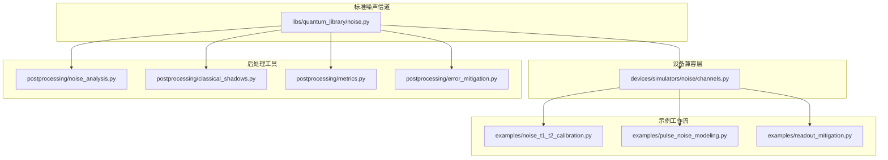

图表来源
- [noise.py:29-341](file://src/tyxonq/libs/quantum_library/noise.py#L29-L341)
- [channels.py:14-41](file://src/tyxonq/devices/simulators/noise/channels.py#L14-L41)
- [noise_analysis.py:24-100](file://src/tyxonq/postprocessing/noise_analysis.py#L24-L100)
- [classical_shadows.py:14-111](file://src/tyxonq/postprocessing/classical_shadows.py#L14-L111)
- [metrics.py:20-84](file://src/tyxonq/postprocessing/metrics.py#L20-L84)
- [error_mitigation.py:7-76](file://src/tyxonq/postprocessing/error_mitigation.py#L7-L76)
- [noise_t1_t2_calibration.py:75-194](file://examples/noise_t1_t2_calibration.py#L75-L194)
- [pulse_noise_modeling.py:50-163](file://examples/pulse_noise_modeling.py#L50-L163)
- [readout_mitigation.py:82-129](file://examples/readout_mitigation.py#L82-L129)

章节来源
- [noise.py:29-341](file://src/tyxonq/libs/quantum_library/noise.py#L29-L341)
- [channels.py:14-41](file://src/tyxonq/devices/simulators/noise/channels.py#L14-L41)
- [noise_analysis.py:24-100](file://src/tyxonq/postprocessing/noise_analysis.py#L24-L100)
- [classical_shadows.py:14-111](file://src/tyxonq/postprocessing/classical_shadows.py#L14-L111)
- [metrics.py:20-84](file://src/tyxonq/postprocessing/metrics.py#L20-L84)
- [error_mitigation.py:7-76](file://src/tyxonq/postprocessing/error_mitigation.py#L7-L76)
- [noise_t1_t2_calibration.py:75-194](file://examples/noise_t1_t2_calibration.py#L75-L194)
- [pulse_noise_modeling.py:50-163](file://examples/pulse_noise_modeling.py#L50-L163)
- [readout_mitigation.py:82-129](file://examples/readout_mitigation.py#L82-L129)

## 核心组件
- 标准噪声信道（Kraus表示）
  - 退极化通道：各向同性Pauli错误
  - 振幅阻尼通道：能量弛豫（T1）
  - 相位阻尼通道：纯退相位（T2）
  - Pauli通道：非对称X/Y/Z错误
  - 测量通道：随机投影测量
  - ZZ串扰哈密顿量：相邻量子比特间固有耦合
- 设备兼容层
  - 将标准通道以旧函数名暴露，便于历史代码迁移
- 后处理工具
  - 计数级噪声近似：独立比特翻转、n比特退极化
  - 经典阴影：随机Pauli基生成、Z期望估计、Pauli积期望估计
  - 指标计算：归一化分布、KL散度、对角可观测量期望
  - 误差缓解占位：ZNE、DD、RC平均策略
- 示例工作流
  - T1/T2标定：指数衰减拟合提取弛豫时间
  - ZZ串扰建模：机制说明、强度测量、算法影响、缓解策略
  - 读出误差缓解：构建校准矩阵并应用逆矩阵校正

章节来源
- [noise.py:29-341](file://src/tyxonq/libs/quantum_library/noise.py#L29-L341)
- [channels.py:14-41](file://src/tyxonq/devices/simulators/noise/channels.py#L14-L41)
- [noise_analysis.py:24-100](file://src/tyxonq/postprocessing/noise_analysis.py#L24-L100)
- [classical_shadows.py:14-111](file://src/tyxonq/postprocessing/classical_shadows.py#L14-L111)
- [metrics.py:20-84](file://src/tyxonq/postprocessing/metrics.py#L20-L84)
- [error_mitigation.py:7-76](file://src/tyxonq/postprocessing/error_mitigation.py#L7-L76)
- [noise_t1_t2_calibration.py:75-194](file://examples/noise_t1_t2_calibration.py#L75-L194)
- [pulse_noise_modeling.py:50-163](file://examples/pulse_noise_modeling.py#L50-L163)
- [readout_mitigation.py:82-129](file://examples/readout_mitigation.py#L82-L129)

## 架构总览
下图展示从标准噪声信道到设备兼容层再到后处理工具的调用关系，以及示例如何串联这些能力完成噪声分析与标定。

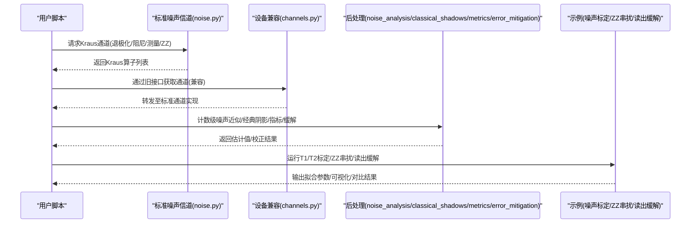

图表来源
- [noise.py:29-341](file://src/tyxonq/libs/quantum_library/noise.py#L29-L341)
- [channels.py:14-41](file://src/tyxonq/devices/simulators/noise/channels.py#L14-L41)
- [noise_analysis.py:24-100](file://src/tyxonq/postprocessing/noise_analysis.py#L24-L100)
- [classical_shadows.py:14-111](file://src/tyxonq/postprocessing/classical_shadows.py#L14-L111)
- [metrics.py:20-84](file://src/tyxonq/postprocessing/metrics.py#L20-L84)
- [error_mitigation.py:7-76](file://src/tyxonq/postprocessing/error_mitigation.py#L7-L76)
- [noise_t1_t2_calibration.py:75-194](file://examples/noise_t1_t2_calibration.py#L75-L194)
- [pulse_noise_modeling.py:50-163](file://examples/pulse_noise_modeling.py#L50-L163)
- [readout_mitigation.py:82-129](file://examples/readout_mitigation.py#L82-L129)

## 详细组件分析

### 标准噪声信道（Kraus表示）
- 退极化通道：对各向同性Pauli错误建模，参数p控制错误强度
- 振幅阻尼通道：模拟|1⟩→|0⟩的能量弛豫，对应T1过程
- 相位阻尼通道：保持布居数但破坏相干性，对应T2过程
- Pauli通道：允许X/Y/Z错误概率独立设置，更贴近实际硬件
- 测量通道：以概率p进行投影测量，用于MIPT等协议
- ZZ串扰哈密顿量：H=ξ·Z⊗Z，描述相邻量子比特间的固有耦合

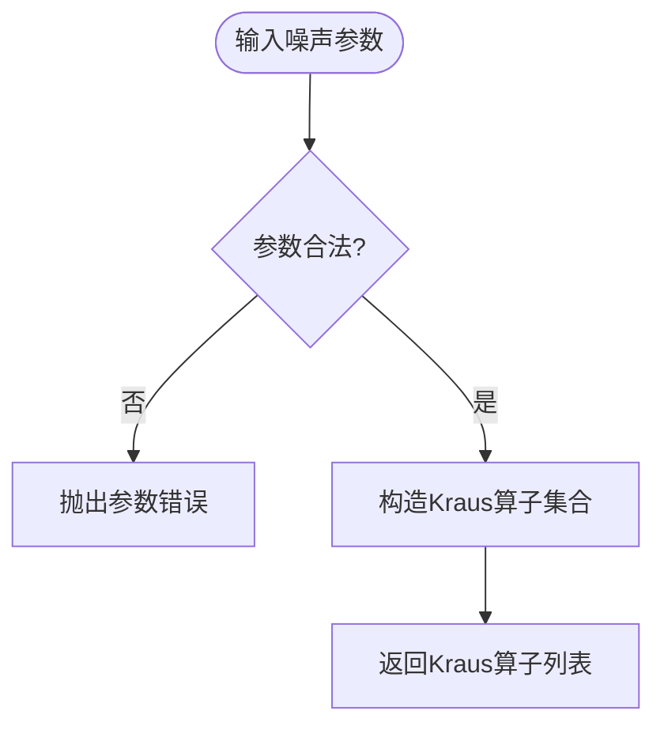

图表来源
- [noise.py:29-341](file://src/tyxonq/libs/quantum_library/noise.py#L29-L341)

章节来源
- [noise.py:29-341](file://src/tyxonq/libs/quantum_library/noise.py#L29-L341)

### 设备兼容层（旧接口包装）
- 提供depolarizing、amplitude_damping、phase_damping、pauli_channel等旧函数名
- 内部转发至标准噪声信道实现，保证历史代码可无缝迁移

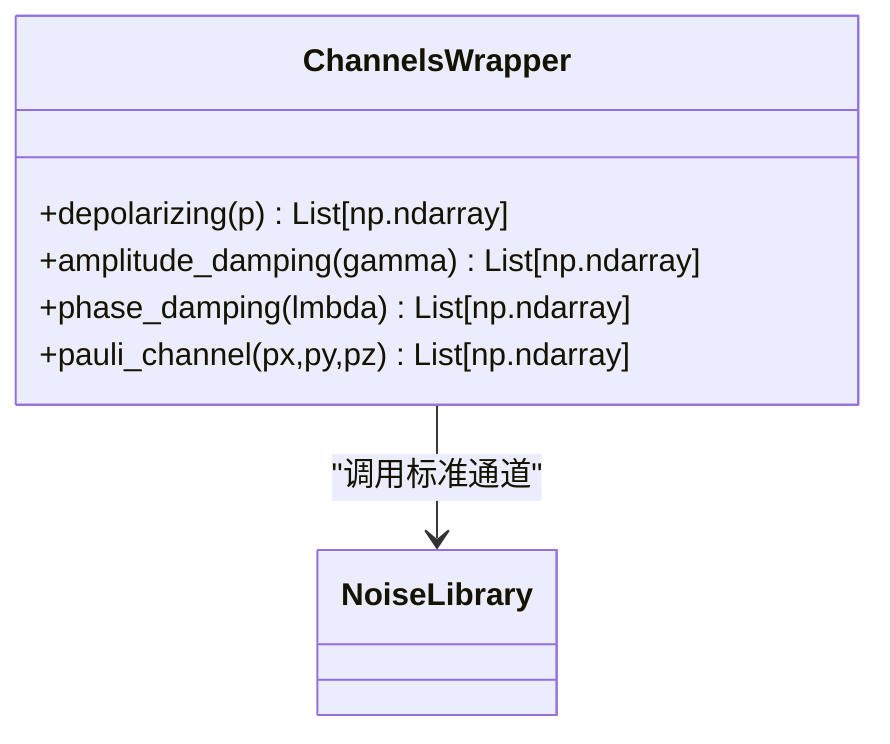

图表来源
- [channels.py:14-41](file://src/tyxonq/devices/simulators/noise/channels.py#L14-L41)
- [noise.py:29-341](file://src/tyxonq/libs/quantum_library/noise.py#L29-L341)

章节来源
- [channels.py:14-41](file://src/tyxonq/devices/simulators/noise/channels.py#L14-L41)

### 计数级噪声近似（后处理）
- 独立比特翻转：对每个比特以概率p翻转，近似一阶效应
- n比特退极化：将计数分布与均匀分布凸组合，近似全局退极化
- 适用于快速what-if分析与基线测试，不替代态级噪声仿真

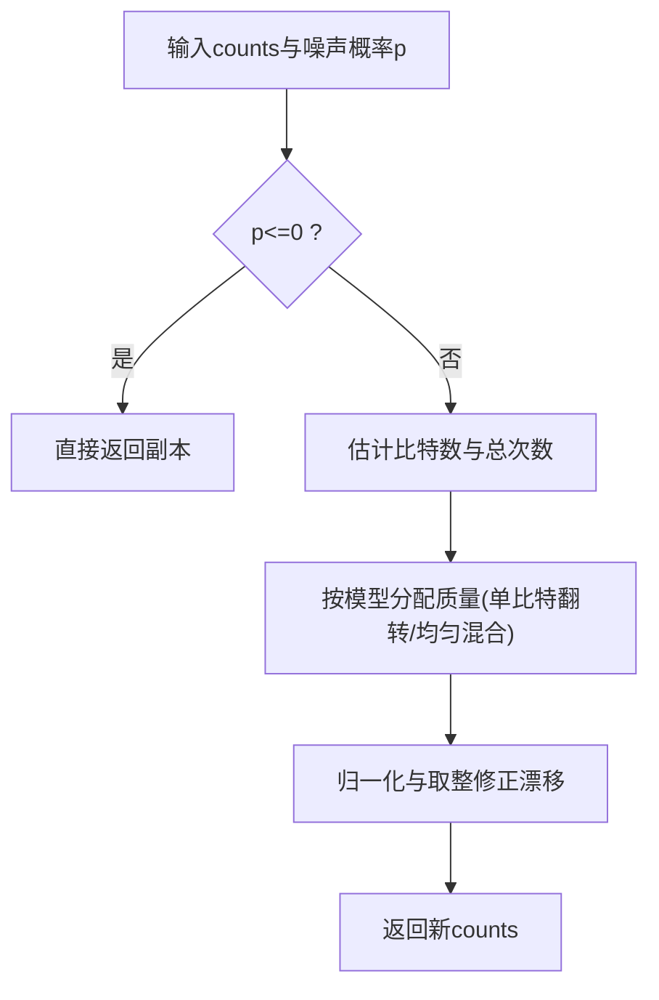

图表来源
- [noise_analysis.py:24-100](file://src/tyxonq/postprocessing/noise_analysis.py#L24-L100)

章节来源
- [noise_analysis.py:24-100](file://src/tyxonq/postprocessing/noise_analysis.py#L24-L100)

### 经典阴影（随机Pauli基与期望估计）
- 随机Pauli基：为每个量子比特随机选择X/Y/Z（或含I）测量基
- Z期望估计：从bitstring counts中统计某比特Z期望
- Pauli积期望估计：仅当测量基匹配时贡献符号，平均得到期望

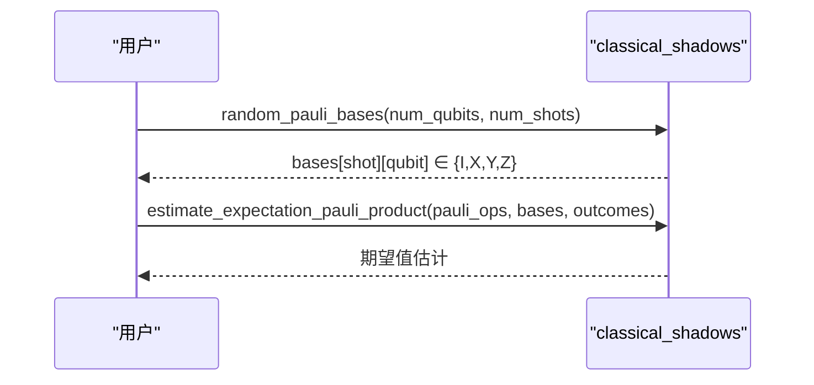

图表来源
- [classical_shadows.py:14-111](file://src/tyxonq/postprocessing/classical_shadows.py#L14-L111)

章节来源
- [classical_shadows.py:14-111](file://src/tyxonq/postprocessing/classical_shadows.py#L14-L111)

### 指标计算（归一化、KL散度、对角期望）
- 归一化计数：将counts转换为概率分布
- KL散度：比较两个计数分布的差异（正则化避免log(0)）
- 对角可观测量期望：支持指定Z测量位置或逐比特对角算符

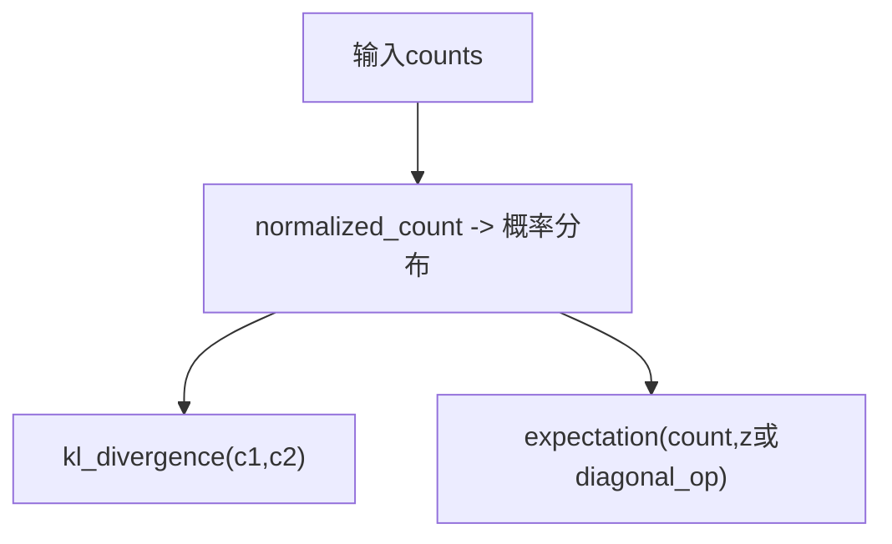

图表来源
- [metrics.py:20-84](file://src/tyxonq/postprocessing/metrics.py#L20-L84)

章节来源
- [metrics.py:20-84](file://src/tyxonq/postprocessing/metrics.py#L20-L84)

### 误差缓解占位接口（ZNE/DD/RC）
- ZNE：多次执行求平均（占位，后续集成mitiq）
- DD：多次执行求平均（占位，不修改电路）
- RC：多次执行求平均（占位，支持counts平均）

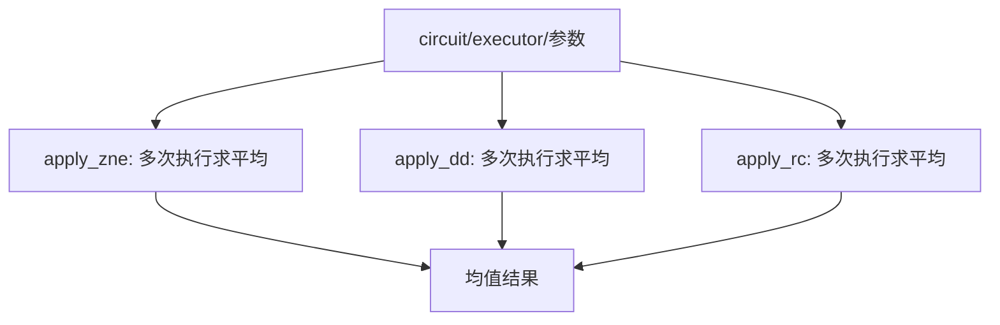

图表来源
- [error_mitigation.py:7-76](file://src/tyxonq/postprocessing/error_mitigation.py#L7-L76)

章节来源
- [error_mitigation.py:7-76](file://src/tyxonq/postprocessing/error_mitigation.py#L7-L76)

### T1/T2弛豫时间标定工作流
- T1标定：制备|1⟩，施加振幅阻尼噪声，测量|1⟩布居，拟合指数衰减P₁(γ)=A·exp(-γ·T1)+C
- T2标定：Ramsey序列(H-noise-H)，施加相位阻尼噪声，测量|0⟩布居，拟合P(λ)=A·exp(-λ·T2)+C
- 可视化：绘制数据点与拟合曲线，保存图像

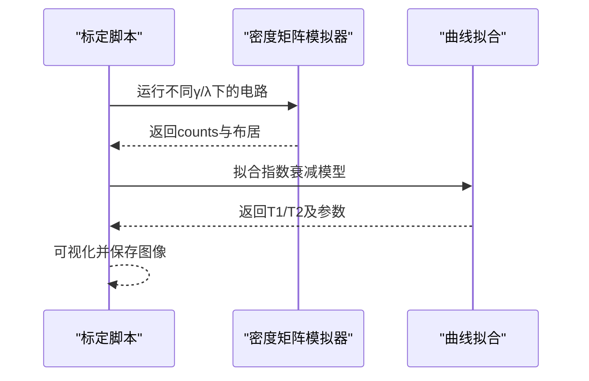

图表来源
- [noise_t1_t2_calibration.py:75-194](file://examples/noise_t1_t2_calibration.py#L75-L194)
- [noise_t1_t2_calibration.py:197-257](file://examples/noise_t1_t2_calibration.py#L197-L257)

章节来源
- [noise_t1_t2_calibration.py:75-194](file://examples/noise_t1_t2_calibration.py#L75-L194)
- [noise_t1_t2_calibration.py:197-257](file://examples/noise_t1_t2_calibration.py#L197-L257)

### ZZ串扰建模与分析
- 机制：控制脉冲边带导致相邻量子比特产生条件相位累积（H_ZZ=ξ·Z⊗Z）
- 测量：改变控制时长，提取相位斜率得到ξ
- 影响：Bell态分布偏移、两比特门保真度下降
- 缓解：频率失谐、ZZ抵消、复合门、调度优化、后处理校正

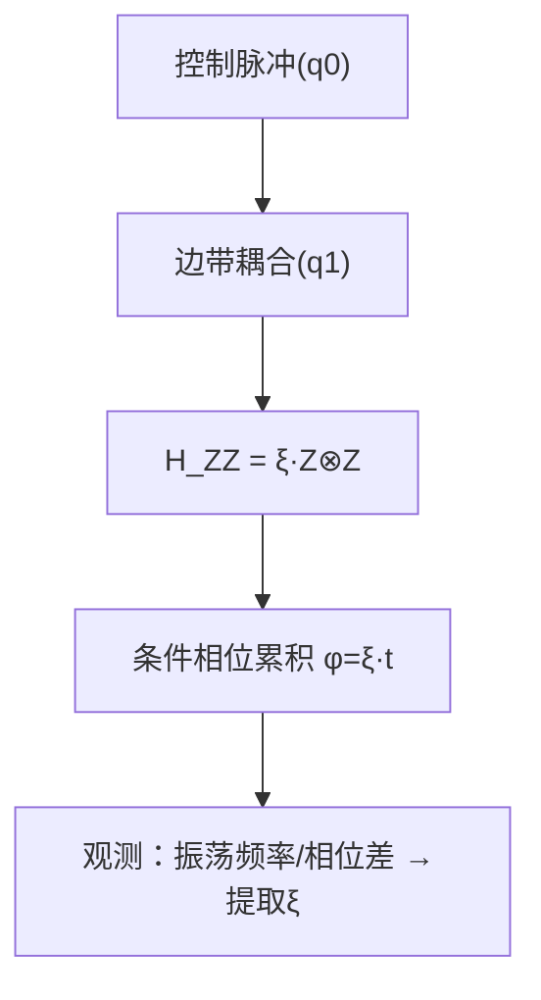

图表来源
- [pulse_noise_modeling.py:50-163](file://examples/pulse_noise_modeling.py#L50-L163)
- [noise.py:255-341](file://src/tyxonq/libs/quantum_library/noise.py#L255-L341)

章节来源
- [pulse_noise_modeling.py:50-163](file://examples/pulse_noise_modeling.py#L50-L163)
- [noise.py:255-341](file://src/tyxonq/libs/quantum_library/noise.py#L255-L341)

### 读出误差缓解
- 构建每比特校准矩阵A，使得测量概率= A × 真实概率
- 合成含读出噪声的原始计数，应用逆矩阵校正恢复理想计数
- 支持链式执行路径：device注入噪声 + postprocessing校正

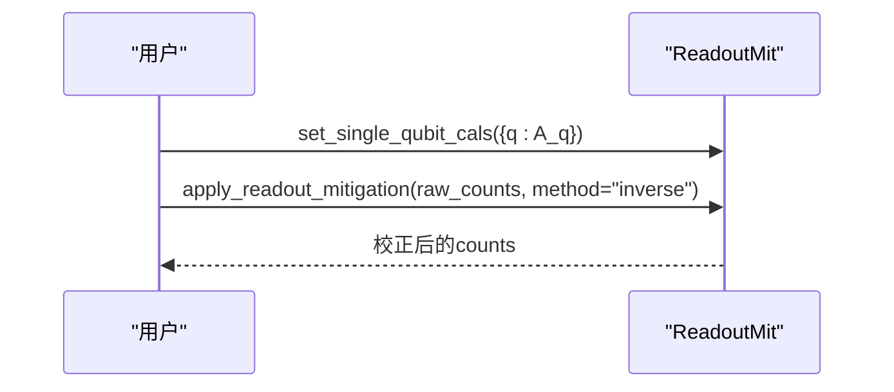

图表来源
- [readout_mitigation.py:82-129](file://examples/readout_mitigation.py#L82-L129)

章节来源
- [readout_mitigation.py:82-129](file://examples/readout_mitigation.py#L82-L129)

## 依赖关系分析
- 标准噪声信道被设备兼容层与后处理工具共同依赖
- 后处理工具之间相对解耦：噪声近似、经典阴影、指标、缓解各自独立
- 示例工作流串联上述能力，形成端到端噪声分析流程

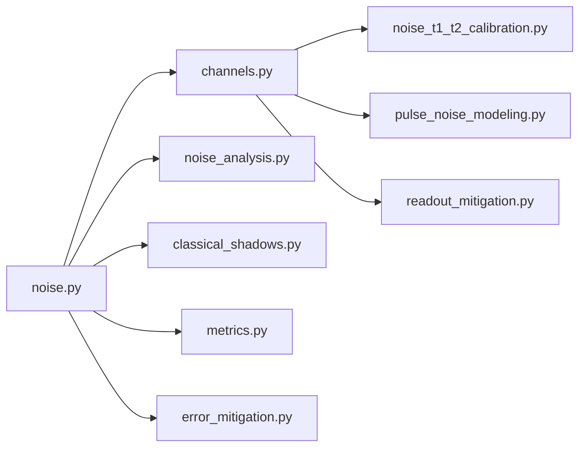

图表来源
- [noise.py:29-341](file://src/tyxonq/libs/quantum_library/noise.py#L29-L341)
- [channels.py:14-41](file://src/tyxonq/devices/simulators/noise/channels.py#L14-L41)
- [noise_analysis.py:24-100](file://src/tyxonq/postprocessing/noise_analysis.py#L24-L100)
- [classical_shadows.py:14-111](file://src/tyxonq/postprocessing/classical_shadows.py#L14-L111)
- [metrics.py:20-84](file://src/tyxonq/postprocessing/metrics.py#L20-L84)
- [error_mitigation.py:7-76](file://src/tyxonq/postprocessing/error_mitigation.py#L7-L76)
- [noise_t1_t2_calibration.py:75-194](file://examples/noise_t1_t2_calibration.py#L75-L194)
- [pulse_noise_modeling.py:50-163](file://examples/pulse_noise_modeling.py#L50-L163)
- [readout_mitigation.py:82-129](file://examples/readout_mitigation.py#L82-L129)

章节来源
- [noise.py:29-341](file://src/tyxonq/libs/quantum_library/noise.py#L29-L341)
- [channels.py:14-41](file://src/tyxonq/devices/simulators/noise/channels.py#L14-L41)
- [noise_analysis.py:24-100](file://src/tyxonq/postprocessing/noise_analysis.py#L24-L100)
- [classical_shadows.py:14-111](file://src/tyxonq/postprocessing/classical_shadows.py#L14-L111)
- [metrics.py:20-84](file://src/tyxonq/postprocessing/metrics.py#L20-L84)
- [error_mitigation.py:7-76](file://src/tyxonq/postprocessing/error_mitigation.py#L7-L76)
- [noise_t1_t2_calibration.py:75-194](file://examples/noise_t1_t2_calibration.py#L75-L194)
- [pulse_noise_modeling.py:50-163](file://examples/pulse_noise_modeling.py#L50-L163)
- [readout_mitigation.py:82-129](file://examples/readout_mitigation.py#L82-L129)

## 性能考量
- 计数级噪声近似复杂度：O(n·2^n)级别（n为比特数），适合小规模快速验证
- 经典阴影估计：每次shot仅计算匹配基的贡献，复杂度与Pauli权重和shots线性相关
- 指标计算：归一化与KL散度为O(k)（k为有效outcome数量）
- 误差缓解占位：多次执行开销与num_to_average/num_trials成正比
- 建议：大规模场景优先使用稀疏表示与批处理；合理设置shots与采样基数量以平衡精度与耗时

## 故障排查指南
- 参数合法性检查
  - 退极化/阻尼/测量通道参数需在[0,1]区间，否则抛出参数错误
  - Pauli通道概率和非负且总和≤1
- 计数为空或零
  - 空counts或总次数为零时，噪声近似直接返回副本，避免除零
- 数值稳定性
  - KL散度使用正则化项避免log(0)
  - 计数归一化与取整后进行漂移修正，确保总数守恒
- 设备兼容层
  - 旧接口仅做转发，若出现异常请检查底层标准通道参数与返回值
- 示例工作流
  - T1/T2拟合需合理初始猜测与采样范围，避免收敛失败
  - ZZ串扰测量需足够多的控制时长点以获得稳定斜率

章节来源
- [noise.py:29-341](file://src/tyxonq/libs/quantum_library/noise.py#L29-L341)
- [noise_analysis.py:24-100](file://src/tyxonq/postprocessing/noise_analysis.py#L24-L100)
- [metrics.py:20-84](file://src/tyxonq/postprocessing/metrics.py#L20-L84)
- [noise_t1_t2_calibration.py:197-257](file://examples/noise_t1_t2_calibration.py#L197-L257)
- [pulse_noise_modeling.py:108-163](file://examples/pulse_noise_modeling.py#L108-L163)

## 结论
TyxonQ后处理模块提供了完整的噪声分析工具链：从标准噪声信道的Kraus实现，到设备兼容层的历史迁移，再到计数级近似、经典阴影、指标计算与误差缓解占位接口。配合T1/T2标定、ZZ串扰建模与读出误差缓解示例，用户可高效开展噪声实验设计、数据分析与结果可视化，并在不同硬件平台上进行噪声特征对比与优化。

## 附录
- 噪声实验设计建议
  - 明确目标噪声源（T1/T2/退极化/ZZ串扰/读出误差）
  - 选择合适的噪声强度范围与采样点数
  - 结合经典阴影与指标进行多可观测量估计
- 数据分析流程
  - 采集counts → 归一化 → 指标计算 → 模型拟合 → 可视化
- 结果可视化
  - 使用示例中的绘图函数保存拟合曲线与对比图
- 跨平台对比
  - 在不同设备上重复相同噪声实验，比较T1/T2、ZZ强度与门保真度差异
  - 结合调度与布局优化降低串扰影响