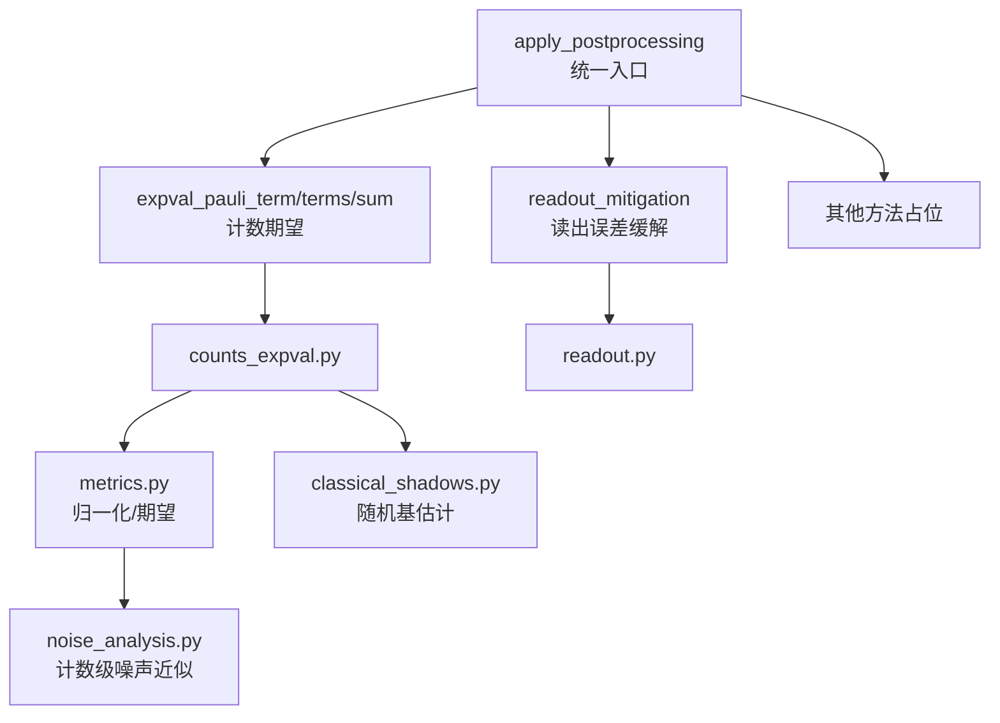
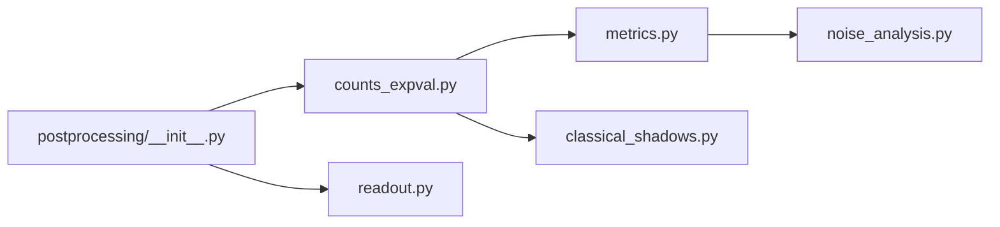
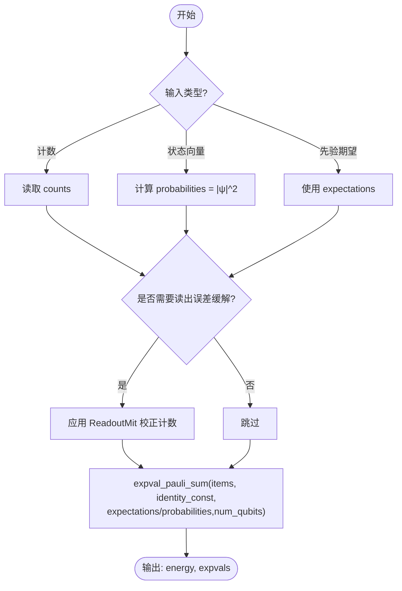

# 数据处理API

<cite>
**本文引用的文件**
- [postprocessing/__init__.py](file://src/tyxonq/postprocessing/__init__.py)
- [counts_expval.py](file://src/tyxonq/postprocessing/counts_expval.py)
- [readout.py](file://src/tyxonq/postprocessing/readout.py)
- [metrics.py](file://src/tyxonq/postprocessing/metrics.py)
- [noise_analysis.py](file://src/tyxonq/postprocessing/noise_analysis.py)
- [classical_shadows.py](file://src/tyxonq/postprocessing/classical_shadows.py)
- [readout_mitigation.py](file://examples/readout_mitigation.py)
</cite>

## 目录
1. [简介](#简介)
2. [项目结构](#项目结构)
3. [核心组件](#核心组件)
4. [架构总览](#架构总览)
5. [详细组件分析](#详细组件分析)
6. [依赖关系分析](#依赖关系分析)
7. [性能考虑](#性能考虑)
8. [故障排查指南](#故障排查指南)
9. [结论](#结论)
10. [附录：从计数到物理量的完整流程](#附录从计数到物理量的完整流程)

## 简介
本文件聚焦 TyxonQ 后处理模块中与“数据处理”相关的 API，重点覆盖：
- 计数数据处理与归一化
- 期望值计算（单项、多项、求和）
- 概率分布转换与状态向量支持
- 读出误差缓解（Readout Mitigation）
- 经典阴影（Classical Shadows）估计
- 噪声近似（比特翻转、去极化）在计数上的快速模拟

目标读者包括需要基于测量计数或状态向量进行数据分析的开发者与研究人员。文档提供接口规范、参数说明、调用流程、性能优化与错误处理实践，并给出从原始计数到物理量（如哈密顿量期望能量）的端到端流程。

## 项目结构
后处理模块位于 src/tyxonq/postprocessing，采用“路由 + 专用工具”的分层设计：
- 统一入口 apply_postprocessing：根据 method 路由到具体实现
- counts_expval：计数到期望值的计算（含解析路径）
- readout：读出误差缓解（矩阵求逆/约束最小二乘）
- metrics：计数归一化、KL 散度、对角算符期望
- noise_analysis：计数级噪声近似（比特翻转、去极化）
- classical_shadows：随机 Pauli 基与期望估计



图表来源
- [postprocessing/__init__.py:16-225](file://src/tyxonq/postprocessing/__init__.py#L16-L225)
- [counts_expval.py:7-112](file://src/tyxonq/postprocessing/counts_expval.py#L7-L112)
- [readout.py:15-137](file://src/tyxonq/postprocessing/readout.py#L15-L137)
- [metrics.py:20-84](file://src/tyxonq/postprocessing/metrics.py#L20-L84)
- [noise_analysis.py:24-100](file://src/tyxonq/postprocessing/noise_analysis.py#L24-L100)
- [classical_shadows.py:14-103](file://src/tyxonq/postprocessing/classical_shadows.py#L14-L103)

章节来源
- [postprocessing/__init__.py:16-225](file://src/tyxonq/postprocessing/__init__.py#L16-L225)

## 核心组件
- 统一后处理入口 apply_postprocessing(result, options)
  - 支持 method：readout_mitigation、expval_pauli_term、expval_pauli_terms、expval_pauli_sum
  - 自动推断 shots、num_qubits；当无计数时尝试从 statevector 推导概率分布
  - 对 expval_pauli_sum 可选集成读出误差缓解（cals/readout_cals）
- 计数期望计算
  - expval_pauli_term(counts, idxs)：Z 积期望
  - expval_pauli_terms(counts, terms)：多项 Z 积期望列表
  - expval_pauli_sum(counts, items, identity_const=0.0, expectations=None, probabilities=None, num_qubits=None)：聚合能量（计数或解析路径）
- 读出误差缓解 ReadoutMit
  - set_single_qubit_cals(cals)：设置每量子比特 2x2 校准矩阵
  - apply_readout_mitigation(raw_count, method="inverse", qubits=None, shots=None)：返回校正后的计数
- 度量与噪声近似
  - normalized_count、kl_divergence、expectation（对角算符）
  - apply_bitflip_counts、apply_depolarizing_counts

章节来源
- [postprocessing/__init__.py:16-225](file://src/tyxonq/postprocessing/__init__.py#L16-L225)
- [counts_expval.py:7-112](file://src/tyxonq/postprocessing/counts_expval.py#L7-L112)
- [readout.py:15-137](file://src/tyxonq/postprocessing/readout.py#L15-L137)
- [metrics.py:20-84](file://src/tyxonq/postprocessing/metrics.py#L20-L84)
- [noise_analysis.py:24-100](file://src/tyxonq/postprocessing/noise_analysis.py#L24-L100)

## 架构总览
下图展示从原始结果（计数/状态向量/先验期望）到最终物理量的数据流，以及各方法的调用顺序。

```mermaid
sequenceDiagram
participant U as "调用方"
participant R as "apply_postprocessing"
participant M as "counts_expval"
participant O as "readout"
participant S as "statevector/expectations"
U->>R : 传入 result(options.method,...)
alt method == "readout_mitigation"
R->>O : apply_readout_mitigation(counts, cals, shots)
O-->>R : 校正计数
R-->>U : {raw_counts, mitigated_counts, time_ms}
else method in {"expval_pauli_term","expval_pauli_terms"}
R->>M : 计数期望计算
M-->>R : float / List[float]
R-->>U : 期望值
else method == "expval_pauli_sum"
opt{是否提供cals?}
opt --|是| R->>O : 可选读出误差缓解
opt --|否| skip
R->>M : expval_pauli_sum(counts/items/identity_const,<br/>expectations/probabilities,num_qubits)
M->>S : 若shots==0则使用解析路径
M-->>R : {energy, expvals}
R-->>U : 能量与分项期望
end
```

图表来源
- [postprocessing/__init__.py:152-221](file://src/tyxonq/postprocessing/__init__.py#L152-L221)
- [counts_expval.py:55-112](file://src/tyxonq/postprocessing/counts_expval.py#L55-L112)
- [readout.py:131-137](file://src/tyxonq/postprocessing/readout.py#L131-L137)

## 详细组件分析

### 统一后处理入口 apply_postprocessing
- 职责
  - 根据 options.method 路由到具体后处理逻辑
  - 自动处理 shots 推断、num_qubits 传递、statevector→probabilities 转换
  - 为 expval_pauli_sum 提供可选的读出误差缓解
- 关键行为
  - 未提供 method 直接返回空结果
  - 失败操作不抛异常，返回诊断信息
  - 支持多种输入键兼容：result/result_meta/counts/statevector/expectations/probabilities

章节来源
- [postprocessing/__init__.py:16-225](file://src/tyxonq/postprocessing/__init__.py#L16-L225)

### 计数期望计算（counts_expval）
- term_expectation_from_counts(counts, idxs)
  - 基于 Z 基计数计算 ⟨Z⊗...⟩，按位符号累加后归一化
- expval_pauli_term(counts, idxs)
  - 单张量积期望封装
- expval_pauli_terms(counts, terms)
  - 批量计算多个 Z 积期望，terms 可为 (term,) 或 (term, coeff)，系数在此忽略
- expval_pauli_sum(counts, items, identity_const=0.0, expectations=None, probabilities=None, num_qubits=None)
  - 若提供 expectations/probabilities 且无计数，走解析路径：
    - 利用 per-qubit Z 期望相乘或全概率分布精确求和
  - 否则遍历 items，逐项用计数期望加权求和，得到 energy 与 expvals

复杂度与性能
- 计数路径：O(N_items × |counts| × k)，k 为项中量子比特数
- 解析路径：O(2^n) 全概率求和或 O(N_items × k) 分解相乘

章节来源
- [counts_expval.py:7-112](file://src/tyxonq/postprocessing/counts_expval.py#L7-L112)

### 读出误差缓解（readout）
- ReadoutMit
  - set_single_qubit_cals：设置每量子比特 2x2 校准矩阵
  - mitigate_probability：支持 inverse（伪逆）与 constrained least squares（单纯形约束）
  - apply_readout_mitigation：将计数转为概率向量，应用校正后再转回计数
- 注意事项
  - 多量子比特校准矩阵通过 Kronecker 积构造
  - 数值稳定性：使用伪逆与裁剪，保证概率非负且归一

章节来源
- [readout.py:15-137](file://src/tyxonq/postprocessing/readout.py#L15-L137)

### 度量与噪声近似（metrics、noise_analysis）
- metrics
  - normalized_count：计数归一化为概率分布
  - kl_divergence：两分布间的 KL 散度（带正则化）
  - expectation：对角算符期望（支持指定 Z 位置或逐比特对角元）
- noise_analysis
  - apply_bitflip_counts：独立比特翻转噪声的一阶近似
  - apply_depolarizing_counts：n 量子比特去极化通道近似（均匀混合）

章节来源
- [metrics.py:20-84](file://src/tyxonq/postprocessing/metrics.py#L20-L84)
- [noise_analysis.py:24-100](file://src/tyxonq/postprocessing/noise_analysis.py#L24-L100)

### 经典阴影（classical_shadows）
- random_pauli_basis/random_pauli_bases：生成随机 Pauli 基
- estimate_z_from_counts：从计数估计单量子比特 Z 期望
- bitstrings_to_bits：little-endian 字符串转比特数组
- estimate_expectation_pauli_product：基于随机基与测量结果估计 Pauli 积期望

章节来源
- [classical_shadows.py:14-103](file://src/tyxonq/postprocessing/classical_shadows.py#L14-L103)

### 示例与用法
- 读出误差缓解示例：构建 Bell 态、注入读出误差、应用缓解并对比理想/原始/校正计数
- 通过 Circuit.run 的 postprocessing(method="readout_mitigation", ...) 链式调用

章节来源
- [readout_mitigation.py:16-133](file://examples/readout_mitigation.py#L16-L133)

## 依赖关系分析
- apply_postprocessing 作为路由器，按需延迟导入 counts_expval 与 readout，避免循环依赖
- counts_expval 依赖 numpy 进行向量化计算（解析路径）
- readout 依赖后端抽象与 scipy 进行数值稳定求解
- metrics 与 noise_analysis 为轻量工具，无外部强依赖



图表来源
- [postprocessing/__init__.py:152-221](file://src/tyxonq/postprocessing/__init__.py#L152-L221)
- [counts_expval.py:1-112](file://src/tyxonq/postprocessing/counts_expval.py#L1-L112)
- [readout.py:1-137](file://src/tyxonq/postprocessing/readout.py#L1-L137)
- [metrics.py:1-94](file://src/tyxonq/postprocessing/metrics.py#L1-L94)
- [noise_analysis.py:1-106](file://src/tyxonq/postprocessing/noise_analysis.py#L1-L106)
- [classical_shadows.py:1-115](file://src/tyxonq/postprocessing/classical_shadows.py#L1-L115)

## 性能考虑
- 批处理建议
  - 使用 expval_pauli_terms 一次性计算多项期望，减少 Python 层循环开销
  - 对于大量项的哈密顿量聚合，优先使用 expval_pauli_sum 的解析路径（提供 expectations/probabilities），可避免重复遍历计数
- 数值稳定性
  - 读出误差缓解中 inverse 方法使用伪逆，必要时选择 constrained least squares
  - 概率裁剪与归一化防止负概率与漂移
- 内存与维度
  - 解析路径中的全概率求和复杂度 O(2^n)，仅适用于中小 n
  - 大 n 场景建议使用 per-qubit 期望分解或采样估计（经典阴影）
- 后端加速
  - 通过 get_backend 切换数值后端，提升大规模向量运算性能

[本节为通用指导，无需特定文件引用]

## 故障排查指南
- 常见错误与处理
  - 缺少 cals：readout_mitigation 无法校正，返回 reason 提示
  - 空计数或无效 metadata：自动 fallback 到 counts 求和推断 shots
  - 不支持的 method：返回 unsupported method 诊断
- 调试建议
  - 检查 result 结构：确保包含 result/counts/statevector/expectations/probabilities 之一
  - 验证 num_qubits：影响解析路径的概率索引映射
  - 校验校准矩阵形状：必须为 2x2
- 日志与耗时
  - readout_mitigation 返回 mitigation_time_ms 便于定位瓶颈

章节来源
- [postprocessing/__init__.py:109-150](file://src/tyxonq/postprocessing/__init__.py#L109-L150)
- [readout.py:39-43](file://src/tyxonq/postprocessing/readout.py#L39-L43)

## 结论
TyxonQ 后处理模块提供了从计数到物理量的完整数据处理链路：
- 统一的 apply_postprocessing 入口简化了方法选择与参数管理
- counts_expval 支持计数与解析双路径，兼顾灵活性与精度
- readout 提供稳健的读出误差缓解，适配不同硬件噪声特性
- metrics 与 noise_analysis 提供实用的分析与近似工具
- classical_shadows 支持高效的多观测估计

推荐实践：
- 小系统/高精度：优先解析路径（提供 expectations/probabilities）
- 大系统/高维：结合经典阴影与批处理 API
- 硬件数据：始终考虑读出误差缓解与噪声近似

[本节为总结性内容，无需特定文件引用]

## 附录：从计数到物理量的完整流程
以下流程图展示了从原始计数到哈密顿量期望能量的典型处理步骤。



图表来源
- [postprocessing/__init__.py:152-221](file://src/tyxonq/postprocessing/__init__.py#L152-L221)
- [counts_expval.py:55-112](file://src/tyxonq/postprocessing/counts_expval.py#L55-L112)
- [readout.py:131-137](file://src/tyxonq/postprocessing/readout.py#L131-L137)