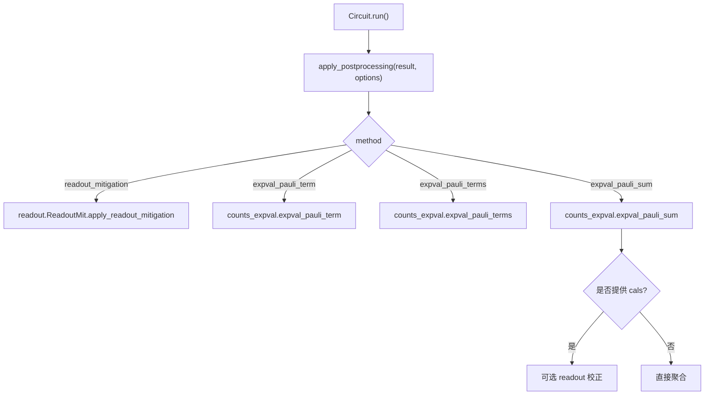
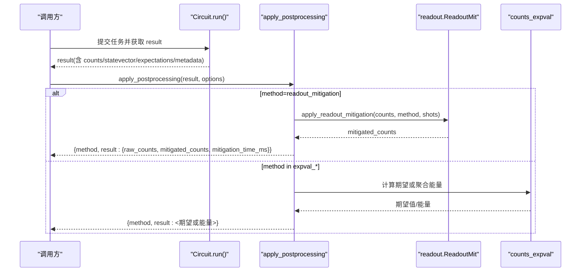
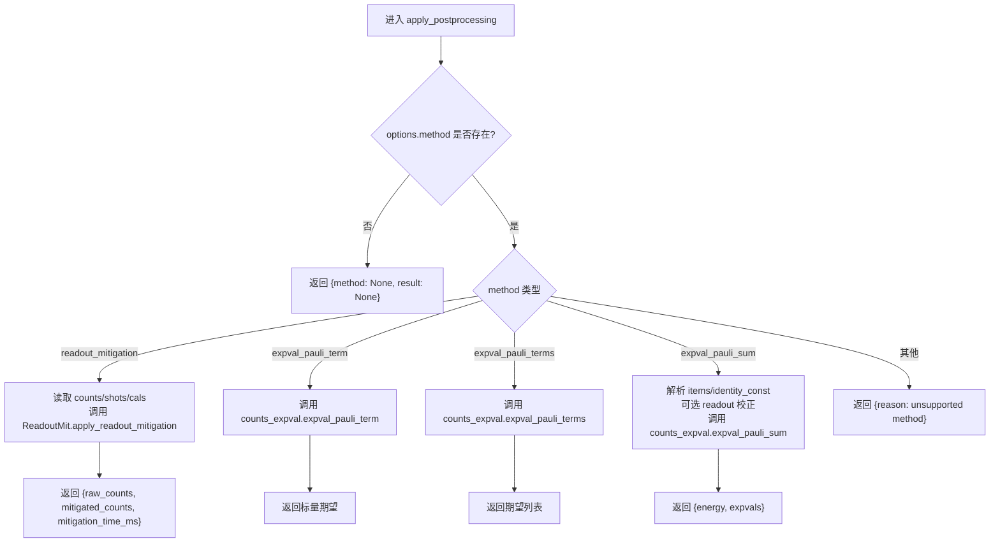
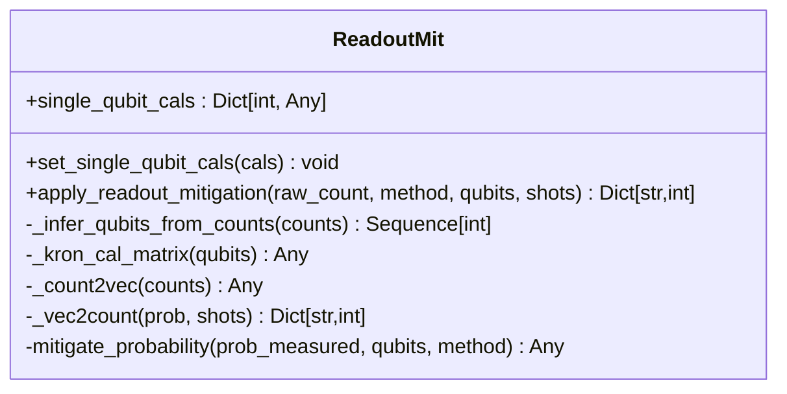
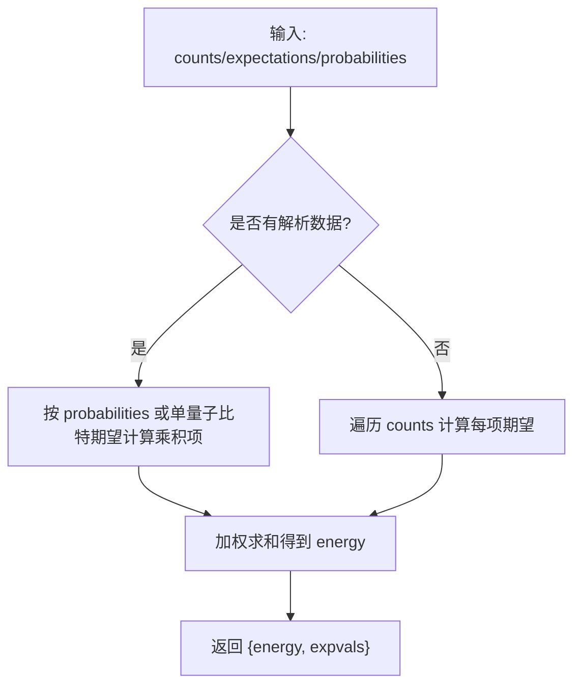
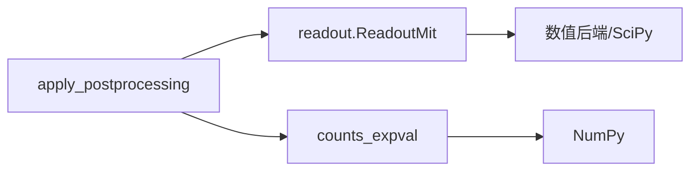

# 统一接口

<cite>
**本文引用的文件**
- [src/tyxonq/postprocessing/__init__.py](file://src/tyxonq/postprocessing/__init__.py)
- [src/tyxonq/postprocessing/readout.py](file://src/tyxonq/postprocessing/readout.py)
- [src/tyxonq/postprocessing/counts_expval.py](file://src/tyxonq/postprocessing/counts_expval.py)
- [src/tyxonq/postprocessing/error_mitigation.py](file://src/tyxonq/postprocessing/error_mitigation.py)
- [src/tyxonq/postprocessing/classical_shadows.py](file://src/tyxonq/postprocessing/classical_shadows.py)
- [src/tyxonq/postprocessing/metrics.py](file://src/tyxonq/postprocessing/metrics.py)
- [src/tyxonq/postprocessing/noise_analysis.py](file://src/tyxonq/postprocessing/noise_analysis.py)
- [src/tyxonq/postprocessing/io.py](file://src/tyxonq/postprocessing/io.py)
- [src/tyxonq/core/ir/circuit.py](file://src/tyxonq/core/ir/circuit.py)
- [tests_core_module/test_postprocessing_qem.py](file://tests_core_module/test_postprocessing_qem.py)
- [tests_core_module/test_postprocessing_shadows.py](file://tests_core_module/test_postprocessing_shadows.py)
</cite>

## 目录
1. [简介](#简介)
2. [项目结构](#项目结构)
3. [核心组件](#核心组件)
4. [架构总览](#架构总览)
5. [详细组件分析](#详细组件分析)
6. [依赖关系分析](#依赖关系分析)
7. [性能考量](#性能考量)
8. [故障排查指南](#故障排查指南)
9. [结论](#结论)
10. [附录](#附录)

## 简介
本文件面向 TyxonQ 后处理模块的统一接口，重点说明 apply_postprocessing 函数的核心作用与工作机制。文档覆盖方法路由、参数传递规范、结果格式标准化、支持的计算方法、配置选项、错误处理策略，以及流水线构建、批量处理、性能监控的使用示例，并展示与其他 TyxonQ 组件的集成方式与最佳实践。

## 项目结构
后处理模块位于 src/tyxonq/postprocessing，提供统一的入口函数与多种专用工具：
- 统一入口：apply_postprocessing（方法路由、参数解析、结果标准化）
- 读误校正：ReadoutMit（单量子比特校准矩阵、逆矩阵或约束最小二乘）
- 期望值计算：expval_pauli_term/terms/sum（计数或解析路径）
- 误差缓解占位：ZNE/DD/RC（多执行平均）
- 经典影子：随机 Pauli 基与期望估计
- 指标与噪声近似：归一化、KL 散度、对角可观测量、比特翻转/去极化近似
- IO 工具：计数与概率向量的转换、CSV 读写等

图表来源
- [src/tyxonq/postprocessing/__init__.py:16-225](file://src/tyxonq/postprocessing/__init__.py#L16-L225)
- [src/tyxonq/postprocessing/readout.py:15-137](file://src/tyxonq/postprocessing/readout.py#L15-L137)
- [src/tyxonq/postprocessing/counts_expval.py:7-112](file://src/tyxonq/postprocessing/counts_expval.py#L7-L112)

章节来源
- [src/tyxonq/postprocessing/__init__.py:1-228](file://src/tyxonq/postprocessing/__init__.py#L1-L228)

## 核心组件
- 统一入口 apply_postprocessing
  - 职责：根据 options["method"] 路由到具体实现；统一输入输出结构；在失败时返回部分结果而非抛错。
  - 输入：result（包含 counts/statevector/expectations/metadata/result_meta），options（至少包含 method）。
  - 输出：{"method": str|None, "result": Any|None}。
  - 支持的方法：
    - readout_mitigation：读误校正，返回 raw_counts/mitigated_counts/mitigation_time_ms。
    - expval_pauli_term：单 Pauli-Z 项期望。
    - expval_pauli_terms：多项期望列表。
    - expval_pauli_sum：哈密顿量求和能量，支持解析路径（statevector/probabilities/expectations）。
- 读误校正 ReadoutMit
  - 支持 inverse 与 constrained least squares 两种校正方法。
  - 通过 set_single_qubit_cals 设置每量子比特 2x2 校准矩阵，自动构造全系统 Kronecker 积矩阵。
- 期望值计算 counts_expval
  - 从计数统计 Z-basis 下的期望；当 shots=0 且存在 statevector/probabilities/expectations 时走解析路径。
- 误差缓解 error_mitigation
  - 提供 apply_zne/apply_dd/apply_rc 占位实现，用于多次执行平均。
- 经典影子 classical_shadows
  - 生成随机 Pauli 基，估计 Pauli 乘积期望。
- 指标与噪声 metrics/noise_analysis
  - 归一化、KL 散度、对角可观测量期望；计数级比特翻转/去极化近似。
- IO io
  - 计数与向量互转、CSV 读写、边缘分布、相关性估计等。

章节来源
- [src/tyxonq/postprocessing/__init__.py:16-225](file://src/tyxonq/postprocessing/__init__.py#L16-L225)
- [src/tyxonq/postprocessing/readout.py:15-137](file://src/tyxonq/postprocessing/readout.py#L15-L137)
- [src/tyxonq/postprocessing/counts_expval.py:7-112](file://src/tyxonq/postprocessing/counts_expval.py#L7-L112)
- [src/tyxonq/postprocessing/error_mitigation.py:7-79](file://src/tyxonq/postprocessing/error_mitigation.py#L7-L79)
- [src/tyxonq/postprocessing/classical_shadows.py:14-112](file://src/tyxonq/postprocessing/classical_shadows.py#L14-L112)
- [src/tyxonq/postprocessing/metrics.py:20-84](file://src/tyxonq/postprocessing/metrics.py#L20-L84)
- [src/tyxonq/postprocessing/noise_analysis.py:24-100](file://src/tyxonq/postprocessing/noise_analysis.py#L24-L100)
- [src/tyxonq/postprocessing/io.py:9-218](file://src/tyxonq/postprocessing/io.py#L9-L218)

## 架构总览
TyxonQ 的后处理统一接口作为“电路执行结果”的下游处理层，屏蔽了不同方法的差异，向上提供一致的结果结构，向下按需加载具体实现。

图表来源
- [src/tyxonq/postprocessing/__init__.py:16-225](file://src/tyxonq/postprocessing/__init__.py#L16-L225)
- [src/tyxonq/postprocessing/readout.py:131-137](file://src/tyxonq/postprocessing/readout.py#L131-L137)
- [src/tyxonq/postprocessing/counts_expval.py:34-112](file://src/tyxonq/postprocessing/counts_expval.py#L34-L112)

章节来源
- [src/tyxonq/core/ir/circuit.py:100-134](file://src/tyxonq/core/ir/circuit.py#L100-L134)
- [src/tyxonq/core/ir/circuit.py:216-239](file://src/tyxonq/core/ir/circuit.py#L216-L239)
- [src/tyxonq/core/ir/circuit.py:853-899](file://src/tyxonq/core/ir/circuit.py#L853-L899)

## 详细组件分析

### 统一入口 apply_postprocessing
- 方法路由机制
  - 读取 options["method"]，未指定则直接返回空结果。
  - 对 readout_mitigation 与 expval_* 三类分支分别处理。
- 参数传递规范
  - result 可包含 "result"/"counts"、"metadata"、"statevector"、"expectations"、"probabilities"、"result_meta"。
  - options 必须包含 "method"；各方法另有特定键（如 cals/items/identity_const/terms/idxs 等）。
- 结果格式标准化
  - 始终返回 {"method": ..., "result": ...}，便于上层统一消费。
  - readout_mitigation 返回 raw_counts/mitigated_counts/mitigation_time_ms。
  - expval_* 返回标量或 {"energy", "expvals"} 字典。
- 错误处理策略
  - 内部 try/except 包裹，失败时不抛错，仅保留占位结构，便于流水线继续运行。
- 性能特征
  - 延迟导入具体模块，避免循环依赖与启动开销。
  - 在读误校正中记录耗时，便于监控。

图表来源
- [src/tyxonq/postprocessing/__init__.py:16-225](file://src/tyxonq/postprocessing/__init__.py#L16-L225)

章节来源
- [src/tyxonq/postprocessing/__init__.py:16-225](file://src/tyxonq/postprocessing/__init__.py#L16-L225)

### 读误校正 ReadoutMit
- 设计要点
  - 通过 set_single_qubit_cals 设置每量子比特 2x2 校准矩阵。
  - 自动推断 qubits 顺序，构造全系统 Kronecker 积矩阵。
  - 支持 inverse（伪逆稳定求解）与 constrained least squares（单纯形约束优化）。
- 数据流
  - 计数 -> 概率向量 -> 校正 -> 概率向量 -> 计数。
- 复杂度
  - 设 n 为量子比特数，矩阵维度 2^n；校正主要成本在矩阵运算与优化。

图表来源
- [src/tyxonq/postprocessing/readout.py:15-137](file://src/tyxonq/postprocessing/readout.py#L15-L137)

章节来源
- [src/tyxonq/postprocessing/readout.py:15-137](file://src/tyxonq/postprocessing/readout.py#L15-L137)

### 期望值计算 counts_expval
- 功能
  - expval_pauli_term：基于计数的单 Pauli-Z 项期望。
  - expval_pauli_terms：多项期望列表。
  - expval_pauli_sum：聚合能量，支持解析路径（expectations/probabilities/statevector）。
- 解析路径
  - 当 shots=0 且存在 statevector/probabilities/expectations 时，直接按概率或单量子比特期望相乘得到精确值。
- 复杂度
  - 计数路径 O(N_shots * |terms|)，解析路径 O(|terms|)。

图表来源
- [src/tyxonq/postprocessing/counts_expval.py:55-112](file://src/tyxonq/postprocessing/counts_expval.py#L55-L112)

章节来源
- [src/tyxonq/postprocessing/counts_expval.py:7-112](file://src/tyxonq/postprocessing/counts_expval.py#L7-L112)

### 误差缓解 error_mitigation（占位）
- 提供 apply_zne/apply_dd/apply_rc，当前实现为多次执行平均，便于后续扩展至完整 ZNE/DD/RC 流程。
- 适用于计数或数值结果的多轮平均。

章节来源
- [src/tyxonq/postprocessing/error_mitigation.py:7-79](file://src/tyxonq/postprocessing/error_mitigation.py#L7-L79)
- [tests_core_module/test_postprocessing_qem.py:1-55](file://tests_core_module/test_postprocessing_qem.py#L1-L55)

### 经典影子 classical_shadows
- 生成随机 Pauli 基，估计 Pauli 乘积期望。
- 适合大规模观测量的采样估计场景。

章节来源
- [src/tyxonq/postprocessing/classical_shadows.py:14-112](file://src/tyxonq/postprocessing/classical_shadows.py#L14-L112)
- [tests_core_module/test_postprocessing_shadows.py:1-37](file://tests_core_module/test_postprocessing_shadows.py#L1-L37)

### 指标与噪声近似 metrics/noise_analysis
- metrics：归一化、KL 散度、对角可观测量期望。
- noise_analysis：计数级比特翻转与去极化通道近似，便于快速 What-if 分析。

章节来源
- [src/tyxonq/postprocessing/metrics.py:20-84](file://src/tyxonq/postprocessing/metrics.py#L20-L84)
- [src/tyxonq/postprocessing/noise_analysis.py:24-100](file://src/tyxonq/postprocessing/noise_analysis.py#L24-L100)

### IO 工具 io
- 计数与向量互转、CSV 读写、边缘分布、相关性估计等，便于前后处理与可视化。

章节来源
- [src/tyxonq/postprocessing/io.py:9-218](file://src/tyxonq/postprocessing/io.py#L9-L218)

## 依赖关系分析
- 耦合与内聚
  - apply_postprocessing 作为薄路由层，低耦合地调用 readout 与 counts_expval，保持高内聚。
  - 延迟导入避免循环依赖。
- 外部依赖
  - readout 使用后端数值库与 SciPy 优化器。
  - 经典影子与指标使用标准库与 NumPy。
- 潜在循环依赖
  - 通过延迟导入规避 Circuit 与 postprocessing 之间的循环依赖。

图表来源
- [src/tyxonq/postprocessing/__init__.py:16-225](file://src/tyxonq/postprocessing/__init__.py#L16-L225)
- [src/tyxonq/postprocessing/readout.py:1-137](file://src/tyxonq/postprocessing/readout.py#L1-L137)
- [src/tyxonq/postprocessing/counts_expval.py:1-112](file://src/tyxonq/postprocessing/counts_expval.py#L1-L112)

章节来源
- [src/tyxonq/postprocessing/__init__.py:16-225](file://src/tyxonq/postprocessing/__init__.py#L16-L225)

## 性能考量
- 延迟导入：仅在需要时加载 readout/counts_expval，降低启动开销。
- 解析路径优先：当存在 statevector/probabilities/expectations 时，跳过计数遍历，直接计算精确期望。
- 读误校正耗时：内置计时字段 mitigation_time_ms，便于监控与调优。
- 批处理建议：
  - 对大量任务，建议将相同 options 的 apply_postprocessing 调用合并，减少重复对象创建。
  - 对于 expval_pauli_sum，尽量提供 expectations/probabilities 以启用解析路径。
- 内存与精度：
  - 读误校正在大维空间下矩阵运算成本高，建议合理选择校正方法与校准矩阵规模。
  - 计数路径受 shot 数影响，需权衡精度与时间。

[本节为通用指导，无需特定文件来源]

## 故障排查指南
- 常见现象
  - 未指定 method：返回空结果。
  - 缺少 cals 或空 counts：readout_mitigation 返回 reason 提示。
  - 不支持的 method：返回 reason 指示不支持。
- 定位步骤
  - 检查 result 结构是否包含 counts/statevector/expectations。
  - 检查 options 是否包含 method 及对应必需键（如 cals/items/identity_const）。
  - 查看返回结果中的 reason 字段定位问题。
- 恢复策略
  - 若 readout 失败，仍可继续使用 expval_* 路径。
  - 若解析路径不可用，回退到计数路径。

章节来源
- [src/tyxonq/postprocessing/__init__.py:102-225](file://src/tyxonq/postprocessing/__init__.py#L102-L225)

## 结论
apply_postprocessing 提供了 TyxonQ 后处理的统一入口，通过方法路由、参数规范化与结果标准化，简化了读误校正与期望值计算的接入。其健壮的错误处理与解析路径优先策略，使其在流水线与批处理场景中具备良好稳定性与性能。结合 Circuit 的配置与运行时选项，可实现端到端的量子计算后处理工作流。

[本节为总结性内容，无需特定文件来源]

## 附录

### 使用方法与最佳实践
- 流水线构建
  - 在 Circuit 上通过 .postprocessing(method=..., ...) 配置后处理选项，再 .device(...).run() 执行，最终由统一接口处理结果。
  - 参考：Circuit.postprocessing 与 run 的集成点。
- 批量处理
  - 对多个任务复用相同的 options，减少重复配置；对 expval_pauli_sum 尽量提供 expectations/probabilities 以启用解析路径。
- 性能监控
  - 读取 readout_mitigation 返回的 mitigation_time_ms，评估校正耗时。
  - 对比计数路径与解析路径的性能差异，选择合适的输入形式。
- 与其他组件集成
  - 与 Circuit 集成：通过 postprocessing_options 注入默认方法。
  - 与 VQE 运行时集成：在算法运行时调用 apply_postprocessing 进行能量聚合与读误校正。

章节来源
- [src/tyxonq/core/ir/circuit.py:111-134](file://src/tyxonq/core/ir/circuit.py#L111-L134)
- [src/tyxonq/core/ir/circuit.py:216-239](file://src/tyxonq/core/ir/circuit.py#L216-L239)
- [src/tyxonq/core/ir/circuit.py:853-899](file://src/tyxonq/core/ir/circuit.py#L853-L899)

### 支持的计算方法与配置选项
- 读误校正 readout_mitigation
  - 必需：method="readout_mitigation"
  - 可选：cals（每量子比特 2x2 校准矩阵）、mitigation（"inverse" 或 "least_squares"）
- 期望值计算
  - expval_pauli_term：idxs 或 indices（量子比特索引列表）
  - expval_pauli_terms：terms（Pauli 项列表）
  - expval_pauli_sum：items 或 group_items（带系数的 Pauli 项）、identity_const（常数项）、readout_cals 或 cals（可选）、mitigation（可选）
- 误差缓解（占位）
  - apply_zne/apply_dd/apply_rc：num_to_average/num_trials 等控制重复次数

章节来源
- [src/tyxonq/postprocessing/__init__.py:16-225](file://src/tyxonq/postprocessing/__init__.py#L16-L225)
- [src/tyxonq/postprocessing/readout.py:15-137](file://src/tyxonq/postprocessing/readout.py#L15-L137)
- [src/tyxonq/postprocessing/counts_expval.py:34-112](file://src/tyxonq/postprocessing/counts_expval.py#L34-L112)
- [src/tyxonq/postprocessing/error_mitigation.py:7-79](file://src/tyxonq/postprocessing/error_mitigation.py#L7-L79)