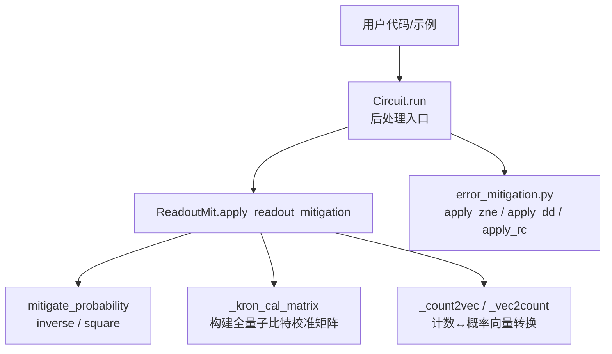
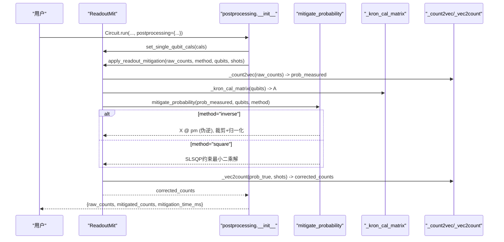
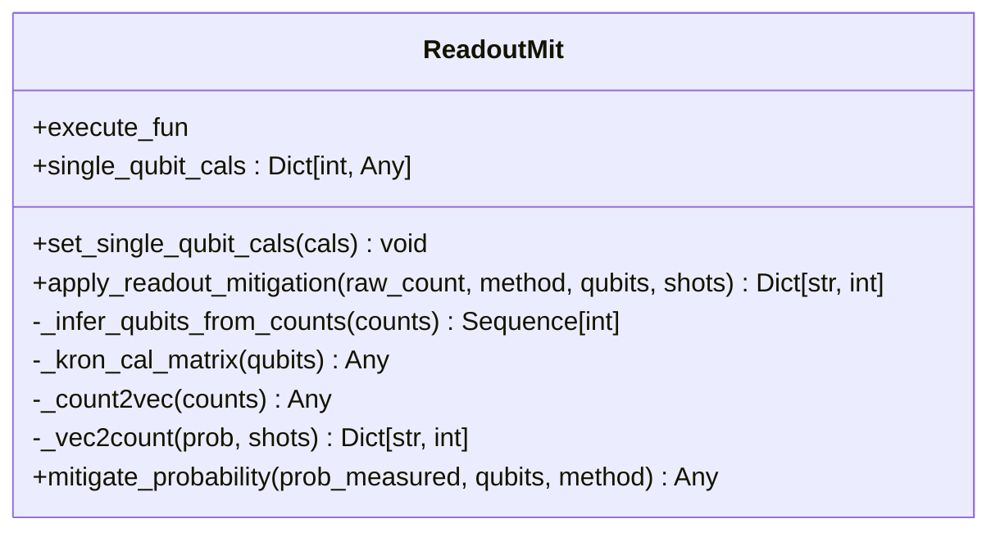
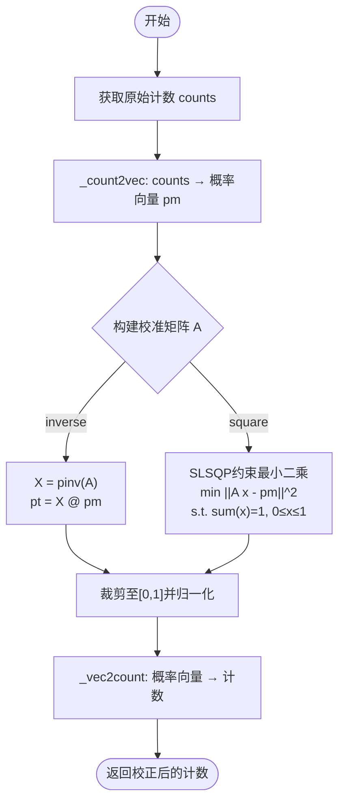
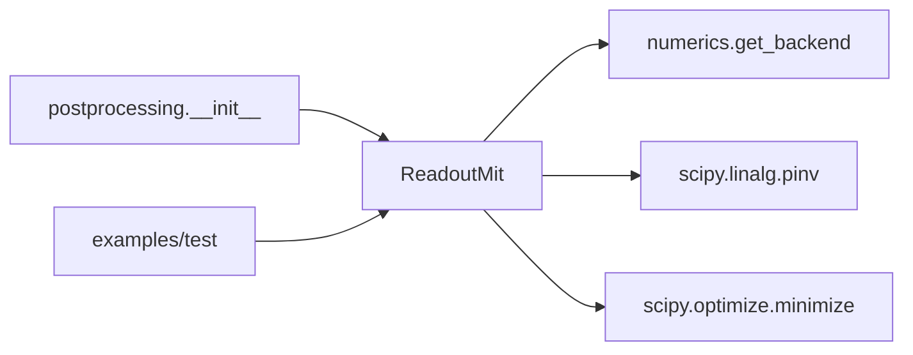

# 误差缓解API

<cite>
**本文引用的文件**
- [readout.py](file://src/tyxonq/postprocessing/readout.py)
- [error_mitigation.py](file://src/tyxonq/postprocessing/error_mitigation.py)
- [postprocessing/__init__.py](file://src/tyxonq/postprocessing/__init__.py)
- [readout_mitigation.py](file://examples/readout_mitigation.py)
- [readout_mitigation_scalability.py](file://examples/readout_mitigation_scalability.py)
- [test_postprocessing_adapters.py](file://tests_core_module/test_postprocessing_adapters.py)
- [test_hea.py](file://tests_mol_valid/test_hea.py)
</cite>

## 目录
1. [简介](#简介)
2. [项目结构](#项目结构)
3. [核心组件](#核心组件)
4. [架构总览](#架构总览)
5. [详细组件分析](#详细组件分析)
6. [依赖关系分析](#依赖关系分析)
7. [性能考量](#性能考量)
8. [故障排查指南](#故障排查指南)
9. [结论](#结论)
10. [附录](#附录)

## 简介
本文件面向TyxonQ后处理模块中的“误差缓解”相关API，重点覆盖读取误差缓解（Readout Mitigation）与量子误差缓解（ZNE、DD、RC等占位接口）。文档将详细说明：
- ReadoutMit类的接口规范、校准数据格式、缓解算法选择（inverse、square/约束最小二乘）
- 单量子比特与多量子比特误差校准、误差矩阵构建、缓解效果评估
- 校准实验设计、缓解参数调优、性能基准测试实践指南
- 不同噪声模型下的误差缓解效果对比与可扩展性边界

## 项目结构
与误差缓解相关的代码主要位于后处理模块与示例中：
- 核心实现：src/tyxonq/postprocessing/readout.py（ReadoutMit类）、src/tyxonq/postprocessing/error_mitigation.py（ZNE/DD/RC占位）
- 集成入口：src/tyxonq/postprocessing/__init__.py（Circuit.run时的后处理调用）
- 使用示例：examples/readout_mitigation.py、examples/readout_mitigation_scalability.py
- 测试用例：tests_core_module/test_postprocessing_adapters.py、tests_mol_valid/test_hea.py

图表来源
- [postprocessing/__init__.py:128-150](file://src/tyxonq/postprocessing/__init__.py#L128-L150)
- [readout.py:15-140](file://src/tyxonq/postprocessing/readout.py#L15-L140)
- [error_mitigation.py:7-79](file://src/tyxonq/postprocessing/error_mitigation.py#L7-L79)

章节来源
- [readout.py:15-140](file://src/tyxonq/postprocessing/readout.py#L15-L140)
- [postprocessing/__init__.py:128-150](file://src/tyxonq/postprocessing/__init__.py#L128-L150)
- [error_mitigation.py:7-79](file://src/tyxonq/postprocessing/error_mitigation.py#L7-L79)

## 核心组件
- ReadoutMit：提供读取误差缓解的核心能力，支持按量子比特设置2x2校准矩阵，构建Kronecker积的全量子比特校准矩阵，并执行inverse或约束最小二乘（square）两种缓解策略。
- error_mitigation.py：提供ZNE、DD、RC的占位函数，用于后续扩展与集成更完整的量子误差缓解流程。
- postprocessing/__init__.py：在Circuit.run时根据配置自动调用ReadoutMit进行后处理校正，并记录耗时与结果。

章节来源
- [readout.py:15-140](file://src/tyxonq/postprocessing/readout.py#L15-L140)
- [error_mitigation.py:7-79](file://src/tyxonq/postprocessing/error_mitigation.py#L7-L79)
- [postprocessing/__init__.py:128-150](file://src/tyxonq/postprocessing/__init__.py#L128-L150)

## 架构总览
下图展示了从用户调用到后处理执行的完整流程，包括校准矩阵构建、概率向量转换、缓解算法选择与结果重建。

图表来源
- [postprocessing/__init__.py:128-150](file://src/tyxonq/postprocessing/__init__.py#L128-L150)
- [readout.py:33-137](file://src/tyxonq/postprocessing/readout.py#L33-L137)

## 详细组件分析

### ReadoutMit类接口规范
- 初始化
  - __init__(execute=None)：可选传入执行函数；内部维护single_qubit_cals字典。
- 校准设置
  - set_single_qubit_cals(cals: Dict[int, Any])：为每个量子比特设置2x2校准矩阵A，表示测量概率与真实概率的关系 p_meas = A @ p_true。矩阵必须为2x2，否则抛出异常。
- 核心方法
  - apply_readout_mitigation(raw_count: Dict[str, int], method: str = "inverse", qubits: Optional[Sequence[int]] = None, shots: Optional[int] = None) -> Dict[str, int]
    - 若未指定qubits，则根据bitstring长度推断。
    - 将counts转换为概率向量，调用mitigate_probability得到真实概率估计，再转回counts。
  - mitigate_probability(prob_measured, qubits, method="inverse")
    - 构建全量子比特校准矩阵A（各量子比特矩阵的Kronecker积）。
    - inverse：使用SciPy伪逆X=pinv(A)，计算pt=X@pm，裁剪至[0,1]并归一化。
    - square：以SLSQP求解约束最小二乘问题，约束为概率和为1且分量非负。
- 辅助方法
  - _infer_qubits_from_counts(counts)：根据bitstring长度推断qubits。
  - _kron_cal_matrix(qubits)：按升序wire顺序对单比特校准矩阵做Kronecker积。
  - _count2vec(counts)、_vec2count(prob, shots)：计数与概率向量的相互转换。

图表来源
- [readout.py:15-140](file://src/tyxonq/postprocessing/readout.py#L15-L140)

章节来源
- [readout.py:15-140](file://src/tyxonq/postprocessing/readout.py#L15-L140)

### 校准数据格式与误差矩阵构建
- 单量子比特校准矩阵
  - 形状：2x2，行随机（每行和为1），表示p_meas = A @ p_true。
  - 典型形式：对称bit-flip通道A=[[1-p, p],[p, 1-p]]；也可包含不对称翻转偏差。
- 多量子比特校准矩阵
  - 通过单比特矩阵的Kronecker积构建：A_full = A_0 ⊗ A_1 ⊗ ... ⊗ A_{n-1}（按升序wire顺序）。
  - 该矩阵维度为2^n × 2^n，用于全局概率映射。
- 概率向量与计数转换
  - _count2vec：将counts字典转为长度为2^n的概率向量（归一化）。
  - _vec2count：将概率向量裁剪、归一化后乘以shots取整，恢复为counts字典。

图表来源
- [readout.py:49-137](file://src/tyxonq/postprocessing/readout.py#L49-L137)

章节来源
- [readout.py:49-137](file://src/tyxonq/postprocessing/readout.py#L49-L137)

### 缓解算法选择与适用场景
- inverse（伪逆）
  - 优点：计算简单直接，适合小系统或条件数良好的校准矩阵。
  - 风险：当n较大时，2^n×2^n矩阵可能病态，数值不稳定导致结果失真。
- square（约束最小二乘）
  - 优点：强制概率分布合法（非负、和为1），数值鲁棒性更好。
  - 成本：需要迭代优化（SLSQP），时间复杂度高于inverse。
- 选择建议
  - n ≤ 10：两者均可尝试，优先square以获得更稳定的概率分布。
  - n > 10：谨慎使用full矩阵方法，考虑分块或近似策略（见可扩展性部分）。

章节来源
- [readout.py:94-129](file://src/tyxonq/postprocessing/readout.py#L94-L129)
- [readout_mitigation_scalability.py:200-299](file://examples/readout_mitigation_scalability.py#L200-L299)

### 单量子比特与多量子比特误差校准
- 单量子比特校准
  - 通过set_single_qubit_cals为每个比特设置2x2矩阵。
  - 示例：轻微翻转偏差的矩阵（如[[0.97, 0.03],[0.05, 0.95]]）。
- 多量子比特校准
  - 按升序wire顺序对单比特矩阵做Kronecker积，得到全局校准矩阵。
  - 注意：维度指数增长，需关注数值稳定性与采样量需求。

章节来源
- [readout.py:33-60](file://src/tyxonq/postprocessing/readout.py#L33-L60)
- [readout_mitigation.py:89-102](file://examples/readout_mitigation.py#L89-L102)

### 缓解效果评估
- 常用指标
  - 保真度Fidelity：比较分布之间的相似度。
  - 总变差距离TVD：衡量分布差异的上界度量。
- 评估流程
  - 生成理想计数与含噪计数，应用缓解后计算指标，对比改进幅度。
  - 可扩展性实验中，随n增大观察保真度退化与时间开销增长。

章节来源
- [readout_mitigation_scalability.py:136-193](file://examples/readout_mitigation_scalability.py#L136-L193)
- [readout_mitigation_scalability.py:260-299](file://examples/readout_mitigation_scalability.py#L260-L299)

### 量子误差缓解（ZNE、DD、RC）占位接口
- apply_zne：当前为骨架实现，平均多次executor输出；未来可集成mitiq等库完成真正的零噪声外推。
- apply_dd：当前不修改电路，仅重复执行并平均；可用于基线对比。
- apply_rc：重复执行并平均，支持计数字典的平均聚合。
- 用途：作为扩展点，便于后续接入更复杂的量子误差缓解技术。

章节来源
- [error_mitigation.py:7-79](file://src/tyxonq/postprocessing/error_mitigation.py#L7-L79)

## 依赖关系分析
- ReadoutMit依赖
  - 数值后端：通过get_backend获取数组操作；必要时转换为NumPy以调用SciPy（伪逆、优化器）。
  - SciPy：scipy.linalg.pinv用于稳定求逆；scipy.optimize.minimize用于约束最小二乘。
- 集成依赖
  - postprocessing/__init__.py在Circuit.run时调用ReadoutMit，并将结果与耗时写入postprocessing字段。
- 外部耦合
  - 示例与测试通过模拟噪声注入与已知校准矩阵验证缓解效果。

图表来源
- [readout.py:5-12](file://src/tyxonq/postprocessing/readout.py#L5-L12)
- [postprocessing/__init__.py:128-150](file://src/tyxonq/postprocessing/__init__.py#L128-L150)

章节来源
- [readout.py:5-12](file://src/tyxonq/postprocessing/readout.py#L5-L12)
- [postprocessing/__init__.py:128-150](file://src/tyxonq/postprocessing/__init__.py#L128-L150)

## 性能考量
- 时间与空间复杂度
  - 校准矩阵维度：2^n × 2^n，构建与求逆的时间复杂度约为O(2^(3n))。
  - 约束最小二乘：迭代优化，收敛速度与条件数相关。
- 可扩展性边界
  - 理论软限制：当n >> log₂(1/p)时，校准矩阵估计需要约2^n/p次采样，变得不切实际。
  - 经验建议：n ≤ 10时使用REM较为可行；更大系统考虑替代方法（张量网络、对称验证、机器学习）。
- 优化建议
  - 优先使用square方法提升数值稳定性。
  - 合理设置shots，确保校准矩阵估计精度。
  - 对大系统采用分块或近似策略，避免全矩阵求逆。

章节来源
- [readout_mitigation_scalability.py:200-299](file://examples/readout_mitigation_scalability.py#L200-L299)
- [readout_mitigation_scalability.py:375-412](file://examples/readout_mitigation_scalability.py#L375-L412)

## 故障排查指南
- 常见错误
  - 校准矩阵形状不符：set_single_qubit_cals要求2x2矩阵，否则会抛出ValueError。
  - 缺失校准：_kron_cal_matrix要求所有qubits都有对应校准矩阵，否则报错。
  - 数值不稳定：大n下inverse方法可能产生负概率或发散，应切换square或降低n。
- 调试步骤
  - 检查单比特校准矩阵是否行随机（每行和为1）。
  - 打印prob_measured与A的条件数，评估数值稳定性。
  - 对比inverse与square的结果，确认square是否更稳健。
  - 在postprocessing层捕获异常，查看mitigation_time_ms与reason字段。

章节来源
- [readout.py:39-60](file://src/tyxonq/postprocessing/readout.py#L39-L60)
- [postprocessing/__init__.py:147-150](file://src/tyxonq/postprocessing/__init__.py#L147-L150)

## 结论
TyxonQ的后处理模块提供了实用的读取误差缓解能力，ReadoutMit类支持灵活的单比特校准与两种缓解算法（inverse、square），并通过postprocessing集成到Circuit.run流程中。对于小规模系统（n ≤ 10），该方法能有效提升结果质量；对于大规模系统，需注意指数级复杂度与数值稳定性问题，建议结合替代策略与参数调优。

## 附录

### 校准实验设计与实践指南
- 实验目标
  - 验证不同噪声模型下的缓解效果，评估保真度与TVD改进。
- 步骤
  - 设计单比特校准矩阵（对称/非对称bit-flip）。
  - 生成理想计数，注入读出噪声得到原始计数。
  - 使用ReadoutMit分别应用inverse与square方法，计算指标对比。
  - 逐步增加qubit数量，观察性能退化与时间开销。
- 参考实现
  - examples/readout_mitigation.py：演示Bell态与双比特校准。
  - examples/readout_mitigation_scalability.py：可扩展性分析与阈值观察。

章节来源
- [readout_mitigation.py:82-134](file://examples/readout_mitigation.py#L82-L134)
- [readout_mitigation_scalability.py:200-299](file://examples/readout_mitigation_scalability.py#L200-L299)

### 缓解参数调优
- 方法选择
  - 小系统：inverse快速但可能不稳定；square更稳健但较慢。
- 采样量（shots）
  - 校准矩阵估计需要足够shots，通常与2^n/p成正比。
- 正则化与约束
  - square方法已内置概率约束；如需更强鲁棒性，可增加迭代次数或调整容差。

章节来源
- [readout.py:94-129](file://src/tyxonq/postprocessing/readout.py#L94-L129)
- [readout_mitigation_scalability.py:260-299](file://examples/readout_mitigation_scalability.py#L260-L299)

### 性能基准测试
- 指标
  - 保真度、TVD、缓解时间、成功率。
- 流程
  - 在不同n与error_rate下运行实验，记录时间与指标。
  - 对比无缓解与缓解后的结果，绘制趋势图。
- 参考
  - readout_mitigation_scalability.py提供完整实验框架与报告输出。

章节来源
- [readout_mitigation_scalability.py:306-412](file://examples/readout_mitigation_scalability.py#L306-L412)

### 不同噪声模型下的效果对比
- 对称bit-flip
  - 校准矩阵A=[[1-p, p],[p, 1-p]]，适用于均匀翻转噪声。
- 非对称bit-flip
  - 校准矩阵包含不同翻转概率，反映偏置噪声。
- 评估方式
  - 通过保真度与TVD对比不同噪声强度下的缓解效果。
  - 在大n下观察失败模式与性能退化。

章节来源
- [readout_mitigation_scalability.py:101-129](file://examples/readout_mitigation_scalability.py#L101-L129)
- [readout_mitigation_scalability.py:136-193](file://examples/readout_mitigation_scalability.py#L136-L193)

### 端到端集成示例
- 在Circuit.run中启用readout缓解
  - 通过postprocessing参数传递cals与mitigation方法，自动执行校正并记录耗时。
- 在HEA能量计算中集成
  - 通过postprocessing透传readout_cals与mitigation，对比有/无校正的能量值。

章节来源
- [postprocessing/__init__.py:128-150](file://src/tyxonq/postprocessing/__init__.py#L128-L150)
- [test_hea.py:91-115](file://tests_mol_valid/test_hea.py#L91-L115)