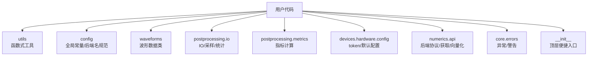
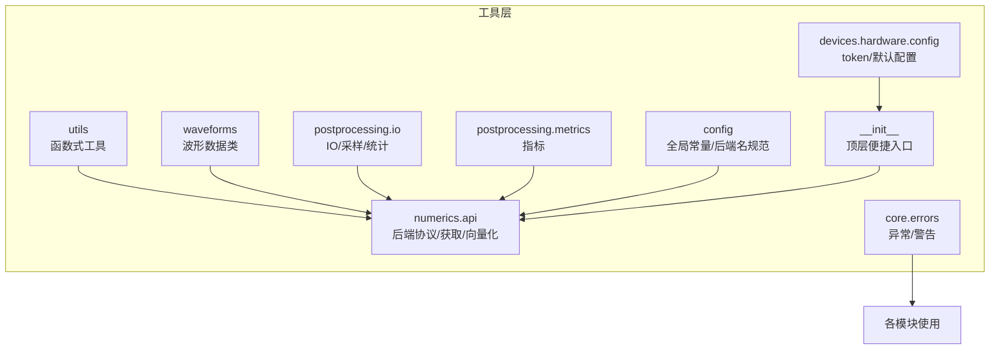
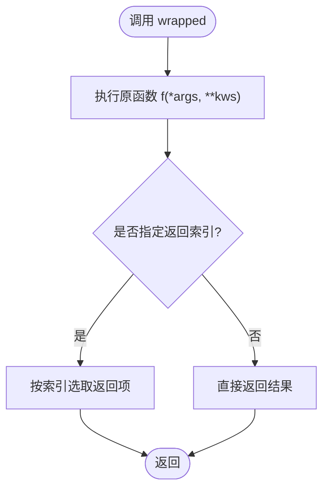
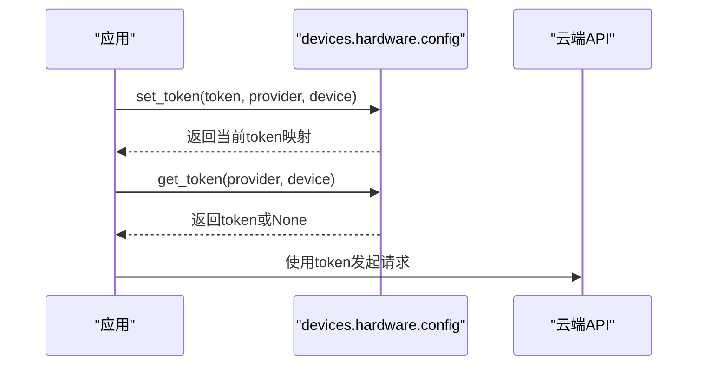
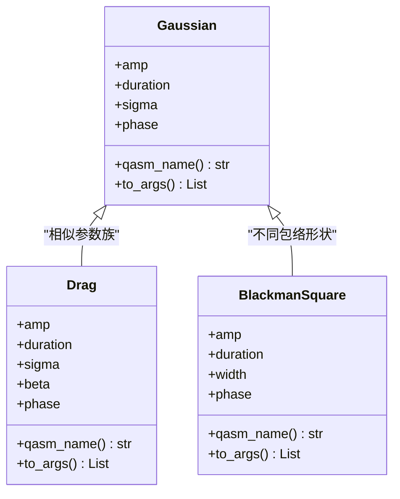
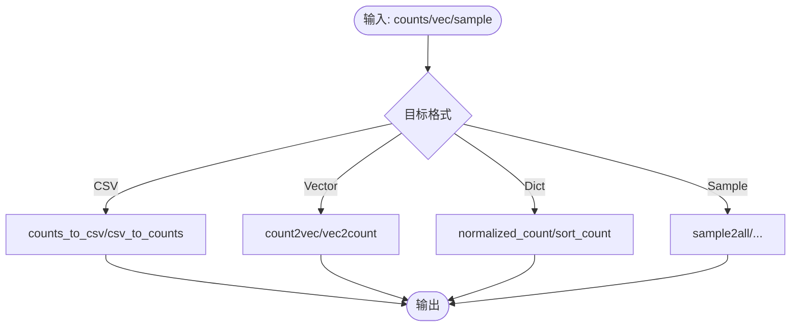
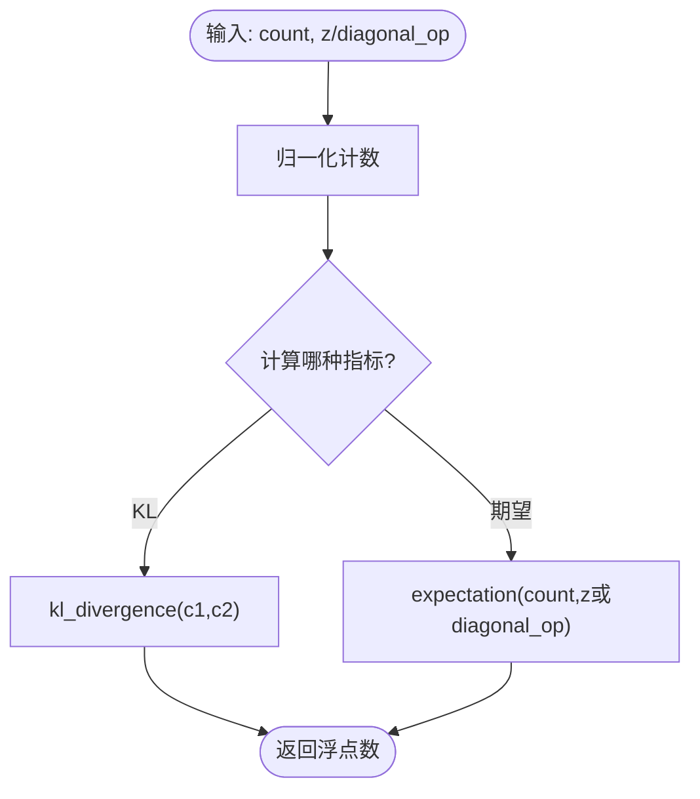
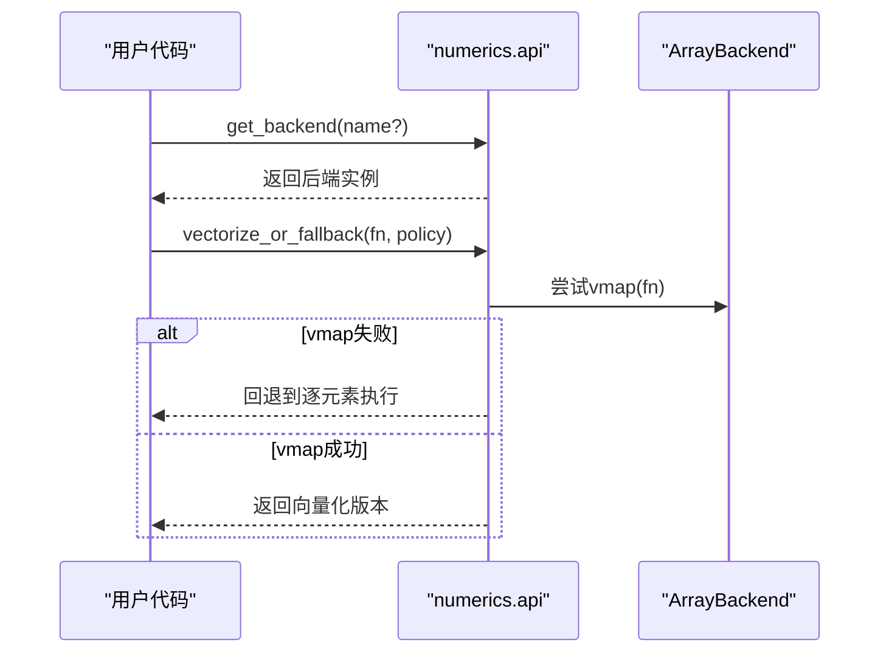
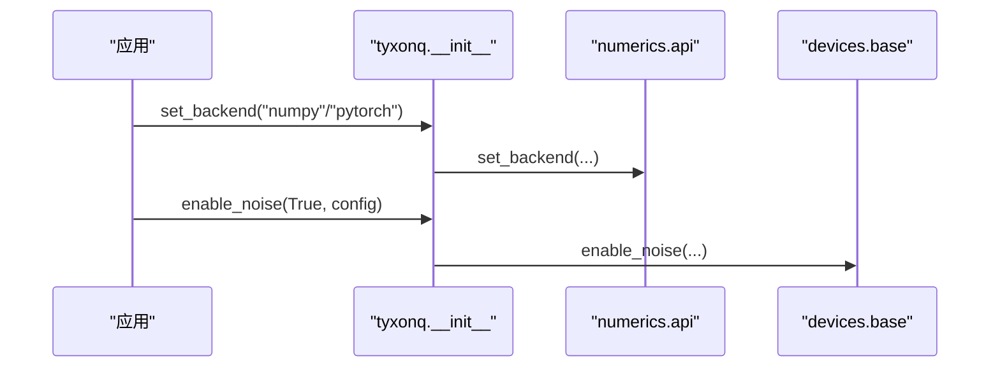
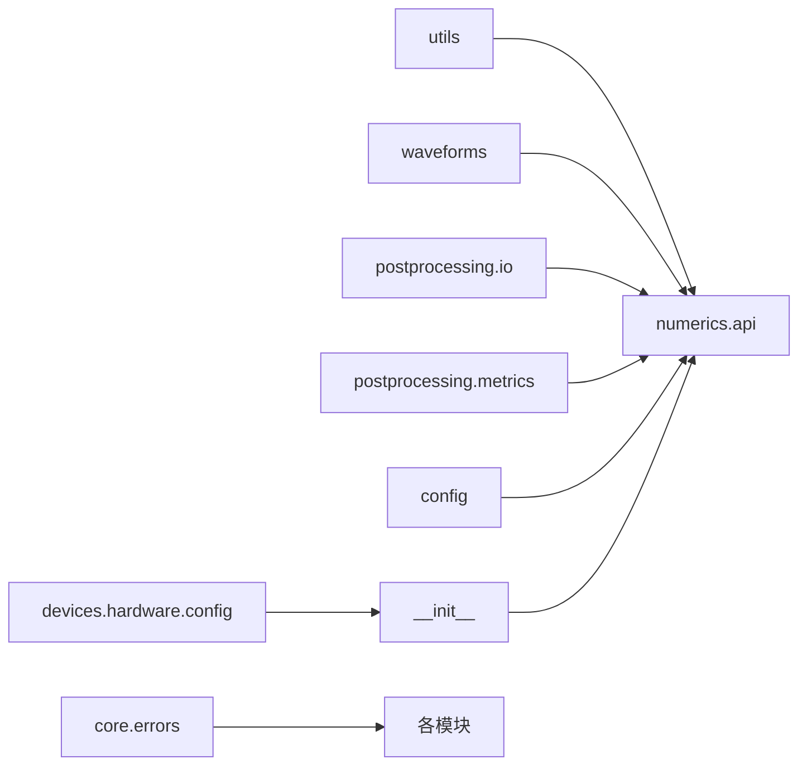

# 工具API

<cite>
**本文引用的文件**
- [src/tyxonq/utils.py](file://src/tyxonq/utils.py)
- [src/tyxonq/config.py](file://src/tyxonq/config.py)
- [src/tyxonq/waveforms.py](file://src/tyxonq/waveforms.py)
- [src/tyxonq/__init__.py](file://src/tyxonq/__init__.py)
- [src/tyxonq/postprocessing/io.py](file://src/tyxonq/postprocessing/io.py)
- [src/tyxonq/postprocessing/metrics.py](file://src/tyxonq/postprocessing/metrics.py)
- [src/tyxonq/core/errors.py](file://src/tyxonq/core/errors.py)
- [src/tyxonq/devices/hardware/config.py](file://src/tyxonq/devices/hardware/config.py)
- [src/tyxonq/numerics/api.py](file://src/tyxonq/numerics/api.py)
</cite>

## 目录
1. [简介](#简介)
2. [项目结构](#项目结构)
3. [核心组件](#核心组件)
4. [架构总览](#架构总览)
5. [详细组件分析](#详细组件分析)
6. [依赖关系分析](#依赖关系分析)
7. [性能考虑](#性能考虑)
8. [故障排查指南](#故障排查指南)
9. [结论](#结论)
10. [附录：常用组合与最佳实践](#附录：常用组合与最佳实践)

## 简介
本文件为 TyxonQ 工具模块的 API 文档，聚焦通用工具函数、配置管理、波形库、后处理 IO/指标、数值后端选择等实用能力。内容覆盖：
- 波形生成（高斯、Drag、BlackmanSquare 等）
- 配置文件管理（设备/云端 token、默认 provider/device、端点）
- 日志与错误（统一异常类型、警告）
- 数学运算与数据格式转换（计数向量/字典互转、归一化、KL 散度、期望值）
- 文件 IO（CSV 读写、稀疏/稠密表示转换）
- 设计原则、性能考量与扩展机制
- 常用工具组合模式与最佳实践

## 项目结构
TyxonQ 的工具能力分布在多个子模块中，彼此低耦合、职责清晰：
- utils：通用函数式工具（函数管道、参数别名、基准测试）
- config：全局常量、后端名规范化、默认 dtype
- waveforms：脉冲波形数据类（Gaussian、Drag、BlackmanSquare 等）
- postprocessing.io：计数与概率的 CSV/向量/字典转换、采样变换
- postprocessing.metrics：归一化、KL 散度、对角观测期望
- core.errors：统一异常与警告基类
- devices.hardware.config：云端/设备 token、默认 provider/device、端点
- numerics.api：数值后端协议、获取后端、向量化策略
- __init__：顶层便捷入口（后端设置、噪声开关、云 API 代理）

**图表来源**
- [src/tyxonq/utils.py:1-209](file://src/tyxonq/utils.py#L1-L209)
- [src/tyxonq/config.py:1-97](file://src/tyxonq/config.py#L1-L97)
- [src/tyxonq/waveforms.py:1-157](file://src/tyxonq/waveforms.py#L1-L157)
- [src/tyxonq/postprocessing/io.py:1-222](file://src/tyxonq/postprocessing/io.py#L1-L222)
- [src/tyxonq/postprocessing/metrics.py:1-94](file://src/tyxonq/postprocessing/metrics.py#L1-L94)
- [src/tyxonq/core/errors.py:1-17](file://src/tyxonq/core/errors.py#L1-L17)
- [src/tyxonq/devices/hardware/config.py:1-78](file://src/tyxonq/devices/hardware/config.py#L1-L78)
- [src/tyxonq/numerics/api.py:1-255](file://src/tyxonq/numerics/api.py#L1-L255)
- [src/tyxonq/__init__.py:1-357](file://src/tyxonq/__init__.py#L1-L357)

**章节来源**
- [src/tyxonq/utils.py:1-209](file://src/tyxonq/utils.py#L1-L209)
- [src/tyxonq/config.py:1-97](file://src/tyxonq/config.py#L1-L97)
- [src/tyxonq/waveforms.py:1-157](file://src/tyxonq/waveforms.py#L1-L157)
- [src/tyxonq/postprocessing/io.py:1-222](file://src/tyxonq/postprocessing/io.py#L1-L222)
- [src/tyxonq/postprocessing/metrics.py:1-94](file://src/tyxonq/postprocessing/metrics.py#L1-L94)
- [src/tyxonq/core/errors.py:1-17](file://src/tyxonq/core/errors.py#L1-L17)
- [src/tyxonq/devices/hardware/config.py:1-78](file://src/tyxonq/devices/hardware/config.py#L1-L78)
- [src/tyxonq/numerics/api.py:1-255](file://src/tyxonq/numerics/api.py#L1-L255)
- [src/tyxonq/__init__.py:1-357](file://src/tyxonq/__init__.py#L1-L357)

## 核心组件
- 通用工具函数（utils）：函数式管道、参数别名装饰器、基准计时、类型判断
- 配置管理（config + devices.hardware.config）：后端名规范化、默认 dtype、token/默认 provider/device 管理
- 波形库（waveforms）：多种脉冲波形数据类，提供 qasm_name 与 to_args
- 后处理 IO（postprocessing.io）：计数与概率的 CSV/向量/字典转换、采样与统计
- 后处理指标（postprocessing.metrics）：归一化、KL 散度、对角观测期望
- 数值后端（numerics.api）：统一 ArrayBackend 协议、后端获取、向量化策略
- 顶层便捷入口（__init__）：后端切换、dtype 设置、噪声控制、云 API 代理

**章节来源**
- [src/tyxonq/utils.py:1-209](file://src/tyxonq/utils.py#L1-L209)
- [src/tyxonq/config.py:1-97](file://src/tyxonq/config.py#L1-L97)
- [src/tyxonq/waveforms.py:1-157](file://src/tyxonq/waveforms.py#L1-L157)
- [src/tyxonq/postprocessing/io.py:1-222](file://src/tyxonq/postprocessing/io.py#L1-L222)
- [src/tyxonq/postprocessing/metrics.py:1-94](file://src/tyxonq/postprocessing/metrics.py#L1-L94)
- [src/tyxonq/numerics/api.py:1-255](file://src/tyxonq/numerics/api.py#L1-L255)
- [src/tyxonq/__init__.py:1-357](file://src/tyxonq/__init__.py#L1-L357)

## 架构总览
TyxonQ 工具层以“轻量、可组合”为原则，通过统一的数值后端协议与配置管理，将波形、后处理、IO、指标等能力解耦，便于在不同硬件/仿真环境中复用。

**图表来源**
- [src/tyxonq/utils.py:1-209](file://src/tyxonq/utils.py#L1-L209)
- [src/tyxonq/waveforms.py:1-157](file://src/tyxonq/waveforms.py#L1-L157)
- [src/tyxonq/postprocessing/io.py:1-222](file://src/tyxonq/postprocessing/io.py#L1-L222)
- [src/tyxonq/postprocessing/metrics.py:1-94](file://src/tyxonq/postprocessing/metrics.py#L1-L94)
- [src/tyxonq/config.py:1-97](file://src/tyxonq/config.py#L1-L97)
- [src/tyxonq/devices/hardware/config.py:1-78](file://src/tyxonq/devices/hardware/config.py#L1-L78)
- [src/tyxonq/numerics/api.py:1-255](file://src/tyxonq/numerics/api.py#L1-L255)
- [src/tyxonq/core/errors.py:1-17](file://src/tyxonq/core/errors.py#L1-L17)
- [src/tyxonq/__init__.py:1-357](file://src/tyxonq/__init__.py#L1-L357)

## 详细组件分析

### 通用工具函数（utils）
- return_partial：对函数输出按首维索引切片，支持单/多返回项
- append：函数式管道，顺序应用后续操作
- is_sequence/is_number：基础类型判断
- arg_alias：参数别名装饰器，自动更新 docstring
- benchmark：简易基准测试，统计 staging 与运行时间

**图表来源**
- [src/tyxonq/utils.py:14-60](file://src/tyxonq/utils.py#L14-L60)

**章节来源**
- [src/tyxonq/utils.py:14-209](file://src/tyxonq/utils.py#L14-L209)

### 配置管理（config + devices.hardware.config）
- config：定义包名、默认 dtype、支持的后端集合；提供后端名规范化、向量化策略校验、默认 dtype 查询
- devices.hardware.config：管理 token（内存缓存）、默认 provider/device、云端端点

**图表来源**
- [src/tyxonq/devices/hardware/config.py:24-50](file://src/tyxonq/devices/hardware/config.py#L24-L50)

**章节来源**
- [src/tyxonq/config.py:17-97](file://src/tyxonq/config.py#L17-L97)
- [src/tyxonq/devices/hardware/config.py:1-78](file://src/tyxonq/devices/hardware/config.py#L1-L78)

### 波形库（waveforms）
- 数据类：Gaussian、GaussianSquare、Drag、Constant、Sine、Cosine、CosineDrag、Flattop、Hermite、BlackmanSquare
- 每个波形提供 qasm_name() 与 to_args()，便于序列化与编译器消费

**图表来源**
- [src/tyxonq/waveforms.py:19-157](file://src/tyxonq/waveforms.py#L19-L157)

**章节来源**
- [src/tyxonq/waveforms.py:1-157](file://src/tyxonq/waveforms.py#L1-L157)

### 后处理 IO（postprocessing.io）
- CSV 读写：counts_to_csv / csv_to_counts
- 计数处理：reverse_count、sort_count、normalized_count
- 向量/字典转换：count2vec、vec2count
- 采样转换：sample_int2bin、sample_bin2int、sample2count、sample2all
- 统计：correlation_from_samples/correlation_from_counts

**图表来源**
- [src/tyxonq/postprocessing/io.py:9-190](file://src/tyxonq/postprocessing/io.py#L9-L190)

**章节来源**
- [src/tyxonq/postprocessing/io.py:1-222](file://src/tyxonq/postprocessing/io.py#L1-L222)

### 后处理指标（postprocessing.metrics）
- normalized_count：将计数归一化为概率分布
- kl_divergence：计算两个分布的 KL 散度
- expectation：基于比特串计数计算对角观测期望

**图表来源**
- [src/tyxonq/postprocessing/metrics.py:20-84](file://src/tyxonq/postprocessing/metrics.py#L20-L84)

**章节来源**
- [src/tyxonq/postprocessing/metrics.py:1-94](file://src/tyxonq/postprocessing/metrics.py#L1-L94)

### 数值后端与向量化（numerics.api）
- ArrayBackend 协议：统一数组创建、代数、随机、线性代数、可选 vmap
- get_backend：按名称获取后端实例，支持 numpy/pytorch/cupynumeric
- vectorize_or_fallback：根据策略启用 vmap 或回退到逐元素执行

**图表来源**
- [src/tyxonq/numerics/api.py:19-176](file://src/tyxonq/numerics/api.py#L19-L176)
- [src/tyxonq/numerics/api.py:179-255](file://src/tyxonq/numerics/api.py#L179-L255)

**章节来源**
- [src/tyxonq/numerics/api.py:1-255](file://src/tyxonq/numerics/api.py#L1-L255)

### 顶层便捷入口（__init__）
- 后端设置：set_backend/get_backend/set_dtype
- 噪声控制：enable_noise/is_noise_enabled/get_noise_config
- 云 API 代理：set_token/submit_task/run（当 cloud 可用时）

**图表来源**
- [src/tyxonq/__init__.py:186-276](file://src/tyxonq/__init__.py#L186-L276)
- [src/tyxonq/__init__.py:335-357](file://src/tyxonq/__init__.py#L335-L357)

**章节来源**
- [src/tyxonq/__init__.py:1-357](file://src/tyxonq/__init__.py#L1-L357)

## 依赖关系分析
- 低耦合：各工具模块仅通过轻量接口交互，避免循环依赖
- 可扩展：ArrayBackend 协议允许新增后端；波形数据类易于扩展新包络
- 容错：向量化失败自动回退；token/配置读取失败有安全降级

**图表来源**
- [src/tyxonq/utils.py:1-209](file://src/tyxonq/utils.py#L1-L209)
- [src/tyxonq/waveforms.py:1-157](file://src/tyxonq/waveforms.py#L1-L157)
- [src/tyxonq/postprocessing/io.py:1-222](file://src/tyxonq/postprocessing/io.py#L1-L222)
- [src/tyxonq/postprocessing/metrics.py:1-94](file://src/tyxonq/postprocessing/metrics.py#L1-L94)
- [src/tyxonq/config.py:1-97](file://src/tyxonq/config.py#L1-L97)
- [src/tyxonq/devices/hardware/config.py:1-78](file://src/tyxonq/devices/hardware/config.py#L1-L78)
- [src/tyxonq/numerics/api.py:1-255](file://src/tyxonq/numerics/api.py#L1-L255)
- [src/tyxonq/core/errors.py:1-17](file://src/tyxonq/core/errors.py#L1-L17)
- [src/tyxonq/__init__.py:1-357](file://src/tyxonq/__init__.py#L1-L357)

**章节来源**
- [src/tyxonq/numerics/api.py:19-176](file://src/tyxonq/numerics/api.py#L19-L176)
- [src/tyxonq/config.py:50-75](file://src/tyxonq/config.py#L50-L75)
- [src/tyxonq/devices/hardware/config.py:24-50](file://src/tyxonq/devices/hardware/config.py#L24-L50)

## 性能考虑
- 向量化策略：优先使用后端 vmap；不可用时回退到逐元素执行，保证稳定性
- 数据类型：默认 complex64/float32 降低内存占用；可按需切换 dtype
- 计数处理：稀疏表示（indices, counts）减少大空间存储开销
- 基准测试：utils.benchmark 提供简单计时，辅助定位热点

[本节为通用指导，不直接分析具体文件]

## 故障排查指南
- 统一异常：
  - TyxonQError：基础异常
  - CompilationError：编译失败
  - DeviceExecutionError：设备执行失败
  - VectorizationFallbackWarning：向量化禁用或回退警告
- 常见错误场景：
  - 后端不可用：get_backend 抛出运行时错误，建议捕获并回退到 numpy
  - 向量化失败：vectorize_or_fallback 自动回退，检查函数签名与输入形状
  - 配置缺失：get_token 返回 None，检查环境变量或调用 set_token
  - CSV 头不匹配：csv_to_counts 抛出 ValueError，确认文件格式

**章节来源**
- [src/tyxonq/core/errors.py:1-17](file://src/tyxonq/core/errors.py#L1-L17)
- [src/tyxonq/numerics/api.py:179-255](file://src/tyxonq/numerics/api.py#L179-L255)
- [src/tyxonq/postprocessing/io.py:16-24](file://src/tyxonq/postprocessing/io.py#L16-L24)
- [src/tyxonq/devices/hardware/config.py:24-50](file://src/tyxonq/devices/hardware/config.py#L24-L50)

## 结论
TyxonQ 工具模块以清晰的职责划分与统一协议为核心，提供了从波形生成、配置管理到后处理 IO/指标的完整工具链。通过数值后端抽象与向量化策略，兼顾了性能与鲁棒性；通过轻量配置与错误处理，提升了易用性与可维护性。推荐在项目中组合使用这些工具，形成稳定高效的量子计算工作流。

[本节为总结，不直接分析具体文件]

## 附录：常用组合与最佳实践
- 波形+后处理：构造波形 → 编译/执行 → 获取计数 → 归一化/可视化
  - 参考路径：[waveforms.py:19-157](file://src/tyxonq/waveforms.py#L19-L157)、[postprocessing.io:9-190](file://src/tyxonq/postprocessing/io.py#L9-L190)、[postprocessing.metrics:20-84](file://src/tyxonq/postprocessing/metrics.py#L20-L84)
- 配置+云端：设置 token → 提交任务 → 获取结果
  - 参考路径：[devices.hardware.config:24-50](file://src/tyxonq/devices/hardware/config.py#L24-L50)、[__init__:46-118](file://src/tyxonq/__init__.py#L46-L118)
- 数值后端：选择后端 → 设置 dtype → 使用统一 API
  - 参考路径：[__init__:186-276](file://src/tyxonq/__init__.py#L186-L276)、[numerics.api:179-255](file://src/tyxonq/numerics/api.py#L179-L255)
- 函数式管道：append 串联数据处理步骤，提升可读性
  - 参考路径：[utils.append:63-88](file://src/tyxonq/utils.py#L63-L88)

[本节为实践建议，不直接分析具体文件]