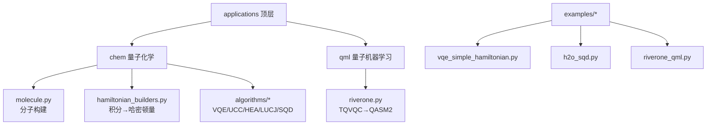
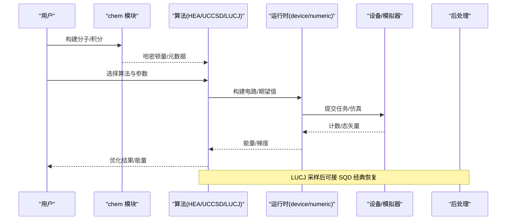
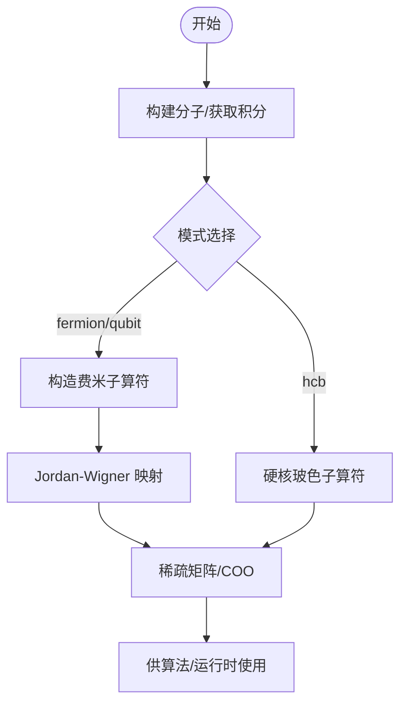
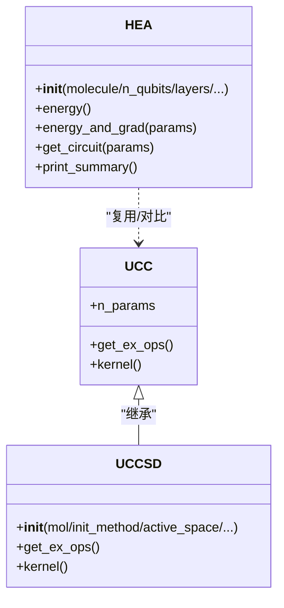
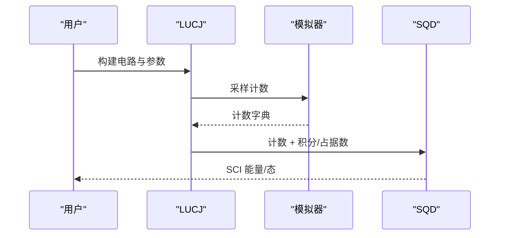
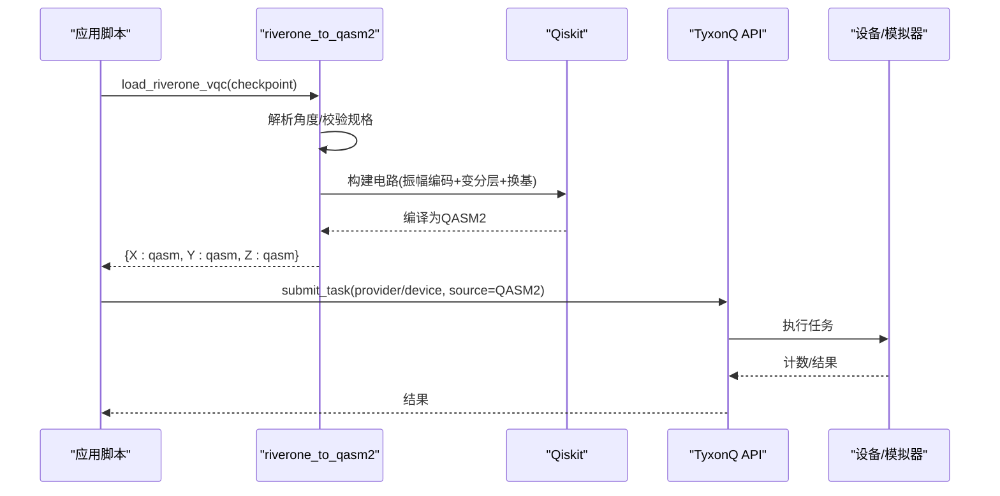
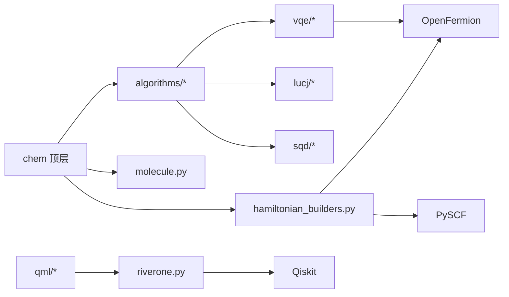

# 应用API

<cite>
**本文引用的文件**
- [applications/__init__.py](file://src/tyxonq/applications/__init__.py)
- [chem/__init__.py](file://src/tyxonq/applications/chem/__init__.py)
- [qml/__init__.py](file://src/tyxonq/applications/qml/__init__.py)
- [qml/riverone.py](file://src/tyxonq/applications/qml/riverone.py)
- [chem/molecule.py](file://src/tyxonq/applications/chem/molecule.py)
- [chem/hamiltonian_builders.py](file://src/tyxonq/applications/chem/hamiltonian_builders.py)
- [algorithms/__init__.py](file://src/tyxonq/applications/chem/algorithms/__init__.py)
- [vqe/__init__.py](file://src/tyxonq/applications/chem/algorithms/vqe/__init__.py)
- [vqe/uccsd.py](file://src/tyxonq/applications/chem/algorithms/vqe/uccsd.py)
- [vqe/hea.py](file://src/tyxonq/applications/chem/algorithms/vqe/hea.py)
- [lucj/__init__.py](file://src/tyxonq/applications/chem/algorithms/lucj/__init__.py)
- [sqd/__init__.py](file://src/tyxonq/applications/chem/algorithms/sqd/__init__.py)
- [examples/riverone_qml.py](file://examples/riverone_qml.py)
- [examples/vqe_simple_hamiltonian.py](file://examples/vqe_simple_hamiltonian.py)
- [examples/h2o_sqd.py](file://examples/h2o_sqd.py)
</cite>

## 目录
1. [简介](#简介)
2. [项目结构](#项目结构)
3. [核心组件](#核心组件)
4. [架构总览](#架构总览)
5. [详细组件分析](#详细组件分析)
6. [依赖关系分析](#依赖关系分析)
7. [性能考量](#性能考量)
8. [故障排查指南](#故障排查指南)
9. [结论](#结论)
10. [附录：配置与参数速查](#附录：配置与参数速查)

## 简介
本文件面向 TyxonQ 应用层 API，聚焦量子化学与量子机器学习两大方向：
- 量子化学：分子构建、哈密顿量计算、VQE（含 UCCSD、HEA）、LUCJ 采样与 SQD 经典后处理等。
- 量子机器学习：RiverONE 训练后的 TQVQC checkpoint 加载、振幅编码与 X/Y/Z 测量基 QASM2 生成，并可直接提交到模拟器或云端设备执行。

文档提供完整的接口说明、配置选项、算法选择策略、性能特征与适用场景，并给出与底层核心 API（电路、数值后端、设备驱动）的集成方式与数据格式转换要点。

## 项目结构
应用层位于 src/tyxonq/applications，顶层包暴露 chem 与 qml 两个子模块；chem 进一步包含算法（VQE/UCC/HEA/LUCJ/SQD）、分子与哈密顿量工具；qml 提供 RiverONE 适配。示例集中在 examples 目录，便于端到端验证。

图表来源
- [applications/__init__.py:1-16](file://src/tyxonq/applications/__init__.py#L1-L16)
- [chem/__init__.py:1-103](file://src/tyxonq/applications/chem/__init__.py#L1-L103)
- [qml/__init__.py:1-14](file://src/tyxonq/applications/qml/__init__.py#L1-L14)

章节来源
- [applications/__init__.py:1-16](file://src/tyxonq/applications/__init__.py#L1-L16)
- [chem/__init__.py:1-103](file://src/tyxonq/applications/chem/__init__.py#L1-L103)
- [qml/__init__.py:1-14](file://src/tyxonq/applications/qml/__init__.py#L1-L14)

## 核心组件
- 量子化学
  - 分子构建：基于 PySCF 的 Mole 封装与常用分子模板（Hn、H2O、NH3、CH4、C2H2、苯等）。
  - 哈密顿量：从 HF/CASCI 积分构造费米子算符、自旋轨道表示、Jordan-Wigner 映射为泡利和，支持稀疏矩阵/MPO/FCI 函数形式。
  - VQE 族：UCC（基类）、UCCSD、KUPCCGSD、PUCCD、HEA；统一通过 device/numeric 运行时执行。
  - 采样与经典后处理：LUCJ 线路构建与参数初始化（可基于 CCSD），SQD 对采样结果做 Selected CI 恢复。
- 量子机器学习
  - RiverONE 适配器：加载 TQVQC checkpoint，解析变分门角度，按 re-upload 语义裁剪活跃层，生成 X/Y/Z 三基 QASM2，支持本地模拟与云端任务提交。

章节来源
- [chem/molecule.py:1-311](file://src/tyxonq/applications/chem/molecule.py#L1-L311)
- [chem/hamiltonian_builders.py:1-320](file://src/tyxonq/applications/chem/hamiltonian_builders.py#L1-L320)
- [algorithms/__init__.py:1-20](file://src/tyxonq/applications/chem/algorithms/__init__.py#L1-L20)
- [vqe/__init__.py:1-49](file://src/tyxonq/applications/chem/algorithms/vqe/__init__.py#L1-L49)
- [vqe/uccsd.py:1-200](file://src/tyxonq/applications/chem/algorithms/vqe/uccsd.py#L1-L200)
- [vqe/hea.py:1-200](file://src/tyxonq/applications/chem/algorithms/vqe/hea.py#L1-L200)
- [lucj/__init__.py:1-31](file://src/tyxonq/applications/chem/algorithms/lucj/__init__.py#L1-L31)
- [sqd/__init__.py:1-45](file://src/tyxonq/applications/chem/algorithms/sqd/__init__.py#L1-L45)
- [qml/riverone.py:1-316](file://src/tyxonq/applications/qml/riverone.py#L1-L316)

## 架构总览
应用层以“问题建模—算法求解—运行执行”为主线：
- 问题建模：PySCF 分子与积分 → 费米子/泡利哈密顿量。
- 算法求解：UCCSD/HEA 等变分方法，或 LUCJ+SQD 采样恢复。
- 运行执行：device 运行时（真实设备/云）或 numeric 运行时（状态向量/张量库）。
- QML：RiverONE checkpoint → QASM2 → 提交任务 → 读取计数统计。

图表来源
- [chem/hamiltonian_builders.py:46-163](file://src/tyxonq/applications/chem/hamiltonian_builders.py#L46-L163)
- [vqe/hea.py:125-200](file://src/tyxonq/applications/chem/algorithms/vqe/hea.py#L125-L200)
- [vqe/uccsd.py:155-200](file://src/tyxonq/applications/chem/algorithms/vqe/uccsd.py#L155-L200)
- [lucj/__init__.py:1-31](file://src/tyxonq/applications/chem/algorithms/lucj/__init__.py#L1-L31)
- [sqd/__init__.py:1-45](file://src/tyxonq/applications/chem/algorithms/sqd/__init__.py#L1-L45)

## 详细组件分析

### 量子化学：分子与哈密顿量
- 分子构建
  - 提供 Hn 链、环、正方形、立方体以及 H2O、NH3、BH3、N2、CO、CH4、HCN、C2H2、甲醛、苯、茚等常见分子模板。
  - 自定义随机分子用于基准测试。
- 哈密顿量
  - 从 RHF/CASCI 提取有效单双电子积分，构造费米子算符，再映射为泡利算符（Jordan-Wigner）。
  - 输出支持稀疏矩阵、MPO-like 对象、FCI 作用函数，便于不同后端使用。
  - 提供 apply_op 统一接口，兼容稀疏/稠密/可调用/eval_matrix 对象。

图表来源
- [chem/hamiltonian_builders.py:46-163](file://src/tyxonq/applications/chem/hamiltonian_builders.py#L46-L163)
- [chem/hamiltonian_builders.py:283-320](file://src/tyxonq/applications/chem/hamiltonian_builders.py#L283-L320)

章节来源
- [chem/molecule.py:80-268](file://src/tyxonq/applications/chem/molecule.py#L80-L268)
- [chem/hamiltonian_builders.py:46-163](file://src/tyxonq/applications/chem/hamiltonian_builders.py#L46-L163)
- [chem/hamiltonian_builders.py:283-320](file://src/tyxonq/applications/chem/hamiltonian_builders.py#L283-L320)

### VQE 算法族：UCCSD、HEA
- UCCSD
  - 基于单位化耦合簇单双激发的变分波函数，支持 MP2/CCSD/FE/Zeros 初始猜测、活性空间、幅度筛选与排序。
  - 默认 device 运行时，可选 numeric 后端；可与 HEA 对比或组合使用。
- HEA
  - 硬件高效 Ansatz：RY 旋转 + CNOT 链交替层；支持直接传入分子/原子坐标自动构建哈密顿量与电路。
  - 提供 energy/energy_and_grad/get_circuit/print_summary 等方法，便于分析与可视化。

图表来源
- [vqe/uccsd.py:18-154](file://src/tyxonq/applications/chem/algorithms/vqe/uccsd.py#L18-L154)
- [vqe/hea.py:28-124](file://src/tyxonq/applications/chem/algorithms/vqe/hea.py#L28-L124)

章节来源
- [vqe/uccsd.py:155-200](file://src/tyxonq/applications/chem/algorithms/vqe/uccsd.py#L155-L200)
- [vqe/hea.py:125-200](file://src/tyxonq/applications/chem/algorithms/vqe/hea.py#L125-L200)
- [vqe/__init__.py:1-49](file://src/tyxonq/applications/chem/algorithms/vqe/__init__.py#L1-L49)

### 采样与恢复：LUCJ + SQD
- LUCJ
  - 提供电路构建、参数计数/形状/归一化、拓扑配对与 Givens 调度，支持从 CCSD 初始化参数。
- SQD
  - 对 LUCJ 采样结果进行 Selected CI 恢复，返回 SCIResult/SCIState，支持批量求解与 PySCF 求解器对接。
- 典型流程
  - 用 LUCJ 生成近似态并采样 → 位串反转/归一化 → SQD 经典对角化得到更精确能量。

图表来源
- [lucj/__init__.py:1-31](file://src/tyxonq/applications/chem/algorithms/lucj/__init__.py#L1-L31)
- [sqd/__init__.py:1-45](file://src/tyxonq/applications/chem/algorithms/sqd/__init__.py#L1-L45)
- [examples/h2o_sqd.py:262-336](file://examples/h2o_sqd.py#L262-L336)

章节来源
- [examples/h2o_sqd.py:83-159](file://examples/h2o_sqd.py#L83-L159)
- [examples/h2o_sqd.py:204-255](file://examples/h2o_sqd.py#L204-L255)
- [examples/h2o_sqd.py:262-336](file://examples/h2o_sqd.py#L262-L336)

### 量子机器学习：RiverONE TQVQC 适配
- 功能
  - 加载 TQVQC checkpoint，解析每层每比特 RX/RY/RZ 角度，按 re-upload 语义裁剪活跃层。
  - 将振幅编码为初态，附加变分层，并在 X/Y/Z 基下生成 OpenQASM 2。
  - 支持本地 statevector 模拟或云端设备批量提交任务。
- 关键数据结构
  - RiverONEVQCSpec：保存 n_qubits、n_layers、angles、reupload_every，并进行严格校验。
- 典型流程
  - 加载 checkpoint → 生成三份 QASM2 → 提交任务 → 读取 counts → 计算期望值。

图表来源
- [qml/riverone.py:33-78](file://src/tyxonq/applications/qml/riverone.py#L33-L78)
- [qml/riverone.py:152-188](file://src/tyxonq/applications/qml/riverone.py#L152-L188)
- [qml/riverone.py:277-308](file://src/tyxonq/applications/qml/riverone.py#L277-L308)
- [examples/riverone_qml.py:127-195](file://examples/riverone_qml.py#L127-L195)

章节来源
- [qml/__init__.py:1-14](file://src/tyxonq/applications/qml/__init__.py#L1-L14)
- [qml/riverone.py:1-316](file://src/tyxonq/applications/qml/riverone.py#L1-L316)
- [examples/riverone_qml.py:1-200](file://examples/riverone_qml.py#L1-L200)

### 示例与用法
- VQE 自定义哈密顿量示例：展示 TFIM 模型、硬件高效 Ansatz、自动微分与收敛跟踪。
- H2O LUCJ+SQD 示例：从 CAS/FCI/CCSD 准备活性空间数据，LUCJ 采样后 SQD 恢复。
- RiverONE QML 示例：加载 checkpoint，生成 X/Y/Z 的 QASM2，在模拟器或云端执行。

章节来源
- [examples/vqe_simple_hamiltonian.py:53-153](file://examples/vqe_simple_hamiltonian.py#L53-L153)
- [examples/vqe_simple_hamiltonian.py:157-255](file://examples/vqe_simple_hamiltonian.py#L157-L255)
- [examples/h2o_sqd.py:125-159](file://examples/h2o_sqd.py#L125-L159)
- [examples/h2o_sqd.py:262-336](file://examples/h2o_sqd.py#L262-L336)
- [examples/riverone_qml.py:127-195](file://examples/riverone_qml.py#L127-L195)

## 依赖关系分析
- 模块耦合
  - chem 顶层聚合算法与工具，保持向后兼容的静态导出。
  - algorithms 内部通过 try/except 优雅降级导入，保证最小依赖环境可用。
  - vqe 子包集中管理 UCC/HEA 及其运行时；lucj/sqd 作为并行采样路径。
  - qml 独立于 chem，仅依赖 Qiskit 与 Torch 加载 checkpoint。
- 外部依赖
  - PySCF：分子与积分、CASCI/FCI/CCSD。
  - OpenFermion：费米子/泡利算符与变换。
  - Qiskit：QASM2 生成与基础门分解。
  - NumPy/SciPy：数值与优化。

图表来源
- [chem/__init__.py:1-103](file://src/tyxonq/applications/chem/__init__.py#L1-L103)
- [algorithms/__init__.py:1-20](file://src/tyxonq/applications/chem/algorithms/__init__.py#L1-L20)
- [vqe/__init__.py:1-49](file://src/tyxonq/applications/chem/algorithms/vqe/__init__.py#L1-L49)
- [qml/riverone.py:1-316](file://src/tyxonq/applications/qml/riverone.py#L1-L316)

章节来源
- [chem/__init__.py:1-103](file://src/tyxonq/applications/chem/__init__.py#L1-L103)
- [algorithms/__init__.py:1-20](file://src/tyxonq/applications/chem/algorithms/__init__.py#L1-L20)
- [vqe/__init__.py:1-49](file://src/tyxonq/applications/chem/algorithms/vqe/__init__.py#L1-L49)
- [qml/riverone.py:1-316](file://src/tyxonq/applications/qml/riverone.py#L1-L316)

## 性能考量
- 算法选择
  - UCCSD：物理先验强、参数相对少，适合中小体系与活性空间；幅度筛选可降低开销。
  - HEA：硬件友好、易于实现，但可能面临 barren plateau；适合 NISQ 设备快速原型。
  - LUCJ+SQD：采样成本低，结合经典 Selected CI 提升精度，适合中等规模活性空间。
- 运行时
  - device 运行时：考虑 shots 噪声、连通性限制与编译开销；建议合理批量化任务。
  - numeric 运行时：状态向量精确但内存随 2^n 增长；大系统慎用。
- 哈密顿量表示
  - 稀疏矩阵/FCI 函数可减少存储；MPO-like 包装便于测试与统一接口。
- 后处理
  - 计数统计需按 q0-first 位序处理；X/Y 基通过换基门获得期望值。

[本节为通用指导，不直接分析具体文件]

## 故障排查指南
- RiverONE checkpoint 加载失败
  - 检查 checkpoint 路径、state 字段与 vqc_index 是否存在。
  - 确保 angles 维度与 n_qubits/n_layers 一致，且角度有限。
- QASM2 生成异常
  - 确认 Qiskit 基础门集合允许；若出现非允许操作，调整 transpile 设置。
  - 检查 amplitudes 是否为一维且非零范数。
- VQE 不收敛或梯度异常
  - 检查 Ansatz 深度与参数初始化；尝试切换 optimizer 或启用梯度截断。
  - 对于 device 运行，适当增加 shots 或使用误差缓解。
- LUCJ+SQD 能量异常
  - 核对采样计数位串顺序（半区反转）；检查初始占据数与对称化开关。
  - 控制 depolarizing 噪声强度与采样批次大小。

章节来源
- [qml/riverone.py:80-96](file://src/tyxonq/applications/qml/riverone.py#L80-L96)
- [qml/riverone.py:191-219](file://src/tyxonq/applications/qml/riverone.py#L191-L219)
- [qml/riverone.py:277-308](file://src/tyxonq/applications/qml/riverone.py#L277-L308)
- [examples/h2o_sqd.py:215-242](file://examples/h2o_sqd.py#L215-L242)
- [examples/h2o_sqd.py:294-315](file://examples/h2o_sqd.py#L294-L315)

## 结论
TyxonQ 应用层 API 提供了从分子建模到变分算法、从采样恢复到 QML 部署的完整链路。通过模块化设计与统一的运行时抽象，用户可在模拟器与真实设备上无缝切换，并根据问题规模与资源约束选择合适的算法与参数。建议在工程实践中：
- 小体系优先 UCCSD，配合活性空间与幅度筛选。
- NISQ 设备优先 HEA，关注 Ansatz 深度与梯度稳定性。
- 中等体系可采用 LUCJ+SQD 平衡成本与精度。
- QML 场景利用 RiverONE 适配器快速生成可执行 QASM2 并提交任务。

[本节为总结，不直接分析具体文件]

## 附录：配置与参数速查
- 分子与积分
  - 分子模板：Hn、H2O、NH3、CH4、C2H2、苯等；可通过 molecule.py 中的工厂函数创建。
  - 积分提取：get_integral_from_hf 支持 active_space 与 active_orbital_indices。
- 哈密顿量
  - get_h_from_integral(mode="fermion"/"qubit"/"hcb", htype="sparse"/"mpo"/"fcifunc")。
  - apply_op 兼容稀疏/稠密/可调用/eval_matrix。
- VQE
  - UCCSD：init_method("mp2"/"ccsd"/"fe"/"zeros")、active_space、epsilon、sort_ex2、runtime("device"/"numeric")。
  - HEA：layers、mapping("parity"/"jordan-wigner"/"bravyi-kitaev")、atom/basis/unit/charge/spin。
- LUCJ+SQD
  - initialize_lucj_parameters_from_ccsd(t2/t1, n_layers, topology, optimize)。
  - run_sqd_fermion(norb, nelec, samples_per_batch, num_batches, max_iterations, max_dim, initial_occupancies)。
- RiverONE
  - load_riverone_vqc(checkpoint_path, vqc_index)。
  - riverone_to_qasm2(spec, amplitudes) → {X:qasm, Y:qasm, Z:qasm}。
  - 提交任务：tq.api.submit_task(provider="simulator"/"tyxonq", device, source, shots)。

章节来源
- [chem/molecule.py:80-268](file://src/tyxonq/applications/chem/molecule.py#L80-L268)
- [chem/hamiltonian_builders.py:46-163](file://src/tyxonq/applications/chem/hamiltonian_builders.py#L46-L163)
- [chem/hamiltonian_builders.py:283-320](file://src/tyxonq/applications/chem/hamiltonian_builders.py#L283-L320)
- [vqe/uccsd.py:155-200](file://src/tyxonq/applications/chem/algorithms/vqe/uccsd.py#L155-L200)
- [vqe/hea.py:125-200](file://src/tyxonq/applications/chem/algorithms/vqe/hea.py#L125-L200)
- [examples/h2o_sqd.py:262-336](file://examples/h2o_sqd.py#L262-L336)
- [qml/riverone.py:152-188](file://src/tyxonq/applications/qml/riverone.py#L152-L188)
- [qml/riverone.py:277-308](file://src/tyxonq/applications/qml/riverone.py#L277-L308)
- [examples/riverone_qml.py:127-195](file://examples/riverone_qml.py#L127-L195)