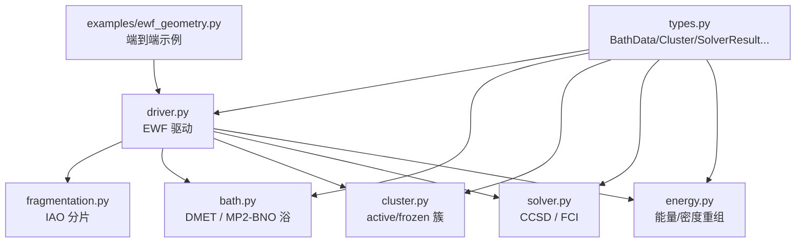
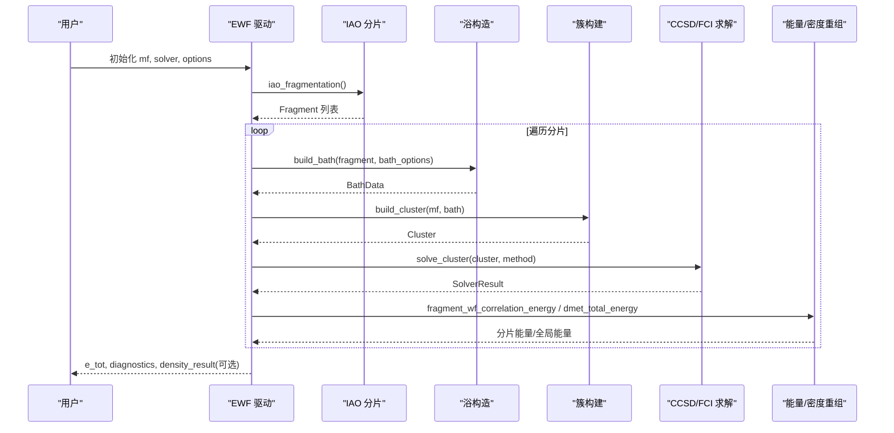
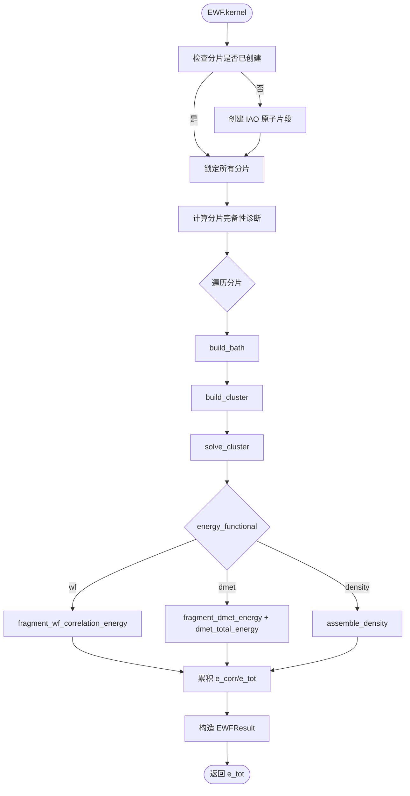
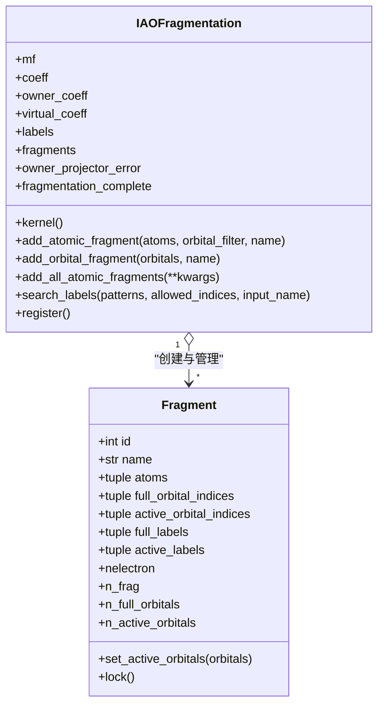
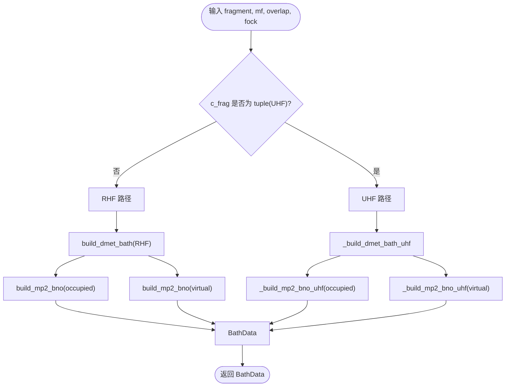
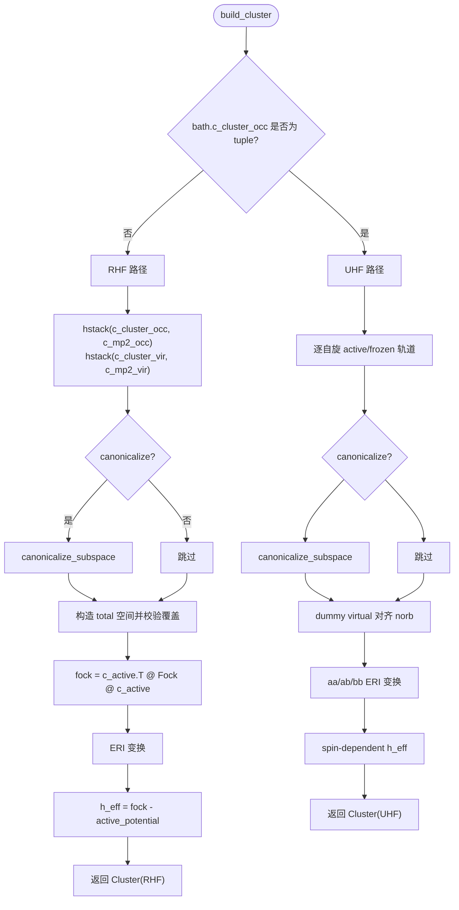
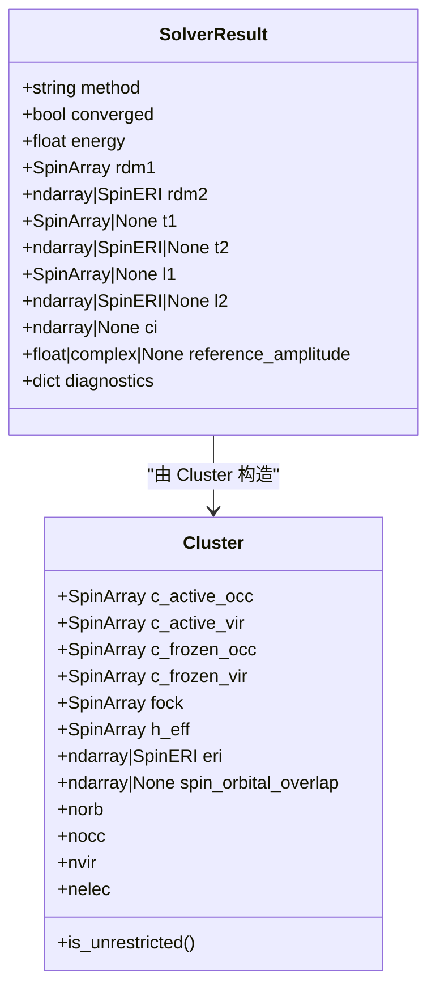
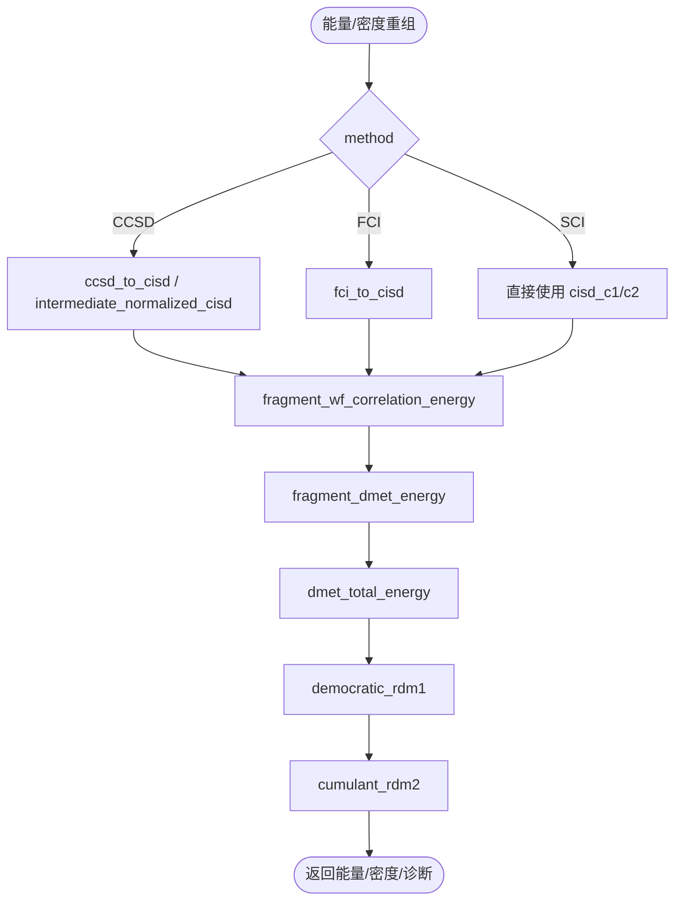
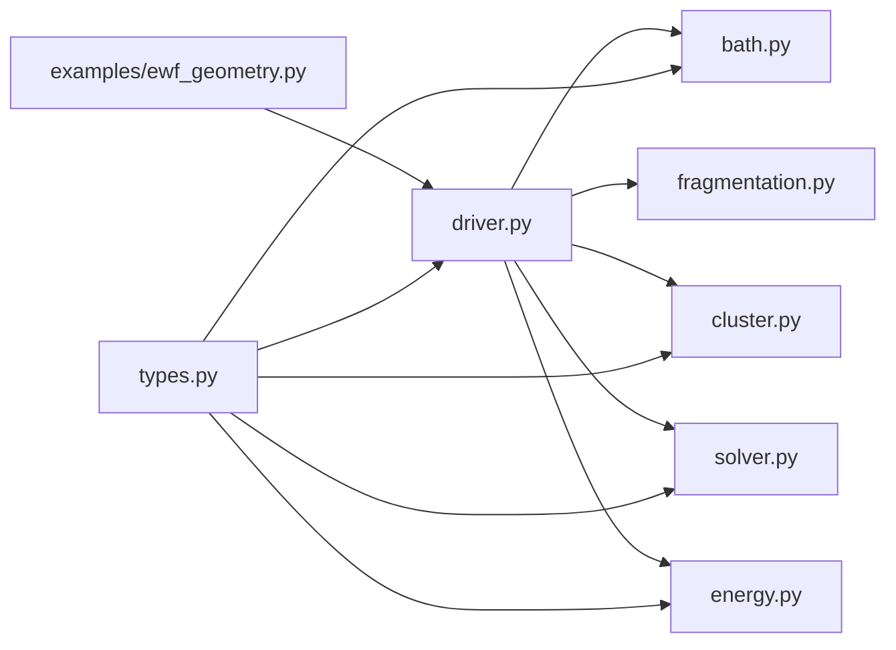
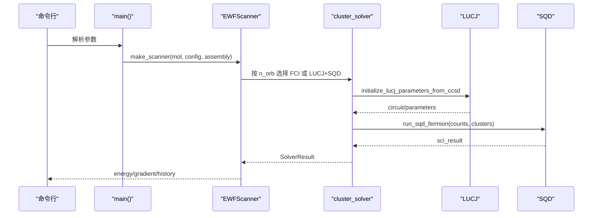

# EWF扩展波函数理论算法

<cite>
**本文引用的文件**   
- [driver.py](file://src/tyxonq/applications/chem/algorithms/ewf/driver.py)
- [types.py](file://src/tyxonq/applications/chem/algorithms/ewf/types.py)
- [bath.py](file://src/tyxonq/applications/chem/algorithms/ewf/bath.py)
- [cluster.py](file://src/tyxonq/applications/chem/algorithms/ewf/cluster.py)
- [solver.py](file://src/tyxonq/applications/chem/algorithms/ewf/solver.py)
- [energy.py](file://src/tyxonq/applications/chem/algorithms/ewf/energy.py)
- [fragmentation.py](file://src/tyxonq/applications/chem/algorithms/ewf/fragmentation.py)
- [__init__.py](file://src/tyxonq/applications/chem/algorithms/ewf/__init__.py)
- [ewf_geometry.py](file://examples/ewf_geometry.py)
</cite>

## 目录
1. [引言](#引言)
2. [项目结构](#项目结构)
3. [核心组件](#核心组件)
4. [架构总览](#架构总览)
5. [详细组件分析](#详细组件分析)
6. [依赖关系分析](#依赖关系分析)
7. [性能与复杂度](#性能与复杂度)
8. [故障排查指南](#故障排查指南)
9. [结论](#结论)
10. [附录：典型使用流程](#附录典型使用流程)

## 引言
本文件系统性梳理 TyxonQ 中“扩展波函数理论（EWF）”在分子 RHF/UHF 嵌入计算中的实现。该模块以 IAO 原子片段为空间划分基础，构造 DMET 浴与 MP2-BNO 浴，生成 active/frozen 簇轨道与有效 Hamiltonian，并调用 CCSD 或 FCI 求解器得到密度矩阵、振幅及能量；最终通过 wavefunction 投影、DMET 能量重组或全局密度组装给出分子总能量，并在密度模式下提供冻结浴近似的核梯度接口。

## 项目结构
EWF 相关代码位于 `src/tyxonq/applications/chem/algorithms/ewf`，主要按职责拆分：
- 驱动与数据模型：`driver.py`、`types.py`
- 分片与轨道归属：`fragmentation.py`
- 浴构造：`bath.py`
- 簇构建与积分变换：`cluster.py`
- 簇求解器封装：`solver.py`
- 能量与密度重组：`energy.py`
- 对外导出：`__init__.py`
- 示例工作流：`examples/ewf_geometry.py`

**图表来源**
- [driver.py:151-412](file://src/tyxonq/applications/chem/algorithms/ewf/driver.py#L151-L412)
- [fragmentation.py:246-400](file://src/tyxonq/applications/chem/algorithms/ewf/fragmentation.py#L246-L400)
- [bath.py:772-800](file://src/tyxonq/applications/chem/algorithms/ewf/bath.py#L772-L800)
- [cluster.py:12-79](file://src/tyxonq/applications/chem/algorithms/ewf/cluster.py#L12-L79)
- [solver.py:387-400](file://src/tyxonq/applications/chem/algorithms/ewf/solver.py#L387-L400)
- [energy.py:602-653](file://src/tyxonq/applications/chem/algorithms/ewf/energy.py#L602-L653)
- [types.py:22-209](file://src/tyxonq/applications/chem/algorithms/ewf/types.py#L22-L209)
- [ewf_geometry.py:169-175](file://examples/ewf_geometry.py#L169-L175)

**章节来源**
- [__init__.py:1-64](file://src/tyxonq/applications/chem/algorithms/ewf/__init__.py#L1-L64)
- [driver.py:1-25](file://src/tyxonq/applications/chem/algorithms/ewf/driver.py#L1-L25)

## 核心组件
- EWF 驱动：负责输入校验、分片管理、浴与簇构建、求解器调度、能量/密度组装、梯度与诊断输出。
- 分片系统：基于 IAO 的原子/轨道级 owner 空间划分，支持 active 子空间选择与投影。
- 浴系统：DMET 环境轨道 + MP2-BNO 自然轨道截断，支持多种投影权重模式。
- 簇系统：将 DMET cluster 与 MP2-BNO bath 合并为 active/frozen 轨道，构造有效一体积分与两体积分。
- 求解器：RCCSD/UCCSD 与 FCI，统一返回 SolverResult，包含 RDM、振幅、收敛信息等。
- 能量与密度：wavefunction 投影关联能、DMET 能量分解、democratic 1RDM 组装、cumulant RDM2。
- 数据类型：BathData、Cluster、SolverResult、FragmentResult、EWFResult 等不可变 dataclass。

**章节来源**
- [driver.py:151-206](file://src/tyxonq/applications/chem/algorithms/ewf/driver.py#L151-L206)
- [types.py:22-209](file://src/tyxonq/applications/chem/algorithms/ewf/types.py#L22-L209)

## 架构总览
EWF 的计算流程可概括为：
1. 验证 RHF/UHF 参考态。
2. 创建 IAO 分片上下文，添加原子片段，锁定分片。
3. 对每个分片构造 DMET 与 MP2-BNO 浴。
4. 合并为 active/frozen 簇，构造有效 Hamiltonian。
5. 调用 CCSD 或 FCI 求解器。
6. 根据 energy_functional 选择 wavefunction 投影、DMET 能量重组或密度组装。
7. 可选地计算冻结浴近似核梯度。

**图表来源**
- [driver.py:256-412](file://src/tyxonq/applications/chem/algorithms/ewf/driver.py#L256-L412)
- [bath.py:772-800](file://src/tyxonq/applications/chem/algorithms/ewf/bath.py#L772-L800)
- [cluster.py:12-79](file://src/tyxonq/applications/chem/algorithms/ewf/cluster.py#L12-L79)
- [solver.py:387-400](file://src/tyxonq/applications/chem/algorithms/ewf/solver.py#L387-L400)
- [energy.py:166-196](file://src/tyxonq/applications/chem/algorithms/ewf/energy.py#L166-L196)
- [energy.py:602-653](file://src/tyxonq/applications/chem/algorithms/ewf/energy.py#L602-L653)

## 详细组件分析

### EWF 驱动类
- 输入校验：
  - 仅支持已收敛的 RHF/UHF；ROHF 自动转 UHF。
  - 不支持周期性体系、复数轨道。
  - bath_options 与 solver_options 白名单校验。
- 分片生命周期：
  - `iao_fragmentation()` 返回 context manager；`add_all_atomic_fragments()` 快速添加原子片段。
  - kernel 开始前锁定所有分片，禁止修改 active 空间。
- 主循环：
  - 对每个分片依次执行 bath → cluster → solver。
  - 记录构建与求解耗时、正交性误差、轨道标签等诊断信息。
- 能量模式：
  - `wf`：first-occupied-index 投影关联能求和。
  - `dmet`：democratically partitioned DMET 总能量。
  - `density`：全局密度组装，要求所有分片求解收敛。
- 梯度：
  - 仅在 `energy_functional='density'` 且分片覆盖完整时可用，返回 frozen-bath 近似梯度。

**图表来源**
- [driver.py:256-412](file://src/tyxonq/applications/chem/algorithms/ewf/driver.py#L256-L412)

**章节来源**
- [driver.py:67-107](file://src/tyxonq/applications/chem/algorithms/ewf/driver.py#L67-L107)
- [driver.py:110-148](file://src/tyxonq/applications/chem/algorithms/ewf/driver.py#L110-L148)
- [driver.py:151-206](file://src/tyxonq/applications/chem/algorithms/ewf/driver.py#L151-L206)
- [driver.py:256-412](file://src/tyxonq/applications/chem/algorithms/ewf/driver.py#L256-L412)
- [driver.py:430-449](file://src/tyxonq/applications/chem/algorithms/ewf/driver.py#L430-L449)

### 分片与 IAO 轨道归属
- Fragment：
  - 维护 full/active 轨道索引、标签、c_frag/c_proj/c_env。
  - 支持按局部整数索引或 PySCF 标签选择 active 子空间。
  - 提供平均电子数、锁机制等属性与方法。
- IAOFragmentation：
  - 构造正交 IAO 基与虚补空间，保证 IAO 空间包含全部电子。
  - 提供 add_atomic_fragment/add_orbital_fragment/add_all_atomic_fragments。
  - 计算 owner_projector_error 与 fragmentation_complete。
  - register 将 context 内创建的 fragments 注册到 embedding.fragments。

**图表来源**
- [fragmentation.py:75-244](file://src/tyxonq/applications/chem/algorithms/ewf/fragmentation.py#L75-L244)
- [fragmentation.py:246-400](file://src/tyxonq/applications/chem/algorithms/ewf/fragmentation.py#L246-L400)
- [fragmentation.py:401-507](file://src/tyxonq/applications/chem/algorithms/ewf/fragmentation.py#L401-L507)
- [fragmentation.py:568-622](file://src/tyxonq/applications/chem/algorithms/ewf/fragmentation.py#L568-L622)

**章节来源**
- [fragmentation.py:75-244](file://src/tyxonq/applications/chem/algorithms/ewf/fragmentation.py#L75-L244)
- [fragmentation.py:246-400](file://src/tyxonq/applications/chem/algorithms/ewf/fragmentation.py#L246-L400)
- [fragmentation.py:401-507](file://src/tyxonq/applications/chem/algorithms/ewf/fragmentation.py#L401-L507)
- [fragmentation.py:568-622](file://src/tyxonq/applications/chem/algorithms/ewf/fragmentation.py#L568-L622)

### 浴构造：DMET 与 MP2-BNO
- DMETBath：
  - 由环境一阶密度矩阵对角化得到 DMET 轨道，按阈值划分 occupied/virtual 环境。
  - 对 fragment+DMET 空间重新对角化密度，确保占据接近 0/2。
- MP2BNO：
  - 基于 MP2 t2 振幅构造 delta 密度矩阵，按 occupation threshold 截断 BNO。
  - 支持 RHF 与 UHF 路径，UHF 分别处理 aa/ab/bb 块。
- 投影权重：
  - 支持 full/half/linear/cosine/cosine-half/entropy/sqrt-entropy/squared-entropy 模式。
  - 用于在 T2 指标上施加 fragment+DMET projector。

**图表来源**
- [bath.py:103-215](file://src/tyxonq/applications/chem/algorithms/ewf/bath.py#L103-L215)
- [bath.py:218-277](file://src/tyxonq/applications/chem/algorithms/ewf/bath.py#L218-L277)
- [bath.py:280-307](file://src/tyxonq/applications/chem/algorithms/ewf/bath.py#L280-L307)
- [bath.py:310-348](file://src/tyxonq/applications/chem/algorithms/ewf/bath.py#L310-L348)
- [bath.py:370-401](file://src/tyxonq/applications/chem/algorithms/ewf/bath.py#L370-L401)
- [bath.py:404-484](file://src/tyxonq/applications/chem/algorithms/ewf/bath.py#L404-L484)
- [bath.py:487-549](file://src/tyxonq/applications/chem/algorithms/ewf/bath.py#L487-L549)
- [bath.py:552-653](file://src/tyxonq/applications/chem/algorithms/ewf/bath.py#L552-L653)
- [bath.py:656-769](file://src/tyxonq/applications/chem/algorithms/ewf/bath.py#L656-L769)
- [bath.py:772-800](file://src/tyxonq/applications/chem/algorithms/ewf/bath.py#L772-L800)

**章节来源**
- [bath.py:103-215](file://src/tyxonq/applications/chem/algorithms/ewf/bath.py#L103-L215)
- [bath.py:218-277](file://src/tyxonq/applications/chem/algorithms/ewf/bath.py#L218-L277)
- [bath.py:280-307](file://src/tyxonq/applications/chem/algorithms/ewf/bath.py#L280-L307)
- [bath.py:310-348](file://src/tyxonq/applications/chem/algorithms/ewf/bath.py#L310-L348)
- [bath.py:370-401](file://src/tyxonq/applications/chem/algorithms/ewf/bath.py#L370-L401)
- [bath.py:404-484](file://src/tyxonq/applications/chem/algorithms/ewf/bath.py#L404-L484)
- [bath.py:487-549](file://src/tyxonq/applications/chem/algorithms/ewf/bath.py#L487-L549)
- [bath.py:552-653](file://src/tyxonq/applications/chem/algorithms/ewf/bath.py#L552-L653)
- [bath.py:656-769](file://src/tyxonq/applications/chem/algorithms/ewf/bath.py#L656-L769)
- [bath.py:772-800](file://src/tyxonq/applications/chem/algorithms/ewf/bath.py#L772-L800)

### 簇构建与有效 Hamiltonian
- RHF 路径：
  - 合并 DMET cluster 与 MP2-BNO bath 为 active_occ/active_vir。
  - 可选 canonicalize，构造 total 空间并校验覆盖分子 MO 空间。
  - 从完整分子 Fock 扣除 active occupied 产生的 2J-K，得到 h_eff。
- UHF 路径：
  - 逐自旋构造 active/frozen 轨道，末尾 dummy virtual 对齐 norb。
  - 转换 aa/ab/bb 四指标积分，构造 spin-dependent h_eff。
  - 计算 spin-orbital_overlap 用于后续 UCCSD 注入物理积分。

**图表来源**
- [cluster.py:12-79](file://src/tyxonq/applications/chem/algorithms/ewf/cluster.py#L12-L79)
- [cluster.py:82-118](file://src/tyxonq/applications/chem/algorithms/ewf/cluster.py#L82-L118)
- [cluster.py:121-205](file://src/tyxonq/applications/chem/algorithms/ewf/cluster.py#L121-L205)

**章节来源**
- [cluster.py:12-79](file://src/tyxonq/applications/chem/algorithms/ewf/cluster.py#L12-L79)
- [cluster.py:82-118](file://src/tyxonq/applications/chem/algorithms/ewf/cluster.py#L82-L118)
- [cluster.py:121-205](file://src/tyxonq/applications/chem/algorithms/ewf/cluster.py#L121-L205)

### 求解器：CCSD 与 FCI
- RCCSD/UCCSD：
  - 包装为 PySCF RHF/UHF 对象，注入 h_eff、ERI。
  - UCCSD 特殊处理不同自旋通道的 AO ERI 注入顺序。
  - 支持 solve_lambda，默认开启；未求解 lambda 时使用 T≈Λ 近似。
  - 返回 rdm1/rdm2、t1/t2/l1/l2、收敛状态。
- FCI：
  - 根据 unrestricted 选择 direct_spin1 或 direct_uhf。
  - 支持 fix_spin、davidson_only、threads 等选项。
  - 返回 ci 向量与 reference_amplitude。

**图表来源**
- [solver.py:115-185](file://src/tyxonq/applications/chem/algorithms/ewf/solver.py#L115-L185)
- [solver.py:211-268](file://src/tyxonq/applications/chem/algorithms/ewf/solver.py#L211-L268)
- [solver.py:271-319](file://src/tyxonq/applications/chem/algorithms/ewf/solver.py#L271-L319)
- [solver.py:322-384](file://src/tyxonq/applications/chem/algorithms/ewf/solver.py#L322-L384)
- [types.py:154-171](file://src/tyxonq/applications/chem/algorithms/ewf/types.py#L154-L171)
- [types.py:51-152](file://src/tyxonq/applications/chem/algorithms/ewf/types.py#L51-L152)

**章节来源**
- [solver.py:14-34](file://src/tyxonq/applications/chem/algorithms/ewf/solver.py#L14-L34)
- [solver.py:37-54](file://src/tyxonq/applications/chem/algorithms/ewf/solver.py#L37-L54)
- [solver.py:57-113](file://src/tyxonq/applications/chem/algorithms/ewf/solver.py#L57-L113)
- [solver.py:115-185](file://src/tyxonq/applications/chem/algorithms/ewf/solver.py#L115-L185)
- [solver.py:211-268](file://src/tyxonq/applications/chem/algorithms/ewf/solver.py#L211-L268)
- [solver.py:271-319](file://src/tyxonq/applications/chem/algorithms/ewf/solver.py#L271-L319)
- [solver.py:322-384](file://src/tyxonq/applications/chem/algorithms/ewf/solver.py#L322-L384)
- [solver.py:387-400](file://src/tyxonq/applications/chem/algorithms/ewf/solver.py#L387-L400)

### 能量与密度重组
- Wavefunction 投影：
  - 将 CCSD/FCI/SCI 结果转换为中间归一化 C1/C2。
  - 通过 first-occupied-index 投影计算分片单双激发贡献。
- DMET 能量：
  - 分片电子能量 + 全局非 cumulant 项补齐。
  - 支持 part_cumulant 与 approx_cumulant 两种 cumulant 约定。
- Democratic 1RDM：
  - 按 first-index 民主分割 correlation 部分，叠加 mean-field 占据。
- Cumulant RDM2：
  - 对 CCSD 使用 make_rdm2(with_dm1=False)，对 FCI/SCI 直接减去 Slater 部分。

**图表来源**
- [energy.py:26-47](file://src/tyxonq/applications/chem/algorithms/ewf/energy.py#L26-L47)
- [energy.py:50-98](file://src/tyxonq/applications/chem/algorithms/ewf/energy.py#L50-L98)
- [energy.py:129-146](file://src/tyxonq/applications/chem/algorithms/ewf/energy.py#L129-L146)
- [energy.py:166-196](file://src/tyxonq/applications/chem/algorithms/ewf/energy.py#L166-L196)
- [energy.py:261-329](file://src/tyxonq/applications/chem/algorithms/ewf/energy.py#L261-L329)
- [energy.py:427-475](file://src/tyxonq/applications/chem/algorithms/ewf/energy.py#L427-L475)
- [energy.py:532-599](file://src/tyxonq/applications/chem/algorithms/ewf/energy.py#L532-L599)
- [energy.py:602-653](file://src/tyxonq/applications/chem/algorithms/ewf/energy.py#L602-L653)

**章节来源**
- [energy.py:26-47](file://src/tyxonq/applications/chem/algorithms/ewf/energy.py#L26-L47)
- [energy.py:50-98](file://src/tyxonq/applications/chem/algorithms/ewf/energy.py#L50-L98)
- [energy.py:129-146](file://src/tyxonq/applications/chem/algorithms/ewf/energy.py#L129-L146)
- [energy.py:166-196](file://src/tyxonq/applications/chem/algorithms/ewf/energy.py#L166-L196)
- [energy.py:261-329](file://src/tyxonq/applications/chem/algorithms/ewf/energy.py#L261-L329)
- [energy.py:427-475](file://src/tyxonq/applications/chem/algorithms/ewf/energy.py#L427-L475)
- [energy.py:532-599](file://src/tyxonq/applications/chem/algorithms/ewf/energy.py#L532-L599)
- [energy.py:602-653](file://src/tyxonq/applications/chem/algorithms/ewf/energy.py#L602-L653)

## 依赖关系分析
- driver.py 依赖：
  - fragmentation.IAOFragmentation 提供分片。
  - bath.build_bath 提供 BathData。
  - cluster.build_cluster 提供 Cluster。
  - solver.solve_cluster 提供 SolverResult。
  - energy.* 提供能量与密度重组。
- types.py 被所有模块共享，定义不可变数据结构。
- examples/ewf_geometry.py 演示如何组合 EWFScanner、LUCJ、SQD 与 StatevectorEngine。

**图表来源**
- [driver.py:14-24](file://src/tyxonq/applications/chem/algorithms/ewf/driver.py#L14-L24)
- [bath.py:12-21](file://src/tyxonq/applications/chem/algorithms/ewf/bath.py#L12-L21)
- [cluster.py:8-9](file://src/tyxonq/applications/chem/algorithms/ewf/cluster.py#L8-L9)
- [solver.py:8-12](file://src/tyxonq/applications/chem/algorithms/ewf/solver.py#L8-L12)
- [energy.py:11-14](file://src/tyxonq/applications/chem/algorithms/ewf/energy.py#L11-L14)
- [ewf_geometry.py:49-55](file://examples/ewf_geometry.py#L49-L55)

**章节来源**
- [driver.py:14-24](file://src/tyxonq/applications/chem/algorithms/ewf/driver.py#L14-L24)
- [bath.py:12-21](file://src/tyxonq/applications/chem/algorithms/ewf/bath.py#L12-L21)
- [cluster.py:8-9](file://src/tyxonq/applications/chem/algorithms/ewf/cluster.py#L8-L9)
- [solver.py:8-12](file://src/tyxonq/applications/chem/algorithms/ewf/solver.py#L8-L12)
- [energy.py:11-14](file://src/tyxonq/applications/chem/algorithms/ewf/energy.py#L11-L14)
- [ewf_geometry.py:49-55](file://examples/ewf_geometry.py#L49-L55)

## 性能与复杂度
- 浴构造：
  - DMET 涉及环境密度矩阵对角化与轨道旋转，复杂度与 AO/MO 维度相关。
  - MP2-BNO 需要构造 t2 振幅与 delta 密度矩阵，四指标张量操作较多。
- 簇构建：
  - RHF 路径一次 ERI 变换；UHF 路径需 aa/ab/bb 三块 ERI 变换。
  - DF 加速下仍可能生成稠密 ERI，需注意内存。
- 求解器：
  - CCSD 迭代求解，默认 max_cycle=300；UCCSD 需处理不同自旋通道积分注入。
  - FCI 指数增长，仅适合小体系或小 active space。
- 能量与密度：
  - democratic_rdm1 与 cumulant_rdm2 涉及 O(N_MO^4) 存储与 einsum 收缩。
  - DMET 总能量需要对分片贡献求和并补齐全局项。

[本节为通用性能讨论，不直接分析具体文件]

## 故障排查指南
- 参考态问题：
  - ROHF 未收敛：需在构造 EWF 前完成 SCF 收敛。
  - 复数轨道或周期性体系：当前最小实现不支持。
  - UHF/RHF 占据数不符合 0/1 或 0/2：检查 SCF 结果与分子电子数。
- 分片问题：
  - owner_projector_error 较大：检查 IAO 完备性与 active 选择是否覆盖完整 owner 空间。
  - 分片为空或重复索引：检查 add_atomic_fragment/add_orbital_fragment 参数。
- 浴问题：
  - DMET 环境占据超出 [0,1]：检查阈值与 occupation_tolerance。
  - MP2 分母为零：检查轨道能隙与数值稳定性。
- 簇问题：
  - active+frozen 空间未覆盖分子 MO 空间：检查 bath 截断与 canonicalize。
  - h_eff 不对称：检查 UHF dummy virtual 填充与积分对称性。
- 求解器问题：
  - CCSD/FCI 未收敛：调整 conv_tol、max_cycle、level_shift 等选项。
  - UCCSD 积分注入错误：确认 eri 块顺序与 physical_norb。
- 能量/密度问题：
  - density 模式要求所有分片收敛：检查 solver.converged。
  - gradient 需要 density 模式与完整分片覆盖：检查 energy_functional 与 fragmentation_complete。

**章节来源**
- [driver.py:67-107](file://src/tyxonq/applications/chem/algorithms/ewf/driver.py#L67-L107)
- [driver.py:110-148](file://src/tyxonq/applications/chem/algorithms/ewf/driver.py#L110-L148)
- [driver.py:256-312](file://src/tyxonq/applications/chem/algorithms/ewf/driver.py#L256-L312)
- [driver.py:346-396](file://src/tyxonq/applications/chem/algorithms/ewf/driver.py#L346-L396)
- [driver.py:430-449](file://src/tyxonq/applications/chem/algorithms/ewf/driver.py#L430-L449)
- [bath.py:114-117](file://src/tyxonq/applications/chem/algorithms/ewf/bath.py#L114-L117)
- [bath.py:387-389](file://src/tyxonq/applications/chem/algorithms/ewf/bath.py#L387-L389)
- [cluster.py:42-46](file://src/tyxonq/applications/chem/algorithms/ewf/cluster.py#L42-L46)
- [cluster.py:69-70](file://src/tyxonq/applications/chem/algorithms/ewf/cluster.py#L69-L70)
- [solver.py:57-113](file://src/tyxonq/applications/chem/algorithms/ewf/solver.py#L57-L113)
- [energy.py:611-613](file://src/tyxonq/applications/chem/algorithms/ewf/energy.py#L611-L613)

## 结论
TyxonQ 的 EWF 模块提供了从 IAO 分片、DMET/MP2-BNO 浴、active/frozen 簇到 CCSD/FCI 求解与能量/密度重组的完整最小实现。其设计强调类型安全、严格校验与可扩展的诊断输出，适用于闭壳层与开壳层分子的嵌入波函数计算。对于几何优化与梯度，模块提供冻结浴近似接口，但需注意其并非完整 EWF 能量的严格导数。示例脚本展示了如何将 EWF 与 LUCJ/SQD 结合，形成从采样到全局密度与能量的端到端工作流。

[本节为总结性内容，不直接分析具体文件]

## 附录：典型使用流程
以下示例展示如何在本地环境中运行 EWF–LUCJ–SQD 的单点、梯度检查与几何优化：
- 设置 profile（small/paper）。
- 构建 EWFScanner，指定 bath_threshold、energy_functional=density、density_assembly。
- 自定义 cluster_solver：小 active space 用 FCI，大 active space 用 LUCJ 初始化 + SQD。
- 运行 singlepoint、gradient-check 或 optimize。

**图表来源**
- [ewf_geometry.py:58-71](file://examples/ewf_geometry.py#L58-L71)
- [ewf_geometry.py:74-166](file://examples/ewf_geometry.py#L74-L166)
- [ewf_geometry.py:169-175](file://examples/ewf_geometry.py#L169-L175)
- [ewf_geometry.py:178-199](file://examples/ewf_geometry.py#L178-L199)
- [ewf_geometry.py:202-259](file://examples/ewf_geometry.py#L202-L259)

**章节来源**
- [ewf_geometry.py:58-71](file://examples/ewf_geometry.py#L58-L71)
- [ewf_geometry.py:74-166](file://examples/ewf_geometry.py#L74-L166)
- [ewf_geometry.py:169-175](file://examples/ewf_geometry.py#L169-L175)
- [ewf_geometry.py:178-199](file://examples/ewf_geometry.py#L178-L199)
- [ewf_geometry.py:202-259](file://examples/ewf_geometry.py#L202-L259)