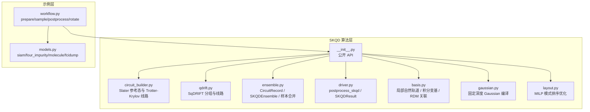
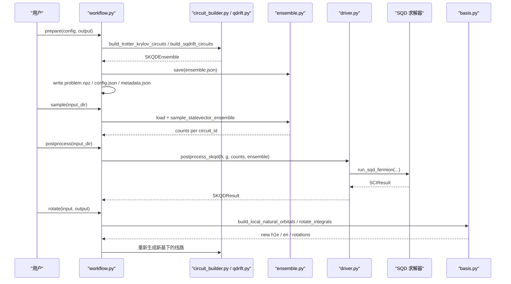
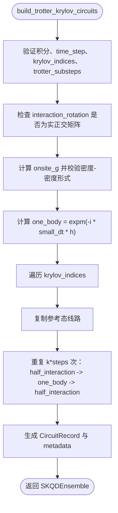
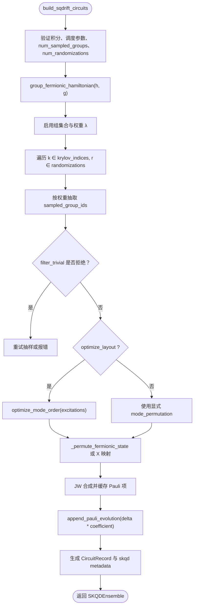
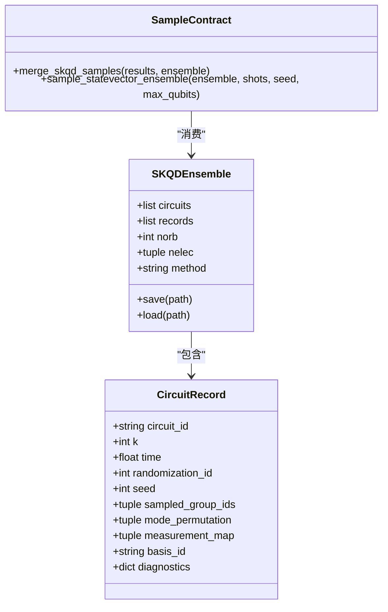
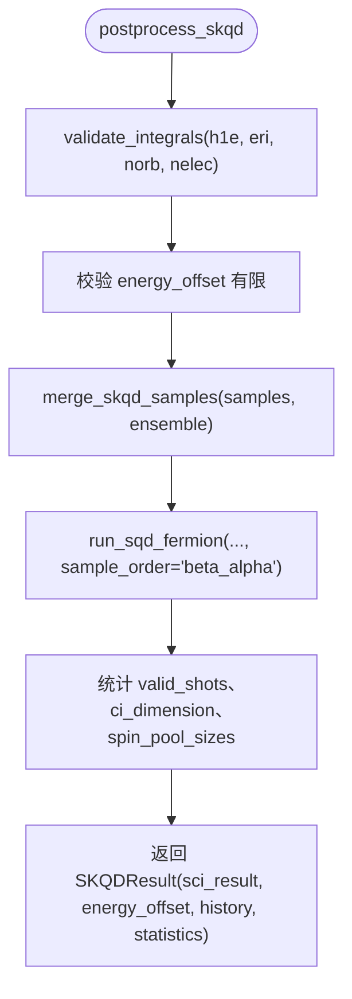
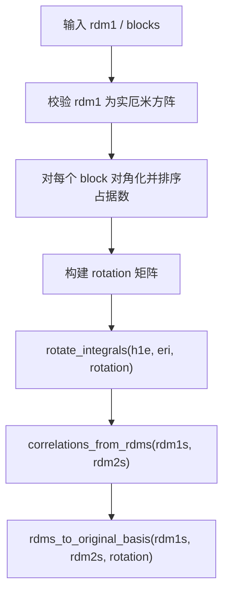
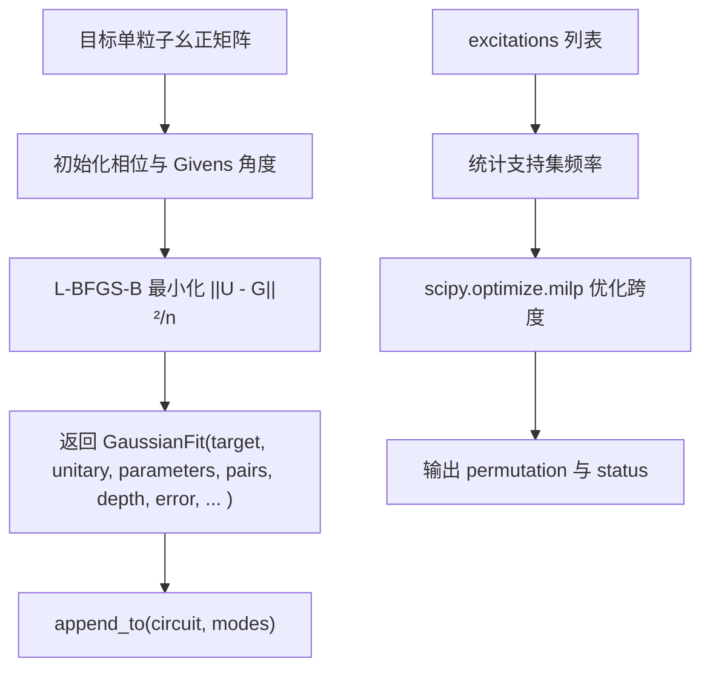
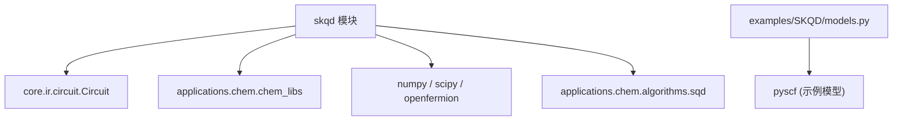

# SKQD自旋适配量子动力学算法

<cite>
**本文引用的文件**   
- [src/tyxonq/applications/chem/algorithms/skqd/__init__.py](file://src/tyxonq/applications/chem/algorithms/skqd/__init__.py)
- [src/tyxonq/applications/chem/algorithms/skqd/driver.py](file://src/tyxonq/applications/chem/algorithms/skqd/driver.py)
- [src/tyxonq/applications/chem/algorithms/skqd/circuit_builder.py](file://src/tyxonq/applications/chem/algorithms/skqd/circuit_builder.py)
- [src/tyxonq/applications/chem/algorithms/skqd/ensemble.py](file://src/tyxonq/applications/chem/algorithms/skqd/ensemble.py)
- [src/tyxonq/applications/chem/algorithms/skqd/qdrift.py](file://src/tyxonq/applications/chem/algorithms/skqd/qdrift.py)
- [src/tyxonq/applications/chem/algorithms/skqd/basis.py](file://src/tyxonq/applications/chem/algorithms/skqd/basis.py)
- [src/tyxonq/applications/chem/algorithms/skqd/gaussian.py](file://src/tyxonq/applications/chem/algorithms/skqd/gaussian.py)
- [src/tyxonq/applications/chem/algorithms/skqd/layout.py](file://src/tyxonq/applications/chem/algorithms/skqd/layout.py)
- [examples/SKQD/workflow.py](file://examples/SKQD/workflow.py)
- [examples/SKQD/models.py](file://examples/SKQD/models.py)
</cite>

## 目录
1. [引言](#引言)
2. [项目结构](#项目结构)
3. [核心组件](#核心组件)
4. [架构总览](#架构总览)
5. [详细组件分析](#详细组件分析)
6. [依赖关系分析](#依赖关系分析)
7. [性能与资源特性](#性能与资源特性)
8. [故障排查指南](#故障排查指南)
9. [结论](#结论)
10. [附录：示例工作流](#附录示例工作流)

## 引言
SKQD（Spin-adapted Krylov Quantum Diagonalization）是 TyxonQ 中面向费米子活性空间问题的自旋适配量子对角化算法族。它通过构造一组可复现的量子线路，采样得到经典比特串分布，再交给经典 SQD 求解器进行扩展子空间对角化，从而在有限采样下逼近基态或低激发态能量及相关函数。代码库同时提供两种演化构造方式：
- Trotter-Krylov：基于二阶 Trotter 分解和密度-密度相互作用基底；
- SqDRIFT：基于费米子算符分组、随机抽样组并执行 Pauli 演化的随机平均方法。

该文档从系统架构、数据流、关键实现细节、错误处理、性能特征及示例工作流等维度，对 SKQD 模块进行完整技术说明。

## 项目结构
SKQD 相关代码位于 `src/tyxonq/applications/chem/algorithms/skqd`，对外暴露统一入口；示例脚本位于 `examples/SKQD`，演示从问题构建、线路生成、采样到后处理的端到端流程。

**图示来源**
- [src/tyxonq/applications/chem/algorithms/skqd/__init__.py:1-19](file://src/tyxonq/applications/chem/algorithms/skqd/__init__.py#L1-L19)
- [examples/SKQD/workflow.py:31-37](file://examples/SKQD/workflow.py#L31-L37)
- [examples/SKQD/models.py:30-100](file://examples/SKQD/models.py#L30-L100)

**章节来源**
- [src/tyxonq/applications/chem/algorithms/skqd/__init__.py:1-19](file://src/tyxonq/applications/chem/algorithms/skqd/__init__.py#L1-L19)
- [examples/SKQD/workflow.py:1-19](file://examples/SKQD/workflow.py#L1-L19)

## 核心组件
SKQD 的核心由以下模块组成：
- 电路构建：Slater 参考态、Trotter-Krylov 线路、SqDRIFT 随机分组线路；
- 集合与样本：CircuitRecord、SKQDEnsemble、样本合并与本地采样；
- 驱动与结果：将样本接入 SQD，输出 SKQDResult；
- 基变换与关联：局部自然轨道、积分旋转、RDM 关联函数；
- 编译与布局：Gaussian 单粒子矩阵拟合、JW 跨度 MILP 模式排序。

**章节来源**
- [src/tyxonq/applications/chem/algorithms/skqd/circuit_builder.py:16-139](file://src/tyxonq/applications/chem/algorithms/skqd/circuit_builder.py#L16-L139)
- [src/tyxonq/applications/chem/algorithms/skqd/qdrift.py:19-174](file://src/tyxonq/applications/chem/algorithms/skqd/qdrift.py#L19-L174)
- [src/tyxonq/applications/chem/algorithms/skqd/ensemble.py:24-150](file://src/tyxonq/applications/chem/algorithms/skqd/ensemble.py#L24-L150)
- [src/tyxonq/applications/chem/algorithms/skqd/driver.py:12-60](file://src/tyxonq/applications/chem/algorithms/skqd/driver.py#L12-L60)
- [src/tyxonq/applications/chem/algorithms/skqd/basis.py:8-79](file://src/tyxonq/applications/chem/algorithms/skqd/basis.py#L8-L79)
- [src/tyxonq/applications/chem/algorithms/skqd/gaussian.py:56-102](file://src/tyxonq/applications/chem/algorithms/skqd/gaussian.py#L56-L102)
- [src/tyxonq/applications/chem/algorithms/skqd/layout.py:12-79](file://src/tyxonq/applications/chem/algorithms/skqd/layout.py#L12-L79)

## 架构总览
SKQD 的工作流分为“量子线路生成”“采样”“经典 SQD 对角化”“可选基变换与第二轮”四个阶段。示例工作流通过命令行子命令串联这些阶段，并在 prepare 阶段保存 ensemble、problem 与 metadata，sample 阶段保存 counts，postprocess 阶段输出能量、RDM、SCI 状态和相关统计。

**图示来源**
- [examples/SKQD/workflow.py:130-229](file://examples/SKQD/workflow.py#L130-L229)
- [src/tyxonq/applications/chem/algorithms/skqd/circuit_builder.py:75-139](file://src/tyxonq/applications/chem/algorithms/skqd/circuit_builder.py#L75-L139)
- [src/tyxonq/applications/chem/algorithms/skqd/qdrift.py:86-174](file://src/tyxonq/applications/chem/algorithms/skqd/qdrift.py#L86-L174)
- [src/tyxonq/applications/chem/algorithms/skqd/ensemble.py:58-150](file://src/tyxonq/applications/chem/algorithms/skqd/ensemble.py#L58-L150)
- [src/tyxonq/applications/chem/algorithms/skqd/driver.py:30-60](file://src/tyxonq/applications/chem/algorithms/skqd/driver.py#L30-L60)
- [src/tyxonq/applications/chem/algorithms/skqd/basis.py:8-43](file://src/tyxonq/applications/chem/algorithms/skqd/basis.py#L8-L43)

## 详细组件分析

### 参考态与 Trotter-Krylov 线路
Trotter-Krylov 线路以 Slater 参考态为起点，按 Krylov 指数 k 构造时间演化近似。每个 k 对应一个电路，记录其 Krylov 阶数、时间与测量映射。H2 部分被限制为密度-密度形式，并通过 interaction_rotation 转换到 onsite 基底后再施加 cphase 演化；H1 部分使用单粒子幺正矩阵或 GaussianFit 近似。

关键点：
- Slater 参考态支持自定义占据列表与轨道旋转；
- validate_schedule 要求 time_step 为正且 krylov_indices 为非负互异整数；
- interaction_rotation 必须为实正交矩阵，否则回退到 SqDRIFT；
- 若提供 GaussianFit，需与 Trotter 子步目标矩阵一致。

**图示来源**
- [src/tyxonq/applications/chem/algorithms/skqd/circuit_builder.py:47-139](file://src/tyxonq/applications/chem/algorithms/skqd/circuit_builder.py#L47-L139)

**章节来源**
- [src/tyxonq/applications/chem/algorithms/skqd/circuit_builder.py:16-139](file://src/tyxonq/applications/chem/algorithms/skqd/circuit_builder.py#L16-L139)

### SqDRIFT 费米子分组与随机抽样
SqDRIFT 将电子哈密顿量按激活模式与 number spectator 分组，并对每组求谱范数作为权重。每个 (k, r) 独立抽取 num_sampled_groups 个组，按权重概率采样，必要时进行模式重排与 JW 合成，最终追加 Pauli 演化。

关键点：
- group_fermionic_hamiltonian 保证每组 Hermitian 且非零权重；
- _permute_fermionic_state 使用带符号的 FSWAP 保持费米子反对易关系；
- filter_diagonal 与 filter_trivial 用于启发式过滤；
- optimize_layout 调用 MILP 优化 JW 跨度。

**图示来源**
- [src/tyxonq/applications/chem/algorithms/skqd/qdrift.py:35-174](file://src/tyxonq/applications/chem/algorithms/skqd/qdrift.py#L35-L174)
- [src/tyxonq/applications/chem/algorithms/skqd/layout.py:19-79](file://src/tyxonq/applications/chem/algorithms/skqd/layout.py#L19-L79)

**章节来源**
- [src/tyxonq/applications/chem/algorithms/skqd/qdrift.py:19-174](file://src/tyxonq/applications/chem/algorithms/skqd/qdrift.py#L19-L174)
- [src/tyxonq/applications/chem/algorithms/skqd/layout.py:12-79](file://src/tyxonq/applications/chem/algorithms/skqd/layout.py#L12-L79)

### 集合、记录与样本合同
SKQDEnsemble 保存未测量的原生线路及其元信息；CircuitRecord 描述每个电路的 Krylov 阶数、时间、随机化编号、模式排列、测量映射与基标识。merge_skqd_samples 负责将不同电路的计数还原到统一的内部位顺序，并按实际 shots 加权。

关键点：
- CircuitRecord.mode_permutation 表示 old mode → new mode 的排列；
- measurement_map 声明 classical register 到逻辑模式的映射；
- merge_skqd_samples 要求所有记录的 basis_id 相同；
- sample_statevector_ensemble 仅适用于小体系，默认最大 qubits 为 20。

**图示来源**
- [src/tyxonq/applications/chem/algorithms/skqd/ensemble.py:24-150](file://src/tyxonq/applications/chem/algorithms/skqd/ensemble.py#L24-L150)

**章节来源**
- [src/tyxonq/applications/chem/algorithms/skqd/ensemble.py:1-150](file://src/tyxonq/applications/chem/algorithms/skqd/ensemble.py#L1-L150)

### 驱动与结果封装
postprocess_skqd 接收 h1e、eri、samples 与 ensemble，先验证积分与 energy_offset，再合并样本，最后调用 SQD 的 run_sqd_fermion。结果封装为 SKQDResult，其中 energy 为电子能，total_energy 加上 energy_offset。

关键点：
- 禁止直接传入 nuclear_repulsion_energy 或 sample_order；
- 默认 symmetrize_spin=False，seed=24；
- statistics 包含电路数、shots、唯一 bitstring 数、有效 shot 数、CI 维度和自旋池大小。

**图示来源**
- [src/tyxonq/applications/chem/algorithms/skqd/driver.py:30-60](file://src/tyxonq/applications/chem/algorithms/skqd/driver.py#L30-L60)

**章节来源**
- [src/tyxonq/applications/chem/algorithms/skqd/driver.py:1-60](file://src/tyxonq/applications/chem/algorithms/skqd/driver.py#L1-L60)

### 基变换与关联函数
basis.py 提供局部自然轨道构建、积分旋转、RDM 关联函数计算以及将 RDM 还原到原始基底的工具。两轮 SKQD 示例中，第一轮结束后根据 RDM 构建局部自然轨道，旋转积分并重新采样。

关键点：
- build_local_natural_orbitals 要求 blocks 非空且不重叠；
- rotate_integrals 与 rdms_to_original_basis 均要求实正交旋转矩阵；
- correlations_from_rdms 输出密度、连通密度、自旋 Z 与自旋点积等关联。

**图示来源**
- [src/tyxonq/applications/chem/algorithms/skqd/basis.py:8-79](file://src/tyxonq/applications/chem/algorithms/skqd/basis.py#L8-L79)

**章节来源**
- [src/tyxonq/applications/chem/algorithms/skqd/basis.py:1-79](file://src/tyxonq/applications/chem/algorithms/skqd/basis.py#L1-L79)

### Gaussian 编译与模式布局
gaussian.py 实现固定深度的 Givens 门网络拟合单粒子幺正矩阵，并提供 append_to 接口直接追加拟合层；layout.py 使用 MILP 优化 JW 激发的跨度，降低 Pauli 链长度。

关键点：
- fit_gaussian_evolution 最小化 Frobenius 误差，使用 L-BFGS-B；
- GaussianFit.append_to 不进一步分解为更深层精确线路；
- optimize_mode_order 忽略 number spectator，只优化改变占据的模式。

**图示来源**
- [src/tyxonq/applications/chem/algorithms/skqd/gaussian.py:82-102](file://src/tyxonq/applications/chem/algorithms/skqd/gaussian.py#L82-L102)
- [src/tyxonq/applications/chem/algorithms/skqd/layout.py:19-79](file://src/tyxonq/applications/chem/algorithms/skqd/layout.py#L19-L79)

**章节来源**
- [src/tyxonq/applications/chem/algorithms/skqd/gaussian.py:1-102](file://src/tyxonq/applications/chem/algorithms/skqd/gaussian.py#L1-L102)
- [src/tyxonq/applications/chem/algorithms/skqd/layout.py:1-79](file://src/tyxonq/applications/chem/algorithms/skqd/layout.py#L1-L79)

## 依赖关系分析
SKQD 模块依赖 TyxonQ 核心 IR、化学库与外部科学计算工具：
- 核心 IR：Circuit、statevector 后端；
- 化学库：fermionic_circuits、fermionic_operators；
- 外部库：numpy、scipy、openfermion；
- 上层集成：SQD 求解器、PySCF（示例模型）。

**图示来源**
- [src/tyxonq/applications/chem/algorithms/skqd/circuit_builder.py:10-12](file://src/tyxonq/applications/chem/algorithms/skqd/circuit_builder.py#L10-L12)
- [src/tyxonq/applications/chem/algorithms/skqd/qdrift.py:10-16](file://src/tyxonq/applications/chem/algorithms/skqd/qdrift.py#L10-L16)
- [examples/SKQD/models.py:73-95](file://examples/SKQD/models.py#L73-L95)

**章节来源**
- [src/tyxonq/applications/chem/algorithms/skqd/circuit_builder.py:1-13](file://src/tyxonq/applications/chem/algorithms/skqd/circuit_builder.py#L1-L13)
- [src/tyxonq/applications/chem/algorithms/skqd/qdrift.py:1-16](file://src/tyxonq/applications/chem/algorithms/skqd/qdrift.py#L1-L16)
- [examples/SKQD/models.py:30-100](file://examples/SKQD/models.py#L30-L100)

## 性能与资源特性
- Trotter-Krylov 线路复杂度随 Krylov 阶数与 Trotter 子步数线性增长；H2 部分为密度-密度耦合，适合在特定基底上高效实现。
- SqDRIFT 通过随机抽样组减少每次电路成本，但需要多次随机化与可能的模式重排；optimize_layout 使用 MILP 优化，可能受 time_limit 影响。
- GaussianFit 用固定深度 Givens 网络近似单粒子演化，避免深层分解；误差收敛取决于 depth、max_iterations 与 tolerance。
- 样本合并与 SQD 对角化复杂度与唯一 bitstring 数量、CI 维度相关；statistics 提供电路数、shots、valid_shots、ci_dimension 等指标。
- 示例 workflow 提供 estimate 子命令，仅读取配置估算 full CI 维度、dense ERI 字节数、statevector 字节数与电路/shot 上限，但不运行实验。

[本节为通用性能讨论，不直接分析具体代码行]

## 故障排查指南
常见错误与定位建议：
- 配置缺失：workflow.prepare 会列出 missing_inputs，如 model.path、model.bath_energies、evolution.time_step、evolution.krylov_indices；
- 积分与基底不一致：circuit_builder.build_trotter_krylov_circuits 要求 interaction_rotation 为实正交矩阵且 H2 为密度-密度形式，否则抛出 ValueError；
- 样本 ID 不匹配：ensemble.merge_skqd_samples 要求 results 的 keys 与 ensemble.records 的 circuit_id 完全一致；
- 基不一致：不同 basis_id 的样本不能合并；
- 测量映射非法：measurement_map 必须测量每个逻辑模式恰好一次；
- 计数非法：counts 必须为非负整数，且字符串宽度与 mapping 一致；
- 能量偏移非法：driver.postprocess_skqd 要求 energy_offset 有限；
- 不允许覆盖已有 ensemble：workflow._save_prepared 检测到 output 已存在 ensemble.json 时报错；
- 两轮示例限制：workflow.rotate 要求 evolution.method == "trotter"；
- 精确验证规模限制：workflow.postprocess --exact 限制完整 CI 维度不超过 100000；
- SqDRIFT 过滤失败：filter_trivial 无法抽到活跃激发时抛出错误；
- Gaussian 目标不匹配：fit_gaussian_evolution 要求 target 为单位阵，且与 Trotter 子步一致；
- 布局参数非法：layout.optimize_mode_order 要求 num_modes、time_limit、mix_delta 合法。

**章节来源**
- [examples/SKQD/workflow.py:60-138](file://examples/SKQD/workflow.py#L60-L138)
- [examples/SKQD/workflow.py:156-229](file://examples/SKQD/workflow.py#L156-L229)
- [src/tyxonq/applications/chem/algorithms/skqd/circuit_builder.py:47-106](file://src/tyxonq/applications/chem/algorithms/skqd/circuit_builder.py#L47-L106)
- [src/tyxonq/applications/chem/algorithms/skqd/ensemble.py:102-129](file://src/tyxonq/applications/chem/algorithms/skqd/ensemble.py#L102-L129)
- [src/tyxonq/applications/chem/algorithms/skqd/driver.py:30-38](file://src/tyxonq/applications/chem/algorithms/skqd/driver.py#L30-L38)
- [src/tyxonq/applications/chem/algorithms/skqd/qdrift.py:97-131](file://src/tyxonq/applications/chem/algorithms/skqd/qdrift.py#L97-L131)
- [src/tyxonq/applications/chem/algorithms/skqd/gaussian.py:82-90](file://src/tyxonq/applications/chem/algorithms/skqd/gaussian.py#L82-L90)
- [src/tyxonq/applications/chem/algorithms/skqd/layout.py:19-23](file://src/tyxonq/applications/chem/algorithms/skqd/layout.py#L19-L23)

## 结论
SKQD 在 TyxonQ 中提供了两条互补路径：Trotter-Krylov 在密度-密度基底上高效实现二阶 Trotter 演化，SqDRIFT 则通过费米子分组与随机抽样降低单次电路成本。两者都产出可复现的 SKQDEnsemble，并由 driver.postprocess_skqd 统一接入 SQD 经典对角化。示例工作流将问题构建、线路生成、采样、后处理与两轮自然轨道变基串联起来，便于在小体系上验证并与 FCI 对比。对于更大体系，应关注样本数量、CI 维度、布局优化时间与 Gaussian 拟合误差之间的平衡。

[本节为总结性内容，不直接分析具体代码行]

## 附录：示例工作流
examples/SKQD/workflow.py 提供命令行接口：
- prepare：读取配置，构建 problem 与 ensemble，保存 ensemble.json、problem.npz、config.json、metadata.json；
- estimate：仅估算资源，不构造积分或线路；
- sample：加载 ensemble 与 sampling 配置，输出 counts.json 与 sampling.json；
- postprocess：运行 postprocess_skqd，输出 result.json、rdms.npz、sci_state.npz，可选 exact 与 strict_rank；
- rotate：基于第一轮 RDM 构建局部自然轨道，旋转积分并重新生成线路，强制第二轮重新采样。

```mermaid
flowchart TD
CLI["workflow.py 子命令"] --> Prepare["prepare(config, output)"]
CLI --> Estimate["estimate(config)"]
CLI --> Sample["sample(input_dir, shots, seed)"]
CLI --> Postprocess["postprocess(input_dir, exact, strict_rank)"]
CLI --> Rotate["rotate(input_dir, output, fit_depth)"]
Prepare --> BuildProblem["models.build_problem(config)"]
Prepare --> BuildEnsemble["build_trotter_krylov_circuits / build_sqdrift_circuits"]
Prepare --> SaveFiles["保存 ensemble.json / problem.npz / config.json / metadata.json"]
Sample --> LoadEnsemble["SKQDEnsemble.load"]
Sample --> LocalSample["sample_statevector_ensemble"]
Sample --> SaveCounts["保存 counts.json / sampling.json"]
Postprocess --> LoadData["加载 problem.npz / ensemble.json / counts.json"]
Postprocess --> RunSQD["postprocess_skqd(...)"]
Postprocess --> SaveResults["保存 rdms.npz / sci_state.npz / result.json"]
Rotate --> ReadRDM["读取 rdms.npz 中的 rdm1s"]
Rotate --> NaturalOrbitals["build_local_natural_orbitals"]
Rotate --> RotateIntegrals["rotate_integrals(...)"]
Rotate --> RebuildEnsemble["重新生成新基线路"]
```

**图示来源**
- [examples/SKQD/workflow.py:70-229](file://examples/SKQD/workflow.py#L70-L229)
- [examples/SKQD/models.py:30-100](file://examples/SKQD/models.py#L30-L100)

**章节来源**
- [examples/SKQD/workflow.py:1-273](file://examples/SKQD/workflow.py#L1-L273)
- [examples/SKQD/models.py:1-100](file://examples/SKQD/models.py#L1-L100)