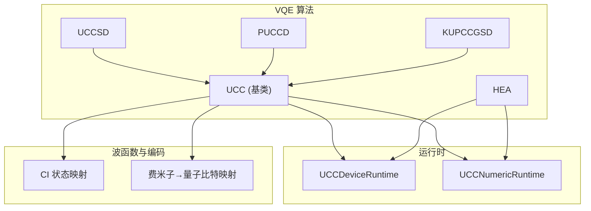
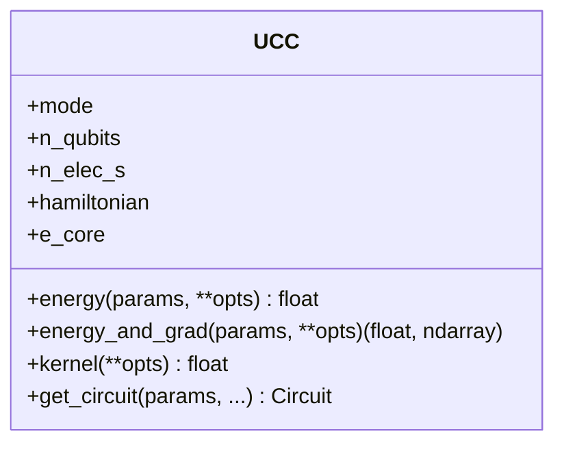
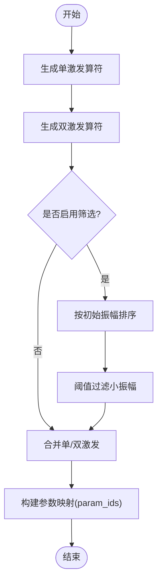
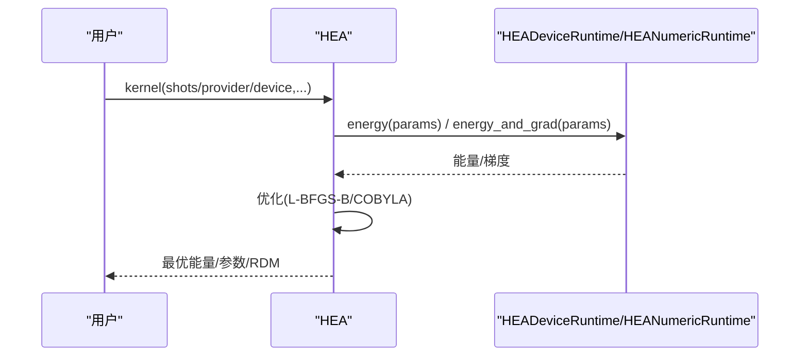
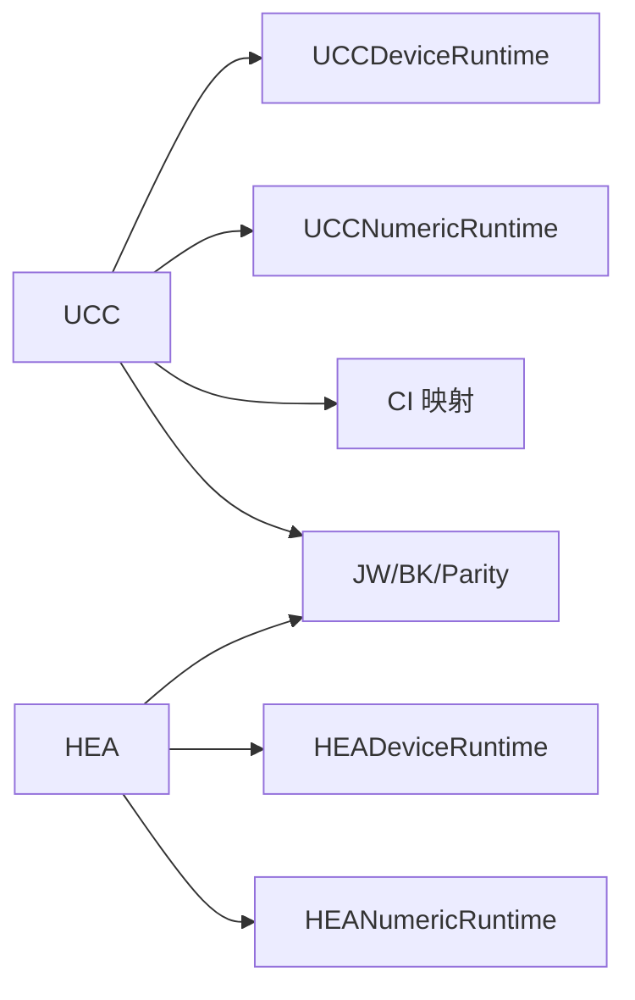

# VQE算法

<cite>
**本文引用的文件**
- [src/tyxonq/applications/chem/algorithms/vqe/__init__.py](file://src/tyxonq/applications/chem/algorithms/vqe/__init__.py)
- [src/tyxonq/applications/chem/algorithms/vqe/ucc_base.py](file://src/tyxonq/applications/chem/algorithms/vqe/ucc_base.py)
- [src/tyxonq/applications/chem/algorithms/vqe/uccsd.py](file://src/tyxonq/applications/chem/algorithms/vqe/uccsd.py)
- [src/tyxonq/applications/chem/algorithms/vqe/kupccgsd.py](file://src/tyxonq/applications/chem/algorithms/vqe/kupccgsd.py)
- [src/tyxonq/applications/chem/algorithms/vqe/puccd.py](file://src/tyxonq/applications/chem/algorithms/vqe/puccd.py)
- [src/tyxonq/applications/chem/algorithms/vqe/hea.py](file://src/tyxonq/applications/chem/algorithms/vqe/hea.py)
- [src/tyxonq/applications/chem/algorithms/vqe/runtimes/ucc_device_runtime.py](file://src/tyxonq/applications/chem/algorithms/vqe/runtimes/ucc_device_runtime.py)
- [src/tyxonq/applications/chem/algorithms/vqe/wavefunction/ci_state_mapping.py](file://src/tyxonq/applications/chem/algorithms/vqe/wavefunction/ci_state_mapping.py)
- [src/tyxonq/libs/hamiltonian_encoding/fermion_to_qubit.py](file://src/tyxonq/libs/hamiltonian_encoding/fermion_to_qubit.py)
</cite>

## 目录
1. [简介](#简介)
2. [项目结构](#项目结构)
3. [核心组件](#核心组件)
4. [架构总览](#架构总览)
5. [详细组件分析](#详细组件分析)
6. [依赖关系分析](#依赖关系分析)
7. [性能考量](#性能考量)
8. [故障排查指南](#故障排查指南)
9. [结论](#结论)
10. [附录](#附录)

## 简介
本文件为 TyxonQ 中变分量子本征求解器（VQE）的完整 API 文档，聚焦以下主题：
- UCCSD（Unitary Coupled Cluster Singles and Doubles）激发算符构建、参数化与梯度计算
- HEA（Hardware Efficient Ansatz）设计原理与参数优化策略
- PUCCD（Paired Unitary Coupled Cluster Doubles）与 KUPCCGSD（k-UpCCGSD）等特殊 Ansatz 的适用场景
- 波函数映射机制（Jordan-Wigner、Bravyi-Kitaev、Parity）的选择与影响
- 优化器配置选项（参数平移法、自然梯度等）、收敛准则与性能调优建议
- 与不同数值后端（statevector、civector、pyscf 等）的兼容性说明

## 项目结构
VQE 模块位于 applications/chem/algorithms/vqe，包含：
- 算法入口与基类：UCC（基类）、UCCSD、PUCCD、KUPCCGSD
- 硬件高效 Ansatz：HEA
- 运行时：设备端（device）与数值端（numeric）两类 runtime
- 波函数映射：CI 向量与态矢量的相互转换、字符串编码
- 哈密顿量编码：费米子到量子比特的映射（JW/BK/Parity）



图表来源
- [src/tyxonq/applications/chem/algorithms/vqe/ucc_base.py:52-166](file://src/tyxonq/applications/chem/algorithms/vqe/ucc_base.py#L52-L166)
- [src/tyxonq/applications/chem/algorithms/vqe/ucc_device_runtime.py:25-70](file://src/tyxonq/applications/chem/algorithms/vqe/runtimes/ucc_device_runtime.py#L25-L70)
- [src/tyxonq/libs/hamiltonian_encoding/fermion_to_qubit.py:79-89](file://src/tyxonq/libs/hamiltonian_encoding/fermion_to_qubit.py#L79-L89)

章节来源
- [src/tyxonq/applications/chem/algorithms/vqe/__init__.py:1-49](file://src/tyxonq/applications/chem/algorithms/vqe/__init__.py#L1-L49)

## 核心组件
- UCC 基类：统一封装分子信息、活性空间、哈密顿量构建、能量与梯度接口、优化流程（默认 device 路径），并支持多种数值后端。
- UCCSD：在 UCC 基础上实现单双激发的筛选与排序、初始猜测（MP2/CCSD/FE/zeros）。
- PUCCD：针对配对双激发的紧凑 Ansatz，提供 MO/AO 基下的 RDM 计算。
- KUPCCGSD：k 层广义单双激发的分层 Ansatz，支持多初值尝试。
- HEA：基于 RY 旋转与 CNOT 链的硬件高效 Ansatz，支持从积分或分子直接构建，提供能量、梯度、RDM 与 PySCF 求解器适配。

章节来源
- [src/tyxonq/applications/chem/algorithms/vqe/ucc_base.py:52-166](file://src/tyxonq/applications/chem/algorithms/vqe/ucc_base.py#L52-L166)
- [src/tyxonq/applications/chem/algorithms/vqe/uccsd.py:18-154](file://src/tyxonq/applications/chem/algorithms/vqe/uccsd.py#L18-L154)
- [src/tyxonq/applications/chem/algorithms/vqe/puccd.py:20-75](file://src/tyxonq/applications/chem/algorithms/vqe/puccd.py#L20-L75)
- [src/tyxonq/applications/chem/algorithms/vqe/kupccgsd.py:15-119](file://src/tyxonq/applications/chem/algorithms/vqe/kupccgsd.py#L15-L119)
- [src/tyxonq/applications/chem/algorithms/vqe/hea.py:28-124](file://src/tyxonq/applications/chem/algorithms/vqe/hea.py#L28-L124)

## 架构总览
VQE 的核心数据流如下：
- 输入：分子（PySCF Mole/RHF/ROHF）或积分；活性空间；Ansatz 类型（UCCSD/PUCCD/KUPCCGSD/HEA）
- 预处理：HF/MP2/CCSD/FCI（可选）；构建哈密顿量（OpenFermion QubitOperator）；选择映射（JW/BK/Parity）
- 电路构建：根据 Ansatz 生成参数化电路（UCC 或 HEA）
- 执行：设备端（计数测量）或数值端（解析态矢量/CI）
- 优化：参数平移法（PSR）或自由梯度；SciPy 优化器（L-BFGS-B/COBYLA）
- 输出：最优能量、参数、RDM（如需要）

```mermaid
sequenceDiagram
participant User as "用户代码"
participant Algo as "UCC/HEA"
participant RT as "运行时(设备/数值)"
participant Map as "映射(JW/BK/Parity)"
participant Opt as "优化器"
User->>Algo : 初始化(分子/积分, Ansatz, 映射)
Algo->>Map : 构建哈密顿量(QubitOperator)
Algo->>RT : energy(params) / energy_and_grad(params)
RT-->>Algo : 能量/梯度
Algo->>Opt : 目标函数(含缓存)
Opt-->>Algo : 最优参数
Algo-->>User : 最优能量/参数/RDM
```

图表来源
- [src/tyxonq/applications/chem/algorithms/vqe/ucc_base.py:416-510](file://src/tyxonq/applications/chem/algorithms/vqe/ucc_base.py#L416-L510)
- [src/tyxonq/applications/chem/algorithms/vqe/ucc_device_runtime.py:293-448](file://src/tyxonq/applications/chem/algorithms/vqe/runtimes/ucc_device_runtime.py#L293-L448)
- [src/tyxonq/libs/hamiltonian_encoding/fermion_to_qubit.py:79-89](file://src/tyxonq/libs/hamiltonian_encoding/fermion_to_qubit.py#L79-L89)

## 详细组件分析

### UCC 基类（统一接口与优化）
- 职责：管理分子与活性空间、构建哈密顿量、提供 energy/energy_and_grad、统一优化流程（默认 device 路径，shots=0 走解析路径）
- 关键特性：
  - 支持 mode="fermion"/"qubit"/"hcb"
  - 支持 numeric_engine 选择（statevector、civector、pyscf 等）
  - 内置 JW 缓存以加速优化
  - 优化器：L-BFGS-B（带梯度）或 COBYLA（无梯度）
  - 默认 shots 策略：模拟器/local 默认 0（解析），真机默认 2048



图表来源
- [src/tyxonq/applications/chem/algorithms/vqe/ucc_base.py:52-166](file://src/tyxonq/applications/chem/algorithms/vqe/ucc_base.py#L52-L166)
- [src/tyxonq/applications/chem/algorithms/vqe/ucc_base.py:416-510](file://src/tyxonq/applications/chem/algorithms/vqe/ucc_base.py#L416-L510)
- [src/tyxonq/applications/chem/algorithms/vqe/ucc_base.py:521-581](file://src/tyxonq/applications/chem/algorithms/vqe/ucc_base.py#L521-L581)

章节来源
- [src/tyxonq/applications/chem/algorithms/vqe/ucc_base.py:52-166](file://src/tyxonq/applications/chem/algorithms/vqe/ucc_base.py#L52-L166)
- [src/tyxonq/applications/chem/algorithms/vqe/ucc_base.py:416-510](file://src/tyxonq/applications/chem/algorithms/vqe/ucc_base.py#L416-L510)
- [src/tyxonq/applications/chem/algorithms/vqe/ucc_base.py:521-581](file://src/tyxonq/applications/chem/algorithms/vqe/ucc_base.py#L521-L581)

### UCCSD（单双激发）
- 激发算符构建：
  - 单激发：按自旋轨道索引构造 α→α、β→β 的单激发
  - 双激发：按自旋轨道构造 αα、ββ、αβ 的双激发
  - 筛选与排序：依据 MP2/CCSD 初始振幅进行阈值筛选与幅度排序，减少参数规模
- 参数化方案：每个独立参数对应一个激发块（共享参数通过 param_ids 映射）
- 梯度计算：设备端采用两移位参数平移法（π/8 与 π/4 组合），数值端使用解析梯度



图表来源
- [src/tyxonq/applications/chem/algorithms/vqe/uccsd.py:268-341](file://src/tyxonq/applications/chem/algorithms/vqe/uccsd.py#L268-L341)
- [src/tyxonq/applications/chem/algorithms/vqe/ucc_base.py:692-800](file://src/tyxonq/applications/chem/algorithms/vqe/ucc_base.py#L692-L800)

章节来源
- [src/tyxonq/applications/chem/algorithms/vqe/uccsd.py:18-154](file://src/tyxonq/applications/chem/algorithms/vqe/uccsd.py#L18-L154)
- [src/tyxonq/applications/chem/algorithms/vqe/uccsd.py:268-341](file://src/tyxonq/applications/chem/algorithms/vqe/uccsd.py#L268-L341)
- [src/tyxonq/applications/chem/algorithms/vqe/ucc_base.py:692-800](file://src/tyxonq/applications/chem/algorithms/vqe/ucc_base.py#L692-L800)

### PUCCD（配对双激发）
- 特点：仅考虑成对双激发，适用于闭壳层体系，参数更少、电路更浅
- RDM：提供 MO/AO 基下的 1-RDM 与 2-RDM 计算，便于化学分析
- 适用场景：强关联但对称性约束较强的系统，追求效率与可解释性

章节来源
- [src/tyxonq/applications/chem/algorithms/vqe/puccd.py:20-75](file://src/tyxonq/applications/chem/algorithms/vqe/puccd.py#L20-L75)
- [src/tyxonq/applications/chem/algorithms/vqe/puccd.py:98-152](file://src/tyxonq/applications/chem/algorithms/vqe/puccd.py#L98-L152)

### KUPCCGSD（k-UpCCGSD）
- 特点：k 层广义单双激发，每层包含受限的双激发与广义单激发；随机初始参数，支持多次尝试取最优
- 适用场景：需要更强表达力且希望保持较浅电路深度的系统；适合 NISQ 设备上的探索性计算

章节来源
- [src/tyxonq/applications/chem/algorithms/vqe/kupccgsd.py:15-119](file://src/tyxonq/applications/chem/algorithms/vqe/kupccgsd.py#L15-L119)
- [src/tyxonq/applications/chem/algorithms/vqe/kupccgsd.py:153-203](file://src/tyxonq/applications/chem/algorithms/vqe/kupccgsd.py#L153-L203)

### HEA（硬件高效 Ansatz）
- 设计原理：
  - 初始 RY 层 + L 层“CNOT 链 + RY”交替结构
  - 参数数量：(layers+1) × n_qubits
  - 天然兼容 NISQ 设备的连通性与相干时间限制
- 参数优化策略：
  - 默认使用参数平移法（PSR）计算梯度；也可关闭梯度使用无梯度优化器
  - SciPy 优化器：L-BFGS-B（有梯度）或 COBYLA（无梯度）
  - 支持从分子或积分直接构建，自动处理映射与哈密顿量项
- RDM：支持 1-RDM 与 2-RDM 计算（基于 counts 期望估计）



图表来源
- [src/tyxonq/applications/chem/algorithms/vqe/hea.py:231-266](file://src/tyxonq/applications/chem/algorithms/vqe/hea.py#L231-L266)
- [src/tyxonq/applications/chem/algorithms/vqe/hea.py:294-337](file://src/tyxonq/applications/chem/algorithms/vqe/hea.py#L294-L337)

章节来源
- [src/tyxonq/applications/chem/algorithms/vqe/hea.py:28-124](file://src/tyxonq/applications/chem/algorithms/vqe/hea.py#L28-L124)
- [src/tyxonq/applications/chem/algorithms/vqe/hea.py:231-266](file://src/tyxonq/applications/chem/algorithms/vqe/hea.py#L231-L266)
- [src/tyxonq/applications/chem/algorithms/vqe/hea.py:294-337](file://src/tyxonq/applications/chem/algorithms/vqe/hea.py#L294-L337)
- [src/tyxonq/applications/chem/algorithms/vqe/hea.py:623-705](file://src/tyxonq/applications/chem/algorithms/vqe/hea.py#L623-L705)

### 波函数映射机制（CI 向量与态矢量）
- CI 字符串生成：根据电子数与模式（fermion/qubit/hcb）生成占据数位串
- 地址映射：将激发操作对应的位串转换为 CI 向量地址
- 转换工具：CI 向量 ↔ 态矢量互转，支持后端无关实现

章节来源
- [src/tyxonq/applications/chem/algorithms/vqe/wavefunction/ci_state_mapping.py:38-97](file://src/tyxonq/applications/chem/algorithms/vqe/wavefunction/ci_state_mapping.py#L38-L97)
- [src/tyxonq/applications/chem/algorithms/vqe/wavefunction/ci_state_mapping.py:100-155](file://src/tyxonq/applications/chem/algorithms/vqe/wavefunction/ci_state_mapping.py#L100-L155)

### 哈密顿量映射（Jordan-Wigner、Bravyi-Kitaev、Parity）
- Jordan-Wigner：直观、线性深度，适用于通用场景
- Bravyi-Kitaev：局部性更好，部分算符深度对数级
- Parity：利用粒子数与自旋守恒，可实现两比特缩减，适合 VQE

章节来源
- [src/tyxonq/libs/hamiltonian_encoding/fermion_to_qubit.py:79-89](file://src/tyxonq/libs/hamiltonian_encoding/fermion_to_qubit.py#L79-L89)
- [src/tyxonq/libs/hamiltonian_encoding/fermion_to_qubit.py:35-76](file://src/tyxonq/libs/hamiltonian_encoding/fermion_to_qubit.py#L35-L76)

## 依赖关系分析
- UCC 基类依赖：
  - 运行时：UCCDeviceRuntime（设备）、UCCNumericRuntime（数值）
  - 波函数映射：CI 字符串与地址映射
  - 哈密顿量编码：OpenFermion 变换（JW/BK/Parity）
- HEA 依赖：
  - 运行时：HEADeviceRuntime/HEANumericRuntime
  - 电路库：RY-only 模板或外部模板（RealAmplitudes）
  - 映射：同上



图表来源
- [src/tyxonq/applications/chem/algorithms/vqe/ucc_base.py:416-510](file://src/tyxonq/applications/chem/algorithms/vqe/ucc_base.py#L416-L510)
- [src/tyxonq/applications/chem/algorithms/vqe/ucc_device_runtime.py:25-70](file://src/tyxonq/applications/chem/algorithms/vqe/runtimes/ucc_device_runtime.py#L25-L70)
- [src/tyxonq/libs/hamiltonian_encoding/fermion_to_qubit.py:79-89](file://src/tyxonq/libs/hamiltonian_encoding/fermion_to_qubit.py#L79-L89)

章节来源
- [src/tyxonq/applications/chem/algorithms/vqe/ucc_base.py:416-510](file://src/tyxonq/applications/chem/algorithms/vqe/ucc_base.py#L416-L510)
- [src/tyxonq/applications/chem/algorithms/vqe/ucc_device_runtime.py:25-70](file://src/tyxonq/applications/chem/algorithms/vqe/runtimes/ucc_device_runtime.py#L25-L70)
- [src/tyxonq/libs/hamiltonian_encoding/fermion_to_qubit.py:79-89](file://src/tyxonq/libs/hamiltonian_encoding/fermion_to_qubit.py#L79-L89)

## 性能考量
- 设备端梯度计算：
  - 默认采用两移位参数平移法（π/8 与 π/4 组合），对 UCC 能量曲面的偶次谐波精确有效
  - 支持较小步长的中心差分（ps），对任意谐波鲁棒但放大采样噪声
- 优化器选择：
  - 有梯度：L-BFGS-B（推荐）
  - 无梯度：COBYLA（适用于噪声较大或无法提供梯度的场景）
- 数值后端：
  - statevector：解析态矢量模拟，速度快、精度高
  - civector/civector-large：CI 向量路径，适合更大活性空间
  - pyscf：经典参考计算，用于初始化与基准
- 采样策略：
  - 模拟器/local 默认 shots=0（解析路径），避免噪声影响优化与 RDM
  - 真机默认 shots=2048，可通过 device_opts 调整
- 缓存与分组：
  - 哈密顿量项分组与测量前缀缓存，减少重复编译与提交开销
  - 优化过程中同一参数的能量/梯度缓存，降低线搜索成本

[本节为通用性能讨论，不直接分析具体文件]

## 故障排查指南
- 常见错误与定位：
  - 未知映射：检查 mapping 参数是否为 "jordan-wigner"/"bravyi-kitaev"/"parity"
  - 参数维度不匹配：确认 ex_ops 与 param_ids 长度一致，params 长度等于 n_params
  - 优化失败：查看 opt_res.success 与 message，调整 maxiter/ftol/gtol
  - 设备端梯度为零：确认使用了两移位 PSR（非 ±π/2），或切换为 ps 方法
- 调试建议：
  - 使用 shots=0 在模拟器上验证解析路径
  - 打印电路摘要与优化结果，检查参数更新轨迹
  - 对比不同映射（JW/BK/Parity）对项数与深度的影响

章节来源
- [src/tyxonq/libs/hamiltonian_encoding/fermion_to_qubit.py:79-89](file://src/tyxonq/libs/hamiltonian_encoding/fermion_to_qubit.py#L79-L89)
- [src/tyxonq/applications/chem/algorithms/vqe/ucc_base.py:401-414](file://src/tyxonq/applications/chem/algorithms/vqe/ucc_base.py#L401-L414)
- [src/tyxonq/applications/chem/algorithms/vqe/ucc_base.py:521-581](file://src/tyxonq/applications/chem/algorithms/vqe/ucc_base.py#L521-L581)
- [src/tyxonq/applications/chem/algorithms/vqe/ucc_device_runtime.py:315-448](file://src/tyxonq/applications/chem/algorithms/vqe/runtimes/ucc_device_runtime.py#L315-L448)

## 结论
TyxonQ 的 VQE 模块提供了统一的 UCC 家族与 HEA 实现，覆盖从分子到量子电路、从设备到数值后端的完整链路。通过灵活的映射选择、高效的梯度计算与稳健的优化策略，能够在 NISQ 设备上实现可靠的变分量子化学计算。对于不同体系与资源约束，可选择合适的 Ansatz（UCCSD/PUCCD/KUPCCGSD/HEA）与后端（statevector/civector/pyscf），并通过 shots 与优化器配置平衡精度与效率。

[本节为总结性内容，不直接分析具体文件]

## 附录
- 典型用法路径（示例）：
  - UCCSD：初始化分子 → 构建激发算符 → 运行 kernel() → 获取能量与参数
  - HEA：从分子或积分构建 → 设置 layers/mapping → 运行 kernel() → 获取 RDM
  - 设备端：provider="simulator"/"local"/"真实设备"，shots 控制采样次数
  - 数值端：numeric_engine="statevector"/"civector"/"pyscf"

[本节为补充说明，不直接分析具体文件]