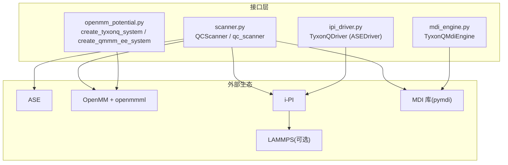
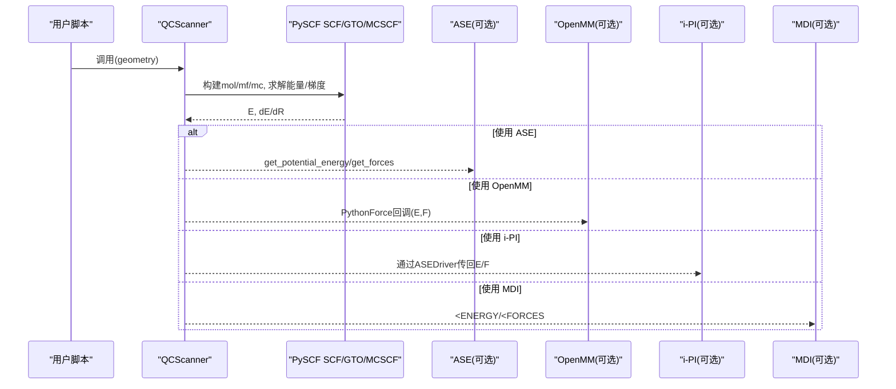
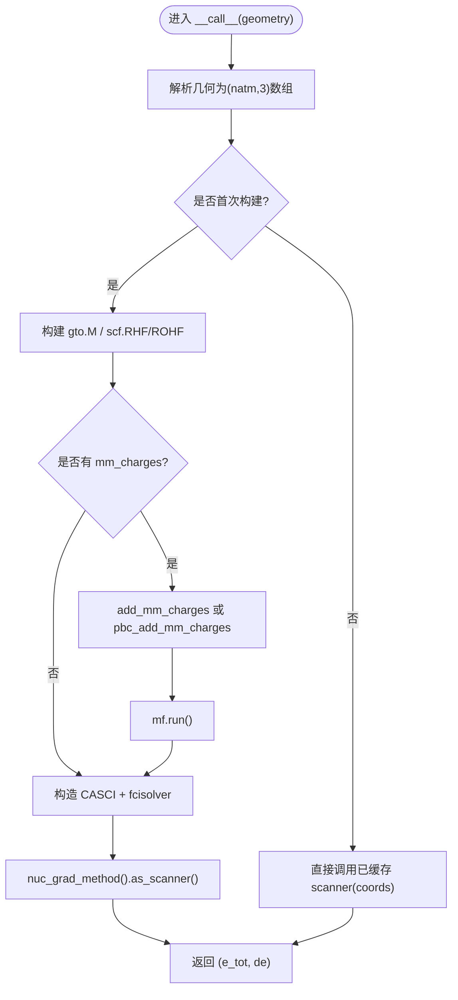
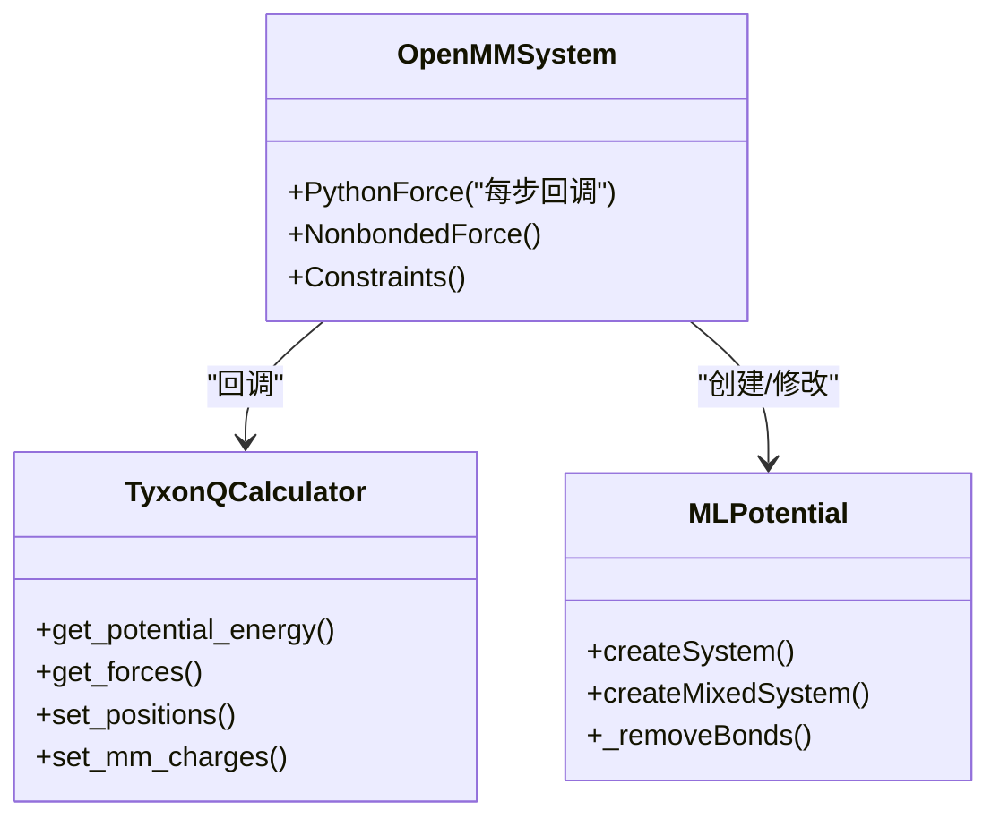
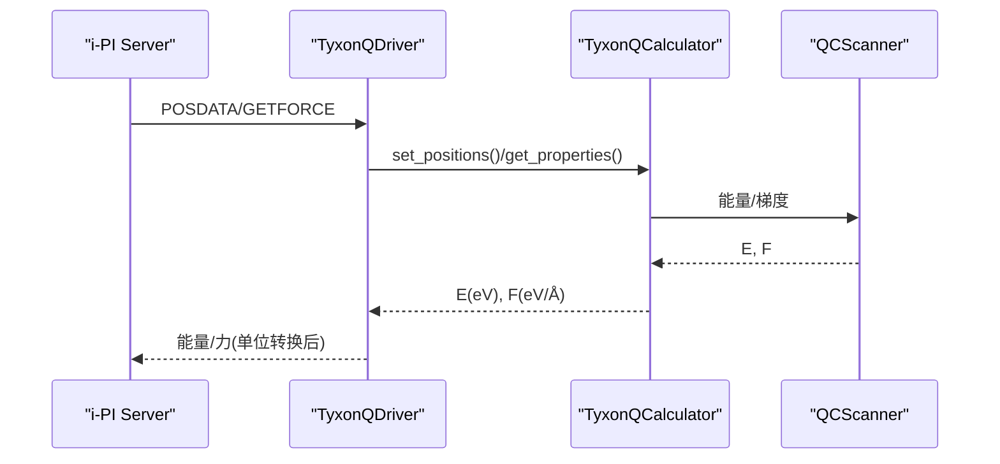
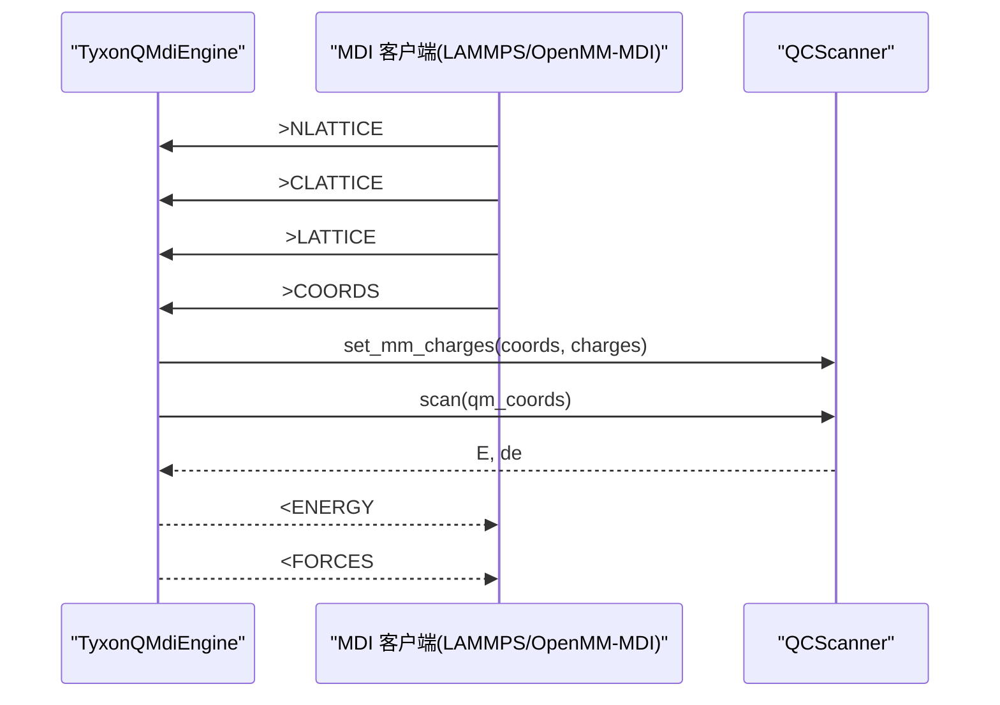
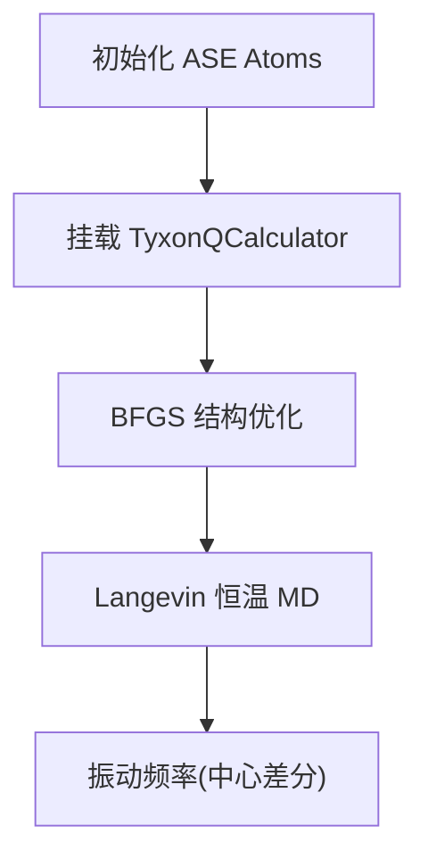
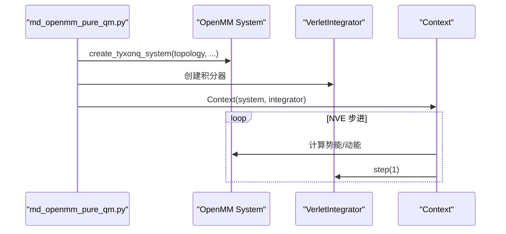
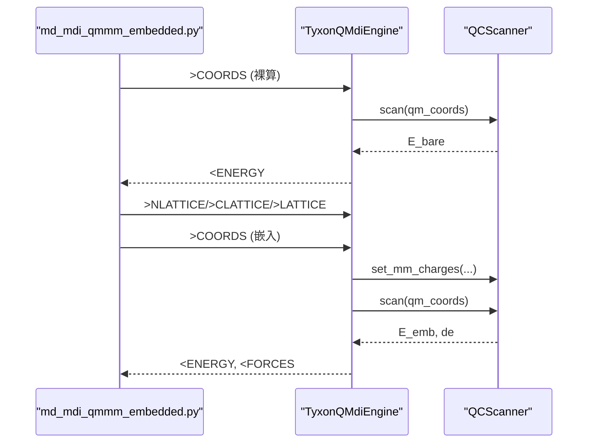
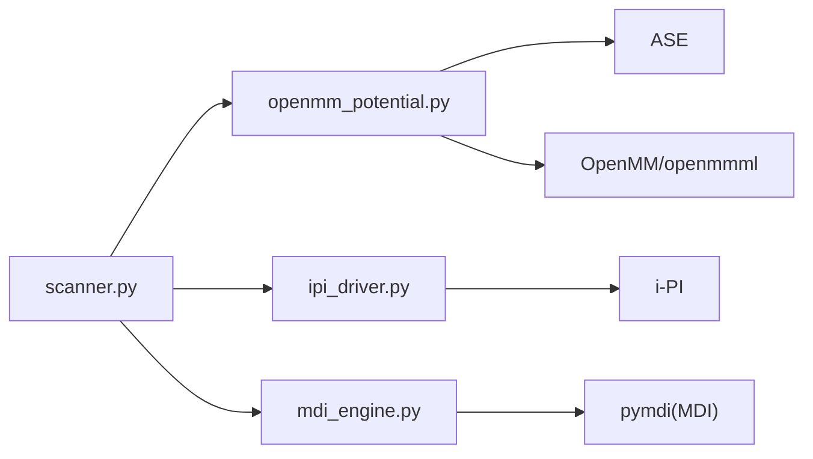

# 分子动力学接口

<cite>
**本文引用的文件**
- [scanner.py](file://src/tyxonq/applications/chem/interfaces/scanner.py)
- [openmm_potential.py](file://src/tyxonq/applications/chem/interfaces/openmm_potential.py)
- [ipi_driver.py](file://src/tyxonq/applications/chem/interfaces/ipi_driver.py)
- [mdi_engine.py](file://src/tyxonq/applications/chem/interfaces/mdi_engine.py)
- [md_openmm_pure_qm.py](file://examples/qmmm/md_openmm_pure_qm.py)
- [md_mdi_qmmm_embedded.py](file://examples/qmmm/md_mdi_qmmm_embedded.py)
- [md_ipi_driver_server.py](file://examples/qmmm/md_ipi_driver_server.py)
- [md_ase_optimize_and_md.py](file://examples/qmmm/md_ase_optimize_and_md.py)
</cite>

## 目录
1. [简介](#简介)
2. [项目结构](#项目结构)
3. [核心组件](#核心组件)
4. [架构总览](#架构总览)
5. [详细组件分析](#详细组件分析)
6. [依赖关系分析](#依赖关系分析)
7. [性能考虑](#性能考虑)
8. [故障排查指南](#故障排查指南)
9. [结论](#结论)
10. [附录](#附录)

## 简介
本文件为 TyxonQ 分子动力学接口的权威 API 文档，聚焦以下目标：
- Scanner 类的使用方法：势能面扫描、几何优化与振动频率计算。
- OpenMM 集成细节：力场定义、约束处理与周期性边界条件设置。
- IPI 驱动器配置：与外部分子动力学引擎通信的客户端/服务器模式。
- MDI 引擎工作原理：QM/MM 静电嵌入方案在 MDI 协议下的实现。
- 完整工作流示例：从初始结构准备到轨迹分析与性质计算。
- 与 LAMMPS、ASE 等主流软件的数据交换格式与性能优化建议。

## 项目结构
TyxonQ 的分子动力学接口位于 applications/chem/interfaces 下，提供统一入口 qc_scanner，并分别对接 ASE、OpenMM、i-PI、MDI 等生态。示例脚本展示了端到端工作流。

图表来源
- [scanner.py:93-424](file://src/tyxonq/applications/chem/interfaces/scanner.py#L93-L424)
- [openmm_potential.py:73-257](file://src/tyxonq/applications/chem/interfaces/openmm_potential.py#L73-L257)
- [ipi_driver.py:90-142](file://src/tyxonq/applications/chem/interfaces/ipi_driver.py#L90-L142)
- [mdi_engine.py:52-231](file://src/tyxonq/applications/chem/interfaces/mdi_engine.py#L52-L231)

章节来源
- [scanner.py:93-424](file://src/tyxonq/applications/chem/interfaces/scanner.py#L93-L424)
- [openmm_potential.py:73-257](file://src/tyxonq/applications/chem/interfaces/openmm_potential.py#L73-L257)
- [ipi_driver.py:90-142](file://src/tyxonq/applications/chem/interfaces/ipi_driver.py#L90-L142)
- [mdi_engine.py:52-231](file://src/tyxonq/applications/chem/interfaces/mdi_engine.py#L52-L231)

## 核心组件
- QCScanner（scanner.py）：惰性构建几何的量子化学能量/梯度扫描器，支持 SQD/UCCSD/ROUCCSD/HEA 等方法；支持静电嵌入与周期性固体嵌入；提供 mm_gradient 返回 MM 反作用力。
- OpenMM 适配（openmm_potential.py）：通过 openmmml.MLPotential('ase') 将 TyxonQCalculator 接入 OpenMM System；提供纯 QM、机械嵌入与静电嵌入三种路径。
- i-PI 驱动器（ipi_driver.py）：基于 ASEDriver 的薄壳，将 TyxonQCalculator 暴露为 i-PI forcefield，支持区域划分与周期性嵌入参数解析。
- MDI 引擎（mdi_engine.py）：以 ENGINE 角色注册命令，接收 >COORDS 与 >NLATTICE/>CLATTICE/>LATTICE，返回 <ENERGY/<FORCES，实现静电嵌入 QM/MM。

章节来源
- [scanner.py:93-424](file://src/tyxonq/applications/chem/interfaces/scanner.py#L93-L424)
- [openmm_potential.py:73-257](file://src/tyxonq/applications/chem/interfaces/openmm_potential.py#L73-L257)
- [ipi_driver.py:90-142](file://src/tyxonq/applications/chem/interfaces/ipi_driver.py#L90-L142)
- [mdi_engine.py:52-231](file://src/tyxonq/applications/chem/interfaces/mdi_engine.py#L52-L231)

## 架构总览
TyxonQ 作为“唯一门面”通过 qc_scanner 暴露统一的能量/梯度接口，上层可自由选择 ASE、OpenMM、i-PI、MDI 或 LAMMPS 等生态进行动力学模拟与采样。

图表来源
- [scanner.py:280-320](file://src/tyxonq/applications/chem/interfaces/scanner.py#L280-L320)
- [openmm_potential.py:242-257](file://src/tyxonq/applications/chem/interfaces/openmm_potential.py#L242-L257)
- [ipi_driver.py:115-142](file://src/tyxonq/applications/chem/interfaces/ipi_driver.py#L115-L142)
- [mdi_engine.py:127-179](file://src/tyxonq/applications/chem/interfaces/mdi_engine.py#L127-L179)

## 详细组件分析

### QCScanner（势能面扫描、几何优化、振动频率）
- 方法选择与子空间策略：
  - method 支持 sqd、uccsd、rouccsd、hea。
  - subspace 控制冻结子空间策略；sqd 默认 frozen，非光滑表面需显式 allow_discontinuous=True。
- 几何构建与单位：
  - 支持传入 Bohr 坐标或 PySCF 原子规格；内部保持 mol.unit='Bohr' 以避免单位误读。
- 静电嵌入与周期性嵌入：
  - 支持 mm_charges=(coords, charges) 与 mm_lattice（对角晶格），要求 rcut_ewald/rcut_hcore 满足上游断言。
  - set_mm_charges 每步更新环境；pbc 分支重跑平均场避免旧轨道残留。
- 反作用力：
  - mm_gradient() 返回 dE/dR_mm（Hartree/Bohr），包含电子与核贡献；pbc 模式额外加入 Ewald 项。
- 与 PySCF 积分器兼容：
  - as_pyscf_scanner() 返回底层 GradScanner，可直接交给 pyscf.md 积分器。

图表来源
- [scanner.py:192-267](file://src/tyxonq/applications/chem/interfaces/scanner.py#L192-L267)
- [scanner.py:280-320](file://src/tyxonq/applications/chem/interfaces/scanner.py#L280-L320)

章节来源
- [scanner.py:93-424](file://src/tyxonq/applications/chem/interfaces/scanner.py#L93-L424)

### OpenMM 集成（力场定义、约束处理、PBC）
- 纯 QM 系统：
  - create_tyxonq_system(topology, info, **scanner_kwargs) 返回 openmm.System，内部 PythonForce 每步回调 TyxonQCalculator 取 E/F。
- 机械嵌入：
  - create_mixed_system(topology, mm_system, qm_atoms, ...) 删除 QM 子集内部键/角/二面角与 nonbonded 自作用，QM–MM 相互作用仍由经典力场处理。
- 静电嵌入（簇嵌入版）：
  - create_qmmm_ee_system(topology, mm_system, qm_atoms, atom_charges, ...) 将 MM 点电荷注入 QM 哈密顿量；防双计数：QM 原子电荷置零、QM 内部 nonbonded 清零、QM–MM vdW 与 MM–MM 保留。
- 单位与精度：
  - 能量 eV→kJ/mol，力 eV/Å→kJ/mol/nm；混合模式下 MM 力可能 float32 截断，本路径保持 float64。

图表来源
- [openmm_potential.py:73-257](file://src/tyxonq/applications/chem/interfaces/openmm_potential.py#L73-L257)

章节来源
- [openmm_potential.py:73-257](file://src/tyxonq/applications/chem/interfaces/openmm_potential.py#L73-L257)

### IPI 驱动器（与外部分子动力学引擎通信）
- 角色与协议：
  - TyxonQDriver 继承 ASEDriver，将 TyxonQCalculator 暴露为 i-PI forcefield。
  - 命令行通过 i-pi-driver-py -m custom -P ipi_driver.py 加载，-o 参数串解析 active_space、qm_indices、atom_charges、mm_lattice、rcut_* 等。
- 无应力处理：
  - compute_structure 为无 stress 计算器补零应力，避免上游 post_process 校验失败。
- 典型用法：
  - 生成 water.xyz 模板与 input.xml，启动 i-PI server 与 driver 双进程，运行 NVT/NVE/PIMD。

图表来源
- [ipi_driver.py:90-142](file://src/tyxonq/applications/chem/interfaces/ipi_driver.py#L90-L142)
- [md_ipi_driver_server.py:144-194](file://examples/qmmm/md_ipi_driver_server.py#L144-L194)

章节来源
- [ipi_driver.py:90-142](file://src/tyxonq/applications/chem/interfaces/ipi_driver.py#L90-L142)
- [md_ipi_driver_server.py:144-194](file://examples/qmmm/md_ipi_driver_server.py#L144-L194)

### MDI 引擎（QM/MM 静电嵌入）
- 命令表：
  - 输入：<NATOMS、<COORDS、<ENERGY、<FORCES、<ELEMENTS、<MASSES、<TOTCHARGE、<ELEC_MULT、<DIMENSIONS。
  - 输出：>COORDS、>NLATTICE、>CLATTICE、>LATTICE、>TOTCHARGE、>ELEC_MULT、EXIT。
- 静电嵌入流程：
  - 先接收 >NLATTICE 确定 MM 粒子数，再接收 >CLATTICE（电荷）、>LATTICE（坐标）缓存成对；每次 >COORDS 后整体注入 set_mm_charges。
  - <FORCES 返回全原子力 = QM 梯度（含嵌入）⊕ MM 反作用力（mm_gradient）。
- 单位约定：
  - 全程原子单位（Bohr/Hartree/e），不做换算。

图表来源
- [mdi_engine.py:127-179](file://src/tyxonq/applications/chem/interfaces/mdi_engine.py#L127-L179)
- [mdi_engine.py:183-216](file://src/tyxonq/applications/chem/interfaces/mdi_engine.py#L183-L216)

章节来源
- [mdi_engine.py:52-231](file://src/tyxonq/applications/chem/interfaces/mdi_engine.py#L52-L231)

### 工作流示例（ASE 优化、MD、振动频率）
- 挂载 TyxonQCalculator 到 ASE Atoms，执行 BFGS 优化、Langevin MD、振动频率分析。
- 步骤要点：
  - 初始化 Atoms，设置 calc=TyxonQCalculator(basis, active_space, method)。
  - 使用 ase.optimize.BFGS 进行结构优化。
  - 使用 ase.md.langevin.Langevin 进行恒温 MD。
  - 使用 ase.vibrations.Vibrations 进行有限差分振动分析。

图表来源
- [md_ase_optimize_and_md.py:61-186](file://examples/qmmm/md_ase_optimize_and_md.py#L61-L186)

章节来源
- [md_ase_optimize_and_md.py:61-186](file://examples/qmmm/md_ase_optimize_and_md.py#L61-L186)

### 工作流示例（OpenMM 纯 QM）
- 通过 create_tyxonq_system 将拓扑转换为 OpenMM System，使用 VerletIntegrator 进行 NVE 短 MD，验证能量守恒与参考能量一致性。

图表来源
- [md_openmm_pure_qm.py:77-159](file://examples/qmmm/md_openmm_pure_qm.py#L77-L159)

章节来源
- [md_openmm_pure_qm.py:77-159](file://examples/qmmm/md_openmm_pure_qm.py#L77-L159)

### 工作流示例（MDI 静电嵌入）
- 两进程模型：driver（客户端）与 engine（TyxonQMdiEngine 子进程）通过 TCP 通信，演示裸算与嵌入能量差、每步更新生效。

图表来源
- [md_mdi_qmmm_embedded.py:79-132](file://examples/qmmm/md_mdi_qmmm_embedded.py#L79-L132)
- [mdi_engine.py:183-216](file://src/tyxonq/applications/chem/interfaces/mdi_engine.py#L183-L216)

章节来源
- [md_mdi_qmmm_embedded.py:79-132](file://examples/qmmm/md_mdi_qmmm_embedded.py#L79-L132)
- [mdi_engine.py:183-216](file://src/tyxonq/applications/chem/interfaces/mdi_engine.py#L183-L216)

## 依赖关系分析
- 模块耦合：
  - scanner.py 为核心，被 openmm_potential.py、ipi_driver.py、mdi_engine.py 引用。
  - openmm_potential.py 依赖 openmmml 与 ASE；ipi_driver.py 依赖 i-PI；mdi_engine.py 依赖 pymdi。
- 外部依赖：
  - PySCF（gto/scf/mcscf/qmmm）、ASE、OpenMM、i-PI、MDI。
- 潜在循环依赖：
  - 各适配层仅单向依赖 scanner.py，无循环导入。

图表来源
- [scanner.py:93-424](file://src/tyxonq/applications/chem/interfaces/scanner.py#L93-L424)
- [openmm_potential.py:73-257](file://src/tyxonq/applications/chem/interfaces/openmm_potential.py#L73-L257)
- [ipi_driver.py:90-142](file://src/tyxonq/applications/chem/interfaces/ipi_driver.py#L90-L142)
- [mdi_engine.py:52-231](file://src/tyxonq/applications/chem/interfaces/mdi_engine.py#L52-L231)

章节来源
- [scanner.py:93-424](file://src/tyxonq/applications/chem/interfaces/scanner.py#L93-L424)
- [openmm_potential.py:73-257](file://src/tyxonq/applications/chem/interfaces/openmm_potential.py#L73-L257)
- [ipi_driver.py:90-142](file://src/tyxonq/applications/chem/interfaces/ipi_driver.py#L90-L142)
- [mdi_engine.py:52-231](file://src/tyxonq/applications/chem/interfaces/mdi_engine.py#L52-L231)

## 性能考虑
- 子空间冻结：
  - 使用 subspace="frozen" 保证能量面光滑，适合解析梯度与 MD；随机子空间会导致力噪声与非光滑表面。
- 热启动与缓存：
  - QCScanner 首次构建后缓存 scanner，后续仅更新坐标；set_mm_charges 在已装饰对象上走原地重入路径，避免重建平均场。
- 单位与精度：
  - OpenMM 混合模式下 MM 力可能 float32 截断；本模块静电嵌入路径保持 float64。
- 步长与收敛：
  - 小体系（如 H2O）可用 0.2–0.5 fs 步长；大活性空间/基组需减小步长以保证稳定性。
- 并行与批处理：
  - i-PI 支持 PIMD 多珠子并行；MDI 专线直连减少进程间开销。

[本节为通用指导，不直接分析具体文件]

## 故障排查指南
- 导入错误：
  - OpenMM/openmmml 缺失时抛出 ImportError 并提示安装命令；i-PI 与 pymdi 同理。
- 参数校验：
  - active_space 必须合法；mm_lattice 必须为对角矩阵且尺寸正确；rcut_ewald/rcut_hcore 必须小于盒边/半盒边。
- 嵌入失效：
  - 首次 set_mm_charges 若未装饰过平均场，会按配方重建；确保返回值被正确引用。
- 能量守恒诊断：
  - 静电嵌入已知近似（缺 post-HF 轨道响应），严格 NVE 守恒诊断不成立；可使用恒温/恒压系综。

章节来源
- [openmm_potential.py:44-57](file://src/tyxonq/applications/chem/interfaces/openmm_potential.py#L44-L57)
- [scanner.py:121-172](file://src/tyxonq/applications/chem/interfaces/scanner.py#L121-L172)
- [scanner.py:331-381](file://src/tyxonq/applications/chem/interfaces/scanner.py#L331-L381)
- [mdi_engine.py:44-49](file://src/tyxonq/applications/chem/interfaces/mdi_engine.py#L44-L49)

## 结论
TyxonQ 通过统一的 qc_scanner 接口，无缝对接 ASE、OpenMM、i-PI、MDI 等分子动力学生态，支持从纯 QM 到 QM/MM 静电嵌入的多种场景。其设计强调：
- 惰性构建与热启动，提升效率。
- 严格的单位与参数校验，保障物理正确性。
- 可扩展的嵌入机制，兼容簇与周期性体系。
结合示例脚本，用户可从结构优化、MD 到振动频率完成端到端工作流，并获得稳定可靠的势能面驱动。

[本节为总结，不直接分析具体文件]

## 附录
- 数据交换格式：
  - ASE：Atoms 对象，位置 Å，能量 eV，力 eV/Å。
  - OpenMM：Topology/System，单位 kJ/mol/nm，通过 PythonForce 回调传递 E/F。
  - i-PI：input.xml 描述系统与力场，ffsocket 通信，单位由 i-PI 管理。
  - MDI：原子单位（Bohr/Hartree/e），命令表见 mdi_engine.py。
- 与 LAMMPS 集成：
  - 通过 i-PI + LAMMPS pppm 实现周期性固体嵌入；或直接使用带 MDI 包的 LAMMPS 直连 TyxonQMdiEngine。
- 性能优化建议：
  - 使用 subspace="frozen" 与合理活性空间；减小步长；利用 i-PI 的 PIMD 并行；避免不必要的平均场重建。

[本节为补充信息，不直接分析具体文件]