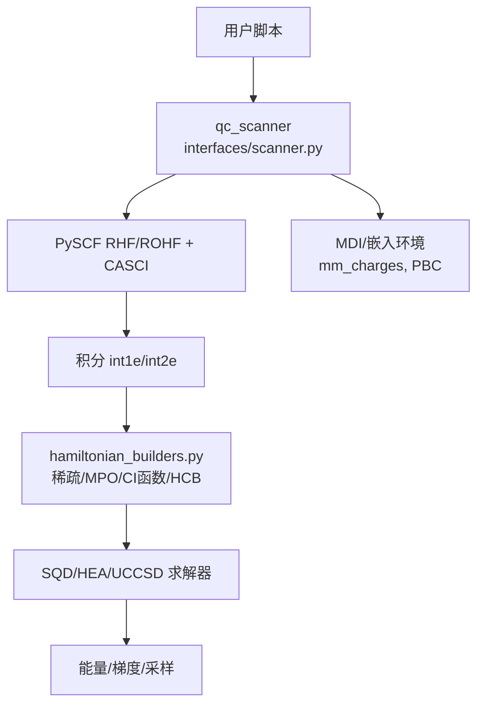
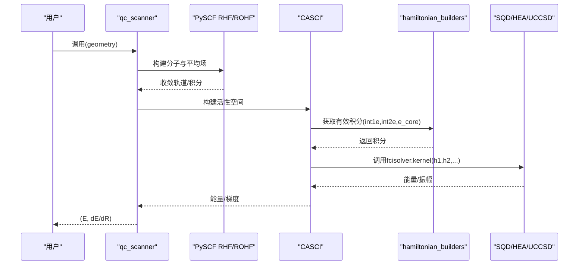
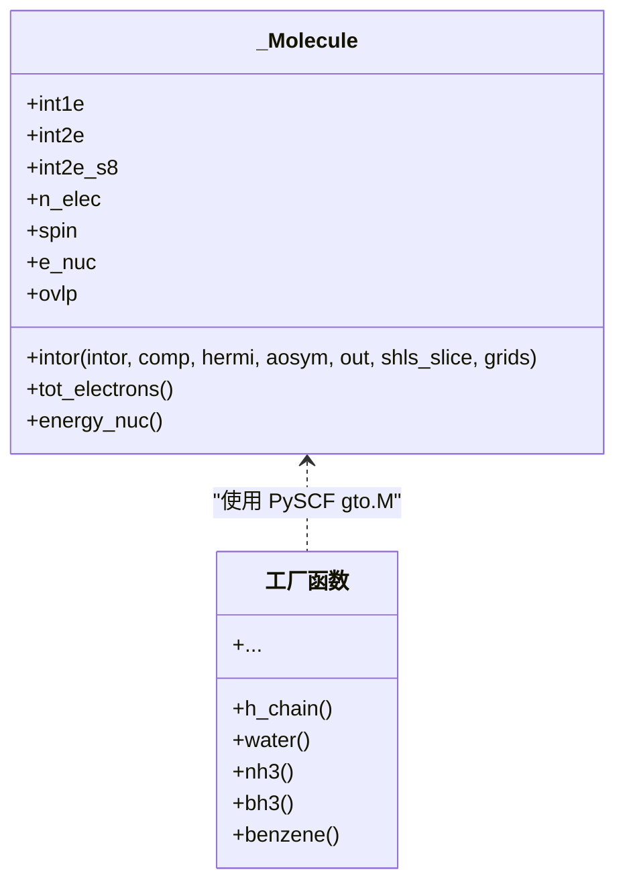
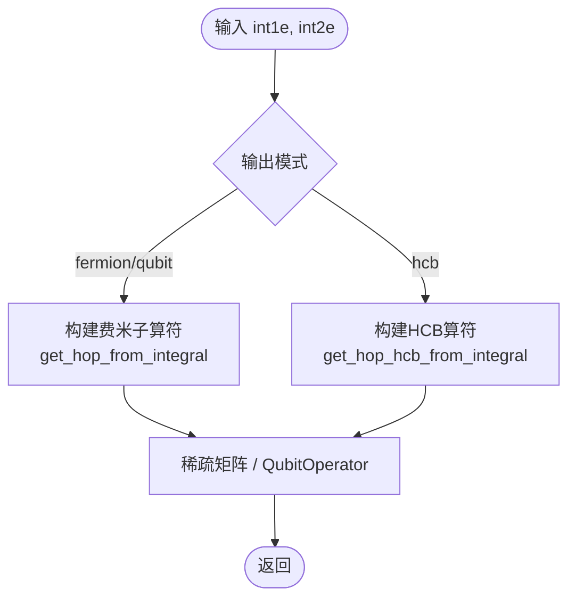
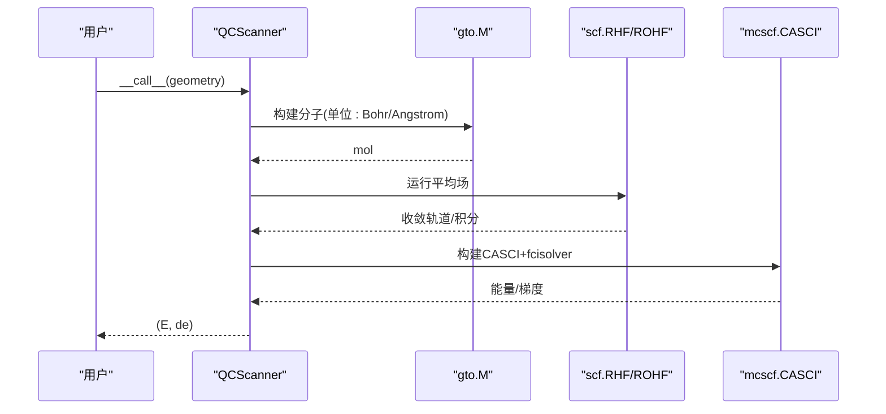
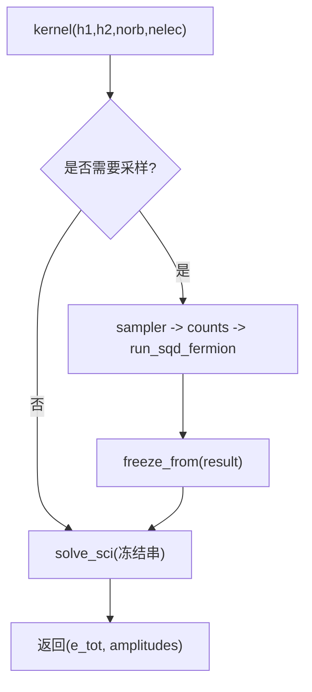
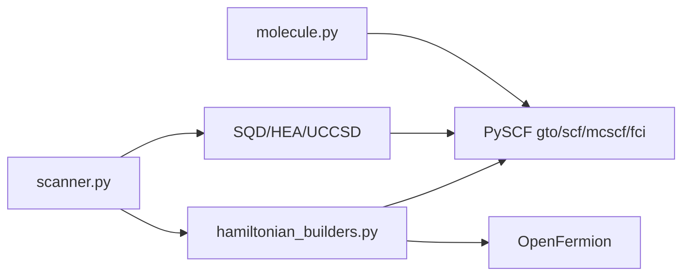

# 分子和哈密顿量

<cite>
**本文引用的文件**
- [molecule.py](file://src/tyxonq/applications/chem/molecule.py)
- [hamiltonian_builders.py](file://src/tyxonq/applications/chem/hamiltonian_builders.py)
- [scanner.py](file://src/tyxonq/applications/chem/interfaces/scanner.py)
- [pyscf_solver.py](file://src/tyxonq/applications/chem/algorithms/sqd/pyscf_solver.py)
- [hea.py](file://src/tyxonq/applications/chem/algorithms/vqe/hea.py)
- [cpu_chem.py](file://src/tyxonq/applications/chem/classical_chem_cloud/server/cpu_chem.py)
- [memory_optimization_checkpointing.py](file://examples/memory_optimization_checkpointing.py)
- [hamiltonian_building.py](file://examples/hamiltonian_building.py)
</cite>

## 目录
1. [简介](#简介)
2. [项目结构](#项目结构)
3. [核心组件](#核心组件)
4. [架构总览](#架构总览)
5. [详细组件分析](#详细组件分析)
6. [依赖关系分析](#依赖关系分析)
7. [性能与内存考量](#性能与内存考量)
8. [故障排查指南](#故障排查指南)
9. [结论](#结论)
10. [附录：示例与用法](#附录示例与用法)

## 简介
本文件面向 TyxonQ 量子化学模块中的“分子”与“哈密顿量构建”能力，提供从 API 到实现细节的系统化说明。内容涵盖：
- Molecule 类（基于 PySCF 的鸭子类型封装）的构造、积分接口与常用分子生成器；
- 哈密顿量构建器的多种模式：费米子算符、自旋轨道耦合、硬芯玻色子（HCB）、稀疏矩阵/MPO/CI函数等；
- 基组选择与计算级别对精度与性能的权衡；
- 大分子系统的内存限制与优化策略；
- 与 PySCF 的集成方式及数据格式转换；
- 从 SMILES/PDB 创建分子对象的推荐路径（通过 PySCF 分子对象接入）。

## 项目结构
TyxonQ 在量子化学方向的关键代码集中在 applications/chem 下，围绕“分子表示—积分获取—哈密顿量编码—求解/扫描”形成清晰分层：
- 分子层：molecule.py 提供 _Molecule 与常用分子工厂；
- 积分与哈密顿量：hamiltonian_builders.py 负责从 HF/CASCI 积分到不同编码形式；
- 扫描与动力学：interfaces/scanner.py 提供 qc_scanner，统一对接 PySCF 梯度与 MD；
- 算法后端：algorithms/sqd/pyscf_solver.py 与 algorithms/vqe/hea.py 提供 SQD/HEA/UCCSD 等求解器；
- 云端/资源管理：classical_chem_cloud/server/cpu_chem.py 设置线程与内存上限；
- 示例：examples 中给出哈密顿量构建与内存优化实践。

图表来源
- [scanner.py:93-267](file://src/tyxonq/applications/chem/interfaces/scanner.py#L93-L267)
- [hamiltonian_builders.py:46-163](file://src/tyxonq/applications/chem/hamiltonian_builders.py#L46-L163)
- [pyscf_solver.py:52-160](file://src/tyxonq/applications/chem/algorithms/sqd/pyscf_solver.py#L52-L160)
- [hea.py:435-474](file://src/tyxonq/applications/chem/algorithms/vqe/hea.py#L435-L474)

章节来源
- [scanner.py:1-424](file://src/tyxonq/applications/chem/interfaces/scanner.py#L1-L424)
- [hamiltonian_builders.py:1-320](file://src/tyxonq/applications/chem/hamiltonian_builders.py#L1-L320)
- [molecule.py:1-311](file://src/tyxonq/applications/chem/molecule.py#L1-L311)

## 核心组件
- 分子表示与工厂
  - _Molecule：继承 PySCF 的 Mole，暴露 intor、tot_electrons、energy_nuc 等必要接口，支持自定义 one-/two-body 积分与重叠矩阵；
  - 常用分子工厂：h_chain/h_ring/h_square/h_cube/water/nh3/bh3/N2/CO/CH4/HCN/C2H2/H2CO/c4h4/benzene/indene 等，便于快速构建测试体系。
- 哈密顿量构建器
  - 从 HF/CASCI 提取有效积分（int1e, int2e, e_core），并转换为：
    - 费米子算符（OpenFermion FermionOperator）→ 稀疏矩阵或 QubitOperator；
    - 硬芯玻色子（HCB）模型；
    - CI 空间作用函数（PySCF direct_spin1/direct_nosym）；
    - MPO-like 包装（供测试兼容）。
- 扫描器与动力学
  - qc_scanner：统一入口，支持方法 sqd/uccsd/rouccsd/hea，惰性构建分子与平均场，返回 (能量, 梯度)，支持静电嵌入与周期性边界。
- 求解器适配器
  - SQDFCISolver：将 SQD 包装为 PySCF fcisolver，支持 frozen/refresh/adaptive 子空间策略；
  - HEA/UCCSD：通过 as_pyscf_solver 接入扫描器。

章节来源
- [molecule.py:13-73](file://src/tyxonq/applications/chem/molecule.py#L13-L73)
- [molecule.py:80-291](file://src/tyxonq/applications/chem/molecule.py#L80-L291)
- [hamiltonian_builders.py:46-163](file://src/tyxonq/applications/chem/hamiltonian_builders.py#L46-L163)
- [scanner.py:93-267](file://src/tyxonq/applications/chem/interfaces/scanner.py#L93-L267)
- [pyscf_solver.py:52-160](file://src/tyxonq/applications/chem/algorithms/sqd/pyscf_solver.py#L52-L160)
- [hea.py:435-474](file://src/tyxonq/applications/chem/algorithms/vqe/hea.py#L435-L474)

## 架构总览
下图展示从分子到哈密顿量再到求解/梯度的端到端流程，以及关键数据流与外部依赖。

图表来源
- [scanner.py:192-267](file://src/tyxonq/applications/chem/interfaces/scanner.py#L192-L267)
- [hamiltonian_builders.py:46-68](file://src/tyxonq/applications/chem/hamiltonian_builders.py#L46-L68)
- [pyscf_solver.py:122-160](file://src/tyxonq/applications/chem/algorithms/sqd/pyscf_solver.py#L122-L160)

## 详细组件分析

### 分子模块（_Molecule 与工厂）
- 构造要点
  - 接受 one-body 与 two-body 积分、电子数、自旋、核能、重叠矩阵；
  - 内部维护 int2e_s8（8重对称压缩）以兼容 PySCF 接口；
  - 重写 intor 以支持 int1e_kin/int1e_nuc/int1e_ovlp/int2e 等查询。
- 常用分子
  - 链/环/方格/立方氢链；水、氨、硼烷、氮、一氧化碳、甲烷、乙炔、甲醛、丁二烯、苯、茚等。
- 随机分子
  - 通过 random_integral 生成对称化的 int1e/int2e，用于基准测试。

图表来源
- [molecule.py:13-73](file://src/tyxonq/applications/chem/molecule.py#L13-L73)
- [molecule.py:80-291](file://src/tyxonq/applications/chem/molecule.py#L80-L291)

章节来源
- [molecule.py:13-73](file://src/tyxonq/applications/chem/molecule.py#L13-L73)
- [molecule.py:80-291](file://src/tyxonq/applications/chem/molecule.py#L80-L291)

### 哈密顿量构建器
- 积分提取
  - get_integral_from_hf：从 RHF 出发，可选 active_space/active_orbital_indices，返回 int1e, int2e, e_core；
  - 自动规范轨道系数（canonical_mo_coeff）。
- 算符构建
  - get_hop_from_integral：构建费米子算符（含自旋轨道项，n_sorb = 2*n_orb）；
  - get_hop_hcb_from_integral：构建硬芯玻色子模型；
  - qubit_operator：将字符串形式的升降算符转为 QubitOperator。
- 输出模式
  - sparse：稀疏矩阵（COO）；
  - mpo：MPO-like 包装（eval_matrix）；
  - fcifunc：CI 空间作用函数（direct_spin1/direct_nosym）。
- 应用
  - apply_op：后端无关的哈密顿量作用函数，支持稀疏/可调用/eval_matrix/稠密矩阵。

图表来源
- [hamiltonian_builders.py:71-153](file://src/tyxonq/applications/chem/hamiltonian_builders.py#L71-L153)
- [hamiltonian_builders.py:283-318](file://src/tyxonq/applications/chem/hamiltonian_builders.py#L283-L318)

章节来源
- [hamiltonian_builders.py:46-163](file://src/tyxonq/applications/chem/hamiltonian_builders.py#L46-L163)
- [hamiltonian_builders.py:283-318](file://src/tyxonq/applications/chem/hamiltonian_builders.py#L283-L318)

### 扫描器与动力学（qc_scanner）
- 功能
  - 惰性构建分子与平均场（RHF/ROHF），再构建 CASCI 与梯度扫描器；
  - 支持方法 sqd/uccsd/rouccsd/hea，并通过 _make_fcisolver 动态装配；
  - 支持静电嵌入（mm_charges）与周期性边界（mm_lattice + rcut_ewald/rcut_hcore）；
  - 提供 mm_gradient 返回 MM 粒子受力（反作用力）。
- 几何处理
  - 支持 Bohr 坐标数组、PySCF 原子列表、带 atom_coords 的对象；
  - 首次调用时构建，后续复用底层 scanner。

图表来源
- [scanner.py:192-267](file://src/tyxonq/applications/chem/interfaces/scanner.py#L192-L267)
- [scanner.py:280-320](file://src/tyxonq/applications/chem/interfaces/scanner.py#L280-L320)

章节来源
- [scanner.py:93-424](file://src/tyxonq/applications/chem/interfaces/scanner.py#L93-L424)

### SQD 求解器适配器（PySCF fcisolver）
- 子空间策略
  - frozen：首帧确定行列式子空间后锁存，能量面光滑，适合解析梯度/MD；
  - refresh：每几何重新采样，仅用于单点能；
  - adaptive：周期刷新子空间，分段光滑。
- 关键实现
  - kernel：接收 h1/h2（注意 h2 需恢复为全张量），nelec 转 (na,nb)，必要时采样并冻结；
  - make_rdm1/make_rdm12/spin_square：对接 SelectedCI 密度矩阵与自旋平方。

图表来源
- [pyscf_solver.py:122-160](file://src/tyxonq/applications/chem/algorithms/sqd/pyscf_solver.py#L122-L160)
- [pyscf_solver.py:200-213](file://src/tyxonq/applications/chem/algorithms/sqd/pyscf_solver.py#L200-L213)

章节来源
- [pyscf_solver.py:52-160](file://src/tyxonq/applications/chem/algorithms/sqd/pyscf_solver.py#L52-L160)
- [pyscf_solver.py:200-213](file://src/tyxonq/applications/chem/algorithms/sqd/pyscf_solver.py#L200-L213)

### HEA/UCCSD 与 PySCF 集成
- HEA.from_molecule：从 PySCF 分子对象构建 HEA，自动运行 RHF 得到积分与 e_core，并根据自旋选择初始化策略；
- 扫描器内通过 _make_fcisolver 将 HEA/UCCSD 作为 fcisolver 注入 CASCI，从而复用 PySCF 梯度与 MD 生态。

章节来源
- [hea.py:435-474](file://src/tyxonq/applications/chem/algorithms/vqe/hea.py#L435-L474)
- [scanner.py:56-90](file://src/tyxonq/applications/chem/interfaces/scanner.py#L56-L90)

## 依赖关系分析
- 外部库
  - PySCF：分子构建、平均场、CASCI、梯度、qmmm、FCI；
  - OpenFermion：费米子/量子比特算符与变换；
  - NumPy/SciPy：数值与稀疏矩阵；
  - TyxonQ 数值后端：backend 抽象，支持 NumPy/PyTorch/CuPy。
- 模块耦合
  - scanner 依赖 pyscf 与算法后端（SQD/HEA/UCCSD）；
  - hamiltonian_builders 依赖 openfermion 与 pyscf.fci；
  - molecule 仅做鸭子类型适配，降低耦合。

图表来源
- [scanner.py:41-90](file://src/tyxonq/applications/chem/interfaces/scanner.py#L41-L90)
- [hamiltonian_builders.py:1-18](file://src/tyxonq/applications/chem/hamiltonian_builders.py#L1-L18)
- [molecule.py:1-11](file://src/tyxonq/applications/chem/molecule.py#L1-L11)

章节来源
- [scanner.py:41-90](file://src/tyxonq/applications/chem/interfaces/scanner.py#L41-L90)
- [hamiltonian_builders.py:1-18](file://src/tyxonq/applications/chem/hamiltonian_builders.py#L1-L18)
- [molecule.py:1-11](file://src/tyxonq/applications/chem/molecule.py#L1-L11)

## 性能与内存考量
- 基组选择与精度/成本权衡
  - STO-3G：最小基组，成本低，定性结果；
  - 6-31G：分裂价基组，中等成本，定量结果；
  - cc-pVDZ/aug-cc-pVTZ：相关一致基组，高/很高成本，高精度。
- 大分子内存限制
  - 控制线程与内存：通过环境变量 PYSCF_MAX_MEMORY 与线程数设置；
  - 稀疏/函数式哈密顿量：优先使用 sparse 或 fcifunc 避免显式稠密矩阵；
  - 梯度检查点：深电路训练时使用梯度检查点降低 O(depth×2^n) 内存；
  - 活动空间：合理选择 active_space 与 active_orbital_indices 减少维度。
- 运行时建议
  - 小体系：statevector 精确模拟；
  - 中等体系：civector/pyscf 后端；
  - 大体系：考虑 MPS/张量网络或截断策略。

章节来源
- [cpu_chem.py:23-53](file://src/tyxonq/applications/chem/classical_chem_cloud/server/cpu_chem.py#L23-L53)
- [memory_optimization_checkpointing.py:1-200](file://examples/memory_optimization_checkpointing.py#L1-L200)
- [hamiltonian_builders.py:142-163](file://src/tyxonq/applications/chem/hamiltonian_builders.py#L142-L163)

## 故障排查指南
- 常见错误
  - 非法 active_space：确保 n_elec ∈ [1, 2*n_orb]；
  - 非平滑子空间：refresh/adaptive 模式默认拒绝解析梯度，需 allow_discontinuous=True；
  - 周期性嵌入参数：rcut_ewald/rcut_hcore 必须满足盒尺寸约束；
  - 设备采样：device 模式需 shots > 0。
- 调试步骤
  - 确认几何单位与 mol.unit 一致（Bohr/Angstrom）；
  - 打印底层 PySCF scanner 是否已构建；
  - 检查 mm_charges 形状与数量匹配；
  - 对 SQD 采样器验证 counts 顺序（半区反转）。

章节来源
- [scanner.py:121-171](file://src/tyxonq/applications/chem/interfaces/scanner.py#L121-L171)
- [scanner.py:280-320](file://src/tyxonq/applications/chem/interfaces/scanner.py#L280-L320)
- [pyscf_solver.py:255-323](file://src/tyxonq/applications/chem/algorithms/sqd/pyscf_solver.py#L255-L323)

## 结论
TyxonQ 的分子与哈密顿量模块以 PySCF 为核心，提供了从分子构建、积分提取、哈密顿量编码到求解/梯度的完整链路。通过灵活的基组与活动空间选择、多种哈密顿量编码模式、以及 SQD/HEA/UCCSD 等多后端，能够覆盖从小分子到较大体系的量子化学任务。结合内存优化与嵌入技术，可在资源受限环境下稳定运行。

## 附录：示例与用法
- 从 PySCF 分子对象构建 HEA
  - 参考路径：[from_molecule:435-474](file://src/tyxonq/applications/chem/algorithms/vqe/hea.py#L435-L474)
- 使用 qc_scanner 进行能量/梯度扫描
  - 参考路径：[qc_scanner 入口:414-424](file://src/tyxonq/applications/chem/interfaces/scanner.py#L414-L424)
- 构建 TFIM 哈密顿量（Pauli 项列表）
  - 参考路径：[build_tfim_terms:18-28](file://examples/hamiltonian_building.py#L18-L28)
- 梯度检查点概念演示
  - 参考路径：[checkpointing 概念:200-267](file://examples/memory_optimization_checkpointing.py#L200-L267)