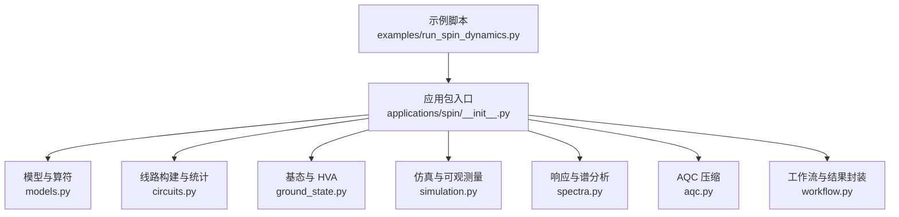
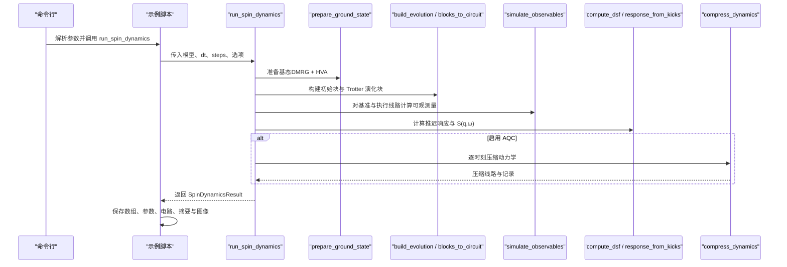
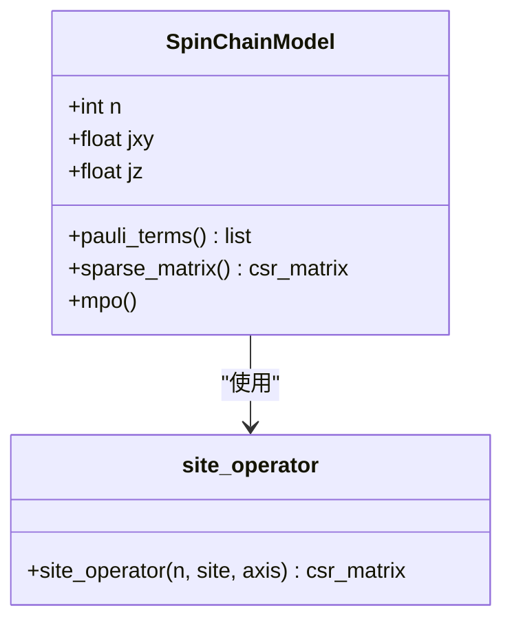
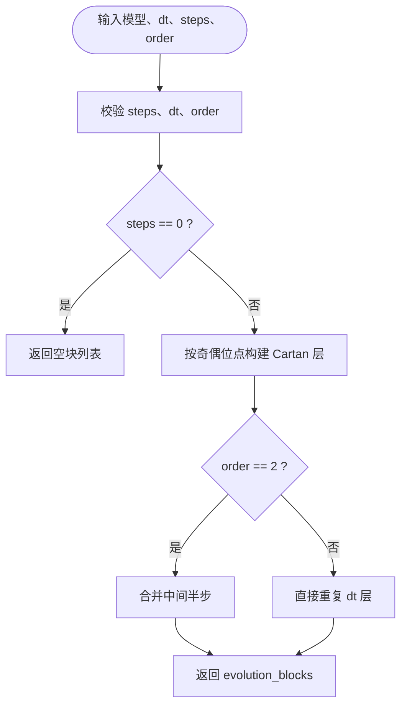
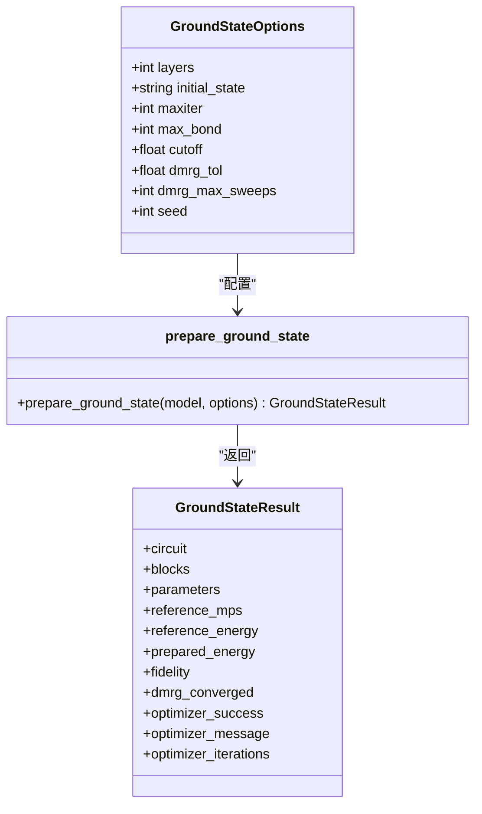
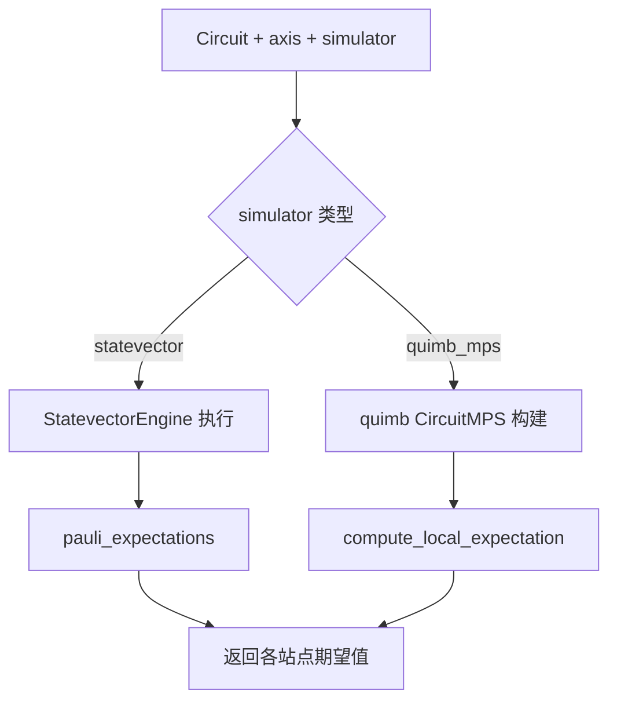
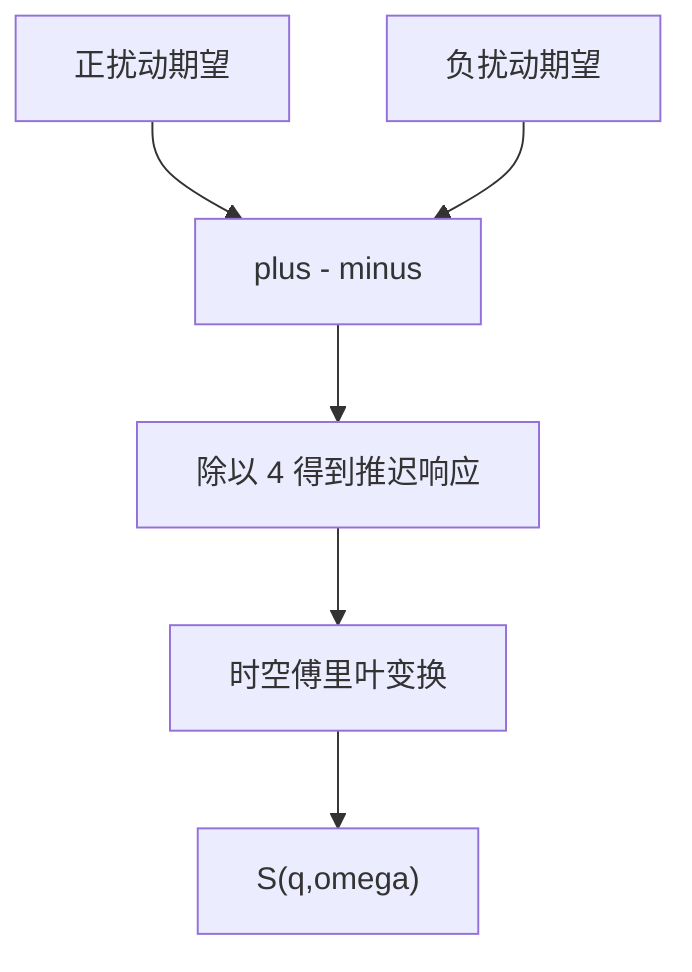
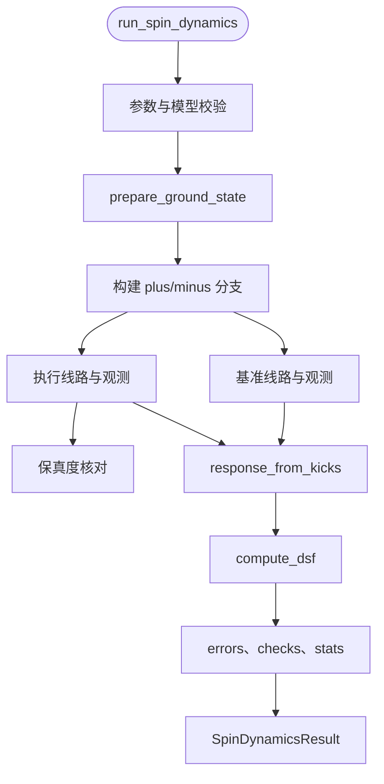
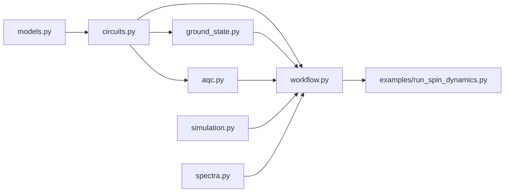

# 自旋动力学应用

<cite>
**本文引用的文件**   
- [run_spin_dynamics.py](file://examples/run_spin_dynamics.py)
- [__init__.py](file://src/tyxonq/applications/spin/__init__.py)
- [models.py](file://src/tyxonq/applications/spin/models.py)
- [circuits.py](file://src/tyxonq/applications/spin/circuits.py)
- [ground_state.py](file://src/tyxonq/applications/spin/ground_state.py)
- [simulation.py](file://src/tyxonq/applications/spin/simulation.py)
- [spectra.py](file://src/tyxonq/applications/spin/spectra.py)
- [aqc.py](file://src/tyxonq/applications/spin/aqc.py)
- [workflow.py](file://src/tyxonq/applications/spin/workflow.py)
</cite>

## 目录
1. [简介](#简介)
2. [项目结构](#项目结构)
3. [核心组件](#核心组件)
4. [架构总览](#架构总览)
5. [详细组件分析](#详细组件分析)
6. [依赖关系分析](#依赖关系分析)
7. [性能与精度特性](#性能与精度特性)
8. [故障排查指南](#故障排查指南)
9. [结论](#结论)

## 简介
本仓库中的“自旋动力学应用”面向最近邻 XXZ 自旋链，提供从基态制备、Trotter 时间演化、近似量子编译压缩到响应函数与谱分析的完整本地流程。示例脚本暴露命令行参数，支持态矢量或矩阵乘积态模拟，并输出数值结果、电路统计、可复现实例化参数与可视化图像。

该应用的核心目标是：
- 用 DMRG 参考 MPS 和 HVA 变分拟设准备基态；
- 用 Trotter 构造实时演化；
- 通过 AQC 将长时间演化压缩为更浅的线路；
- 计算推迟格林函数与动态结构因子；
- 给出误差指标与验收检查，区分基态误差、Trotter 误差与 AQC 误差。

## 项目结构
自旋应用位于 `src/tyxonq/applications/spin`，对外由包入口统一导出；示例位于 `examples/run_spin_dynamics.py`。



**图表来源**
- [__init__.py:3-8](file://src/tyxonq/applications/spin/__init__.py#L3-L8)
- [run_spin_dynamics.py:23-24](file://examples/run_spin_dynamics.py#L23-L24)

**章节来源**
- [run_spin_dynamics.py:1-13](file://examples/run_spin_dynamics.py#L1-L13)
- [__init__.py:1-12](file://src/tyxonq/applications/spin/__init__.py#L1-L12)

## 核心组件
- 物理模型：偶数位点开边界 XXZ 链，使用 `S = σ/2` 约定，并提供 Pauli 项、稀疏哈密顿量与 quimb MPO。
- 线路构建：HVA 基态拟设、Cartan 相互作用分解、二阶 Trotter 块、单比特旋转折叠与电路统计。
- 基态求解：DMRG 参考 MPS + HVA 经典保真度优化，返回能量、保真度与优化状态。
- 仿真后端：TyxonQ 原生态矢量引擎与 quimb MPS 两条路径，均计算局域 Pauli 期望值。
- 谱分析：正负扰动差得到推迟响应，零温中心位点近似下做时空傅里叶变换得到 S(q,ω)。
- AQC 压缩：逐时刻拟合目标 MPS，使用 PyTorch 梯度与 SciPy L-BFGS-B 优化，保留未压缩基准对比。
- 工作流：串联上述步骤，输出结构化结果、摘要、验收检查与耗时。

**章节来源**
- [models.py:1-71](file://src/tyxonq/applications/spin/models.py#L1-L71)
- [circuits.py:1-213](file://src/tyxonq/applications/spin/circuits.py#L1-L213)
- [ground_state.py:1-96](file://src/tyxonq/applications/spin/ground_state.py#L1-L96)
- [simulation.py:1-70](file://src/tyxonq/applications/spin/simulation.py#L1-L70)
- [spectra.py:1-62](file://src/tyxonq/applications/spin/spectra.py#L1-L62)
- [aqc.py:1-160](file://src/tyxonq/applications/spin/aqc.py#L1-L160)
- [workflow.py:1-176](file://src/tyxonq/applications/spin/workflow.py#L1-L176)

## 架构总览
自旋动力学应用采用“模型 → 线路 → 仿真 → 谱分析 → AQC 压缩 → 工作流汇总”的分层设计。示例脚本负责参数解析、进度回调与结果持久化；核心逻辑集中在 spin 应用包中。



**图表来源**
- [run_spin_dynamics.py:123-168](file://examples/run_spin_dynamics.py#L123-L168)
- [workflow.py:44-175](file://src/tyxonq/applications/spin/workflow.py#L44-L175)
- [ground_state.py:68-95](file://src/tyxonq/applications/spin/ground_state.py#L68-L95)
- [circuits.py:121-142](file://src/tyxonq/applications/spin/circuits.py#L121-L142)
- [simulation.py:57-69](file://src/tyxonq/applications/spin/simulation.py#L57-L69)
- [spectra.py:6-36](file://src/tyxonq/applications/spin/spectra.py#L6-L36)
- [aqc.py:95-159](file://src/tyxonq/applications/spin/aqc.py#L95-L159)

## 详细组件分析

### 物理模型与算符
- `SpinChainModel` 描述偶数位点 XXZ 链，哈密顿量为相邻键上 `Jxy(XX+YY)+Jz ZZ` 的和，系数按实现约定归一化。
- `site_operator` 生成单个位点的 Pauli 算符，不额外乘以 `1/2`；全局表示遵循 `S = σ/2`。
- 提供 `pauli_terms`、`sparse_matrix` 与 quimb `mpo`，分别用于小体系精确对角化、稀疏指数映射与 DMRG。



**图表来源**
- [models.py:16-70](file://src/tyxonq/applications/spin/models.py#L16-L70)

**章节来源**
- [models.py:1-71](file://src/tyxonq/applications/spin/models.py#L1-L71)

### 线路构建与电路统计
- Cartan 门分解：三 CNOT 实现 `exp[i(a XX+b YY+c ZZ)]`，允许全局相位差异。
- HVA 拟设：每层两个共享参数，局域生成元与模型耦合一致；角度是变参，与物理时间独立。
- Trotter 演化：保留块结构，支持一阶与二阶；整段二阶演化合并中间半步。
- 单比特旋转折叠：连续同轴旋转合并，提升线路简洁性。
- 电路统计：在共同分解下统计两比特门数量、两比特深度与总深度。



**图表来源**
- [circuits.py:51-75](file://src/tyxonq/applications/spin/circuits.py#L51-L75)

**章节来源**
- [circuits.py:11-142](file://src/tyxonq/applications/spin/circuits.py#L11-L142)

### 基态求解与 HVA 拟合
- DMRG 参考基态：使用 quimb DMRG2，尝试不同键维与截断，返回收敛状态与能量。
- HVA 拟合：以 MPS 内积保真度为目标，COBYQA 优化 HVA 角度，返回电路、参数与能量。
- 结果对象同时包含参考 MPS、制备电路、能量、保真度与优化信息，避免混淆两类基态。



**图表来源**
- [ground_state.py:12-50](file://src/tyxonq/applications/spin/ground_state.py#L12-L50)
- [ground_state.py:68-95](file://src/tyxonq/applications/spin/ground_state.py#L68-L95)

**章节来源**
- [ground_state.py:1-96](file://src/tyxonq/applications/spin/ground_state.py#L1-L96)

### 仿真后端与可观测量
- 态矢量路径：通过 TyxonQ 原生 `StatevectorEngine` 执行绑定后的基础门线路，并归一化。
- MPS 路径：将 TyxonQ 基础门转换为 quimb CircuitMPS，保留 MPS 表示并归一化。
- 可观测量：批量计算所有位点的单自旋 Pauli 期望值；MPS 路径直接收缩局域算符。



**图表来源**
- [simulation.py:8-41](file://src/tyxonq/applications/spin/simulation.py#L8-L41)
- [simulation.py:44-69](file://src/tyxonq/applications/spin/simulation.py#L44-L69)

**章节来源**
- [simulation.py:1-70](file://src/tyxonq/applications/spin/simulation.py#L1-L70)

### 响应函数与谱分析
- 推迟响应：通过对称施加正负 `R_beta(π/2)` 扰动，取期望差除以 4，对应 `-i<[Sα(t),Sβ]>`。
- 动态结构因子：对中心位点近似做时空离散傅里叶变换，零温下 `S(q,ω) = -Im G^R(q,ω)/π`。
- 绘图辅助：镜像动量、截断负值、归一化等仅影响展示，不改变原始物理数据。



**图表来源**
- [spectra.py:6-36](file://src/tyxonq/applications/spin/spectra.py#L6-L36)

**章节来源**
- [spectra.py:1-62](file://src/tyxonq/applications/spin/spectra.py#L1-L62)

### AQC 压缩
- 分段策略：每个 segment 指定压缩时间点数与种子演化步数；总压缩步数不能超过请求的总步数。
- 目标态：对每个压缩时间点，用 Trotter 构造目标电路并转为 MPS。
- 优化器：PyTorch 构建带参数的张量网络，计算保真度损失与梯度；SciPy L-BFGS-B 进行无约束优化。
- 记录与复核：每次优化后独立绑定线路并用 MPS 复核保真度，同时统计全 Trotter 与 AQC 电路成本。

```mermaid
sequenceDiagram
participant WF as "workflow"
participant AQC as "compress_dynamics"
participant Ans as "make_spin_ansatz"
participant Target as "mps_state(target)"
participant Opt as "FidelityObjective"
participant Sci as "scipy.optimize.minimize"
WF->>AQC : 传入 initial_blocks、dt、steps、segments
loop 每个 segment
AQC->>Ans : 解析种子块生成参数模板
loop 每个压缩时间点
AQC->>Target : 构造目标电路并转 MPS
AQC->>Opt : 构建保真度目标
Opt->>Sci : value_and_grad + callback
Sci-->>Opt : 最优参数
Opt-->>AQC : 绑定线路与保真度
end
end
AQC-->>WF : 返回 circuits、parameters、records
```

**图表来源**
- [aqc.py:95-159](file://src/tyxonq/applications/spin/aqc.py#L95-L159)
- [circuits.py:182-212](file://src/tyxonq/applications/spin/circuits.py#L182-L212)
- [simulation.py:26-30](file://src/tyxonq/applications/spin/simulation.py#L26-L30)

**章节来源**
- [aqc.py:1-160](file://src/tyxonq/applications/spin/aqc.py#L1-L160)

### 工作流与结果封装
- 输入校验：限制模型规模、模拟器类型、步数、中心位点与坐标轴。
- 基态阶段：调用 DMRG 与 HVA，报告能量与保真度。
- 演化阶段：对 plus/minus 分支分别构建基准与执行线路，计算可观测量与保真度。
- 谱阶段：计算推迟响应与 S(q,ω)，并与精确参考比较。
- 验收阶段：检查 DMRG 能量、基态保真度、压缩保真度、独立态矢量保真度与电路成本下降。
- 输出：`SpinDynamicsResult` 包含数组、摘要、基态对象、执行与基准电路以及 AQC 结果。



**图表来源**
- [workflow.py:44-175](file://src/tyxonq/applications/spin/workflow.py#L44-L175)

**章节来源**
- [workflow.py:1-176](file://src/tyxonq/applications/spin/workflow.py#L1-L176)

## 依赖关系分析
自旋应用内部模块耦合清晰，外部依赖主要集中在科学计算与张量网络库：
- NumPy/SciPy：线性代数、稀疏矩阵、指数映射与优化。
- quimb：MPO/DMRG/MPS 与张量网络收缩。
- PyTorch：AQC 梯度计算。
- TyxonQ 核心：Circuit IR 与态矢量仿真引擎。



**图表来源**
- [__init__.py:3-8](file://src/tyxonq/applications/spin/__init__.py#L3-L8)
- [run_spin_dynamics.py:23-24](file://examples/run_spin_dynamics.py#L23-L24)

**章节来源**
- [__init__.py:1-12](file://src/tyxonq/applications/spin/__init__.py#L1-L12)
- [run_spin_dynamics.py:123-168](file://examples/run_spin_dynamics.py#L123-L168)

## 性能与精度特性
- 基态误差：通过 DMRG 能量与精确对角化能量比较，以及 HVA 制备保真度衡量。
- Trotter 误差：比较 HVA + Trotter 与精确基态 + 精确演化的响应与谱。
- AQC 误差：比较压缩线路与全 Trotter 基准的保真度与电路成本。
- 验收阈值：默认要求 DMRG 能量接近精确值、基态保真度不低于 0.98、压缩保真度不低于 0.95，且最终电路的两比特门数与深度低于基准。
- 模拟选择：态矢量适合小规模精确核对；MPS 适合较大体系但受 `max_bond` 与 `cutoff` 控制。

**章节来源**
- [workflow.py:141-175](file://src/tyxonq/applications/spin/workflow.py#L141-L175)
- [aqc.py:137-159](file://src/tyxonq/applications/spin/aqc.py#L137-L159)
- [simulation.py:33-69](file://src/tyxonq/applications/spin/simulation.py#L33-L69)

## 故障排查指南
- 模型参数错误：`n` 必须为不小于 2 的偶整数；耦合常数必须有限。
- 演化参数错误：`steps` 必须为正整数；`dt` 必须为正；`order` 只能为 1 或 2。
- 中心位点与坐标轴：`center` 必须在链范围内；扰动与测量轴必须是 X/Y/Z。
- AQC 计划越界：segment 总压缩步数与种子步数不得超过请求的总步数。
- 模拟器类型：仅支持 `statevector` 与 `quimb_mps`。
- 谱输入形状：响应数组必须为 `(n_times, n_sites)`；时间序列必须均匀、递增且从 0 开始。
- 绘图处理：镜像与截断仅影响显示，不会修正物理分辨率或旁瓣。

**章节来源**
- [models.py:35-39](file://src/tyxonq/applications/spin/models.py#L35-L39)
- [circuits.py:51-56](file://src/tyxonq/applications/spin/circuits.py#L51-L56)
- [workflow.py:57-73](file://src/tyxonq/applications/spin/workflow.py#L57-L73)
- [aqc.py:23-35](file://src/tyxonq/applications/spin/aqc.py#L23-L35)
- [spectra.py:20-30](file://src/tyxonq/applications/spin/spectra.py#L20-L30)

## 结论
自旋动力学应用将物理建模、量子线路构建、经典基态求解、数值仿真与谱分析整合为可复现的工作流。它既支持小规模精确参考验证，也支持基于 MPS 的大规模模拟；AQC 压缩进一步降低电路成本，并通过独立保真度核对保证可靠性。用户可通过示例脚本快速探索不同模型参数、演化步数与压缩策略，并以结构化结果与可视化图像评估基态、Trotter 与 AQC 三类误差。