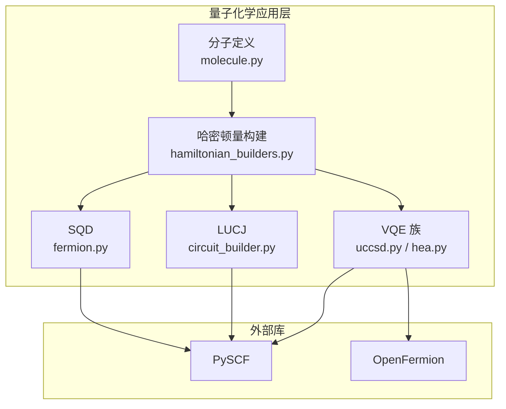
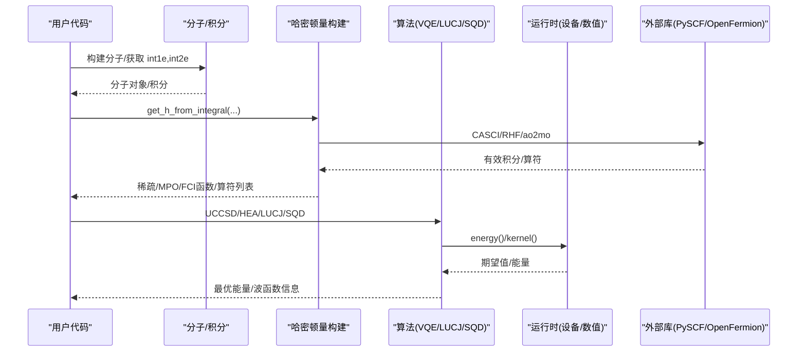
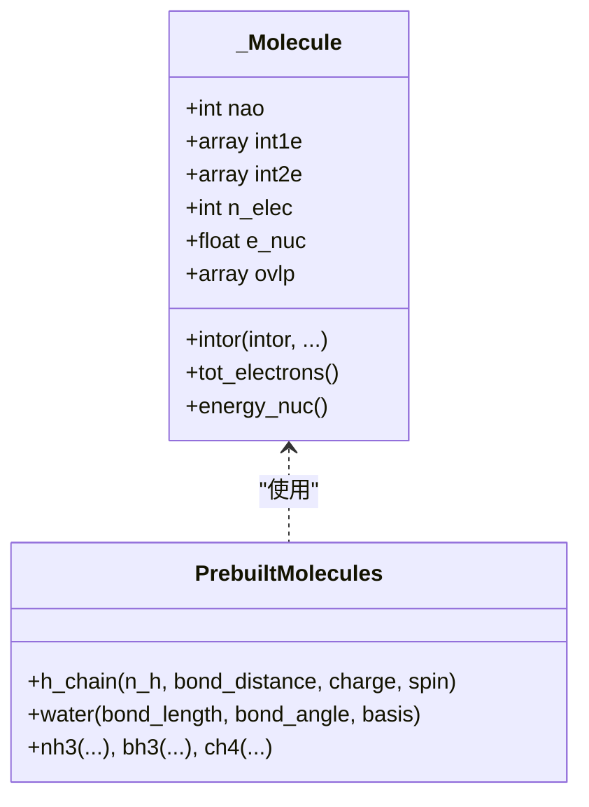
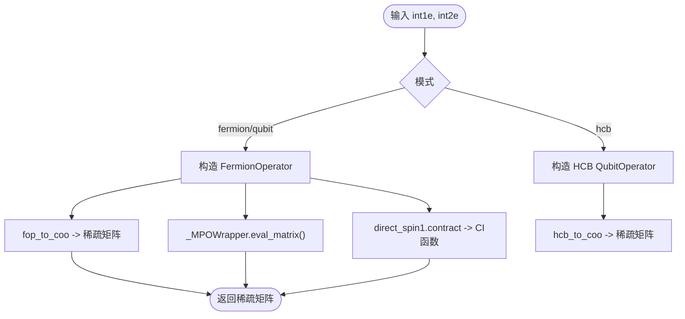
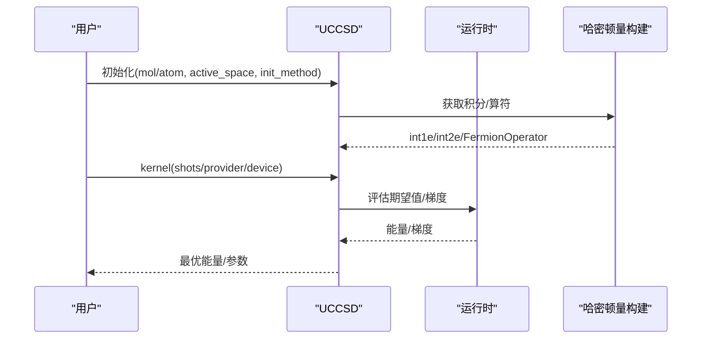
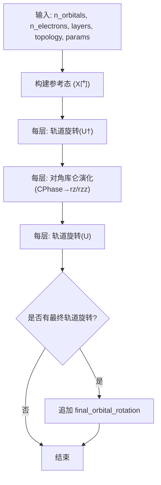
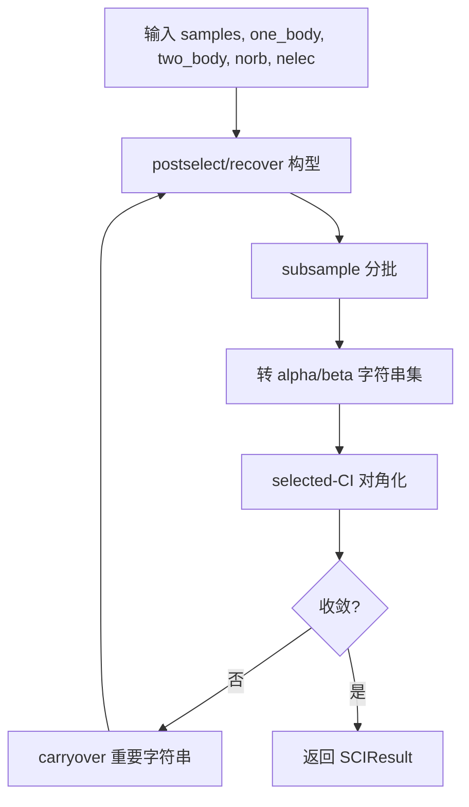
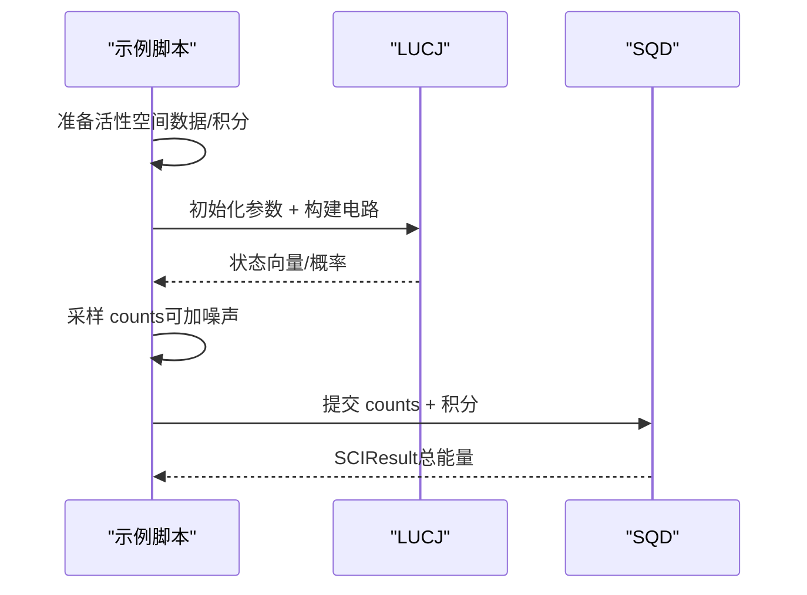
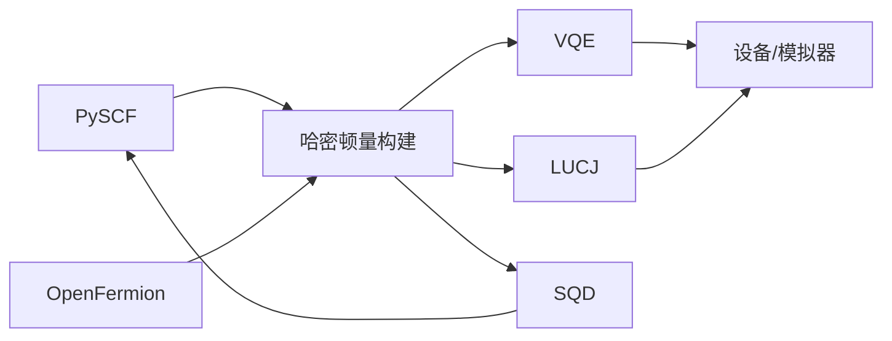

# 量子化学API

<cite>
**本文引用的文件**
- [molecule.py](file://src/tyxonq/applications/chem/molecule.py)
- [hamiltonian_builders.py](file://src/tyxonq/applications/chem/hamiltonian_builders.py)
- [vqe/__init__.py](file://src/tyxonq/applications/chem/algorithms/vqe/__init__.py)
- [uccsd.py](file://src/tyxonq/applications/chem/algorithms/vqe/uccsd.py)
- [hea.py](file://src/tyxonq/applications/chem/algorithms/vqe/hea.py)
- [lucj/circuit_builder.py](file://src/tyxonq/applications/chem/algorithms/lucj/circuit_builder.py)
- [sqd/fermion.py](file://src/tyxonq/applications/chem/algorithms/sqd/fermion.py)
- [h2o_sqd.py](file://examples/h2o_sqd.py)
- [README.md](file://README.md)
</cite>

## 目录
1. [简介](#简介)
2. [项目结构](#项目结构)
3. [核心组件](#核心组件)
4. [架构总览](#架构总览)
5. [详细组件分析](#详细组件分析)
6. [依赖关系分析](#依赖关系分析)
7. [性能考虑](#性能考虑)
8. [故障排查指南](#故障排查指南)
9. [结论](#结论)
10. [附录](#附录)

## 简介
本文件面向使用 TyxonQ 进行量子化学计算的开发者与研究人员，系统性说明分子构建、哈密顿量构建、VQE（含 UCCSD、HEA）、LUCJ 与 SQD 等高级算法的接口与实现要点。文档覆盖：
- Molecule 类的构造与使用（几何、基组、计算设置）
- 哈密顿量构建器（Fermi-Hubbard/HCB、分子轨道变换、从 HF/CASCI 提取积分）
- VQE 完整接口（UCCSD、ROUCCSD、HEA；设备/数值双后端；优化策略）
- LUCJ（矩阵形式局部幺正耦合簇）电路构建与参数化
- SQD（子空间搜索变分量子本征求解器）采样、选择-CI 对角化流程
- 配置选项、参数说明与性能优化建议
- 与 PySCF、OpenFermion 等外部库的集成方式

## 项目结构
TyxonQ 的量子化学能力集中在 applications/chem 下，按“分子/哈密顿量/算法”分层组织：
- 分子与预置体系：applications/chem/molecule.py
- 哈密顿量构建：applications/chem/hamiltonian_builders.py
- 算法族：
  - VQE：algorithms/vqe（UCC/UCCSD/PUCCD/KUPCCGSD/HEA，以及 device/numeric 运行时）
  - LUCJ：algorithms/lucj（电路构建、拓扑、参数工具）
  - SQD：algorithms/sqd（费米子主流程、PySCF 求解器适配、采样与后处理）
- 示例：examples/h2o_sqd.py 演示 LUCJ 初始化 + SQD 的端到端流程

图表来源
- [molecule.py:14-73](file://src/tyxonq/applications/chem/molecule.py#L14-L73)
- [hamiltonian_builders.py:46-153](file://src/tyxonq/applications/chem/hamiltonian_builders.py#L46-L153)
- [uccsd.py:18-265](file://src/tyxonq/applications/chem/algorithms/vqe/uccsd.py#L18-L265)
- [hea.py:28-247](file://src/tyxonq/applications/chem/algorithms/vqe/hea.py#L28-L247)
- [lucj/circuit_builder.py:33-155](file://src/tyxonq/applications/chem/algorithms/lucj/circuit_builder.py#L33-L155)
- [sqd/fermion.py:111-339](file://src/tyxonq/applications/chem/algorithms/sqd/fermion.py#L111-L339)

章节来源
- [README.md:12-24](file://README.md#L12-L24)

## 核心组件
- 分子与积分：_Molecule 封装 PySCF Mole 的 duck-typing，提供 int1e/int2e/ovlp/e_nuc 等属性；并提供多种预置分子（H链、环、水、氨、甲烷等）。
- 哈密顿量构建：从 HF/CASCI 提取有效单/双体积分，转换为 FermionOperator/QubitOperator，支持稀疏矩阵、MPO 包装、FCI 函数等多种输出模式；支持 HCB（硬核玻色子）模式。
- VQE：UCCSD/ROUCCSD 基于 UCC 基类，支持活性空间、振幅筛选、MP2/CCSD 初始猜测；HEA 提供硬件高效 RY ansatz，支持 parity/JW/BK 映射与 RDM 计算。
- LUCJ：矩阵形式的局部幺正耦合簇，按层构建参考态、轨道旋转、对角库仑演化，并分解为 TyxonQ 门序列。
- SQD：从计数或比特串矩阵出发，通过 Hamming 权重选择与恢复、子采样、selected-CI 对角化迭代收敛，返回 SCIState/SCIResult。

章节来源
- [molecule.py:14-73](file://src/tyxonq/applications/chem/molecule.py#L14-L73)
- [hamiltonian_builders.py:46-153](file://src/tyxonq/applications/chem/hamiltonian_builders.py#L46-L153)
- [uccsd.py:18-265](file://src/tyxonq/applications/chem/algorithms/vqe/uccsd.py#L18-L265)
- [hea.py:28-247](file://src/tyxonq/applications/chem/algorithms/vqe/hea.py#L28-L247)
- [lucj/circuit_builder.py:33-155](file://src/tyxonq/applications/chem/algorithms/lucj/circuit_builder.py#L33-L155)
- [sqd/fermion.py:111-339](file://src/tyxonq/applications/chem/algorithms/sqd/fermion.py#L111-L339)

## 架构总览
下图展示从分子到算法执行的总体数据流与控制流：

图表来源
- [hamiltonian_builders.py:46-153](file://src/tyxonq/applications/chem/hamiltonian_builders.py#L46-L153)
- [uccsd.py:155-265](file://src/tyxonq/applications/chem/algorithms/vqe/uccsd.py#L155-L265)
- [hea.py:125-247](file://src/tyxonq/applications/chem/algorithms/vqe/hea.py#L125-L247)
- [lucj/circuit_builder.py:78-155](file://src/tyxonq/applications/chem/algorithms/lucj/circuit_builder.py#L78-L155)
- [sqd/fermion.py:111-339](file://src/tyxonq/applications/chem/algorithms/sqd/fermion.py#L111-L339)

## 详细组件分析

### 分子构建：Molecule 与预置体系
- _Molecule 继承自 PySCF Mole 的 duck-typing，暴露 int1e/int2e/ovlp/e_nuc 等必要属性，屏蔽部分内部检查以兼容测试与基准。
- 提供随机积分生成与多种预置分子（H链、环、正方形、立方、水、氨、甲烷、苯等），便于快速搭建模型。
- 典型用法：直接传入 int1e/int2e/n_elec 构造，或使用预置函数创建分子对象。

图表来源
- [molecule.py:14-73](file://src/tyxonq/applications/chem/molecule.py#L14-L73)
- [molecule.py:80-291](file://src/tyxonq/applications/chem/molecule.py#L80-L291)

章节来源
- [molecule.py:14-73](file://src/tyxonq/applications/chem/molecule.py#L14-L73)
- [molecule.py:80-291](file://src/tyxonq/applications/chem/molecule.py#L80-L291)

### 哈密顿量构建器
- 从 HF/CASCI 提取有效单/双体积分，构造费米子算符，再转换为 QubitOperator 或稀疏矩阵。
- 支持模式：
  - fermion/qubit：标准费米子/量子比特表示
  - hcb：硬核玻色子表示
  - sparse/mpo/fcifunc：不同下游消费格式
- 提供 apply_op 统一对稀疏/可调用/eval_matrix 对象执行矩阵乘。

图表来源
- [hamiltonian_builders.py:46-153](file://src/tyxonq/applications/chem/hamiltonian_builders.py#L46-L153)
- [hamiltonian_builders.py:283-318](file://src/tyxonq/applications/chem/hamiltonian_builders.py#L283-L318)

章节来源
- [hamiltonian_builders.py:46-153](file://src/tyxonq/applications/chem/hamiltonian_builders.py#L46-L153)
- [hamiltonian_builders.py:283-318](file://src/tyxonq/applications/chem/hamiltonian_builders.py#L283-L318)

### VQE：UCCSD 与 HEA
- UCCSD：
  - 基于 UCC 基类，支持 MP2/CCSD/FE/Zeros 初始猜测，活性空间与轨道选择，振幅筛选与排序。
  - 提供 ex_ops、param_ids、init_guess 的生成与筛选逻辑，支持 device/numeric 双运行路径。
  - 提供 ROUCCSD 用于开壳层场景。
- HEA：
  - RY-only 硬件高效 ansatz，支持 parity/JW/BK 映射，自动从分子积分构建 QubitOperator 项。
  - 提供 energy/energy_and_grad、SciPy 优化、RDM 计算、from_molecule/from_integral 工厂方法。
  - 支持 PySCF FCI 求解器适配器，便于与 CASSCF 对接。

图表来源
- [uccsd.py:155-319](file://src/tyxonq/applications/chem/algorithms/vqe/uccsd.py#L155-L319)
- [hea.py:125-337](file://src/tyxonq/applications/chem/algorithms/vqe/hea.py#L125-L337)

章节来源
- [uccsd.py:18-470](file://src/tyxonq/applications/chem/algorithms/vqe/uccsd.py#L18-L470)
- [hea.py:28-800](file://src/tyxonq/applications/chem/algorithms/vqe/hea.py#L28-L800)
- [vqe/__init__.py:1-49](file://src/tyxonq/applications/chem/algorithms/vqe/__init__.py#L1-L49)

### LUCJ：矩阵形式局部幺正耦合簇
- LUCJ 电路构建遵循“闭壳 RHF 参考 → U† → 对角库仑 J → U”的顺序，将矩阵参数分解为 TyxonQ 支持的 rz/rzz/unitary 门。
- 支持拓扑（如 square）、层数、轨道旋转与最终轨道旋转，参数形状由 lucj_parameter_shapes 给出。
- 适合在活性空间内用较少的参数表达强关联效应。

图表来源
- [lucj/circuit_builder.py:78-155](file://src/tyxonq/applications/chem/algorithms/lucj/circuit_builder.py#L78-L155)
- [lucj/circuit_builder.py:184-329](file://src/tyxonq/applications/chem/algorithms/lucj/circuit_builder.py#L184-L329)

章节来源
- [lucj/circuit_builder.py:33-384](file://src/tyxonq/applications/chem/algorithms/lucj/circuit_builder.py#L33-L384)

### SQD：子空间搜索变分量子本征求解器
- 输入：counts 或 bitstring 矩阵及概率，目标为给定 one_body/two_body 积分下的基态。
- 流程：
  - 根据 Hamming 权重选择或 recovery 恢复占据构型
  - 子采样为多批次样本
  - 将样本转为 alpha/beta 行列式集合，构建 selected-CI 子空间
  - 调用 PySCF selected_ci 对角化，得到能量与密度矩阵
  - 迭代至能量/占据收敛，保留重要字符串跨轮传递
- 输出：SCIResult（能量、SCIState、轨道占据、核排斥能等）

图表来源
- [sqd/fermion.py:111-339](file://src/tyxonq/applications/chem/algorithms/sqd/fermion.py#L111-L339)
- [sqd/fermion.py:367-408](file://src/tyxonq/applications/chem/algorithms/sqd/fermion.py#L367-L408)

章节来源
- [sqd/fermion.py:25-450](file://src/tyxonq/applications/chem/algorithms/sqd/fermion.py#L25-L450)

### 端到端示例：H2O 初始化 LUCJ + SQD
- 步骤：
  - 构建 H2O 分子，选取活性空间，计算自然轨道与 CCSD 振幅
  - 用 initialize_lucj_parameters_from_ccsd 初始化 LUCJ 参数
  - 构建 LUCJ 电路，无噪声/有噪声采样得到 counts
  - 反转比特串半区顺序以匹配 SQD/PySCF 约定
  - 运行 run_sqd_fermion，得到总能量并与 HF/FCI 对比

图表来源
- [h2o_sqd.py:125-336](file://examples/h2o_sqd.py#L125-L336)

章节来源
- [h2o_sqd.py:1-376](file://examples/h2o_sqd.py#L1-376)

## 依赖关系分析
- 外部库：
  - PySCF：分子构建、HF/CASCI/FCI、积分与 selected-CI 求解
  - OpenFermion：费米子/量子比特算符转换、Jordan-Wigner 等映射
- 内部模块：
  - 数值后端：tyxonq.numerics 提供 NumPy/PyTorch/CuPyNumeric 的统一接口
  - 编译与设备：gate_compiler、devices（simulator/hardware）

图表来源
- [hamiltonian_builders.py:46-153](file://src/tyxonq/applications/chem/hamiltonian_builders.py#L46-L153)
- [uccsd.py:155-265](file://src/tyxonq/applications/chem/algorithms/vqe/uccsd.py#L155-L265)
- [hea.py:125-247](file://src/tyxonq/applications/chem/algorithms/vqe/hea.py#L125-L247)
- [sqd/fermion.py:111-339](file://src/tyxonq/applications/chem/algorithms/sqd/fermion.py#L111-L339)

章节来源
- [hamiltonian_builders.py:46-153](file://src/tyxonq/applications/chem/hamiltonian_builders.py#L46-L153)
- [uccsd.py:155-265](file://src/tyxonq/applications/chem/algorithms/vqe/uccsd.py#L155-L265)
- [hea.py:125-247](file://src/tyxonq/applications/chem/algorithms/vqe/hea.py#L125-L247)
- [sqd/fermion.py:111-339](file://src/tyxonq/applications/chem/algorithms/sqd/fermion.py#L111-L339)

## 性能考虑
- 活性空间与振幅筛选：UCCSD 中通过 pick_ex2/sort_ex2/epsilon 控制二体激发数量，显著降低参数规模。
- 映射选择：HEA 中 parity 映射可减少 qubit 数（n_sorb-2），但需确保后续 RDM 计算正确还原。
- 运行路径：
  - 数值路径（shots=0）：解析期望值，避免采样噪声，适合优化预热与 RDM 计算。
  - 设备路径：真机默认 shots（如 2048），注意采样误差对优化轨迹的影响。
- 采样与批处理：SQD 中 samples_per_batch 与 num_batches 平衡精度与开销；carryover_threshold 控制重要字符串保留。
- 并行与缓存：HEA 支持 _qop_cached 复用 QubitOperator；LUCJ 参数形状规范化减少重复计算。

[本节为通用性能建议，不直接分析具体文件]

## 故障排查指南
- 输入校验：
  - SQD 要求 bitstring 列数为 2*norb，概率和为正，最大迭代次数至少为 1。
  - LUCJ 要求偶数电子且不超过轨道数限制。
- 常见错误：
  - 非闭合壳层使用 symmetrize_spin=True 会报错。
  - 未提供 mapping/nelec 时无法计算 RDM。
  - 无效哈密顿量模式（mode/htype）导致异常。
- 调试建议：
  - 先用数值路径验证能量与梯度，再切换设备路径。
  - 打印电路摘要（HEA.print_circuit）与优化结果（opt_res）定位问题。
  - 检查 counts 的比特串顺序（LUCJ 与 SQD 的 alpha/beta 半区顺序差异）。

章节来源
- [sqd/fermion.py:196-225](file://src/tyxonq/applications/chem/algorithms/sqd/fermion.py#L196-L225)
- [lucj/circuit_builder.py:363-383](file://src/tyxonq/applications/chem/algorithms/lucj/circuit_builder.py#L363-L383)
- [hea.py:623-705](file://src/tyxonq/applications/chem/algorithms/vqe/hea.py#L623-L705)

## 结论
TyxonQ 的量子化学 API 提供了从分子构建、哈密顿量编码到 VQE/LUCJ/SQD 等算法的完整链路。其设计强调：
- 与 PySCF/OpenFermion 的深度集成，便于利用成熟经典计算生态
- 设备/数值双路径一致语义，无缝切换仿真与真机
- 模块化算法与运行时，支持活性空间、映射选择、采样策略等灵活配置
对于药物设计与材料模拟等应用场景，推荐结合活性空间与 LUCJ 初始化，再用 SQD 做子空间搜索以获得高精度结果。

[本节为总结性内容，不直接分析具体文件]

## 附录
- 快速开始（量子化学最小示例）：参见 README 中的 UCCSD 示例，展示如何从预设分子到设备/数值路径的能量计算。
- 配置与参数：
  - UCCSD：init_method、active_space、pick_ex2、sort_ex2、epsilon、runtime、numeric_engine、run_fci 等
  - HEA：mapping、layers、runtime、numeric_engine、scipy_minimize_options、grad 等
  - LUCJ：n_orbitals、n_electrons、layers、topology、with_final_orbital_rotation
  - SQD：samples_per_batch、num_batches、max_iterations、max_dim、symmetrize_spin、carryover_threshold、seed 等

章节来源
- [uccsd.py:155-265](file://src/tyxonq/applications/chem/algorithms/vqe/uccsd.py#L155-L265)
- [hea.py:125-247](file://src/tyxonq/applications/chem/algorithms/vqe/hea.py#L125-L247)
- [lucj/circuit_builder.py:33-75](file://src/tyxonq/applications/chem/algorithms/lucj/circuit_builder.py#L33-L75)
- [sqd/fermion.py:111-166](file://src/tyxonq/applications/chem/algorithms/sqd/fermion.py#L111-L166)
- [README.md:89-106](file://README.md#L89-L106)