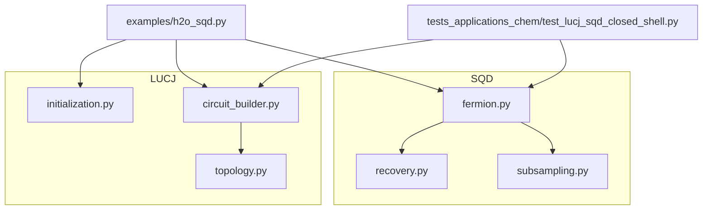
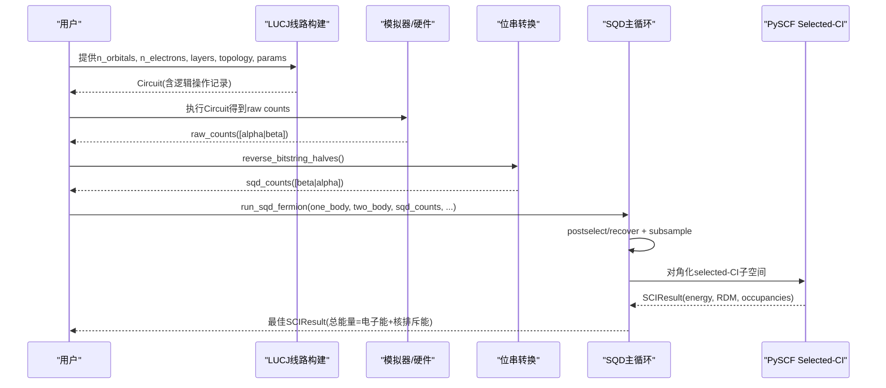
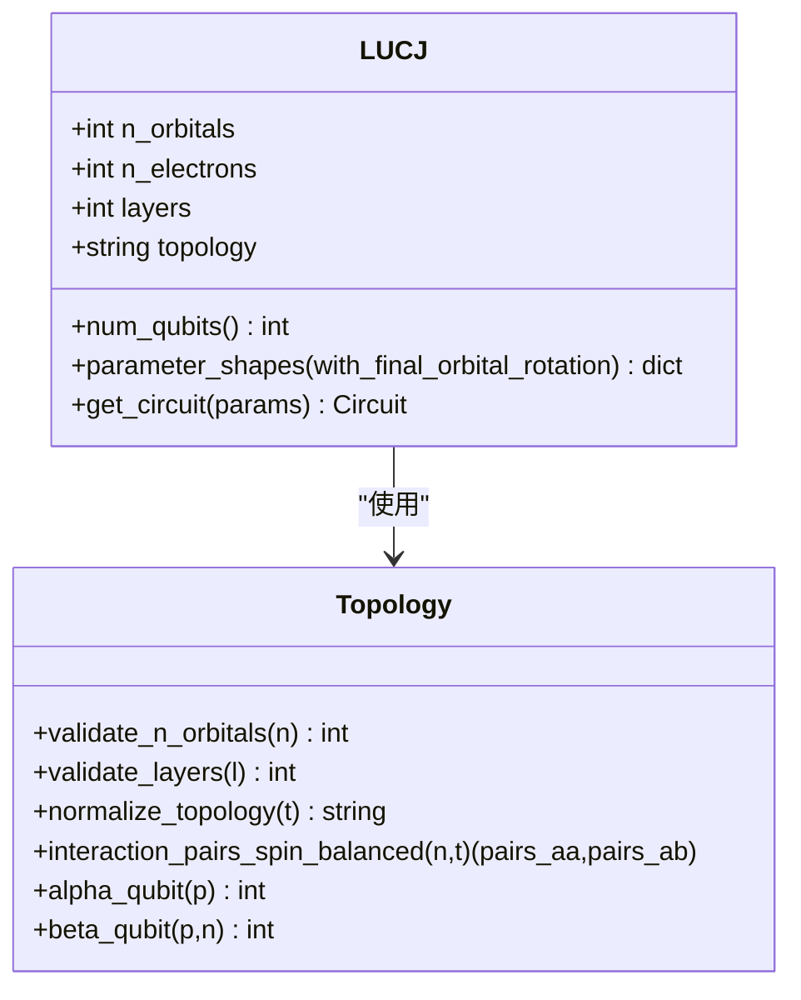
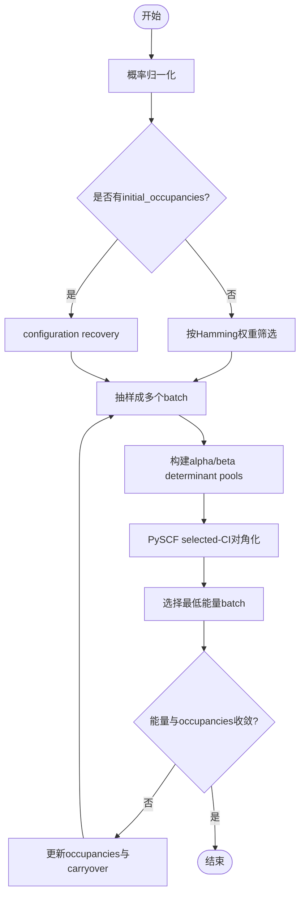
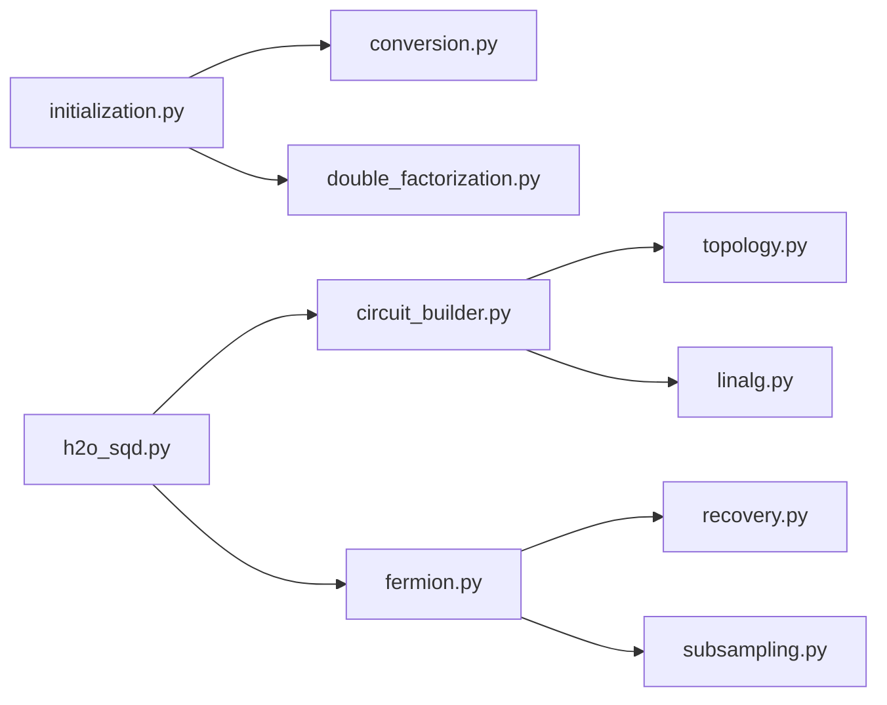

# 高级算法

<cite>
**本文引用的文件**
- [LUCJ_SQD.md](file://LUCJ_SQD.md)
- [circuit_builder.py](file://src/tyxonq/applications/chem/algorithms/lucj/circuit_builder.py)
- [topology.py](file://src/tyxonq/applications/chem/algorithms/lucj/topology.py)
- [initialization.py](file://src/tyxonq/applications/chem/algorithms/lucj/initialization.py)
- [fermion.py](file://src/tyxonq/applications/chem/algorithms/sqd/fermion.py)
- [recovery.py](file://src/tyxonq/applications/chem/algorithms/sqd/recovery.py)
- [subsampling.py](file://src/tyxonq/applications/chem/algorithms/sqd/subsampling.py)
- [h2o_sqd.py](file://examples/h2o_sqd.py)
- [test_lucj_sqd_closed_shell.py](file://tests_applications_chem/test_lucj_sqd_closed_shell.py)
</cite>

## 目录
1. [简介](#简介)
2. [项目结构](#项目结构)
3. [核心组件](#核心组件)
4. [架构总览](#架构总览)
5. [详细组件分析](#详细组件分析)
6. [依赖关系分析](#依赖关系分析)
7. [性能与复杂度](#性能与复杂度)
8. [参数配置指南](#参数配置指南)
9. [基准测试与对比](#基准测试与对比)
10. [故障排查](#故障排查)
11. [结论](#结论)

## 简介
本文件面向TyxonQ中高级量子化学算法的API文档，重点覆盖：
- LUCJ（局部幺正耦合簇）算法：局部近似策略、拓扑结构处理、电路构建与参数初始化。
- SQD（子空间搜索变分量子本征求解器）算法：子空间搜索机制、状态恢复技术、多态处理能力。
- 与传统VQE相比的优势：在强关联体系与激发态计算中的改进思路。
- 参数配置：收敛标准、迭代控制、内存优化。
- 基准与平台表现：基于仓库内H2O示例与测试的验证结果与运行方式说明。

## 项目结构
TyxonQ将LUCJ与SQD分别组织在应用层算法目录下，并通过统一的对外接口暴露能力：
- LUCJ模块负责从CCSD振幅初始化矩阵参数、生成拓扑相关的相互作用对、构建并分解为底层门序列。
- SQD模块负责从采样数据构造selected-CI子空间、执行对角化、管理迭代与状态恢复。
- 示例脚本演示了从分子积分到LUCJ采样再到SQD求解的完整流程。

图表来源
- [circuit_builder.py:33-155](file://src/tyxonq/applications/chem/algorithms/lucj/circuit_builder.py#L33-L155)
- [topology.py:11-99](file://src/tyxonq/applications/chem/algorithms/lucj/topology.py#L11-L99)
- [fermion.py:111-339](file://src/tyxonq/applications/chem/algorithms/sqd/fermion.py#L111-L339)
- [recovery.py:12-60](file://src/tyxonq/applications/chem/algorithms/sqd/recovery.py#L12-L60)
- [subsampling.py:8-82](file://src/tyxonq/applications/chem/algorithms/sqd/subsampling.py#L8-L82)
- [h2o_sqd.py:262-336](file://examples/h2o_sqd.py#L262-L336)

章节来源
- [LUCJ_SQD.md:48-71](file://LUCJ_SQD.md#L48-L71)
- [h2o_sqd.py:262-336](file://examples/h2o_sqd.py#L262-L336)

## 核心组件
- LUCJ
  - 参数初始化：从restricted CCSD t1/t2生成matrix LUCJ参数（orbital rotations、diagonal Coulomb matrices、可选final orbital rotation）。
  - 拓扑与轨道对：支持square/hex/linear三种拓扑，限定same-spin相邻轨道对与opposite-spin同轨道对。
  - 电路构建：固定顺序RHF参考态 -> U† -> diagonal Coulomb J -> U，并将unitary分解为相邻Givens旋转和单比特相位；Coulomb演化分解为rz/rzz。
- SQD
  - 主循环：从counts/bitstring矩阵构造样本数组，按电子数postselect或configuration recovery，抽样成多个batch，构建alpha/beta determinant pools，调用PySCF selected-CI对角化，选择最低能量结果并更新occupancies驱动下一轮。
  - 状态对象：SCIState保存CI振幅与字符串，支持RDM、自旋平方、轨道占据等；SCIResult包含能量、RDM、核排斥能等。
  - 采样工具：粒子数筛选、批量抽样、bitstring与整数determinant转换。

章节来源
- [circuit_builder.py:33-155](file://src/tyxonq/applications/chem/algorithms/lucj/circuit_builder.py#L33-L155)
- [topology.py:61-99](file://src/tyxonq/applications/chem/algorithms/lucj/topology.py#L61-L99)
- [initialization.py:10-41](file://src/tyxonq/applications/chem/algorithms/lucj/initialization.py#L10-L41)
- [fermion.py:25-108](file://src/tyxonq/applications/chem/algorithms/sqd/fermion.py#L25-L108)
- [fermion.py:111-339](file://src/tyxonq/applications/chem/algorithms/sqd/fermion.py#L111-L339)
- [recovery.py:12-60](file://src/tyxonq/applications/chem/algorithms/sqd/recovery.py#L12-L60)
- [subsampling.py:8-82](file://src/tyxonq/applications/chem/algorithms/sqd/subsampling.py#L8-L82)

## 架构总览
LUCJ与SQD通过明确的“数据契约”衔接：LUCJ输出原始bitstring counts，SQD要求对半区进行反转以匹配内部[beta|alpha]顺序，随后进入selected-CI子空间迭代。

图表来源
- [circuit_builder.py:67-155](file://src/tyxonq/applications/chem/algorithms/lucj/circuit_builder.py#L67-L155)
- [h2o_sqd.py:290-315](file://examples/h2o_sqd.py#L290-L315)
- [fermion.py:111-339](file://src/tyxonq/applications/chem/algorithms/sqd/fermion.py#L111-L339)

## 详细组件分析

### LUCJ组件分析
- 参数形状与校验：
  - 参数字典包含orbital_rotations(L,N,N)、diag_coulomb_mats(L,2,N,N)、可选final_orbital_rotation(N,N)。
  - 拓扑限制same-spin相邻轨道对，opposite-spin根据拓扑选择(p,p)集合。
- 电路构建逻辑：
  - 固定顺序：RHF参考态 -> U† -> diagonal Coulomb J -> U。
  - Unitary分解为相邻双轨道unitary与单比特相位；Coulomb演化分解为rz/rzz。
  - 逻辑操作记录保存在metadata["lucj"]["logical_ops"]，便于调试与检查。
- 拓扑与轨道映射：
  - square保留全部(p,p)，hex仅偶数p，linear仅(0,0)。
  - qubit顺序固定为[alpha0..alphaN-1 | beta0..betaN-1]。

图表来源
- [circuit_builder.py:33-75](file://src/tyxonq/applications/chem/algorithms/lucj/circuit_builder.py#L33-L75)
- [topology.py:11-99](file://src/tyxonq/applications/chem/algorithms/lucj/topology.py#L11-L99)

章节来源
- [circuit_builder.py:78-155](file://src/tyxonq/applications/chem/algorithms/lucj/circuit_builder.py#L78-L155)
- [topology.py:61-99](file://src/tyxonq/applications/chem/algorithms/lucj/topology.py#L61-L99)
- [initialization.py:10-41](file://src/tyxonq/applications/chem/algorithms/lucj/initialization.py#L10-L41)

### SQD组件分析
- 主入口与参数：
  - run_sqd_fermion接收one_body/two_body张量、samples、nelec、norb以及多种控制参数（samples_per_batch、num_batches、max_iterations、symmetrize_spin、max_dim、initial_occupancies、carryover_threshold、energy_tol、occupancies_tol、seed等）。
  - 内部统一为[beta|alpha]顺序，概率归一化后进入迭代。
- 迭代流程：
  - 若无initial_occupancies则按左右Hamming权重postselect；否则用上一轮occupancies进行configuration recovery。
  - 抽样成多个batch，构建alpha/beta determinant pools，合入include_configurations与carryover strings，调用PySCF selected-CI对角化。
  - 选择最低能量batch，若能量与occupancies同时收敛则停止。
- 状态与结果：
  - SCIState保存CI振幅与字符串，支持save/load、rdm(rank, spin_summed)、spin_square、orbital_occupancies。
  - SCIResult包含energy、total_energy、orbital_occupancies、rdm1/rdm2、nuclear_repulsion_energy。

图表来源
- [fermion.py:169-339](file://src/tyxonq/applications/chem/algorithms/sqd/fermion.py#L169-L339)
- [recovery.py:12-60](file://src/tyxonq/applications/chem/algorithms/sqd/recovery.py#L12-L60)
- [subsampling.py:8-82](file://src/tyxonq/applications/chem/algorithms/sqd/subsampling.py#L8-L82)

章节来源
- [fermion.py:25-108](file://src/tyxonq/applications/chem/algorithms/sqd/fermion.py#L25-L108)
- [fermion.py:111-339](file://src/tyxonq/applications/chem/algorithms/sqd/fermion.py#L111-L339)
- [recovery.py:12-60](file://src/tyxonq/applications/chem/algorithms/sqd/recovery.py#L12-L60)
- [subsampling.py:8-82](file://src/tyxonq/applications/chem/algorithms/sqd/subsampling.py#L8-L82)

### 与传统VQE的优势与适用场景
- VQE通常针对基态优化，而SQD通过子空间搜索与selected-CI对角化，天然适合低激发态与强关联体系的描述。
- LUCJ利用局部幺正变换与拓扑约束降低参数规模与电路深度，结合CCSD初始值提升收敛质量。
- 在强关联体系中，传统VQE易受 barren plateau与参数初始化影响；LUCJ+SQD通过物理先验（CCSD）与子空间搜索提高鲁棒性。

[本节为概念性说明，不直接分析具体文件]

## 依赖关系分析
- LUCJ依赖拓扑与参数校验，电路构建依赖unitary分解与Coulomb演化分解。
- SQD依赖采样工具（postselect/recovery/subsampling），并与PySCF selected-CI集成完成对角化。
- 示例脚本串联LUCJ与SQD，确保位串顺序一致。

图表来源
- [initialization.py:10-41](file://src/tyxonq/applications/chem/algorithms/lucj/initialization.py#L10-L41)
- [circuit_builder.py:17-27](file://src/tyxonq/applications/chem/algorithms/lucj/circuit_builder.py#L17-L27)
- [fermion.py:20-22](file://src/tyxonq/applications/chem/algorithms/sqd/fermion.py#L20-L22)
- [h2o_sqd.py:262-315](file://examples/h2o_sqd.py#L262-L315)

章节来源
- [h2o_sqd.py:262-315](file://examples/h2o_sqd.py#L262-L315)
- [fermion.py:169-339](file://src/tyxonq/applications/chem/algorithms/sqd/fermion.py#L169-L339)

## 性能与复杂度
- LUCJ电路复杂度：
  - 每层包含U†、diagonal Coulomb J、U三部分；orbital rotation分解为相邻Givens旋转与相位，Coulomb演化分解为rz/rzz。
  - 拓扑决定opposite-spin对数量，square最多、hex减半、linear最少。
- SQD复杂度：
  - 每轮迭代包括postselect/recovery、subsample、构建determinant pools、selected-CI对角化。
  - 最大维度max_dim控制每个spin pool容量，影响对角化成本。
- 内存优化建议：
  - 合理设置samples_per_batch与num_batches，避免一次性加载过多bitstrings。
  - 使用symmetrize_spin合并候选池，减少重复计算。
  - 利用carryover_threshold保留重要CI strings，减少重建开销。

[本节为通用指导，不直接分析具体文件]

## 参数配置指南
- LUCJ参数：
  - n_orbitals、n_electrons（必须为正偶数）、layers、topology（square/hex/linear）。
  - 初始化：initialize_lucj_parameters_from_ccsd(t2_amplitudes, t1, n_spatial_orbitals, n_layers, topology, optimize, regularization, maxiter, multi_stage_start, multi_stage_step)。
  - 参数形状：orbital_rotations(L,N,N)、diag_coulomb_mats(L,2,N,N)、final_orbital_rotation(N,N或None)。
- SQD参数：
  - samples_per_batch：每批完整bitstring数量。
  - num_batches：每轮独立抽取并求解的batch数。
  - max_iterations：occupancy-recovery与selected-CI的最大迭代次数。
  - max_dim：每个alpha/beta determinant pool容量上限。
  - initial_occupancies：首轮configuration recovery的平均占据数。
  - symmetrize_spin：合并alpha/beta候选池，仅允许n_alpha==n_beta。
  - include_configurations：强制加入的CI strings。
  - carryover_threshold：下一轮保留重要CI strings的振幅阈值。
  - energy_tol、occupancies_tol：能量与占据收敛阈值。
  - seed：随机种子。

章节来源
- [initialization.py:10-41](file://src/tyxonq/applications/chem/algorithms/lucj/initialization.py#L10-L41)
- [fermion.py:111-166](file://src/tyxonq/applications/chem/algorithms/sqd/fermion.py#L111-L166)
- [LUCJ_SQD.md:75-166](file://LUCJ_SQD.md#L75-L166)
- [LUCJ_SQD.md:211-279](file://LUCJ_SQD.md#L211-L279)

## 基准测试与对比
- H2O CAS(4e,4o)示例：
  - 默认配置：LUCJ layers=1、topology=square、shots=4096、probability-level noise=0.05、SQD batches=4、samples per batch=8、max iterations=5、max dimension=4。
  - 验证结果（optimize=True、maxiter=100、seed=7）：
    - HF能量、FCI能量、初始化LUCJ无噪能量、噪声混合能量、SQD能量。
  - 运行命令：python examples/h2o_sqd.py --no-optimize 或默认模式。
- 测试套件：
  - tests_applications_chem/test_lucj_sqd_closed_shell.py验证位串转换、恢复退化为均匀选择、metadata包含final rotation shape等。

章节来源
- [LUCJ_SQD.md:283-354](file://LUCJ_SQD.md#L283-L354)
- [h2o_sqd.py:262-376](file://examples/h2o_sqd.py#L262-L376)
- [test_lucj_sqd_closed_shell.py:15-98](file://tests_applications_chem/test_lucj_sqd_closed_shell.py#L15-L98)

## 故障排查
- 输入校验错误：
  - n_orbitals必须为正整数；layers必须为正整数；n_electrons必须为正偶数且不超过轨道容量。
  - bitstring_matrix必须为二维数组，列数为2*norb；概率数量需匹配bitstring数量。
  - Hamming权重必须为非负整数；bitstring长度必须为偶数。
- 收敛问题：
  - 调整energy_tol与occupancies_tol；增加max_iterations；增大max_dim或num_batches。
  - 提供initial_occupancies以启用configuration recovery，避免严格HF占据导致零权重。
- 采样与顺序：
  - TyxonQ/LUCJ raw order需reverse_bitstring_halves后再交给SQD；sample_order仅交换alpha/beta半区，不替代半区内反转。
- 资源占用：
  - 减小samples_per_batch与num_batches；使用symmetrize_spin合并候选池；合理设置carryover_threshold。

章节来源
- [circuit_builder.py:363-384](file://src/tyxonq/applications/chem/algorithms/lucj/circuit_builder.py#L363-L384)
- [topology.py:11-39](file://src/tyxonq/applications/chem/algorithms/lucj/topology.py#L11-L39)
- [fermion.py:196-226](file://src/tyxonq/applications/chem/algorithms/sqd/fermion.py#L196-L226)
- [subsampling.py:8-42](file://src/tyxonq/applications/chem/algorithms/sqd/subsampling.py#L8-L42)
- [recovery.py:12-60](file://src/tyxonq/applications/chem/algorithms/sqd/recovery.py#L12-L60)
- [LUCJ_SQD.md:171-201](file://LUCJ_SQD.md#L171-L201)

## 结论
TyxonQ的LUCJ+SQD工作流提供了从CCSD初始化的局部幺正变换到子空间搜索对角化的完整路径，适用于强关联体系与低激发态计算。通过拓扑约束、参数初始化与selected-CI子空间搜索，该方案在收敛性与准确性上优于传统VQE。仓库内的H2O示例与测试验证了端到端流程的正确性与可复现性。实际应用中可根据体系大小与硬件资源调整参数，以获得最佳性能与精度平衡。

[本节为总结性内容，不直接分析具体文件]