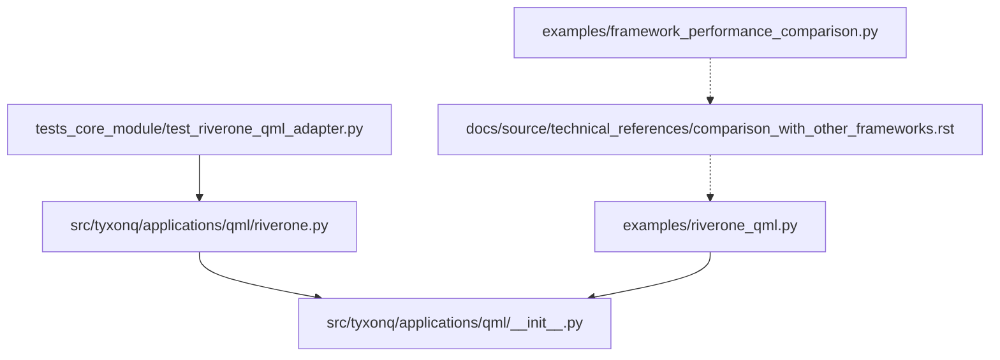
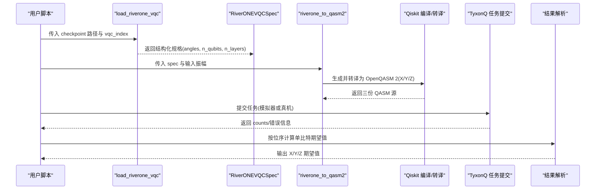
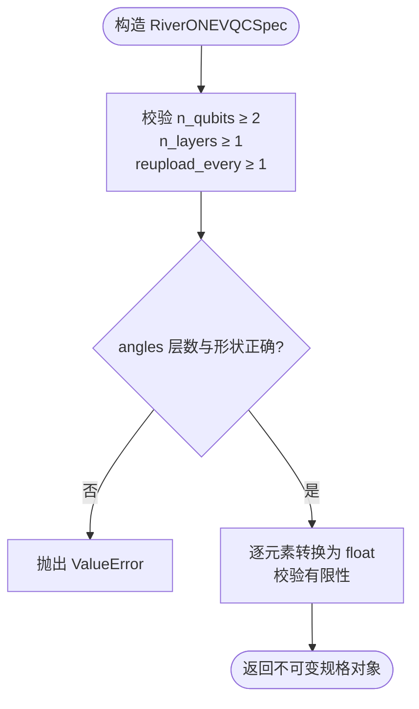
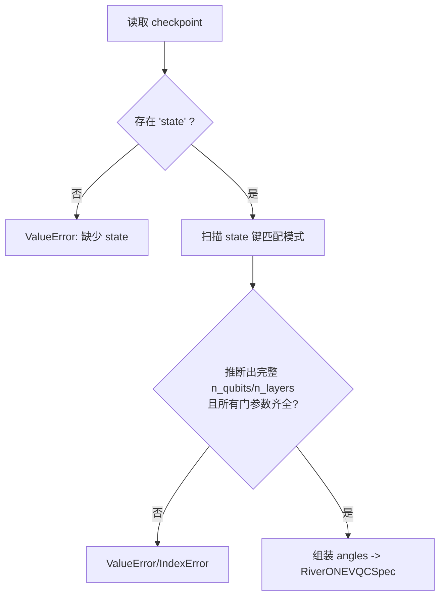
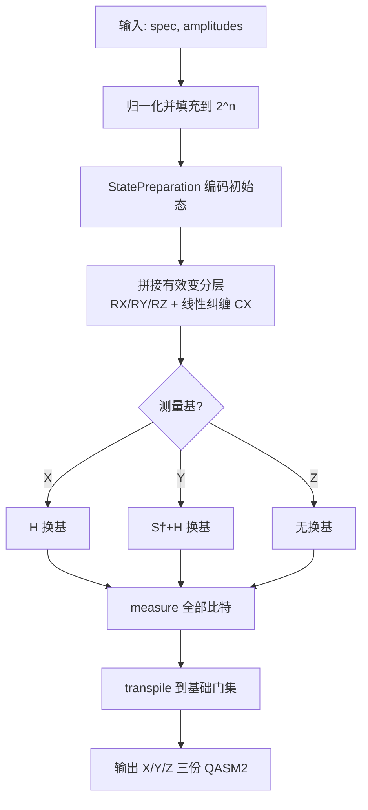
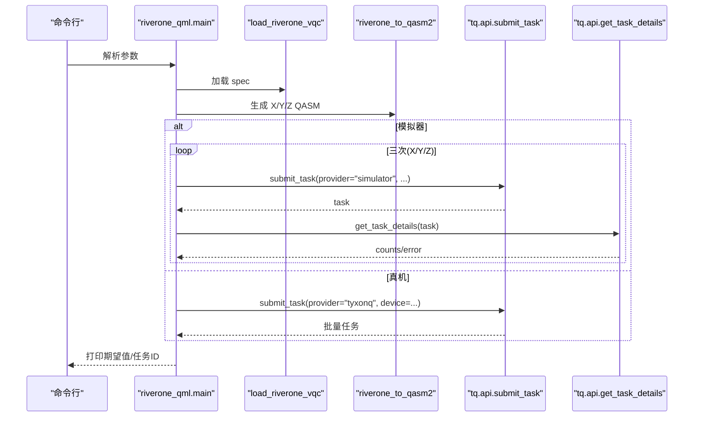
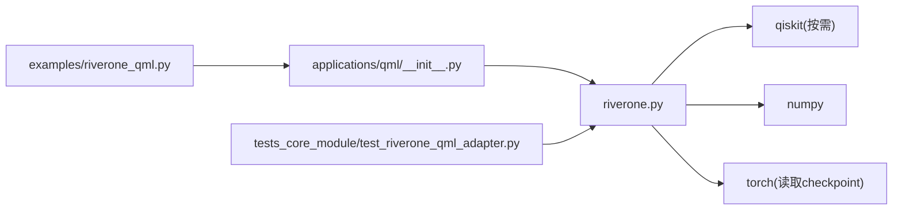

# 量子机器学习API

<cite>
**本文引用的文件**
- [riverone.py](file://src/tyxonq/applications/qml/riverone.py)
- [__init__.py](file://src/tyxonq/applications/qml/__init__.py)
- [riverone_qml.py](file://examples/riverone_qml.py)
- [test_riverone_qml_adapter.py](file://tests_core_module/test_riverone_qml_adapter.py)
- [README.md](file://README.md)
- [comparison_with_other_frameworks.rst](file://docs/source/technical_references/comparison_with_other_frameworks.rst)
- [framework_performance_comparison.py](file://examples/framework_performance_comparison.py)
</cite>

## 目录
1. [简介](#简介)
2. [项目结构](#项目结构)
3. [核心组件](#核心组件)
4. [架构总览](#架构总览)
5. [详细组件分析](#详细组件分析)
6. [依赖关系分析](#依赖关系分析)
7. [性能考量](#性能考量)
8. [故障排查指南](#故障排查指南)
9. [结论](#结论)
10. [附录](#附录)

## 简介
本文件面向使用 TyxonQ 进行量子机器学习（QML）的工程师与研究者，聚焦 RiverOne 算法在 TyxonQ 中的接口与使用方法。RiverOne 训练后产出的变分量子电路（TQVQC）参数以 checkpoint 形式保存；TyxonQ 提供从 checkpoint 加载、构建可执行 OpenQASM 2 线路、并在模拟器或真实设备上运行并解析结果的全流程能力。文档同时给出与其他主流量子框架的对比分析与集成建议，帮助你将 RiverOne 模型无缝接入现有机器学习工作流。

## 项目结构
与 RiverOne QML 适配直接相关的代码位于应用层 qml 子模块，示例脚本位于 examples，测试覆盖于 tests_core_module。

图表来源
- [riverone.py:1-316](file://src/tyxonq/applications/qml/riverone.py#L1-L316)
- [__init__.py:1-14](file://src/tyxonq/applications/qml/__init__.py#L1-L14)
- [riverone_qml.py:1-200](file://examples/riverone_qml.py#L1-L200)
- [test_riverone_qml_adapter.py:1-189](file://tests_core_module/test_riverone_qml_adapter.py#L1-L189)
- [comparison_with_other_frameworks.rst:1-720](file://docs/source/technical_references/comparison_with_other_frameworks.rst#L1-L720)
- [framework_performance_comparison.py:582-804](file://examples/framework_performance_comparison.py#L582-L804)

章节来源
- [riverone.py:1-316](file://src/tyxonq/applications/qml/riverone.py#L1-L316)
- [__init__.py:1-14](file://src/tyxonq/applications/qml/__init__.py#L1-L14)
- [riverone_qml.py:1-200](file://examples/riverone_qml.py#L1-L200)
- [test_riverone_qml_adapter.py:1-189](file://tests_core_module/test_riverone_qml_adapter.py#L1-L189)

## 核心组件
- RiverONEVQCSpec：描述一条训练后的 TQVQC 的结构化规格，包含量子比特数、层数、每层每比特的 RX/RY/RZ 角度序列，以及数据重上传间隔 reupload_every。构造时进行严格校验（维度、有限性、非空等）。
- load_riverone_vqc：从 RiverONE 的 checkpoint 中读取 state 映射，推断 VQC 的拓扑与层数，提取各门角度，返回 RiverONEVQCSpec。无需导入 TorchQuantum，仅依赖 torch 读取权重。
- riverone_to_qasm2：将 RiverONE 训练好的 VQC 与输入振幅编码为 X/Y/Z 三种测量基对应的 OpenQASM 2 字符串集合，供后续提交到模拟器或真机执行。内部完成振幅归一化、状态准备、变分层拼接、基变换与基础门分解。

章节来源
- [riverone.py:33-78](file://src/tyxonq/applications/qml/riverone.py#L33-L78)
- [riverone.py:152-188](file://src/tyxonq/applications/qml/riverone.py#L152-L188)
- [riverone.py:277-308](file://src/tyxonq/applications/qml/riverone.py#L277-L308)

## 架构总览
下图展示了从 RiverONE checkpoint 到可执行 QASM 再到任务提交的端到端流程，涵盖数据预处理（振幅编码）、模型训练产物（变分层参数）与后处理（期望值计算）。

图表来源
- [riverone.py:152-188](file://src/tyxonq/applications/qml/riverone.py#L152-L188)
- [riverone.py:277-308](file://src/tyxonq/applications/qml/riverone.py#L277-L308)
- [riverone_qml.py:127-195](file://examples/riverone_qml.py#L127-L195)

## 详细组件分析

### RiverONEVQCSpec：结构化规格与校验
- 字段
  - n_qubits：量子比特数（≥2）
  - n_layers：变分层数（≥1）
  - angles：三维数组，形状 (n_layers, n_qubits, 3)，对应每层每比特的 RX/RY/RZ 角度
  - reupload_every：数据重上传周期（默认 2），用于确定“有效”变分层范围
- 校验规则
  - 维度与数量约束：层数、每层比特数、角度三元组长度必须匹配
  - 数值约束：角度必须为有限浮点数
  - 规范化：将外部列表转为不可变元组，逐项检查并转换类型

图表来源
- [riverone.py:33-78](file://src/tyxonq/applications/qml/riverone.py#L33-L78)

章节来源
- [riverone.py:33-78](file://src/tyxonq/applications/qml/riverone.py#L33-L78)

### load_riverone_vqc：从 checkpoint 加载训练参数
- 输入
  - checkpoint_path：PyTorch 保存的 checkpoint 路径
  - vqc_index：选择第几条 VQC（默认 0）
- 处理流程
  - 读取 checkpoint，要求顶层为字典且包含 state 字段
  - 通过正则匹配 state 键名推断 n_qubits 与 n_layers
  - 提取每个 wire 的 rx/ry/rz 参数，聚合为 angles
- 错误处理
  - 找不到 checkpoint、state 缺失、vqc_index 不存在、缺少某门参数、参数非标量或非有限值均会抛出明确异常

图表来源
- [riverone.py:80-132](file://src/tyxonq/applications/qml/riverone.py#L80-L132)
- [riverone.py:152-188](file://src/tyxonq/applications/qml/riverone.py#L152-L188)

章节来源
- [riverone.py:80-132](file://src/tyxonq/applications/qml/riverone.py#L80-L132)
- [riverone.py:152-188](file://src/tyxonq/applications/qml/riverone.py#L152-L188)

### riverone_to_qasm2：生成 X/Y/Z 测量基的 OpenQASM 2
- 输入
  - spec：RiverONEVQCSpec
  - amplitudes：一维复数/实数数组，表示初始态振幅
- 关键步骤
  - 振幅归一化与填充至 2^n 维空间
  - 使用 StatePreparation 编码初始态
  - 拼接“有效”变分层（基于 reupload_every 丢弃被覆盖的前置层）
  - 对 X/Y 基添加 H/H·S† 换基门，统一 Z 读出
  - 转译为 OpenQASM 2，限制基础门集合，确保可被服务器接受
- 输出
  - 字典 {"X": qasm_x, "Y": qasm_y, "Z": qasm_z}

图表来源
- [riverone.py:191-226](file://src/tyxonq/applications/qml/riverone.py#L191-L226)
- [riverone.py:228-274](file://src/tyxonq/applications/qml/riverone.py#L228-L274)
- [riverone.py:277-308](file://src/tyxonq/applications/qml/riverone.py#L277-L308)

章节来源
- [riverone.py:191-226](file://src/tyxonq/applications/qml/riverone.py#L191-L226)
- [riverone.py:228-274](file://src/tyxonq/applications/qml/riverone.py#L228-L274)
- [riverone.py:277-308](file://src/tyxonq/applications/qml/riverone.py#L277-L308)

### 示例脚本：riverone_qml.py 的使用流程
- 功能
  - 解析命令行参数（checkpoint、vqc_index、amplitudes、shots、device）
  - 加载 RiverONE VQC 规格并生成 X/Y/Z 三份 QASM2
  - 本地模拟器逐条提交任务，或配置 API Key 批量提交到真机设备
  - 从 counts 计算单比特期望值并打印
- 关键点
  - 未提供振幅时使用确定性演示输入
  - 模拟器逐条接收 QASM，避免批量解析限制
  - 真机执行需设置 provider="tyxonq" 与 device（如 homebrew_s2/s3）

图表来源
- [riverone_qml.py:38-83](file://examples/riverone_qml.py#L38-L83)
- [riverone_qml.py:127-195](file://examples/riverone_qml.py#L127-L195)

章节来源
- [riverone_qml.py:38-83](file://examples/riverone_qml.py#L38-L83)
- [riverone_qml.py:127-195](file://examples/riverone_qml.py#L127-L195)

### 测试用例：行为验证与边界条件
- 覆盖点
  - 非有限角度拒绝
  - 不依赖 TorchQuantum 直接加载 checkpoint
  - 要求 state 字段、拒绝未知 vqc_index、拒绝缺失门参数、拒绝非标量参数
  - 振幅非法输入（空、全零、多维、越界、非有限）
  - reupload 机制下前置层被覆盖等价性
  - X/Y/Z 基语义与基础门集合约束
  - 8 量子比特 QASM2 可解析性与无高层初始化操作

章节来源
- [test_riverone_qml_adapter.py:46-189](file://tests_core_module/test_riverone_qml_adapter.py#L46-L189)

## 依赖关系分析
- 运行时依赖
  - torch：读取 checkpoint 权重
  - numpy：振幅处理与数值计算
  - qiskit：生成与转译 OpenQASM 2（仅在 riverone_to_qasm2 内按需导入）
- 模块耦合
  - applications/qml/__init__.py 暴露 RiverONEVQCSpec、load_riverone_vqc、riverone_to_qasm2
  - examples/riverone_qml.py 依赖上述接口完成端到端流程
  - 测试覆盖核心逻辑与边界条件

图表来源
- [__init__.py:1-14](file://src/tyxonq/applications/qml/__init__.py#L1-L14)
- [riverone.py:1-316](file://src/tyxonq/applications/qml/riverone.py#L1-L316)
- [riverone_qml.py:1-200](file://examples/riverone_qml.py#L1-L200)
- [test_riverone_qml_adapter.py:1-189](file://tests_core_module/test_riverone_qml_adapter.py#L1-L189)

章节来源
- [__init__.py:1-14](file://src/tyxonq/applications/qml/__init__.py#L1-L14)
- [riverone.py:1-316](file://src/tyxonq/applications/qml/riverone.py#L1-L316)
- [riverone_qml.py:1-200](file://examples/riverone_qml.py#L1-L200)
- [test_riverone_qml_adapter.py:1-189](file://tests_core_module/test_riverone_qml_adapter.py#L1-L189)

## 性能考量
- 编译与转译
  - riverone_to_qasm2 使用 transpile 将线路分解为基础门集，优化级别为 1，保证稳定性与兼容性
  - 对部分状态无法直接综合的情况，先 decompose StatePreparation 再转译，提升成功率
- 执行路径
  - 模拟器：逐条提交以避免批量解析限制
  - 真机：支持批量提交多基任务，减少往返开销
- 框架对比参考
  - TyxonQ 提供 shot-based、NumPy+梯度、PyTorch+Autograd 多种模式，具备跨框架对比基准
  - 与 Qiskit/PennyLane 的 IR、测量优化、双路径执行、后端抽象等方面差异详见技术参考

章节来源
- [riverone.py:254-308](file://src/tyxonq/applications/qml/riverone.py#L254-L308)
- [riverone_qml.py:138-195](file://examples/riverone_qml.py#L138-L195)
- [framework_performance_comparison.py:582-804](file://examples/framework_performance_comparison.py#L582-L804)
- [comparison_with_other_frameworks.rst:1-720](file://docs/source/technical_references/comparison_with_other_frameworks.rst#L1-L720)

## 故障排查指南
- checkpoint 相关
  - 未找到 checkpoint：检查路径是否存在并可读
  - 缺少 state 字段：确认 checkpoint 顶层为字典且包含 state
  - vqc_index 不存在：确认 checkpoint 中包含该索引的 VQC
  - 缺少门参数：检查 l{layer}_w{wire}.{gate}.params 是否齐全
  - 参数非标量或非有限：确保每个门参数为单个有限浮点数
- 振幅相关
  - 空数组、全零向量、多维数组、维度超过 2^n、含非有限值都会报错
- QASM 生成相关
  - 转译后仍包含非允许的基础门：检查 Qiskit 版本与转译选项
  - 未生成完整 OpenQASM 2：确认包含 OPENQASM 2、qreg、creg、measure
- 执行相关
  - 模拟器返回非法测量态或 shots 为 0：检查 counts 格式与任务详情
  - 真机任务失败：查看任务详情中的 error 字段

章节来源
- [riverone.py:80-149](file://src/tyxonq/applications/qml/riverone.py#L80-L149)
- [riverone.py:191-226](file://src/tyxonq/applications/qml/riverone.py#L191-L226)
- [riverone.py:277-308](file://src/tyxonq/applications/qml/riverone.py#L277-L308)
- [riverone_qml.py:104-124](file://examples/riverone_qml.py#L104-L124)
- [riverone_qml.py:154-195](file://examples/riverone_qml.py#L154-L195)
- [test_riverone_qml_adapter.py:46-189](file://tests_core_module/test_riverone_qml_adapter.py#L46-L189)

## 结论
TyxonQ 为 RiverOne 训练后的变分量子电路提供了从 checkpoint 加载、OpenQASM 2 生成到任务提交与结果解析的一体化能力。其设计强调稳定的中间表示、可观测的编译过程与一致的双路径执行语义，便于在研究与生产环境中复用与扩展。结合示例脚本与测试用例，用户可以快速将 RiverOne 模型集成到现有的机器学习工作流中，并在模拟器与真实设备上获得一致的预期行为。

## 附录

### RiverOne 算法概念与数学原理（在本仓库中的体现）
- 数据重上传（Re-upload）：通过 reupload_every 控制数据编码与变分层交替执行的周期，最终输出由最近一次重上传覆盖决定
- 变分层结构：每层在每个量子比特上依次施加 RX、RY、RZ 旋转，并以线性纠缠（CX 链）连接相邻比特，形成硬件友好的 ansatz
- 测量基：通过标准换基门实现 X/Y/Z 基下的期望值计算，统一以 Z 读出

章节来源
- [riverone.py:222-274](file://src/tyxonq/applications/qml/riverone.py#L222-L274)

### 与其他量子机器学习框架的对比要点
- IR 设计：TyxonQ 采用显式稳定 IR，便于跨组件契约与版本稳定
- 测量优化：编译器层生成分组元数据，决定 shot 分配策略，提高可重复性
- 双路径执行：同一算法 API 可选择设备路径（含噪声与误差缓解）或数值路径（精确计算与自动微分）
- 后端抽象：单一 ArrayBackend 协议统一 NumPy/PyTorch/CuPyNumeric
- 后处理：统一的计数优先语义与可插拔误差缓解层

章节来源
- [comparison_with_other_frameworks.rst:1-720](file://docs/source/technical_references/comparison_with_other_frameworks.rst#L1-L720)

### 集成到现有机器学习工作流的建议
- 数据预处理
  - 将经典特征编码为振幅向量，并进行归一化与填充至 2^n 维
  - 若使用示例脚本，可直接传入 .npy 文件或采用内置演示输入
- 模型训练
  - 使用 RiverOne 训练得到 checkpoint；确保 state 字段与键名符合约定
- 部署与推理
  - 通过 load_riverone_vqc 加载规格，riverone_to_qasm2 生成 X/Y/Z 三份 QASM
  - 模拟器调试：逐条提交，观察 counts 与期望值
  - 真机部署：批量提交多基任务，获取 counts 并计算期望值
- 后处理
  - 根据 counts 与量子比特位序计算单比特期望值
  - 如需误差缓解，可在 TyxonQ 的后处理层配置相应方法

章节来源
- [riverone_qml.py:92-124](file://examples/riverone_qml.py#L92-L124)
- [riverone_qml.py:127-195](file://examples/riverone_qml.py#L127-L195)
- [README.md:27-66](file://README.md#L27-L66)