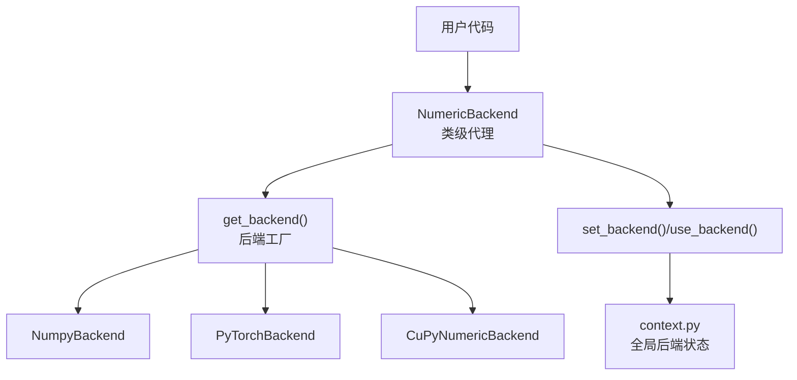
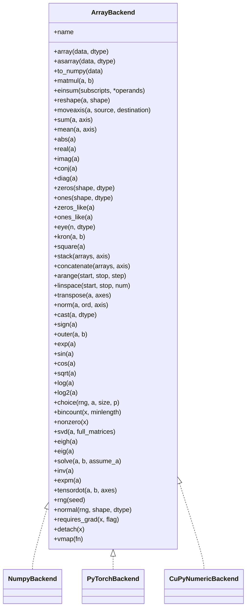
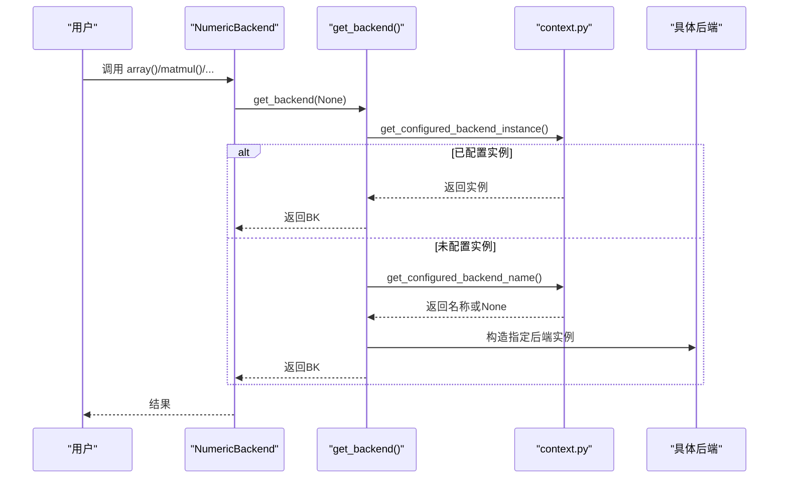
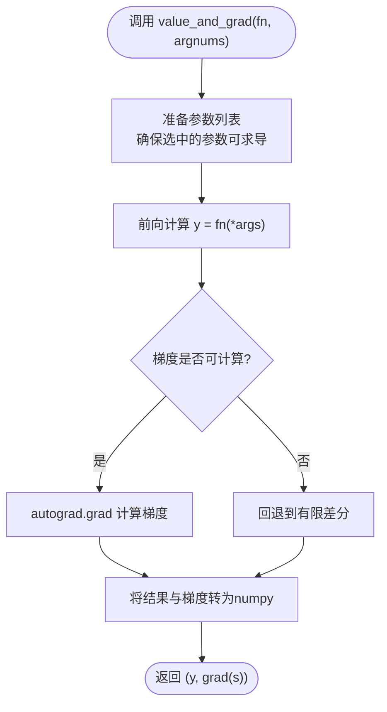
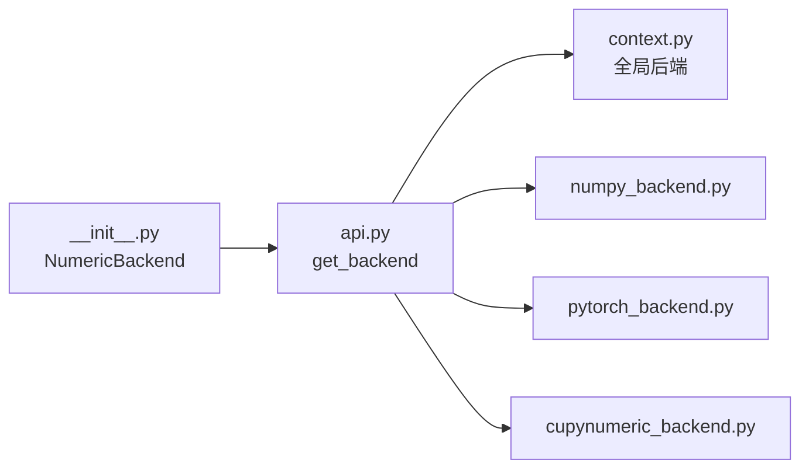

# 数值后端API

<cite>
**本文引用的文件**
- [src/tyxonq/numerics/__init__.py](file://src/tyxonq/numerics/__init__.py)
- [src/tyxonq/numerics/api.py](file://src/tyxonq/numerics/api.py)
- [src/tyxonq/numerics/context.py](file://src/tyxonq/numerics/context.py)
- [src/tyxonq/numerics/backends/numpy_backend.py](file://src/tyxonq/numerics/backends/numpy_backend.py)
- [src/tyxonq/numerics/backends/pytorch_backend.py](file://src/tyxonq/numerics/backends/pytorch_backend.py)
- [src/tyxonq/numerics/backends/cupynumeric_backend.py](file://src/tyxonq/numerics/backends/cupynumeric_backend.py)
- [examples/numeric_backend_switching.py](file://examples/numeric_backend_switching.py)
</cite>

## 目录
1. [简介](#简介)
2. [项目结构](#项目结构)
3. [核心组件](#核心组件)
4. [架构总览](#架构总览)
5. [详细组件分析](#详细组件分析)
6. [依赖关系分析](#依赖关系分析)
7. [性能与内存管理](#性能与内存管理)
8. [故障排查指南](#故障排查指南)
9. [结论](#结论)
10. [附录：自定义后端开发指南与集成示例](#附录自定义后端开发指南与集成示例)

## 简介
本文件面向TyxonQ数值后端系统的API文档，聚焦于ArrayBackend协议、NumPy后端、PyTorch后端与CuPyNumeric后端的实现与使用。内容涵盖数组操作、自动微分支持、GPU加速、后端切换机制、性能特征对比、内存管理策略，以及自定义数值后端的开发与集成方法。同时提供数值精度控制、并行计算配置与调试工具的使用说明。

## 项目结构
TyxonQ的数值后端位于src/tyxonq/numerics目录下，采用“协议+多实现”的设计：
- api.py：定义ArrayBackend协议、后端工厂get_backend、向量化工具vectorize_or_fallback等核心接口
- context.py：全局后端上下文（设置/恢复默认后端）
- __init__.py：暴露统一入口NumericBackend类（类级代理），并提供set_backend/set_dtype等便捷函数
- backends：具体后端实现
  - numpy_backend.py：基于NumPy的CPU实现
  - pytorch_backend.py：基于PyTorch的CPU/GPU实现，含自动微分与JIT封装
  - cupynumeric_backend.py：基于CuPyNumeric的GPU/加速实现（可选依赖）

图表来源
- [src/tyxonq/numerics/__init__.py:20-58](file://src/tyxonq/numerics/__init__.py#L20-L58)
- [src/tyxonq/numerics/api.py:179-252](file://src/tyxonq/numerics/api.py#L179-L252)
- [src/tyxonq/numerics/context.py:18-50](file://src/tyxonq/numerics/context.py#L18-L50)

章节来源
- [src/tyxonq/numerics/__init__.py:1-476](file://src/tyxonq/numerics/__init__.py#L1-L476)
- [src/tyxonq/numerics/api.py:1-255](file://src/tyxonq/numerics/api.py#L1-L255)
- [src/tyxonq/numerics/context.py:1-53](file://src/tyxonq/numerics/context.py#L1-L53)

## 核心组件
- ArrayBackend协议：统一的数组/张量后端接口，包含创建、代数运算、线性代数、随机数、自动微分桥接等能力
- NumericBackend类：类级代理，所有调用转发到当前后端实例，屏蔽后端差异
- get_backend()：后端工厂，按名称或全局配置返回后端实例
- set_backend()/use_backend()：全局后端设置与上下文切换
- vectorize_or_fallback()：根据策略选择vmap或回退到逐元素执行

章节来源
- [src/tyxonq/numerics/api.py:19-122](file://src/tyxonq/numerics/api.py#L19-L122)
- [src/tyxonq/numerics/__init__.py:67-472](file://src/tyxonq/numerics/__init__.py#L67-L472)
- [src/tyxonq/numerics/api.py:124-177](file://src/tyxonq/numerics/api.py#L124-L177)

## 架构总览
TyxonQ通过协议抽象与工厂模式解耦上层量子计算逻辑与底层数值库。用户通过NumericBackend或tq.*统一接口进行计算；内部由get_backend解析并路由到具体后端实现。上下文模块提供进程级默认后端，便于批量任务复用同一后端。

图表来源
- [src/tyxonq/numerics/api.py:19-122](file://src/tyxonq/numerics/api.py#L19-L122)
- [src/tyxonq/numerics/backends/numpy_backend.py:8-457](file://src/tyxonq/numerics/backends/numpy_backend.py#L8-L457)
- [src/tyxonq/numerics/backends/pytorch_backend.py:13-567](file://src/tyxonq/numerics/backends/pytorch_backend.py#L13-L567)
- [src/tyxonq/numerics/backends/cupynumeric_backend.py:13-300](file://src/tyxonq/numerics/backends/cupynumeric_backend.py#L13-L300)

## 详细组件分析

### ArrayBackend协议
- 目标：为不同数值库提供一致的数组/张量接口，屏蔽实现细节
- 关键能力：
  - 数组创建与转换：array/asarray/to_numpy
  - 代数与线性代数：matmul/einsum/svd/eigh/eig/solve/expm/tensordot
  - 数学函数：exp/sin/cos/sqrt/log/log2
  - 随机数：rng/normal/choice/bincount/nonzero
  - 自动微分桥接：requires_grad/detach（可选）
  - 向量化：vmap（可选）

章节来源
- [src/tyxonq/numerics/api.py:19-122](file://src/tyxonq/numerics/api.py#L19-L122)

### NumPy后端
- 特点：纯CPU实现，轻量稳定，适合小规模电路与原型验证
- 自动微分：提供有限差分实现的jacfwd/hessian/value_and_grad，无原生反向传播
- 精度控制：支持complex64/complex128及对应实数dtype
- 典型用途：小系统VQE、快速脚本、基准测试

章节来源
- [src/tyxonq/numerics/backends/numpy_backend.py:8-457](file://src/tyxonq/numerics/backends/numpy_backend.py#L8-L457)

### PyTorch后端
- 特点：支持CPU/GPU、自动微分、JIT编译（torch.compile）、丰富的线性代数
- 自动微分：原生autograd路径，失败时回退到有限差分；提供jacfwd/hessian/value_and_grad
- 精度控制：支持complex64/complex128及对应实数dtype
- 典型用途：带梯度的VQA训练、大规模矩阵运算、GPU加速

章节来源
- [src/tyxonq/numerics/backends/pytorch_backend.py:13-567](file://src/tyxonq/numerics/backends/pytorch_backend.py#L13-L567)

### CuPyNumeric后端
- 特点：GPU/加速后端，API与NumPy对齐，部分算子回退到CPU（如SVD）
- 自动微分：无原生支持，value_and_grad通过有限差分实现
- 典型用途：大态矢量运算、GPU吞吐优先场景

章节来源
- [src/tyxonq/numerics/backends/cupynumeric_backend.py:13-300](file://src/tyxonq/numerics/backends/cupynumeric_backend.py#L13-L300)

### NumericBackend类级代理
- 作用：无需实例化即可调用后端方法，统一dtype访问、自动微分桥接、可选JIT/vmap
- 常用方法：array/zeros/ones/matmul/einsum/eigh/svd/exp/sin/cos/sqrt/requires_grad/detach等

章节来源
- [src/tyxonq/numerics/__init__.py:67-472](file://src/tyxonq/numerics/__init__.py#L67-L472)

### 后端切换机制
- set_backend(name_or_instance)：设置全局后端（字符串名或实例）
- use_backend(...)：上下文管理器临时切换后端
- get_backend(name=None)：工厂函数，优先使用已配置实例/名称，否则回退到NumPy

图表来源
- [src/tyxonq/numerics/__init__.py:20-58](file://src/tyxonq/numerics/__init__.py#L20-L58)
- [src/tyxonq/numerics/api.py:179-252](file://src/tyxonq/numerics/api.py#L179-L252)
- [src/tyxonq/numerics/context.py:18-50](file://src/tyxonq/numerics/context.py#L18-L50)

章节来源
- [src/tyxonq/numerics/__init__.py:20-58](file://src/tyxonq/numerics/__init__.py#L20-L58)
- [src/tyxonq/numerics/api.py:179-252](file://src/tyxonq/numerics/api.py#L179-L252)
- [src/tyxonq/numerics/context.py:18-50](file://src/tyxonq/numerics/context.py#L18-L50)

### 自动微分支持流程（PyTorch）

图表来源
- [src/tyxonq/numerics/backends/pytorch_backend.py:446-564](file://src/tyxonq/numerics/backends/pytorch_backend.py#L446-L564)

章节来源
- [src/tyxonq/numerics/backends/pytorch_backend.py:446-564](file://src/tyxonq/numerics/backends/pytorch_backend.py#L446-L564)

### 向量化工具
- vectorize_or_fallback(fn, backend, policy="auto")：
  - policy="off"：直接返回原函数
  - 若后端提供vmap：尝试vmap执行，异常则回退到逐元素
  - 若无vmap：对首个参数沿首维迭代调用，非序列则直接执行

章节来源
- [src/tyxonq/numerics/api.py:124-177](file://src/tyxonq/numerics/api.py#L124-L177)

## 依赖关系分析
- 模块耦合：
  - NumericBackend依赖api.get_backend获取当前后端实例
  - get_backend依赖context的全局配置与具体后端实现
  - 各后端实现遵循ArrayBackend协议，彼此独立
- 外部依赖：
  - NumPy后端依赖numpy/scipy.linalg.expm
  - PyTorch后端依赖torch（可选功能如torch.func.jacfwd/hessian）
  - CuPyNumeric后端依赖cupynumeric（可选）

图表来源
- [src/tyxonq/numerics/__init__.py:20-58](file://src/tyxonq/numerics/__init__.py#L20-L58)
- [src/tyxonq/numerics/api.py:179-252](file://src/tyxonq/numerics/api.py#L179-L252)
- [src/tyxonq/numerics/context.py:18-50](file://src/tyxonq/numerics/context.py#L18-L50)

章节来源
- [src/tyxonq/numerics/__init__.py:20-58](file://src/tyxonq/numerics/__init__.py#L20-L58)
- [src/tyxonq/numerics/api.py:179-252](file://src/tyxonq/numerics/api.py#L179-L252)
- [src/tyxonq/numerics/context.py:18-50](file://src/tyxonq/numerics/context.py#L18-L50)

## 性能与内存管理
- 后端选择建议：
  - NumPy：小系统、轻量脚本、内存敏感
  - PyTorch：需要自动微分、GPU可用、JIT优化
  - CuPyNumeric：大规模态矢量运算、GPU吞吐优先
- 精度控制：
  - 通过后端set_dtype(dtype_str)设置复数与实数dtype（complex64/complex128）
  - 可通过NumericBackend.set_dtype或直接调用后端实例的set_dtype
- GPU加速：
  - PyTorch后端可使用CUDA设备；示例中展示检测与使用
  - CuPyNumeric后端在GPU上运行，部分算子回退CPU（如SVD）
- 内存管理：
  - 使用上下文管理器或显式清理释放中间状态
  - 对于PyTorch，可在必要时清空缓存以缓解OOM
- 基准与一致性：
  - 示例脚本演示了跨后端性能对比与结果一致性校验

章节来源
- [examples/numeric_backend_switching.py:86-323](file://examples/numeric_backend_switching.py#L86-L323)
- [src/tyxonq/numerics/backends/numpy_backend.py:27-46](file://src/tyxonq/numerics/backends/numpy_backend.py#L27-L46)
- [src/tyxonq/numerics/backends/pytorch_backend.py:35-53](file://src/tyxonq/numerics/backends/pytorch_backend.py#L35-L53)
- [src/tyxonq/numerics/backends/cupynumeric_backend.py:33-53](file://src/tyxonq/numerics/backends/cupynumeric_backend.py#L33-L53)

## 故障排查指南
- 后端不可用：
  - 请求PyTorch/CuPyNumeric但依赖未安装时，get_backend会抛出运行时错误
- 自动微分失败：
  - PyTorch后端在autograd失败时会回退到有限差分并给出警告
- 精度问题：
  - 检查set_dtype是否正确设置；复杂态与参数实数dtype需匹配
- 内存不足：
  - 切换到NumPy或降低精度；必要时清理缓存或分批处理

章节来源
- [src/tyxonq/numerics/api.py:236-252](file://src/tyxonq/numerics/api.py#L236-L252)
- [src/tyxonq/numerics/backends/pytorch_backend.py:509-564](file://src/tyxonq/numerics/backends/pytorch_backend.py#L509-L564)

## 结论
TyxonQ数值后端通过ArrayBackend协议实现了统一的数组/张量接口，支持NumPy、PyTorch与CuPyNumeric三种后端。该设计使上层量子计算代码具备跨框架的可移植性，并可按需选择CPU/GPU、自动微分与JIT优化。结合上下文管理与精度控制，用户可在不同规模与硬件环境下获得稳定的数值计算体验。

## 附录：自定义后端开发指南与集成示例

### 自定义后端实现要点
- 实现ArrayBackend协议中的所有必需方法与属性（name、dtype常量、数组创建、代数/线性代数、随机数、自动微分桥接等）
- 提供set_dtype(dtype_str)以支持精度控制
- 可选实现vmap/jit/value_and_grad以提升性能与易用性
- 在get_backend中注册新后端（或通过工厂扩展）

章节来源
- [src/tyxonq/numerics/api.py:19-122](file://src/tyxonq/numerics/api.py#L19-L122)
- [src/tyxonq/numerics/api.py:179-252](file://src/tyxonq/numerics/api.py#L179-L252)

### 集成步骤
- 将自定义后端类放入backends目录
- 在api.py中导入并注册到get_backend工厂
- 通过tq.set_backend("your_backend")或上下文管理器使用
- 使用NumericBackend统一接口进行计算

章节来源
- [src/tyxonq/numerics/api.py:179-252](file://src/tyxonq/numerics/api.py#L179-L252)
- [src/tyxonq/numerics/__init__.py:20-58](file://src/tyxonq/numerics/__init__.py#L20-L58)

### 使用示例参考
- 后端切换与性能对比：见示例脚本
- 自动微分与GPU使用：参考PyTorch后端实现与示例

章节来源
- [examples/numeric_backend_switching.py:86-323](file://examples/numeric_backend_switching.py#L86-L323)
- [src/tyxonq/numerics/backends/pytorch_backend.py:13-567](file://src/tyxonq/numerics/backends/pytorch_backend.py#L13-L567)