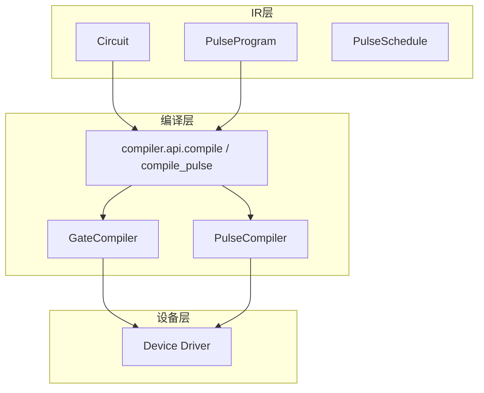
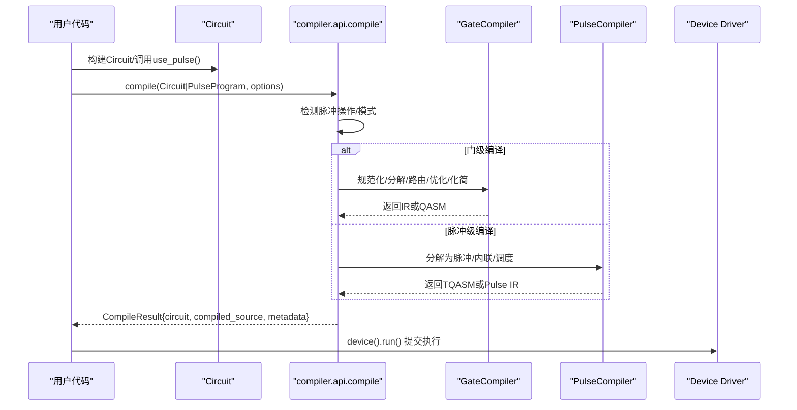
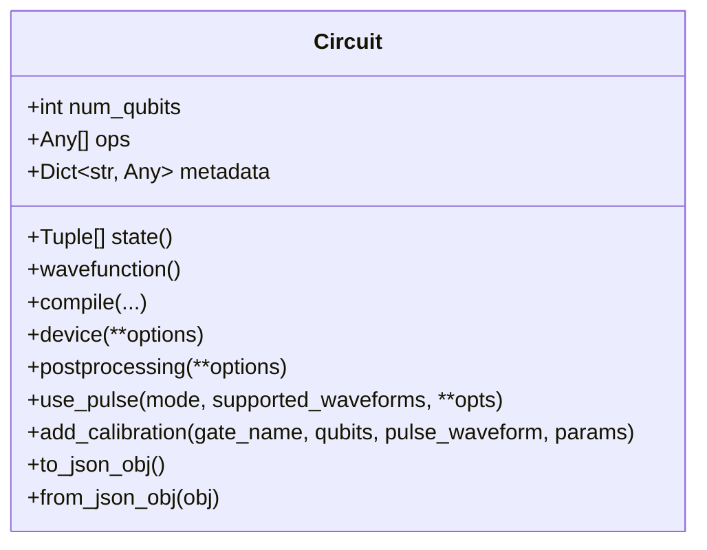
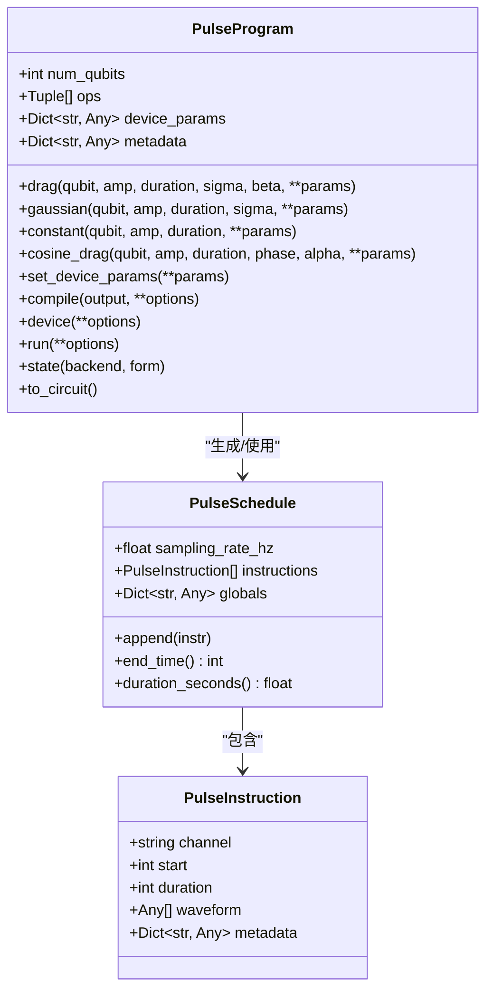
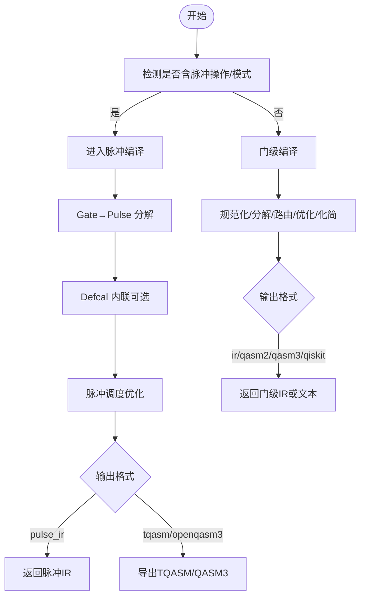
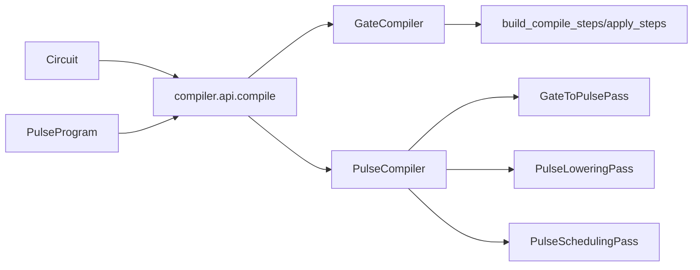

# IR系统API

<cite>
**本文引用的文件**
- [src/tyxonq/core/ir/__init__.py](file://src/tyxonq/core/ir/__init__.py)
- [src/tyxonq/core/ir/circuit.py](file://src/tyxonq/core/ir/circuit.py)
- [src/tyxonq/core/ir/pulse.py](file://src/tyxonq/core/ir/pulse.py)
- [src/tyxonq/compiler/api.py](file://src/tyxonq/compiler/api.py)
- [src/tyxonq/compiler/gate_compiler/compiler.py](file://src/tyxonq/compiler/gate_compiler/compiler.py)
- [src/tyxonq/compiler/pulse_compiler/native/pulse_compiler.py](file://src/tyxonq/compiler/pulse_compiler/native/pulse_compiler.py)
- [src/tyxonq/compiler/pulse_compiler/serialization.py](file://src/tyxonq/compiler/pulse_compiler/serialization.py)
</cite>

## 目录
1. [简介](#简介)
2. [项目结构](#项目结构)
3. [核心组件](#核心组件)
4. [架构总览](#架构总览)
5. [详细组件分析](#详细组件分析)
6. [依赖关系分析](#依赖关系分析)
7. [性能与优化](#性能与优化)
8. [故障排查指南](#故障排查指南)
9. [结论](#结论)
10. [附录：编程接口与示例](#附录编程接口与示例)

## 简介
本文件系统性阐述 TyxonQ 的中间表示（IR）系统，覆盖门级 IR（Circuit）与脉冲级 IR（PulseProgram/PulseSchedule）的设计、构建流程、节点类型、边关系与数据流；解释 IR 的转换与优化机制（门级到脉冲级的分解、内联、调度），并说明序列化/反序列化格式与兼容性。同时提供面向用户的编程接口（查询、修改、验证）、与编译器及设备层的交互方式，以及高级操作的代码路径指引。

## 项目结构
TyxonQ 的 IR 位于 core/ir 包中，分为两类：
- 门级 IR：Circuit（含 Hamiltonian）
- 脉冲级 IR：PulseInstruction、PulseSchedule、PulseProgram

编译入口在 compiler/api.py，门级编译器核心在 gate_compiler/compiler.py，脉冲编译器在 pulse_compiler/native/pulse_compiler.py，序列化在 pulse_compiler/serialization.py。

图表来源
- [src/tyxonq/core/ir/circuit.py:48-139](file://src/tyxonq/core/ir/circuit.py#L48-L139)
- [src/tyxonq/core/ir/pulse.py:8-47](file://src/tyxonq/core/ir/pulse.py#L8-L47)
- [src/tyxonq/compiler/api.py:39-98](file://src/tyxonq/compiler/api.py#L39-L98)
- [src/tyxonq/compiler/gate_compiler/compiler.py:14-109](file://src/tyxonq/compiler/gate_compiler/compiler.py#L14-L109)
- [src/tyxonq/compiler/pulse_compiler/native/pulse_compiler.py:24-197](file://src/tyxonq/compiler/pulse_compiler/native/pulse_compiler.py#L24-L197)

章节来源
- [src/tyxonq/core/ir/__init__.py:1-8](file://src/tyxonq/core/ir/__init__.py#L1-L8)
- [src/tyxonq/core/ir/circuit.py:48-139](file://src/tyxonq/core/ir/circuit.py#L48-L139)
- [src/tyxonq/core/ir/pulse.py:8-47](file://src/tyxonq/core/ir/pulse.py#L8-L47)
- [src/tyxonq/compiler/api.py:39-98](file://src/tyxonq/compiler/api.py#L39-L98)

## 核心组件
- Circuit（门级 IR）
  - 属性：num_qubits、ops（操作序列）、metadata（元信息）、instructions（测量等指令）
  - 链式配置：device()、postprocessing()、use_pulse()、with_noise()、add_calibration()
  - 执行与状态：state()/wavefunction()、run()（通过编译后交由设备驱动）
  - 序列化：to_json_obj()/to_json_str()、from_json_obj()/from_json_str()
- PulseProgram（脉冲级 IR）
  - 属性：num_qubits、ops（(qubit, waveform, params)）、device_params、metadata
  - 链式方法：drag/gaussian/constant/cosine_drag、set_device_params、compile()、device()、run()、state()
  - 与 Circuit 对齐的 with_metadata()、pulse_ops 别名
- PulseSchedule/PulseInstruction（低层脉冲调度）
  - 采样率、指令列表、时间计算（end_time/duration_seconds）

章节来源
- [src/tyxonq/core/ir/circuit.py:48-139](file://src/tyxonq/core/ir/circuit.py#L48-L139)
- [src/tyxonq/core/ir/circuit.py:184-426](file://src/tyxonq/core/ir/circuit.py#L184-L426)
- [src/tyxonq/core/ir/circuit.py:427-572](file://src/tyxonq/core/ir/circuit.py#L427-L572)
- [src/tyxonq/core/ir/circuit.py:758-767](file://src/tyxonq/core/ir/circuit.py#L758-L767)
- [src/tyxonq/core/ir/circuit.py:1991-2005](file://src/tyxonq/core/ir/circuit.py#L1991-L2005)
- [src/tyxonq/core/ir/pulse.py:8-47](file://src/tyxonq/core/ir/pulse.py#L8-L47)
- [src/tyxonq/core/ir/pulse.py:71-138](file://src/tyxonq/core/ir/pulse.py#L71-L138)
- [src/tyxonq/core/ir/pulse.py:154-357](file://src/tyxonq/core/ir/pulse.py#L154-L357)
- [src/tyxonq/core/ir/pulse.py:360-493](file://src/tyxonq/core/ir/pulse.py#L360-L493)
- [src/tyxonq/core/ir/pulse.py:496-648](file://src/tyxonq/core/ir/pulse.py#L496-L648)

## 架构总览
TyxonQ 的 IR 体系采用“门级 IR 与脉冲级 IR 并列”的双轨设计：
- 门级 IR（Circuit）：高层量子电路抽象，支持噪声、测量、状态获取、编译为多种目标（IR/QASM2/QASM3/qiskit）。
- 脉冲级 IR（PulseProgram/PulseSchedule）：底层波形控制，支持本地数值模拟与云端提交。

统一编译入口：
- compile(circuit, ...)：根据是否包含脉冲操作或显式 use_pulse() 自动选择门级或脉冲级编译。
- compile_pulse(pulse_program, ...)：专用于脉冲程序的编译，内部复用 compile() 逻辑。

图表来源
- [src/tyxonq/compiler/api.py:39-98](file://src/tyxonq/compiler/api.py#L39-L98)
- [src/tyxonq/compiler/api.py:140-340](file://src/tyxonq/compiler/api.py#L140-L340)
- [src/tyxonq/compiler/gate_compiler/compiler.py:27-109](file://src/tyxonq/compiler/gate_compiler/compiler.py#L27-L109)
- [src/tyxonq/compiler/pulse_compiler/native/pulse_compiler.py:81-197](file://src/tyxonq/compiler/pulse_compiler/native/pulse_compiler.py#L81-L197)

## 详细组件分析

### Circuit IR：构建、节点、边与数据流
- 节点类型
  - ops：操作序列，元素为 (gate_name, *args)，其中 args 可包含 qubit 索引、参数等。
  - instructions：测量等指令，形如 (name, (indices,))。
- 边关系与数据流
  - 顺序执行：ops 按序作用到量子态上。
  - 测量：instructions 或 measure_z 操作决定测量位置与映射。
  - 初始态：可通过 inputs 指定初始态（仅数值模拟）。
- 构建过程
  - 构造时进行轻量校验（qubit 索引范围、op 结构）。
  - 链式方法扩展：device/postprocessing/use_pulse/add_calibration/with_noise。
- 分析与工具
  - gate_count/gate_summary/count_flop/get_circuit_summary 提供统计与启发式估算。
  - compose/remap_qubits/inverse 提供组合、重映射与逆运算。
- 序列化
  - to_json_obj/to_json_str/from_json_obj/from_json_str 实现 JSON 序列化/反序列化。

图表来源
- [src/tyxonq/core/ir/circuit.py:48-139](file://src/tyxonq/core/ir/circuit.py#L48-L139)
- [src/tyxonq/core/ir/circuit.py:184-426](file://src/tyxonq/core/ir/circuit.py#L184-L426)
- [src/tyxonq/core/ir/circuit.py:427-572](file://src/tyxonq/core/ir/circuit.py#L427-L572)
- [src/tyxonq/core/ir/circuit.py:758-767](file://src/tyxonq/core/ir/circuit.py#L758-L767)
- [src/tyxonq/core/ir/circuit.py:1991-2005](file://src/tyxonq/core/ir/circuit.py#L1991-L2005)

章节来源
- [src/tyxonq/core/ir/circuit.py:48-139](file://src/tyxonq/core/ir/circuit.py#L48-L139)
- [src/tyxonq/core/ir/circuit.py:155-183](file://src/tyxonq/core/ir/circuit.py#L155-L183)
- [src/tyxonq/core/ir/circuit.py:574-730](file://src/tyxonq/core/ir/circuit.py#L574-L730)
- [src/tyxonq/core/ir/circuit.py:758-767](file://src/tyxonq/core/ir/circuit.py#L758-L767)
- [src/tyxonq/core/ir/circuit.py:1991-2005](file://src/tyxonq/core/ir/circuit.py#L1991-L2005)

### Pulse IR：PulseProgram、PulseSchedule、PulseInstruction
- 节点类型
  - PulseInstruction：channel、start、duration、waveform、metadata
  - PulseSchedule：sampling_rate_hz、instructions、globals
  - PulseProgram：num_qubits、ops（(qubit, waveform, params)）、device_params、metadata
- 数据流
  - 链式添加波形（drag/gaussian/constant/cosine_drag）→ 可选 set_device_params → 编译/运行
  - run(shots=0) 走数值模拟（state），shots>0 走设备驱动（TQASM/OpenQASM3）
- 与 Circuit 的关系
  - 双轨并行：PulseProgram 可直接执行，也可转换为 Circuit（兼容调试）
  - 通过 metadata 传递校准、设备参数等上下文

图表来源
- [src/tyxonq/core/ir/pulse.py:8-47](file://src/tyxonq/core/ir/pulse.py#L8-L47)
- [src/tyxonq/core/ir/pulse.py:71-138](file://src/tyxonq/core/ir/pulse.py#L71-L138)
- [src/tyxonq/core/ir/pulse.py:154-357](file://src/tyxonq/core/ir/pulse.py#L154-L357)
- [src/tyxonq/core/ir/pulse.py:360-493](file://src/tyxonq/core/ir/pulse.py#L360-L493)
- [src/tyxonq/core/ir/pulse.py:496-648](file://src/tyxonq/core/ir/pulse.py#L496-L648)

章节来源
- [src/tyxonq/core/ir/pulse.py:8-47](file://src/tyxonq/core/ir/pulse.py#L8-L47)
- [src/tyxonq/core/ir/pulse.py:71-138](file://src/tyxonq/core/ir/pulse.py#L71-L138)
- [src/tyxonq/core/ir/pulse.py:154-357](file://src/tyxonq/core/ir/pulse.py#L154-L357)
- [src/tyxonq/core/ir/pulse.py:360-493](file://src/tyxonq/core/ir/pulse.py#L360-L493)
- [src/tyxonq/core/ir/pulse.py:496-648](file://src/tyxonq/core/ir/pulse.py#L496-L648)

### 门级到脉冲级的转换与优化
- 转换管线（PulseCompiler）
  1) GateToPulsePass：标准门分解为脉冲序列
  2) PulseLoweringPass：内联 defcal（校准定义）
  3) PulseSchedulingPass：脉冲时序优化与资源分配
- 输出格式
  - pulse_ir：TyxonQ 原生脉冲 IR
  - tqasm/tqasm0.2：TQASM 0.2（homebrew_s2 专用）
  - openqasm3/openqasm3.0：OpenQASM 3.0 + OpenPulse
- 内联策略
  - inline_pulses=False：保留符号引用（适合本地模拟、autograd）
  - inline_pulses=True：完全内联（适合云端提交、序列化）

图表来源
- [src/tyxonq/compiler/pulse_compiler/native/pulse_compiler.py:81-197](file://src/tyxonq/compiler/pulse_compiler/native/pulse_compiler.py#L81-L197)
- [src/tyxonq/compiler/gate_compiler/compiler.py:27-109](file://src/tyxonq/compiler/gate_compiler/compiler.py#L27-L109)
- [src/tyxonq/compiler/api.py:140-340](file://src/tyxonq/compiler/api.py#L140-L340)

章节来源
- [src/tyxonq/compiler/pulse_compiler/native/pulse_compiler.py:81-197](file://src/tyxonq/compiler/pulse_compiler/native/pulse_compiler.py#L81-L197)
- [src/tyxonq/compiler/gate_compiler/compiler.py:27-109](file://src/tyxonq/compiler/gate_compiler/compiler.py#L27-L109)
- [src/tyxonq/compiler/api.py:140-340](file://src/tyxonq/compiler/api.py#L140-L340)

### 序列化与版本兼容性
- Circuit JSON
  - to_json_obj：包含 num_qubits、ops、metadata、instructions
  - from_json_obj：从字典重建 Circuit
  - 注意：metadata 中的复杂对象需可 JSON 序列化（或使用 pickle）
- 脉冲程序序列化
  - JSON：serialize_pulse_circuit_to_json/deserialize_pulse_circuit_from_json
  - Pickle：serialize_pulse_circuit_to_pickle/deserialize_pulse_circuit_from_pickle
  - 建议：云端提交/跨进程通信优先使用 TQASM/QASM3 文本；本地 Python 环境可用 pickle 保留对象类型
- 版本兼容性
  - 当前实现未显式声明版本字段；建议在 metadata 中记录版本信息以增强向后兼容
  - 对 JSON 反序列化应容忍缺失字段（已有默认值处理）

章节来源
- [src/tyxonq/core/ir/circuit.py:758-767](file://src/tyxonq/core/ir/circuit.py#L758-L767)
- [src/tyxonq/core/ir/circuit.py:1991-2005](file://src/tyxonq/core/ir/circuit.py#L1991-L2005)
- [src/tyxonq/compiler/pulse_compiler/serialization.py:26-87](file://src/tyxonq/compiler/pulse_compiler/serialization.py#L26-L87)
- [src/tyxonq/compiler/pulse_compiler/serialization.py:90-132](file://src/tyxonq/compiler/pulse_compiler/serialization.py#L90-L132)
- [src/tyxonq/compiler/pulse_compiler/serialization.py:135-191](file://src/tyxonq/compiler/pulse_compiler/serialization.py#L135-L191)

### IR 与编译器、设备层的交互
- 编译器
  - compile() 统一入口，自动推断平台与输出格式；门级通过 GateCompiler，脉冲级通过 PulseCompiler
  - 支持 basis_gates、decompose、route、optimize、simplify 等类型化参数
- 设备层
  - Circuit.run()/PulseProgram.run() 最终调用设备驱动（device_base.run）
  - homebrew_s2 特殊规则：门电路强制 qasm2，脉冲电路强制 tyxonq_homebrew_tqasm

章节来源
- [src/tyxonq/compiler/api.py:39-98](file://src/tyxonq/compiler/api.py#L39-L98)
- [src/tyxonq/compiler/api.py:140-340](file://src/tyxonq/compiler/api.py#L140-L340)
- [src/tyxonq/compiler/gate_compiler/compiler.py:27-109](file://src/tyxonq/compiler/gate_compiler/compiler.py#L27-L109)
- [src/tyxonq/compiler/pulse_compiler/native/pulse_compiler.py:81-197](file://src/tyxonq/compiler/pulse_compiler/native/pulse_compiler.py#L81-L197)

## 依赖关系分析
- Circuit 依赖 compiler.api.compile（延迟导入以避免硬依赖）
- PulseProgram 依赖 compiler.api.compile_pulse（内部复用 compile）
- GateCompiler 依赖 steps/build_compile_steps/apply_steps（步骤装配与执行）
- PulseCompiler 依赖三个 Pass（GateToPulse、PulseLowering、PulseScheduling）

图表来源
- [src/tyxonq/core/ir/circuit.py:8-9](file://src/tyxonq/core/ir/circuit.py#L8-L9)
- [src/tyxonq/compiler/api.py:39-98](file://src/tyxonq/compiler/api.py#L39-L98)
- [src/tyxonq/compiler/gate_compiler/compiler.py:27-109](file://src/tyxonq/compiler/gate_compiler/compiler.py#L27-L109)
- [src/tyxonq/compiler/pulse_compiler/native/pulse_compiler.py:24-197](file://src/tyxonq/compiler/pulse_compiler/native/pulse_compiler.py#L24-L197)

章节来源
- [src/tyxonq/core/ir/circuit.py:8-9](file://src/tyxonq/core/ir/circuit.py#L8-L9)
- [src/tyxonq/compiler/api.py:39-98](file://src/tyxonq/compiler/api.py#L39-L98)
- [src/tyxonq/compiler/gate_compiler/compiler.py:27-109](file://src/tyxonq/compiler/gate_compiler/compiler.py#L27-L109)
- [src/tyxonq/compiler/pulse_compiler/native/pulse_compiler.py:24-197](file://src/tyxonq/compiler/pulse_compiler/native/pulse_compiler.py#L24-L197)

## 性能与优化
- 门级优化
  - optimize 级别控制相邻门合并、恒等剪枝
  - simplify 启用光锥化简，裁剪不影响测量的算符
  - basis_gates 限制基集，便于 QASM2 导出
- 脉冲级优化
  - optimization_level 控制调度与合并强度
  - inline_pulses 影响序列化与云端兼容性
  - supported_waveforms 约束波形类型，避免硬件不支持的波形
- 内存与复杂度
  - statevector：O(2^n) 内存
  - MPS：低纠缠场景高效
  - density_matrix：支持噪声但开销更大

[本节为通用指导，不直接分析具体文件]

## 故障排查指南
- 常见错误
  - qubit 索引越界：构造时校验会抛出 ValueError
  - 未知引擎：state(engine=...) 不支持的值将报错
  - 不支持的输出格式：PulseCompiler 会提示支持的 output
- 诊断建议
  - 使用 gate_summary/count_flop 检查电路规模
  - 使用 validate_waveforms 检查波形支持性
  - 查看 metadata 中的 pulse_device_params、pulse_calibrations 是否正确设置

章节来源
- [src/tyxonq/core/ir/circuit.py:155-183](file://src/tyxonq/core/ir/circuit.py#L155-L183)
- [src/tyxonq/core/ir/circuit.py:538-541](file://src/tyxonq/core/ir/circuit.py#L538-L541)
- [src/tyxonq/compiler/pulse_compiler/native/pulse_compiler.py:250-316](file://src/tyxonq/compiler/pulse_compiler/native/pulse_compiler.py#L250-L316)

## 结论
TyxonQ 的 IR 系统以 Circuit 与 PulseProgram 双轨为核心，通过统一的编译入口与模块化 Pass 实现了从门级到脉冲级的完整转换与优化。其灵活的序列化支持与多后端设备适配，使得从本地仿真到云端执行的链路顺畅且可扩展。推荐在生产环境中明确 use_pulse() 意图、合理设置 device_params 与 supported_waveforms，并利用 metadata 管理校准与设备信息。

[本节为总结，不直接分析具体文件]

## 附录：编程接口与示例
以下列出常用接口与典型用法路径（以文件路径代替具体代码片段）：

- 构建与配置 Circuit
  - 构造与校验：[src/tyxonq/core/ir/circuit.py:48-139](file://src/tyxonq/core/ir/circuit.py#L48-L139)
  - 链式配置 device/postprocessing/use_pulse/add_calibration：[src/tyxonq/core/ir/circuit.py:184-426](file://src/tyxonq/core/ir/circuit.py#L184-L426)
- 获取状态与执行
  - state/wavefunction：[src/tyxonq/core/ir/circuit.py:427-572](file://src/tyxonq/core/ir/circuit.py#L427-L572)
  - 编译与导出（QASM2/QASM3/qiskit）：[src/tyxonq/compiler/gate_compiler/compiler.py:27-109](file://src/tyxonq/compiler/gate_compiler/compiler.py#L27-L109)
- 脉冲编程
  - 添加波形与设备参数：[src/tyxonq/core/ir/pulse.py:154-357](file://src/tyxonq/core/ir/pulse.py#L154-L357)
  - 编译与运行：[src/tyxonq/core/ir/pulse.py:360-493](file://src/tyxonq/core/ir/pulse.py#L360-L493)
  - 数值模拟 state：[src/tyxonq/core/ir/pulse.py:496-586](file://src/tyxonq/core/ir/pulse.py#L496-L586)
- 统一编译入口
  - compile/compile_pulse：[src/tyxonq/compiler/api.py:39-98](file://src/tyxonq/compiler/api.py#L39-L98), [src/tyxonq/compiler/api.py:343-463](file://src/tyxonq/compiler/api.py#L343-L463)
- 序列化/反序列化
  - Circuit JSON：[src/tyxonq/core/ir/circuit.py:758-767](file://src/tyxonq/core/ir/circuit.py#L758-L767), [src/tyxonq/core/ir/circuit.py:1991-2005](file://src/tyxonq/core/ir/circuit.py#L1991-L2005)
  - 脉冲程序 JSON/Pickle：[src/tyxonq/compiler/pulse_compiler/serialization.py:26-132](file://src/tyxonq/compiler/pulse_compiler/serialization.py#L26-L132)

[本节为接口索引，不直接分析具体文件]