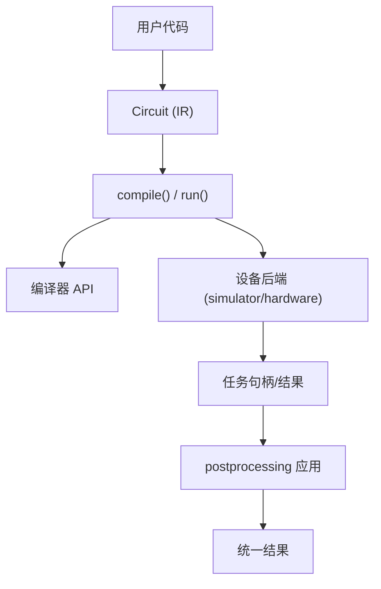
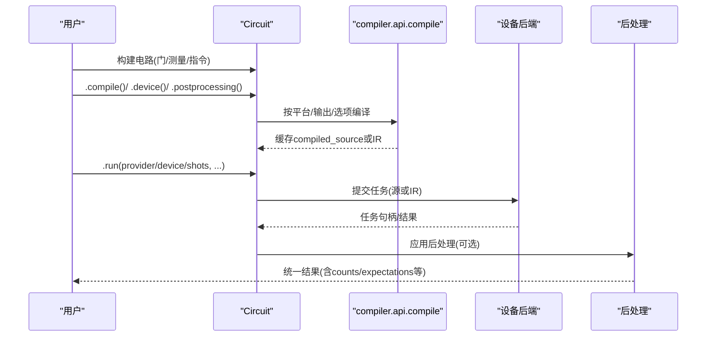
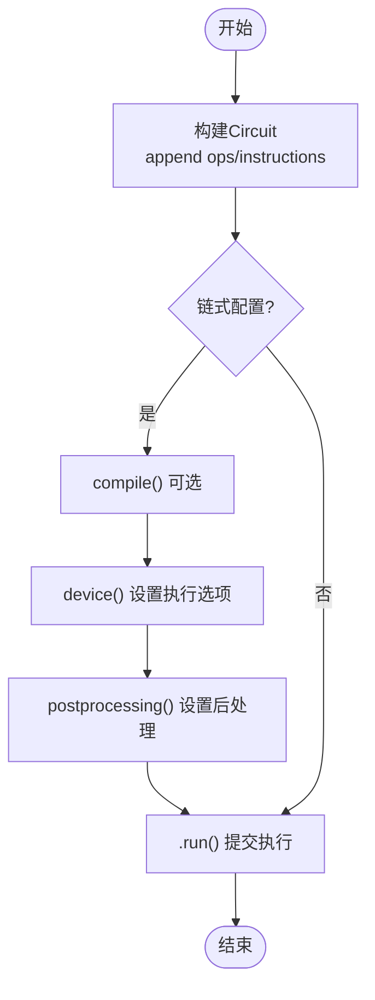
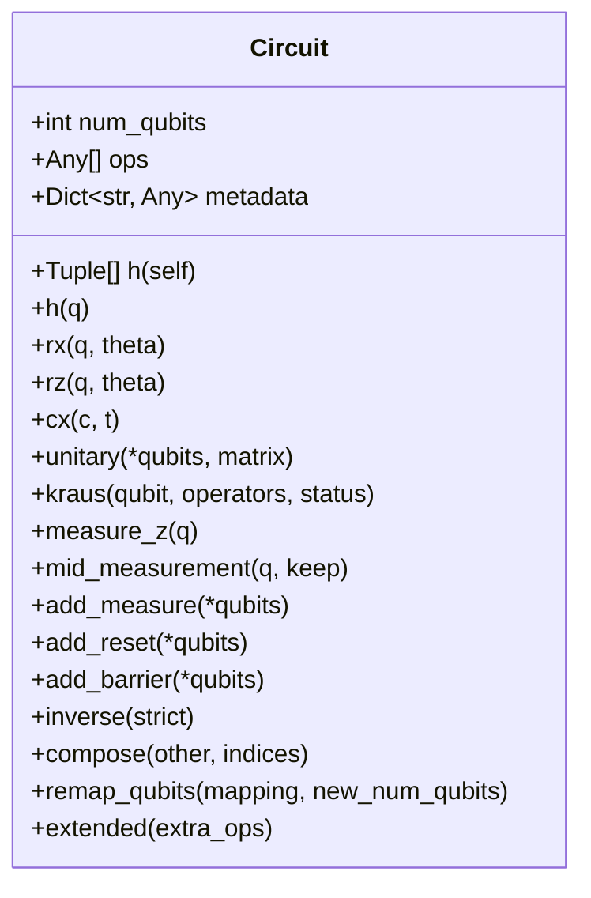
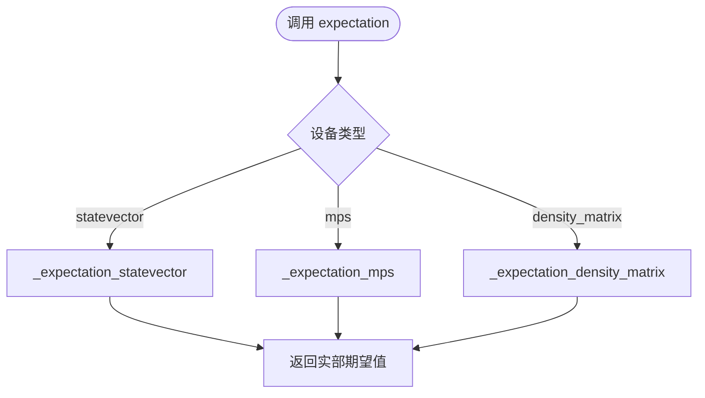
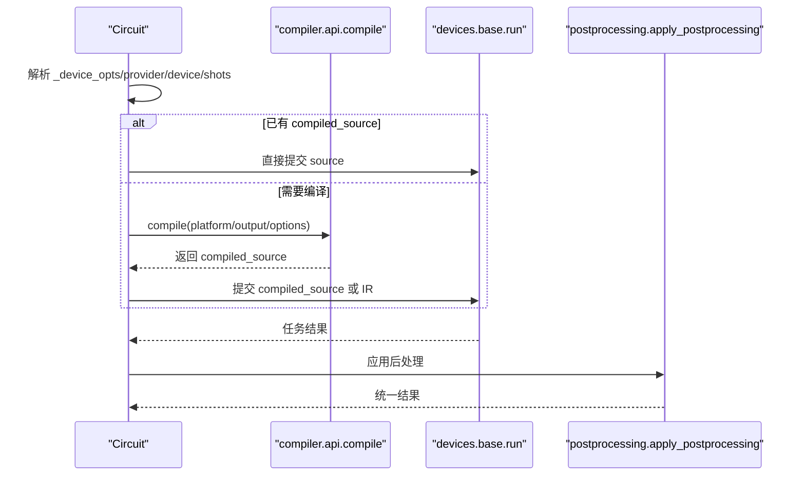
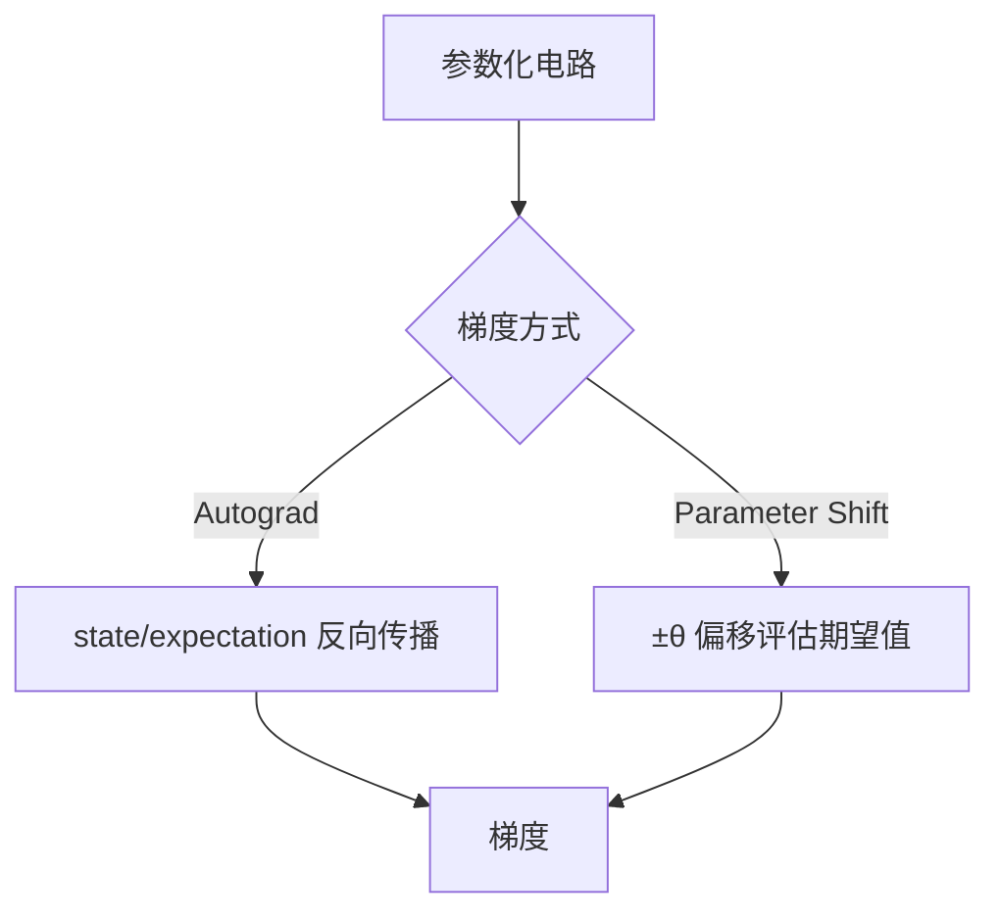
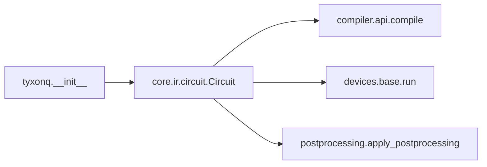

# 核心API

<cite>
**本文引用的文件**
- [src/tyxonq/core/__init__.py](file://src/tyxonq/core/__init__.py)
- [src/tyxonq/core/types.py](file://src/tyxonq/core/types.py)
- [src/tyxonq/core/ir/__init__.py](file://src/tyxonq/core/ir/__init__.py)
- [src/tyxonq/core/ir/circuit.py](file://src/tyxonq/core/ir/circuit.py)
- [src/tyxonq/__init__.py](file://src/tyxonq/__init__.py)
- [examples/basic_chain_api.py](file://examples/basic_chain_api.py)
- [examples/circuit_chain_demo.py](file://examples/circuit_chain_demo.py)
- [examples/autograd_vs_counts.py](file://examples/autograd_vs_counts.py)
</cite>

## 目录
1. [简介](#简介)
2. [项目结构](#项目结构)
3. [核心组件](#核心组件)
4. [架构总览](#架构总览)
5. [详细组件分析](#详细组件分析)
6. [依赖关系分析](#依赖关系分析)
7. [性能考量](#性能考量)
8. [故障排查指南](#故障排查指南)
9. [结论](#结论)
10. [附录](#附录)

## 简介
本文件面向TyxonQ核心API，聚焦量子电路IR表示与基础类型系统，系统性说明Circuit类的构造、链式API调用模式、量子门操作接口、测量与状态管理、参数化电路与梯度计算等核心概念。文档同时给出错误处理建议、性能优化策略与最佳实践，并解释与编译器、设备后端及后处理的集成方式与数据流。

## 项目结构
TyxonQ的核心以“中间表示（IR）+ 设备执行 + 编译/后处理”的分层组织：
- IR层：Circuit/Hamiltonian/PulseInstruction/PulseSchedule 等数据结构，承载电路描述与元信息。
- 顶层入口：暴露Circuit、Hamiltonian以及全局默认配置（device/postprocessing/compile）。
- 执行链路：Circuit.run() 将IR经编译或直译提交至设备后端（模拟器/硬件），并统一返回结果。
- 后处理：对counts/expectations等进行可选的后处理（如读出误差缓解）。

图表来源
- [src/tyxonq/core/ir/circuit.py:783-850](file://src/tyxonq/core/ir/circuit.py#L783-L850)
- [src/tyxonq/core/ir/circuit.py:853-1042](file://src/tyxonq/core/ir/circuit.py#L853-L1042)
- [src/tyxonq/__init__.py:145-182](file://src/tyxonq/__init__.py#L145-L182)

章节来源
- [src/tyxonq/core/__init__.py:1-13](file://src/tyxonq/core/__init__.py#L1-L13)
- [src/tyxonq/core/ir/__init__.py:1-11](file://src/tyxonq/core/ir/__init__.py#L1-L11)
- [src/tyxonq/__init__.py:136-182](file://src/tyxonq/__init__.py#L136-L182)

## 核心组件
- Circuit：最小化的量子电路IR，包含num_qubits、ops、metadata、instructions等字段；提供链式构建、编译、运行、状态获取、期望值计算、绘制、序列化等能力。
- Hamiltonian：哈密顿量IR容器，terms支持多种后端表示。
- 类型与问题封装：Problem用于向应用/编译器传递结构化问题描述。
- 顶层便捷API：通过tyxonq模块暴露Circuit/Hamiltonian、全局device/postprocessing/compile默认设置、数值后端切换等。

章节来源
- [src/tyxonq/core/ir/circuit.py:48-141](file://src/tyxonq/core/ir/circuit.py#L48-L141)
- [src/tyxonq/core/ir/circuit.py:2008-2045](file://src/tyxonq/core/ir/circuit.py#L2008-L2045)
- [src/tyxonq/core/types.py:1-19](file://src/tyxonq/core/types.py#L1-L19)
- [src/tyxonq/__init__.py:136-182](file://src/tyxonq/__init__.py#L136-L182)

## 架构总览
下图展示从IR到执行的端到端流程，包括编译、设备选择、任务提交与后处理。

图表来源
- [src/tyxonq/core/ir/circuit.py:783-850](file://src/tyxonq/core/ir/circuit.py#L783-L850)
- [src/tyxonq/core/ir/circuit.py:853-1042](file://src/tyxonq/core/ir/circuit.py#L853-L1042)

## 详细组件分析

### Circuit类：构造与生命周期
- 构造参数
  - num_qubits：量子比特数（必须非负）。
  - ops：操作序列（字符串名+参数，具体由后端解释）。
  - metadata/instructions：元信息与指令（如measure/reset/barrier）。
  - inputs：初始态（仅数值仿真，支持态矢/密度矩阵）。
  - 编译/设备/后处理默认项：_compile_opts/_device_opts/_post_opts，可从全局默认继承并可被实例覆盖。
- 校验
  - __post_init__中检查num_qubits、op格式、qubit索引范围、instruction格式与索引范围。
- 上下文管理器与兼容方法
  - __enter__/__exit__用于测试场景的with用法。
  - circuit()返回self，兼容某些构建器风格。

章节来源
- [src/tyxonq/core/ir/circuit.py:48-141](file://src/tyxonq/core/ir/circuit.py#L48-L141)
- [src/tyxonq/core/ir/circuit.py:155-183](file://src/tyxonq/core/ir/circuit.py#L155-L183)

### 链式API与全局默认
- 链式阶段
  - compile()：无参时作为no-op返回self；有参时委托compiler.api.compile，支持platform/output/basis_gates/decompose/route/optimize/simplify/device_rule/options等。
  - device(**options)：设置provider/device/shots等执行选项。
  - postprocessing(**options)：设置后处理方法与参数。
  - use_pulse(...)：配置脉冲级编译模式与波形约束。
  - with_noise(...)：快捷配置噪声模型（自动切density_matrix仿真）。
- 全局默认
  - tyxonq.device()/postprocessing()/compile()可设置全局默认，所有后续Circuit实例会继承并在构造时合并。

图表来源
- [src/tyxonq/core/ir/circuit.py:190-239](file://src/tyxonq/core/ir/circuit.py#L190-L239)
- [src/tyxonq/core/ir/circuit.py:241-372](file://src/tyxonq/core/ir/circuit.py#L241-L372)
- [src/tyxonq/core/ir/circuit.py:783-850](file://src/tyxonq/core/ir/circuit.py#L783-L850)
- [src/tyxonq/__init__.py:145-182](file://src/tyxonq/__init__.py#L145-L182)

章节来源
- [src/tyxonq/core/ir/circuit.py:190-372](file://src/tyxonq/core/ir/circuit.py#L190-L372)
- [src/tyxonq/__init__.py:145-182](file://src/tyxonq/__init__.py#L145-L182)

### 量子门操作接口与测量
- 单/双量子比特门
  - h/x/y/z/s/sdg/t/tdg/rx/ry/rz/cx/cnot/cz/cy/iswap/swap/unitary/kraus等。
  - unitary支持任意幺正矩阵（1或2量子比特），内部校验形状并缓存矩阵。
  - kraus支持一般Kraus信道（噪声/测量诱导动力学等）。
- 测量与投影
  - measure_z：添加Z基测量指令。
  - mid_measurement：进行中测并投影（保留keep=0/1分支）。
  - add_measure/add_reset/add_barrier：指令式测量/重置/屏障。
  - measure_reference：仿真期参考测量（返回结果与概率）。
- 辅助
  - inverse：对h/cx/rz等求逆，跳过非幺正操作（strict模式报错）。
  - compose/remap_qubits/extended：电路组合、重映射、扩展。

图表来源
- [src/tyxonq/core/ir/circuit.py:1101-1695](file://src/tyxonq/core/ir/circuit.py#L1101-L1695)
- [src/tyxonq/core/ir/circuit.py:1694-1810](file://src/tyxonq/core/ir/circuit.py#L1694-L1810)

章节来源
- [src/tyxonq/core/ir/circuit.py:1101-1695](file://src/tyxonq/core/ir/circuit.py#L1101-L1695)
- [src/tyxonq/core/ir/circuit.py:1694-1810](file://src/tyxonq/core/ir/circuit.py#L1694-L1810)

### 状态管理与期望值
- state(engine/backend/form)
  - 根据_device_opts选择statevector/mps/density_matrix引擎。
  - form="numpy"返回numpy数组；否则返回后端张量（保持autograd）。
- expectation/expval(pauli_ops...)
  - 自动选择引擎：statevector/mps/density_matrix。
  - 多观测值建议使用Hamiltonian矩阵一次性计算以获得显著加速。
- wavefunction：state的别名，语义更贴近波函数。

图表来源
- [src/tyxonq/core/ir/circuit.py:1694-1810](file://src/tyxonq/core/ir/circuit.py#L1694-L1810)
- [src/tyxonq/core/ir/circuit.py:1811-1956](file://src/tyxonq/core/ir/circuit.py#L1811-L1956)

章节来源
- [src/tyxonq/core/ir/circuit.py:427-572](file://src/tyxonq/core/ir/circuit.py#L427-L572)
- [src/tyxonq/core/ir/circuit.py:1694-1956](file://src/tyxonq/core/ir/circuit.py#L1694-L1956)

### 编译与执行（run）
- compile(platform/output/options/...): 
  - 无参时返回self（链式no-op）。
  - 有参时委托compiler.api.compile，支持缓存compiled_source避免重复编译。
- run(provider/device/shots/...):
  - 优先使用已编译source；否则按当前默认编译。
  - 针对特定provider（qcos/lqcloud/guodun）走不同路径（拓扑发现、路由、物理比特映射等）。
  - 统一收集任务结果，并应用postprocessing。

图表来源
- [src/tyxonq/core/ir/circuit.py:783-850](file://src/tyxonq/core/ir/circuit.py#L783-L850)
- [src/tyxonq/core/ir/circuit.py:853-1042](file://src/tyxonq/core/ir/circuit.py#L853-L1042)

章节来源
- [src/tyxonq/core/ir/circuit.py:783-1042](file://src/tyxonq/core/ir/circuit.py#L783-L1042)

### 参数化电路与梯度计算
- 参数化门：rx/ry/rz等接受任意参数（浮点/符号/表达式），在IR中以元组形式记录。
- 梯度策略
  - 自动微分：当使用支持autograd的后端（如PyTorch）且参数requires_grad=True时，可通过state/期望值反向传播获得梯度。
  - 参数平移法（Parameter Shift）：对RX/RZ等门，通过±π/2偏移估计梯度，适用于采样路径（shots>0）与精确路径（shots=0）。
- 示例参考
  - autograd vs counts对比：比较基于计数与autograd的路径。
  - VQE库中的parameter_shift_gradient实现。

图表来源
- [examples/autograd_vs_counts.py:1-91](file://examples/autograd_vs_counts.py#L1-L91)
- [src/tyxonq/libs/circuits_library/vqe.py:85-118](file://src/tyxonq/libs/circuits_library/vqe.py#L85-L118)

章节来源
- [examples/autograd_vs_counts.py:1-91](file://examples/autograd_vs_counts.py#L1-L91)
- [src/tyxonq/libs/circuits_library/vqe.py:85-118](file://src/tyxonq/libs/circuits_library/vqe.py#L85-L118)

### 错误处理与健壮性
- 构造期校验：num_qubits非负、op为tuple/list、名称为字符串、qubit索引在范围内、instruction格式正确。
- 运行时异常：
  - unitary矩阵维度不匹配、qubit索引非法。
  - expectation输入格式错误。
  - 未知engine类型。
  - 任务取消/详情获取缺失设备信息。
- 警告：reset操作仅在仿真有效，硬件逻辑电路中通常不支持。

章节来源
- [src/tyxonq/core/ir/circuit.py:155-183](file://src/tyxonq/core/ir/circuit.py#L155-L183)
- [src/tyxonq/core/ir/circuit.py:1241-1277](file://src/tyxonq/core/ir/circuit.py#L1241-L1277)
- [src/tyxonq/core/ir/circuit.py:1488-1495](file://src/tyxonq/core/ir/circuit.py#L1488-L1495)
- [src/tyxonq/core/ir/circuit.py:2047-2082](file://src/tyxonq/core/ir/circuit.py#L2047-L2082)

### 与其他模块的集成与数据流
- 编译器：compile()委托compiler.api.compile，支持多平台（qiskit/lqcloud/guodun/pulse等）。
- 设备后端：run()通过devices.base.run提交任务，支持模拟器与多种硬件提供商。
- 后处理：apply_postprocessing对counts/expectations进行误差缓解等处理。
- 可视化：draw()通过Qiskit转换IR为QuantumCircuit并调用其绘图。

章节来源
- [src/tyxonq/core/ir/circuit.py:771-778](file://src/tyxonq/core/ir/circuit.py#L771-L778)
- [src/tyxonq/core/ir/circuit.py:853-1042](file://src/tyxonq/core/ir/circuit.py#L853-L1042)
- [src/tyxonq/core/ir/circuit.py:1970-1989](file://src/tyxonq/core/ir/circuit.py#L1970-L1989)

## 依赖关系分析
- 顶层模块tyxonq.__init__导出Circuit/Hamiltonian，并提供全局device/postprocessing/compile默认设置与数值后端切换。
- core.ir.circuit依赖compiler.api.compile与devices.base.run，形成IR→编译→执行→后处理的闭环。
- 示例展示了链式API与全局默认的使用模式。

图表来源
- [src/tyxonq/__init__.py:136-182](file://src/tyxonq/__init__.py#L136-L182)
- [src/tyxonq/core/ir/circuit.py:783-850](file://src/tyxonq/core/ir/circuit.py#L783-L850)
- [src/tyxonq/core/ir/circuit.py:853-1042](file://src/tyxonq/core/ir/circuit.py#L853-L1042)

章节来源
- [src/tyxonq/__init__.py:136-182](file://src/tyxonq/__init__.py#L136-L182)
- [src/tyxonq/core/ir/circuit.py:783-1042](file://src/tyxonq/core/ir/circuit.py#L783-L1042)

## 性能考量
- 多观测值期望值：优先使用Hamiltonian矩阵一次性计算，避免多次re-execute带来的开销。
- 仿真引擎选择：大系统使用MPS（matrix_product_state）降低内存与时间复杂度；噪声场景使用density_matrix。
- 编译缓存：compile()会缓存compiled_source，避免重复编译。
- 采样与精度权衡：shots越大统计误差越小，但耗时增加；autograd路径在仿真下更高效。
- 脉冲编译：use_pulse(mode="pulse_only"/"hybrid")结合inline_pulses与output="tqasm"可在云端提交时提升兼容性。

[本节为通用指导，无需特定文件引用]

## 故障排查指南
- 常见错误
  - qubit索引越界：检查num_qubits与门参数。
  - unitary矩阵形状不匹配：确保矩阵维度为2^k×2^k（k为目标量子比特数）。
  - 未知engine：确认device()中device字符串与支持的引擎一致。
  - 任务取消失败：确认任务句柄包含设备信息。
- 调试建议
  - 使用gate_summary()/count_flop()了解电路规模。
  - 使用draw()查看IR对应的量子线路图。
  - 逐步启用postprocessing定位结果偏差来源。

章节来源
- [src/tyxonq/core/ir/circuit.py:155-183](file://src/tyxonq/core/ir/circuit.py#L155-L183)
- [src/tyxonq/core/ir/circuit.py:1241-1277](file://src/tyxonq/core/ir/circuit.py#L1241-L1277)
- [src/tyxonq/core/ir/circuit.py:2047-2082](file://src/tyxonq/core/ir/circuit.py#L2047-L2082)

## 结论
TyxonQ的Circuit提供了简洁而强大的IR抽象与链式API，配合灵活的编译/执行/后处理管线，能够无缝衔接仿真与硬件。通过合理的引擎选择、编译缓存与多观测值优化，可在保证精度的同时显著提升性能。参数化电路与梯度计算（autograd/参数平移）为变分算法提供了坚实基础。

[本节为总结，无需特定文件引用]

## 附录
- 完整示例路径
  - 链式API与全局默认：[examples/basic_chain_api.py](file://examples/basic_chain_api.py)
  - 全面演示（门/测量/组合/序列化/脉冲）：[examples/circuit_chain_demo.py](file://examples/circuit_chain_demo.py)
  - Autograd vs Counts对比：[examples/autograd_vs_counts.py](file://examples/autograd_vs_counts.py)

章节来源
- [examples/basic_chain_api.py:1-150](file://examples/basic_chain_api.py#L1-L150)
- [examples/circuit_chain_demo.py:1-305](file://examples/circuit_chain_demo.py#L1-L305)
- [examples/autograd_vs_counts.py:1-91](file://examples/autograd_vs_counts.py#L1-L91)