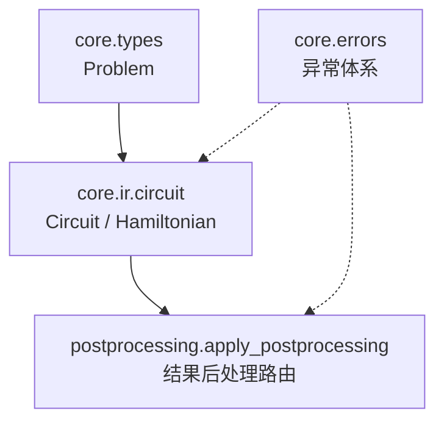
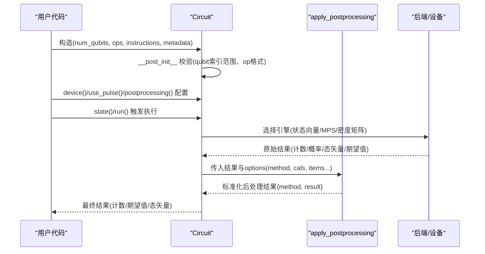
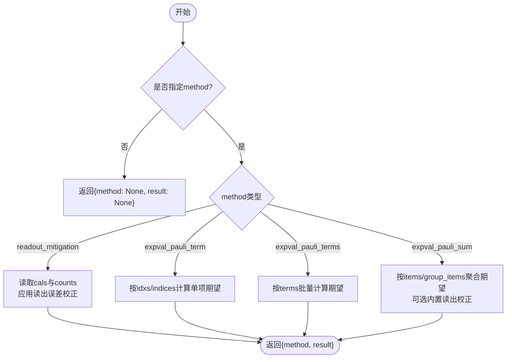
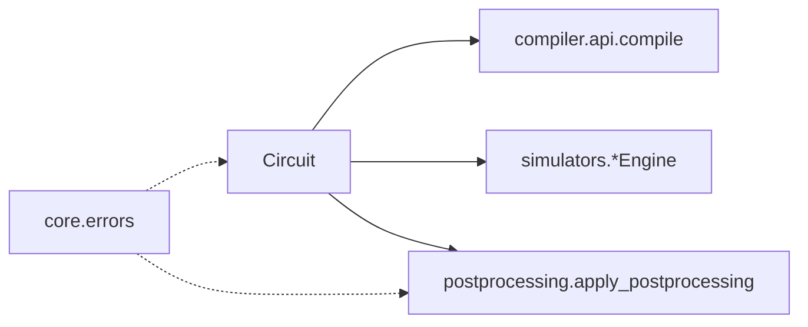

# 类型系统API

<cite>
**本文引用的文件**
- [src/tyxonq/core/types.py](file://src/tyxonq/core/types.py)
- [src/tyxonq/core/errors.py](file://src/tyxonq/core/errors.py)
- [src/tyxonq/core/__init__.py](file://src/tyxonq/core/__init__.py)
- [src/tyxonq/core/ir/__init__.py](file://src/tyxonq/core/ir/__init__.py)
- [src/tyxonq/core/ir/circuit.py](file://src/tyxonq/core/ir/circuit.py)
- [src/tyxonq/postprocessing/__init__.py](file://src/tyxonq/postprocessing/__init__.py)
</cite>

## 目录
1. [简介](#简介)
2. [项目结构](#项目结构)
3. [核心组件](#核心组件)
4. [架构总览](#架构总览)
5. [详细组件分析](#详细组件分析)
6. [依赖关系分析](#依赖关系分析)
7. [性能考量](#性能考量)
8. [故障排查指南](#故障排查指南)
9. [结论](#结论)
10. [附录](#附录)

## 简介
本文件聚焦 TyxonQ 的类型系统，围绕框架中的核心数据类型与定义展开：量子比特索引、量子态表示、算符类型、测量结果等基础类型的约定与使用；并说明类型验证、类型转换与类型安全的实现机制。同时给出自定义类型扩展方法、类型约束、相关工具函数与辅助类的使用方式，以及类型错误处理与调试技巧，并通过具体代码示例展示如何在开发中正确使用这些类型。

## 项目结构
TyxonQ 的类型系统主要分布在 core 与 postprocessing 两个层次：
- core 层提供中间表示（IR）与基础异常类型，包括 Circuit、Hamiltonian、Problem 等核心数据结构，以及统一的编译/设备/后处理默认值管理。
- postprocessing 层提供测量结果的后处理路由与聚合，统一输出结构，屏蔽底层差异。

图表来源
- [src/tyxonq/core/types.py:6-16](file://src/tyxonq/core/types.py#L6-L16)
- [src/tyxonq/core/ir/circuit.py:49-183](file://src/tyxonq/core/ir/circuit.py#L49-L183)
- [src/tyxonq/postprocessing/__init__.py:16-225](file://src/tyxonq/postprocessing/__init__.py#L16-L225)
- [src/tyxonq/core/errors.py:1-17](file://src/tyxonq/core/errors.py#L1-L17)

章节来源
- [src/tyxonq/core/__init__.py:1-13](file://src/tyxonq/core/__init__.py#L1-L13)
- [src/tyxonq/core/ir/__init__.py:1-11](file://src/tyxonq/core/ir/__init__.py#L1-L11)

## 核心组件
- Problem：用于封装问题域输入到应用/编译器，包含问题类别与载荷。
- Circuit：最小化的量子电路 IR，承载量子比特数、操作序列、指令、元数据及执行/编译/后处理配置。
- Hamiltonian：量子哈密顿量的 IR，terms 字段支持多种后端表示（Pauli 求和、稀疏矩阵、稠密矩阵、系数+Pauli 字符串列表）。
- 后处理路由 apply_postprocessing：对测量结果进行统一后处理（读出误差校正、期望值计算等），返回稳定结构。

章节来源
- [src/tyxonq/core/types.py:6-16](file://src/tyxonq/core/types.py#L6-L16)
- [src/tyxonq/core/ir/circuit.py:49-183](file://src/tyxonq/core/ir/circuit.py#L49-L183)
- [src/tyxonq/core/ir/circuit.py:2009-2044](file://src/tyxonq/core/ir/circuit.py#L2009-L2044)
- [src/tyxonq/postprocessing/__init__.py:16-225](file://src/tyxonq/postprocessing/__init__.py#L16-L225)

## 架构总览
下图展示了从用户构建 Circuit/Hamiltonian，到执行与后处理的类型流转与校验点。

图表来源
- [src/tyxonq/core/ir/circuit.py:49-183](file://src/tyxonq/core/ir/circuit.py#L49-L183)
- [src/tyxonq/core/ir/circuit.py:427-541](file://src/tyxonq/core/ir/circuit.py#L427-L541)
- [src/tyxonq/postprocessing/__init__.py:16-225](file://src/tyxonq/postprocessing/__init__.py#L16-L225)

## 详细组件分析

### 类型与数据结构
- Problem
  - kind：受限字面量类型，限定为“hamiltonian”“circuit”“pulse”“custom”。
  - payload：任意结构化数据，承载具体问题描述。
  - 用途：作为应用/编译器的统一输入包装，便于类型化分发。

- Circuit
  - num_qubits：量子比特数量，非负整数。
  - ops：操作序列，元素为元组或列表，首项为操作名（字符串），后续参数含量子比特索引（整数）。
  - instructions：显式指令列表，形如 (名称, (索引元组,))。
  - metadata：元数据字典，可携带校准、波形、编译选项等。
  - 构造器参数：支持初始态 inputs、编译/设备/后处理默认值、绘制输出、预编译源等。
  - 校验：在 __post_init__ 中对 num_qubits、ops、instructions 做轻量结构校验，确保 qubit 索引在范围内。

- Hamiltonian
  - terms：后端特定的哈密顿量表示，允许灵活适配不同阶段与设备需求。

- 后处理结果结构
  - apply_postprocessing 始终返回 {method, result} 的字典结构，保证上层消费的一致性。

章节来源
- [src/tyxonq/core/types.py:6-16](file://src/tyxonq/core/types.py#L6-L16)
- [src/tyxonq/core/ir/circuit.py:49-183](file://src/tyxonq/core/ir/circuit.py#L49-L183)
- [src/tyxonq/core/ir/circuit.py:2009-2044](file://src/tyxonq/core/ir/circuit.py#L2009-L2044)
- [src/tyxonq/postprocessing/__init__.py:16-225](file://src/tyxonq/postprocessing/__init__.py#L16-L225)

### 类型验证与类型安全
- 量子比特索引验证
  - 在 Circuit.__post_init__ 中，遍历 ops 与 instructions，识别所有整型参数作为量子比特索引，并检查是否在 [0, num_qubits) 范围内。
  - 若越界则抛出 ValueError，防止非法索引进入后续编译/执行流程。

- 操作结构验证
  - 要求 op 为 tuple/list，且非空；首项必须为字符串（操作名）。
  - instructions 必须为 (name, indices_tuple) 形式，indices 为整型元组。

- 引擎选择与类型契约
  - state() 根据 device 配置自动选择引擎：statevector、mps、density_matrix。
  - 每种引擎返回符合文档约定的类型：态矢量为 1D 数组/张量，密度矩阵为 2D 数组/张量。
  - 不支持的 engine 会抛出 ValueError，明确可用集合。

- 后处理类型契约
  - apply_postprocessing 对 method 进行路由，未识别的方法返回占位信息，避免上层崩溃。
  - 失败路径保持结构完整（method/result），便于诊断。

章节来源
- [src/tyxonq/core/ir/circuit.py:155-183](file://src/tyxonq/core/ir/circuit.py#L155-L183)
- [src/tyxonq/core/ir/circuit.py:427-541](file://src/tyxonq/core/ir/circuit.py#L427-L541)
- [src/tyxonq/postprocessing/__init__.py:102-225](file://src/tyxonq/postprocessing/__init__.py#L102-L225)

### 类型转换与工具函数
- 电路序列化/反序列化
  - to_json_obj/to_json_str/from_json_str：将 Circuit 转换为 JSON 对象/字符串，支持跨模块/进程传递。
- 电路组合与重映射
  - compose/extended/remap_qubits：在不改变原实例的前提下生成新电路，支持逻辑量子比特到物理量子比特的映射。
- 统计与分析
  - gate_count/gate_summary/count_flop/get_circuit_summary：轻量级统计与复杂度估算，不依赖外部库。
- 后处理聚合
  - apply_postprocessing：统一入口，支持 readout_mitigation、expval_pauli_term/terms/sum 等方法，内部按需延迟导入以避免循环依赖。

章节来源
- [src/tyxonq/core/ir/circuit.py:666-710](file://src/tyxonq/core/ir/circuit.py#L666-L710)
- [src/tyxonq/core/ir/circuit.py:574-664](file://src/tyxonq/core/ir/circuit.py#L574-L664)
- [src/tyxonq/core/ir/circuit.py:757-767](file://src/tyxonq/core/ir/circuit.py#L757-L767)
- [src/tyxonq/postprocessing/__init__.py:16-225](file://src/tyxonq/postprocessing/__init__.py#L16-L225)

### 自定义类型扩展与类型约束
- 扩展 Problem.kind
  - 通过 Literal 限制领域问题类别，新增类别需在类型定义处扩展，以维持编译期约束。
- 扩展 Circuit.instructions
  - 可在 metadata 中附加自定义指令集或校准信息（例如脉冲校准 add_calibration），并在 use_pulse 模式下参与编译。
- 扩展 Hamiltonian.terms
  - 允许后端/编译器将 terms 设置为特定表示（如 Pauli 求和、稀疏矩阵、MPO），但需遵守上游/下游接口的约定。

章节来源
- [src/tyxonq/core/types.py:6-16](file://src/tyxonq/core/types.py#L6-L16)
- [src/tyxonq/core/ir/circuit.py:300-425](file://src/tyxonq/core/ir/circuit.py#L300-L425)
- [src/tyxonq/core/ir/circuit.py:2009-2044](file://src/tyxonq/core/ir/circuit.py#L2009-L2044)

### 测量结果与后处理
- 输入结构
  - result 可为 {"result": counts} 或 {"counts": ...}，metadata 可包含 shots、num_qubits 等。
- 方法路由
  - readout_mitigation：基于单量子比特校准矩阵校正计数。
  - expval_pauli_term/terms/sum：按 Pauli 项或求和计算期望值，支持从 statevector/probabilities 解析或直接使用 counts。
- 输出结构
  - 统一返回 {method, result}，其中 result 为方法特定数据（如 mitigated_counts、期望值标量或聚合结果）。

图表来源
- [src/tyxonq/postprocessing/__init__.py:16-225](file://src/tyxonq/postprocessing/__init__.py#L16-L225)

章节来源
- [src/tyxonq/postprocessing/__init__.py:16-225](file://src/tyxonq/postprocessing/__init__.py#L16-L225)

## 依赖关系分析
- Circuit 依赖
  - 编译 API：compile() 委托 compiler.api.compile，支持平台与输出目标切换。
  - 模拟器引擎：state() 动态选择 statevector/matrix_product_state/density_matrix 引擎。
  - 后处理：postprocessing 选项经 apply_postprocessing 路由。
- 后处理依赖
  - 延迟导入 readout、counts_expval，避免循环依赖与启动开销。
- 异常体系
  - core.errors 提供 TyxonQError 及其子类，贯穿编译与设备执行阶段。

图表来源
- [src/tyxonq/core/ir/circuit.py:780-800](file://src/tyxonq/core/ir/circuit.py#L780-L800)
- [src/tyxonq/core/ir/circuit.py:427-541](file://src/tyxonq/core/ir/circuit.py#L427-L541)
- [src/tyxonq/postprocessing/__init__.py:16-225](file://src/tyxonq/postprocessing/__init__.py#L16-L225)
- [src/tyxonq/core/errors.py:1-17](file://src/tyxonq/core/errors.py#L1-L17)

章节来源
- [src/tyxonq/core/errors.py:1-17](file://src/tyxonq/core/errors.py#L1-L17)

## 性能考量
- 状态表示选择
  - statevector：O(2^n) 内存，适合小规模系统。
  - MPS：低纠缠场景高效，可通过 max_bond 控制精度与内存。
  - density_matrix：支持噪声模拟，内存 O(4^n)。
- 后处理优化
  - 在读出误差校正与期望值聚合时，优先复用 counts/probabilities/statevector，减少重复计算。
  - 对于 expval_pauli_sum，当存在 expectations/probabilities 时直接解析，避免无意义的采样。

[本节为通用指导，无需引用具体文件]

## 故障排查指南
- 常见类型错误
  - 量子比特索引越界：检查 Circuit.__post_init__ 抛出的 ValueError，确认 num_qubits 与 op/instructions 中的索引范围。
  - 未知引擎：state() 抛出 ValueError，确认 device 配置或 engine 参数。
  - 未识别后处理方法：apply_postprocessing 返回 reason 提示，检查 options["method"] 是否正确。
- 调试建议
  - 使用 gate_summary/count_flop 快速定位门深度与复杂度。
  - 使用 to_json_str 导出电路，便于跨进程/模块复现问题。
  - 在后处理失败时，检查 result 结构与方法参数（如 cals、items、identity_const）。

章节来源
- [src/tyxonq/core/ir/circuit.py:155-183](file://src/tyxonq/core/ir/circuit.py#L155-L183)
- [src/tyxonq/core/ir/circuit.py:427-541](file://src/tyxonq/core/ir/circuit.py#L427-L541)
- [src/tyxonq/postprocessing/__init__.py:102-225](file://src/tyxonq/postprocessing/__init__.py#L102-L225)

## 结论
TyxonQ 的类型系统以 Circuit 与 Hamiltonian 为核心 IR，结合 Problem 的问题域封装与 postprocessing 的统一结果路由，形成从构建、校验、执行到后处理的完整类型链。通过严格的索引校验、引擎契约与稳定的后处理结构，框架在保证类型安全的同时提供了灵活的扩展点。开发者应遵循类型约定，合理使用工具函数，借助异常与诊断信息进行高效调试。

## 附录
- 使用示例（路径引用）
  - 构建与校验：参考 Circuit 构造与 __post_init__ 校验逻辑。
  - 状态获取：参考 state() 的引擎选择与返回类型。
  - 后处理：参考 apply_postprocessing 的方法路由与输出结构。
  - 序列化：参考 to_json_str/from_json_str。

章节来源
- [src/tyxonq/core/ir/circuit.py:49-183](file://src/tyxonq/core/ir/circuit.py#L49-L183)
- [src/tyxonq/core/ir/circuit.py:427-541](file://src/tyxonq/core/ir/circuit.py#L427-L541)
- [src/tyxonq/postprocessing/__init__.py:16-225](file://src/tyxonq/postprocessing/__init__.py#L16-L225)
- [src/tyxonq/core/ir/circuit.py:757-767](file://src/tyxonq/core/ir/circuit.py#L757-L767)