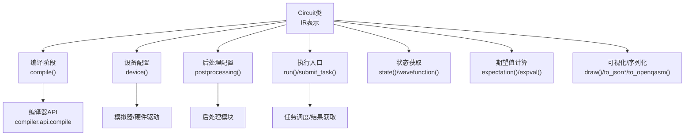
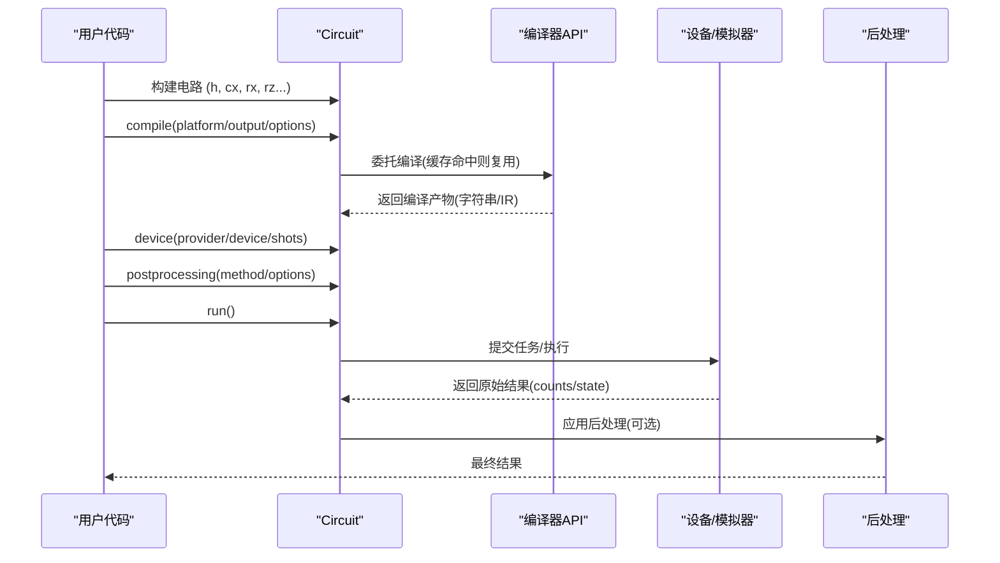
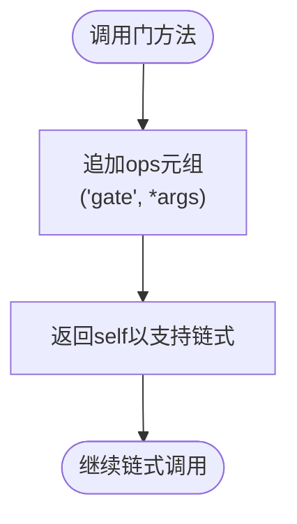
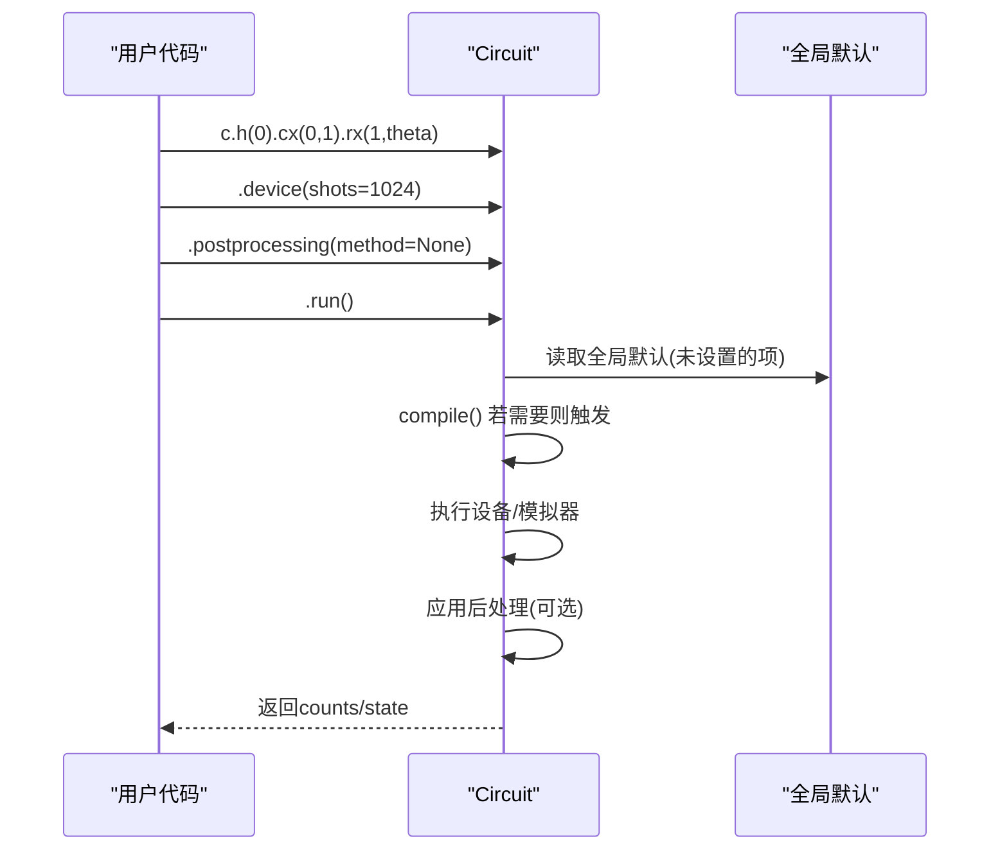
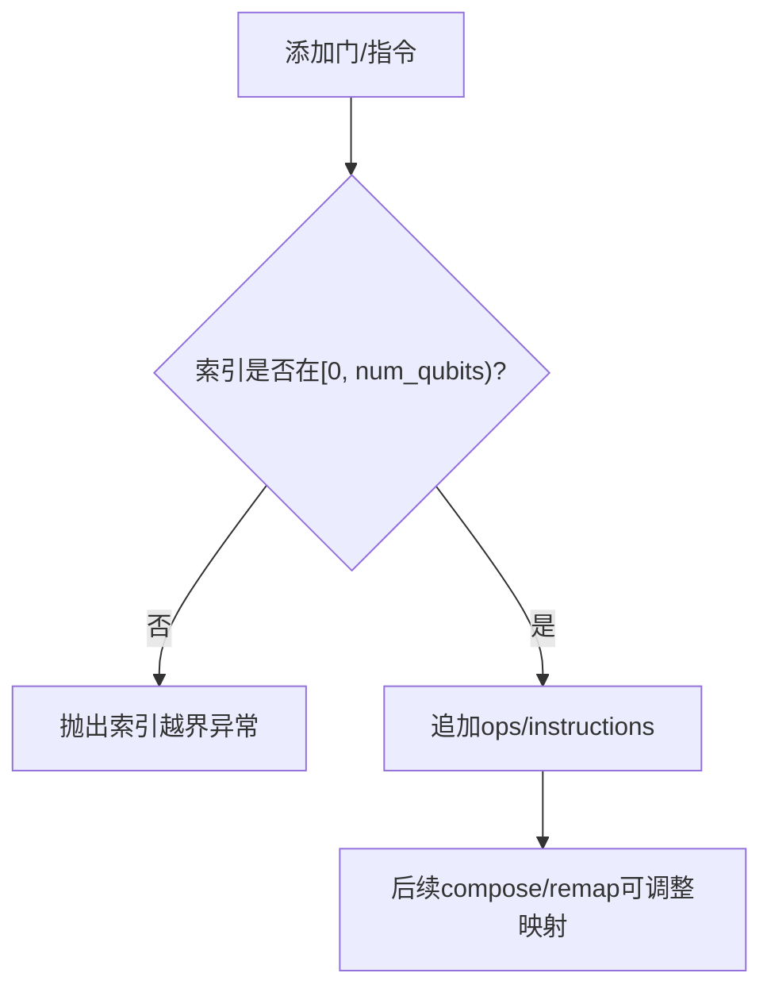
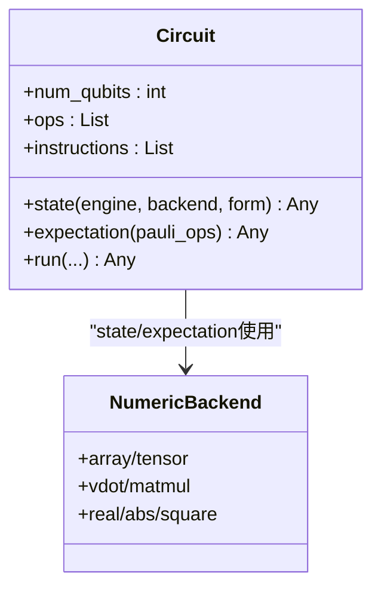
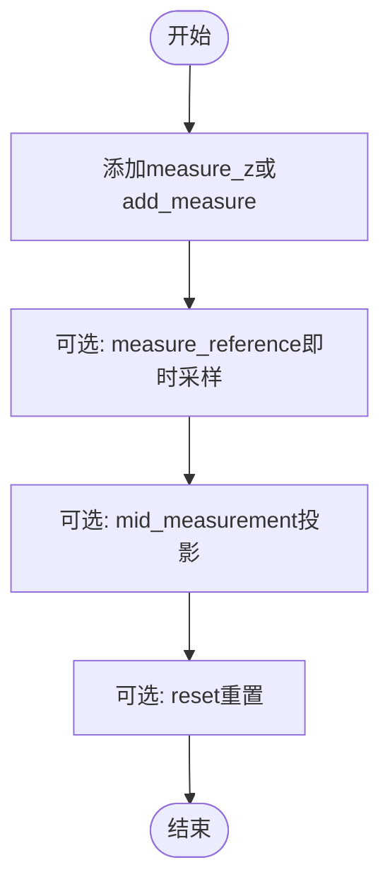
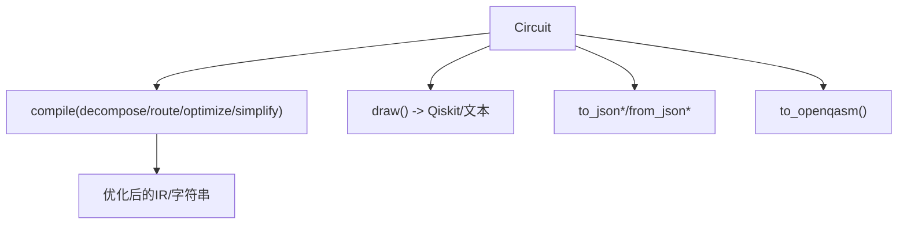
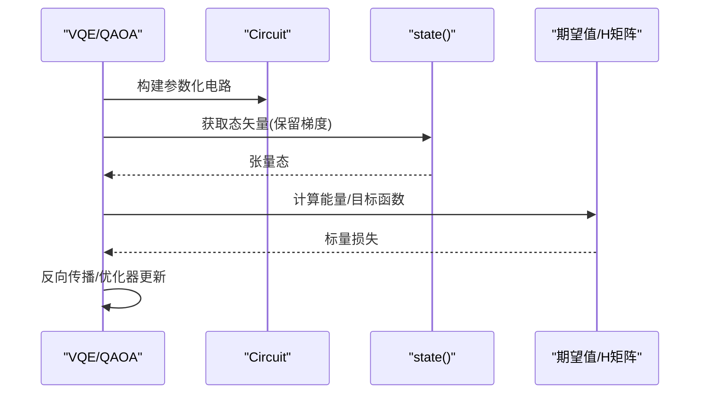
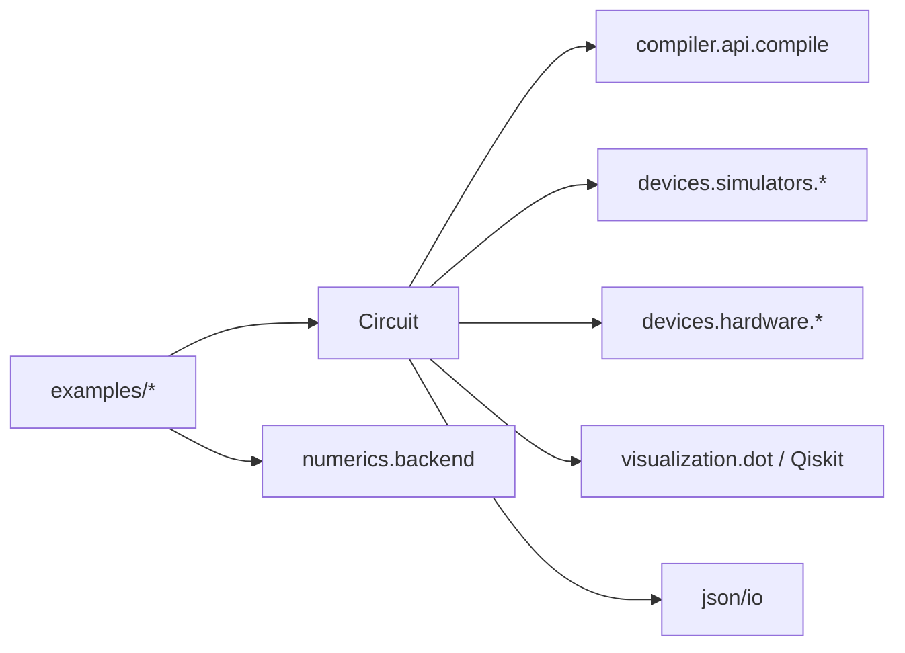

# 量子电路API

<cite>
**本文引用的文件**
- [src/tyxonq/core/ir/circuit.py](file://src/tyxonq/core/ir/circuit.py)
- [examples/basic_chain_api.py](file://examples/basic_chain_api.py)
- [examples/circuit_chain_demo.py](file://examples/circuit_chain_demo.py)
- [examples/vqe_simple_hamiltonian.py](file://examples/vqe_simple_hamiltonian.py)
- [examples/simple_qaoa.py](file://examples/simple_qaoa.py)
- [src/tyxonq/core/errors.py](file://src/tyxonq/core/errors.py)
- [examples/performance_optimization_tips.md](file://examples/performance_optimization_tips.md)
</cite>

## 目录
1. [简介](#简介)
2. [项目结构](#项目结构)
3. [核心组件](#核心组件)
4. [架构总览](#架构总览)
5. [详细组件分析](#详细组件分析)
6. [依赖关系分析](#依赖关系分析)
7. [性能考量](#性能考量)
8. [故障排查指南](#故障排查指南)
9. [结论](#结论)
10. [附录](#附录)

## 简介
本文件面向TyxonQ的量子电路API，聚焦Circuit类的核心能力与使用方式。内容涵盖：
- 电路构造、链式API调用模式（compile → device → postprocessing → run）
- 量子门操作接口（Hadamard、CNOT、参数化旋转门等）
- 测量操作与状态管理（state/wavefunction、期望值计算、中间测量）
- 量子比特索引机制、参数化电路构建、梯度计算支持
- 电路优化、可视化、序列化（JSON/QASM）
- 错误处理、性能优化建议与最佳实践

## 项目结构
围绕Circuit的核心实现位于IR层，示例覆盖基础链式API、复杂电路组合、VQE/QAOA等典型算法场景；错误类型定义在core.errors中；性能优化建议由示例文档给出。

**图示来源**
- [src/tyxonq/core/ir/circuit.py:783-850](file://src/tyxonq/core/ir/circuit.py#L783-L850)
- [src/tyxonq/core/ir/circuit.py:853-1042](file://src/tyxonq/core/ir/circuit.py#L853-L1042)

**章节来源**
- [src/tyxonq/core/ir/circuit.py:48-182](file://src/tyxonq/core/ir/circuit.py#L48-L182)
- [examples/basic_chain_api.py:22-41](file://examples/basic_chain_api.py#L22-L41)
- [examples/circuit_chain_demo.py:46-100](file://examples/circuit_chain_demo.py#L46-L100)

## 核心组件
- Circuit类：最小化的量子电路IR，包含num_qubits、ops、instructions、metadata等字段，并提供链式配置与执行方法。
- 链式配置：device()、postprocessing()、use_pulse()、with_noise()等可链式设置运行期选项。
- 执行流程：compile() → device() → postprocessing() → run()，或简写为c.run()自动补全缺失阶段。
- 状态与观测：state()/wavefunction()获取态矢量/密度矩阵；expectation()/expval()计算Pauli算符乘积的期望值。
- 可视化与序列化：draw()借助Qiskit绘制；to_json_obj()/to_json_str()/from_json_obj()/from_json_str()进行序列化；to_openqasm()导出OpenQASM。

**章节来源**
- [src/tyxonq/core/ir/circuit.py:48-182](file://src/tyxonq/core/ir/circuit.py#L48-L182)
- [src/tyxonq/core/ir/circuit.py:191-239](file://src/tyxonq/core/ir/circuit.py#L191-L239)
- [src/tyxonq/core/ir/circuit.py:427-541](file://src/tyxonq/core/ir/circuit.py#L427-L541)
- [src/tyxonq/core/ir/circuit.py:758-778](file://src/tyxonq/core/ir/circuit.py#L758-L778)
- [src/tyxonq/core/ir/circuit.py:1971-2005](file://src/tyxonq/core/ir/circuit.py#L1971-L2005)

## 架构总览
下图展示从用户代码到执行结果的完整链路，包括编译、设备选择、后处理与结果返回。

**图示来源**
- [src/tyxonq/core/ir/circuit.py:783-850](file://src/tyxonq/core/ir/circuit.py#L783-L850)
- [src/tyxonq/core/ir/circuit.py:853-1042](file://src/tyxonq/core/ir/circuit.py#L853-L1042)

## 详细组件分析

### 电路构造与量子门操作
- 单比特门：h(), x(), y(), z(), s(), sdg(), t(), tdg()
- 两比特门：cx()/cnot(), cy(), cz(), swap(), iswap()
- 参数化旋转门：rx(q, theta), ry(q, theta), rz(q, theta), rxx(), ryy(), rzz()
- 任意幺正：unitary(matrix, qubits)
- 测量与重置：measure_z(q), add_measure(*qubits), add_reset(*qubits), reset(q)
- 屏障：add_barrier(*qubits)

所有门方法均追加ops元组并返回self，支持链式调用。

**图示来源**
- [src/tyxonq/core/ir/circuit.py:1102-1120](file://src/tyxonq/core/ir/circuit.py#L1102-L1120)
- [src/tyxonq/core/ir/circuit.py:1160-1186](file://src/tyxonq/core/ir/circuit.py#L1160-L1186)
- [src/tyxonq/core/ir/circuit.py:1125-1158](file://src/tyxonq/core/ir/circuit.py#L1125-L1158)
- [src/tyxonq/core/ir/circuit.py:1555-1560](file://src/tyxonq/core/ir/circuit.py#L1555-L1560)
- [src/tyxonq/core/ir/circuit.py:1576-1595](file://src/tyxonq/core/ir/circuit.py#L1576-L1595)
- [src/tyxonq/core/ir/circuit.py:1647-1688](file://src/tyxonq/core/ir/circuit.py#L1647-L1688)
- [src/tyxonq/core/ir/circuit.py:1197-1277](file://src/tyxonq/core/ir/circuit.py#L1197-L1277)
- [src/tyxonq/core/ir/circuit.py:1351-1376](file://src/tyxonq/core/ir/circuit.py#L1351-L1376)
- [src/tyxonq/core/ir/circuit.py:1082-1091](file://src/tyxonq/core/ir/circuit.py#L1082-L1091)
- [src/tyxonq/core/ir/circuit.py:1093-1099](file://src/tyxonq/core/ir/circuit.py#L1093-L1099)
- [src/tyxonq/core/ir/circuit.py:1488-1495](file://src/tyxonq/core/ir/circuit.py#L1488-L1495)

**章节来源**
- [src/tyxonq/core/ir/circuit.py:1102-1120](file://src/tyxonq/core/ir/circuit.py#L1102-L1120)
- [src/tyxonq/core/ir/circuit.py:1160-1186](file://src/tyxonq/core/ir/circuit.py#L1160-L1186)
- [src/tyxonq/core/ir/circuit.py:1125-1158](file://src/tyxonq/core/ir/circuit.py#L1125-L1158)
- [src/tyxonq/core/ir/circuit.py:1555-1560](file://src/tyxonq/core/ir/circuit.py#L1555-L1560)
- [src/tyxonq/core/ir/circuit.py:1576-1595](file://src/tyxonq/core/ir/circuit.py#L1576-L1595)
- [src/tyxonq/core/ir/circuit.py:1647-1688](file://src/tyxonq/core/ir/circuit.py#L1647-L1688)
- [src/tyxonq/core/ir/circuit.py:1197-1277](file://src/tyxonq/core/ir/circuit.py#L1197-L1277)
- [src/tyxonq/core/ir/circuit.py:1351-1376](file://src/tyxonq/core/ir/circuit.py#L1351-L1376)
- [src/tyxonq/core/ir/circuit.py:1082-1091](file://src/tyxonq/core/ir/circuit.py#L1082-L1091)
- [src/tyxonq/core/ir/circuit.py:1093-1099](file://src/tyxonq/core/ir/circuit.py#L1093-L1099)
- [src/tyxonq/core/ir/circuit.py:1488-1495](file://src/tyxonq/core/ir/circuit.py#L1488-L1495)

### 链式API与执行流程
- 链式配置：device()设置provider/device/shots等；postprocessing()设置method等；use_pulse()启用脉冲级编译；with_noise()快速配置噪声模型。
- 自动补全：仅调用部分阶段时，run()会基于全局默认与已设置项自动补齐缺失阶段。
- 执行：run()负责编译、设备执行、后处理与结果返回；submit_task()为别名。

**图示来源**
- [src/tyxonq/core/ir/circuit.py:191-239](file://src/tyxonq/core/ir/circuit.py#L191-L239)
- [src/tyxonq/core/ir/circuit.py:241-297](file://src/tyxonq/core/ir/circuit.py#L241-L297)
- [src/tyxonq/core/ir/circuit.py:783-850](file://src/tyxonq/core/ir/circuit.py#L783-L850)
- [src/tyxonq/core/ir/circuit.py:853-1042](file://src/tyxonq/core/ir/circuit.py#L853-L1042)

**章节来源**
- [examples/basic_chain_api.py:22-41](file://examples/basic_chain_api.py#L22-L41)
- [examples/circuit_chain_demo.py:46-100](file://examples/circuit_chain_demo.py#L46-L100)
- [src/tyxonq/core/ir/circuit.py:191-239](file://src/tyxonq/core/ir/circuit.py#L191-L239)
- [src/tyxonq/core/ir/circuit.py:241-297](file://src/tyxonq/core/ir/circuit.py#L241-L297)
- [src/tyxonq/core/ir/circuit.py:783-850](file://src/tyxonq/core/ir/circuit.py#L783-L850)
- [src/tyxonq/core/ir/circuit.py:853-1042](file://src/tyxonq/core/ir/circuit.py#L853-L1042)

### 量子比特索引机制
- 构造时指定num_qubits，所有门的整数参数作为量子比特索引会被校验范围。
- compose()支持将子电路的量子位映射到父电路的物理索引。
- remap_qubits()提供重映射能力，便于布局优化与拓扑适配。
- positional_logical_mapping()可从显式指令或measure_z推断位置到逻辑量子位的映射。

**图示来源**
- [src/tyxonq/core/ir/circuit.py:155-182](file://src/tyxonq/core/ir/circuit.py#L155-L182)
- [src/tyxonq/core/ir/circuit.py:671-691](file://src/tyxonq/core/ir/circuit.py#L671-L691)
- [src/tyxonq/core/ir/circuit.py:693-709](file://src/tyxonq/core/ir/circuit.py#L693-L709)
- [src/tyxonq/core/ir/circuit.py:711-730](file://src/tyxonq/core/ir/circuit.py#L711-L730)

**章节来源**
- [src/tyxonq/core/ir/circuit.py:155-182](file://src/tyxonq/core/ir/circuit.py#L155-L182)
- [src/tyxonq/core/ir/circuit.py:671-691](file://src/tyxonq/core/ir/circuit.py#L671-L691)
- [src/tyxonq/core/ir/circuit.py:693-709](file://src/tyxonq/core/ir/circuit.py#L693-L709)
- [src/tyxonq/core/ir/circuit.py:711-730](file://src/tyxonq/core/ir/circuit.py#L711-L730)

### 参数化电路与梯度计算支持
- 参数化门：rx/ry/rz及rxx/ryy/rzz等接受浮点或张量参数，支持PyTorch后端自动微分。
- 状态获取：state()/wavefunction()返回后端张量（默认保留梯度），可用于数值模拟与梯度传播。
- 期望值：expectation()/expval()支持statevector/mps/density_matrix引擎，内部根据设备配置选择最优路径。
- 示例：VQE/QAOA通过参数化电路+后端自动微分完成优化。

**图示来源**
- [src/tyxonq/core/ir/circuit.py:427-541](file://src/tyxonq/core/ir/circuit.py#L427-L541)
- [src/tyxonq/core/ir/circuit.py:1694-1784](file://src/tyxonq/core/ir/circuit.py#L1694-L1784)
- [examples/vqe_simple_hamiltonian.py:87-152](file://examples/vqe_simple_hamiltonian.py#L87-L152)
- [examples/simple_qaoa.py:48-83](file://examples/simple_qaoa.py#L48-L83)

**章节来源**
- [src/tyxonq/core/ir/circuit.py:427-541](file://src/tyxonq/core/ir/circuit.py#L427-L541)
- [src/tyxonq/core/ir/circuit.py:1694-1784](file://src/tyxonq/core/ir/circuit.py#L1694-L1784)
- [examples/vqe_simple_hamiltonian.py:87-152](file://examples/vqe_simple_hamiltonian.py#L87-L152)
- [examples/simple_qaoa.py:48-83](file://examples/simple_qaoa.py#L48-L83)

### 测量操作与中间测量
- Z基测量：measure_z(q)添加测量指令；add_measure(*qubits)批量添加。
- 参考测量：measure_reference(q, with_prob=False|True)用于仿真时的即时采样与概率返回。
- 中间测量：mid_measurement(q, target_value)支持投影与条件分支（仿真）。
- 重置：reset(q)将量子位投影到|0⟩（仿真）。

**图示来源**
- [src/tyxonq/core/ir/circuit.py:1351-1376](file://src/tyxonq/core/ir/circuit.py#L1351-L1376)
- [src/tyxonq/core/ir/circuit.py:1082-1091](file://src/tyxonq/core/ir/circuit.py#L1082-L1091)
- [src/tyxonq/core/ir/circuit.py:1381-1440](file://src/tyxonq/core/ir/circuit.py#L1381-L1440)
- [src/tyxonq/core/ir/circuit.py:1442-1486](file://src/tyxonq/core/ir/circuit.py#L1442-L1486)
- [src/tyxonq/core/ir/circuit.py:1488-1495](file://src/tyxonq/core/ir/circuit.py#L1488-L1495)

**章节来源**
- [src/tyxonq/core/ir/circuit.py:1351-1376](file://src/tyxonq/core/ir/circuit.py#L1351-L1376)
- [src/tyxonq/core/ir/circuit.py:1082-1091](file://src/tyxonq/core/ir/circuit.py#L1082-L1091)
- [src/tyxonq/core/ir/circuit.py:1381-1440](file://src/tyxonq/core/ir/circuit.py#L1381-L1440)
- [src/tyxonq/core/ir/circuit.py:1442-1486](file://src/tyxonq/core/ir/circuit.py#L1442-L1486)
- [src/tyxonq/core/ir/circuit.py:1488-1495](file://src/tyxonq/core/ir/circuit.py#L1488-L1495)

### 电路优化、可视化与序列化
- 优化：compile()支持decompose/route/optimize/simplify等；count_flop()提供FLOP估算；get_circuit_summary()汇总统计。
- 可视化：draw()通过Qiskit渲染；若无Qiskit则回退到gate_summary文本。
- 序列化：to_json_obj()/to_json_str()/from_json_obj()/from_json_str()；to_openqasm()导出OpenQASM 2。

**图示来源**
- [src/tyxonq/core/ir/circuit.py:624-664](file://src/tyxonq/core/ir/circuit.py#L624-L664)
- [src/tyxonq/core/ir/circuit.py:758-778](file://src/tyxonq/core/ir/circuit.py#L758-L778)
- [src/tyxonq/core/ir/circuit.py:1971-2005](file://src/tyxonq/core/ir/circuit.py#L1971-L2005)
- [src/tyxonq/core/ir/circuit.py:783-850](file://src/tyxonq/core/ir/circuit.py#L783-L850)

**章节来源**
- [src/tyxonq/core/ir/circuit.py:624-664](file://src/tyxonq/core/ir/circuit.py#L624-L664)
- [src/tyxonq/core/ir/circuit.py:758-778](file://src/tyxonq/core/ir/circuit.py#L758-L778)
- [src/tyxonq/core/ir/circuit.py:1971-2005](file://src/tyxonq/core/ir/circuit.py#L1971-L2005)
- [src/tyxonq/core/ir/circuit.py:783-850](file://src/tyxonq/core/ir/circuit.py#L783-L850)

### 变分量子算法中的参数化电路示例
- VQE：构建硬件高效 Ansatz（H层+CNOT梯子+RY/RZ旋转），结合Hamiltonian一次性计算能量，利用后端自动微分优化。
- QAOA：按图结构构建ZZ相互作用与RX旋转，测量后处理得到MaxCut目标函数。

**图示来源**
- [examples/vqe_simple_hamiltonian.py:87-152](file://examples/vqe_simple_hamiltonian.py#L87-L152)
- [examples/simple_qaoa.py:48-83](file://examples/simple_qaoa.py#L48-L83)
- [src/tyxonq/core/ir/circuit.py:427-541](file://src/tyxonq/core/ir/circuit.py#L427-L541)

**章节来源**
- [examples/vqe_simple_hamiltonian.py:87-152](file://examples/vqe_simple_hamiltonian.py#L87-L152)
- [examples/simple_qaoa.py:48-83](file://examples/simple_qaoa.py#L48-L83)

## 依赖关系分析
- Circuit依赖编译器API进行编译与平台输出；运行时依赖设备/模拟器驱动；可视化依赖Qiskit（可选）；序列化独立于外部库。
- 示例展示了与numerics后端的集成（numpy/pytorch），以及量子库工具（Hamiltonian构建、gates等）。

**图示来源**
- [src/tyxonq/core/ir/circuit.py:783-850](file://src/tyxonq/core/ir/circuit.py#L783-L850)
- [src/tyxonq/core/ir/circuit.py:427-541](file://src/tyxonq/core/ir/circuit.py#L427-L541)
- [examples/vqe_simple_hamiltonian.py:34-40](file://examples/vqe_simple_hamiltonian.py#L34-L40)

**章节来源**
- [src/tyxonq/core/ir/circuit.py:783-850](file://src/tyxonq/core/ir/circuit.py#L783-L850)
- [src/tyxonq/core/ir/circuit.py:427-541](file://src/tyxonq/core/ir/circuit.py#L427-L541)
- [examples/vqe_simple_hamiltonian.py:34-40](file://examples/vqe_simple_hamiltonian.py#L34-L40)

## 性能考量
- 避免重复电路执行：多次expectation会重复执行电路，应缓存state()或使用Hamiltonian一次性计算。
- 使用MPS/Density Matrix引擎：对大系统或含噪声场景选择合适的模拟器。
- 批量化与向量化：利用后端vmap/jit提升多参数或多电路评估效率。
- 参考优化技巧文档中的对比与最佳实践。

**章节来源**
- [examples/performance_optimization_tips.md:1-223](file://examples/performance_optimization_tips.md#L1-L223)
- [src/tyxonq/core/ir/circuit.py:427-541](file://src/tyxonq/core/ir/circuit.py#L427-L541)
- [src/tyxonq/core/ir/circuit.py:1694-1784](file://src/tyxonq/core/ir/circuit.py#L1694-L1784)

## 故障排查指南
- 常见错误类型：CompilationError（编译失败）、DeviceExecutionError（设备执行超时/连接问题）、VectorizationFallbackWarning（向量化降级）。
- 索引越界：构造时或添加门时检查qubit索引范围。
- 可视化不可用：若无Qiskit，draw()回退到gate_summary文本。
- 任务取消：cancel()需任务对象携带设备信息，否则抛出异常。

**章节来源**
- [src/tyxonq/core/errors.py:1-17](file://src/tyxonq/core/errors.py#L1-L17)
- [src/tyxonq/core/ir/circuit.py:155-182](file://src/tyxonq/core/ir/circuit.py#L155-L182)
- [src/tyxonq/core/ir/circuit.py:1971-2005](file://src/tyxonq/core/ir/circuit.py#L1971-L2005)
- [src/tyxonq/core/ir/circuit.py:1051-1064](file://src/tyxonq/core/ir/circuit.py#L1051-L1064)

## 结论
TyxonQ的Circuit类提供了简洁而强大的量子电路IR与链式API，支持丰富的量子门、测量、状态管理与期望值计算。通过compile→device→postprocessing→run的标准化流程，用户可以无缝切换模拟器与硬件，并利用参数化电路与自动微分实现变分算法。配合优化技巧与错误处理机制，可在不同规模与噪声环境下高效开发量子程序。

## 附录
- 快速上手：参考基础链式API示例，理解全局默认与自动补全。
- 进阶用法：学习电路组合、重映射、脉冲编程与噪声建模。
- 算法模板：借鉴VQE/QAOA示例，构建自己的变分电路与目标函数。