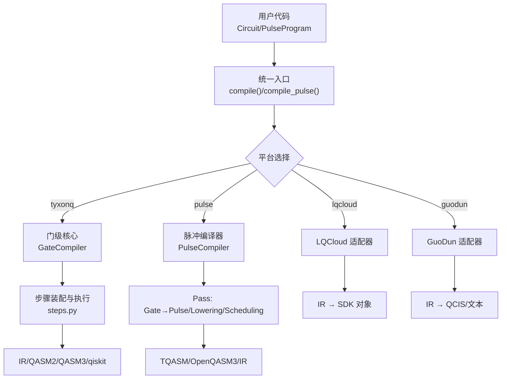
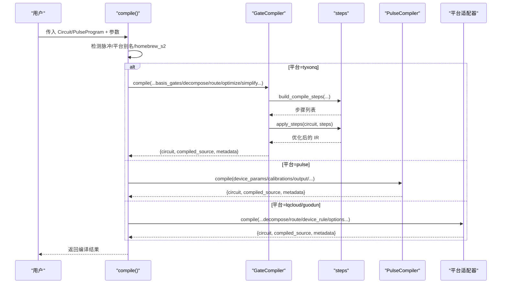
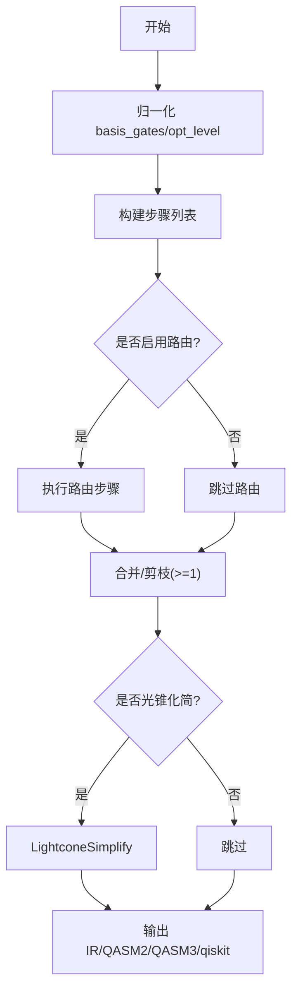
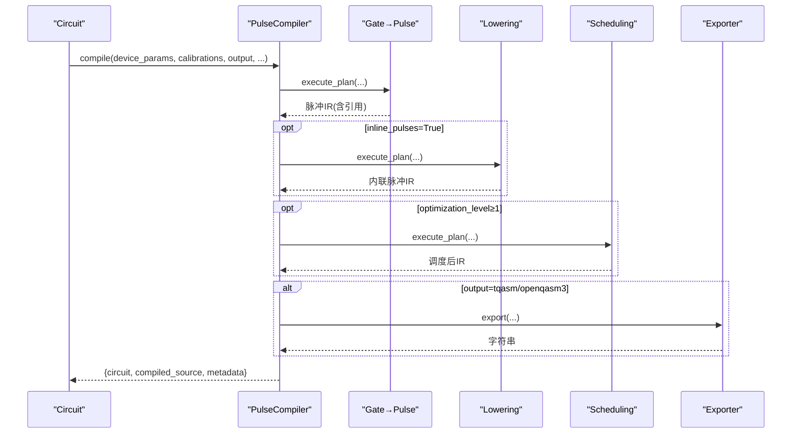
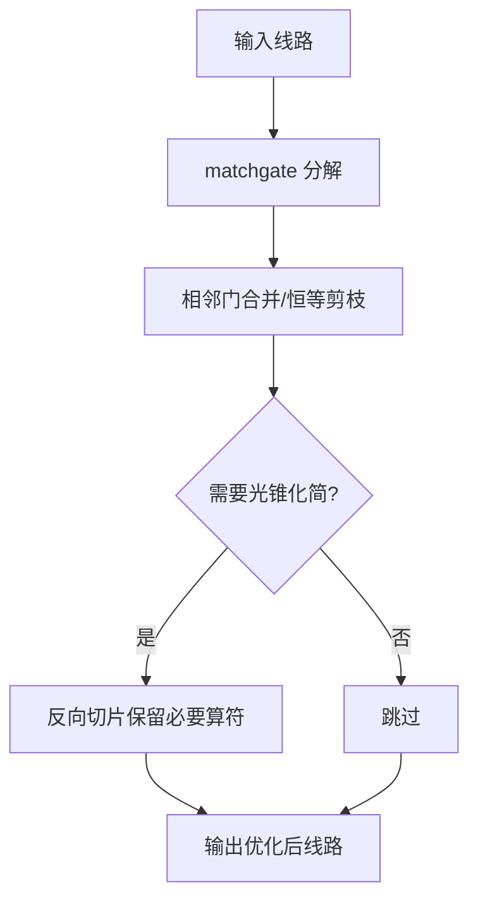
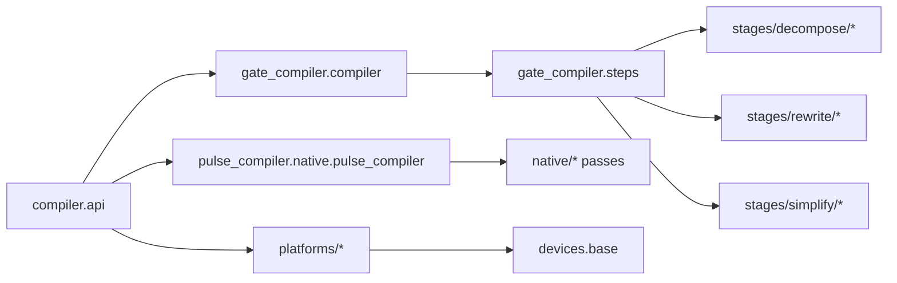

# 编译器API

<cite>
**本文引用的文件**
- [src/tyxonq/compiler/api.py](file://src/tyxonq/compiler/api.py)
- [src/tyxonq/compiler/gate_compiler/compiler.py](file://src/tyxonq/compiler/gate_compiler/compiler.py)
- [src/tyxonq/compiler/gate_compiler/steps.py](file://src/tyxonq/compiler/gate_compiler/steps.py)
- [src/tyxonq/compiler/gate_compiler/stages/decompose/matchgate.py](file://src/tyxonq/compiler/gate_compiler/stages/decompose/matchgate.py)
- [src/tyxonq/compiler/gate_compiler/stages/rewrite/merge_prune.py](file://src/tyxonq/compiler/gate_compiler/stages/rewrite/merge_prune.py)
- [src/tyxonq/compiler/gate_compiler/stages/simplify/lightcone.py](file://src/tyxonq/compiler/gate_compiler/stages/simplify/lightcone.py)
- [src/tyxonq/compiler/pulse_compiler/native/pulse_compiler.py](file://src/tyxonq/compiler/pulse_compiler/native/pulse_compiler.py)
- [src/tyxonq/core/ir/circuit.py](file://src/tyxonq/core/ir/circuit.py)
- [src/tyxonq/devices/base.py](file://src/tyxonq/devices/base.py)
- [src/tyxonq/plugins/registry.py](file://src/tyxonq/plugins/registry.py)
</cite>

## 目录
1. [简介](#简介)
2. [项目结构](#项目结构)
3. [核心组件](#核心组件)
4. [架构总览](#架构总览)
5. [详细组件分析](#详细组件分析)
6. [依赖关系分析](#依赖关系分析)
7. [性能与优化](#性能与优化)
8. [故障排查指南](#故障排查指南)
9. [结论](#结论)
10. [附录](#附录)

## 简介
本文件面向 TyxonQ 编译器的 API，系统性说明门级编译器与脉冲编译器的接口规范、编译流程、优化策略、目标平台适配、中间表示、调试与错误诊断方法，并提供不同硬件平台的编译示例与性能调优建议。文档以代码为依据，确保可追溯性与准确性。

## 项目结构
TyxonQ 的编译器由“统一入口 + 门级核心 + 脉冲编译器 + 平台适配器”构成：
- 统一入口：compiler.api.compile / compile_pulse，负责参数归一化、平台路由与输出格式选择。
- 门级核心：GateCompiler 通过步骤装配（build_compile_steps）与顺序执行（apply_steps）完成规范化、分解、路由、优化、化简。
- 脉冲编译器：PulseCompiler 将门电路转换为脉冲序列，支持 defcal 内联、调度与导出 TQASM/QASM3。
- 平台适配器：tyxonq/lqcloud/guodun 等将通用 IR 翻译为平台方言或 SDK 对象。
- 设备层：devices.base 提供 DeviceRule、驱动解析与统一运行接口。

图表来源
- [src/tyxonq/compiler/api.py:39-340](file://src/tyxonq/compiler/api.py#L39-L340)
- [src/tyxonq/compiler/gate_compiler/compiler.py:27-109](file://src/tyxonq/compiler/gate_compiler/compiler.py#L27-L109)
- [src/tyxonq/compiler/gate_compiler/steps.py:27-105](file://src/tyxonq/compiler/gate_compiler/steps.py#L27-L105)
- [src/tyxonq/compiler/pulse_compiler/native/pulse_compiler.py:81-197](file://src/tyxonq/compiler/pulse_compiler/native/pulse_compiler.py#L81-L197)

章节来源
- [src/tyxonq/compiler/api.py:39-340](file://src/tyxonq/compiler/api.py#L39-L340)
- [src/tyxonq/compiler/gate_compiler/compiler.py:27-109](file://src/tyxonq/compiler/gate_compiler/compiler.py#L27-L109)
- [src/tyxonq/compiler/gate_compiler/steps.py:27-105](file://src/tyxonq/compiler/gate_compiler/steps.py#L27-L105)
- [src/tyxonq/compiler/pulse_compiler/native/pulse_compiler.py:81-197](file://src/tyxonq/compiler/pulse_compiler/native/pulse_compiler.py#L81-L197)

## 核心组件
- 统一编译入口
  - compile(circuit, platform, output, basis_gates, decompose, route, optimize, simplify, device_rule, options, compile_engine)
    - 自动检测脉冲操作并切换到 pulse 编译；homebrew_s2 特殊输出规则；qiskit 互操作别名。
  - compile_pulse(pulse_program, output, device_params, calibrations, device, options)
    - 对 PulseProgram 进行编译，返回统一结果结构。
- 门级核心
  - GateCompiler.compile：按类型化参数装配步骤并执行，输出 IR/QASM2/QASM3/qiskit。
  - steps.build_compile_steps：装配 AutoMeasure/GatesTransform/MatchgateDecompose/RotationsDecompose/Routing/MergePrune/LightconeSimplify。
- 脉冲编译器
  - PulseCompiler.compile：Gate→Pulse 分解、defcal 内联、调度、导出 TQASM/QASM3/IR。
- 设备与平台
  - devices.base.DeviceRule：声明式设备能力（耦合图、初始布局、比特数等）。
  - platforms/*：tyxonq/lqcloud/guodun 等平台适配器，委托核心后翻译方言。

章节来源
- [src/tyxonq/compiler/api.py:39-340](file://src/tyxonq/compiler/api.py#L39-L340)
- [src/tyxonq/compiler/gate_compiler/compiler.py:27-109](file://src/tyxonq/compiler/gate_compiler/compiler.py#L27-L109)
- [src/tyxonq/compiler/gate_compiler/steps.py:27-105](file://src/tyxonq/compiler/gate_compiler/steps.py#L27-L105)
- [src/tyxonq/compiler/pulse_compiler/native/pulse_compiler.py:81-197](file://src/tyxonq/compiler/pulse_compiler/native/pulse_compiler.py#L81-L197)
- [src/tyxonq/devices/base.py:60-83](file://src/tyxonq/devices/base.py#L60-L83)

## 架构总览
TyxonQ 采用“统一入口 + 可插拔步骤 + 平台方言”的分层架构：
- 统一入口负责参数归一化、平台路由、输出格式选择与缓存。
- 门级核心以“步骤”为单位组织编译逻辑，便于扩展与组合。
- 脉冲编译器以 Pass 形式串联 Gate→Pulse、Lowering、Scheduling。
- 平台适配器复用核心能力，专注方言转换与 SDK 对接。

图表来源
- [src/tyxonq/compiler/api.py:39-340](file://src/tyxonq/compiler/api.py#L39-L340)
- [src/tyxonq/compiler/gate_compiler/compiler.py:27-109](file://src/tyxonq/compiler/gate_compiler/compiler.py#L27-L109)
- [src/tyxonq/compiler/gate_compiler/steps.py:27-105](file://src/tyxonq/compiler/gate_compiler/steps.py#L27-L105)
- [src/tyxonq/compiler/pulse_compiler/native/pulse_compiler.py:81-197](file://src/tyxonq/compiler/pulse_compiler/native/pulse_compiler.py#L81-L197)

## 详细组件分析

### 统一编译入口 API
- compile
  - 关键行为：
    - 自动检测脉冲操作或显式模式，切换至 pulse 编译。
    - homebrew_s2 的特殊输出规则（门电路→qasm2；脉冲电路→tyxonq_homebrew_tqasm）。
    - qiskit 作为互操作别名，默认输出 qiskit 对象。
    - 将 basis_gates/optimize/simplify 等参数注入 opts 并传递给下游。
  - 返回值：CompileResult = {circuit, compiled_source, metadata}。
- compile_pulse
  - 针对 PulseProgram 的统一入口，补齐 device_params，调用 compile(platform="pulse")，返回 PulseCompileResult。

章节来源
- [src/tyxonq/compiler/api.py:39-340](file://src/tyxonq/compiler/api.py#L39-L340)
- [src/tyxonq/compiler/api.py:343-463](file://src/tyxonq/compiler/api.py#L343-L463)

### 门级编译器核心（GateCompiler）
- 编译流程
  - 归一化 basis_gates（qasm2 时降级到兼容基）。
  - 构建步骤：AutoMeasure → GatesTransform → MatchgateDecompose/RotationsDecompose → Routing → MergePrune → LightconeSimplify。
  - 输出：IR/QASM2/QASM3/qiskit。
- 元数据
  - 记录 output、options、device_rule、steps、basis_gates、optimization_level。

图表来源
- [src/tyxonq/compiler/gate_compiler/compiler.py:27-109](file://src/tyxonq/compiler/gate_compiler/compiler.py#L27-L109)
- [src/tyxonq/compiler/gate_compiler/steps.py:27-105](file://src/tyxonq/compiler/gate_compiler/steps.py#L27-L105)

章节来源
- [src/tyxonq/compiler/gate_compiler/compiler.py:27-109](file://src/tyxonq/compiler/gate_compiler/compiler.py#L27-L109)
- [src/tyxonq/compiler/gate_compiler/steps.py:27-105](file://src/tyxonq/compiler/gate_compiler/steps.py#L27-L105)

### 脉冲编译器（PulseCompiler）
- 流水线
  - GateToPulsePass：标准门→脉冲原语。
  - PulseLoweringPass：defcal 内联（可选 inline_pulses）。
  - PulseSchedulingPass：时序优化与资源分配（optimization_level≥1）。
- 输出
  - pulse_ir：原生 IR。
  - tqasm/tqasm0.2：TQASM 0.2（homebrew_s2）。
  - openqasm3/qasm3：OpenQASM 3 扩展。
- 波形约束
  - supported_waveforms：校验与过滤，避免使用硬件不支持的波形。

图表来源
- [src/tyxonq/compiler/pulse_compiler/native/pulse_compiler.py:81-197](file://src/tyxonq/compiler/pulse_compiler/native/pulse_compiler.py#L81-L197)

章节来源
- [src/tyxonq/compiler/pulse_compiler/native/pulse_compiler.py:81-197](file://src/tyxonq/compiler/pulse_compiler/native/pulse_compiler.py#L81-L197)

### 关键优化步骤
- 匹配门分解（matchgate）
  - 将数守恒 2-qubit matchgate（fSim/two_mode_fock）精确分解为 {rz, rx, h, cx}。
  - 零角度块剪枝，减少冗余门。
- 相邻门合并与恒等剪枝（MergePrune）
  - 基于规则表合并相邻同线门，删除恒等操作。
- 光锥化简（LightconeSimplify）
  - 从测量反向切片，仅保留影响测量的算符，显著降低深度与门数。

图表来源
- [src/tyxonq/compiler/gate_compiler/stages/decompose/matchgate.py:152-197](file://src/tyxonq/compiler/gate_compiler/stages/decompose/matchgate.py#L152-L197)
- [src/tyxonq/compiler/gate_compiler/stages/rewrite/merge_prune.py:27-85](file://src/tyxonq/compiler/gate_compiler/stages/rewrite/merge_prune.py#L27-L85)
- [src/tyxonq/compiler/gate_compiler/stages/simplify/lightcone.py:12-97](file://src/tyxonq/compiler/gate_compiler/stages/simplify/lightcone.py#L12-L97)

章节来源
- [src/tyxonq/compiler/gate_compiler/stages/decompose/matchgate.py:152-197](file://src/tyxonq/compiler/gate_compiler/stages/decompose/matchgate.py#L152-L197)
- [src/tyxonq/compiler/gate_compiler/stages/rewrite/merge_prune.py:27-85](file://src/tyxonq/compiler/gate_compiler/stages/rewrite/merge_prune.py#L27-L85)
- [src/tyxonq/compiler/gate_compiler/stages/simplify/lightcone.py:12-97](file://src/tyxonq/compiler/gate_compiler/stages/simplify/lightcone.py#L12-L97)

### 平台适配与目标输出
- tyxonq：直接输出 IR/QASM2/QASM3/qiskit。
- lqcloud：IR → SDK QuantumCircuit（无 QASM 中间层）。
- guodun：IR → QCIS 文本（固定基，内部强制 matchgate+rotations 分解）。
- homebrew_s2：门电路→qasm2；脉冲电路→tyxonq_homebrew_tqasm。

章节来源
- [src/tyxonq/compiler/api.py:169-186](file://src/tyxonq/compiler/api.py#L169-L186)
- [src/tyxonq/compiler/platforms/tyxonq/__init__.py:1-18](file://src/tyxonq/compiler/platforms/tyxonq/__init__.py#L1-L18)

### 中间表示与调试信息
- Circuit IR
  - num_qubits、ops、metadata、instructions；支持 with_metadata 链式更新。
  - use_pulse/add_calibration 配置脉冲编译与自定义校准。
- 编译元数据
  - GateCompiler 在 metadata 中记录 output、options、device_rule、steps、basis_gates、optimization_level。
- 调试建议
  - 检查 metadata.steps 确认启用的步骤。
  - 对 homebrew_s2 注意输出格式自动切换。
  - 脉冲编译时关注 supported_waveforms 与 inline_pulses。

章节来源
- [src/tyxonq/core/ir/circuit.py:48-188](file://src/tyxonq/core/ir/circuit.py#L48-L188)
- [src/tyxonq/core/ir/circuit.py:299-425](file://src/tyxonq/core/ir/circuit.py#L299-L425)
- [src/tyxonq/compiler/gate_compiler/compiler.py:76-83](file://src/tyxonq/compiler/gate_compiler/compiler.py#L76-L83)

### 插件扩展机制
- plugins.registry
  - get_device/get_compiler：通过全限定路径动态加载并缓存实例。
  - discover：预留 entry point 发现接口（当前返回空映射）。
- 用途
  - 可扩展设备/编译器实现，保持核心稳定。

章节来源
- [src/tyxonq/plugins/registry.py:10-62](file://src/tyxonq/plugins/registry.py#L10-L62)

## 依赖关系分析
- 模块耦合
  - compiler.api 依赖 gate_compiler 与 pulse_compiler，并按平台惰性导入。
  - gate_compiler 依赖 stages/* 中的具体步骤实现。
  - pulse_compiler 依赖 native/* Pass 与 exporter。
  - devices.base 提供 DeviceRule 与驱动解析，供平台与运行期使用。
- 外部依赖
  - qiskit 仅在互操作输出或路由时按需导入，避免启动开销。

图表来源
- [src/tyxonq/compiler/api.py:39-340](file://src/tyxonq/compiler/api.py#L39-L340)
- [src/tyxonq/compiler/gate_compiler/compiler.py:27-109](file://src/tyxonq/compiler/gate_compiler/compiler.py#L27-L109)
- [src/tyxonq/compiler/gate_compiler/steps.py:27-105](file://src/tyxonq/compiler/gate_compiler/steps.py#L27-L105)
- [src/tyxonq/compiler/pulse_compiler/native/pulse_compiler.py:81-197](file://src/tyxonq/compiler/pulse_compiler/native/pulse_compiler.py#L81-L197)
- [src/tyxonq/devices/base.py:146-258](file://src/tyxonq/devices/base.py#L146-L258)

章节来源
- [src/tyxonq/compiler/api.py:39-340](file://src/tyxonq/compiler/api.py#L39-L340)
- [src/tyxonq/devices/base.py:146-258](file://src/tyxonq/devices/base.py#L146-L258)

## 性能与优化
- 门级优化
  - optimize≥1：启用相邻门合并与恒等剪枝，减少门数与噪声累积。
  - simplify=True：光锥化简，裁剪不影响测量的算符，降低深度。
  - matchgate 分解：将 fSim/two_mode_fock 精确降为原生门，零角度块剪枝。
- 脉冲优化
  - optimization_level≥1：启用脉冲调度，提升并行度与时序质量。
  - inline_pulses=True：适合云端提交与序列化，但会失去 Python 对象灵活性。
  - supported_waveforms：限制波形类型，避免硬件不支持导致的失败。
- 平台差异
  - homebrew_s2：强制特定输出格式与默认基集，减少运行时转换成本。
  - lqcloud/guodun：平台方言优化与 SDK 集成，减少中间层开销。

章节来源
- [src/tyxonq/compiler/gate_compiler/steps.py:27-105](file://src/tyxonq/compiler/gate_compiler/steps.py#L27-L105)
- [src/tyxonq/compiler/gate_compiler/stages/rewrite/merge_prune.py:27-85](file://src/tyxonq/compiler/gate_compiler/stages/rewrite/merge_prune.py#L27-L85)
- [src/tyxonq/compiler/gate_compiler/stages/simplify/lightcone.py:12-97](file://src/tyxonq/compiler/gate_compiler/stages/simplify/lightcone.py#L12-L97)
- [src/tyxonq/compiler/pulse_compiler/native/pulse_compiler.py:81-197](file://src/tyxonq/compiler/pulse_compiler/native/pulse_compiler.py#L81-L197)

## 故障排查指南
- 常见错误
  - 未提供 device_params：脉冲编译将自动补足默认测试参数并发出警告。
  - 不支持的波形：supported_waveforms 校验失败，需调整波形集合。
  - 非数守恒 matchgate：分解失败，需放宽 strict 或更换算法。
  - 路由失败：耦合图不匹配或 initial_layout 冲突，需调整 device_rule。
- 调试步骤
  - 检查 metadata.steps 与 metadata.options 确认实际启用的步骤与参数。
  - 对 homebrew_s2 验证输出格式是否符合预期。
  - 使用 compile_pulse 明确脉冲编译意图，避免自动推断带来的歧义。
  - 通过 devices.base.run 获取任务详情，区分排队超时与编译错误。

章节来源
- [src/tyxonq/compiler/api.py:247-262](file://src/tyxonq/compiler/api.py#L247-L262)
- [src/tyxonq/compiler/pulse_compiler/native/pulse_compiler.py:250-316](file://src/tyxonq/compiler/pulse_compiler/native/pulse_compiler.py#L250-L316)
- [src/tyxonq/devices/base.py:497-557](file://src/tyxonq/devices/base.py#L497-L557)

## 结论
TyxonQ 编译器通过统一入口、可组合的步骤与平台适配器，实现了门级与脉冲级的完整编译链路。其优化策略覆盖门级合并/化简与脉冲调度，平台适配兼顾多硬件方言与 SDK 集成。借助元数据与调试工具，用户可高效定位问题并调优性能。

## 附录
- 典型用法参考
  - 门级编译：设置 platform、output、basis_gates、optimize、simplify、route。
  - 脉冲编译：use_pulse(mode, supported_waveforms, device_params, inline_pulses)，或 compile_pulse。
  - 平台提交：根据 homebrew_s2 要求选择 qasm2 或 tyxonq_homebrew_tqasm。
- 扩展点
  - 自定义步骤：实现 CompileStep.apply 并通过 steps 装配。
  - 自定义校准：Circuit.add_calibration 或 PulseCompiler.add_calibration。
  - 插件加载：plugins.registry.get_device/get_compiler。