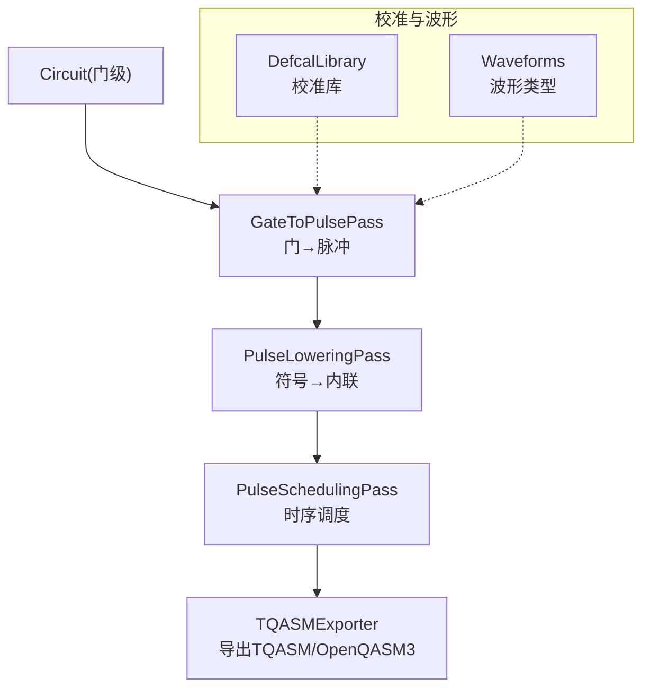
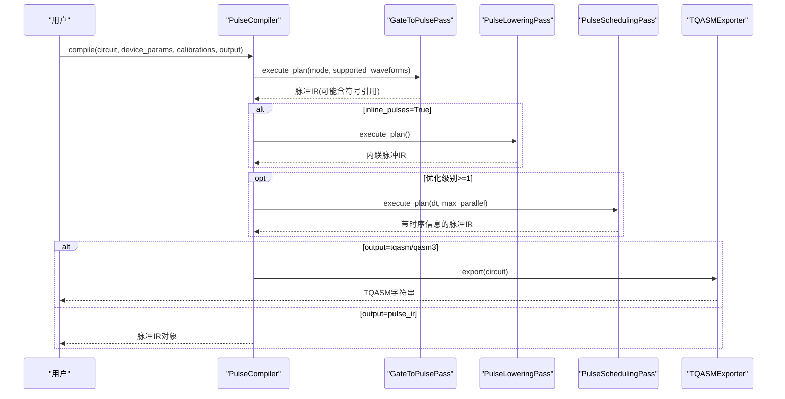
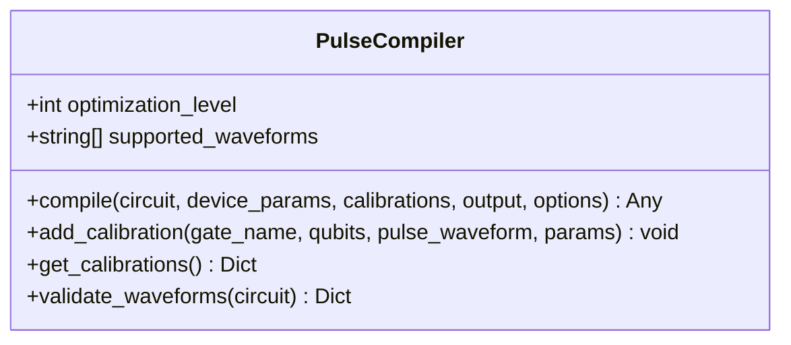
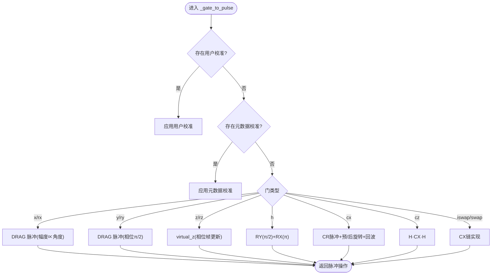
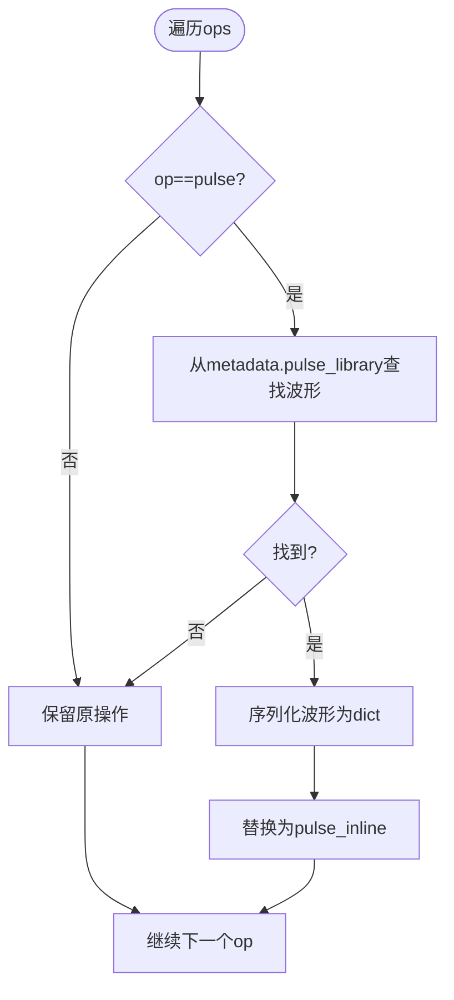
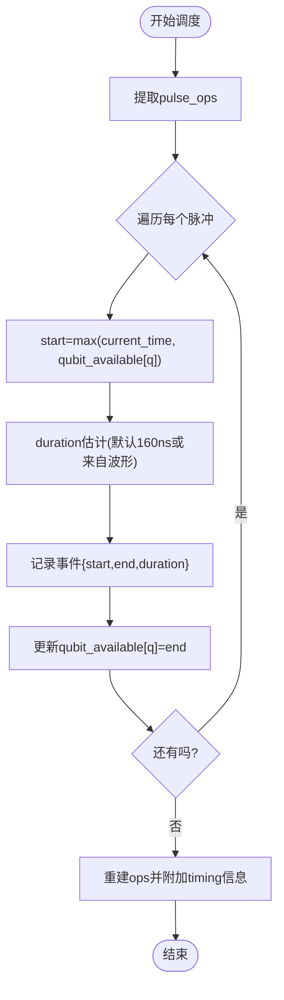
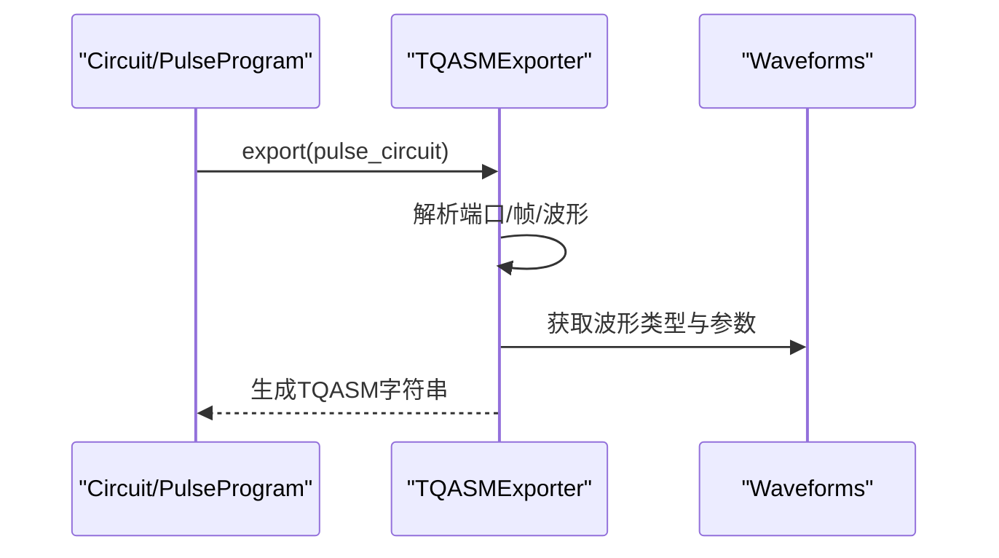
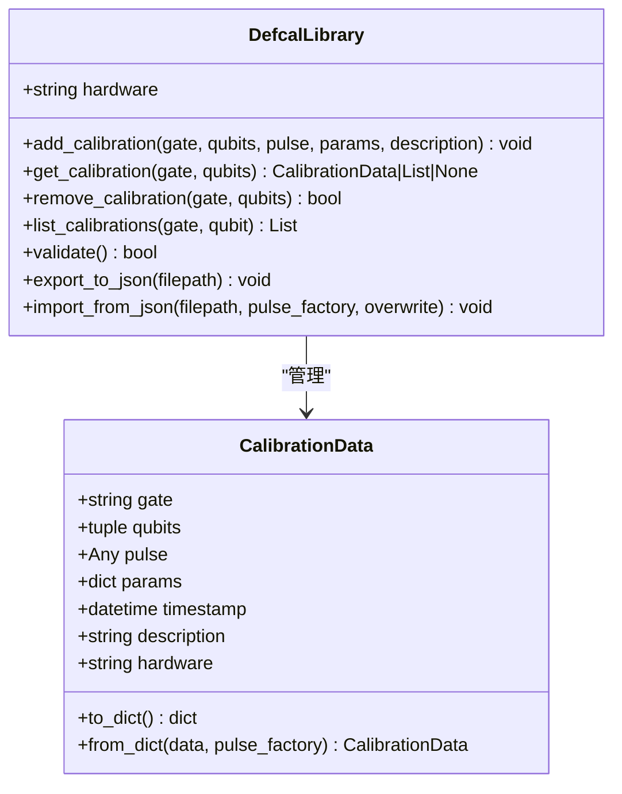
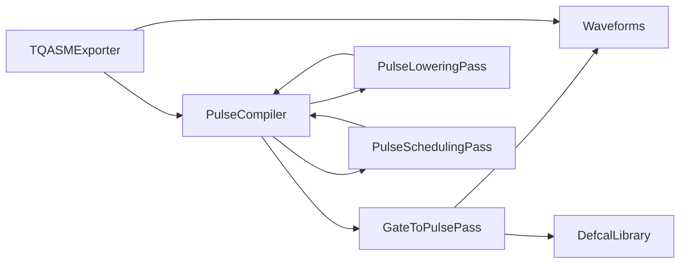

# 脉冲编译器API

<cite>
**本文引用的文件**
- [pulse_compiler.py](file://src/tyxonq/compiler/pulse_compiler/native/pulse_compiler.py)
- [gate_to_pulse.py](file://src/tyxonq/compiler/pulse_compiler/native/gate_to_pulse.py)
- [pulse_lowering.py](file://src/tyxonq/compiler/pulse_compiler/native/pulse_lowering.py)
- [pulse_scheduling.py](file://src/tyxonq/compiler/pulse_compiler/native/pulse_scheduling.py)
- [tqasm_exporter.py](file://src/tyxonq/compiler/pulse_compiler/native/tqasm_exporter.py)
- [defcal_library.py](file://src/tyxonq/compiler/pulse_compiler/defcal_library.py)
- [waveforms.py](file://src/tyxonq/waveforms.py)
- [pulse_basic_tutorial.py](file://examples/pulse_basic_tutorial.py)
- [pulse_compilation_modes.py](file://examples/pulse_compilation_modes.py)
</cite>

## 目录
1. [简介](#简介)
2. [项目结构](#项目结构)
3. [核心组件](#核心组件)
4. [架构总览](#架构总览)
5. [详细组件分析](#详细组件分析)
6. [依赖关系分析](#依赖关系分析)
7. [性能与优化](#性能与优化)
8. [故障排查指南](#故障排查指南)
9. [结论](#结论)
10. [附录：使用与集成指南](#附录使用与集成指南)

## 简介
本文件面向需要深入理解并使用 TyxonQ 脉冲编译器的开发者，系统阐述 PulseCompiler 类的设计与实现、门到脉冲的转换机制（gate_to_pulse）、脉冲调度与时序优化策略、TQASM 导出器的工作原理与输出规范，以及校准库的使用与自定义波形集成方法。文档同时提供最佳实践与性能调优建议，帮助你在真实硬件或模拟器上高效完成从量子门级电路到可执行脉冲序列的全流程编译与部署。

## 项目结构
TyxonQ 的脉冲编译器位于 compiler/pulse_compiler/native 目录下，围绕“门→脉冲→调度→导出”的主流水线组织代码：
- GateToPulsePass：将标准量子门分解为物理脉冲序列（DRAG/Gaussian/Constant 等），支持用户校准优先。
- PulseLoweringPass：将符号化的脉冲引用内联为可直接执行的波形定义（便于序列化与云端提交）。
- PulseSchedulingPass：进行脉冲级时序调度与资源分配，标注起止时间与总时长。
- TQASMExporter：将编译后的脉冲 IR 导出为 TQASM 0.2 / OpenQASM 3 + OpenPulse 格式。
- DefcalLibrary：管理硬件相关的门级校准数据（单比特/双比特），支持导入导出与校验。
- Waveforms：内置多种波形类型（Drag、Gaussian、Constant、Hermite、BlackmanSquare 等）。

图表来源
- [pulse_compiler.py:24-197](file://src/tyxonq/compiler/pulse_compiler/native/pulse_compiler.py#L24-L197)
- [gate_to_pulse.py:38-115](file://src/tyxonq/compiler/pulse_compiler/native/gate_to_pulse.py#L38-L115)
- [pulse_lowering.py:22-75](file://src/tyxonq/compiler/pulse_compiler/native/pulse_lowering.py#L22-L75)
- [pulse_scheduling.py:24-86](file://src/tyxonq/compiler/pulse_compiler/native/pulse_scheduling.py#L24-L86)
- [tqasm_exporter.py:24-158](file://src/tyxonq/compiler/pulse_compiler/native/tqasm_exporter.py#L24-L158)
- [defcal_library.py:153-182](file://src/tyxonq/compiler/pulse_compiler/defcal_library.py#L153-L182)
- [waveforms.py:19-157](file://src/tyxonq/waveforms.py#L19-L157)

章节来源
- [pulse_compiler.py:24-197](file://src/tyxonq/compiler/pulse_compiler/native/pulse_compiler.py#L24-L197)

## 核心组件
- PulseCompiler：编排编译流水线，支持优化级别控制、设备参数注入、校准注入、输出格式选择（脉冲IR/TQASM）。
- GateToPulsePass：实现门到脉冲的分解逻辑，优先级为用户校准→元数据校准→默认物理分解；支持虚拟Z合并优化。
- PulseLoweringPass：将脉冲引用展开为内联波形字典，便于序列化与跨平台传输。
- PulseSchedulingPass：基于 qubit 可用时间线进行调度，标注 start_time/duration/end_time，并计算总执行时间。
- TQASMExporter：生成符合 OpenQASM 3 + OpenPulse 语法的程序，包含 cal/defcal 块、frame/port 声明、波形定义与 play/shift_phase 指令。
- DefcalLibrary：集中管理校准数据，支持按门名与量子比特索引查询、去重、验证、JSON 持久化。
- Waveforms：提供 Drag、Gaussian、Constant、Hermite、BlackmanSquare 等波形数据结构，具备 qasm_name/to_args 接口以支持导出。

章节来源
- [pulse_compiler.py:24-197](file://src/tyxonq/compiler/pulse_compiler/native/pulse_compiler.py#L24-L197)
- [gate_to_pulse.py:38-115](file://src/tyxonq/compiler/pulse_compiler/native/gate_to_pulse.py#L38-L115)
- [pulse_lowering.py:22-75](file://src/tyxonq/compiler/pulse_compiler/native/pulse_lowering.py#L22-L75)
- [pulse_scheduling.py:24-86](file://src/tyxonq/compiler/pulse_compiler/native/pulse_scheduling.py#L24-L86)
- [tqasm_exporter.py:24-158](file://src/tyxonq/compiler/pulse_compiler/native/tqasm_exporter.py#L24-L158)
- [defcal_library.py:153-182](file://src/tyxonq/compiler/pulse_compiler/defcal_library.py#L153-L182)
- [waveforms.py:19-157](file://src/tyxonq/waveforms.py#L19-L157)

## 架构总览
下图展示了从门级电路到可执行 TQASM 的完整编译路径，包括三种中间表示形式：门级、带符号引用的脉冲级、完全内联的脉冲级。

图表来源
- [pulse_compiler.py:81-197](file://src/tyxonq/compiler/pulse_compiler/native/pulse_compiler.py#L81-L197)
- [gate_to_pulse.py:64-115](file://src/tyxonq/compiler/pulse_compiler/native/gate_to_pulse.py#L64-L115)
- [pulse_lowering.py:37-75](file://src/tyxonq/compiler/pulse_compiler/native/pulse_lowering.py#L37-L75)
- [pulse_scheduling.py:43-86](file://src/tyxonq/compiler/pulse_compiler/native/pulse_scheduling.py#L43-L86)
- [tqasm_exporter.py:129-233](file://src/tyxonq/compiler/pulse_compiler/native/tqasm_exporter.py#L129-L233)

## 详细组件分析

### PulseCompiler 主类
- 职责：编排 GateToPulsePass → PulseLoweringPass（可选）→ PulseSchedulingPass（按优化级别），并根据 output 选择返回脉冲IR或TQASM。
- 关键能力：
  - 注入设备参数与校准到 circuit.metadata，供后续 Pass 使用。
  - 支持 supported_waveforms 过滤，避免生成硬件不支持的波形。
  - 多模式编译：hybrid/pulse_only/auto_lower，控制哪些门转换为脉冲。
  - 输出格式：pulse_ir、tqasm（OpenQASM3+OpenPulse）、homebrew_tqasm（特殊格式）。
- 扩展点：add_calibration/get_calibrations/validate_waveforms。

图表来源
- [pulse_compiler.py:24-197](file://src/tyxonq/compiler/pulse_compiler/native/pulse_compiler.py#L24-L197)

章节来源
- [pulse_compiler.py:24-197](file://src/tyxonq/compiler/pulse_compiler/native/pulse_compiler.py#L24-L197)

### GateToPulsePass：门到脉冲转换
- 分解策略：
  - 单比特旋转：X/Y 通过 DRAG 脉冲实现，幅度与角度相关；Z/RZ 采用虚拟Z（相位帧更新，无物理脉冲）。
  - H 门：拆分为 RY(π/2)+RX(π)，分别对应不同相位的 DRAG 脉冲。
  - 两比特门：CX 通过交叉共振（CR）实现，包含预/后旋转、目标回波抑制项；CZ=H·CX·H；iSWAP/SWAP 通过 CX 链实现。
- 优先级：用户 defcal 校准 > 元数据校准 > 默认物理分解。
- 优化：相邻虚拟Z合并，减少相位累积开销。

图表来源
- [gate_to_pulse.py:137-192](file://src/tyxonq/compiler/pulse_compiler/native/gate_to_pulse.py#L137-L192)
- [gate_to_pulse.py:194-730](file://src/tyxonq/compiler/pulse_compiler/native/gate_to_pulse.py#L194-L730)

章节来源
- [gate_to_pulse.py:38-115](file://src/tyxonq/compiler/pulse_compiler/native/gate_to_pulse.py#L38-L115)
- [gate_to_pulse.py:137-192](file://src/tyxonq/compiler/pulse_compiler/native/gate_to_pulse.py#L137-L192)
- [gate_to_pulse.py:194-730](file://src/tyxonq/compiler/pulse_compiler/native/gate_to_pulse.py#L194-L730)

### PulseLoweringPass：脉冲内联
- 作用：将 ("pulse", qubit, pulse_key, params) 替换为 ("pulse_inline", qubit, waveform_dict, params)，其中 waveform_dict 包含 type/args/class，便于序列化与跨平台传输。
- 适用场景：TQASM 导出、云端提交、离线保存。

图表来源
- [pulse_lowering.py:37-75](file://src/tyxonq/compiler/pulse_compiler/native/pulse_lowering.py#L37-L75)
- [pulse_lowering.py:77-151](file://src/tyxonq/compiler/pulse_compiler/native/pulse_lowering.py#L77-L151)

章节来源
- [pulse_lowering.py:22-75](file://src/tyxonq/compiler/pulse_compiler/native/pulse_lowering.py#L22-L75)
- [pulse_lowering.py:77-151](file://src/tyxonq/compiler/pulse_compiler/native/pulse_lowering.py#L77-L151)

### PulseSchedulingPass：时序调度
- 功能：提取所有脉冲操作，基于每个量子比特的可用时间线安排 start_time/duration/end_time，并记录总执行时间。
- 优化级别：
  - 0：不调度（顺序执行）
  - 1：基础并行调度（无冲突）
  - 2/3：高级调度与合并（可扩展）
- 输出：在 metadata 中写入 pulse_schedule 与 pulse_total_time。

图表来源
- [pulse_scheduling.py:43-86](file://src/tyxonq/compiler/pulse_compiler/native/pulse_scheduling.py#L43-L86)
- [pulse_scheduling.py:104-148](file://src/tyxonq/compiler/pulse_compiler/native/pulse_scheduling.py#L104-L148)
- [pulse_scheduling.py:173-238](file://src/tyxonq/compiler/pulse_compiler/native/pulse_scheduling.py#L173-L238)

章节来源
- [pulse_scheduling.py:24-86](file://src/tyxonq/compiler/pulse_compiler/native/pulse_scheduling.py#L24-L86)
- [pulse_scheduling.py:104-148](file://src/tyxonq/compiler/pulse_compiler/native/pulse_scheduling.py#L104-L148)
- [pulse_scheduling.py:173-238](file://src/tyxonq/compiler/pulse_compiler/native/pulse_scheduling.py#L173-L238)

### TQASMExporter：TQASM 导出器
- 支持两种版本：
  - openqasm3：标准 OpenQASM 3.0 + OpenPulse
  - tyxonq_homebrew_tqasm：Homebrew S2 特殊格式（兼容 Qiskit 风格 qreg）
- 输出内容：
  - 版本声明与 defcalgrammar
  - 量子比特声明
  - cal 块：extern port 与 frame 声明
  - defcal 块：门级校准（波形定义、play、shift_phase）
  - 电路操作：标准门调用或根据 defcal 生成 gate 调用
- 输入兼容：既可从 Circuit（含脉冲操作）导出，也可从 PulseProgram 直接导出。

图表来源
- [tqasm_exporter.py:24-158](file://src/tyxonq/compiler/pulse_compiler/native/tqasm_exporter.py#L24-L158)
- [tqasm_exporter.py:160-233](file://src/tyxonq/compiler/pulse_compiler/native/tqasm_exporter.py#L160-L233)
- [tqasm_exporter.py:235-295](file://src/tyxonq/compiler/pulse_compiler/native/tqasm_exporter.py#L235-L295)
- [tqasm_exporter.py:593-681](file://src/tyxonq/compiler/pulse_compiler/native/tqasm_exporter.py#L593-L681)

章节来源
- [tqasm_exporter.py:24-158](file://src/tyxonq/compiler/pulse_compiler/native/tqasm_exporter.py#L24-L158)
- [tqasm_exporter.py:160-233](file://src/tyxonq/compiler/pulse_compiler/native/tqasm_exporter.py#L160-L233)
- [tqasm_exporter.py:235-295](file://src/tyxonq/compiler/pulse_compiler/native/tqasm_exporter.py#L235-L295)
- [tqasm_exporter.py:593-681](file://src/tyxonq/compiler/pulse_compiler/native/tqasm_exporter.py#L593-L681)

### DefcalLibrary：校准库
- 数据结构 CalibrationData：封装门名、目标量子比特、波形对象、参数、时间戳、描述、硬件标识。
- 主要能力：
  - add_calibration/get_calibration/remove_calibration/list_calibrations/has_calibration
  - validate：校验所有校准数据的完整性
  - export_to_json/import_from_json：持久化与恢复
- 用途：为 GateToPulsePass 提供用户自定义的门级脉冲实现，覆盖默认分解。

图表来源
- [defcal_library.py:39-151](file://src/tyxonq/compiler/pulse_compiler/defcal_library.py#L39-L151)
- [defcal_library.py:153-182](file://src/tyxonq/compiler/pulse_compiler/defcal_library.py#L153-L182)
- [defcal_library.py:206-336](file://src/tyxonq/compiler/pulse_compiler/defcal_library.py#L206-L336)
- [defcal_library.py:338-420](file://src/tyxonq/compiler/pulse_compiler/defcal_library.py#L338-L420)
- [defcal_library.py:422-512](file://src/tyxonq/compiler/pulse_compiler/defcal_library.py#L422-L512)

章节来源
- [defcal_library.py:39-151](file://src/tyxonq/compiler/pulse_compiler/defcal_library.py#L39-L151)
- [defcal_library.py:153-182](file://src/tyxonq/compiler/pulse_compiler/defcal_library.py#L153-L182)
- [defcal_library.py:206-336](file://src/tyxonq/compiler/pulse_compiler/defcal_library.py#L206-L336)
- [defcal_library.py:338-420](file://src/tyxonq/compiler/pulse_compiler/defcal_library.py#L338-L420)
- [defcal_library.py:422-512](file://src/tyxonq/compiler/pulse_compiler/defcal_library.py#L422-L512)

### Waveforms：波形类型
- 支持的波形：Gaussian、GaussianSquare、Drag、Constant、Sine、Cosine、CosineDrag、Flattop、Hermite、BlackmanSquare。
- 统一接口：qasm_name() 与 to_args()，用于 TQASM 导出时的波形定义生成。
- 典型用法：在 GateToPulsePass 中构造 DRAG/Gaussian 脉冲，设置幅度、持续时间、包络宽度与 DRAG 系数等。

章节来源
- [waveforms.py:19-157](file://src/tyxonq/waveforms.py#L19-L157)

## 依赖关系分析
- 耦合性：
  - PulseCompiler 强耦合三个 Pass，但通过统一的 execute_plan 接口解耦具体实现。
  - GateToPulsePass 依赖 waveforms 模块与 defcal_library（可选）。
  - TQASMExporter 依赖 waveforms 的 qasm_name/to_args 接口，以及 circuit.metadata 中的 pulse_library。
- 外部依赖：
  - 设备参数（qubit_freq、anharmonicity、coupling_strength 等）由上层传入，影响脉冲形状与时长。
  - 云平台/后端通过 TQASM 字符串进行任务提交。

图表来源
- [pulse_compiler.py:24-197](file://src/tyxonq/compiler/pulse_compiler/native/pulse_compiler.py#L24-L197)
- [gate_to_pulse.py:38-115](file://src/tyxonq/compiler/pulse_compiler/native/gate_to_pulse.py#L38-L115)
- [pulse_lowering.py:22-75](file://src/tyxonq/compiler/pulse_compiler/native/pulse_lowering.py#L22-L75)
- [pulse_scheduling.py:24-86](file://src/tyxonq/compiler/pulse_compiler/native/pulse_scheduling.py#L24-L86)
- [tqasm_exporter.py:24-158](file://src/tyxonq/compiler/pulse_compiler/native/tqasm_exporter.py#L24-L158)

章节来源
- [pulse_compiler.py:24-197](file://src/tyxonq/compiler/pulse_compiler/native/pulse_compiler.py#L24-L197)

## 性能与优化
- 优化级别选择：
  - 0：最小开销，适合调试与快速验证。
  - 1：基础并行调度，提升吞吐。
  - 2/3：高级调度与合并，进一步缩短总时长（可扩展）。
- 虚拟Z优化：RZ 门以相位帧更新实现，零耗时且可与相邻 RZ 合并，减少相位累积误差。
- 波形选择：
  - DRAG：抑制泄漏，适合高保真单比特门。
  - Gaussian：平滑边缘，降低频谱泄漏。
  - Constant：简单恒幅脉冲，适用于特定硬件需求。
- 设备参数调优：
  - 合理设置 qubit_freq、anharmonicity、coupling_strength、cr_amplitude、echo_amplitude 等，直接影响两比特门质量与时序。
- 采样步长 dt：影响调度精度与仿真速度，通常 1e-10 s 足够平衡精度与性能。
- 参考示例：
  - 基本教程演示了门到脉冲的自动分解与 TQASM 导出流程。
  - 编译模式对比展示了 Mode A/B/Hybrid 的性能差异与适用场景。

章节来源
- [pulse_scheduling.py:43-86](file://src/tyxonq/compiler/pulse_compiler/native/pulse_scheduling.py#L43-L86)
- [gate_to_pulse.py:278-312](file://src/tyxonq/compiler/pulse_compiler/native/gate_to_pulse.py#L278-L312)
- [pulse_basic_tutorial.py:152-217](file://examples/pulse_basic_tutorial.py#L152-L217)
- [pulse_compilation_modes.py:220-292](file://examples/pulse_compilation_modes.py#L220-L292)

## 故障排查指南
- 常见错误与处理：
  - 输出格式不支持：确保 output 为 pulse_ir、tqasm（或 tqasm0.2）、qasm3（或 openqasm3）。
  - 波形不受支持：通过 supported_waveforms 过滤或在 validate_waveforms 中检查，避免硬件不支持的波形。
  - 校准缺失：若未提供用户校准，将回退到默认分解；如需定制，请通过 DefcalLibrary 添加校准。
  - 脉冲内联失败：确认 metadata.pulse_library 中存在对应 pulse_key；否则保持原操作不变。
  - 调度异常：检查 dt 与 max_parallel 设置，确保与设备能力匹配。
- 调试建议：
  - 使用 output="pulse_ir" 先查看中间结果，再切换至 TQASM。
  - 打印 pulse_library 与 metadata，确认波形与参数是否正确注入。
  - 逐步关闭优化级别，定位问题来源。

章节来源
- [pulse_compiler.py:81-197](file://src/tyxonq/compiler/pulse_compiler/native/pulse_compiler.py#L81-L197)
- [pulse_compiler.py:250-317](file://src/tyxonq/compiler/pulse_compiler/native/pulse_compiler.py#L250-L317)
- [pulse_lowering.py:77-151](file://src/tyxonq/compiler/pulse_compiler/native/pulse_lowering.py#L77-L151)
- [pulse_scheduling.py:104-148](file://src/tyxonq/compiler/pulse_compiler/native/pulse_scheduling.py#L104-L148)

## 结论
TyxonQ 脉冲编译器提供了从门级电路到可执行脉冲序列的完整工具链：通过 GateToPulsePass 实现物理分解，借助 PulseLoweringPass 完成内联与序列化，利用 PulseSchedulingPass 进行时序优化，并通过 TQASMExporter 输出标准格式以便云端执行。配合 DefcalLibrary 与丰富的 Waveforms，用户可灵活定制校准与波形，满足从算法开发到硬件优化的全链路需求。遵循本文的最佳实践与调优建议，可在保证保真度的前提下显著提升执行效率与稳定性。

## 附录：使用与集成指南
- 基本使用流程：
  - 创建 Circuit，添加门操作。
  - 调用 compile(output="ir") 获取脉冲IR，或 output="tqasm" 导出 TQASM。
  - 设置 device_params（qubit_freq、anharmonicity 等）与可选 calibrations。
- 校准库集成：
  - 使用 DefcalLibrary.add_calibration 添加门级校准（单/双比特）。
  - 通过 get_calibration 检索并应用于 GateToPulsePass。
  - 使用 export_to_json/import_from_json 持久化与共享校准。
- 自定义波形集成：
  - 继承或复用 waveforms 中的波形类，确保实现 qasm_name/to_args。
  - 在 GateToPulsePass 中构造并注入到 pulse_library。
  - 通过 TQASMExporter 导出时自动生成波形定义。
- 最佳实践：
  - 优先使用 DRAG 波形实现单比特门，结合虚拟Z优化。
  - 对两比特门调整 CR 幅度与回波强度，平衡保真度与串扰。
  - 使用 supported_waveforms 约束，避免硬件不支持的波形。
  - 分阶段调试：先 pulse_ir，再 TQASM；逐步开启优化级别。
- 参考示例：
  - 入门教程：pulse_basic_tutorial.py
  - 编译模式对比：pulse_compilation_modes.py

章节来源
- [pulse_basic_tutorial.py:152-217](file://examples/pulse_basic_tutorial.py#L152-L217)
- [pulse_compilation_modes.py:46-213](file://examples/pulse_compilation_modes.py#L46-L213)
- [defcal_library.py:206-336](file://src/tyxonq/compiler/pulse_compiler/defcal_library.py#L206-L336)
- [waveforms.py:19-157](file://src/tyxonq/waveforms.py#L19-L157)