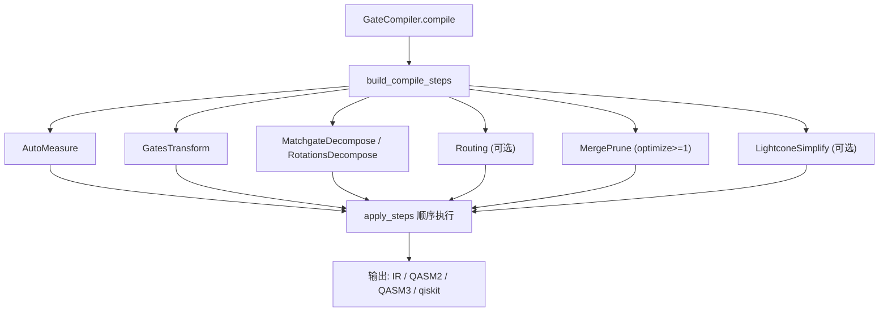
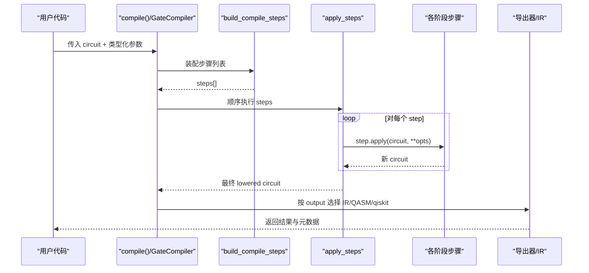
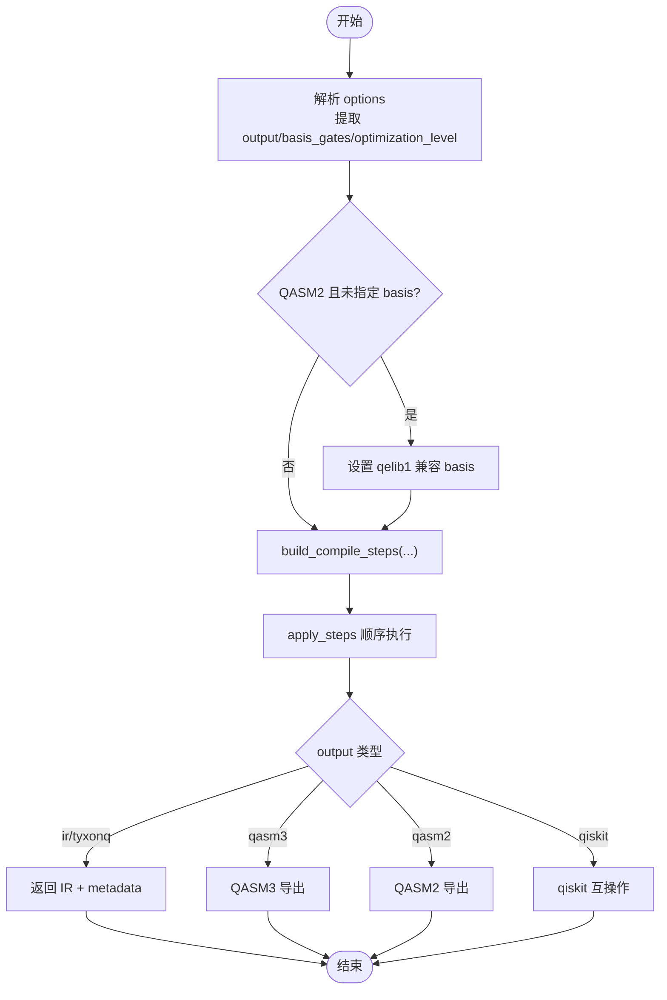
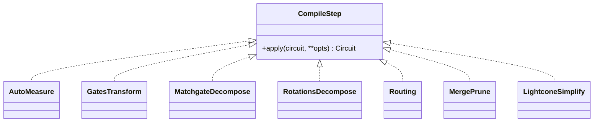
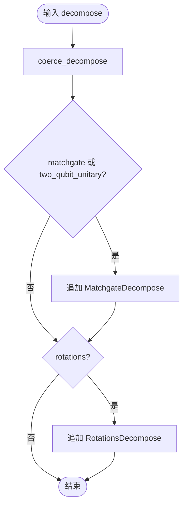
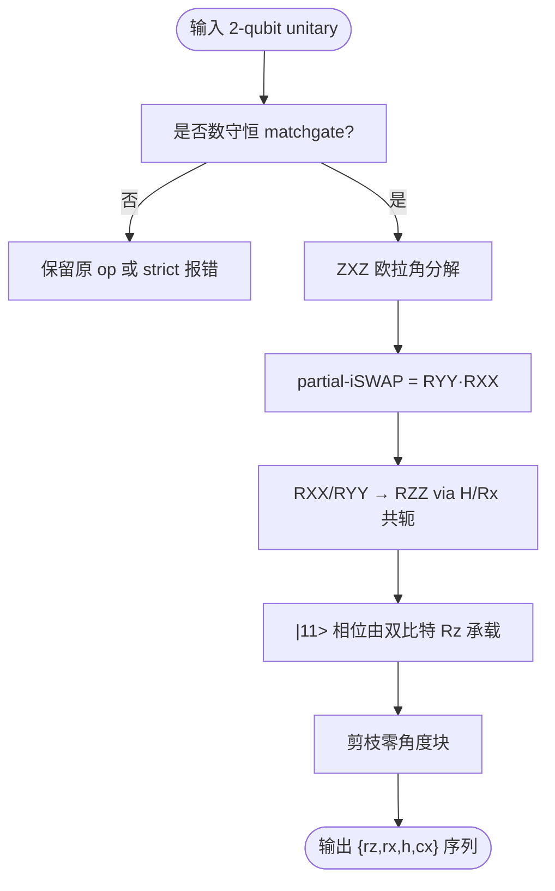
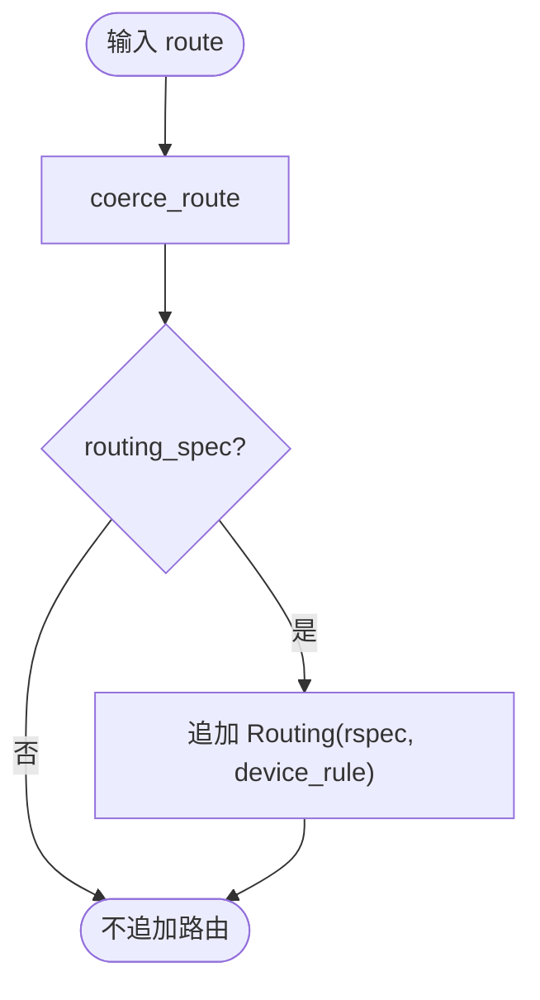
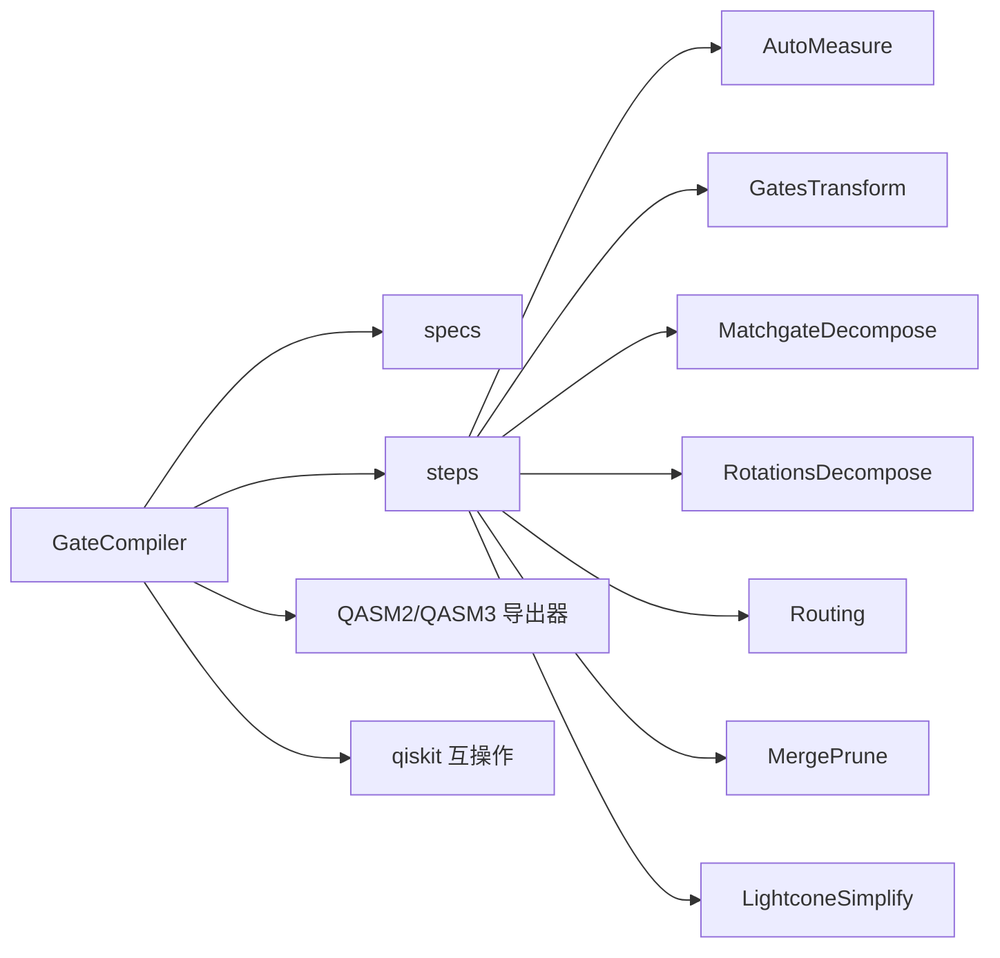

# 门级编译器API

<cite>
**本文引用的文件**
- [compiler.py](file://src/tyxonq/compiler/gate_compiler/compiler.py)
- [steps.py](file://src/tyxonq/compiler/gate_compiler/steps.py)
- [api.py](file://src/tyxonq/compiler/api.py)
- [specs.py](file://src/tyxonq/compiler/gate_compiler/specs.py)
- [matchgate.py](file://src/tyxonq/compiler/gate_compiler/stages/decompose/matchgate.py)
- [rotations.py](file://src/tyxonq/compiler/gate_compiler/stages/decompose/rotations.py)
- [auto_measure.py](file://src/tyxonq/compiler/gate_compiler/stages/rewrite/auto_measure.py)
- [gates_transform.py](file://src/tyxonq/compiler/gate_compiler/stages/rewrite/gates_transform.py)
- [merge_prune.py](file://src/tyxonq/compiler/gate_compiler/stages/rewrite/merge_prune.py)
- [lightcone.py](file://src/tyxonq/compiler/gate_compiler/stages/simplify/lightcone.py)
</cite>

## 目录
1. [简介](#简介)
2. [项目结构](#项目结构)
3. [核心组件](#核心组件)
4. [架构总览](#架构总览)
5. [详细组件分析](#详细组件分析)
6. [依赖关系分析](#依赖关系分析)
7. [性能考量](#性能考量)
8. [故障排查指南](#故障排查指南)
9. [结论](#结论)
10. [附录](#附录)

## 简介
本文件面向 TyxonQ 的门级编译器 API，系统性说明 GateCompiler 的核心能力、编译流程、优化策略与目标平台适配方式；详解 CompileStep 协议的设计与使用，覆盖分解（decompose）、路由（route）、简化（simplify）等阶段的配置选项；给出 DecomposeSpec 与 RoutingSpec 类型化规格的使用方法；提供不同硬件平台的编译示例与性能调优建议；并说明中间表示转换、错误处理与调试工具的使用。

## 项目结构
门级编译器位于 gate_compiler 子模块，采用“阶段化步骤”的装配与执行模式：
- 入口与调度：GateCompiler.compile 统一收集参数，构建步骤序列并顺序执行。
- 步骤装配：build_compile_steps 根据类型化参数生成步骤列表；apply_steps 顺序应用。
- 阶段实现：各阶段以独立类实现 CompileStep 协议，包括自动测量、门基变换、分解、路由、合并剪枝、光锥化简等。
- 规格定义：DecomposeSpec/RoutingSpec 提供布尔开关到细粒度配置的升级机制。
- 输出导出：支持 IR、QASM2/QASM3、Qiskit 互操作等输出格式。

图表来源
- [compiler.py:27-109](file://src/tyxonq/compiler/gate_compiler/compiler.py#L27-L109)
- [steps.py:27-91](file://src/tyxonq/compiler/gate_compiler/steps.py#L27-L91)

章节来源
- [compiler.py:14-109](file://src/tyxonq/compiler/gate_compiler/compiler.py#L14-L109)
- [steps.py:1-109](file://src/tyxonq/compiler/gate_compiler/steps.py#L1-L109)

## 核心组件
- GateCompiler：设备无关的门电路核心编译器，统一装配并执行编译步骤，负责输出格式选择与元数据记录。
- CompileStep 协议：每个阶段实现 apply(circuit, **opts) -> Circuit，从 opts 自取所需参数，保证步骤间解耦。
- 步骤装配器：build_compile_steps 按固定顺序组装 AutoMeasure → GatesTransform → 分解 → 路由 → 优化 → 化简。
- 规格系统：DecomposeSpec/RoutingSpec 将 bool 开关升级为可配置对象，coerce_* 函数完成归一化。
- 阶段实现：
  - AutoMeasure：无显式测量时补 Z 测量。
  - GatesTransform：按 basis_gates 进行最小重写。
  - MatchgateDecompose：数守恒 matchgate 精确分解到 {rz, rx, h, cx}。
  - RotationsDecompose：旋转门到 {h, rz, cx} 的标准恒等式展开。
  - Routing：可选，委托 qiskit.transpile 完成布局与 SWAP 插入。
  - MergePrune：相邻门合并与恒等剪枝。
  - LightconeSimplify：基于测量反向切片的光锥化简。

章节来源
- [api.py:28-36](file://src/tyxonq/compiler/api.py#L28-L36)
- [specs.py:15-58](file://src/tyxonq/compiler/gate_compiler/specs.py#L15-L58)
- [steps.py:27-91](file://src/tyxonq/compiler/gate_compiler/steps.py#L27-L91)
- [auto_measure.py:13-50](file://src/tyxonq/compiler/gate_compiler/stages/rewrite/auto_measure.py#L13-L50)
- [gates_transform.py:12-50](file://src/tyxonq/compiler/gate_compiler/stages/rewrite/gates_transform.py#L12-L50)
- [matchgate.py:152-197](file://src/tyxonq/compiler/gate_compiler/stages/decompose/matchgate.py#L152-L197)
- [rotations.py:13-73](file://src/tyxonq/compiler/gate_compiler/stages/decompose/rotations.py#L13-L73)
- [merge_prune.py:27-85](file://src/tyxonq/compiler/gate_compiler/stages/rewrite/merge_prune.py#L27-L85)
- [lightcone.py:12-97](file://src/tyxonq/compiler/gate_compiler/stages/simplify/lightcone.py#L12-L97)

## 架构总览
TyxonQ 的门级编译采用“类型化参数驱动 + 阶段化步骤”的架构：
- 用户通过 compile() 或 GateCompiler.compile() 传入类型化参数（basis_gates、decompose、route、optimize、simplify、device_rule、options）。
- build_compile_steps 将这些参数转换为具体步骤实例，形成有向无环的执行链。
- apply_steps 顺序调用每个步骤的 apply，逐步逼近目标平台/原生门集合。
- 最终由 GateCompiler 根据 output 选择 IR、QASM2/QASM3 或 qiskit 互操作输出。

图表来源
- [compiler.py:27-109](file://src/tyxonq/compiler/gate_compiler/compiler.py#L27-L109)
- [steps.py:27-105](file://src/tyxonq/compiler/gate_compiler/steps.py#L27-L105)

章节来源
- [compiler.py:27-109](file://src/tyxonq/compiler/gate_compiler/compiler.py#L27-L109)
- [steps.py:27-105](file://src/tyxonq/compiler/gate_compiler/steps.py#L27-L105)

## 详细组件分析

### GateCompiler 与编译流程
- 职责：统一收集参数、规范化 basis_gates、优化级别、output 选择；构建步骤并执行；记录 metadata。
- 关键行为：
  - QASM2 输出时若未指定 basis_gates，默认降级到 qelib1 兼容集，确保导出正确。
  - optimize 与 options.optimization_level 归一为同一值。
  - 输出分支：ir/tyxonq、qasm3/openqasm3、qasm/qasm2、qiskit。

图表来源
- [compiler.py:27-109](file://src/tyxonq/compiler/gate_compiler/compiler.py#L27-L109)

章节来源
- [compiler.py:27-109](file://src/tyxonq/compiler/gate_compiler/compiler.py#L27-L109)

### CompileStep 协议与步骤装配
- 协议：每个步骤实现 apply(circuit, **opts) -> Circuit，从 opts 读取所需参数（如 basis_gates、device_rule），不关心其他键。
- 装配顺序：AutoMeasure → GatesTransform → 分解 → 路由（可选）→ MergePrune（optimize≥1）→ LightconeSimplify（可选）。
- 延迟导入：仅在启用路由时导入相关依赖，保持核心装配零额外依赖。

图表来源
- [api.py:28-36](file://src/tyxonq/compiler/api.py#L28-L36)
- [steps.py:27-91](file://src/tyxonq/compiler/gate_compiler/steps.py#L27-L91)

章节来源
- [api.py:28-36](file://src/tyxonq/compiler/api.py#L28-L36)
- [steps.py:27-91](file://src/tyxonq/compiler/gate_compiler/steps.py#L27-L91)

### 分解阶段：DecomposeSpec 与实现
- DecomposeSpec 字段：
  - matchgate：分解 2-qubit 数守恒 matchgate（fSim 家族）到 {rz, rx, h, cx}，默认开启。
  - rotations：分解 rx/ry/rxx/ryy/rzz 到 {h, rz, cx}，默认关闭（许多平台原生支持旋转门）。
  - two_qubit_unitary：当前经 matchgate 覆盖数守恒子集，通用 KAK 分解后续增量。
- 装配逻辑：coerce_decompose 将 bool/None/Spec 归一；当 matchgate 或 two_qubit_unitary 为真时追加 MatchgateDecompose；rotations 为真时追加 RotationsDecompose。

图表来源
- [specs.py:15-76](file://src/tyxonq/compiler/gate_compiler/specs.py#L15-L76)
- [steps.py:61-72](file://src/tyxonq/compiler/gate_compiler/steps.py#L61-L72)

章节来源
- [specs.py:15-76](file://src/tyxonq/compiler/gate_compiler/specs.py#L15-L76)
- [steps.py:61-72](file://src/tyxonq/compiler/gate_compiler/steps.py#L61-L72)

#### MatchgateDecompose 算法要点
- 物理依据：fSim = iSWAP型相互作用 + CPhase，二者作用在正交态空间上且对易。
- 实现细节：
  - 校验矩阵是否为数守恒 matchgate（跨粒子数子空间耦合为零）。
  - ZXZ 欧拉角分解单激发子空间 U(2)，结合 RXX/RYY 到 RZZ 的等价转换，落到 {h, rx, rz, cx}。
  - 零角度块剪枝以减少冗余门。
  - 非 matchgate 的 2-qubit unitary 默认保留，strict 模式下抛出明确错误。

图表来源
- [matchgate.py:46-149](file://src/tyxonq/compiler/gate_compiler/stages/decompose/matchgate.py#L46-L149)
- [matchgate.py:152-197](file://src/tyxonq/compiler/gate_compiler/stages/decompose/matchgate.py#L152-L197)

章节来源
- [matchgate.py:46-149](file://src/tyxonq/compiler/gate_compiler/stages/decompose/matchgate.py#L46-L149)
- [matchgate.py:152-197](file://src/tyxonq/compiler/gate_compiler/stages/decompose/matchgate.py#L152-L197)

#### RotationsDecompose 标准恒等式
- RX(θ) => H·RZ(θ)·H
- RY(θ) => S†·H·RZ(θ)·H·S
- RZZ/RXX/RYY 通过 CX 与单比特旋转组合实现
- 使用 rebuild_circuit 保留 _unitary_cache，避免后续 lowering 丢失矩阵引用

章节来源
- [rotations.py:13-73](file://src/tyxonq/compiler/gate_compiler/stages/decompose/rotations.py#L13-L73)

### 路由阶段：RoutingSpec 与实现
- RoutingSpec 字段：
  - coupling_map：物理耦合图，缺省时从 device_rule 读取。
  - initial_layout：初始逻辑→物理布局，缺省优先恒等布局，必要时 BFS 挑选连通子图。
  - algorithm：目前委托 "qiskit"（qiskit.transpile）。
  - optimization_level：路由步骤仅做布局与 SWAP 插入，不做门集合重写；默认 0 以避免 IR 词汇表外门导致回读失败。
  - seed：默认 0 以保证可复现性；传 None 可恢复随机搜索用于对比。
- 装配逻辑：coerce_route 将 bool/None/Spec 归一；为真时追加 Routing 步骤，并延迟导入依赖。

图表来源
- [specs.py:33-58](file://src/tyxonq/compiler/gate_compiler/specs.py#L33-L58)
- [specs.py:79-94](file://src/tyxonq/compiler/gate_compiler/specs.py#L79-L94)
- [steps.py:74-79](file://src/tyxonq/compiler/gate_compiler/steps.py#L74-L79)

章节来源
- [specs.py:33-58](file://src/tyxonq/compiler/gate_compiler/specs.py#L33-L58)
- [specs.py:79-94](file://src/tyxonq/compiler/gate_compiler/specs.py#L79-L94)
- [steps.py:74-79](file://src/tyxonq/compiler/gate_compiler/steps.py#L74-L79)

### 优化与简化阶段
- MergePrune（optimize≥1）：
  - 相邻同线门合并（如 s·s→z、t·t→s、x·x→i 等），合并后循环剪除恒等门。
  - 规则可扩展，默认规则覆盖常见相位门与单比特旋转。
- LightconeSimplify（simplify=True）：
  - 收集测量比特，反向切片追踪受影响的量子比特集合。
  - 仅保留影响测量结果的算符，显著减少无用门。
  - 支持 assume_measure_all 选项在无显式测量时假设全比特测量。

章节来源
- [merge_prune.py:27-85](file://src/tyxonq/compiler/gate_compiler/stages/rewrite/merge_prune.py#L27-L85)
- [lightcone.py:12-97](file://src/tyxonq/compiler/gate_compiler/stages/simplify/lightcone.py#L12-L97)

### 规范化与前置阶段
- AutoMeasure：
  - 检测 ops 与 instructions 中是否存在测量；若无则对所有比特补 measure_z，并发出警告。
  - 使用 rebuild_circuit 保留 _unitary_cache，避免后续分解缺失矩阵缓存。
- GatesTransform：
  - 按 basis_gates 进行最小重写（如 x→rx(pi)、y→ry(pi)），保留请求的原生门。
  - 运行于分解之前，需保留 _unitary_cache 供后续 matchgate 分解使用。

章节来源
- [auto_measure.py:13-50](file://src/tyxonq/compiler/gate_compiler/stages/rewrite/auto_measure.py#L13-L50)
- [gates_transform.py:12-50](file://src/tyxonq/compiler/gate_compiler/stages/rewrite/gates_transform.py#L12-L50)

## 依赖关系分析
- GateCompiler 依赖 specs、steps 以及各阶段实现；输出导出依赖 QASM2/QASM3 导出器与 qiskit 互操作模块。
- 步骤装配按需延迟导入，降低核心装配时的外部依赖。
- 平台适配器（platforms/*）统一委托 GateCompiler 核心完成通用编译，再翻译为自身方言。

图表来源
- [compiler.py:27-109](file://src/tyxonq/compiler/gate_compiler/compiler.py#L27-L109)
- [steps.py:27-91](file://src/tyxonq/compiler/gate_compiler/steps.py#L27-L91)

章节来源
- [compiler.py:27-109](file://src/tyxonq/compiler/gate_compiler/compiler.py#L27-L109)
- [steps.py:27-91](file://src/tyxonq/compiler/gate_compiler/steps.py#L27-L91)

## 性能考量
- 分解策略：
  - matchgate 分解针对数守恒 2-qubit unitary，能精确降到 {rz, rx, h, cx}，并剪枝零角度块以减少门数。
  - rotations 分解默认关闭，避免在平台原生支持旋转门时增加门数。
- 路由策略：
  - optimization_level=0 仅做布局与 SWAP 插入，避免引入 IR 词汇表外门导致回读失败。
  - seed=0 保证路由可复现，便于实验对比与稳定性。
- 优化与简化：
  - MergePrune 合并相邻门并剪除恒等，减少噪声敏感门数量。
  - LightconeSimplify 基于测量反向切片裁剪不影响结果的算符，显著缩短线路长度。
- 输出选择：
  - QASM2 输出时自动降级到 qelib1 兼容基，确保导出兼容性。
  - 合理选择 output 可减少不必要的中间转换开销。

[本节为通用指导，无需特定文件来源]

## 故障排查指南
- 匹配失败：
  - 非数守恒 matchgate 无法按 fSim 分解；检查 2-qubit unitary 是否满足数守恒条件，或在严格模式下捕获异常。
- 矩阵缓存缺失：
  - 前置阶段重建线路时需保留 _unitary_cache；若缺失，分解阶段会报错。确保使用 rebuild_circuit 而非直接构造。
- 路由不可用：
  - route=False 时不会导入路由依赖；如需路由，请显式启用并传入 device_rule 中的 coupling_map。
- QASM 导出问题：
  - QASM2 输出未指定 basis_gates 时会降级到 qelib1 兼容集；如需自定义基，请显式传入 basis_gates。
- 脉冲编译自动切换：
  - 检测到脉冲操作或模式时会自动切换到 pulse 编译；如需稳定行为，建议显式调用 use_pulse()。

章节来源
- [matchgate.py:84-93](file://src/tyxonq/compiler/gate_compiler/stages/decompose/matchgate.py#L84-L93)
- [auto_measure.py:21-50](file://src/tyxonq/compiler/gate_compiler/stages/rewrite/auto_measure.py#L21-L50)
- [compiler.py:51-55](file://src/tyxonq/compiler/gate_compiler/compiler.py#L51-L55)
- [api.py:149-217](file://src/tyxonq/compiler/api.py#L149-L217)

## 结论
TyxonQ 的门级编译器通过类型化参数与阶段化步骤实现了高内聚、低耦合的编译管线。GateCompiler 作为设备无关的核心，统一装配分解、路由、优化与简化阶段，并按输出目标选择合适的导出路径。DecomposeSpec 与 RoutingSpec 提供了从一键开关到细粒度控制的平滑升级，满足不同硬件平台的适配需求。通过合理的参数配置与优化策略，可在保真度与效率之间取得良好平衡。

[本节为总结性内容，无需特定文件来源]

## 附录

### 编译步骤（CompileStep）协议使用示例
- 自定义步骤：实现 apply(circuit, **opts) -> Circuit，从 opts 读取所需参数，返回新线路。
- 装配与执行：通过 build_compile_steps 将自定义步骤加入步骤列表，再由 apply_steps 顺序执行。

章节来源
- [api.py:28-36](file://src/tyxonq/compiler/api.py#L28-L36)
- [steps.py:94-105](file://src/tyxonq/compiler/gate_compiler/steps.py#L94-L105)

### 类型化规格使用示例
- DecomposeSpec：
  - 默认 matchgate 开、rotations 关；可按需开启 rotations 或 two_qubit_unitary。
- RoutingSpec：
  - 提供 coupling_map、initial_layout、algorithm、optimization_level、seed；默认路由关闭，需显式启用。

章节来源
- [specs.py:15-58](file://src/tyxonq/compiler/gate_compiler/specs.py#L15-L58)
- [specs.py:61-94](file://src/tyxonq/compiler/gate_compiler/specs.py#L61-L94)

### 不同硬件平台的编译示例
- TyxonQ 核心：
  - 输出 IR/QASM2/QASM3/qiskit；适合仿真与通用导出。
- LQCloud/Guodun：
  - 平台适配器委托 GateCompiler 核心完成通用编译，再翻译为平台方言；注意 platform 参数与 options 透传。
- homebrew_s2：
  - 门电路强制 qasm2 输出；脉冲电路强制 tyxonq_homebrew_tqasm 输出；自动设置默认 basis_gates 与波形限制。

章节来源
- [api.py:149-217](file://src/tyxonq/compiler/api.py#L149-L217)
- [api.py:219-339](file://src/tyxonq/compiler/api.py#L219-L339)

### 中间表示转换与调试
- IR 到 QASM：
  - 通过 GateQASM2Exporter/GateQASM3Exporter 将 IR 转换为 QASM 文本。
- IR 到 Qiskit：
  - 通过 to_qiskit 将 IR 转换为 QuantumCircuit 对象；未安装 qiskit 时会抛出清晰错误。
- 调试建议：
  - 启用 simplify 与 optimize 观察线路变化；检查 metadata 中的 steps、basis_gates、optimization_level。
  - 对于路由问题，调整 RoutingSpec.seed 与 optimization_level，或提供明确的 coupling_map/initial_layout。

章节来源
- [compiler.py:84-109](file://src/tyxonq/compiler/gate_compiler/compiler.py#L84-L109)