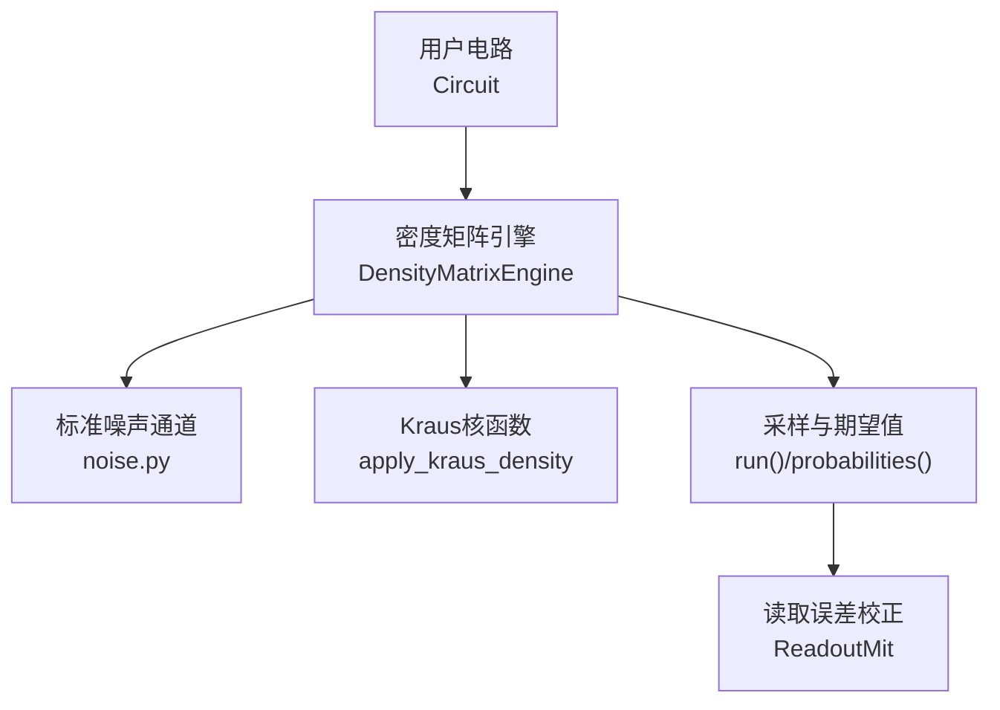
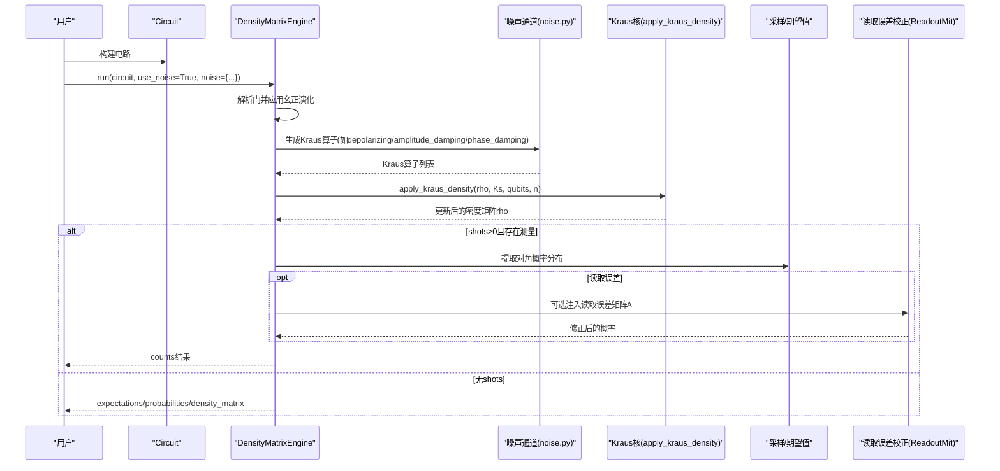
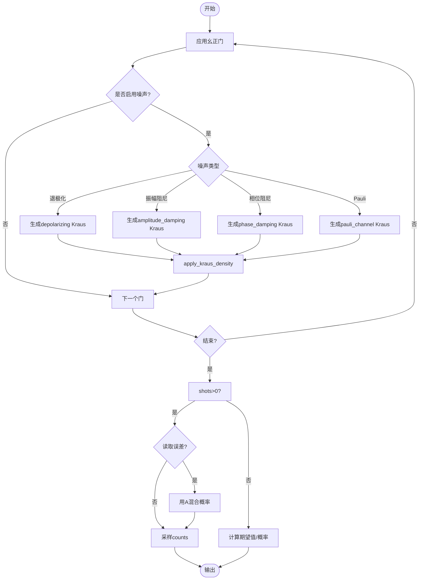
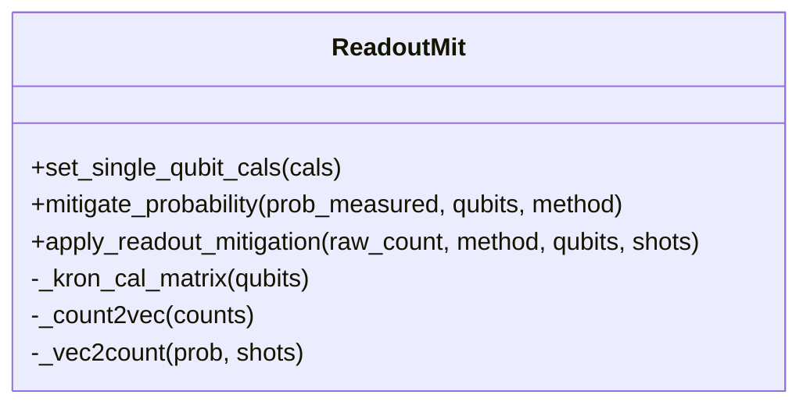
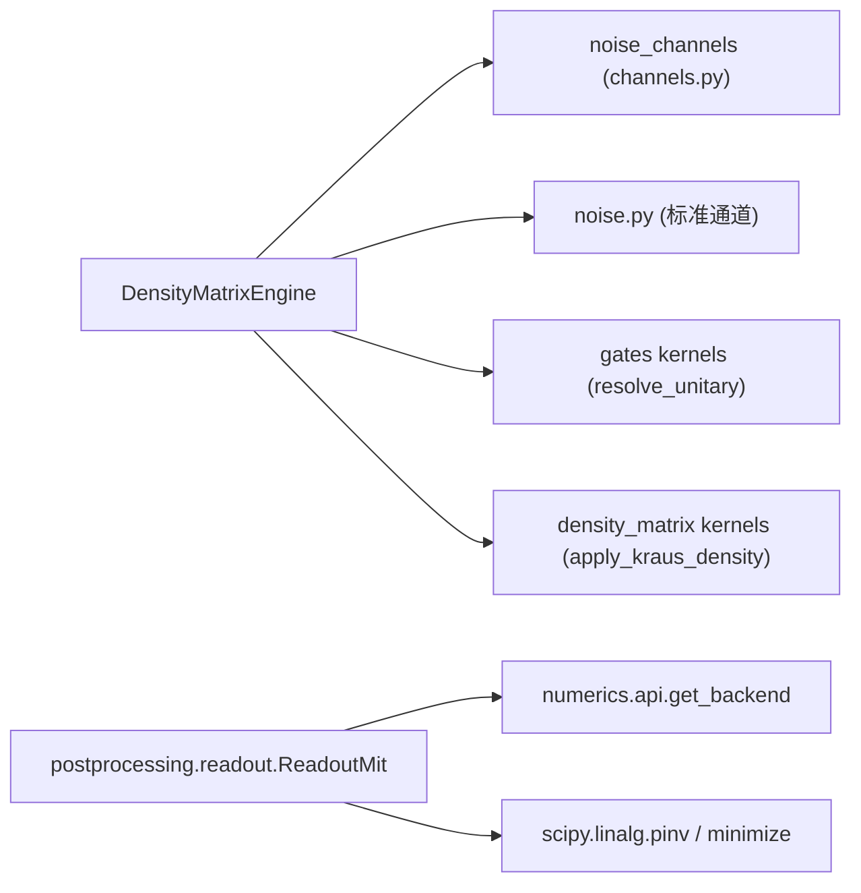

# 噪声模型

<cite>
**本文引用的文件**
- [src/tyxonq/libs/quantum_library/noise.py](file://src/tyxonq/libs/quantum_library/noise.py)
- [src/tyxonq/devices/simulators/density_matrix/engine.py](file://src/tyxonq/devices/simulators/density_matrix/engine.py)
- [src/tyxonq/devices/simulators/noise/channels.py](file://src/tyxonq/devices/simulators/noise/channels.py)
- [examples/noise_controls_demo.py](file://examples/noise_controls_demo.py)
- [examples/noise_t1_t2_calibration.py](file://examples/noise_t1_t2_calibration.py)
- [examples/pulse_noise_modeling.py](file://examples/pulse_noise_modeling.py)
- [src/tyxonq/postprocessing/readout.py](file://src/tyxonq/postprocessing/readout.py)
- [tests_core_module/test_noise_integration.py](file://tests_core_module/test_noise_integration.py)
</cite>

## 目录
1. [简介](#简介)
2. [项目结构](#项目结构)
3. [核心组件](#核心组件)
4. [架构总览](#架构总览)
5. [详细组件分析](#详细组件分析)
6. [依赖关系分析](#依赖关系分析)
7. [性能与精度考量](#性能与精度考量)
8. [故障排查指南](#故障排查指南)
9. [结论](#结论)
10. [附录：校准与实验验证](#附录校准与实验验证)

## 简介
本文件面向TyxonQ的量子噪声建模API，系统性说明密度矩阵模拟器中的噪声通道实现、参数物理意义、典型取值范围、实验测量方法，以及在密度矩阵引擎中如何配置与应用噪声。文档覆盖T1弛豫（振幅阻尼）、T2退相位（相位阻尼）、退极化噪声、Pauli噪声、读取误差（readout）及其校正，并给出噪声模拟的性能影响、精度考虑以及与真实硬件噪声的对应关系。同时提供噪声校准指南与实验验证流程，帮助用户构建准确的噪声模拟环境。

## 项目结构
TyxonQ将噪声建模分为“标准噪声通道定义”和“模拟器集成”两部分：
- 标准噪声通道：在统一库中定义Kraus算子族，供所有模拟器复用。
- 密度矩阵引擎：在运行时按门操作后应用噪声通道，支持采样与期望值计算。
- 读取误差校正：在后处理模块中提供基于校准矩阵的反演或约束最小二乘校正。
- 示例与测试：提供端到端演示、T1/T2标定流程、ZZ串扰讨论与集成测试。

图表来源
- [src/tyxonq/devices/simulators/density_matrix/engine.py:1-242](file://src/tyxonq/devices/simulators/density_matrix/engine.py#L1-L242)
- [src/tyxonq/libs/quantum_library/noise.py:1-341](file://src/tyxonq/libs/quantum_library/noise.py#L1-L341)
- [src/tyxonq/postprocessing/readout.py:1-143](file://src/tyxonq/postprocessing/readout.py#L1-L143)

章节来源
- [src/tyxonq/devices/simulators/density_matrix/engine.py:1-242](file://src/tyxonq/devices/simulators/density_matrix/engine.py#L1-L242)
- [src/tyxonq/libs/quantum_library/noise.py:1-341](file://src/tyxonq/libs/quantum_library/noise.py#L1-L341)

## 核心组件
- 标准噪声通道库
  - 退极化通道：等概率X/Y/Z错误，参数p∈[0,1]。
  - 振幅阻尼通道：|1⟩→|0⟩能量弛豫，参数γ≈1−exp(−t_gate/T1)。
  - 相位阻尼通道：纯退相位，参数λ≈1−exp(−t_gate/T2)。
  - Pauli通道：非对称X/Y/Z错误，px+py+pz≤1。
  - 测量通道：随机投影测量（用于MIPT等研究）。
  - ZZ串扰哈密顿量：H_ZZ=ξ·σ_z⊗σ_z，描述相邻量子比特间常开耦合。
- 密度矩阵引擎
  - 对每个门操作后，根据噪声配置调用Kraus通道作用于目标量子比特。
  - 支持shots采样与期望值计算；在读取出错时可注入读取误差矩阵。
- 读取误差校正
  - 通过单比特校准矩阵A构建全比特张量积矩阵，使用逆矩阵或约束最小二乘恢复真实分布。

章节来源
- [src/tyxonq/libs/quantum_library/noise.py:29-341](file://src/tyxonq/libs/quantum_library/noise.py#L29-L341)
- [src/tyxonq/devices/simulators/density_matrix/engine.py:43-167](file://src/tyxonq/devices/simulators/density_matrix/engine.py#L43-L167)
- [src/tyxonq/postprocessing/readout.py:15-143](file://src/tyxonq/postprocessing/readout.py#L15-L143)

## 架构总览
下图展示从电路到噪声应用的完整数据流与控制流：

图表来源
- [src/tyxonq/devices/simulators/density_matrix/engine.py:43-167](file://src/tyxonq/devices/simulators/density_matrix/engine.py#L43-L167)
- [src/tyxonq/libs/quantum_library/noise.py:29-205](file://src/tyxonq/libs/quantum_library/noise.py#L29-L205)
- [src/tyxonq/postprocessing/readout.py:94-137](file://src/tyxonq/postprocessing/readout.py#L94-L137)

## 详细组件分析

### 噪声通道数学实现与物理意义
- 退极化通道
  - 数学：K0=√(1−p)I，K1=√(p/3)X，K2=√(p/3)Y，K3=√(p/3)Z。
  - 物理：各向同性噪声，常用于近似均匀误差源。
  - 典型取值：p≈0.01~0.1（单门级），随器件而异。
- 振幅阻尼通道（T1）
  - 数学：K0=[[1,0],[0,√(1−γ)]]，K1=[[0,√γ],[0,0]]。
  - 物理：能量弛豫|1⟩→|0⟩，γ≈1−exp(−t_gate/T1)。
  - 典型取值：T1≈几十微秒，门时间纳秒级，故γ很小（约千分之几）。
- 相位阻尼通道（T2）
  - 数学：K0=[[1,0],[0,√(1−λ)]]，K1=[[0,0],[0,√λ]]。
  - 物理：纯退相位，破坏相干但不改变布居数，λ≈1−exp(−t_gate/T2)。
  - 典型取值：T2≈几十微秒，λ同样较小。
- Pauli通道
  - 数学：K0=√(1−px−py−pz)I，K1=√px X，K2=√py Y，K3=√pz Z。
  - 物理：非对称错误，可刻画退相位主导或比特翻转主导场景。
  - 约束：px+py+pz≤1。
- 测量通道
  - 数学：以概率p进行Z基投影，否则恒等。
  - 用途：研究测量诱导相变、监控电路等。
- ZZ串扰哈密顿量
  - 数学：H_ZZ=ξ·σ_z⊗σ_z。
  - 物理：相邻比特间常开耦合导致条件相位累积，典型ξ为kHz量级。

章节来源
- [src/tyxonq/libs/quantum_library/noise.py:29-341](file://src/tyxonq/libs/quantum_library/noise.py#L29-L341)

### 密度矩阵引擎中的噪声应用流程
- 在每个门操作后，引擎依据噪声配置选择通道类型，生成Kraus算子并通过apply_kraus_density作用到目标比特上。
- 支持多种噪声类型：depolarizing、amplitude_damping、phase_damping、pauli。
- 当请求shots时，引擎从密度矩阵对角抽取概率分布，并可注入读取误差矩阵A进行混淆。

图表来源
- [src/tyxonq/devices/simulators/density_matrix/engine.py:43-167](file://src/tyxonq/devices/simulators/density_matrix/engine.py#L43-L167)
- [src/tyxonq/devices/simulators/density_matrix/engine.py:196-227](file://src/tyxonq/devices/simulators/density_matrix/engine.py#L196-L227)

章节来源
- [src/tyxonq/devices/simulators/density_matrix/engine.py:43-167](file://src/tyxonq/devices/simulators/density_matrix/engine.py#L43-L167)
- [src/tyxonq/devices/simulators/density_matrix/engine.py:196-227](file://src/tyxonq/devices/simulators/density_matrix/engine.py#L196-L227)

### 读取误差与校正
- 读取误差注入：在密度矩阵引擎中，若噪声类型为readout，则构造每比特校准矩阵A并按比特序张量积，乘以概率向量实现混淆。
- 读取误差校正：在后处理模块中，提供ReadoutMit类，支持：
  - 设置单比特校准矩阵A_q（2×2行随机矩阵）。
  - 构建全比特校准矩阵A=⊗_q A_q。
  - 使用逆矩阵或约束最小二乘恢复真实概率分布，再转回计数。

图表来源
- [src/tyxonq/postprocessing/readout.py:15-143](file://src/tyxonq/postprocessing/readout.py#L15-L143)

章节来源
- [src/tyxonq/devices/simulators/density_matrix/engine.py:111-152](file://src/tyxonq/devices/simulators/density_matrix/engine.py#L111-L152)
- [src/tyxonq/postprocessing/readout.py:15-143](file://src/tyxonq/postprocessing/readout.py#L15-L143)

### 示例与用法路径
- 全局噪声开关与设备级噪声配置：见示例演示如何在运行电路时开启/关闭噪声，并在设备层传入噪声配置。
- T1/T2标定流程：通过扫描γ/λ并拟合指数衰减曲线，估计T1/T2。
- ZZ串扰建模：讨论ZZ哈密顿量、测量方法与算法影响，以及缓解策略。

章节来源
- [examples/noise_controls_demo.py:1-53](file://examples/noise_controls_demo.py#L1-L53)
- [examples/noise_t1_t2_calibration.py:75-194](file://examples/noise_t1_t2_calibration.py#L75-L194)
- [examples/pulse_noise_modeling.py:1-591](file://examples/pulse_noise_modeling.py#L1-L591)

## 依赖关系分析
- 密度矩阵引擎依赖：
  - 标准噪声通道库（noise.py）提供Kraus算子。
  - 密度矩阵核函数（apply_kraus_density等）执行实际演化。
  - 门表（resolve_unitary等）提供权威门矩阵。
- 读取误差校正依赖：
  - 数值后端（get_backend）与SciPy优化器（pinv/minimize）。
- 向后兼容层：
  - devices.simulators.noise.channels提供旧接口包装，指向新实现。

图表来源
- [src/tyxonq/devices/simulators/density_matrix/engine.py:13-30](file://src/tyxonq/devices/simulators/density_matrix/engine.py#L13-L30)
- [src/tyxonq/devices/simulators/noise/channels.py:14-41](file://src/tyxonq/devices/simulators/noise/channels.py#L14-L41)
- [src/tyxonq/postprocessing/readout.py:1-12](file://src/tyxonq/postprocessing/readout.py#L1-L12)

章节来源
- [src/tyxonq/devices/simulators/density_matrix/engine.py:13-30](file://src/tyxonq/devices/simulators/density_matrix/engine.py#L13-L30)
- [src/tyxonq/devices/simulators/noise/channels.py:14-41](file://src/tyxonq/devices/simulators/noise/channels.py#L14-L41)
- [src/tyxonq/postprocessing/readout.py:1-12](file://src/tyxonq/postprocessing/readout.py#L1-L12)

## 性能与精度考量
- 复杂度与内存
  - 密度矩阵表示：内存O(4^n)，时间约O(poly(gates)·4^n)，比态矢量更昂贵，适合噪声研究。
- 噪声通道开销
  - 每次门后可能应用Kraus通道，增加矩阵运算次数；建议合理设置噪声强度与采样次数。
- 读取误差校正成本
  - 全比特校准矩阵大小为2^n×2^n，反演或优化成本随n指数增长；适用于小规模系统（通常n≤10）。
- 精度与稳定性
  - 读取误差校正可使用伪逆或约束最小二乘提升数值稳定性。
  - 概率归一化与裁剪避免负值与溢出。

章节来源
- [src/tyxonq/devices/simulators/density_matrix/engine.py:1-9](file://src/tyxonq/devices/simulators/density_matrix/engine.py#L1-L9)
- [src/tyxonq/postprocessing/readout.py:94-137](file://src/tyxonq/postprocessing/readout.py#L94-L137)

## 故障排查指南
- 未知操作报错
  - 密度矩阵引擎对不支持的操作会抛出明确错误，避免静默跳过；检查操作是否在门表中定义。
- 噪声参数越界
  - 噪声通道对参数有严格范围校验（如p∈[0,1]、γ∈[0,1]、λ∈[0,1]、px+py+pz≤1），确保输入合法。
- 读取误差校正失败
  - 缺少某比特校准矩阵会抛错；确保为所有相关比特提供2×2校准矩阵。
- 采样统计波动
  - shots不足会导致统计噪声大；适当增加shots或使用期望值模式评估收敛性。

章节来源
- [src/tyxonq/devices/simulators/density_matrix/engine.py:103-109](file://src/tyxonq/devices/simulators/density_matrix/engine.py#L103-L109)
- [src/tyxonq/libs/quantum_library/noise.py:56-58](file://src/tyxonq/libs/quantum_library/noise.py#L56-L58)
- [src/tyxonq/postprocessing/readout.py:39-43](file://src/tyxonq/postprocessing/readout.py#L39-L43)

## 结论
TyxonQ的噪声建模以标准Kraus通道为核心，结合密度矩阵引擎的后门级噪声应用与读取误差校正，提供了从基础噪声到硬件相关效应（如ZZ串扰）的完整工具链。通过合理的参数标定与后处理校正，可在仿真环境中逼近真实硬件噪声行为，支撑算法设计与误差缓解策略的验证。

## 附录：校准与实验验证
- T1标定（振幅阻尼）
  - 准备|1⟩态，扫描γ，测量P(|1⟩)，拟合指数衰减得到T1。
  - 参考流程与可视化：见示例脚本。
- T2标定（相位阻尼）
  - Ramsey序列（H-noise-H），扫描λ，测量P(|0⟩)，拟合得到T2。
- ZZ串扰测量
  - 通过控制脉冲时长与相位变化提取χ_ZZ，评估对算法的影响与缓解策略。
- 读取误差校准
  - 构建单比特校准矩阵A_q，组合为全比特矩阵A，使用逆或约束最小二乘校正计数。

章节来源
- [examples/noise_t1_t2_calibration.py:75-194](file://examples/noise_t1_t2_calibration.py#L75-L194)
- [examples/pulse_noise_modeling.py:104-163](file://examples/pulse_noise_modeling.py#L104-L163)
- [src/tyxonq/postprocessing/readout.py:33-60](file://src/tyxonq/postprocessing/readout.py#L33-L60)