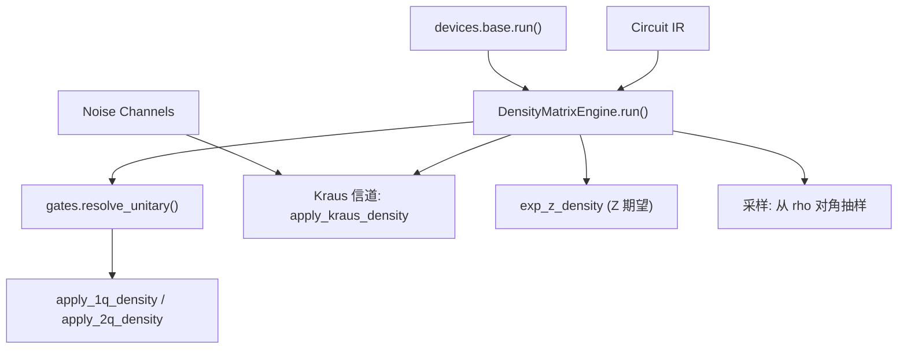
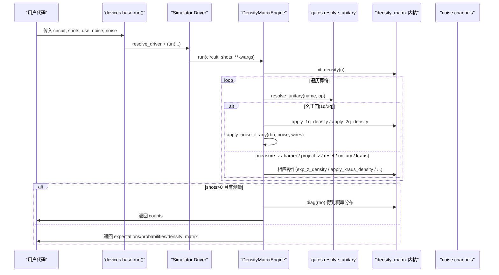
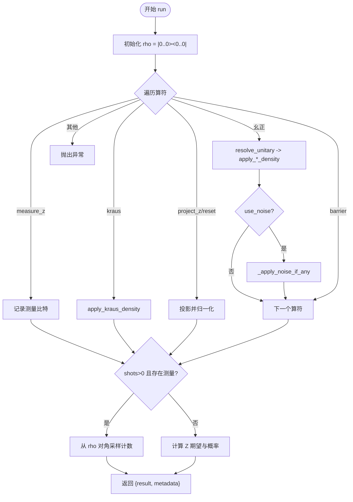
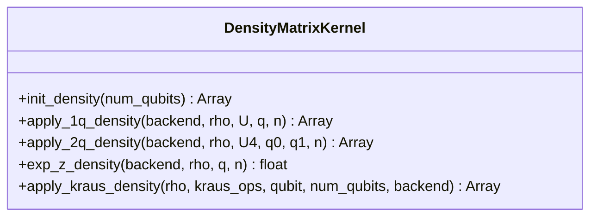
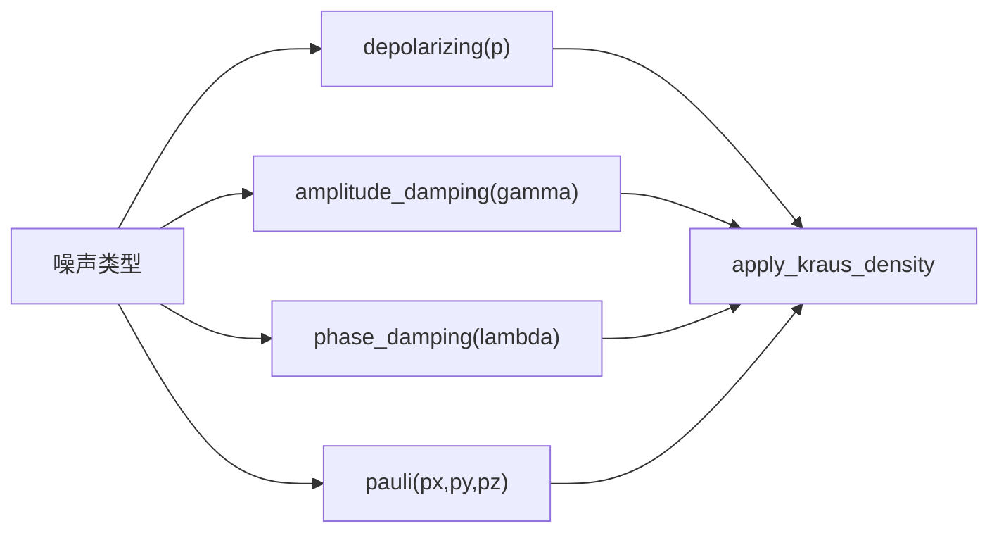
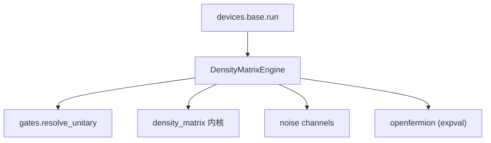

# 密度矩阵模拟器

<cite>
**本文引用的文件**
- [engine.py](file://src/tyxonq/devices/simulators/density_matrix/engine.py)
- [density_matrix.py](file://src/tyxonq/libs/quantum_library/kernels/density_matrix.py)
- [noise.py](file://src/tyxonq/libs/quantum_library/noise.py)
- [channels.py](file://src/tyxonq/devices/simulators/noise/channels.py)
- [base.py](file://src/tyxonq/devices/base.py)
- [test_noise_integration.py](file://tests_core_module/test_noise_integration.py)
- [noise_controls_demo.py](file://examples/noise_controls_demo.py)
- [noisy_circuit_simple_api.py](file://examples/noisy_circuit_simple_api.py)
- [noise_t1_t2_calibration.py](file://examples/noise_t1_t2_calibration.py)
</cite>

## 目录
1. [简介](#简介)
2. [项目结构](#项目结构)
3. [核心组件](#核心组件)
4. [架构总览](#架构总览)
5. [详细组件分析](#详细组件分析)
6. [依赖关系分析](#依赖关系分析)
7. [性能与复杂度](#性能与复杂度)
8. [故障排查指南](#故障排查指南)
9. [结论](#结论)
10. [附录：使用示例与配置指南](#附录使用示例与配置指南)

## 简介
本文件为 TyxonQ 密度矩阵模拟器的详细 API 文档，聚焦 DensityMatrixEngine 的实现原理、噪声建模能力与配置选项。内容涵盖密度矩阵的数学基础、退相干效应模拟、混合态处理机制，并提供含噪量子计算、退相干模拟与量子信道操作的实践指引。同时给出内存需求、计算复杂度与适用场景说明，以及噪声模型配置与性能调优建议，帮助用户在需要噪声模拟时正确高效地使用该模拟器。

## 项目结构
密度矩阵模拟器位于设备仿真器子系统中，核心由引擎类、内核函数、标准噪声通道与统一设备接口组成：
- 引擎层：DensityMatrixEngine 负责电路执行、测量、期望值计算与噪声注入。
- 内核层：提供密度矩阵初始化、幺正门作用（单/双量子比特）、Z 期望值快速路径与 Kraus 信道应用的高效实现。
- 噪声层：标准噪声通道（去极化、振幅阻尼、相位阻尼、Pauli 信道等）与兼容旧接口的包装。
- 设备层：统一设备运行入口，负责选择驱动、注入噪声参数并归一化返回结果。

图表来源
- [engine.py:43-167](file://src/tyxonq/devices/simulators/density_matrix/engine.py#L43-L167)
- [density_matrix.py:9-164](file://src/tyxonq/libs/quantum_library/kernels/density_matrix.py#L9-L164)
- [noise.py:29-205](file://src/tyxonq/libs/quantum_library/noise.py#L29-L205)
- [base.py:294-445](file://src/tyxonq/devices/base.py#L294-L445)

章节来源
- [engine.py:1-242](file://src/tyxonq/devices/simulators/density_matrix/engine.py#L1-L242)
- [density_matrix.py:1-176](file://src/tyxonq/libs/quantum_library/kernels/density_matrix.py#L1-L176)
- [noise.py:1-341](file://src/tyxonq/libs/quantum_library/noise.py#L1-L341)
- [channels.py:1-44](file://src/tyxonq/devices/simulators/noise/channels.py#L1-L44)
- [base.py:1-578](file://src/tyxonq/devices/base.py#L1-L578)

## 核心组件
- DensityMatrixEngine
  - 名称与能力：name="density_matrix"，支持 shots 采样。
  - 运行流程：初始化密度矩阵 → 遍历算符 → 幺正演化或投影/重置 → 可选噪声通道 → 测量与期望值 → 可选采样计数。
  - 关键方法：run、state、probabilities、expval。
- 密度矩阵内核
  - init_density：构造 |0...0><0...0|。
  - apply_1q_density / apply_2q_density：基于 einsum 的高效张量收缩实现 ρ → UρU†。
  - exp_z_density：利用对角元快速计算 Z 期望。
  - apply_kraus_density：对 ρ 施加完全正定保迹（CPTP）信道 ∑ K_i ρ K_i†。
- 标准噪声通道
  - depolarizing_channel、amplitude_damping_channel、phase_damping_channel、pauli_channel、measurement_channel。
- 设备层集成
  - devices.base.run 统一注入 use_noise/noise 参数，屏蔽真机无关键，保证模拟器一致行为。

章节来源
- [engine.py:36-193](file://src/tyxonq/devices/simulators/density_matrix/engine.py#L36-L193)
- [density_matrix.py:9-164](file://src/tyxonq/libs/quantum_library/kernels/density_matrix.py#L9-L164)
- [noise.py:29-252](file://src/tyxonq/libs/quantum_library/noise.py#L29-L252)
- [base.py:274-445](file://src/tyxonq/devices/base.py#L274-L445)

## 架构总览
下图展示从高层设备调用到具体引擎执行的完整数据流，包括噪声注入与测量采样。

图表来源
- [base.py:294-445](file://src/tyxonq/devices/base.py#L294-L445)
- [engine.py:43-167](file://src/tyxonq/devices/simulators/density_matrix/engine.py#L43-L167)
- [density_matrix.py:9-164](file://src/tyxonq/libs/quantum_library/kernels/density_matrix.py#L9-L164)
- [noise.py:29-205](file://src/tyxonq/libs/quantum_library/noise.py#L29-L205)

## 详细组件分析

### DensityMatrixEngine 类
- 职责
  - 管理后端（ArrayBackend），初始化密度矩阵。
  - 解析并执行电路算符：幺正门、测量、投影、重置、自定义幺正、Kraus 信道。
  - 支持 shots 采样：从 rho 对角抽取计数；支持 readout 与 depolarizing 后处理噪声。
  - 提供 state/probabilities/expval 便捷接口。
- 关键流程
  - 幺正门：通过 gates.resolve_unitary 统一分发，调用 apply_1q_density/apply_2q_density 更新 ρ。
  - 噪声：每步幺正后按 wires 应用噪声通道（去极化、振幅阻尼、相位阻尼、Pauli）。
  - 测量：measure_z 记录目标比特；shots>0 时从 rho 对角采样；否则返回精确期望与概率。
  - 投影/重置：project_z/reset 通过投影算子作用并归一化。
  - Kraus：直接调用 apply_kraus_density 进行精确混合态演化。
- 错误处理
  - 未知算符会抛出 ValueError，避免静默跳过导致结果不可信。
  - 脉冲级算符不支持，抛出 NotImplementedError，建议使用 statevector 引擎或先编译为幺正。

图表来源
- [engine.py:43-167](file://src/tyxonq/devices/simulators/density_matrix/engine.py#L43-L167)
- [engine.py:196-239](file://src/tyxonq/devices/simulators/density_matrix/engine.py#L196-L239)

章节来源
- [engine.py:36-239](file://src/tyxonq/devices/simulators/density_matrix/engine.py#L36-L239)

### 密度矩阵内核（线性代数与算法）
- 初始化：init_density 构造单位维度的纯态密度矩阵。
- 幺正作用：apply_1q_density/apply_2q_density 使用 einsum 将 ρ 重塑为高阶张量，按目标比特指标收缩，避免显式构建大矩阵，提升效率。
- Z 期望：exp_z_density 仅读取对角元并按位符号加权求和，时间复杂度 O(2^n)。
- Kraus 信道：apply_kraus_density 对每个 K_i 执行 K_i ρ K_i† 并求和，保持 CPTP 性质；同样采用张量网络收缩。

图表来源
- [density_matrix.py:9-164](file://src/tyxonq/libs/quantum_library/kernels/density_matrix.py#L9-L164)

章节来源
- [density_matrix.py:1-176](file://src/tyxonq/libs/quantum_library/kernels/density_matrix.py#L1-L176)

### 噪声建模与量子信道
- 标准通道
  - 去极化通道：以概率 p 均匀随机施加 X/Y/Z 误差。
  - 振幅阻尼：能量弛豫 |1⟩→|0⟩，对应 T1 过程。
  - 相位阻尼：纯退相干，T2 过程，破坏非对角元但保留布居数。
  - Pauli 信道：非对称 X/Y/Z 误差，允许独立速率。
  - 测量通道：以概率 p 进行 Z 基投影测量，用于 MIPT 等协议。
- 引擎集成
  - _apply_noise_if_any 根据 type 选择通道，并在每个受影响的比特上应用 Kraus 信道。
  - 兼容旧接口 channels.py 包装至标准噪声模块。
- 设备层注入
  - devices.base.run 自动注入 use_noise/noise，确保模拟器路径一致；真机路径丢弃这些键。

图表来源
- [noise.py:29-205](file://src/tyxonq/libs/quantum_library/noise.py#L29-L205)
- [channels.py:23-41](file://src/tyxonq/devices/simulators/noise/channels.py#L23-L41)
- [engine.py:196-227](file://src/tyxonq/devices/simulators/density_matrix/engine.py#L196-L227)
- [base.py:344-356](file://src/tyxonq/devices/base.py#L344-L356)

章节来源
- [noise.py:1-341](file://src/tyxonq/libs/quantum_library/noise.py#L1-L341)
- [channels.py:1-44](file://src/tyxonq/devices/simulators/noise/channels.py#L1-L44)
- [engine.py:196-227](file://src/tyxonq/devices/simulators/density_matrix/engine.py#L196-L227)
- [base.py:274-356](file://src/tyxonq/devices/base.py#L274-L356)

### 数学基础与混合态处理
- 密度矩阵表示混合态 ρ，满足 Tr(ρ)=1、半正定。
- 幺正演化：ρ → UρU†，保持纯度与迹。
- 噪声信道：CPTP 映射 ρ → ∑ K_i ρ K_i†，描述退相干与耗散。
- 测量：Z 期望通过 ρ 的对角元计算；shots>0 时对对角采样得到计数。
- 投影与重置：通过投影算子 P=|k><k| 作用并归一化，模拟选择性测量或复位。

章节来源
- [engine.py:43-167](file://src/tyxonq/devices/simulators/density_matrix/engine.py#L43-L167)
- [density_matrix.py:9-73](file://src/tyxonq/libs/quantum_library/kernels/density_matrix.py#L9-L73)

## 依赖关系分析
- 引擎依赖
  - gates.resolve_unitary：统一门表，确保所有幺正门被正确处理。
  - density_matrix 内核：高效实现张量收缩与信道应用。
  - noise channels：标准噪声通道生成 Kraus 算子。
  - devices.base：统一运行入口与噪声注入。
- 外部依赖
  - openfermion.linalg.get_sparse_operator：用于 expval 中可观测量稀疏表示转换（可选）。

图表来源
- [engine.py:17-30](file://src/tyxonq/devices/simulators/density_matrix/engine.py#L17-L30)
- [engine.py:169-180](file://src/tyxonq/devices/simulators/density_matrix/engine.py#L169-L180)
- [base.py:294-445](file://src/tyxonq/devices/base.py#L294-L445)

章节来源
- [engine.py:1-242](file://src/tyxonq/devices/simulators/density_matrix/engine.py#L1-L242)
- [base.py:1-578](file://src/tyxonq/devices/base.py#L1-L578)

## 性能与复杂度
- 内存需求
  - 密度矩阵维度为 2^n × 2^n，复数存储，内存约 O(4^n)。n 增大时内存迅速增长。
- 时间复杂度
  - 单次幺正作用：O(4^n)（通过张量收缩避免显式矩阵乘法）。
  - 整体电路：~O(poly(gates)·4^n)。
- 适用场景
  - 噪声研究、退相干模拟、混合态演化、量子信道分析。
  - 小至中等规模系统（n ≤ ~15-16，取决于可用内存）。
- 优化建议
  - 优先使用 shots=0 获取精确期望与概率，避免采样开销。
  - 合理设置噪声强度，避免过大导致数值不稳定。
  - 使用 numpy 后端进行本地调试；如需加速可考虑 GPU 后端（需确认兼容性）。
  - 减少不必要的中间状态拷贝，复用后端数组对象。

[本节为通用性能讨论，不直接分析具体文件]

## 故障排查指南
- 常见错误
  - 未知算符：抛出 ValueError，检查 gates.resolve_unitary 是否支持该门。
  - 脉冲级算符：DensityMatrixEngine 不支持 pulse/pulse_inline，改用 statevector 引擎或先编译为幺正。
  - openfermion 缺失：expval 需要安装 openfermion，否则会抛出 ImportError。
- 调试步骤
  - 逐步启用噪声：先关闭噪声验证理想结果，再逐步开启去极化/阻尼通道定位问题。
  - 检查噪声参数范围：确保 p、gamma、lambda、px/py/pz 在合法区间。
  - 验证测量与期望：shots=0 时比较期望值与采样统计一致性。
- 参考测试
  - 去极化噪声下 RX(pi) 的 Z 期望衰减符合理论因子。

章节来源
- [engine.py:97-109](file://src/tyxonq/devices/simulators/density_matrix/engine.py#L97-L109)
- [engine.py:169-180](file://src/tyxonq/devices/simulators/density_matrix/engine.py#L169-L180)
- [test_noise_integration.py:13-40](file://tests_core_module/test_noise_integration.py#L13-L40)

## 结论
TyxonQ 的密度矩阵模拟器提供了精确的混合态演化与噪声建模能力，适用于退相干与量子信道研究。其核心优势在于统一的门分发、高效的张量收缩内核与标准化的噪声通道。通过合理配置噪声参数与利用设备层注入，用户可在不同场景下灵活进行含噪量子计算模拟。对于大规模系统，需注意内存与时间复杂度限制，并结合优化策略提升效率。

[本节为总结性内容，不直接分析具体文件]

## 附录：使用示例与配置指南

### 使用示例
- 基础噪声控制演示
  - 全局启用噪声、构建电路、分别以无噪声与有噪声方式运行，对比结果。
  - 参考路径：[noise_controls_demo.py:4-46](file://examples/noise_controls_demo.py#L4-L46)
- 简化噪声 API
  - 使用 with_noise 链式调用，支持多种噪声类型与参数。
  - 参考路径：[noisy_circuit_simple_api.py:15-62](file://examples/noisy_circuit_simple_api.py#L15-L62)
- T1/T2 校准工作流
  - 通过振幅阻尼与相位阻尼噪声拟合指数衰减，提取 T1/T2。
  - 参考路径：[noise_t1_t2_calibration.py:75-194](file://examples/noise_t1_t2_calibration.py#L75-L194)

### 噪声模型配置指南
- 支持的噪声类型与参数
  - depolarizing：type="depolarizing", p∈[0,1]
  - amplitude_damping：type="amplitude_damping", gamma∈[0,1]
  - phase_damping：type="phase_damping", lambda∈[0,1]
  - pauli：type="pauli", px, py, pz≥0 且 px+py+pz≤1
- 配置位置
  - 设备层注入：devices.base.run 自动处理 use_noise/noise。
  - 引擎内应用：_apply_noise_if_any 根据 type 选择通道并作用于目标比特。
- 最佳实践
  - 从小参数开始，逐步增加噪声强度观察影响。
  - 结合 shots=0 与 shots>0 两种模式验证理论与采样一致性。
  - 在批处理电路中统一噪声配置，便于对比分析。

章节来源
- [noise.py:29-205](file://src/tyxonq/libs/quantum_library/noise.py#L29-L205)
- [engine.py:196-227](file://src/tyxonq/devices/simulators/density_matrix/engine.py#L196-L227)
- [base.py:344-356](file://src/tyxonq/devices/base.py#L344-L356)