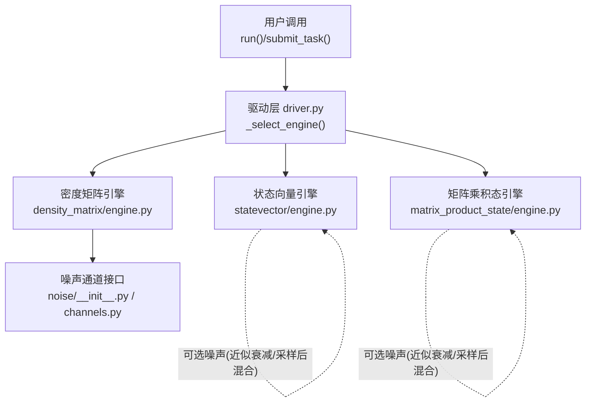
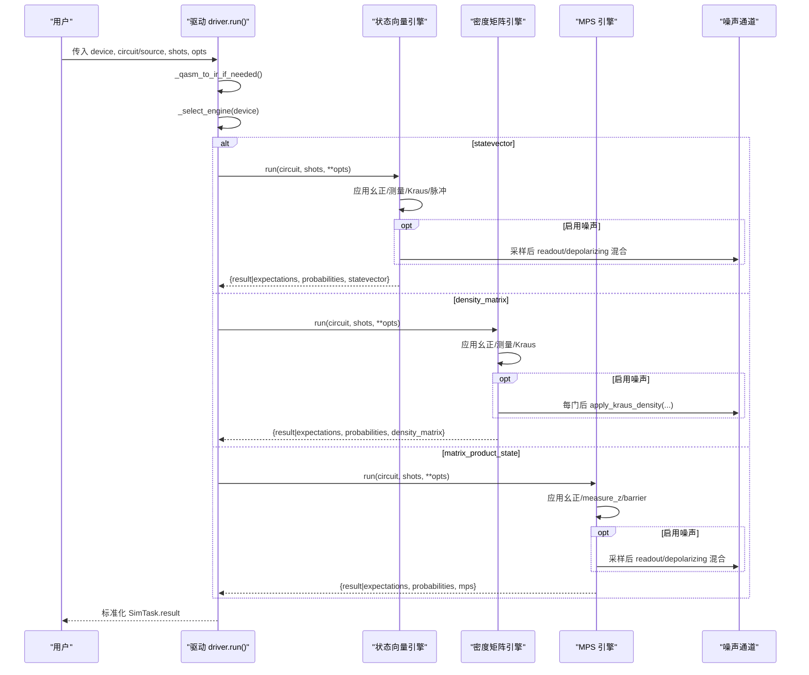
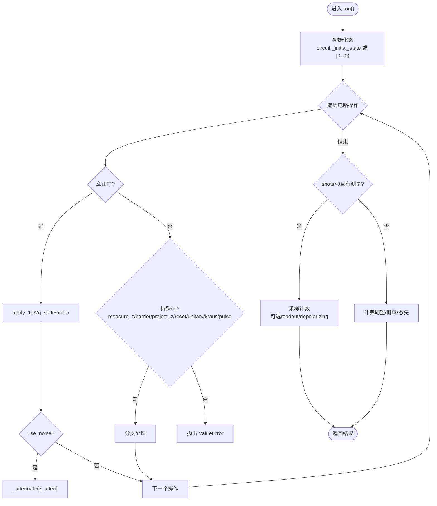
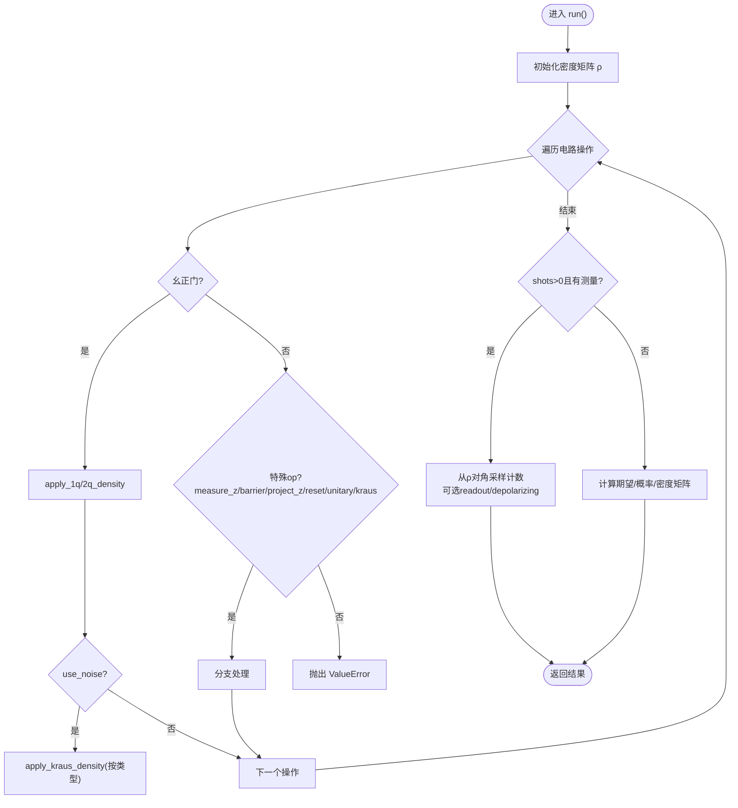
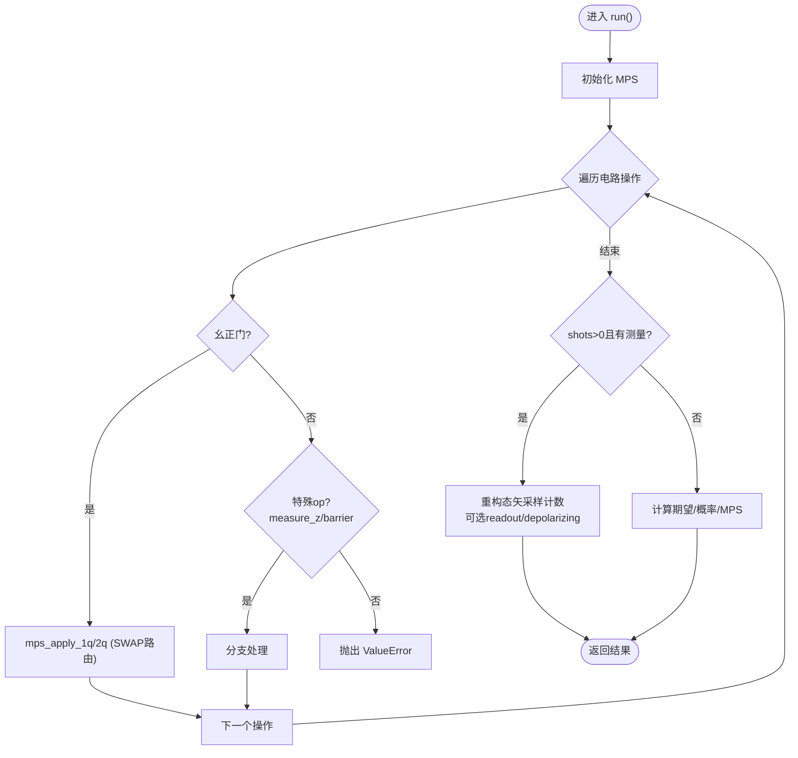
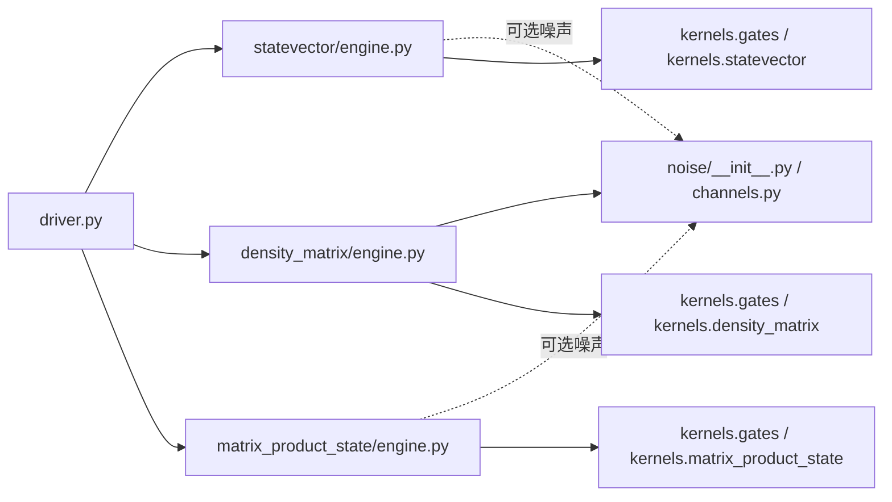

# 模拟器API

<cite>
**本文引用的文件**
- [driver.py](file://src/tyxonq/devices/simulators/driver.py)
- [statevector/engine.py](file://src/tyxonq/devices/simulators/statevector/engine.py)
- [density_matrix/engine.py](file://src/tyxonq/devices/simulators/density_matrix/engine.py)
- [matrix_product_state/engine.py](file://src/tyxonq/devices/simulators/matrix_product_state/engine.py)
- [noise/channels.py](file://src/tyxonq/devices/simulators/noise/channels.py)
- [noise/__init__.py](file://src/tyxonq/devices/simulators/noise/__init__.py)
- [noise_simulation.rst](file://docs/source/user_guide/devices/noise_simulation.rst)
- [noise_controls_demo.py](file://examples/noise_controls_demo.py)
- [noisy_circuit_demo.py](file://examples/noisy_circuit_demo.py)
- [memory_optimization_checkpointing.py](file://examples/memory_optimization_checkpointing.py)
</cite>

## 目录
1. [简介](#简介)
2. [项目结构](#项目结构)
3. [核心组件](#核心组件)
4. [架构总览](#架构总览)
5. [详细组件分析](#详细组件分析)
6. [依赖关系分析](#依赖关系分析)
7. [性能考量](#性能考量)
8. [故障排除指南](#故障排除指南)
9. [结论](#结论)
10. [附录：使用示例与配置清单](#附录使用示例与配置清单)

## 简介
本文件为 TyxonQ 量子模拟器的 API 文档，覆盖状态向量（Statevector）、密度矩阵（Density Matrix）和矩阵乘积态（MPS）三种模拟器，以及噪声模型与高级功能（退相干、读取误差、ZZ串扰、三能级泄漏等）。文档面向不同技术背景的读者，提供从高层架构到代码级实现的说明，包含选择指南、性能优化建议与故障排除方法。

## 项目结构
TyxonQ 的模拟器位于 devices/simulators 下，统一通过 driver 进行设备选择与任务提交；各引擎实现各自的状态表示与演化逻辑；噪声通道由 noise 模块提供并复用至密度矩阵引擎。

图表来源
- [driver.py:20-38](file://src/tyxonq/devices/simulators/driver.py#L20-L38)
- [statevector/engine.py:38-45](file://src/tyxonq/devices/simulators/statevector/engine.py#L38-L45)
- [density_matrix/engine.py:36-42](file://src/tyxonq/devices/simulators/density_matrix/engine.py#L36-L42)
- [matrix_product_state/engine.py:39-47](file://src/tyxonq/devices/simulators/matrix_product_state/engine.py#L39-L47)
- [noise/__init__.py:13-20](file://src/tyxonq/devices/simulators/noise/__init__.py#L13-L20)
- [noise/channels.py:14-41](file://src/tyxonq/devices/simulators/noise/channels.py#L14-L41)

章节来源
- [driver.py:20-38](file://src/tyxonq/devices/simulators/driver.py#L20-L38)

## 核心组件
- 驱动层（driver）
  - 统一入口 run()/submit_task()，自动将 QASM 字符串转换为 IR（支持 OpenQASM 3/TQASM 0.2 或回退到 Qiskit QASM2），按 device 字符串选择具体引擎。
  - 标准化输出：shots>0 返回 counts；shots==0 返回 expectations/probabilities/statevector（或 density_matrix/mps）。
- 状态向量引擎（StatevectorEngine）
  - 以 O(2^n) 内存存储纯态，支持幺正门、测量、投影、重置、自定义 unitary、Kraus 通道、脉冲操作（含三能级泄漏建模与 ZZ 串扰）。
  - 支持 use_noise 开关对 Z 期望进行近似衰减，并在采样阶段支持 readout/depolarizing 混合。
- 密度矩阵引擎（DensityMatrixEngine）
  - 以 O(4^n) 内存存储混合态，原生支持 Kraus 通道（去极化、振幅阻尼、相位阻尼、Pauli 通道），适合噪声研究。
  - 不支持脉冲级演化（会抛出异常），需改用状态向量引擎或将脉冲编译为幺正门。
- 矩阵乘积态引擎（MatrixProductStateEngine）
  - 以 MPS 表示低纠缠态，支持 1q/2q 幺正门与 measure_z/barrier，通过 SWAP 路由处理非相邻作用。
  - 不支持 unitary/kraus/project_z/reset/pulse 等特殊 op，遇到即抛出异常；可通过 expectation_pauli 在 MPS 上直接计算期望值。

章节来源
- [driver.py:75-166](file://src/tyxonq/devices/simulators/driver.py#L75-L166)
- [statevector/engine.py:38-451](file://src/tyxonq/devices/simulators/statevector/engine.py#L38-L451)
- [density_matrix/engine.py:36-242](file://src/tyxonq/devices/simulators/density_matrix/engine.py#L36-L242)
- [matrix_product_state/engine.py:39-319](file://src/tyxonq/devices/simulators/matrix_product_state/engine.py#L39-L319)

## 架构总览
下图展示从用户调用到引擎执行再到结果归一化的完整流程，以及噪声注入点。

图表来源
- [driver.py:41-166](file://src/tyxonq/devices/simulators/driver.py#L41-L166)
- [statevector/engine.py:46-451](file://src/tyxonq/devices/simulators/statevector/engine.py#L46-L451)
- [density_matrix/engine.py:43-167](file://src/tyxonq/devices/simulators/density_matrix/engine.py#L43-L167)
- [matrix_product_state/engine.py:137-218](file://src/tyxonq/devices/simulators/matrix_product_state/engine.py#L137-L218)
- [noise/__init__.py:13-20](file://src/tyxonq/devices/simulators/noise/__init__.py#L13-L20)

## 详细组件分析

### 状态向量模拟器（StatevectorEngine）
- 能力与复杂度
  - 内存 O(2^n)，时间约 O(poly(gates)·2^n)。
  - 支持 h/rz/rx/cx 及更多幺正门（通过权威门表 resolve_unitary），measure_z、project_z、reset、unitary、kraus、pulse/pulse_inline。
- 噪声与高级特性
  - use_noise=True 时，对受影响的 qubit 的 Z 期望进行近似衰减；采样阶段支持 readout（校准矩阵 KRON）与 depolarizing 混合。
  - 脉冲操作支持两能级与三能级（leakage to |2⟩）两种模式；支持 ZZ 串扰（local/global 两种模式）。
- 关键数据流
  - 初始化态（可接受 circuit._initial_state）→ 逐门应用 → 若 shots>0 且存在测量则采样计数；否则返回期望值与概率分布/态矢量。

图表来源
- [statevector/engine.py:46-451](file://src/tyxonq/devices/simulators/statevector/engine.py#L46-L451)

章节来源
- [statevector/engine.py:38-451](file://src/tyxonq/devices/simulators/statevector/engine.py#L38-L451)

### 密度矩阵模拟器（DensityMatrixEngine）
- 能力与复杂度
  - 内存 O(4^n)，时间约 O(poly(gates)·4^n)。
  - 原生 Kraus 通道：去极化、振幅阻尼、相位阻尼、Pauli 通道；每门后可按线网逐一应用。
- 限制
  - 不支持 pulse/pulse_inline（会抛出异常），需改用状态向量引擎或先将脉冲编译为幺正门。
- 关键数据流
  - 初始化 ρ=I/2^n → 逐门应用幺正或 Kraus → 若 shots>0 且存在测量则从对角读出概率并采样；否则返回期望值与概率分布/密度矩阵。

图表来源
- [density_matrix/engine.py:43-167](file://src/tyxonq/devices/simulators/density_matrix/engine.py#L43-L167)

章节来源
- [density_matrix/engine.py:36-242](file://src/tyxonq/devices/simulators/density_matrix/engine.py#L36-L242)

### 矩阵乘积态模拟器（MatrixProductStateEngine）
- 能力与复杂度
  - 内存/时间与键维 χ 相关，适合低纠缠系统；支持 1q/2q 幺正门与 measure_z/barrier。
  - 通过 SWAP 路由处理非相邻作用；提供 expectation_pauli 直接在 MPS 上计算期望值。
- 限制
  - 不支持 unitary/kraus/project_z/reset/pulse/pulse_inline 等特殊 op，遇到即抛出异常。
- 关键数据流
  - 初始化 MPS → 逐门应用 → 若 shots>0 且存在测量则重构态矢采样计数；否则返回期望值与概率分布/MPS。

图表来源
- [matrix_product_state/engine.py:74-218](file://src/tyxonq/devices/simulators/matrix_product_state/engine.py#L74-L218)

章节来源
- [matrix_product_state/engine.py:39-319](file://src/tyxonq/devices/simulators/matrix_product_state/engine.py#L39-L319)

### 噪声模型与高级功能
- 标准噪声通道（密度矩阵原生）
  - 去极化（depolarizing）：均匀随机 Pauli 错误。
  - 振幅阻尼（amplitude_damping）：T₁ 弛豫，|1⟩→|0⟩。
  - 相位阻尼（phase_damping）：T₂ 退相干，破坏相干但不改变布居。
  - Pauli 通道（pauli）：自定义 px/py/pz 的非对称噪声。
- 状态向量与 MPS 的“近似噪声”
  - 通过 use_noise 开关对 Z 期望进行衰减因子修正；采样阶段支持 readout（校准矩阵 KRON）与 depolarizing 混合。
- 读取误差模拟（Readout Mitigation）
  - 通过 noise.cals 构建单比特校准矩阵并按张量积组合，作用于采样前概率分布。
- ZZ 串扰（仅状态向量）
  - local 近似：先单量子比特脉冲再依次施加 U_ZZ；global 精确：构造全空间哈密顿量并指数演化。
- 三能级泄漏（仅状态向量）
  - 脉冲操作可选择三能级演化，模拟 transmon 泄漏到 |2⟩；测量时对单量子比特映射 0/1/2，多量子比特采用简化投影。

章节来源
- [noise/__init__.py:13-20](file://src/tyxonq/devices/simulators/noise/__init__.py#L13-L20)
- [noise/channels.py:14-41](file://src/tyxonq/devices/simulators/noise/channels.py#L14-L41)
- [statevector/engine.py:344-451](file://src/tyxonq/devices/simulators/statevector/engine.py#L344-L451)
- [statevector/engine.py:474-725](file://src/tyxonq/devices/simulators/statevector/engine.py#L474-L725)
- [statevector/engine.py:789-800](file://src/tyxonq/devices/simulators/statevector/engine.py#L789-L800)
- [density_matrix/engine.py:196-227](file://src/tyxonq/devices/simulators/density_matrix/engine.py#L196-L227)
- [noise_simulation.rst:76-244](file://docs/source/user_guide/devices/noise_simulation.rst#L76-L244)

## 依赖关系分析
- 驱动层依赖
  - 解析 QASM：优先使用 TyxonQ 原生 QASM3 导入器，回退到 Qiskit QASM2。
  - 引擎选择：根据 device 字符串映射到具体引擎类。
- 引擎依赖
  - 统一数值后端：ArrayBackend（numpy/pytorch/cupynumeric）。
  - 权威门表：resolve_unitary 提供统一的幺正门矩阵与元信息。
  - 内核函数：statevector/density_matrix/matrix_product_state 专用 apply/expectation 内核。
- 噪声依赖
  - 密度矩阵引擎直接调用 noise_channels 生成 Kraus 算子并通过 apply_kraus_density 应用。
  - 状态向量/MPS 在采样阶段对概率分布进行 readout/depolarizing 混合。

图表来源
- [driver.py:41-97](file://src/tyxonq/devices/simulators/driver.py#L41-L97)
- [statevector/engine.py:17-32](file://src/tyxonq/devices/simulators/statevector/engine.py#L17-L32)
- [density_matrix/engine.py:17-30](file://src/tyxonq/devices/simulators/density_matrix/engine.py#L17-L30)
- [matrix_product_state/engine.py:19-33](file://src/tyxonq/devices/simulators/matrix_product_state/engine.py#L19-L33)
- [noise/__init__.py:13-20](file://src/tyxonq/devices/simulators/noise/__init__.py#L13-L20)
- [noise/channels.py:14-41](file://src/tyxonq/devices/simulators/noise/channels.py#L14-L41)

章节来源
- [driver.py:41-97](file://src/tyxonq/devices/simulators/driver.py#L41-L97)

## 性能考量
- 内存与时间复杂度
  - 状态向量：O(2^n) 内存，适合中小规模无噪声或近似噪声场景。
  - 密度矩阵：O(4^n) 内存，适合噪声研究与混合态模拟，规模受限更明显。
  - MPS：内存/时间与键维 χ 相关，适合低纠缠系统；大 n 但低纠缠时可扩展。
- 噪声开销
  - 密度矩阵每门后可能多次应用 Kraus 算子，增加常数因子；合理设置 shots 与噪声强度平衡精度与速度。
- 采样与期望
  - shots==0 时返回解析期望与概率，避免采样方差；shots>0 时注意 shot 数对统计误差的影响。
- 脉冲与 ZZ 串扰
  - global 模式精确但昂贵，仅适用于小系统；local 模式高效且物理合理，推荐生产环境。
- 三能级泄漏
  - 仅在状态向量引擎支持；多量子比特下当前为实验性，建议单量子比特验证。

章节来源
- [statevector/engine.py:474-725](file://src/tyxonq/devices/simulators/statevector/engine.py#L474-L725)
- [density_matrix/engine.py:196-227](file://src/tyxonq/devices/simulators/density_matrix/engine.py#L196-L227)
- [matrix_product_state/engine.py:137-218](file://src/tyxonq/devices/simulators/matrix_product_state/engine.py#L137-L218)
- [noise_simulation.rst:341-419](file://docs/source/user_guide/devices/noise_simulation.rst#L341-L419)

## 故障排除指南
- 常见错误与原因
  - 未知操作符：引擎对未知 op 会抛出 ValueError，检查是否使用了不支持的 op（如 MPS 不支持 Kraus/Pulse）。
  - 密度矩阵不支持脉冲：若使用 density_matrix 并包含 pulse/pulse_inline，会抛出 NotImplementedError，请改用状态向量引擎或先将脉冲编译为幺正门。
  - expval 依赖 openfermion：未安装时会抛出 ImportError，需安装依赖。
- 调试建议
  - 逐步缩小电路规模，确认基本门序列正确。
  - 对比 shots==0 与 shots>0 的结果，识别统计误差与噪声影响。
  - 使用 with_noise 或 device-level use_noise 控制噪声开关，隔离问题来源。
- 参考示例
  - 噪声控制演示与多种噪声模型对比，帮助定位参数与效果。

章节来源
- [statevector/engine.py:335-342](file://src/tyxonq/devices/simulators/statevector/engine.py#L335-L342)
- [density_matrix/engine.py:97-109](file://src/tyxonq/devices/simulators/density_matrix/engine.py#L97-L109)
- [matrix_product_state/engine.py:121-134](file://src/tyxonq/devices/simulators/matrix_product_state/engine.py#L121-L134)
- [statevector/engine.py:453-462](file://src/tyxonq/devices/simulators/statevector/engine.py#L453-L462)
- [density_matrix/engine.py:169-180](file://src/tyxonq/devices/simulators/density_matrix/engine.py#L169-L180)
- [matrix_product_state/engine.py:220-233](file://src/tyxonq/devices/simulators/matrix_product_state/engine.py#L220-L233)
- [noisy_circuit_demo.py:62-232](file://examples/noisy_circuit_demo.py#L62-L232)

## 结论
TyxonQ 提供了统一、可扩展的量子模拟器框架：状态向量适合小规模无噪声或近似噪声仿真；密度矩阵适合噪声研究与混合态；MPS 适合低纠缠大规模系统。噪声模型完备，支持读取误差与 ZZ 串扰等高级特性。选择合适的引擎与参数，结合性能优化与故障排除策略，可在不同应用场景中取得最佳效果。

## 附录：使用示例与配置清单
- 模拟器选择指南
  - 小规模（≤~15 qubits）且需要精确态：状态向量。
  - 需要噪声与混合态：密度矩阵。
  - 大规模低纠缠：MPS。
- 常用配置项
  - device：simulator::statevector / simulator::density_matrix / simulator::matrix_product_state。
  - shots：采样次数；0 表示解析期望。
  - use_noise：启用近似噪声（状态向量/MPS）或原生噪声（密度矩阵）。
  - noise：噪声类型与参数（type, p/gamma/l/px/py/pz, cals）。
  - zz_topology/zz_mode：状态向量 ZZ 串扰拓扑与模式（local/global）。
  - three_level：状态向量三能级泄漏开关。
- 示例路径（不含代码内容）
  - 噪声控制与全局开关：[noise_controls_demo.py](file://examples/noise_controls_demo.py)
  - 多种噪声模型对比与 VQE 示例：[noisy_circuit_demo.py](file://examples/noisy_circuit_demo.py)
  - 深度电路内存优化与梯度检查点概念：[memory_optimization_checkpointing.py](file://examples/memory_optimization_checkpointing.py)
  - 噪声模拟用户指南（含数学描述与最佳实践）：[noise_simulation.rst](file://docs/source/user_guide/devices/noise_simulation.rst)

章节来源
- [noise_controls_demo.py:1-53](file://examples/noise_controls_demo.py#L1-L53)
- [noisy_circuit_demo.py:1-315](file://examples/noisy_circuit_demo.py#L1-L315)
- [memory_optimization_checkpointing.py:1-280](file://examples/memory_optimization_checkpointing.py#L1-L280)
- [noise_simulation.rst:1-696](file://docs/source/user_guide/devices/noise_simulation.rst#L1-L696)