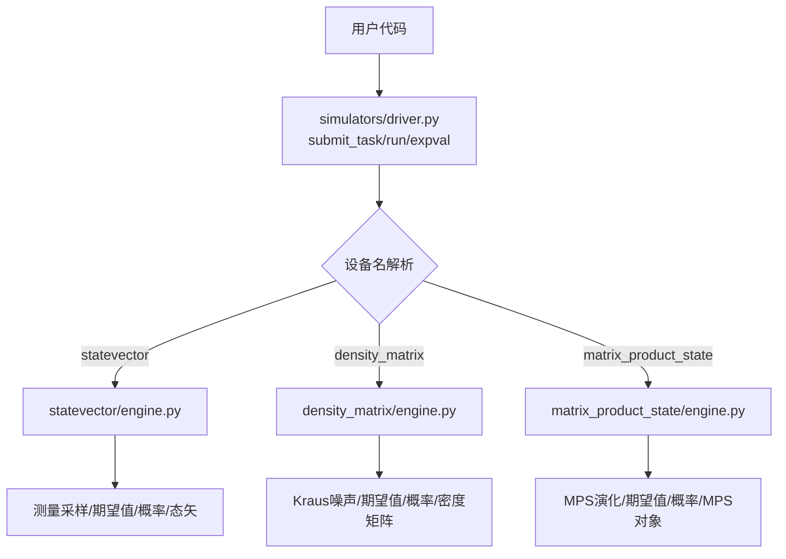
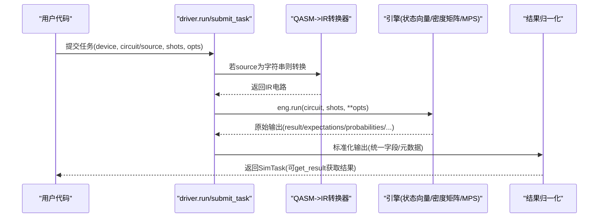
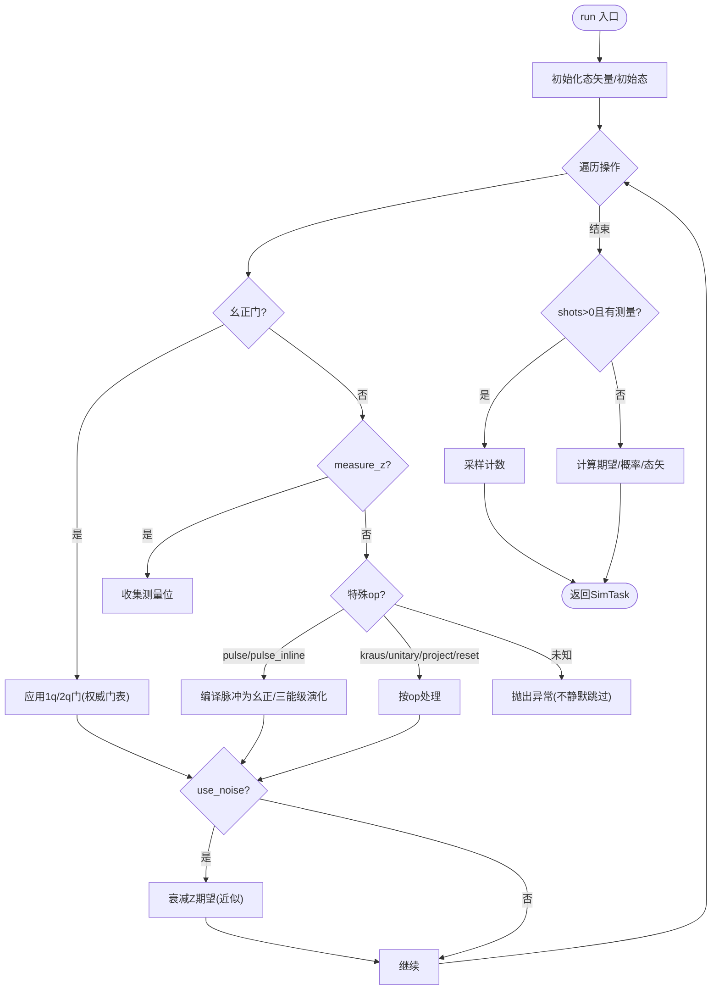
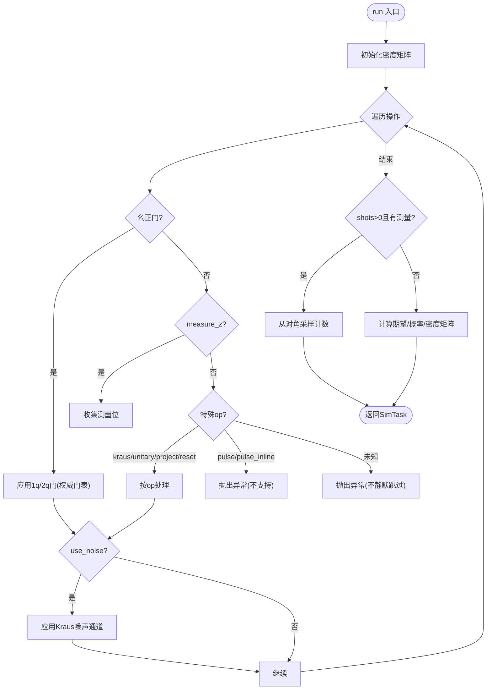
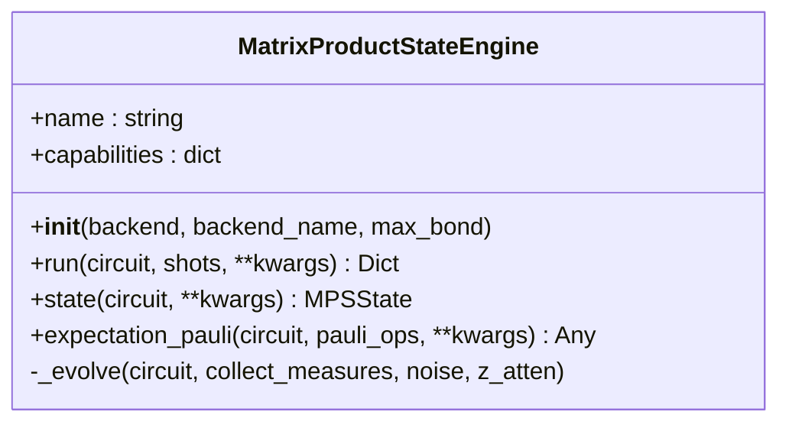
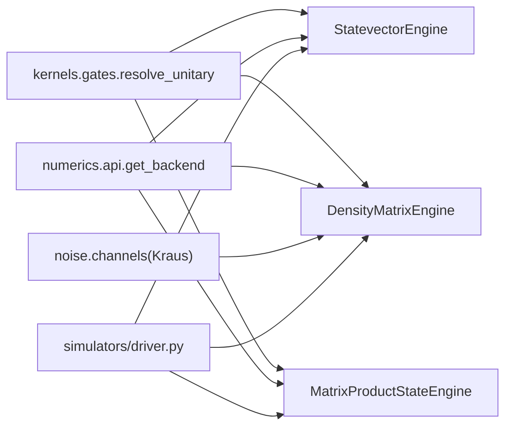
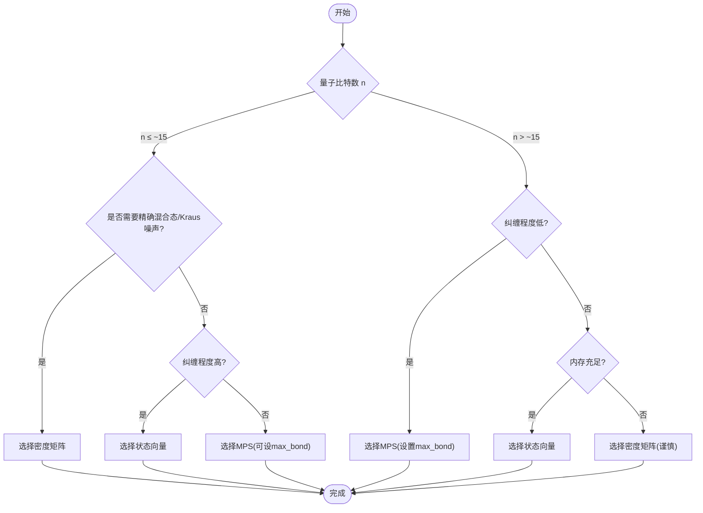

# 模拟器选择指南

<cite>
**本文引用的文件**
- [driver.py](file://src/tyxonq/devices/simulators/driver.py)
- [statevector/engine.py](file://src/tyxonq/devices/simulators/statevector/engine.py)
- [density_matrix/engine.py](file://src/tyxonq/devices/simulators/density_matrix/engine.py)
- [matrix_product_state/engine.py](file://src/tyxonq/devices/simulators/matrix_product_state/engine.py)
- [circuit.py](file://src/tyxonq/core/ir/circuit.py)
- [noise_simulation.rst](file://docs/source/user_guide/devices/noise_simulation.rst)
- [numeric_backend_switching.py](file://examples/numeric_backend_switching.py)
- [noisy_circuit_demo.py](file://examples/noisy_circuit_demo.py)
- [test_cloud_api_smoke.py](file://tests_core_module/test_cloud_api_smoke.py)
</cite>

## 目录
1. [简介](#简介)
2. [项目结构](#项目结构)
3. [核心组件](#核心组件)
4. [架构总览](#架构总览)
5. [详细组件分析](#详细组件分析)
6. [依赖关系分析](#依赖关系分析)
7. [性能考量与基准建议](#性能考量与基准建议)
8. [故障排查指南](#故障排查指南)
9. [结论](#结论)
10. [附录](#附录)

## 简介
本指南面向使用 TyxonQ 的开发者，帮助你在三种主要模拟器之间做出明智选择：状态向量（Statevector）、密度矩阵（Density Matrix）和矩阵乘积态（MPS）。内容涵盖三类模拟器的特点对比、适用场景、性能特征、噪声建模能力、任务提交流程（SimTask）以及配置优化与常见问题解决方案。文末提供决策流程图与最佳实践，帮助你根据量子比特数量、纠缠程度、噪声需求与计算资源快速选型。

## 项目结构
TyxonQ 的模拟器子系统位于 devices/simulators 下，包含统一驱动与三个具体引擎：
- 统一驱动 driver.py：负责设备名解析、任务提交、结果归一化、SimTask 封装与 expval 路由。
- 状态向量引擎 statevector/engine.py：以 2^n 维复数态矢量表示纯态，支持门演化、测量采样、可选近似退相干衰减、脉冲级演化（含三能级泄漏模型与 ZZ 串扰）。
- 密度矩阵引擎 density_matrix/engine.py：以 2^n×2^n 密度矩阵表示混合态，原生支持 Kraus 噪声通道，适合噪声研究。
- 矩阵乘积态引擎 matrix_product_state/engine.py：以 MPS 表示低纠缠态，支持最大键维截断，适合大系统但低纠缠场景。

图表来源
- [driver.py:20-38](file://src/tyxonq/devices/simulators/driver.py#L20-L38)
- [statevector/engine.py:38-45](file://src/tyxonq/devices/simulators/statevector/engine.py#L38-L45)
- [density_matrix/engine.py:36-42](file://src/tyxonq/devices/simulators/density_matrix/engine.py#L36-L42)
- [matrix_product_state/engine.py:39-47](file://src/tyxonq/devices/simulators/matrix_product_state/engine.py#L39-L47)

章节来源
- [driver.py:20-38](file://src/tyxonq/devices/simulators/driver.py#L20-L38)

## 核心组件
- SimTask：本地模拟器任务的轻量封装，返回统一的结果字典（counts/expectations/probabilities/statevector/density_matrix/mps），并附带元数据与错误信息。
- 设备选择器：根据 device 字符串选择对应引擎（支持别名如 mps、statevector、density_matrix）。
- 运行入口 run/submit_task：将电路转换为 IR（若传入 QASM 字符串则自动导入转换），调用引擎 run()，并对输出进行归一化。
- 期望值入口 expval：直接路由到具体引擎的 expval 实现，用于 shots=0 的精确期望值计算。

章节来源
- [driver.py:6-18](file://src/tyxonq/devices/simulators/driver.py#L6-L18)
- [driver.py:75-166](file://src/tyxonq/devices/simulators/driver.py#L75-L166)

## 架构总览
下图展示了从用户代码到引擎执行的完整流程，包括 QASM 到 IR 的转换、引擎选择、执行与结果归一化。

图表来源
- [driver.py:41-72](file://src/tyxonq/devices/simulators/driver.py#L41-L72)
- [driver.py:95-141](file://src/tyxonq/devices/simulators/driver.py#L95-L141)

## 详细组件分析

### 状态向量模拟器（Statevector）
- 表示与复杂度：以 2^n 维复数态矢量表示纯态；内存 O(2^n)，时间约 O(poly(gates)·2^n)。
- 功能特性：
  - 支持 h/rz/rx/cx 等幺正门，通过权威门表 resolve_unitary 分发，避免多套分支。
  - 支持 measure_z、project_z、reset、unitary、kraus、pulse/pulse_inline。
  - 支持 shots>0 的采样计数；shots=0 时返回期望值、概率分布与态矢量。
  - 可选 use_noise 近似衰减 Z 期望；支持 readout/depol 噪声混合。
  - 脉冲级演化：支持二能级与三能级（泄漏到 |2⟩）模型，支持 ZZ 串扰（local/global 两种模式）。
- 适用场景：中小规模系统（n≤~20-22，视内存而定），需要精确态矢或脉冲级物理建模（含泄漏与串扰）。
- 性能特征：对小中 n 极快；对大 n 指数增长；脉冲级与全局 ZZ 模式开销较大。

图表来源
- [statevector/engine.py:46-118](file://src/tyxonq/devices/simulators/statevector/engine.py#L46-L118)
- [statevector/engine.py:119-204](file://src/tyxonq/devices/simulators/statevector/engine.py#L119-L204)
- [statevector/engine.py:344-451](file://src/tyxonq/devices/simulators/statevector/engine.py#L344-L451)

章节来源
- [statevector/engine.py:38-45](file://src/tyxonq/devices/simulators/statevector/engine.py#L38-L45)
- [statevector/engine.py:46-118](file://src/tyxonq/devices/simulators/statevector/engine.py#L46-L118)
- [statevector/engine.py:119-204](file://src/tyxonq/devices/simulators/statevector/engine.py#L119-L204)
- [statevector/engine.py:344-451](file://src/tyxonq/devices/simulators/statevector/engine.py#L344-L451)

### 密度矩阵模拟器（Density Matrix）
- 表示与复杂度：以 2^n×2^n 密度矩阵表示混合态；内存 O(4^n)，时间约 O(poly(gates)·4^n)。
- 功能特性：
  - 原生 Kraus 噪声通道（depolarizing、amplitude_damping、phase_damping、pauli_channel）。
  - 支持 h/rz/rx/cx 等幺正门，通过权威门表分发。
  - 支持 measure_z、project_z、reset、unitary、kraus；不支持 pulse/pulse_inline（会抛出异常）。
  - shots>0 时从密度矩阵对角采样计数；shots=0 时返回期望值、概率分布与密度矩阵。
- 适用场景：需要精确混合态演化与噪声建模的研究；中小规模系统（n≤~15-18，视内存而定）。
- 性能特征：比状态向量更昂贵；噪声通道逐门应用带来额外开销。

图表来源
- [density_matrix/engine.py:43-109](file://src/tyxonq/devices/simulators/density_matrix/engine.py#L43-L109)
- [density_matrix/engine.py:111-167](file://src/tyxonq/devices/simulators/density_matrix/engine.py#L111-L167)
- [density_matrix/engine.py:196-227](file://src/tyxonq/devices/simulators/density_matrix/engine.py#L196-L227)

章节来源
- [density_matrix/engine.py:36-42](file://src/tyxonq/devices/simulators/density_matrix/engine.py#L36-L42)
- [density_matrix/engine.py:43-109](file://src/tyxonq/devices/simulators/density_matrix/engine.py#L43-L109)
- [density_matrix/engine.py:111-167](file://src/tyxonq/devices/simulators/density_matrix/engine.py#L111-L167)
- [density_matrix/engine.py:196-227](file://src/tyxonq/devices/simulators/density_matrix/engine.py#L196-L227)

### 矩阵乘积态模拟器（MPS）
- 表示与复杂度：以 MPS 表示量子态，内存/时间与键维 χ 相关，而非 2^n；可通过 max_bond 控制截断。
- 功能特性：
  - 支持 h/rz/rx/cx 等幺正门，通过权威门表分发；measure_z/barrier 控制 op。
  - 不支持 unitary/kraus/project_z/reset/pulse/pulse_inline（会抛出异常）。
  - shots>0 时重建态矢后采样计数；shots=0 时返回期望值、概率分布与 MPS 对象。
  - expectation_pauli 可直接在 MPS 上计算 Pauli 期望，避免全态矢重构。
- 适用场景：大规模系统但纠缠较低（例如浅层随机电路、特定拓扑）；需要控制键维以平衡精度与内存。
- 性能特征：对低纠缠大 n 友好；高纠缠时 χ 增大导致成本上升。

图表来源
- [matrix_product_state/engine.py:39-47](file://src/tyxonq/devices/simulators/matrix_product_state/engine.py#L39-L47)
- [matrix_product_state/engine.py:74-135](file://src/tyxonq/devices/simulators/matrix_product_state/engine.py#L74-L135)
- [matrix_product_state/engine.py:137-218](file://src/tyxonq/devices/simulators/matrix_product_state/engine.py#L137-L218)
- [matrix_product_state/engine.py:235-250](file://src/tyxonq/devices/simulators/matrix_product_state/engine.py#L235-L250)
- [matrix_product_state/engine.py:252-308](file://src/tyxonq/devices/simulators/matrix_product_state/engine.py#L252-L308)

章节来源
- [matrix_product_state/engine.py:39-47](file://src/tyxonq/devices/simulators/matrix_product_state/engine.py#L39-L47)
- [matrix_product_state/engine.py:74-135](file://src/tyxonq/devices/simulators/matrix_product_state/engine.py#L74-L135)
- [matrix_product_state/engine.py:137-218](file://src/tyxonq/devices/simulators/matrix_product_state/engine.py#L137-L218)
- [matrix_product_state/engine.py:235-250](file://src/tyxonq/devices/simulators/matrix_product_state/engine.py#L235-L250)
- [matrix_product_state/engine.py:252-308](file://src/tyxonq/devices/simulators/matrix_product_state/engine.py#L252-L308)

## 依赖关系分析
- 统一门表与内核：三个引擎均通过 libs.quantum_library.kernels.gates.resolve_unitary 解析幺正门，确保一致性。
- 数值后端：通过 numerics.api.get_backend 切换 NumPy/PyTorch/CuPyNumeric，影响数组运算与 GPU 加速。
- 噪声通道：密度矩阵引擎使用 devices.simulators.noise.channels 提供的 Kraus 算子；状态向量引擎使用近似衰减与 readout/depol 混合。
- 任务接口：driver.py 提供 submit_task/run/expval，统一封装 SimTask；Circuit 层提供 get_task_details/get_result/cancel 等便捷方法。

图表来源
- [statevector/engine.py:17-32](file://src/tyxonq/devices/simulators/statevector/engine.py#L17-L32)
- [density_matrix/engine.py:17-30](file://src/tyxonq/devices/simulators/density_matrix/engine.py#L17-L30)
- [matrix_product_state/engine.py:19-33](file://src/tyxonq/devices/simulators/matrix_product_state/engine.py#L19-L33)
- [driver.py:20-38](file://src/tyxonq/devices/simulators/driver.py#L20-L38)

章节来源
- [statevector/engine.py:17-32](file://src/tyxonq/devices/simulators/statevector/engine.py#L17-L32)
- [density_matrix/engine.py:17-30](file://src/tyxonq/devices/simulators/density_matrix/engine.py#L17-L30)
- [matrix_product_state/engine.py:19-33](file://src/tyxonq/devices/simulators/matrix_product_state/engine.py#L19-L33)
- [driver.py:20-38](file://src/tyxonq/devices/simulators/driver.py#L20-L38)

## 性能考量与基准建议
- 量子比特数量与内存：
  - 状态向量：内存 O(2^n)，适用于 n≤~20-22（取决于可用内存）。
  - 密度矩阵：内存 O(4^n)，适用于 n≤~15-18。
  - MPS：内存与键维 χ 相关，适合大 n 且低纠缠；可通过 max_bond 控制精度与内存。
- 纠缠程度：
  - 高纠缠：优先状态向量（小 n）或密度矩阵（噪声研究）；MPS 在高纠缠下 χ 增长快。
  - 低纠缠：MPS 在大 n 下更高效。
- 噪声需求：
  - 需要精确混合态与 Kraus 噪声：密度矩阵。
  - 近似退相干与脉冲级噪声（泄漏、ZZ 串扰）：状态向量。
  - MPS 不支持 Kraus/pulse，需改用其他引擎。
- 计算资源：
  - CPU 环境：NumPy 后端适合原型与小电路。
  - GPU 环境：PyTorch/CuPyNumeric 后端可加速大态矢运算。
- 基准建议：
  - 使用 examples/numeric_backend_switching.py 比较不同后端性能。
  - 使用 examples/noisy_circuit_demo.py 验证噪声模型效果。
  - 针对目标电路，分别以三种引擎跑相同任务，记录时间与内存，结合问题规模选择最优。

章节来源
- [numeric_backend_switching.py:16-27](file://examples/numeric_backend_switching.py#L16-L27)
- [noisy_circuit_demo.py:1-11](file://examples/noisy_circuit_demo.py#L1-L11)

## 故障排查指南
- 未知操作符被拒绝：
  - 状态向量/密度矩阵/MPS 引擎对未知 op 会抛出异常，不会静默跳过。检查电路是否包含非受支持 op。
- 脉冲操作限制：
  - 密度矩阵引擎不支持 pulse/pulse_inline，会抛出异常；请改用状态向量引擎或将脉冲编译为幺正门。
  - MPS 引擎同样不支持 pulse/pulse_inline 等特殊 op。
- 噪声参数：
  - 密度矩阵引擎支持 depolarizing/amplitude_damping/phase_damping/pauli_channel；确认参数名与范围。
  - 状态向量引擎 use_noise 为近似衰减，readout/depol 噪声在采样阶段混合。
- 任务结果字段：
  - shots>0：result 为计数字典；shots=0：expectations/probabilities/statevector/density_matrix/mps 可能返回。
  - 通过 SimTask.get_result() 获取统一结果；Circuit 层提供 get_task_details/get_result/cancel 便捷方法。

章节来源
- [statevector/engine.py:335-342](file://src/tyxonq/devices/simulators/statevector/engine.py#L335-L342)
- [density_matrix/engine.py:97-109](file://src/tyxonq/devices/simulators/density_matrix/engine.py#L97-L109)
- [matrix_product_state/engine.py:121-134](file://src/tyxonq/devices/simulators/matrix_product_state/engine.py#L121-L134)
- [driver.py:101-141](file://src/tyxonq/devices/simulators/driver.py#L101-L141)
- [circuit.py:1044-1065](file://src/tyxonq/core/ir/circuit.py#L1044-L1065)
- [circuit.py:2047-2081](file://src/tyxonq/core/ir/circuit.py#L2047-L2081)

## 结论
- 小中规模、需要精确态矢或脉冲级物理建模：选状态向量。
- 需要精确混合态与 Kraus 噪声建模：选密度矩阵。
- 大规模、低纠缠：选 MPS，并通过 max_bond 控制精度与内存。
- 结合后端切换（NumPy/PyTorch/CuPyNumeric）与噪声模型，针对不同问题规模与硬件约束进行基准测试，选择最优组合。

## 附录

### 模拟器选择决策流程图

[此图为概念性流程图，无需图表来源]

### SimTask 使用方法与任务提交流程
- 提交任务：
  - 使用 tq.api.submit_task 或 tq.api.run，传入 provider="simulator"、device（如 simulator::statevector）、circuit/source、shots、opts。
  - 返回 SimTask 列表；单个任务时取第一个元素。
- 获取结果：
  - 使用 tq.api.result(task) 或 task.get_result() 获取统一结果字典。
  - Circuit 层提供 get_task_details/get_result/cancel 便捷方法。
- 结果字段：
  - shots>0：result 为计数字典。
  - shots=0：expectations/probabilities/statevector/density_matrix/mps 可能返回；result_meta 包含 num_qubits 等元信息。

章节来源
- [test_cloud_api_smoke.py:6-59](file://tests_core_module/test_cloud_api_smoke.py#L6-L59)
- [driver.py:75-141](file://src/tyxonq/devices/simulators/driver.py#L75-L141)
- [circuit.py:1044-1065](file://src/tyxonq/core/ir/circuit.py#L1044-L1065)
- [circuit.py:2047-2081](file://src/tyxonq/core/ir/circuit.py#L2047-L2081)

### 配置优化建议
- 数值后端：
  - 原型与小电路：NumPy。
  - VQA 与梯度、GPU 可用：PyTorch。
  - 大态矢 GPU 加速：CuPyNumeric（若安装）。
- 噪声建模：
  - 密度矩阵：使用 with_noise("depolarizing"/"amplitude_damping"/"phase_damping"/"pauli") 配置 Kraus 噪声。
  - 状态向量：use_noise=True 启用近似衰减；readout/depol 在采样阶段混合。
- MPS 键维：
  - 通过 max_bond 控制截断，平衡精度与内存；低纠缠场景可设置较高值以提升精度。
- 脉冲级仿真：
  - 状态向量支持三能级泄漏与 ZZ 串扰；选择合适的 zz_mode（local/global）权衡精度与性能。

章节来源
- [numeric_backend_switching.py:16-27](file://examples/numeric_backend_switching.py#L16-L27)
- [noise_simulation.rst:21-28](file://docs/source/user_guide/devices/noise_simulation.rst#L21-L28)
- [noise_simulation.rst:76-200](file://docs/source/user_guide/devices/noise_simulation.rst#L76-L200)
- [statevector/engine.py:474-725](file://src/tyxonq/devices/simulators/statevector/engine.py#L474-L725)