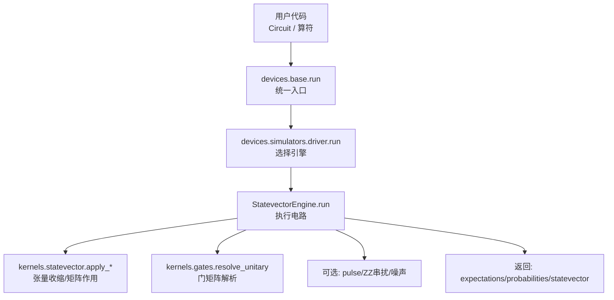
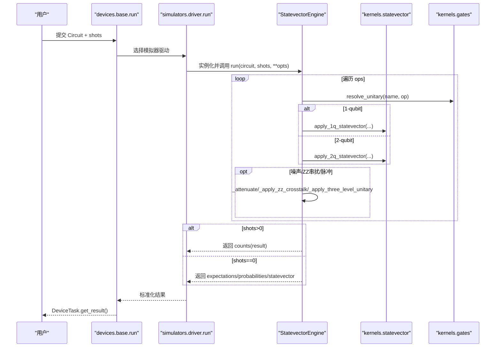
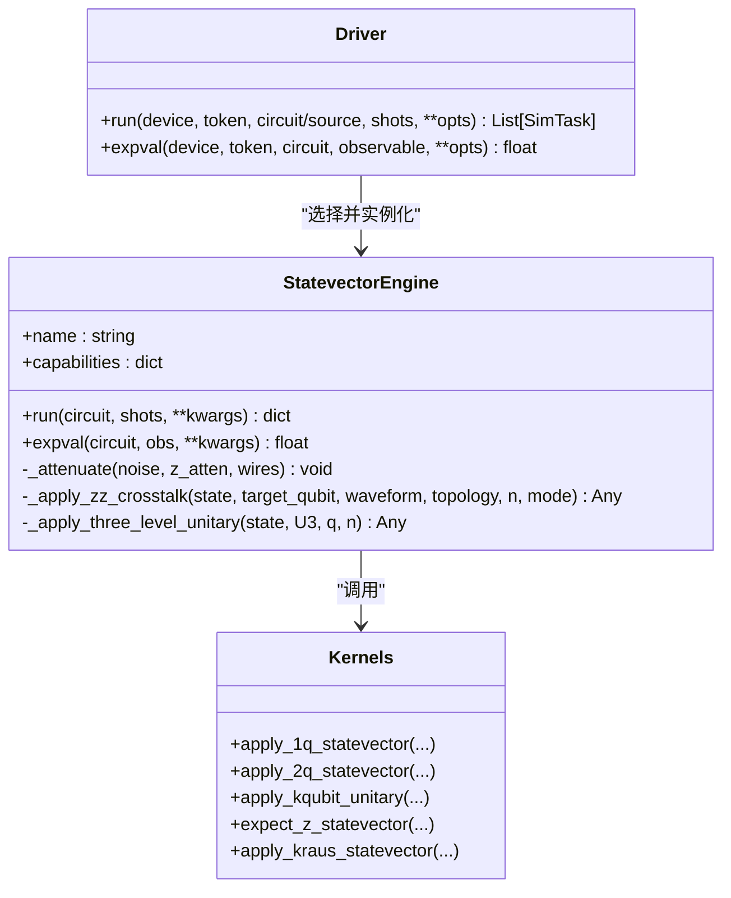

# 状态向量模拟器

<cite>
**本文引用的文件**
- [engine.py](file://src/tyxonq/devices/simulators/statevector/engine.py)
- [__init__.py](file://src/tyxonq/devices/simulators/statevector/__init__.py)
- [driver.py](file://src/tyxonq/devices/simulators/driver.py)
- [base.py](file://src/tyxonq/devices/base.py)
- [statevector.py](file://src/tyxonq/libs/quantum_library/kernels/statevector.py)
- [test_statevector_engine_probs.py](file://tests_core_module/test_statevector_engine_probs.py)
- [vqe_memory_scaling_demo.py](file://examples/vqe_memory_scaling_demo.py)
</cite>

## 目录
1. [简介](#简介)
2. [项目结构](#项目结构)
3. [核心组件](#核心组件)
4. [架构总览](#架构总览)
5. [详细组件分析](#详细组件分析)
6. [依赖关系分析](#依赖关系分析)
7. [性能与内存特性](#性能与内存特性)
8. [使用示例与API参考](#使用示例与api参考)
9. [故障排除指南](#故障排除指南)
10. [与其他模拟器的对比](#与其他模拟器的对比)
11. [结论](#结论)

## 简介
本文件面向TyxonQ的状态向量（Statevector）模拟器，系统性说明 StatevectorEngine 的实现原理、配置参数与使用方法；解释状态向量的数学表示、内存占用与性能特点；提供完整的使用流程（基本电路执行、期望值计算、概率分布获取等），并给出适用场景、优化技巧与故障排除方法。同时对比其他模拟器类型，帮助用户选择合适的仿真后端。

## 项目结构
状态向量模拟器位于设备层“simulators”子系统中，由驱动层统一调度，底层数值内核来自量子库的 statevector kernels。

图表来源
- [driver.py:86-141](file://src/tyxonq/devices/simulators/driver.py#L86-L141)
- [engine.py:46-451](file://src/tyxonq/devices/simulators/statevector/engine.py#L46-L451)
- [statevector.py:28-129](file://src/tyxonq/libs/quantum_library/kernels/statevector.py#L28-L129)

章节来源
- [driver.py:20-38](file://src/tyxonq/devices/simulators/driver.py#L20-L38)
- [base.py:294-445](file://src/tyxonq/devices/base.py#L294-L445)

## 核心组件
- StatevectorEngine：状态向量仿真引擎，负责按顺序对态矢量施加幺正门、测量、投影、重置、Kraus通道、脉冲演化等，并输出期望值、概率分布或采样计数。
- Driver：模拟器驱动，负责将设备名映射到具体引擎，封装任务对象，统一结果格式。
- Kernels：底层数值内核，提供高效的一比特/两比特/多比特幺正作用、Z期望值计算、Kraus通道随机轨迹等。

章节来源
- [engine.py:38-451](file://src/tyxonq/devices/simulators/statevector/engine.py#L38-L451)
- [driver.py:20-38](file://src/tyxonq/devices/simulators/driver.py#L20-L38)
- [statevector.py:19-219](file://src/tyxonq/libs/quantum_library/kernels/statevector.py#L19-L219)

## 架构总览
状态向量模拟器的执行路径如下：
- 上层通过 devices.base.run 统一入口提交任务，自动注入噪声开关与默认配置。
- 模拟器驱动根据设备名选择 StatevectorEngine。
- Engine.run 遍历电路操作，调用 gates.resolve_unitary 解析门矩阵，再调用 statevector 内核进行张量收缩式作用。
- 支持 shots=0 的解析模式（返回精确期望值与概率分布）与 shots>0 的采样模式（基于概率分布抽样）。
- 支持可选噪声（退极化衰减、读出误差混合）、ZZ串扰（局部近似或全局精确）、三能级泄漏建模（实验性）。

图表来源
- [base.py:294-445](file://src/tyxonq/devices/base.py#L294-L445)
- [driver.py:86-141](file://src/tyxonq/devices/simulators/driver.py#L86-L141)
- [engine.py:46-451](file://src/tyxonq/devices/simulators/statevector/engine.py#L46-L451)
- [statevector.py:28-129](file://src/tyxonq/libs/quantum_library/kernels/statevector.py#L28-L129)

## 详细组件分析

### StatevectorEngine 实现要点
- 初始化：可插拔数值后端（numpy/pytorch/cupynumeric），通过 get_backend 获取。
- 运行主循环：
  - 统一初态：优先使用 circuit._initial_state，否则 init_statevector(0...0)。
  - 门分发：全部幺正门经 resolve_unitary 解析为 (arity, qubits, matrix)，再用 apply_1q/apply_2q 内核作用。
  - 特殊操作：measure_z、barrier、project_z、reset、unitary（自定义幺正缓存）、kraus（随机轨迹）、pulse/pulse_inline（含三能级泄漏模型与ZZ串扰）。
  - 未知op严格报错，避免静默丢弃导致错误。
- 输出：
  - shots>0：按概率分布抽样得到 counts，支持读出误差混合与去极化噪声混合。
  - shots==0：返回精确期望值（Z基测量）、概率分布、当前态矢量及元数据。
- 辅助：
  - _attenuate：退极化噪声对Z期望值的衰减。
  - _apply_zz_crosstalk：两种模式——局部近似（local）与全局精确（global）。
  - _apply_three_level_unitary：三能级系统扩展（实验性）。

章节来源
- [engine.py:42-451](file://src/tyxonq/devices/simulators/statevector/engine.py#L42-L451)
- [engine.py:466-800](file://src/tyxonq/devices/simulators/statevector/engine.py#L466-L800)

### 数值内核（kernels.statevector）
- init_statevector：构造 |0...0⟩ 初始态。
- apply_1q_statevector：用einsum做单比特张量收缩，保持梯度链。
- apply_2q_statevector：双比特张量收缩，处理任意比特对。
- expect_z_statevector：按目标比特求Z期望值。
- apply_kqubit_unitary：通用k比特幺正作用，通过轴置换+矩阵乘法高效实现。
- apply_kraus_statevector：随机轨迹法应用Kraus通道，归一化保证保真度。

章节来源
- [statevector.py:19-219](file://src/tyxonq/libs/quantum_library/kernels/statevector.py#L19-L219)

### 驱动与统一接口
- driver.run：选择引擎、包装SimTask、标准化结果（counts/expectations/probabilities/statevector/metadata）。
- base.run：统一入口，注入噪声配置，处理shots=0的解析路径，批量电路支持。

章节来源
- [driver.py:86-169](file://src/tyxonq/devices/simulators/driver.py#L86-L169)
- [base.py:294-470](file://src/tyxonq/devices/base.py#L294-L470)

## 依赖关系分析
- StatevectorEngine 依赖：
  - gates.resolve_unitary：权威门表，确保run()/state()一致性。
  - statevector内核：高效张量运算。
  - 可选：three-level system、pulse_simulation、noise模块用于高级功能。
- 驱动层依赖：
  - 设备名到引擎映射（statevector/mps/density_matrix）。
  - QASM导入（原生QASM3或Qiskit QASM2）。
- 设备抽象：
  - DeviceProtocol 定义 run/expval 接口。
  - DeviceTask 统一任务结果格式。

图表来源
- [engine.py:38-451](file://src/tyxonq/devices/simulators/statevector/engine.py#L38-L451)
- [driver.py:86-169](file://src/tyxonq/devices/simulators/driver.py#L86-L169)
- [statevector.py:28-219](file://src/tyxonq/libs/quantum_library/kernels/statevector.py#L28-L219)

章节来源
- [engine.py:38-451](file://src/tyxonq/devices/simulators/statevector/engine.py#L38-L451)
- [driver.py:20-38](file://src/tyxonq/devices/simulators/driver.py#L20-L38)
- [statevector.py:19-219](file://src/tyxonq/libs/quantum_library/kernels/statevector.py#L19-L219)

## 性能与内存特性
- 内存复杂度：O(2^n)，n为量子比特数。每个复数占16字节（complex128），因此：
  - 20比特约16MB，适合笔记本；
  - 24比特约256MB，工作站可行；
  - 28比特约4GB，需服务器；
  - 32比特约64GB，多数系统不可行。
- 时间复杂度：每门作用在态矢量上约为 O(2^n)（单比特）或 O(2^n)（双比特通过张量收缩），总体 ~O(poly(gates)*2^n)。
- 优化点：
  - 使用einsum/轴置换的高效张量收缩，避免显式构建大矩阵。
  - 共享门矩阵解析（resolve_unitary），减少重复计算。
  - 支持shots=0解析路径直接返回期望值与概率，无需采样开销。
  - 可选噪声与串扰按需启用，避免无谓计算。
- 限制：
  - 大系统（>~30比特）内存瓶颈明显，建议改用MPS或密度矩阵（视需求）。
  - 三能级与全局ZZ串扰模式计算昂贵，仅适用于小规模高精度验证。

章节来源
- [vqe_memory_scaling_demo.py:111-143](file://examples/vqe_memory_scaling_demo.py#L111-L143)
- [engine.py:3-10](file://src/tyxonq/devices/simulators/statevector/engine.py#L3-L10)
- [statevector.py:28-129](file://src/tyxonq/libs/quantum_library/kernels/statevector.py#L28-L129)

## 使用示例与API参考

### 创建与运行状态向量模拟器
- 通过 devices.base.run 指定 provider="simulator", device="statevector"，传入 Circuit 与 shots。
- 或通过 devices.simulators.driver.run 直接调用模拟器驱动。
- 返回 DeviceTask/SimTask，调用 get_result() 获取结果。

章节来源
- [base.py:294-445](file://src/tyxonq/devices/base.py#L294-L445)
- [driver.py:86-141](file://src/tyxonq/devices/simulators/driver.py#L86-L141)

### 基本电路执行
- 构造 Circuit，添加门操作（如H、X、Y、Z、Rx、Ry、Rz、CX、CZ、CRY等）。
- 调用 run(shots=0) 获取精确期望值与概率分布；或 shots>0 获取采样计数。

章节来源
- [test_statevector_engine_probs.py:7-27](file://tests_core_module/test_statevector_engine_probs.py#L7-L27)

### 期望值计算
- 使用 engine.expval(circuit, observable) 计算解析期望值（需安装 openfermion）。
- 或通过 measure_z 收集 Z 期望值（shots=0 时直接返回）。

章节来源
- [engine.py:453-462](file://src/tyxonq/devices/simulators/statevector/engine.py#L453-L462)
- [engine.py:435-451](file://src/tyxonq/devices/simulators/statevector/engine.py#L435-L451)

### 概率分布与振幅
- shots=0 时返回 probabilities 数组（维度 2^n）。
- 可通过 amplitude 或概率分布访问特定基矢的概率幅。

章节来源
- [engine.py:441-451](file://src/tyxonq/devices/simulators/statevector/engine.py#L441-L451)
- [test_statevector_engine_probs.py:19-27](file://tests_core_module/test_statevector_engine_probs.py#L19-L27)

### 噪声与串扰
- 噪声：use_noise=True 配合 noise={"type":"depolarizing","p":...} 或 {"type":"readout",...}。
- ZZ串扰：zz_topology 与 zz_mode="local"/"global"。
- 三能级泄漏：three_level=True，结合 pulse/pulse_inline。

章节来源
- [engine.py:56-118](file://src/tyxonq/devices/simulators/statevector/engine.py#L56-L118)
- [engine.py:192-203](file://src/tyxonq/devices/simulators/statevector/engine.py#L192-L203)
- [engine.py:205-334](file://src/tyxonq/devices/simulators/statevector/engine.py#L205-L334)
- [engine.py:357-383](file://src/tyxonq/devices/simulators/statevector/engine.py#L357-L383)

### 最佳实践
- 小系统（≤24比特）优先使用状态向量以获得精确结果。
- 需要梯度优化时，选择PyTorch后端以启用自动微分。
- 大规模系统考虑MPS或密度矩阵模拟器，或采用观测算符分解/切片技术。

章节来源
- [vqe_memory_scaling_demo.py:111-143](file://examples/vqe_memory_scaling_demo.py#L111-L143)

## 故障排除指南
- 未知门操作报错：若遇到不支持的门，会抛出 ValueError，检查 gates.resolve_unitary 是否覆盖该门。
- 静默跳过问题：旧版本可能存在分支缺失导致门被忽略，现已严格报错，升级后应可见明确错误。
- 噪声参数无效：确认 use_noise=True 且 noise 字典键正确（type、p、cals等）。
- ZZ串扰模式错误：zz_mode 必须为 "local" 或 "global"。
- 三能级模拟限制：多比特下仅脉冲比特具有三能级动力学，其余比特近似投影。

章节来源
- [engine.py:335-342](file://src/tyxonq/devices/simulators/statevector/engine.py#L335-L342)
- [engine.py:604-605](file://src/tyxonq/devices/simulators/statevector/engine.py#L604-L605)
- [engine.py:147-154](file://src/tyxonq/devices/simulators/statevector/engine.py#L147-L154)

## 与其他模拟器的对比
- 状态向量（Statevector）：
  - 优点：精确、支持任意幺正、可获取完整态矢量与概率分布。
  - 缺点：内存 O(2^n)，规模受限。
- 密度矩阵（DensityMatrix）：
  - 优点：支持混合态与噪声信道精确演化。
  - 缺点：内存 O(4^n)，规模更小。
- 矩阵乘积态（MPS）：
  - 优点：对低纠缠态高效，可扩展至更大比特数。
  - 缺点：高纠缠态精度受限，需截断。

选择建议：
- 算法开发与小规模验证：优先状态向量。
- 噪声与混合态研究：密度矩阵更合适。
- 大规模低纠缠系统：MPS更高效。

章节来源
- [driver.py:20-38](file://src/tyxonq/devices/simulators/driver.py#L20-L38)
- [base.py:483-493](file://src/tyxonq/devices/base.py#L483-L493)

## 结论
TyxonQ的状态向量模拟器提供了高性能、精确的量子态演化能力，适用于中小规模量子电路的仿真与算法开发。其核心优势在于统一的门解析、高效的张量内核、灵活的噪声与串扰建模，以及完整的解析与采样输出。对于大规模系统，建议结合MPS或密度矩阵方案，并根据问题特征选择最合适的模拟器。