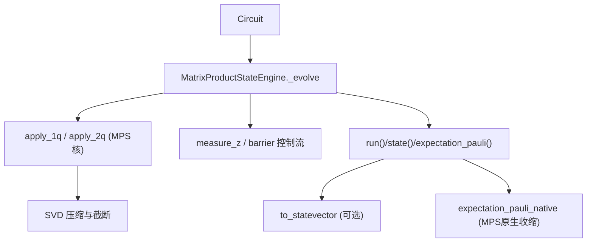
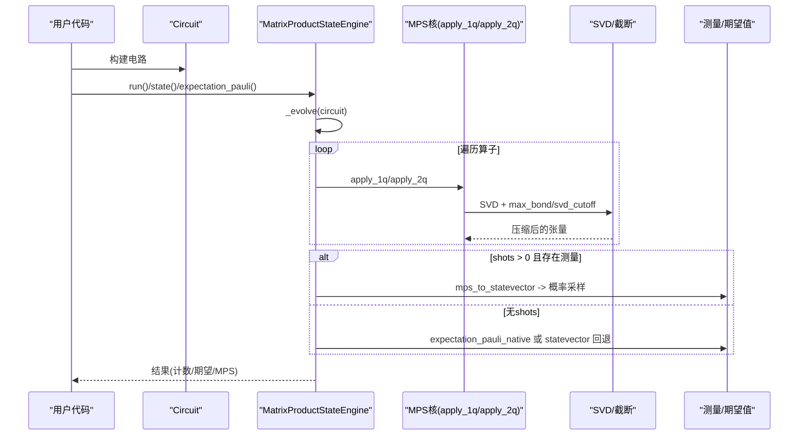
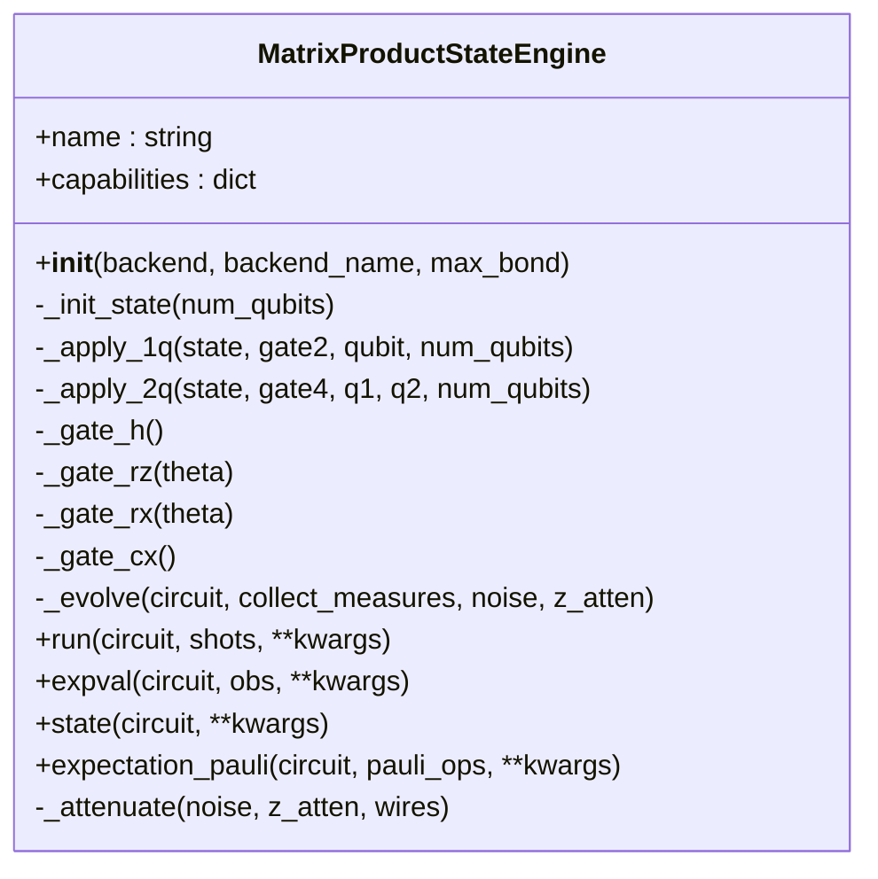
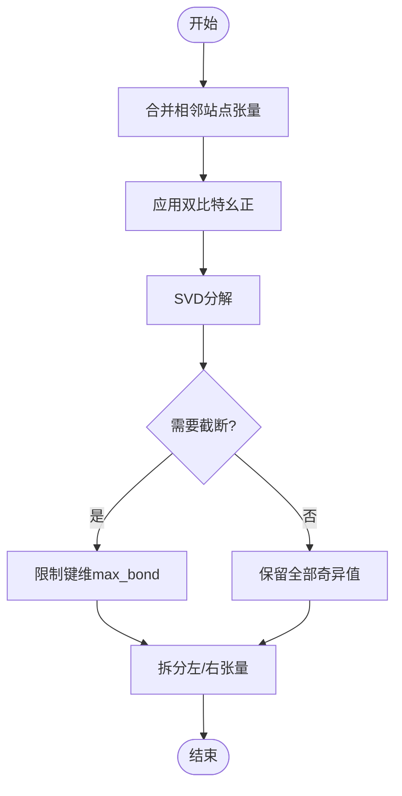
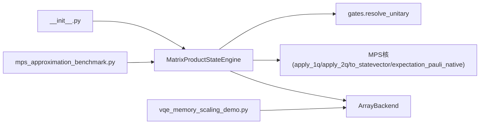

# 矩阵乘积态模拟器

<cite>
**本文引用的文件**
- [engine.py](file://src/tyxonq/devices/simulators/matrix_product_state/engine.py)
- [matrix_product_state.py](file://src/tyxonq/libs/quantum_library/kernels/matrix_product_state.py)
- [__init__.py](file://src/tyxonq/devices/simulators/matrix_product_state/__init__.py)
- [mps_approximation_benchmark.py](file://examples/mps_approximation_benchmark.py)
- [vqe_memory_scaling_demo.py](file://examples/vqe_memory_scaling_demo.py)
</cite>

## 目录
1. [简介](#简介)
2. [项目结构](#项目结构)
3. [核心组件](#核心组件)
4. [架构总览](#架构总览)
5. [详细组件分析](#详细组件分析)
6. [依赖关系分析](#依赖关系分析)
7. [性能考量](#性能考量)
8. [故障排查指南](#故障排查指南)
9. [结论](#结论)
10. [附录：参数调优与基准测试](#附录参数调优与基准测试)

## 简介
本文件为 TyxonQ 的矩阵乘积态（MPS）模拟器提供完整 API 文档，聚焦 MatrixProductStateEngine 的实现原理、张量网络算法与压缩表示方法。内容涵盖 MPS 格式的优势、纠缠熵控制与截断策略、大规模量子系统处理、MPS 参数设置与性能优化，以及适用条件与精度控制建议。通过示例与流程图帮助读者评估 MPS 模拟器是否适合解决特定问题。

## 项目结构
TyxonQ 将 MPS 模拟能力拆分为“设备引擎”和“底层核函数”两层：
- 设备引擎层：MatrixProductStateEngine 负责电路演化、门分发、测量与期望值计算，统一入口为 _evolve。
- 核函数层：matrix_product_state.py 提供 MPSState、apply_1q、apply_2q、to_statevector、expectation_pauli_native 等核心张量网络操作。
- 模块导出：__init__.py 暴露 MatrixProductStateEngine 供上层使用。
- 示例：mps_approximation_benchmark.py 展示 MPS 近似质量与键维度的关系；vqe_memory_scaling_demo.py 对比不同规模下的内存需求。

图表来源
- [engine.py:74-135](file://src/tyxonq/devices/simulators/matrix_product_state/engine.py#L74-L135)
- [matrix_product_state.py:63-149](file://src/tyxonq/libs/quantum_library/kernels/matrix_product_state.py#L63-L149)
- [matrix_product_state.py:176-202](file://src/tyxonq/libs/quantum_library/kernels/matrix_product_state.py#L176-L202)
- [matrix_product_state.py:204-224](file://src/tyxonq/libs/quantum_library/kernels/matrix_product_state.py#L204-L224)
- [matrix_product_state.py:236-316](file://src/tyxonq/libs/quantum_library/kernels/matrix_product_state.py#L236-L316)

章节来源
- [engine.py:39-319](file://src/tyxonq/devices/simulators/matrix_product_state/engine.py#L39-L319)
- [matrix_product_state.py:36-318](file://src/tyxonq/libs/quantum_library/kernels/matrix_product_state.py#L36-L318)
- [__init__.py:1-6](file://src/tyxonq/devices/simulators/matrix_product_state/__init__.py#L1-L6)

## 核心组件
- MatrixProductStateEngine：封装 MPS 模拟器的运行接口，包括 run、state、expval、expectation_pauli 等方法，统一通过 _evolve 进行算子分发。
- MPSState：保存每个位点的张量，形状为 (Dl, 2, Dr)，其中 Dl、Dr 为左右键维度。
- apply_1q / apply_2q：对 MPS 施加单比特或双比特幺正门；非相邻双比特门通过 SWAP 路由实现。
- to_statevector：将 MPS 重构为全态矢量（仅用于小系统验证）。
- expectation_pauli_native：在 MPS 上直接计算 Pauli 算符期望值，避免全态矢重构，保持 O(nχ³) 复杂度。

章节来源
- [engine.py:39-319](file://src/tyxonq/devices/simulators/matrix_product_state/engine.py#L39-L319)
- [matrix_product_state.py:36-318](file://src/tyxonq/libs/quantum_library/kernels/matrix_product_state.py#L36-L318)

## 架构总览
下图展示了从 Circuit 到 MPS 演化的关键路径，包括门解析、应用、噪声衰减、测量与期望值计算。

图表来源
- [engine.py:74-218](file://src/tyxonq/devices/simulators/matrix_product_state/engine.py#L74-L218)
- [matrix_product_state.py:102-149](file://src/tyxonq/libs/quantum_library/kernels/matrix_product_state.py#L102-L149)
- [matrix_product_state.py:176-202](file://src/tyxonq/libs/quantum_library/kernels/matrix_product_state.py#L176-L202)
- [matrix_product_state.py:204-224](file://src/tyxonq/libs/quantum_library/kernels/matrix_product_state.py#L204-L224)
- [matrix_product_state.py:236-316](file://src/tyxonq/libs/quantum_library/kernels/matrix_product_state.py#L236-L316)

## 详细组件分析

### MatrixProductStateEngine 类
- 初始化：接受 ArrayBackend、backend_name 与可选 max_bond（硬上限键维）。
- _init_state：构造 |0...0> 或 |1...1> 的 MPS 初始态。
- _apply_1q/_apply_2q：调用 MPS 核函数原地更新张量；_apply_2q 支持非相邻 qubit 的 SWAP 路由。
- _gate_*：返回权威门表中的幺正矩阵（H、RZ、RX、CX 等）。
- _evolve：唯一算子分发循环，解析幺正门并应用；measure_z/barrier 作为控制算子；不支持的特殊算子（unitary/kraus/project_z/reset/pulse/pulse_inline）与未知算子会抛出异常，避免静默丢弃。
- run：若请求 shots 且有测量，则重建态矢并采样计数；否则返回期望值、概率分布、MPS 与态矢（小系统）。
- expval：通过 openfermion 稀疏算符与态矢计算期望值（需安装 openfermion）。
- state：直接返回 MPS 对象，不重建态矢，保持 O(nχ) 内存。
- expectation_pauli：优先使用 MPS 原生收缩（use_native=True 或 n>15），否则回退到态矢路径。
- _attenuate：实现 depolarizing 噪声的 Z 衰减因子累积。

图表来源
- [engine.py:39-319](file://src/tyxonq/devices/simulators/matrix_product_state/engine.py#L39-L319)

章节来源
- [engine.py:39-319](file://src/tyxonq/devices/simulators/matrix_product_state/engine.py#L39-L319)

### MPS 核函数与张量网络算法
- MPSState：容器，包含 site tensors 列表，每个张量形状 (Dl, 2, Dr)。
- init_product_state：生成单位键维的直积态 MPS。
- apply_1q：在指定位点原位应用单比特幺正。
- apply_2q_nn：最近邻双比特幺正应用，合并两站点张量后做 SVD 并压缩。
- apply_swap_nn：SWAP 门实现（基于 apply_2q_nn）。
- apply_2q：通用双比特幺正，若非相邻则通过 SWAP 路由至相邻位置再应用。
- to_statevector：按顺序收缩张量得到全态矢（指数复杂度，仅用于小系统验证）。
- bond_dims：查询各站点的左右键维度。
- expectation_pauli_native：在 MPS 上直接计算 Pauli 期望值，避免全态矢重构，复杂度 O(nχ³)。

图表来源
- [matrix_product_state.py:102-149](file://src/tyxonq/libs/quantum_library/kernels/matrix_product_state.py#L102-L149)
- [matrix_product_state.py:73-99](file://src/tyxonq/libs/quantum_library/kernels/matrix_product_state.py#L73-L99)

章节来源
- [matrix_product_state.py:36-318](file://src/tyxonq/libs/quantum_library/kernels/matrix_product_state.py#L36-L318)

### 使用示例与最佳实践
- 配置 MPS 后端与键维：通过 Circuit.device(provider="simulator", device="matrix_product_state", max_bond=...) 设置。
- 低纠缠态高效模拟：对于一维短程相互作用或浅层变分电路，较小键维即可达到高精度。
- 大系统期望值：优先使用 expectation_pauli(use_native=True) 或默认自动选择 native 路径，避免态矢重构。
- 噪声与衰减：可通过 use_noise 与噪声参数启用 depolarizing 噪声，引擎内部以 Z 衰减因子累积影响测量期望。

章节来源
- [mps_approximation_benchmark.py:43-84](file://examples/mps_approximation_benchmark.py#L43-L84)
- [mps_approximation_benchmark.py:111-179](file://examples/mps_approximation_benchmark.py#L111-L179)
- [engine.py:137-218](file://src/tyxonq/devices/simulators/matrix_product_state/engine.py#L137-L218)

## 依赖关系分析
- 引擎依赖：
  - 门矩阵与权威 op 词汇表 resolve_unitary（来自 gates 内核）。
  - MPS 核函数（apply_1q、apply_2q、to_statevector、expectation_pauli_native）。
  - ArrayBackend（数值后端抽象）。
- 模块导出：
  - __init__.py 暴露 MatrixProductStateEngine。
- 示例依赖：
  - mps_approximation_benchmark.py 演示 MPS 近似质量与键维的关系。
  - vqe_memory_scaling_demo.py 展示不同系统规模的内存需求与对比。

图表来源
- [engine.py:18-33](file://src/tyxonq/devices/simulators/matrix_product_state/engine.py#L18-L33)
- [matrix_product_state.py:1-30](file://src/tyxonq/libs/quantum_library/kernels/matrix_product_state.py#L1-L30)
- [__init__.py:1-6](file://src/tyxonq/devices/simulators/matrix_product_state/__init__.py#L1-L6)
- [mps_approximation_benchmark.py:1-184](file://examples/mps_approximation_benchmark.py#L1-L184)
- [vqe_memory_scaling_demo.py:1-288](file://examples/vqe_memory_scaling_demo.py#L1-L288)

章节来源
- [engine.py:18-33](file://src/tyxonq/devices/simulators/matrix_product_state/engine.py#L18-L33)
- [matrix_product_state.py:1-30](file://src/tyxonq/libs/quantum_library/kernels/matrix_product_state.py#L1-L30)
- [__init__.py:1-6](file://src/tyxonq/devices/simulators/matrix_product_state/__init__.py#L1-L6)

## 性能考量
- 内存与时间复杂度：
  - MPS 存储复杂度 O(nχ)，其中 χ 为最大键维；时间复杂度随键维增长而增加，典型操作 O(nχ³)。
  - 当纠缠较低时，较小 χ 即可保持高精度；高纠缠态需增大 χ，但内存与计算成本上升。
- 截断策略：
  - 硬上限 max_bond：强制限制键维，防止内存爆炸。
  - 奇异值阈值 svd_cutoff：按绝对阈值裁剪奇异值，进一步压缩。
- 期望值计算：
  - 优先使用 expectation_pauli_native 在 MPS 上直接收缩，避免态矢重构带来的指数开销。
- 噪声影响：
  - depolarizing 噪声通过 Z 衰减因子累积，影响测量期望值；可在 run 中通过 use_noise 开关控制。

[本节为一般性指导，不直接分析具体文件]

## 故障排查指南
- 不支持的算子：
  - MPS 引擎不支持 unitary/kraus/project_z/reset/pulse/pulse_inline 等特殊算子；遇到这些算子会抛出异常，应改用 statevector 或 density_matrix 引擎。
- 未知算子：
  - 未知名称的算子会抛出 ValueError，确保使用的算子在权威门表中定义。
- 依赖缺失：
  - expval 方法依赖 openfermion；未安装时会抛出 ImportError。
- 噪声参数：
  - 使用 use_noise 时需正确传入噪声类型与参数（如 type="depolarizing", p=...），否则可能无效或导致数值异常。

章节来源
- [engine.py:121-134](file://src/tyxonq/devices/simulators/matrix_product_state/engine.py#L121-L134)
- [engine.py:220-233](file://src/tyxonq/devices/simulators/matrix_product_state/engine.py#L220-L233)

## 结论
TyxonQ 的 MPS 模拟器通过 MatrixProductStateEngine 提供了高效的低纠缠态模拟能力，结合 MPS 核函数的张量网络操作与灵活的截断策略，能够在较大系统中保持可接受的内存与计算开销。对于一维短程相互作用或浅层变分电路，MPS 是首选方案；对于高度纠缠态，需权衡键维与精度。通过 expectation_pauli_native 与合理的噪声模型，用户可以在保证精度的同时优化性能。

[本节为总结性内容，不直接分析具体文件]

## 附录：参数调优与基准测试
- 键维选择：
  - 从小键维（如 2、5、10、20）开始，逐步增大直至收敛；观察能量相对误差与保真度。
- 噪声模型：
  - 使用 depolarizing 噪声时，合理设置 p 值；注意其对期望值的衰减效应。
- 基准测试参考：
  - mps_approximation_benchmark.py 展示了不同键维下 TFI 模型能量的近似质量与保真度变化。
  - vqe_memory_scaling_demo.py 对比了不同系统规模的内存需求，帮助评估 MPS 的适用场景。

章节来源
- [mps_approximation_benchmark.py:111-179](file://examples/mps_approximation_benchmark.py#L111-L179)
- [vqe_memory_scaling_demo.py:111-143](file://examples/vqe_memory_scaling_demo.py#L111-L143)