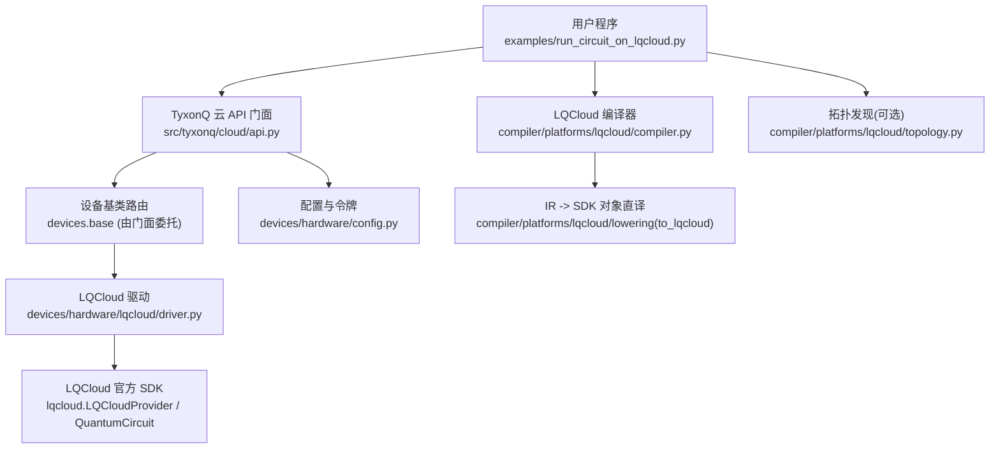
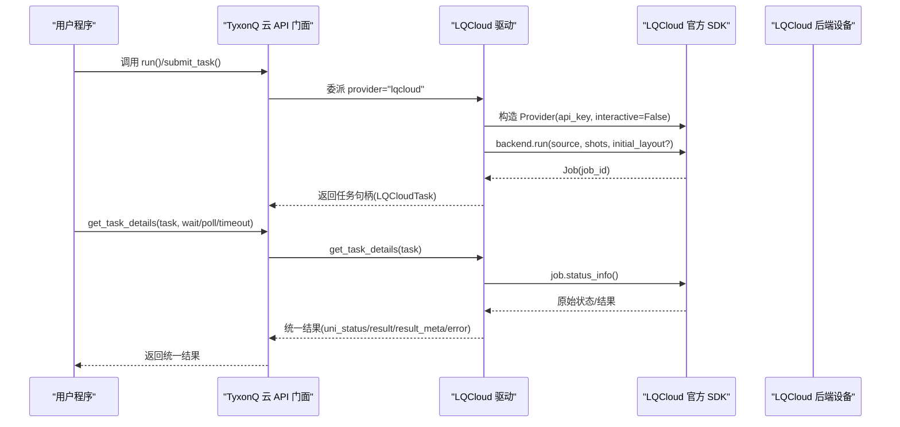
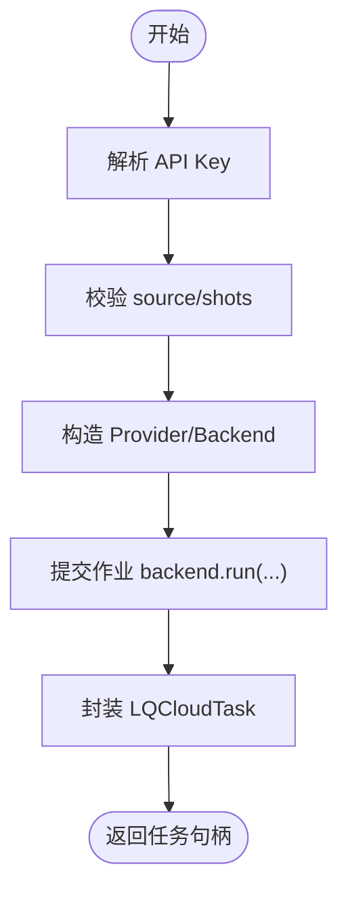
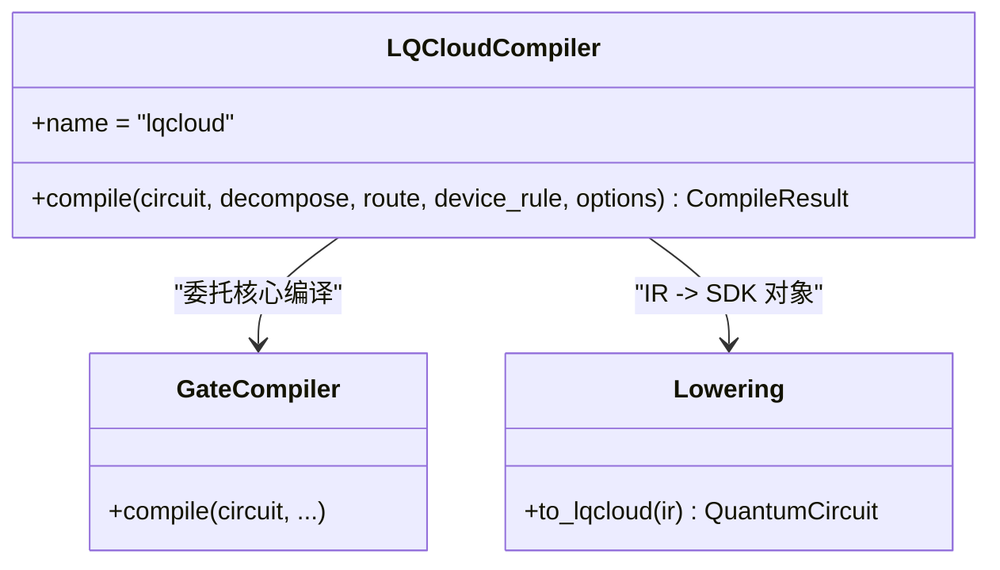
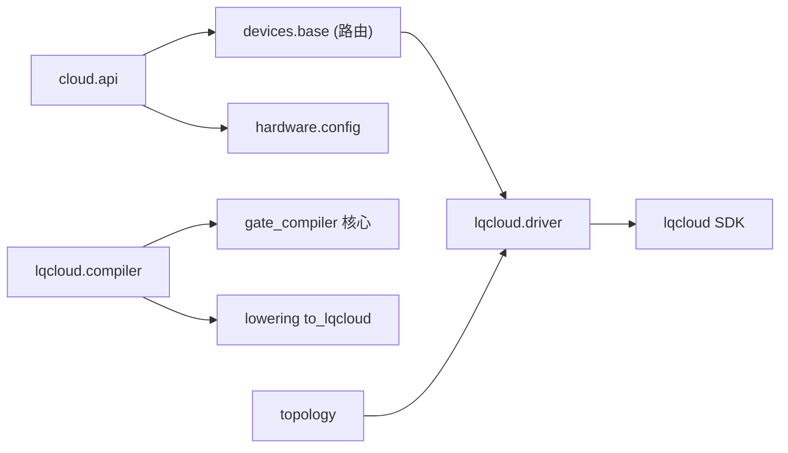

# LQCloud云平台驱动

<cite>
**本文引用的文件**
- [src/tyxonq/devices/hardware/lqcloud/driver.py](file://src/tyxonq/devices/hardware/lqcloud/driver.py)
- [src/tyxonq/compiler/platforms/lqcloud/__init__.py](file://src/tyxonq/compiler/platforms/lqcloud/__init__.py)
- [src/tyxonq/compiler/platforms/lqcloud/compiler.py](file://src/tyxonq/compiler/platforms/lqcloud/compiler.py)
- [src/tyxonq/compiler/platforms/lqcloud/topology.py](file://src/tyxonq/compiler/platforms/lqcloud/topology.py)
- [src/tyxonq/cloud/api.py](file://src/tyxonq/cloud/api.py)
- [src/tyxonq/devices/hardware/config.py](file://src/tyxonq/devices/hardware/config.py)
- [examples/run_circuit_on_lqcloud.py](file://examples/run_circuit_on_lqcloud.py)
- [examples/cloud_api_task.py](file://examples/cloud_api_task.py)
- [docs/tyxonq_cloud_api.md](file://docs/tyxonq_cloud_api.md)
- [src/tyxonq/core/errors.py](file://src/tyxonq/core/errors.py)
</cite>

## 目录
1. [简介](#简介)
2. [项目结构](#项目结构)
3. [核心组件](#核心组件)
4. [架构总览](#架构总览)
5. [详细组件分析](#详细组件分析)
6. [依赖关系分析](#依赖关系分析)
7. [性能考虑](#性能考虑)
8. [故障排除指南](#故障排除指南)
9. [结论](#结论)
10. [附录：配置与使用示例](#附录配置与使用示例)

## 简介
本文件为 TyxonQ 框架中 LQCloud 云平台驱动的 API 文档，聚焦以下目标：
- 接入方式与认证流程：说明如何通过环境变量、运行时 token 或显式参数设置 LQCloud API Key。
- 任务提交与执行管理：从电路构建、编译到提交任务、轮询状态、获取结果的全链路说明。
- 设备发现、任务调度、结果获取与错误处理机制：解释如何列出可用设备、查询任务详情、取消任务以及统一错误语义。
- 使用示例：提供连接平台、提交量子计算任务并获取结果的端到端示例路径。
- 配置指南、故障排除与性能优化建议：覆盖常见问题的定位方法与运行优化策略。

## 项目结构
LQCloud 相关代码主要分布在以下模块：
- 设备驱动层：负责与 LQCloud 官方 SDK 交互（提交任务、查询状态、取消任务、列出设备）。
- 编译器层：将 TyxonQ IR 编译为目标平台的 QuantumCircuit 对象，供驱动直接提交。
- 云 API 门面：统一的云端调用入口，屏蔽底层 provider 差异。
- 配置中心：集中管理 token、默认 provider/device、端点等。
- 示例脚本：演示离线转换与在线提交的完整流程。

图表来源
- [src/tyxonq/devices/hardware/lqcloud/driver.py:56-92](file://src/tyxonq/devices/hardware/lqcloud/driver.py#L56-L92)
- [src/tyxonq/compiler/platforms/lqcloud/compiler.py:50-109](file://src/tyxonq/compiler/platforms/lqcloud/compiler.py#L50-L109)
- [src/tyxonq/cloud/api.py:42-64](file://src/tyxonq/cloud/api.py#L42-L64)
- [src/tyxonq/devices/hardware/config.py:24-50](file://src/tyxonq/devices/hardware/config.py#L24-L50)

章节来源
- [src/tyxonq/devices/hardware/lqcloud/driver.py:1-223](file://src/tyxonq/devices/hardware/lqcloud/driver.py#L1-L223)
- [src/tyxonq/compiler/platforms/lqcloud/compiler.py:1-113](file://src/tyxonq/compiler/platforms/lqcloud/compiler.py#L1-L113)
- [src/tyxonq/cloud/api.py:1-160](file://src/tyxonq/cloud/api.py#L1-L160)
- [src/tyxonq/devices/hardware/config.py:1-78](file://src/tyxonq/devices/hardware/config.py#L1-L78)

## 核心组件
- LQCloud 驱动（driver）
  - 提交任务：run(device, source, shots, **opts)
  - 查询任务详情：get_task_details(task, token)
  - 取消任务：remove_task(task, token)
  - 设备发现：list_devices(token, **kws)
  - 内部工具：_resolve_api_key、_map_status、_decode_result
- LQCloud 编译器（compiler）
  - 将 TyxonQ Circuit 编译为 lqcloud.QuantumCircuit 对象（先经 gate_compiler 核心做分解与路由，再直译）
  - 输出元数据包含门统计、步骤序列等
- 云 API 门面（cloud.api）
  - set_token、set_default、device、list_devices、submit_task、get_task_details、run、result、cancel
- 配置（hardware.config）
  - set_token/get_token、set_default、ENDPOINTS、默认 provider/device

章节来源
- [src/tyxonq/devices/hardware/lqcloud/driver.py:24-43](file://src/tyxonq/devices/hardware/lqcloud/driver.py#L24-L43)
- [src/tyxonq/devices/hardware/lqcloud/driver.py:56-92](file://src/tyxonq/devices/hardware/lqcloud/driver.py#L56-L92)
- [src/tyxonq/devices/hardware/lqcloud/driver.py:119-187](file://src/tyxonq/devices/hardware/lqcloud/driver.py#L119-L187)
- [src/tyxonq/devices/hardware/lqcloud/driver.py:190-213](file://src/tyxonq/devices/hardware/lqcloud/driver.py#L190-L213)
- [src/tyxonq/compiler/platforms/lqcloud/compiler.py:50-109](file://src/tyxonq/compiler/platforms/lqcloud/compiler.py#L50-L109)
- [src/tyxonq/cloud/api.py:22-72](file://src/tyxonq/cloud/api.py#L22-L72)
- [src/tyxonq/devices/hardware/config.py:24-50](file://src/tyxonq/devices/hardware/config.py#L24-L50)

## 架构总览
下图展示了从用户程序到 LQCloud 真机的完整调用链，包括编译、提交、状态轮询与结果归一化。

图表来源
- [src/tyxonq/cloud/api.py:42-72](file://src/tyxonq/cloud/api.py#L42-L72)
- [src/tyxonq/devices/hardware/lqcloud/driver.py:56-92](file://src/tyxonq/devices/hardware/lqcloud/driver.py#L56-L92)
- [src/tyxonq/devices/hardware/lqcloud/driver.py:119-187](file://src/tyxonq/devices/hardware/lqcloud/driver.py#L119-L187)

## 详细组件分析

### LQCloud 驱动（driver）
职责
- 解析 API Key：优先显式参数，其次内存 token，最后环境变量；严格拒绝回退到 TyxonQ 全局密钥。
- 提交任务：校验 source 类型与 shots，构造 Provider 与 Backend，提交作业并封装为 LQCloudTask。
- 查询详情：调用 status_info，映射状态至统一语义，解析 counts/probabilities，保留 raw 元数据。
- 取消任务：调用 job.cancel()。
- 设备发现：通过 provider.get_backends() 动态列出当前 key 可见的设备名，格式为 "lqcloud::name"。

关键行为与约束
- 首版仅支持单条线路与单个 shots 值。
- physical_qubits 作为运行期 initial_layout 透传，不进入编译产物。
- 状态映射：queued/pending/submitted/retrying → queued；running → running；completed/done/success/finished → completed；failed/error → failed；cancelled/canceled → cancelled；其他 → unknown。

图表来源
- [src/tyxonq/devices/hardware/lqcloud/driver.py:33-42](file://src/tyxonq/devices/hardware/lqcloud/driver.py#L33-L42)
- [src/tyxonq/devices/hardware/lqcloud/driver.py:56-92](file://src/tyxonq/devices/hardware/lqcloud/driver.py#L56-L92)

章节来源
- [src/tyxonq/devices/hardware/lqcloud/driver.py:24-43](file://src/tyxonq/devices/hardware/lqcloud/driver.py#L24-L43)
- [src/tyxonq/devices/hardware/lqcloud/driver.py:56-92](file://src/tyxonq/devices/hardware/lqcloud/driver.py#L56-L92)
- [src/tyxonq/devices/hardware/lqcloud/driver.py:95-116](file://src/tyxonq/devices/hardware/lqcloud/driver.py#L95-L116)
- [src/tyxonq/devices/hardware/lqcloud/driver.py:119-187](file://src/tyxonq/devices/hardware/lqcloud/driver.py#L119-L187)
- [src/tyxonq/devices/hardware/lqcloud/driver.py:190-213](file://src/tyxonq/devices/hardware/lqcloud/driver.py#L190-L213)

### LQCloud 编译器（compiler）
职责
- 将 TyxonQ Circuit 编译为 lqcloud.QuantumCircuit 对象。
- 先委托 gate_compiler 核心完成设备无关的分解（matchgate/rotations）与路由，再进行 1:1 直译。
- 输出元数据包含 num_qubits、gate_stats、core_steps、conversion 等信息。

注意
- physical_qubits 是运行期参数，不在编译期消费。
- 输出目标固定为 lqcloud 对象，不接受文本中间层。

图表来源
- [src/tyxonq/compiler/platforms/lqcloud/compiler.py:50-109](file://src/tyxonq/compiler/platforms/lqcloud/compiler.py#L50-L109)

章节来源
- [src/tyxonq/compiler/platforms/lqcloud/compiler.py:1-113](file://src/tyxonq/compiler/platforms/lqcloud/compiler.py#L1-L113)
- [src/tyxonq/compiler/platforms/lqcloud/__init__.py:1-12](file://src/tyxonq/compiler/platforms/lqcloud/__init__.py#L1-L12)

### 云 API 门面（cloud.api）
职责
- 统一入口：set_token、set_default、device、list_devices、submit_task、get_task_details、run、result、cancel。
- 对 LQCloud 的具体实现透明，内部委派 devices.base 与具体 driver。

典型用法
- 设置 token：tq.set_token(token, provider="lqcloud")
- 提交任务：api.submit_task(provider="lqcloud", device="...", source=..., shots=...)
- 查询详情：api.get_task_details(task, wait=True, poll_interval=..., timeout=...)

章节来源
- [src/tyxonq/cloud/api.py:22-72](file://src/tyxonq/cloud/api.py#L22-L72)
- [src/tyxonq/cloud/api.py:75-145](file://src/tyxonq/cloud/api.py#L75-L145)

### 配置与令牌（hardware.config）
职责
- 存储 provider/device 级别的 token，支持按 provider 和 device 维度读取。
- 提供默认 provider/device 与端点信息。

要点
- set_token 同时写入 device-scoped 与 provider-scoped 键。
- get_token 优先内存 token，其次可选的环境变量回退。

章节来源
- [src/tyxonq/devices/hardware/config.py:24-50](file://src/tyxonq/devices/hardware/config.py#L24-L50)
- [src/tyxonq/devices/hardware/config.py:53-65](file://src/tyxonq/devices/hardware/config.py#L53-L65)

### 拓扑发现（topology）
职责
- 抓取 LQCloud 设备拓扑（一次只读网络请求），返回归一化的 DeviceRule（provider、device、num_qubits、coupling_map、native_gates、status、raw）。
- 支持传入 api_key 或复用驱动解析链。

章节来源
- [src/tyxonq/compiler/platforms/lqcloud/topology.py:108-127](file://src/tyxonq/compiler/platforms/lqcloud/topology.py#L108-L127)

## 依赖关系分析
- 驱动依赖 LQCloud 官方 SDK（延迟导入），在首次使用时加载。
- 编译器依赖 gate_compiler 核心进行设备无关的分解与路由，再进行直译。
- 云 API 门面依赖 devices.base 与 hardware.config 进行统一调度与令牌管理。
- 拓扑发现通过驱动的内部函数复用 API Key 解析逻辑。

图表来源
- [src/tyxonq/cloud/api.py:42-72](file://src/tyxonq/cloud/api.py#L42-L72)
- [src/tyxonq/devices/hardware/lqcloud/driver.py:24-43](file://src/tyxonq/devices/hardware/lqcloud/driver.py#L24-L43)
- [src/tyxonq/compiler/platforms/lqcloud/compiler.py:74-92](file://src/tyxonq/compiler/platforms/lqcloud/compiler.py#L74-L92)

章节来源
- [src/tyxonq/devices/hardware/lqcloud/driver.py:24-43](file://src/tyxonq/devices/hardware/lqcloud/driver.py#L24-L43)
- [src/tyxonq/compiler/platforms/lqcloud/compiler.py:74-92](file://src/tyxonq/compiler/platforms/lqcloud/compiler.py#L74-L92)
- [src/tyxonq/cloud/api.py:42-72](file://src/tyxonq/cloud/api.py#L42-L72)

## 性能考虑
- 编译阶段：利用 gate_compiler 核心只做一次 matchgate/rotations 分解，避免重复开销；降低后续 lowering 负担。
- 提交阶段：物理比特映射通过 initial_layout 在运行期指定，减少不必要的重映射。
- 轮询策略：使用 get_task_details 的 wait/poll_interval/timeout 控制轮询频率与超时，避免频繁请求。
- 结果解析：统一 counts/probabilities 归一化，便于下游高效处理。
- 设备发现：仅在需要时调用 list_devices，避免多余网络请求。

[本节为通用指导，无需特定文件引用]

## 故障排除指南
常见问题与定位方法
- 缺少 API Key
  - 现象：抛出运行时异常提示需要 LQCloud API key。
  - 排查：确认已通过 tq.set_token(provider="lqcloud") 设置，或设置环境变量 TYXONQ_LQCLOUD_API_KEY/LQCLOUD_API_KEY。
  - 参考：驱动 _resolve_api_key 的优先级与提示。
- SDK 未安装或版本不匹配
  - 现象：导入失败或版本不符报错。
  - 排查：安装指定版本的 lqcloud SDK。
  - 参考：驱动延迟导入时的版本提示。
- 提交参数不支持
  - 现象：传入未知运行参数时报错。
  - 排查：首版仅支持 source、shots、physical_qubits；移除不支持的参数。
  - 参考：run 的参数校验。
- 任务状态异常
  - 现象：uni_status 为 error/unknown/failed。
  - 排查：查看 result_meta.raw 中的原始响应与 error 字段；必要时调整 shots 或 initial_layout。
  - 参考：get_task_details 的状态映射与错误提取。
- 无法列出设备
  - 现象：list_devices 返回空列表。
  - 排查：检查 API Key 权限与网络连通性；确认 provider 名称正确。
  - 参考：list_devices 的异常捕获与日志记录。

章节来源
- [src/tyxonq/devices/hardware/lqcloud/driver.py:33-42](file://src/tyxonq/devices/hardware/lqcloud/driver.py#L33-L42)
- [src/tyxonq/devices/hardware/lqcloud/driver.py:56-92](file://src/tyxonq/devices/hardware/lqcloud/driver.py#L56-L92)
- [src/tyxonq/devices/hardware/lqcloud/driver.py:119-187](file://src/tyxonq/devices/hardware/lqcloud/driver.py#L119-L187)
- [src/tyxonq/devices/hardware/lqcloud/driver.py:190-213](file://src/tyxonq/devices/hardware/lqcloud/driver.py#L190-L213)
- [src/tyxonq/core/errors.py:1-17](file://src/tyxonq/core/errors.py#L1-L17)

## 结论
LQCloud 云平台驱动在 TyxonQ 中提供了简洁而强大的能力：通过统一的云 API 门面与设备驱动抽象，用户可以以一致的方式完成设备发现、任务提交、状态轮询与结果获取。编译器层确保电路在提交前被正确分解与路由，驱动层则负责与 LQCloud 官方 SDK 的可靠交互。结合合理的配置与轮询策略，可在保证稳定性的同时获得良好的性能表现。

[本节为总结性内容，无需特定文件引用]

## 附录：配置与使用示例

### 认证与配置
- 设置 Token
  - 推荐通过环境变量或运行时设置：TYXONQ_LQCLOUD_API_KEY 或 LQCLOUD_API_KEY；或通过 tq.set_token(token, provider="lqcloud")。
  - 参考：配置模块的 set_token/get_token。
- 默认 Provider/Device
  - 可通过 set_default 设置默认 provider 与 device，简化后续调用。
  - 参考：配置模块的 set_default。

章节来源
- [src/tyxonq/devices/hardware/config.py:24-50](file://src/tyxonq/devices/hardware/config.py#L24-L50)
- [src/tyxonq/devices/hardware/config.py:53-65](file://src/tyxonq/devices/hardware/config.py#L53-L65)

### 端到端使用示例
- 在线运行四比特门线路
  - 示例路径：examples/run_circuit_on_lqcloud.py
  - 流程：构建电路 → 转换为 LQCloud QuantumCircuit → 设置 token → 提交任务 → 等待异步结果 → 打印 uni_status、job_id、counts。
  - 参考：示例脚本的主流程与参数解析。
- 通过云 API 提交 OpenQASM 源
  - 示例路径：examples/cloud_api_task.py
  - 流程：设置 token → 列出设备 → 提交任务 → 轮询详情。
  - 参考：示例脚本的 legacy-style 与 chain-style 两种模式。

章节来源
- [examples/run_circuit_on_lqcloud.py:52-114](file://examples/run_circuit_on_lqcloud.py#L52-L114)
- [examples/cloud_api_task.py:30-59](file://examples/cloud_api_task.py#L30-L59)

### 设备发现与拓扑
- 列出设备
  - 使用驱动 list_devices(token) 动态获取当前 key 可见的设备名（格式 "lqcloud::name"）。
  - 参考：驱动的设备发现实现。
- 获取拓扑
  - 使用 topology.get_topology(device, token) 获取耦合图、量子比特数、原生门集等。
  - 参考：拓扑发现接口与裁剪大字段逻辑。

章节来源
- [src/tyxonq/devices/hardware/lqcloud/driver.py:190-213](file://src/tyxonq/devices/hardware/lqcloud/driver.py#L190-L213)
- [src/tyxonq/compiler/platforms/lqcloud/topology.py:108-127](file://src/tyxonq/compiler/platforms/lqcloud/topology.py#L108-L127)

### 任务提交与结果获取
- 提交任务
  - 通过 cloud.api.submit_task 或 circuit.run(provider="lqcloud", device="...", shots=...) 提交。
  - 参考：云 API 门面与示例脚本。
- 查询详情
  - 使用 cloud.api.get_task_details(task, wait=True, poll_interval=..., timeout=...) 轮询直至完成或超时。
  - 参考：云 API 门面与驱动的状态映射。
- 取消任务
  - 使用驱动 remove_task(task) 取消排队中的作业。
  - 参考：驱动取消任务实现。

章节来源
- [src/tyxonq/cloud/api.py:42-72](file://src/tyxonq/cloud/api.py#L42-L72)
- [src/tyxonq/devices/hardware/lqcloud/driver.py:119-187](file://src/tyxonq/devices/hardware/lqcloud/driver.py#L119-L187)
- [examples/run_circuit_on_lqcloud.py:87-114](file://examples/run_circuit_on_lqcloud.py#L87-L114)

### 与 TyxonQ 云端 API 的关系
- 文档说明 TyxonQ 云端 API 的端点、认证与任务管理流程，适用于 TyxonQ 自有云平台。
- LQCloud 驱动通过官方 SDK 与 LQCloud 平台交互，而非直接调用 TyxonQ 云端 API。
- 两者可并行理解：TyxonQ 云端 API 用于 TyxonQ 平台；LQCloud 驱动用于 LQCloud 平台。

章节来源
- [docs/tyxonq_cloud_api.md:1-361](file://docs/tyxonq_cloud_api.md#L1-L361)