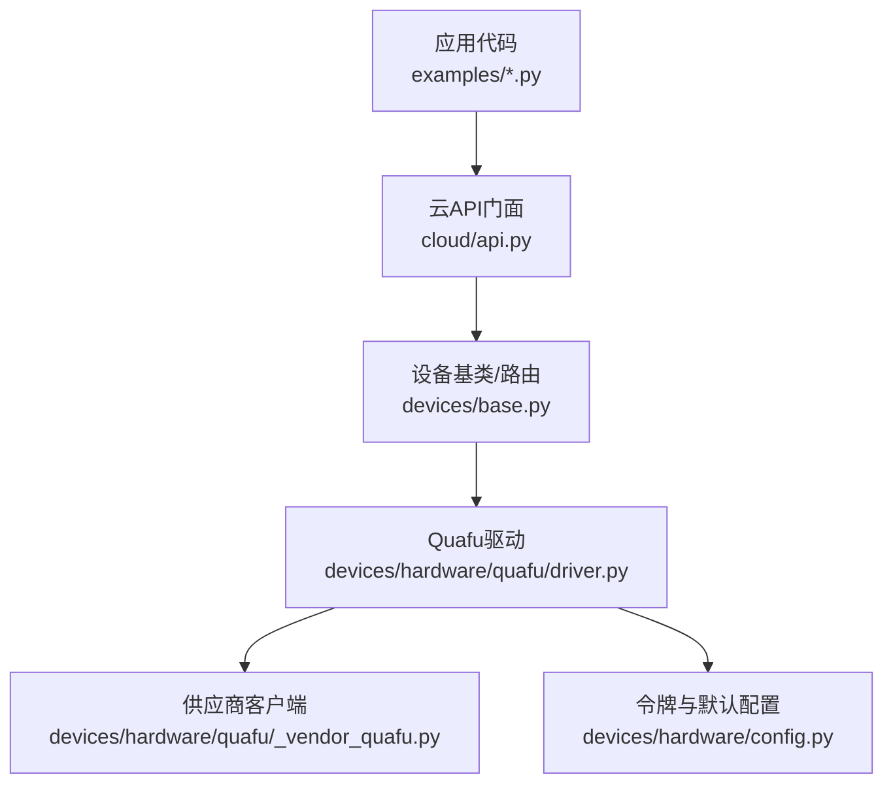
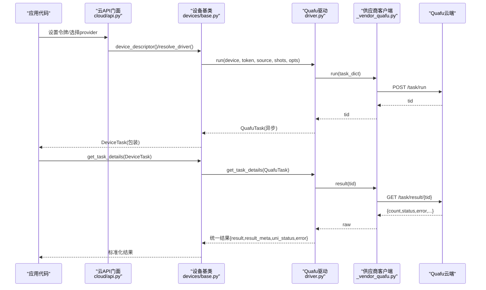
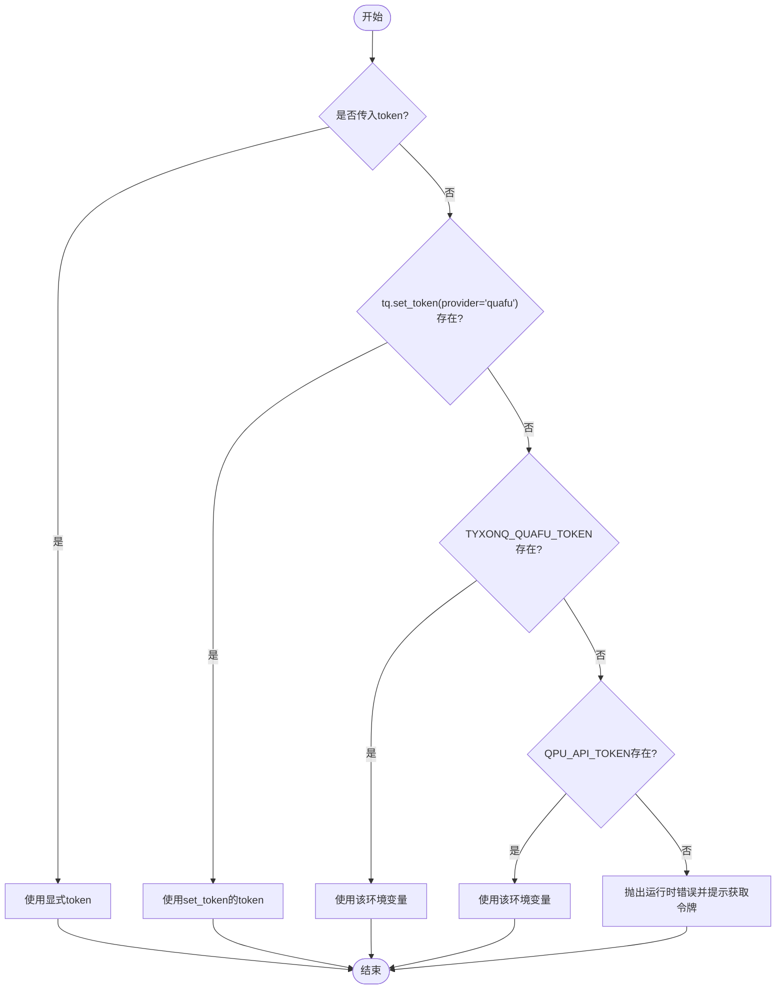
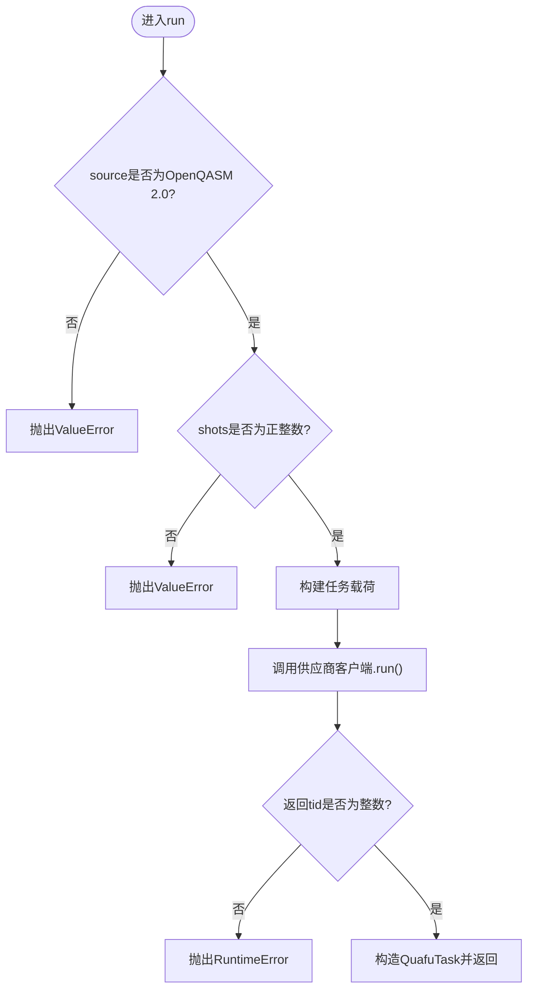
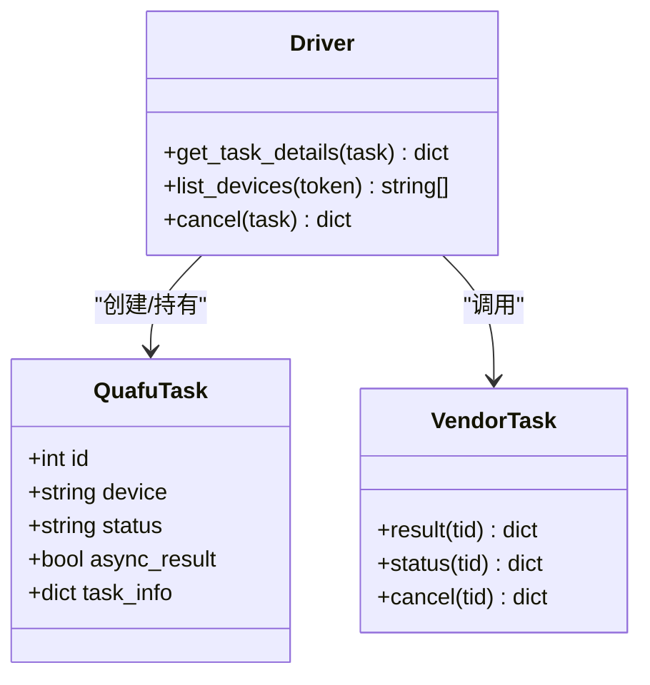
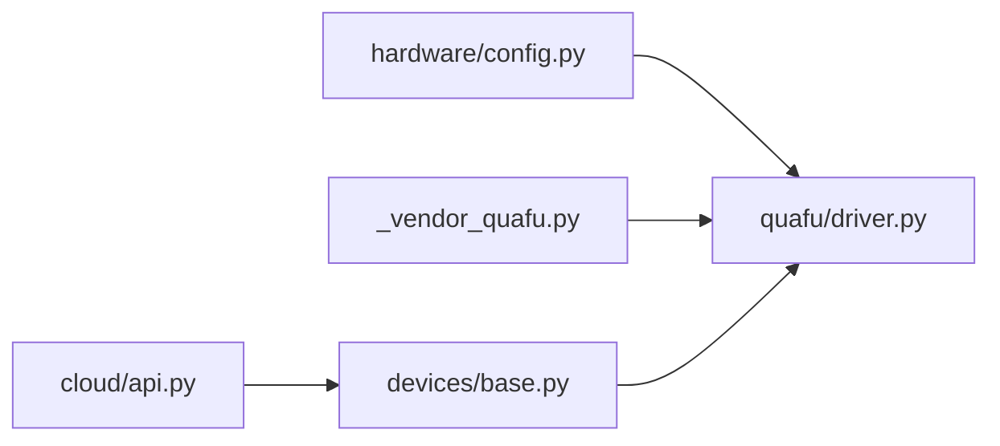

# Quafu云平台驱动

<cite>
**本文引用的文件**
- [driver.py](file://src/tyxonq/devices/hardware/quafu/driver.py)
- [_vendor_quafu.py](file://src/tyxonq/devices/hardware/quafu/_vendor_quafu.py)
- [config.py](file://src/tyxonq/devices/hardware/config.py)
- [base.py](file://src/tyxonq/devices/base.py)
- [api.py](file://src/tyxonq/cloud/api.py)
- [run_circuit_on_quafu.py](file://examples/run_circuit_on_quafu.py)
- [run_circuit_on_quafu_full.py](file://examples/run_circuit_on_quafu_full.py)
- [test_quafu_driver.py](file://tests_core_module/test_quafu_driver.py)
- [quafu_provider.md](file://docs/quafu_provider.md)
</cite>

## 目录
1. [简介](#简介)
2. [项目结构](#项目结构)
3. [核心组件](#核心组件)
4. [架构总览](#架构总览)
5. [详细组件分析](#详细组件分析)
6. [依赖关系分析](#依赖关系分析)
7. [性能与配额](#性能与配额)
8. [故障排查指南](#故障排查指南)
9. [结论](#结论)
10. [附录：完整集成示例](#附录完整集成示例)

## 简介
本文件为 TyxonQ 中“Quafu 云平台驱动”的详细 API 文档，覆盖以下内容：
- 接入方式与认证机制（令牌获取、优先级解析）
- 任务提交与执行监控（批量提交、轮询、超时处理）
- 设备接口（在线设备发现、状态映射）
- 任务队列管理（提交、取消、结果获取）
- 结果解析与错误处理（统一结果格式、错误字段透传）
- 完整集成示例（配置连接、提交量子电路、监控状态、处理结果）
- 常见问题与性能优化建议

## 项目结构
TyxonQ 将 Quafu 驱动置于硬件设备层，并通过统一的设备基类与云 API 门面进行调度。关键路径如下：
- 驱动实现：devices/hardware/quafu/driver.py
- 供应商客户端封装：devices/hardware/quafu/_vendor_quafu.py
- 令牌与默认配置：devices/hardware/config.py
- 统一设备选择与任务包装：devices/base.py
- 云 API 门面：cloud/api.py
- 使用示例：examples/run_circuit_on_quafu*.py
- 测试用例：tests_core_module/test_quafu_driver.py
- 用户文档：docs/quafu_provider.md

图表来源
- [api.py:38-72](file://src/tyxonq/cloud/api.py#L38-L72)
- [base.py:146-258](file://src/tyxonq/devices/base.py#L146-L258)
- [driver.py:103-180](file://src/tyxonq/devices/hardware/quafu/driver.py#L103-L180)
- [_vendor_quafu.py:112-202](file://src/tyxonq/devices/hardware/quafu/_vendor_quafu.py#L112-L202)
- [config.py:24-50](file://src/tyxonq/devices/hardware/config.py#L24-L50)

章节来源
- [api.py:38-72](file://src/tyxonq/cloud/api.py#L38-L72)
- [base.py:146-258](file://src/tyxonq/devices/base.py#L146-L258)
- [driver.py:103-180](file://src/tyxonq/devices/hardware/quafu/driver.py#L103-L180)
- [_vendor_quafu.py:112-202](file://src/tyxonq/devices/hardware/quafu/_vendor_quafu.py#L112-L202)
- [config.py:24-50](file://src/tyxonq/devices/hardware/config.py#L24-L50)

## 核心组件
- QuafuTask：驱动返回的任务句柄，包含任务ID、设备名、状态、异步标志及元信息，便于上层链式调用统一轮询。
- run(device, token, source, shots, **opts)：提交一个或多个 OpenQASM 2.0 电路到 Quafu 云端，构建任务载荷并调用供应商客户端。
- get_task_details(task, token)：拉取任务结果并标准化为统一结果格式（result/result_meta/uni_status/error）。
- list_devices(token, **kws)：列出在线芯片，过滤离线/维护中的设备。
- cancel(task, token)：取消排队中的任务。
- _vendor_quafu.Task：对 Quafu REST API 的轻量封装，提供 verify/query/delete/result/status/cancel/run 等方法。

章节来源
- [driver.py:50-180](file://src/tyxonq/devices/hardware/quafu/driver.py#L50-L180)
- [driver.py:203-276](file://src/tyxonq/devices/hardware/quafu/driver.py#L203-L276)
- [_vendor_quafu.py:112-202](file://src/tyxonq/devices/hardware/quafu/_vendor_quafu.py#L112-L202)

## 架构总览
下图展示了从应用代码到 Quafu 云端的请求链路，以及结果回传的标准化过程。

图表来源
- [api.py:38-72](file://src/tyxonq/cloud/api.py#L38-L72)
- [base.py:294-445](file://src/tyxonq/devices/base.py#L294-L445)
- [driver.py:103-180](file://src/tyxonq/devices/hardware/quafu/driver.py#L103-L180)
- [_vendor_quafu.py:155-202](file://src/tyxonq/devices/hardware/quafu/_vendor_quafu.py#L155-L202)

## 详细组件分析

### 认证与令牌解析
- 令牌优先级（从高到低）：
  1) 显式传入 token 参数
  2) 通过 tq.set_token(provider="quafu") 设置的内存令牌
  3) 环境变量 TYXONQ_QUAFU_TOKEN
  4) 环境变量 QPU_API_TOKEN
  注意：不会回退到全局 TYXONQ_API_KEY，避免误用 TyxonQ 云平台密钥。
- 若未找到有效令牌，抛出运行时错误并提供获取令牌的指引。

图表来源
- [driver.py:28-45](file://src/tyxonq/devices/hardware/quafu/driver.py#L28-L45)
- [config.py:24-50](file://src/tyxonq/devices/hardware/config.py#L24-L50)

章节来源
- [driver.py:28-45](file://src/tyxonq/devices/hardware/quafu/driver.py#L28-L45)
- [config.py:24-50](file://src/tyxonq/devices/hardware/config.py#L24-L50)

### 任务提交与载荷构建
- 输入校验：
  - source 必须为非空字符串且包含 OpenQASM 2.0 头部；支持批量提交（列表）。
  - shots 必须为正整数；非 1024 倍数会发出警告（服务器可能四舍五入或拒绝）。
- 载荷构建：
  - chip：从 device 名称中提取（支持 quafu::Dongling 前缀剥离）。
  - name：任务显示名，默认 "TyxonQJob"。
  - circuit：OpenQASM 2.0 字符串。
  - shots：测量次数。
  - options：compiler（None/"quarkcircuit"/"qsteed"/"qiskit"）、correct（读出纠错）、open_dd（动态解耦 XY4/CPMG）、target_qubits（物理比特子集）。
  - compile：默认 True（由 TyxonQ 预编译为可运行 QASM，通常关闭服务端重编译）。
- 提交后返回 QuafuTask 列表（每个源对应一个任务）。

图表来源
- [driver.py:63-180](file://src/tyxonq/devices/hardware/quafu/driver.py#L63-L180)

章节来源
- [driver.py:63-180](file://src/tyxonq/devices/hardware/quafu/driver.py#L63-L180)

### 任务状态与结果标准化
- 状态映射：将上游状态转换为统一状态（Finished→completed、Failed→failed、Running→running、Pending/Queued→queued、Submitted/InQueue/Compiling→running）。
- 结果结构：
  - result：计数字典（bitstring → count）
  - result_meta：包含 shots、device、tid、raw 等元数据
  - uni_status：统一状态字符串
  - error：错误消息（如有）
- 若上游返回非预期结构，返回安全兜底结果并标记 unknown 状态。

图表来源
- [driver.py:50-61](file://src/tyxonq/devices/hardware/quafu/driver.py#L50-L61)
- [driver.py:203-276](file://src/tyxonq/devices/hardware/quafu/driver.py#L203-L276)
- [_vendor_quafu.py:155-176](file://src/tyxonq/devices/hardware/quafu/_vendor_quafu.py#L155-L176)

章节来源
- [driver.py:183-236](file://src/tyxonq/devices/hardware/quafu/driver.py#L183-L236)
- [driver.py:242-276](file://src/tyxonq/devices/hardware/quafu/driver.py#L242-L276)

### 设备发现与在线筛选
- list_devices 调用供应商 status(0) 获取设备队列深度。
- 仅当值为整数时认为设备在线并可接受任务；字符串值（如 Offline/Calibrating/Maintenance）视为离线。
- 返回设备名以 "quafu::" 前缀形式，便于统一设备标识。

章节来源
- [driver.py:242-266](file://src/tyxonq/devices/hardware/quafu/driver.py#L242-L266)

### 取消任务
- cancel 直接转发至供应商客户端的 cancel(tid)，返回原始响应。
- 适用于任务处于排队阶段时的取消。

章节来源
- [driver.py:269-276](file://src/tyxonq/devices/hardware/quafu/driver.py#L269-L276)

### 与 TyxonQ 框架的集成
- 设备选择：通过 base.resolve_driver("quafu", device) 加载 Quafu 驱动。
- 统一任务包装：DeviceTask 包装驱动返回的任务，提供 get_result() 与 cancel()。
- 统一结果获取：base.get_task_details 负责轮询与超时控制，并将各驱动结果标准化。

章节来源
- [base.py:146-258](file://src/tyxonq/devices/base.py#L146-L258)
- [base.py:294-445](file://src/tyxonq/devices/base.py#L294-L445)
- [base.py:497-557](file://src/tyxonq/devices/base.py#L497-L557)

## 依赖关系分析
- 驱动依赖供应商客户端进行网络请求，所有 HTTP 交互集中在 _vendor_quafu.py。
- 令牌解析依赖 hardware.config 的 set_token/get_token 与全局环境变量。
- 框架层通过 base.resolve_driver 将 provider="quafu" 映射到具体驱动模块。
- 云 API 门面提供高层接口，屏蔽底层差异。

图表来源
- [config.py:24-50](file://src/tyxonq/devices/hardware/config.py#L24-L50)
- [base.py:146-258](file://src/tyxonq/devices/base.py#L146-L258)
- [api.py:38-72](file://src/tyxonq/cloud/api.py#L38-L72)
- [driver.py:103-180](file://src/tyxonq/devices/hardware/quafu/driver.py#L103-L180)

章节来源
- [config.py:24-50](file://src/tyxonq/devices/hardware/config.py#L24-L50)
- [base.py:146-258](file://src/tyxonq/devices/base.py#L146-L258)
- [api.py:38-72](file://src/tyxonq/cloud/api.py#L38-L72)
- [driver.py:103-180](file://src/tyxonq/devices/hardware/quafu/driver.py#L103-L180)

## 性能与配额
- 每日配额：根据上游文档，每位用户每天最多提交 1000 个任务；超出部分顺延至次日。
- 采样数限制：Quafu 要求 shots 为 1024 的倍数；非倍数会警告，服务器可能四舍五入或拒绝。
- 服务端重编译：默认不启用（compile=True，options.compiler=None），因为 TyxonQ 已预编译为可运行 QASM；如需绕过本地编译器限制，可指定 compiler="qsteed"/"quarkcircuit"/"qiskit"。
- 轮询策略：建议在首次结果返回后立即检查 uni_status；若为 transient 状态（Submitted/InQueue/Compiling），可通过供应商客户端的 result(tid, timeout=...) 进行带超时的轮询。

章节来源
- [driver.py:119-156](file://src/tyxonq/devices/hardware/quafu/driver.py#L119-L156)
- [_vendor_quafu.py:155-168](file://src/tyxonq/devices/hardware/quafu/_vendor_quafu.py#L155-L168)
- [quafu_provider.md:77-104](file://docs/quafu_provider.md#L77-L104)

## 故障排查指南
- 令牌缺失或过期：
  - 现象：启动时报错提示需要令牌或 token rejected。
  - 解决：按优先级设置令牌（显式参数 > tq.set_token > TYXONQ_QUAFU_TOKEN > QPU_API_TOKEN），并确保每 30 天刷新。
- 非 OpenQASM 2.0 源：
  - 现象：提交时报 ValueError，提示缺少 OPENQASM 2.0 头部。
  - 解决：确保使用 qiskit 引擎输出 qasm2，并在 Chain API 中先显式编译一次。
- shots 非 1024 倍数：
  - 现象：发出 UserWarning，服务器可能拒绝或四舍五入。
  - 解决：调整为 1024 的倍数。
- 任务长时间未完成：
  - 现象：uni_status 为 queued/running/unknown。
  - 解决：使用带超时的轮询；必要时增大 timeout 或稍后重试。
- 设备不可用：
  - 现象：list_devices 返回空或设备状态为字符串（Offline/Calibrating/Maintenance）。
  - 解决：等待设备恢复或选择其他在线芯片。

章节来源
- [driver.py:28-45](file://src/tyxonq/devices/hardware/quafu/driver.py#L28-L45)
- [driver.py:90-100](file://src/tyxonq/devices/hardware/quafu/driver.py#L90-L100)
- [driver.py:147-156](file://src/tyxonq/devices/hardware/quafu/driver.py#L147-L156)
- [driver.py:242-266](file://src/tyxonq/devices/hardware/quafu/driver.py#L242-L266)
- [test_quafu_driver.py:31-86](file://tests_core_module/test_quafu_driver.py#L31-L86)

## 结论
Quafu 驱动在 TyxonQ 中提供了稳定、统一的云端执行能力：
- 通过严格的令牌解析与载荷校验，确保提交正确性
- 标准化结果格式与状态映射，简化下游处理
- 支持批量提交、设备发现与任务取消，满足多样化工作流
- 与框架层紧密集成，便于在 Chain API 中无缝使用

## 附录：完整集成示例
以下示例展示如何配置令牌、列出设备、构建并编译电路、提交任务、轮询结果与打印结果。

- 最小示例：
  - 参考：[run_circuit_on_quafu.py](file://examples/run_circuit_on_quafu.py)
  - 要点：设置令牌环境变量，构建 Bell 态电路，显式编译为 qasm2，通过 Chain API 提交并 postprocessing 获取结果。

- 完整示例：
  - 参考：[run_circuit_on_quafu_full.py](file://examples/run_circuit_on_quafu_full.py)
  - 要点：三种令牌配置方式、自动选择空闲芯片、构建+编译电路、提交并带超时轮询、批量提交演示、结果打印。

- 单元测试（用于理解行为与边界条件）：
  - 参考：[test_quafu_driver.py](file://tests_core_module/test_quafu_driver.py)
  - 要点：令牌优先级、载荷构建、shots 校验、状态映射、设备过滤、取消任务、驱动注册。

章节来源
- [run_circuit_on_quafu.py:22-51](file://examples/run_circuit_on_quafu.py#L22-L51)
- [run_circuit_on_quafu_full.py:44-173](file://examples/run_circuit_on_quafu_full.py#L44-L173)
- [test_quafu_driver.py:31-351](file://tests_core_module/test_quafu_driver.py#L31-L351)