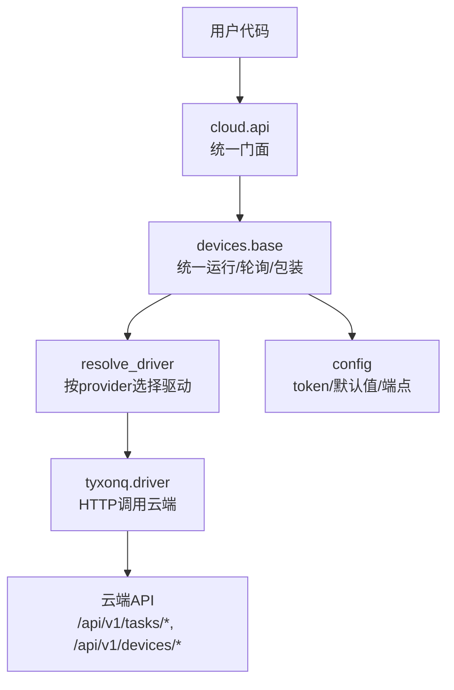
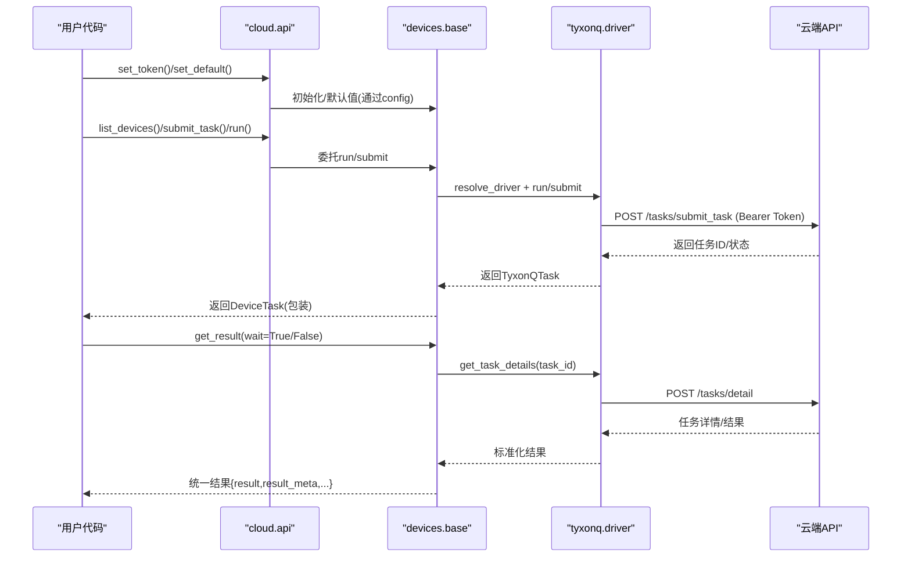
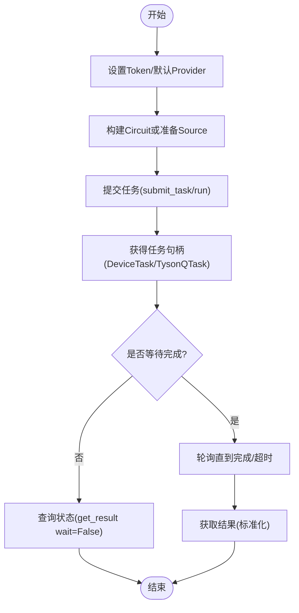
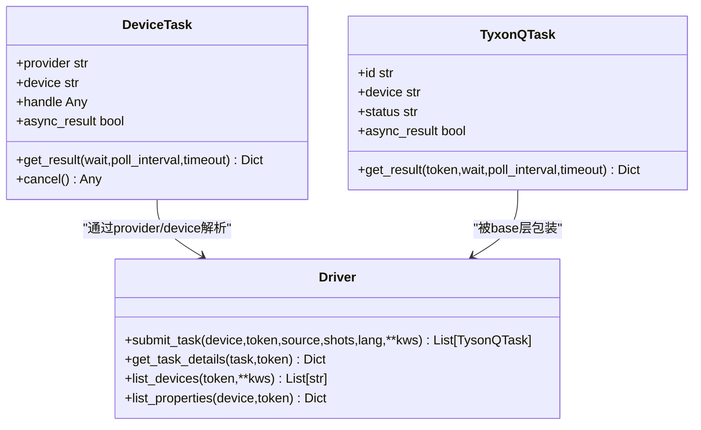
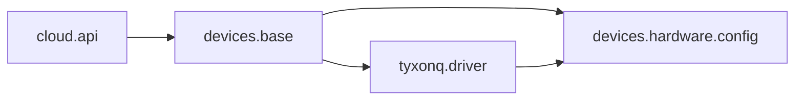

# TyxonQ云平台驱动

<cite>
**本文引用的文件**
- [src/tyxonq/cloud/api.py](file://src/tyxonq/cloud/api.py)
- [src/tyxonq/devices/base.py](file://src/tyxonq/devices/base.py)
- [src/tyxonq/devices/hardware/tyxonq/driver.py](file://src/tyxonq/devices/hardware/tyxonq/driver.py)
- [src/tyxonq/devices/hardware/config.py](file://src/tyxonq/devices/hardware/config.py)
- [examples/cloud_api_task.py](file://examples/cloud_api_task.py)
- [examples/cloud_api_devices.py](file://examples/cloud_api_devices.py)
- [docs/source/cloud_services/task_submission.rst](file://docs/source/cloud_services/task_submission.rst)
- [docs/source/cloud_services/device_management.rst](file://docs/source/cloud_services/device_management.rst)
- [docs/source/cloud_services/api_reference.rst](file://docs/source/cloud_services/api_reference.rst)
- [docs/tyxonq_cloud_api.md](file://docs/tyxonq_cloud_api.md)
</cite>

## 目录
1. [简介](#简介)
2. [项目结构](#项目结构)
3. [核心组件](#核心组件)
4. [架构总览](#架构总览)
5. [详细组件分析](#详细组件分析)
6. [依赖关系分析](#依赖关系分析)
7. [性能与优化建议](#性能与优化建议)
8. [故障排查指南](#故障排查指南)
9. [结论](#结论)
10. [附录：API参考与示例路径](#附录api参考与示例路径)

## 简介
本文件为TyxonQ云平台驱动的权威API文档，覆盖接入方式、认证机制、任务提交与执行流程、设备发现、状态监控、结果获取与错误处理。文档基于仓库中云API门面、设备抽象层、TyxonQ硬件驱动及官方文档进行梳理，并提供端到端使用路径与最佳实践。

## 项目结构
TyxonQ云相关代码主要分布在以下模块：
- 云API门面：提供统一入口（set_token、list_devices、submit_task、get_task_details等）
- 设备抽象层：统一驱动选择、任务包装、结果标准化、轮询等待
- TyxonQ硬件驱动：对接云端HTTP接口，负责提交任务、查询详情、设备列表与属性
- 配置管理：默认provider/device、token存储与读取、端点URL
- 示例与文档：演示用法、任务提交流程、设备管理与API参考

图表来源
- [src/tyxonq/cloud/api.py:22-73](file://src/tyxonq/cloud/api.py#L22-L73)
- [src/tyxonq/devices/base.py:294-445](file://src/tyxonq/devices/base.py#L294-L445)
- [src/tyxonq/devices/hardware/tyxonq/driver.py:45-141](file://src/tyxonq/devices/hardware/tyxonq/driver.py#L45-L141)
- [src/tyxonq/devices/hardware/config.py:11-19](file://src/tyxonq/devices/hardware/config.py#L11-L19)

章节来源
- [src/tyxonq/cloud/api.py:1-160](file://src/tyxonq/cloud/api.py#L1-L160)
- [src/tyxonq/devices/base.py:1-578](file://src/tyxonq/devices/base.py#L1-L578)
- [src/tyxonq/devices/hardware/tyxonq/driver.py:1-222](file://src/tyxonq/devices/hardware/tyxonq/driver.py#L1-L222)
- [src/tyxonq/devices/hardware/config.py:1-78](file://src/tyxonq/devices/hardware/config.py#L1-L78)

## 核心组件
- 云API门面（cloud.api）
  - set_token/set_default：设置认证与默认provider/device
  - list_devices：列出可用设备
  - submit_task/run：提交任务（支持circuit或source）
  - get_task_details/result/cancel：查询任务详情、结果、取消
- 设备抽象层（devices.base）
  - resolve_driver：根据provider选择具体驱动
  - run：统一执行入口，封装噪声参数、shots归一化、返回DeviceTask
  - DeviceTask.get_result：统一轮询与结果格式标准化
  - get_task_details/remove_task：统一任务查询与删除
- TyxonQ硬件驱动（devices.hardware.tyxonq.driver）
  - 提交任务：POST /api/v1/tasks/submit_task
  - 查询详情：POST /api/v1/tasks/detail
  - 设备列表/属性：POST /api/v1/devices/list
  - 认证头：Authorization: Bearer {token}
- 配置（devices.hardware.config）
  - ENDPOINTS：云端基础URL与版本
  - token存储：内存字典，支持provider级与device级
  - 默认provider/device：默认为tyxonq与模拟器

章节来源
- [src/tyxonq/cloud/api.py:22-158](file://src/tyxonq/cloud/api.py#L22-L158)
- [src/tyxonq/devices/base.py:112-578](file://src/tyxonq/devices/base.py#L112-L578)
- [src/tyxonq/devices/hardware/tyxonq/driver.py:12-222](file://src/tyxonq/devices/hardware/tyxonq/driver.py#L12-L222)
- [src/tyxonq/devices/hardware/config.py:7-78](file://src/tyxonq/devices/hardware/config.py#L7-L78)

## 架构总览
TyxonQ云平台驱动采用“门面-抽象-驱动”三层架构：
- 门面层屏蔽底层差异，提供稳定API
- 抽象层统一任务生命周期、结果格式与轮询策略
- 驱动层实现具体云平台HTTP交互

图表来源
- [src/tyxonq/cloud/api.py:42-73](file://src/tyxonq/cloud/api.py#L42-L73)
- [src/tyxonq/devices/base.py:294-557](file://src/tyxonq/devices/base.py#L294-L557)
- [src/tyxonq/devices/hardware/tyxonq/driver.py:83-214](file://src/tyxonq/devices/hardware/tyxonq/driver.py#L83-L214)
- [docs/tyxonq_cloud_api.md:91-258](file://docs/tyxonq_cloud_api.md#L91-L258)

## 详细组件分析

### 认证与配置
- 设置Token
  - 通过cloud.api.set_token或devices.base.init传入token，内部写入config的内存存储
  - 支持provider级与device级键，优先使用显式token，其次回退到环境变量TYXONQ_API_KEY
- 默认Provider/Device
  - 默认provider为tyxonq；默认device为模拟器mps（可通过set_default修改）
- 端点配置
  - 云端基础URL与API版本由config.ENDPOINTS定义，可通过环境变量覆盖

章节来源
- [src/tyxonq/devices/hardware/config.py:7-78](file://src/tyxonq/devices/hardware/config.py#L7-L78)
- [src/tyxonq/devices/base.py:261-272](file://src/tyxonq/devices/base.py#L261-L272)
- [docs/tyxonq_cloud_api.md:9-22](file://docs/tyxonq_cloud_api.md#L9-L22)

### 设备发现与管理
- 列出设备
  - cloud.api.list_devices -> devices.base.list_all_devices -> 驱动list_devices
  - TyxonQ驱动调用POST /api/v1/devices/list，返回设备ID列表并加上provider前缀
- 设备属性
  - 通过驱动list_properties获取设备详细信息（如qubits、queue、status等）
- 设备选择
  - 支持字符串形式附加优化标志（例如homebrew_s2?o=7），或通过关键字参数控制优化开关

章节来源
- [src/tyxonq/devices/hardware/tyxonq/driver.py:56-77](file://src/tyxonq/devices/hardware/tyxonq/driver.py#L56-L77)
- [src/tyxonq/devices/base.py:475-493](file://src/tyxonq/devices/base.py#L475-L493)
- [docs/source/cloud_services/device_management.rst:10-174](file://docs/source/cloud_services/device_management.rst#L10-L174)

### 任务提交与执行流程
- 提交任务
  - cloud.api.submit_task/run -> devices.base.run -> 驱动submit_task
  - 对TyxonQ设备，要求source为OpenQASM字符串（含qreg/creg），lang="OPENQASM"
  - 支持批量提交（source/shots为序列时）
- 任务对象
  - 驱动返回TyxonQTask（id、device、status、async_result等）
  - base层将其包装为DeviceTask，提供统一的get_result与cancel
- 轮询与等待
  - get_result支持wait=True/False，内置超时与轮询间隔控制
  - 统一状态判定：done/completed/success/finished视为完成；failed/error视为失败

图表来源
- [src/tyxonq/devices/base.py:497-557](file://src/tyxonq/devices/base.py#L497-L557)
- [src/tyxonq/devices/hardware/tyxonq/driver.py:83-141](file://src/tyxonq/devices/hardware/tyxonq/driver.py#L83-L141)
- [docs/source/cloud_services/task_submission.rst:211-349](file://docs/source/cloud_services/task_submission.rst#L211-L349)

章节来源
- [src/tyxonq/cloud/api.py:42-131](file://src/tyxonq/cloud/api.py#L42-L131)
- [src/tyxonq/devices/base.py:294-445](file://src/tyxonq/devices/base.py#L294-L445)
- [src/tyxonq/devices/hardware/tyxonq/driver.py:83-141](file://src/tyxonq/devices/hardware/tyxonq/driver.py#L83-L141)
- [docs/source/cloud_services/task_submission.rst:10-176](file://docs/source/cloud_services/task_submission.rst#L10-L176)

### 结果获取与标准化
- 驱动层返回原始响应，包含task信息、测量结果、时间戳等
- base层将不同驱动的结果统一为：
  - result：计数字典
  - result_meta：元数据（shots、device、raw等）
  - uni_status：统一状态
  - error：错误信息
- 支持从metadata中提取性能指标（runDur、durChip等）

章节来源
- [src/tyxonq/devices/hardware/tyxonq/driver.py:145-214](file://src/tyxonq/devices/hardware/tyxonq/driver.py#L145-L214)
- [src/tyxonq/devices/base.py:20-54](file://src/tyxonq/devices/base.py#L20-L54)
- [docs/source/cloud_services/api_reference.rst:419-499](file://docs/source/cloud_services/api_reference.rst#L419-L499)

### 错误处理机制
- 提交失败
  - 驱动在收到服务端error时抛出RuntimeError，并尝试附带设备属性用于诊断
- 执行失败
  - 任务状态为failed时，可从result_meta.raw.task中读取错误信息
- 超时处理
  - get_result在wait模式下超过timeout会发出警告并返回当前结果（可能为空或不完整）
- 恢复策略
  - 可结合设备状态检查、队列长度监控、降级到本地模拟器

章节来源
- [src/tyxonq/devices/hardware/tyxonq/driver.py:132-141](file://src/tyxonq/devices/hardware/tyxonq/driver.py#L132-L141)
- [src/tyxonq/devices/base.py:535-551](file://src/tyxonq/devices/base.py#L535-L551)
- [docs/source/cloud_services/task_submission.rst:447-619](file://docs/source/cloud_services/task_submission.rst#L447-L619)

### 类与关系图（代码级）

图表来源
- [src/tyxonq/devices/base.py:13-57](file://src/tyxonq/devices/base.py#L13-L57)
- [src/tyxonq/devices/hardware/tyxonq/driver.py:12-222](file://src/tyxonq/devices/hardware/tyxonq/driver.py#L12-L222)

## 依赖关系分析
- cloud.api依赖devices.base与devices.hardware.config
- devices.base通过resolve_driver动态加载具体驱动（如tyxonq）
- tyxonq.driver依赖config中的ENDPOINTS与token管理
- 示例与文档引用上述模块以展示用法

图表来源
- [src/tyxonq/cloud/api.py:18-20](file://src/tyxonq/cloud/api.py#L18-L20)
- [src/tyxonq/devices/base.py:146-258](file://src/tyxonq/devices/base.py#L146-L258)
- [src/tyxonq/devices/hardware/tyxonq/driver.py:7-10](file://src/tyxonq/devices/hardware/tyxonq/driver.py#L7-L10)

章节来源
- [src/tyxonq/cloud/api.py:1-160](file://src/tyxonq/cloud/api.py#L1-L160)
- [src/tyxonq/devices/base.py:146-258](file://src/tyxonq/devices/base.py#L146-L258)
- [src/tyxonq/devices/hardware/tyxonq/driver.py:1-222](file://src/tyxonq/devices/hardware/tyxonq/driver.py#L1-L222)

## 性能与优化建议
- 选择合适的优化级别
  - o=1：量子比特映射
  - o=2：门分解为原生集
  - o=4：初始布局优化
  - o=7：全部优化（推荐复杂电路）
- 脉冲级电路需关闭优化，避免破坏时序
- 合理设置shots与超时
  - 简单测试用较小shots与短超时
  - 复杂电路或脉冲实验使用较大shots与更长超时
- 监控队列与设备状态
  - 提交前检查设备online与队列长度，降低等待时间
- 批量化与并行
  - 批量提交多个任务，减少网络往返
  - 注意并发限制与资源占用

章节来源
- [docs/source/cloud_services/device_management.rst:97-210](file://docs/source/cloud_services/device_management.rst#L97-L210)
- [docs/source/cloud_services/task_submission.rst:621-757](file://docs/source/cloud_services/task_submission.rst#L621-L757)

## 故障排查指南
- 常见错误
  - 提交失败：检查设备名称、优化标志、源语言是否为OpenQASM且包含qreg/creg
  - 执行失败：查看result_meta.raw.task.state与err字段
  - 超时：增大timeout或检查设备队列
- 诊断步骤
  - 使用list_properties确认设备在线与容量
  - 使用get_result(wait=False)获取实时状态
  - 记录task.id与设备信息便于后续追踪
- 恢复策略
  - 降级到本地模拟器快速验证
  - 调整优化级别或简化电路

章节来源
- [src/tyxonq/devices/hardware/tyxonq/driver.py:132-141](file://src/tyxonq/devices/hardware/tyxonq/driver.py#L132-L141)
- [docs/source/cloud_services/task_submission.rst:491-619](file://docs/source/cloud_services/task_submission.rst#L491-L619)

## 结论
TyxonQ云平台驱动通过清晰的分层设计提供了稳定的云执行能力。开发者可使用高层API快速接入，也可通过底层驱动精细控制。合理的优化策略、错误处理与性能调优能显著提升任务成功率与效率。

## 附录：API参考与示例路径
- 认证与配置
  - 设置Token与默认Provider/Device：[src/tyxonq/cloud/api.py:22-27](file://src/tyxonq/cloud/api.py#L22-L27)、[src/tyxonq/devices/base.py:261-272](file://src/tyxonq/devices/base.py#L261-L272)
  - 端点与Token管理：[src/tyxonq/devices/hardware/config.py:11-78](file://src/tyxonq/devices/hardware/config.py#L11-L78)
- 设备发现与管理
  - 列出设备与属性：[src/tyxonq/devices/hardware/tyxonq/driver.py:56-77](file://src/tyxonq/devices/hardware/tyxonq/driver.py#L56-L77)
  - 设备选择与优化标志：[docs/source/cloud_services/device_management.rst:97-210](file://docs/source/cloud_services/device_management.rst#L97-L210)
- 任务提交与执行
  - 提交任务与轮询：[src/tyxonq/cloud/api.py:42-73](file://src/tyxonq/cloud/api.py#L42-L73)、[src/tyxonq/devices/base.py:294-445](file://src/tyxonq/devices/base.py#L294-L445)
  - 任务状态与详情：[src/tyxonq/devices/hardware/tyxonq/driver.py:145-214](file://src/tyxonq/devices/hardware/tyxonq/driver.py#L145-L214)
- 结果获取与标准化
  - 统一结果格式：[src/tyxonq/devices/base.py:20-54](file://src/tyxonq/devices/base.py#L20-L54)
  - 响应结构与字段说明：[docs/source/cloud_services/api_reference.rst:419-499](file://docs/source/cloud_services/api_reference.rst#L419-L499)
- 示例程序
  - 任务提交示例：[examples/cloud_api_task.py:30-59](file://examples/cloud_api_task.py#L30-L59)
  - 设备列表示例：[examples/cloud_api_devices.py:16-21](file://examples/cloud_api_devices.py#L16-L21)
- 云端API参考
  - 端点与请求/响应：[docs/tyxonq_cloud_api.md:91-258](file://docs/tyxonq_cloud_api.md#L91-L258)